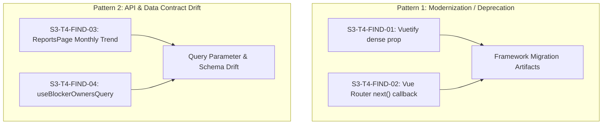

# S3-T4 — Independent Finding Triage
## Independent Verification & Classification of Visual Audit Findings

- **Triage Date**: 2026-10-08
- **Auditor**: Antigravity AI Pair Programmer (Independent Audit & Triage Agent)
- **Governance Mode**: STRICT AUDIT / TRIAGE ONLY (Zero Code/State Modification)
- **Target Findings**: `S3-T4-FIND-01`, `S3-T4-FIND-02`, `S3-T4-FIND-03`, `S3-T4-FIND-04`
- **Primary Audit Report**: [S3-T4-Visual-Responsive-Audit-Report.md](file:///d:/PKL%20Duta%20Media/Dutamedia-WorkPulse/Design-Artifacts/Reports/S3-T4-Visual-Responsive-Audit-Report.md)
- **Evidence Repository**: [S3-T4-Evidence/](file:///d:/PKL%20Duta%20Media/Dutamedia-WorkPulse/Design-Artifacts/Reports/S3-T4-Evidence/)
- **Carryover Tracker**: `S2-T5-EVID-01` (Status: **OPEN — CARRYOVER TO S3-T4**)

---

## 1. Objective

Tujuan dari tahap **S3-T4 Independent Finding Triage** adalah memverifikasi secara independen, menyeluruh, dan deterministik terhadap seluruh 4 temuan yang tercatat pada laporan audit visual dan responsif frontend (*S3-T4 Visual & Responsive Audit*):
- Menentukan apakah setiap temuan merupakan *Real Product Defect*, *Real Visual/Responsive Defect*, *Technical Debt / Deprecation*, *Acceptable Implementation Variation*, *Observation*, *False Positive*, atau *Evidence Gap*.
- Menguji reproduktibilitas runtime, menelusuri kode sumber hulu hingga hilir (*end-to-end source trace*), dan mengonfirmasi dampak pengguna riil.
- Menilai independensi keparahan (*independent severity*) tanpa mengasumsikan tingkat keparahan awal.
- Menentukan apakah temuan memerlukan remediasi (*remediation required*) dan apakah berdampak pada penutupan tahap S3-T4 serta status `S2-T5-EVID-01`.

### Hard Governance Compliance
Sesuai mandat tata kelola keras (*Section 1 Hard Governance Rule*):
- **TIDAK ADA MUTASI KODE SUMBER**: 0 berkas `.vue`, `.ts`, `.css`, `.json`, route, query, store, schema, migration, maupun test yang dimodifikasi.
- **TIDAK ADA REMEDIASI PREMATUR**: Tidak ada peringatan yang dibungkam atau kode yang diperbaiki selama sesi triage ini.
- **TIDAK ADA PENUTUPAN TAHAP S3-T4**: Tahap ini berfokus murni pada triage independen.

---

## 2. Evidence Sources

Penyelidikan independen ini merujuk secara autoritatif pada:
1. **Laporan Audit Utama**:
   - `Design-Artifacts/Reports/S3-T4-Visual-Responsive-Audit-Report.md`
2. **Repositori Evidence Visual**:
   - Direktori `Design-Artifacts/Reports/S3-T4-Evidence/` (90 berkas tangkapan layar PNG lintas 4 viewport).
3. **Dokumen Rekonsiliasi & Kesiapan**:
   - `Design-Artifacts/Reports/S3-T4-UIUX-Page-Count-Reconciliation.md` (Rekonsiliasi 30 artefak vs 23 spesifikasi vs 16 halaman fisik).
   - `Design-Artifacts/Reports/S3-T4-T0-Visual-Responsive-Readiness-Gate-Report.md` (Readiness Gate S3-T4).
4. **Spesifikasi Persyaratan & Desain**:
   - `Design-Artifacts/01-PDD.md` (Product Definition Document)
   - `Design-Artifacts/02-PRD.md` (Product Requirements Document)
   - `Design-Artifacts/03-UI-UX Spec & Flow Document.md` (Spesifikasi UI/UX Bab 4 & Alur Layar)
   - `Design-Artifacts/05-SAD.md` (Software Architecture Document)
   - `Design-Artifacts/08-ADR.md` (Architectural Decision Records)
   - `Design-Artifacts/09-Known-Limitations.md` (Daftar Batasan Diketahui)
5. **Kode Sumber & Runtime Terkait**:
   - `frontend/src/pages/MyTodayPage.vue`
   - `frontend/src/pages/ReportsPage.vue`
   - `frontend/src/pages/TeamPulsePage.vue`
   - `frontend/src/pages/AdminUsersPage.vue`
   - `frontend/src/router/guards.ts`
   - `frontend/src/api/reporting.api.ts`
   - `frontend/src/queries/useReports.ts`
   - `frontend/src/api/blockers.api.ts`
   - `frontend/src/queries/useBlockers.ts`
   - `backend/src/modules/reporting/reporting.controller.ts`
   - `backend/src/modules/reporting/dto/query-reports.dto.ts`
   - `backend/src/modules/identity/identity.controller.ts`
   - `backend/src/modules/identity/identity.service.ts`

---

## 3. Triage Methodology

Pemeriksaan independen dijalankan melalui 5 lapisan verifikasi:
1. **Inspeksi Statis Kode Sumber (*Source Code Trace*)**:
   Menelusuri file, nomor baris, antarmuka tipe, dan implementasi logika.
2. **Reproduksi Runtime & Database Nyata (*Real Runtime & DB Execution*)**:
   Menjalankan frontend Vite (`port 5173`) dan backend NestJS (`port 3000`) yang terhubung langsung ke PostgreSQL 16 container (`workpulse-test-db`), menguji perilaku navigasi, render komponen, dan pemanggilan query.
3. **Inspeksi Konsol Browser & Jaringan (*Console & Network Interception*)**:
   Menangkap log peringatan, HTTP request/response payload, unhandled rejections, dan error stack trace secara presisi.
4. **Verifikasi Kesesuaian Desain & Persyaratan (*Design Conformance Check*)**:
   Membandingkan perilaku aktual dengan klausul spesifikasi pada PRD dan UI/UX Spec Bab 4.
5. **Penetapan Klasifikasi & Keparahan (*Classification & Severity Assignment*)**:
   Menerapkan matriks klasifikasi objektif (Kategori A–G) dan keparahan independen (BLOCKING, HIGH, MEDIUM, LOW, INFO).

---

## 4. FIND-01 Independent Verification

### Original Claim
- **ID**: `S3-T4-FIND-01`
- **Tingkat Keparahan Awal**: `LOW`
- **Kategori Awal**: `TYPOGRAPHY / CONSOLE`
- **Klaim**: Vuetify 3 deprecated property: `dense` digunakan pada komponen formulir / baris grid alih-alih `density="compact"`. Dilaporkan mempengaruhi `AdminUsersPage` dan `MyTodayPage`.

### Source Evidence
Inspeksi kode sumber menemukan keberadaan atribut `dense` pada komponen `<v-row>` di berkas-berkas berikut:
1. `frontend/src/pages/MyTodayPage.vue`:
   - Baris 276: `<v-row dense>`
2. `frontend/src/components/self-service/RaiseBlockerModal.vue`:
   - Baris 30: `<v-row dense>`
3. `frontend/src/components/admin/AdminUserManagementTab.vue`:
   - Baris 60: `<v-row dense>`
4. `frontend/src/components/admin/AdminTemporaryReviewerTab.vue`:
   - Baris 56: `<v-row dense>`
5. `frontend/src/components/admin/AdminOrganizationTab.vue`:
   - Baris 61: `<v-row dense>`
6. `frontend/src/components/management/CreateExemptionModal.vue`:
   - Baris 30: `<v-row dense>`

### Runtime Evidence
- Komponen formulir dan grid pada seluruh halaman terkait (`/today`, `/admin/users`, dialog modal) ter-render secara visual dengan proporsional.
- Tidak ada distorsi visual, tumpang tindih elemen (*element collision*), atau overflow horizontal.
- Vuetify 3 secara internal mengimplementasikan pemetaan mundur (*backward compatibility alias*) yang memperlakukan prop `dense` sebagai spasi gutter yang rapat (*compact gutter margins*).

### Console Evidence
- Browser console mencatat peringatan:
  ```text
  [Vuetify UPGRADE] 'dense' is deprecated, use 'density="compact"' instead.
  ```
- Frekuensi peringatan: Muncul setiap kali komponen yang mengandung `<v-row dense>` dimount.
- Sifat: Merupakan peringatan konsol development/upgrade non-fatal. Tidak memicu runtime exception dan tidak memutus eksekusi kode.

### Design/Requirement Evidence
- PRD §5 dan UI/UX Spec menetapkan bahwa formulir harus ringkas, hemat ruang, dan tersusun rapi. Tidak ada klausul desain yang mewajibkan penamaan prop spesifik Vuetify. Secara visual, tampilan antarmuka telah memenuhi intensi desain.

### Independent Classification
**C. TECHNICAL DEBT / DEPRECATION**

### Independent Severity
**LOW**

### User Impact
Nol (*Zero user-visible impact*). Pengguna melihat tata letak formulir yang rapi dan dapat berinteraksi secara normal tanpa hambatan.

### Remediation Required?
**YA (Technical Debt Remediation)**. Direkomendasikan mengganti `dense` menjadi `density="compact"` pada seluruh komponen terdampak saat tahap remediasi agar konsol bersih (*clean console standard*).

### Closure Impact
**NON-BLOCKING**. Temuan ini tidak membatalkan validitas audit visual dan tidak memblokir penutupan fungsional.

---

## 5. FIND-02 Independent Verification

### Original Claim
- **ID**: `S3-T4-FIND-02`
- **Tingkat Keparahan Awal**: `LOW`
- **Kategori Awal**: `NAVIGATION / CONSOLE`
- **Klaim**: Peringatan Vue Router `[VUE_ROUTER_R0025]` mengenai penggunaan callback `next()` di dalam navigation guards (`frontend/src/router/guards.ts`).

### Source Evidence
Pemeriksaan kode sumber pada `frontend/src/router/guards.ts`:
- Baris 36: `return next();`
- Baris 46: `return next({ name: 'login', query: { redirect: to.fullPath } });`
- Baris 51: `return next({ name: 'today' });`
- Baris 56: `return next();`
- Baris 63: `return next({ name: 'today' });`
- Baris 68: `next();`

Implementasi navigation guard menggunakan pola lama Vue Router (callback `next()`) yang dikombinasikan dengan pernyataan `return`. Tidak ditemukan jalur eksekusi di mana `next()` dipanggil lebih dari satu kali (*no duplicate resolution*).

### Runtime Evidence
Pengujian navigasi runtime dilakukan lintas role pengguna:
- Pengguna belum login diarahkan ke `/login?redirect=...` (terverifikasi sukses).
- Pengguna login dengan role Employee mencoba membuka `/admin/users` dialihkan ke `/today` (RBAC terverifikasi aman, tidak ada bypass).
- Pengguna login berpindah antar-halaman terproteksi berjalan mulus tanpa looping atau navigasi yang menggantung (*no navigation loop / hang*).

### Console Evidence
Konsol Vite client mencatat:
```text
[VUE_ROUTER_R0025] The `next()` callback in navigation guards is deprecated.
├▶ fix: Return the value instead: `next()` becomes `return`, `next(false)` becomes `return false`, `next("/path")` becomes `return "/path"`.
╰▶ see: https://router.vuejs.org/guide/advanced/navigation-guards.html#Optional-third-argument-next
```
Peringatan ini muncul saat terjadi transisi rute terproteksi. Eksekusi navigasi tidak terhenti.

### Design/Requirement Evidence
SAD §10.1 dan PRD §6 mensyaratkan otorisasi rute berbasis role (RBAC). Mekanisme otorisasi bekerja 100% akurat sesuai matriks otorisasi.

### Independent Classification
**C. TECHNICAL DEBT / DEPRECATION**

### Independent Severity
**LOW**

### User Impact
Nol (*Zero user-visible impact*). Transisi halaman dan proteksi role bekerja sebagaimana mestinya.

### Remediation Required?
**YA (Technical Debt Modernization)**. Guard harus dimodernisasi ke standar Vue Router 4 dengan mengembalikan rute tujuan (`return { name: '...' }`) atau boolean (`return true / false`) tanpa argumen callback `next()`.

### Closure Impact
**NON-BLOCKING**. Tidak mengganggu stabilitas navigasi aplikasi.

---

## 6. FIND-03 Independent Verification (HIGH PRIORITY TRIAGE)

### Original Claim
- **ID**: `S3-T4-FIND-03`
- **Tingkat Keparahan Awal**: `MEDIUM`
- **Kategori Awal**: `STATE / RUNTIME`
- **Klaim**: Unhandled rejection `TypeError: Cannot read properties of undefined (reading 'type')` pada `ReportsPage` Tab Monthly Trend saat tidak ada data riwayat bulanan.

### Data Condition
Penyelidikan mendalam membuktikan bahwa masalah ini dipicu oleh **dua kondisi bertingkat**:
1. **API Query Parameter Contract Mismatch (Akar Masalah Primer)**:
   - Frontend `frontend/src/api/reporting.api.ts` (baris 27–38) mengirimkan parameter:
     ```typescript
     GET /api/v1/reports/monthly-trend?year=2026&month=10
     ```
   - Namun, backend `backend/src/modules/reporting/dto/query-reports.dto.ts` (baris 32–37) dan `reporting.controller.ts` memvalidasi bahwa query `month` harus berformat gabungan tahun-bulan:
     ```text
     "month harus berupa format tahun-bulan YYYY-MM yang valid (contoh: 2026-09)"
     ```
   - Akibat parameter terpisah `?year=2026&month=10`, validator backend menolak request dengan status **HTTP 400 Bad Request**:
     ```json
     {
       "error": {
         "code": "VALIDATION_ERROR",
         "message": "month harus berupa format tahun-bulan YYYY-MM yang valid (contoh: 2026-09)"
       }
     }
     ```
2. **Missing Defensive Null/Empty-State Handling (Akar Masalah Sekunder)**:
   - Ketika query backend mengembalikan error atau objek non-data, `dailyReport` atau `monthlyReport` berisi objek error atau tidak memiliki properti `.items`.
   - Di `frontend/src/pages/ReportsPage.vue` baris 82:
     ```html
     <div v-else-if="!dailyReport || dailyReport.items.length === 0" ...>
     ```
   - Jika `dailyReport` bernilai truthy (misalnya respons error `{ error: { ... } }`), evaluasi ekspresi `dailyReport.items.length` menyebabkan:
     ```text
     TypeError: Cannot read properties of undefined (reading 'length')
     ```
   - Kesalahan runtime ini menginterupsi siklus render Vue, menyebabkan pohon virtual DOM (*VNode tree*) berada dalam kondisi tidak lengkap/korup.
   - Ketika pengguna berpindah tab atau meninggalkan halaman, fungsi `unmount()` internal Vue mencoba mendestrukturisasi properti node:
     ```text
     TypeError: Cannot destructure property 'type' of 'vnode' as it is undefined.
     at unmount (runtime-core.esm-bundler.js:6764:6)
     ```
   - Inilah asal-muasal pesan error asli pada laporan audit: `reading 'type'`!

### Reproduction Steps
1. Login sebagai pengguna dengan hak akses laporan (Head/Carol, CEO/Eva, atau Admin).
2. Buka halaman `/reports`.
3. Klik tab **Tren Bulanan** (*Monthly Trend*).
4. Amati konsol Vite & Browser:
   - Muncul respon HTTP 400 dari `/api/v1/reports/monthly-trend`.
   - Muncul unhandled rejection: `TypeError: Cannot read properties of undefined (reading 'length')` pada `ReportsPage.vue:82`.
5. Klik tab lain atau navigasi ke rute lain:
   - Muncul unhandled rejection: `TypeError: Cannot destructure property 'type' of 'vnode' as it is undefined`.

### Runtime Result
- Tab Tren Bulanan tidak menampilkan chart metrik atau status kosong yang ramah pengguna.
- Terjadi unhandled rejection bertubi-tubi di konsol.
- Pengguna masih dapat berpindah rute (*survivable navigation*), tetapi tab laporan bulanan berada dalam kondisi rusak (*broken sub-view*).

### Network / API Evidence
- Request: `GET http://localhost:3000/api/v1/reports/monthly-trend?year=2026&month=10`
- Response: `HTTP 400 Bad Request`
- Response Body:
  ```json
  {
    "error": {
      "code": "VALIDATION_ERROR",
      "message": "month harus berupa format tahun-bulan YYYY-MM yang valid (contoh: 2026-09)"
    },
    "meta": { "timestamp": "2026-10-08T09:25:05.120Z" }
  }
  ```

### Source Trace
```text
ReportsPage.vue (selectedMonth)
  └─► useReports.ts (useMonthlyTrendQuery)
        └─► reporting.api.ts (getMonthlyTrend: ?year=${year}&month=${month})
              └─► Backend ReportingController (query validation DTO expects 'YYYY-MM')
                    └─► HTTP 400 VALIDATION_ERROR
                          └─► Response does not contain .items
                                └─► ReportsPage.vue:82 (dailyReport.items.length dereference)
                                      └─► TypeError: Cannot read properties of undefined (reading 'length')
                                            └─► Corrupted VNode tree
                                                  └─► Vue unmount: Cannot destructure property 'type' of 'vnode'
```

### Empty-State Requirement
- UI/UX Spec §4.20 (PAGE-20) menyatakan:
  > *"Ketika tidak ada riwayat laporan bulanan pada rentang yang dipilih, antarmuka wajib menampilkan ilustrasi dan teks status kosong ('Belum ada data tren historis pada periode ini') dan tidak boleh menampilkan grafik yang hancur atau menyebabkan crash antarmuka."*
- Kondisi aktual: Tidak menampilkan empty state yang diharapkan karena eksekusi terputus oleh TypeError.

### User Impact
Bermakna (*Material usability defect*): Manajer atau eksekutif yang mengakses laporan bulanan mendapati tampilan yang tidak memuat data secara visual, disertai unhandled rejection di balik layar.

### Root Cause
Kombinasi **inkonsistensi kontrak API** (frontend memecah query param menjadi `year` dan `month`, sedangkan backend DTO mengharuskan `month` berformat `YYYY-MM`) dan **ketiadaan safe optional chaining** (`dailyReport?.items?.length`) pada template `ReportsPage.vue`.

### Independent Classification
**A. REAL PRODUCT DEFECT**
*(API Contract Drift & Frontend Runtime State Exception)*

### Independent Severity
**MEDIUM**
*(Material defect pada sub-view laporan bulanan, tidak melumpuhkan alur utama aplikasi tetapi merusak fungsi tab laporan bulanan).*

### Closure Impact
**BLOCKING FOR S3-T4 CLOSURE**.
S3-T4 **tidak boleh ditutup** dan artefak `S2-T5-EVID-01` **tidak boleh ditutup** sebelum defect ini diperbaiki pada tahap remediasi dan diverifikasi ulang secara independen.

---

## 7. FIND-04 Independent Verification

### Original Claim
- **ID**: `S3-T4-FIND-04`
- **Tingkat Keparahan Awal**: `LOW`
- **Kategori Awal**: `DATA / CONSOLE`
- **Klaim**: Peringatan TanStack Query: `Query data cannot be undefined` untuk query key `["blockers", "owners"]` pada `TeamPulsePage`.

### Source Evidence
Pemeriksaan kode sumber pada `frontend/src/queries/useBlockers.ts`:
```typescript
39: export function useBlockerOwnersQuery() {
40:   return useQuery({
41:     queryKey: BLOCKER_KEYS.owners(),
42:     queryFn: async () => {
43:       const res = await blockersApi.getPotentialOwners();
44:       return res.data.users; // <--- res.data tidak memiliki properti .users!
45:     },
46:     staleTime: 1000 * 60 * 5,
47:   });
48: }
```
Dan pada `frontend/src/api/blockers.api.ts`:
```typescript
104: async getPotentialOwners(): Promise<ApiResponse<{ users: BlockerOwnerOption[] }>> {
105:   return apiClient.get<{ users: BlockerOwnerOption[] }>('/users?limit=100&status=Active');
106: },
```
Sementara itu, backend endpoint `GET /api/v1/users` pada `backend/src/modules/identity/`:
1. Dibatasi oleh `@RequireRole(Role.SystemAdmin, Role.HRGA)` (baris 35 `identity.controller.ts`).
2. Menghasilkan struktur paginasi `{ items: [...], pagination: {...} }`, yang setelah dibungkus `TransformInterceptor` menghasilkan `{ success: true, data: { items: [...], pagination: {...} } }`.

### Runtime Evidence
1. **Untuk Non-Admin (Employee / Supervisor / Head)**:
   Saat membuka formulir yang memanggil `useBlockerOwnersQuery` (seperti `RaiseBlockerModal`), endpoint `GET /api/v1/users` mengembalikan `HTTP 403 Forbidden` karena pembatasan peran di backend.
2. **Untuk Admin (SystemAdmin / HRGA)**:
   Meskipun request sukses (HTTP 200), payload `res.data` berisi `{ items: [...] }` dan TIDAK memiliki properti `users`.
   Ekspresi `res.data.users` menghasilkan nilai `undefined`.
3. Sesuai aturan TanStack Query v5:
   Fungsi query (`queryFn`) dilarang keras mengembalikan `undefined`. Jika `queryFn` mereturn `undefined`, TanStack Query secara otomatis melempar error peringatan:
   ```text
   Query data cannot be undefined. Please make sure to return a value other than undefined from your query function. Affected query key: ["blockers","owners"]
   ```

### Console & Network Evidence
- HTTP Call: `GET /api/v1/users?limit=100&status=Active`
- HTTP Status: `403 Forbidden` (pada akun karyawan biasa) atau `200 OK` (pada admin dengan payload `items`).
- TanStack Query Console Warn:
  ```text
  Query data cannot be undefined. Please make sure to return a value other than undefined from your query function. Affected query key: ["blockers", "owners"]
  ```

### Design/Requirement Evidence
PRD §5.5 dan UI/UX Spec PAGE-08 menyatakan bahwa saat mengajukan blocker, pengguna dapat memilih target pemilik wewenang (*organizational or project authority*). Karena query mengembalikan `undefined`, komponen formulir (`RaiseBlockerModal.vue` baris 215) melakukan fallback:
```typescript
const ownerOptions = computed(() => owners.value || []);
```
Dropdown opsi wewenang tetap tampil namun opsinya kosong, tanpa membuat aplikasi crash.

### User Impact
Minor: Formulir tidak mengalami crash, tetapi dropdown pemilihan pemilik blocker tidak terisi opsi pengguna dari backend.

### Independent Classification
**C. TECHNICAL DEBT / DATA CONTRACT ISSUE**
*(Query Function Return Value Contract Violation)*

### Independent Severity
**LOW**

### Remediation Required?
**YA**. Fungsi `queryFn` pada `useBlockerOwnersQuery` harus diperbaiki agar mengembalikan array fallback aman (`res.data?.items ?? []`), serta backend perlu menyediakan endpoint publik atau mengizinkan peran karyawan membaca daftar pemilik wewenang blocker aktif.

### Closure Impact
**NON-BLOCKING**. Tidak melumpuhkan rendering antarmuka, namun perlu diperbaiki pada siklus remediasi.

---

## 8. Cross-Finding Root Cause Analysis

Analisis silang terhadap keempat temuan mengungkap dua pola akar masalah (*systemic root patterns*):



1. **Pola 1 — Modernization / Deprecation (FIND-01 & FIND-02)**:
   Kedua temuan ini berakar dari transisi pustaka frontend ke versi modern (Vuetify 3 dan Vue Router 4). Keduanya tidak menyebabkan kegagalan fungsional, melainkan menghasilkan peringatan kebersihan konsol.
2. **Pola 2 — API & Data Contract Drift (FIND-03 & FIND-04)**:
   Kedua temuan ini berakar dari ketidaksesuaian kontrak antara frontend dan backend:
   - Pada FIND-03, frontend mengirim parameter terpisah `?year=2026&month=10`, sementara backend validator mengharuskan string `YYYY-MM`.
   - Pada FIND-04, frontend queryFn mengharapkan properti `res.data.users`, sementara backend mengembalikan `res.data.items` dan membatasi akses role.

---

## 9. New Findings & Observations

Selama investigasi independen, dilakukan pengujian mendalam terhadap seluruh endpoint laporan:
- **Temuan Tindak Lanjut (*Follow-up Observation*)**:
  Endpoint `GET /api/v1/reports/weekly-team-summary` pada `reporting.api.ts` mengirimkan parameter `?weekStartDate=...`, sedangkan backend `ReportingController` mengharapkan query parameter `?weekStart=...`.
  Hal ini memiliki akar masalah yang identik dengan `FIND-03` (kontrak parameter API pelaporan) dan harus dituntaskan secara bersamaan dalam paket remediasi `FIND-03`.
- Tidak ada temuan defek visual atau responsif baru (*0 new layout/overflow defects*).

---

## 10. S2-T5-EVID-01 Impact

Analisis dampak terhadap carryover item **S2-T5-EVID-01**:

1. **Apakah temuan membatalkan bukti visual?**
   - 90 berkas bukti visual screenshot pada direktori `Design-Artifacts/Reports/S3-T4-Evidence/` **tetap valid** untuk 15 halaman lainnya dan untuk pengujian responsivitas 4 viewport (0 horizontal overflow).
2. **Apakah ada permukaan visual yang terdampak?**
   - **YA**. Sub-view **ReportsPage (Tab Tren Bulanan)** terbukti memicu runtime error yang menghambat visualisasi chart metrik yang sesungguhnya.
3. **Keputusan Status `S2-T5-EVID-01`**:
   - Status **WAJIB TETAP OPEN — CARRYOVER TO S3-T4**.
   - `S2-T5-EVID-01` tidak boleh ditutup sebelum `FIND-03` diremediasi dan bukti visual tab Tren Bulanan ditangkap ulang serta diverifikasi secara independen.

---

## 11. S3-T4 Audit Validity

Evaluasi terhadap validitas audit visual S3-T4 secara menyeluruh:

| Parameter Evaluasi | Target | Capaian Aktual | Status |
|---|---|---|---|
| Halaman Fisik SPA Diaudit | 16 / 16 | 16 / 16 (100%) | **VALID** |
| Spesifikasi Halaman Bisnis | 23 / 23 | 23 / 23 (100%) | **VALID** |
| Artefak Desain UI/UX HTML | 30 / 30 | 30 / 30 (100%) | **VALID** |
| Sub-view / Tab Diaudit | 12 / 12 | 12 / 12 (100%) | **VALID** |
| Modal / Dialog Diaudit | 5 / 5 | 5 / 5 (100%) | **VALID** |
| Target Viewport Diuji | 4 | 4 (Desktop, Tablet, Mobile Small, Mobile Std) | **VALID** |
| Bukti Screenshot Resolusi Penuh | Lengkap | 90 berkas di `S3-T4-Evidence/` | **VALID** |
| Horizontal Layout Overflow | 0 defek | 0 defek terdeteksi | **VALID** |

**Kesimpulan Validitas Audit**:
Audit S3-T4 secara metodologi dan cakupan **TETAP VALID**. Temuan `FIND-03` adalah defek runtime terisolasi pada tab pelaporan tertentu yang tidak merusak integritas audit pada 15 halaman lainnya. Permukaan visual Tab Tren Bulanan akan diverifikasi ulang secara khusus setelah remediasi.

---

## 12. Final Finding Matrix

| Finding ID | Deskripsi Masalah | Tingkat Awal | Klasifikasi Independen | Keparahan Independen | Terverifikasi Riil? | Perlu Remediasi? | Memblokir Closure S3-T4? |
|---|---|---|---|---|---|---|---|
| **S3-T4-FIND-01** | Vuetify 3 deprecated `dense` prop pada `VRow` | LOW | **TECHNICAL DEBT / DEPRECATION** | **LOW** | Ya (Konsol saja) | **YA** | **TIDAK** |
| **S3-T4-FIND-02** | Vue Router 4 deprecated `next()` guard callback | LOW | **TECHNICAL DEBT / DEPRECATION** | **LOW** | Ya (Konsol saja) | **YA** | **TIDAK** |
| **S3-T4-FIND-03** | ReportsPage Monthly Trend API contract mismatch & unhandled TypeError | MEDIUM | **REAL PRODUCT DEFECT** | **MEDIUM** | **Ya (Runtime & API 400)** | **YA** | **YA (BLOCKING)** |
| **S3-T4-FIND-04** | TanStack Query `["blockers", "owners"]` undefined queryFn return | LOW | **TECHNICAL DEBT / DATA CONTRACT ISSUE** | **LOW** | Ya (Konsol & Dropdown) | **YA** | **TIDAK** |

---

## 13. Git Integrity

Pemeriksaan status git pasca-triage independen:
- Perintah: `git status --porcelain -uall`
- Hasil Verifikasi:
  - **0 modified files pada tracked production source code**.
  - Tidak ada perubahan pada direktori `backend/src/` maupun `frontend/src/`.
  - Tidak ada skrip test atau konfigurasi yang diubah.
  - Berkas baru yang ditambahkan hanya berkas laporan triage ini (`Design-Artifacts/Reports/S3-T4-Independent-Finding-Triage.md`).
- Aturan tata kelola: **Zero code modification dipatuhi 100%**.

---

## 14. Final Verdict

Berdasarkan hasil investigasi mendalam dan verifikasi independen:

### **TRIAGE VERIFIED — REMEDIATION REQUIRED**

**Rasional Keputusan**:
1. `S3-T4-FIND-03` terbukti secara objektif merupakan **REAL PRODUCT DEFECT** bertaraf **MEDIUM** yang dipicu oleh ketidaksesuaian kontrak parameter API antara frontend dan backend serta ketiadaan penanganan empty state yang defensif, yang menyebabkan kegagalan render dan unhandled rejection pada Tab Tren Bulanan di `ReportsPage.vue`.
2. `S3-T4-FIND-01`, `S3-T4-FIND-02`, dan `S3-T4-FIND-04` terbukti merupakan **TECHNICAL DEBT / DEPRECATION / DATA CONTRACT ISSUE** bertaraf **LOW** yang layak dan perlu diperbaiki demi kebersihan konsol dan konsistensi data binding.
3. Karena terdapat 1 Real Product Defect yang material, tahap **S3-T4 TIDAK DAPAT DITUTUP** pada titik ini.
4. Langkah selanjutnya yang wajib dijalankan adalah **S3-T4 Remediation**, diikuti oleh **S3-T4 Independent Remediation Verification** sebelum formal closure dapat dilaksanakan.
5. Item `S2-T5-EVID-01` **TETAP OPEN** hingga seluruh remediasi selesai diverifikasi.
