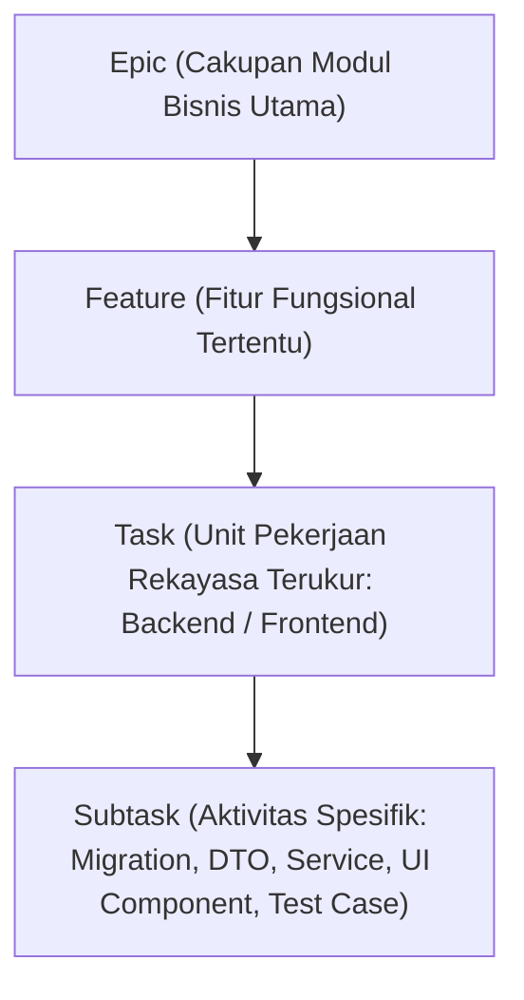

# Playbook 02 — Standar Arsitektur Sistem, Product Backlog, dan QA/QC WorkPulse

**Versi:** 1.0  
**Tanggal:** 28 Oktober 2026  
**Status:** FINAL — Aktif untuk Fase 3, Fase 4, & Fase 5  
**Dokumen Induk:** `00-Project-Charter-and-Governance.md`  
**Acuan Hulu:** `01-PDD.md` v1.5, `02-PRD.md` v1.6, `03-UI-UX-Spec-Flow.md` v2.0.0, `04-Design-System.md` v1.5.0, `DEC-001` s/d `DEC-009`, serta 26 Prototipe HTML Kanonikal (`UI-UX-Design/`).

---

## 1. Tujuan & Ruang Lingkup Dokumen

Playbook ini menetapkan standar rekayasa (*engineering standards*), konvensi teknis, dan metodologi verifikasi kualitas yang mengikat seluruh penyusunan artefak teknis WorkPulse:
1. **Fase 3:** Penyusunan dokumen arsitektur komprehensif `05-SAD.md` (*System Architecture Design*) menuju **Gate 2 (Architecture Freeze)**.
2. **Fase 4:** Dekomposisi tugas pada `06-Product-Backlog.md`, penyusunan skenario pengujian berorientasi risiko pada `07-Test-Plan.md`, dan pedoman pengendalian mutu pada `08-QA-QC-Guide.md`.
3. **Fase 5:** Pelaksanaan audit kesiapan akhir pada `09-Readiness-Assessment.md` menuju **Gate 3 (Go/No-Go Implementasi)**.

Playbook ini memastikan seluruh keputusan sistem dirancang secara **matang, independen, mandiri, tanpa spekulasi, dan mematuhi best practice konvensi industri perangkat lunak**.

---

## 2. Prinsip Arsitektur Perangkat Lunak (*Architecture Principles*)

### 2.1. Clean-Slate Implementation & Zero Legacy Dependency (`DEC-006`)
- Arsitektur sistem WorkPulse dibangun secara **bersih (*clean-slate*)**. Seluruh folder `backend/` dan `frontend/` generasi lama akan diarsipkan ke `_Archive/` sebelum implementasi Fase 6.
- Arsitektur baru **dilarang mewarisi utang teknis atau kompromi lama**, seperti kompromi UUID manual pada Project Authority, serialisasi backup string in-memory yang memicu memory leak, atau starvasi antrean notifikasi akibat query SQL yang tidak idempoten.

### 2.2. Pola Arsitektur Modular Monolith
- Memilih arsitektur **Modular Monolith** berorientasi domain (*Domain-Driven Clean Architecture*) daripada microservices yang berlebihan (*over-engineering*) untuk skala tim 30–50 karyawan.
- Pemisahan modul backend dilakukan secara tegas berdasarkan konteks domain:
  1. `IdentityAndOrganizationModule` (User, Role, Division, Squad, Hierarchy, Invitation Token)
  2. `DailyAccountabilityModule` (Morning Commitment, Additional Work, EOD Outcome, Carry-Over Engine)
  3. `BlockerAndSupportModule` (Blocker Lifecycle, Severity Matrix, SLA Engine, Support Contribution)
  4. `CorrectionAndReviewModule` (Correction Request Morning/EOD, Reviewer Queue, Audit Diff)
  5. `ExceptionAndPolicyModule` (Leave Management, Bounded Exemption, Holiday, Policy Settings, Anti-Backdating Guard)
  6. `NotificationAndAuditModule` (Multi-Channel Dispatcher, Web Push, Webhooks, Immutable Audit Log)
- Komunikasi antar-modul internal wajib melewati *Domain Interface / Service Boundary*, bukan manipulasi langsung tabel internal modul lain.

### 2.3. Pemisahan Komputasi dan Data (*Compute-Data Separation*)
- Aplikasi backend dan frontend dikemas dalam image Docker terisolasi dan bersifat *stateless*.
- Penyimpanan persisten (PostgreSQL, Object Storage untuk lampiran, dan Redis untuk job queue/cache) dikelola sebagai layanan terpisah yang independen, sehingga aplikasi dapat di-restart atau di-deploy ulang tanpa risiko kehilangan data.

### 2.4. Penegakan Invarian Bisnis Berlapis (*Multi-Layer Invariant Enforcement*)
Aturan bisnis tidak boleh hanya bergantung pada validasi antarmuka peramban klien. Penegakan wajib dilakukan pada 3 lapis pertahanan:
1. **Lapis 1 (Client/UI):** Feedback instan, form validation, hitung mundur batas waktu, boundary disabled states.
2. **Lapis 2 (Application/Domain Service):** Autentikasi sesi, validasi DTO ketat, otorisasi kontekstual berbasis scope, penegakan Cut-Off berbasis waktu server (NTP).
3. **Lapis 3 (Database/Persistence):** Check constraints, foreign key referential integrity, unique constraints, dan trigger anti-backdating.

---

## 3. Standar Desain Basis Data (*Data Architecture Standards*)

Setiap entitas dan skema pada `05-SAD.md` wajib mematuhi standar berikut:

### 3.1. Konvensi Penamaan & Tipe Data
- Nama tabel: `snake_case` bentuk jamak (`users`, `daily_commitments`, `blocker_tickets`, `audit_logs`).
- Nama kolom: `snake_case` deskriptif (`submitted_at`, `effective_date`, `created_at`, `updated_at`).
- Kunci Utama (*Primary Key*): `id UUID PRIMARY KEY DEFAULT gen_random_uuid()` (standar UUIDv4/v7 non-prediktabel).
- Kunci Asing (*Foreign Key*): Menggunakan penamaan `<entity_singular>_id` bertipe UUID dengan referensial integritas eksplisit (`ON DELETE RESTRICT` untuk entitas bisnis audit, bukan cascading delete serampangan).
- Waktu & Tanggal: Seluruh timestamp transaksi wajib menggunakan `TIMESTAMPTZ` (UTC) dan tanggal kalender menggunakan `DATE`.

### 3.2. Integritas Data & Larangan Backdating (`DEC-008`)
- Seluruh tabel yang memuat kolom penugasan berlaku (`effective_date` pada struktur organisasi, delegasi review, dan kebijakan) wajib memiliki constraint basis data:
  ```sql
  CONSTRAINT chk_effective_date_no_backdating CHECK (effective_date >= CURRENT_DATE)
  ```
- Pembatalan atau penarikan data transaksi akuntabilitas tidak boleh menggunakan operasi `HARD DELETE` (`DELETE FROM`). Seluruh rekaman historis wajib berstatus *append-only* atau menggunakan *soft state flag* (`superseded_at`, `status = 'SUPERSEDED'`) demi melindungi integritas jejak audit (`DEC-007`).

### 3.3. Pengindeksan Efisien (*Indexing Strategy*)
- Seluruh kolom Foreign Key wajib memiliki index.
- Composite Index dibuat untuk query rutin berfrekuensi tinggi:
  - `daily_commitments (user_id, work_date)` — pencarian komitmen harian.
  - `blocker_tickets (status, severity, target_resolution_at)` — antrean eskalasi blocker.
  - `leave_requests (user_id, start_date, end_date, status)` — pengecekan jadwal libur/cuti.

---

## 4. Standar Desain API & Keamanan (*API & Security Standards*)

### 4.1. Konvensi RESTful API
- URL Base: `/api/v1/...`
- Sumber Daya Jamak: `/api/v1/commitments`, `/api/v1/blockers`, `/api/v1/leaves`, `/api/v1/admin/users`.
- Penggunaan Metode HTTP Semantik:
  - `GET`: Pembacaan data (idempoten, aman, mendukung pagination `?page=1&limit=20` dan filter).
  - `POST`: Pembuatan sumber daya baru atau eksekusi aksi transaksional (misal `/api/v1/blockers/:id/acknowledge`).
  - `PUT`: Penggantian sumber daya secara penuh.
  - `PATCH`: Pembaruan sebagian field data secara spesifik.
  - `DELETE`: Penonaktifan/pembatalan sumber daya secara terkontrol.

### 4.2. Amplop Respons Standar (*Standard Response Envelope*)
Seluruh endpoint API wajib menghasilkan format JSON yang konsisten:
```json
{
  "success": true,
  "statusCode": 200,
  "data": { ... },
  "error": null,
  "meta": {
    "timestamp": "2026-10-28T08:30:00.000Z",
    "requestId": "req_847192",
    "pagination": { "page": 1, "limit": 20, "total": 142, "totalPages": 8 }
  }
}
```

Format respon galat (*Error Envelope*):
```json
{
  "success": false,
  "statusCode": 403,
  "data": null,
  "error": {
    "code": "AUTH_FORBIDDEN_SCOPE",
    "message": "Anda tidak memiliki wewenang untuk mengakui kendala di luar lingkup divisi Anda.",
    "details": []
  },
  "meta": {
    "timestamp": "2026-10-28T08:30:00.000Z",
    "requestId": "req_847192"
  }
}
```

### 4.3. Keamanan Sesi & Otorisasi Bertingkat
- **Autentikasi:** Sesi berbasis `HttpOnly`, `Secure`, `SameSite=Strict` Cookie dengan enkripsi HMAC token untuk mencegah pencurian token melalui XSS.
- **Otorisasi 3 Lapis:**
  1. *Role-Based Access Control (RBAC):* Employee, Supervisor, Head, PM, HRGA, Executive, Admin.
  2. *Contextual Scope Enforcement:* Penegakan batas wewenang berdasarkan hierarki organisasi (Squad A hanya bisa meninjau anggota Squad A) atau wewenang proyek (*Project Authority*).
  3. *Temporal Validity:* Delegasi peninjau sementara hanya berlaku dalam rentang tanggal aktif (`start_date <= today <= end_date`).
- **Pencegahan XSS & SQLi:** Seluruh parameter query menggunakan *Prepared Statements / Parameterized Queries* via ORM (Prisma/TypeORM). Output teks yang dikembalikan ke UI disanitasi ketat.

---

## 5. Standar Rekayasa Frontend (*Frontend Architecture Standards*)

### 5.1. Translasi 1:1 dari 26 Prototipe HTML Kanonikal
- Arsitektur frontend wajib memetakan **26 prototipe HTML kanonikal** (`UI-UX-Design/`) menjadi komponen modular TypeScript tanpa mengubah alur interaksi atau aturan bisnis yang telah dibekukan di **Gate 1**.
- Setiap halaman frontend mengimplementasikan **7 UI States Lengkap**: Normal, Empty State, Loading/Sync, Form Validation Error, Success Toast, Disabled Boundary, dan 403 Forbidden Access State.

### 5.2. Penanganan State Klien & Manajemen Sesi
- Status autentikasi dan identitas pengguna disimpan dalam state store reaktif global (Zustand / Redux Toolkit / React Context).
- Data formulir multi-langkah (misal Morning Commitment draf) diamankan di penyimpanan lokal klien (*Draft Auto-Save*) untuk mencegah kehilangan ketikan saat koneksi terputus sesaat.

---

## 6. Standar Dekomposisi Product Backlog (*Backlog Standards*)

Penyusunan `06-Product-Backlog.md` (Fase 4) wajib mengikuti struktur dekomposisi hierarkis:



### 6.1. Format Penulisan Task & Kriteria Penerimaan
Setiap Task dalam Product Backlog wajib mencakup:
1. **ID Task & Judul Jelas:** Format `[WP-EP01-TK001] Implementasi Skema & Migration Database Modul Identity`.
2. **Keterlacakan Requirement:** Menautkan kode `FR-xx`, `AC-xx`, `UF-xx` yang didukungnya.
3. **Deskripsi Teknis Singkat:** Komponen file yang disentuh dan perubahannya.
4. **Acceptance Criteria (Gherkin Format):**
   ```gherkin
   Given Karyawan telah login dan waktu server berada di antara 09:00 dan 09:30 WIB
   When Karyawan mengirimkan 3 komitmen harian yang valid
   Then Sistem menerima data dan mencatat submission_status sebagai LATE
   And Menampilkan badge Late berwarna amber pada layar riwayat
   ```
5. **Dependensi:** Menyebutkan Task prasyarat yang wajib selesai sebelumnya.
6. **Definition of Done (DoD):** Kriteria selesai teknis (kode lulus linting, unit test lulus, review disetujui).

---

## 7. Standar Pengendalian & Pengujian Kualitas (*QA/QC Standards*)

### 7.1. Quality Gates Sepanjang Siklus Proyek
Proyek menerapkan 5 Quality Gates yang tidak boleh dilangkahi:

| Quality Gate | Nama Gate | Syarat Kelulusan (*Exit Criteria*) |
|---|---|---|
| **Gate 1** | Product & Design Baseline Freeze | PDD v1.5, PRD v1.6, UI/UX Spec v2.0.0, DS v1.5.0 final, dan 26 prototipe HTML lulus verifikasi 100% `PASS` (0 isu). *(TELAH DICAPAI)* |
| **Gate 2** | Architecture & Contract Freeze | Dokumen `05-SAD.md` disahkan, skema database tuntas tanpa open questions, kontrak API terspesifikasi lengkap, strategi clean-slate disepakati. |
| **Gate 3** | Readiness & Plan Freeze | Backlog, Test Plan, Panduan QA/QC tuntas, Launch Configuration Register disahkan manajemen, prasyarat lingkungan uji terpenuhi. |
| **Gate 4** | Sprint Increment Verification | Setiap Task backlog memenuhi DoD, lolos pengujian fungsional dan unit test sebelum diintegrasikan. |
| **Gate 5** | Production Release Sign-Off | Regression testing 100% pass, security audit bersih dari kerentanan High/Critical, persetujuan acceptance dari Harry. |

### 7.2. Piramida Pengujian & Metrik Cakupan (*Test Pyramid*)
- **Unit Testing ($\ge 80\%$ Coverage Domain Logic):** Menguji perhitungan status (On-Time/Late/NoSub), mesin state blocker, heuristik carry-over, dan fungsi sanitasi secara deterministik.
- **Integration Testing:** Menguji interaksi controller-service-database, transaksi database PostgreSQL, dan integrasi webhook.
- **End-to-End (E2E) Testing:** Menguji alur pengguna kritis (Morning Check-in $\rightarrow$ EOD Outcome $\rightarrow$ Escalation Blocker $\rightarrow$ Approval Review).

### 7.3. Klasifikasi & Penanganan Defect
- **Blocker (Severity 1):** Sistem crash, kebocoran data, gagal otentikasi total, atau kehilangan data transaksi. *SLA Perbaikan: $\le 4$ jam kerja*.
- **Critical (Severity 2):** Fitur utama tidak berfungsi dan tidak ada workaround (misal gagal submit komitmen pagi sebelum cutoff). *SLA Perbaikan: $\le 8$ jam kerja*.
- **Major (Severity 3):** Fitur parsial terganggu tetapi ada workaround sementara. *SLA Perbaikan: $\le 24$ jam kerja*.
- **Minor (Severity 4):** Kosmetik, typo, atau visual padding minor yang tidak menghalangi fungsionalitas. *SLA Perbaikan: Sprint berjalan*.

