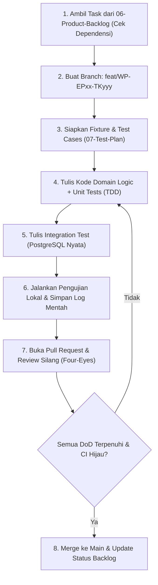

# Playbook 03 — Panduan Implementasi Clean-Slate & Pengiriman Terkontrol (Delivery Guide)

**Versi:** 1.0 (FINAL)  
**Tanggal Pengesahan:** 28 Oktober 2026  
**Status Dokumen:** Aktif untuk Fase 6 (Eksekusi Implementasi)  
**Dokumen Induk:** `00-Project-Charter-and-Governance.md`  
**Acuan Teknis:** `05-SAD.md` v2.0.0 (Lampiran A), `06-Product-Backlog.md` v1.1, `07-Test-Plan.md` v1.1, `08-QA-QC-Guide.md` v1.1, dan `09-Readiness-Assessment.md` v1.0.

---

## 1. Tujuan & Filosofi Operasional

Playbook ini menetapkan pedoman praktis (*day-to-day delivery guide*) bagi tim pelaksana inti (Orang A dan Orang B dibantu Agent AI) untuk mengeksekusi pembangunan sistem WorkPulse secara bersih (*clean-slate*), terukur, disiplin, dan berintegritas tinggi:
1. **Clean-Slate Execution (`DEC-006`):** Menjamin pemisahan total antara artefak kode sumber lama dan pembangunan sistem baru tanpa kontaminasi utang teknis.
2. **Four-Eyes Collaboration (`DEC-010`):** Mencegah kesalahan manusia dan halusinasi AI melalui penelaahan silang (*peer review*) wajib pada setiap baris kode.
3. **Active Quality Control:** Menerapkan pengujian unit, integrasi, dan verifikasi Definition of Done (DoD) sebagai bagian tak terpisahkan dari setiap task, bukan aktivitas susulan di akhir proyek.

---

## 2. Prosedur Pengarsipan Codebase Lama (`WP-EP01-TK001`)

Sebelum menginisialisasi kode baru, seluruh aset direktori lama dipindahkan secara utuh ke repositori arsip terisolasi:

```
[Root Proyek: d:\PKL Duta Media\Dutamedia-WorkPulse]
 ├── backend/  ──(Pindahkan Utuh)──▶ Dokumen-Perancangan-untuk-Pengerjaan-Baru/_Archive/Legacy-Codebase/backend/
 └── frontend/ ──(Pindahkan Utuh)──▶ Dokumen-Perancangan-untuk-Pengerjaan-Baru/_Archive/Legacy-Codebase/frontend/
```

### Langkah Operasional Pengarsipan:
1. Pastikan tidak ada proses server dev (Node.js, NestJS, Vite) yang sedang mengunci berkas.
2. Buat direktori tujuan: `Dokumen-Perancangan-untuk-Pengerjaan-Baru/_Archive/Legacy-Codebase/`.
3. Pindahkan folder `backend` dan `frontend` ke direktori arsip tersebut.
4. Buat berkas penjelas `README.md` di dalam folder arsip yang mencatat tanggal pengarsipan, status *read-only non-SSOT*, dan rujukan ke `DEC-006`.
5. Verifikasi bahwa root direktori kini hanya memuat folder perancangan baru dan berkas konfigurasi root yang relevan.

---

## 3. Tata Kelola Git & Workflow Pengembangan

### 3.1. Kebijakan Cabang (*Branching Strategy*)
- **`main` (Protected Branch):** Selalu dalam kondisi stabil, siap bangun (*buildable*), dan seluruh pengujian otomatis hijau. Dilarang melakukan *direct push* ke `main`.
- **`feat/WP-EPxx-TKyyy-<deskripsi-singkat>`:** Cabang pengerjaan fitur baru sesuai ID Task Backlog (misal: `feat/WP-EP02-TK002-auth-login`).
- **`fix/WP-EPxx-TKyyy-<deskripsi-defect>`:** Cabang perbaikan bug/defect teridentifikasi.

### 3.2. Konvensi Pesan Komit (*Conventional Commits*)
Format standar:
```
<type>(<scope>): <deskripsi imperatif singkat> [WP-EPxx-TKyyy]

[Penjelasan detail jika diperlukan]
- Memenuhi Acceptance Criteria Gherkin skenario X
- Menambahkan unit test dengan coverage Z%
```
Contoh:
```
feat(auth): implement session cookie & csrf double-submit [WP-EP02-TK002]
```

### 3.3. Penegakan *Four-Eyes Principle* pada Pull Request (PR)
1. **Dilarang Self-Approval:** Orang A yang membuka PR dilarang menyetujui atau me-merge PR miliknya sendiri. Review wajib dilakukan oleh Orang B, dan sebaliknya.
2. **Keterlibatan Agent AI:**
   - Agent AI dapat digunakan untuk menyusun draf kode awal, boilerplate DTO, dan skrip pengujian.
   - **Agent AI dilarang menjadi approver PR.**
   - Pengembang manusia yang mengajukan PR bertanggung jawab 100% atas keabsahan kode yang dibantu AI, dan wajib melampirkan log mentah eksekusi pengujian lokal.
3. **Persetujuan PR Memerlukan:**
   - Pipeline CI 100% hijau (Lint, Typecheck, Unit Test, Integration Test, Build).
   - Verifikasi pemenuhan seluruh butir Checklist PR Wajib pada `08-QA-QC-Guide.md` §2.
   - Tautan bukti pengujian nyata yang terlampir pada deskripsi PR.

---

## 4. Alur Siklus Pengerjaan Backlog Task (Step-by-Step)

Setiap pengerjaan unit tugas backlog mengikuti siklus terpadu berikut:



---

## 5. Prosedur Pengendalian Mutu & Pengelolaan Defect

### 5.1. Penanganan Defect Berdasarkan SLA
Apabila ditemukan cacat selama pengujian atau integrasi:
1. Catat defect pada issue tracker dengan format standar: ID, Severity, Langkah Reproduksi, Hasil Aktual vs Harapan, dan Log Mentah.
2. Triage defect sesuai matriks severitas `08-QA-QC-Guide.md` §5.
3. Perbaikan defect Sev 1 & Sev 2 **wajib menyertakan unit/integration test regresi baru** yang gagal pada kode lama dan lulus pada kode perbaikan.
4. Orang yang memverifikasi penutupan defect (*retest*) wajib berbeda dari orang yang menulis perbaikan.

### 5.2. Verifikasi Milestone Akhir Fase (Gate 4)
Sebelum tim berpindah dari satu fase increment ke fase berikutnya (misal P1 ke P2):
1. Seluruh task dalam fase tersebut wajib berstatus `DONE` dan memenuhi DoD.
2. Jalankan rangkaian *milestone regression suite*:
   ```bash
   npm run test:unit && npm run test:integration:real
   ```
3. Pastikan tidak ada defect Sev 1 atau Sev 2 yang masih berstatus terbuka (*zero critical open defects*).
4. Catat kelulusan Gate 4 pada Laporan Kontinuitas Proyek.

---

## 6. Prosedur Kesiapan Rilis Produksi (Gate 5)

Pada fase penutupan (Fase P6), sistem menjalani verifikasi akhir menyeluruh sebelum diserahterimakan kepada Harry:
1. **Full Regression Suite:** 100% kasus uji pada `07-Test-Plan.md` berhasil dieksekusi tanpa kegagalan.
2. **Security Vulnerability Audit:** Audit dependensi (`npm audit / pnpm audit`) dan verifikasi OWASP Top 10 bebas dari temuan tingkat *High* atau *Critical*.
3. **Database Restore Drill (`WP-EP11-TK001`):** Bukti nyata eksekusi pencadangan streaming dan pemulihan sukses ke server mandiri terisolasi dengan pengukuran RTO/RPO riil.
4. **Pengesahan Launch Configuration Register (`OPEN-04`):** Manajemen Dutamedia mengesahkan nilai parameter operasional produksi resmi.
5. **Acceptance Testing Sign-Off (UAT):** Skenario penerimaan akhir diverifikasi langsung bersama Harry dan ditandatangani secara formal.

