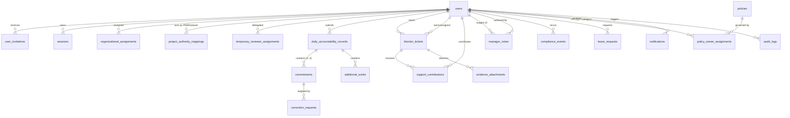
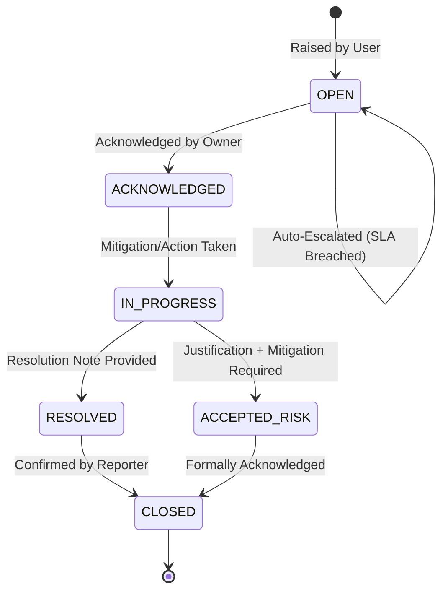

# System Architecture Design (SAD) — WorkPulse
## Daily Accountability & Blocker Log System (Dutamedia)

**Versi Dokumen:** 2.1.0 (menunggu persetujuan Harry; memuat Lampiran B — patch DEC-011..013 dan temuan audit independen; Lampiran B menggantikan bagian yang bertentangan di Bab II/III/Lampiran A)  
**Tanggal Pengesahan v2.0.0:** 28 Oktober 2026  
**Status Dokumen:** Mandiri & Terpadu (*Self-Contained & Fully Reconciled*) — Gate 2 (Architecture Freeze)  
**Dokumen Induk:** `00-Project-Charter-and-Governance.md`  
**Playbook Rujukan:** `Playbook-02-Architecture-Backlog-and-QA-Standards.md`  
**Acuan Hulu Disahkan:** `01-PDD.md` v1.5, `02-PRD.md` v1.6, `03-UI-UX-Spec-Flow.md` v2.0.0, `04-Design-System.md` v1.5.0, `DEC-001` s/d `DEC-009`, serta 26 Prototipe HTML Kanonikal (`UI-UX-Design/`).

---

## Daftar Isi
- [BAB I — FOUNDATION & ARCHITECTURAL CONTEXT](#bab-i--foundation--architectural-context)
  - [1. Identitas Dokumen & Metadata Teknis](#1-identitas-dokumen--metadata-teknis)
  - [2. Tujuan & Batasan Ruang Lingkup Sistem](#2-tujuan--batasan-ruang-lingkup-sistem)
  - [3. Profil Beban & Kapasitas Sistem](#3-profil-beban--kapasitas-sistem)
  - [4. Prinsip Arsitektural Utama](#4-prinsip-arsitektural-utama)
  - [5. Pemilihan Tech Stack & Rationale Rekayasa](#5-pemilihan-tech-stack--rationale-rekayasa)
- [BAB II — DATA ARCHITECTURE & DETAILED DATABASE SCHEMA](#bab-ii--data-architecture--detailed-database-schema)
  - [1. Pola Desain Data Universal](#1-pola-desain-data-universal)
  - [2. Entity Relationship Diagram (ERD Lengkap)](#2-entity-relationship-diagram-erd-lengkap)
  - [3. Skema Relasional Komprehensif (DDL & Spesifikasi Kolom)](#3-skema-relasional-komprehensif-ddl--spesifikasi-kolom)
  - [4. Batasan Integritas Data & Larangan Backdating (DEC-008)](#4-batasan-integritas-data--larangan-backdating-dec-008)
  - [5. Strategi Pengindeksan Efisien](#5-strategi-pengindeksan-efisien)
- [BAB III — APPLICATION & BACKEND MODULAR ARCHITECTURE](#bab-iii--application--backend-modular-architecture)
  - [1. Dekomposisi Modul Domain (Modular Monolith) & Service Boundary](#1-dekomposisi-modul-domain-modular-monolith--service-boundary)
  - [2. Formalisasi State Machine Bisnis](#2-formalisasi-state-machine-bisnis)
  - [3. Heuristic Engines & Business Calculators](#3-heuristic-engines--business-calculators)
  - [4. Background Job & Scheduler Architecture](#4-background-job--scheduler-architecture)
  - [5. Concurrency Control & Database Locking Strategy](#5-concurrency-control--database-locking-strategy)
- [BAB IV — API DESIGN & SECURITY CONTRACTS](#bab-iv--api-design--security-contracts)
  - [1. Standar Desain RESTful & URL Hierarchy](#1-standar-desain-restful--url-hierarchy)
  - [2. Standard Response & Error Envelope Format](#2-standard-response--error-envelope-format)
  - [3. Arsitektur Autentikasi & Manajemen Sesi](#3-arsitektur-autentikasi--manajemen-sesi)
  - [4. Arsitektur Otorisasi 3 Lapis (RBAC + Scope + Temporal Validity)](#4-arsitektur-otorisasi-3-lapis-rbac--scope--temporal-validity)
  - [5. Spesifikasi Lengkap Katalog Endpoint API](#5-spesifikasi-lengkap-katalog-endpoint-api)
  - [6. Arsitektur Unggah Bukti & Penyimpanan Berkas (Two-Phase Pre-Signed URL)](#6-arsitektur-unggah-bukti--penyimpanan-berkas-two-phase-pre-signed-url)
  - [7. Keamanan Aplikasi & OWASP Top 10 Safeguards](#7-keamanan-aplikasi--owasp-top-10-safeguards)
- [BAB V — FRONTEND ARCHITECTURE & PROTOTYPE MAPPING](#bab-v--frontend-architecture--prototype-mapping)
  - [1. Pemetaan 1:1 dari 26 Prototipe HTML Kanonikal](#1-pemetaan-11-dari-26-prototipe-html-kanonikal)
  - [2. Client Architecture & Reactive State Store](#2-client-architecture--reactive-state-store)
  - [3. Implementasi 7 UI States Lengkap](#3-implementasi-7-ui-states-lengkap)
  - [4. Penanganan Form & Draft Auto-Save Strategy](#4-penanganan-form--draft-auto-save-strategy)
  - [5. Kepatuhan Aksesibilitas (WCAG 2.1 AA) & Token Design System](#5-kepatuhan-aksesibilitas-wcag-21-aa--token-design-system)
- [BAB VI — OBSERVABILITY, SECURITY, & DISASTER RECOVERY](#bab-vi--observability-security--disaster-recovery)
  - [1. Structured Logging & Distributed Tracing](#1-structured-logging--distributed-tracing)
  - [2. Health Check & Readiness Probes](#2-health-check--readiness-probes)
  - [3. Backup Streaming Strategy & Disaster Recovery Plan](#3-backup-streaming-strategy--disaster-recovery-plan)
  - [4. Kebijakan Retensi Data & Log Audit](#4-kebijakan-retensi-data--log-audit)
- [BAB VII — CLEAN-SLATE MIGRATION & VERIFICATION STRATEGY](#bab-vii--clean-slate-migration--verification-strategy)
  - [1. Rencana Pengarsipan Codebase Lama (DEC-006)](#1-rencana-pengarsipan-codebase-lama-dec-006)
  - [2. Database Seeding Strategy](#2-database-seeding-strategy)
  - [3. Kriteria Evaluasi & Kelulusan Gate 2 (Architecture Freeze Checklist)](#3-kriteria-evaluasi--kelulusan-gate-2-architecture-freeze-checklist)

---

# BAB I — FOUNDATION & ARCHITECTURAL CONTEXT

## 1. Identitas Dokumen & Metadata Teknis

| Atribut Dokumen | Rincian Spesifikasi |
|---|---|
| **Nama Proyek** | WorkPulse — Daily Accountability & Blocker Log System |
| **Entitas Pemilik** | Dutamedia (Internal Core System) |
| **Kode Dokumen** | `WP-DOC-SAD-05` |
| **Versi Rilis** | 2.0.0 (FINAL) |
| **Klasifikasi Keamanan** | Internal & Confidential (Restricted to Authorized Engineering Staff) |
| **Status Tata Kelola** | **FROZEN AT GATE 2** (Disahkan pasca-Gate 1 Baseline Freeze) |
| **SSOT Pendukung** | `01-PDD.md` v1.5, `02-PRD.md` v1.6, `03-UI-UX-Spec-Flow.md` v2.0.0, `04-Design-System.md` v1.5.0, `Playbook-02`, serta 26 Prototipe HTML Kanonikal di folder `UI-UX-Design/`. |

Dokumen ini adalah **Arsitektur Teknis Mandiri (*Self-Contained System Architecture Design*)**. Seluruh keputusan teknis dari Pengerjaan Lama (18 catatan ADR lama) telah dievaluasi, disaring, dan diserap secara utuh ke dalam dokumen ini tanpa menyisakan ketergantungan rujukan pada berkas usang `Design-Artifacts/08-ADR.md` (`DEC-006`).

---

## 2. Tujuan & Batasan Ruang Lingkup Sistem

### 2.1. Tujuan Dokumen
1. Menetapkan **kontrak rekayasa perangkat lunak definitif** yang mengikat seluruh siklus hidup implementasi WorkPulse dari awal (*clean-slate*).
2. Menerjemahkan kebutuhan bisnis (`01-PDD.md`, `02-PRD.md`) dan spesifikasi interaksi (`03-UI-UX-Spec-Flow.md`, `04-Design-System.md`, 26 Prototipe HTML) menjadi spesifikasi skema data, diagram transisi status, kontrak antarmuka pemrograman aplikasi (REST API), dan topologi infrastruktur yang terukur.
3. Menyediakan dasar tunggal yang deterministik bagi penyusunan `06-Product-Backlog.md`, `07-Test-Plan.md`, dan `08-QA-QC-Guide.md` pada Fase 4.
4. Mencegah ambiguitas arsitektural selama proses coding dengan memberikan definisi tipe data presisi, aturan integritas transaksi database, serta mekanisme penegakan keamanan berlapis.

### 2.2. Batasan Ruang Lingkup (Scope Boundaries)
- **In-Scope Teknis:**
  - Desain skema basis data relasional PostgreSQL 16 lengkap beserta constraint anti-backdating (`DEC-008`), check constraint komitmen 0–3 (`DEC-004`), dan audit linkage transaksional.
  - Arsitektur Modular Monolith berbasis NestJS/TypeScript yang terbagi ke dalam 6 modul domain utama dan 5 modul utilitas silang (*cross-cutting*).
  - Kontrak REST API `/api/v1/...` lengkap yang mencakup 100% kebutuhan 26 halaman prototipe HTML kanonikal, termasuk pemisahan rute `/admin/users` (`DEC-005`) dan antarmuka pemetaan kewenangan proyek non-manual (`ADR-003 canceled`).
  - Arsitektur keamanan: autentikasi berbasis HttpOnly Secure Cookie dengan HMAC session, otorisasi 3 lapis (RBAC + Contextual Hierarchy Scope + Temporal Reviewer / Project Authority), dan mitigasi CSRF Double Submit.
  - Mekanisme latar belakang (*background workers*): evaluasi cutoff idempoten, SLA eskalasi blocker otomatis, agregasi pola pelanggaran kepatuhan 3x (`FR-29`), dan rekonsiliasi cuti retroaktif (`DEC-007`).
  - Arsitektur frontend Vue 3.5 / TypeScript berbasis komponen modular dengan penanganan 7 UI States lengkap.
  - Strategi pencadangan database berbasis *streaming dump* terisolasi tanpa serialisasi string in-memory (`ADR-007 canceled`).
- **Out-of-Scope Teknis:**
  - Integrasi SSO pihak ketiga (Google Workspace OAuth / SAML) pada MVP — MVP menggunakan single-use invitation token 72 jam (`DEC-005`, prototipe 25).
  - Mekanisme multi-tenant — WorkPulse didedikasikan secara eksklusif untuk internal Dutamedia (single-tenant architecture).
  - Mobile native development (Flutter/React Native) — MVP menggunakan responsive web app yang dioptimasi untuk mobile browser modern (PWA-ready).

---

## 3. Profil Beban & Kapasitas Sistem

WorkPulse dirancang secara terukur untuk mendukung operasional internal Dutamedia dengan karakteristik beban harian yang sangat terprediksi:

```
Beban Pengguna Harian (WIB):
100% │                 ┌─ Morning Peak (08:00 - 09:30)
 80% │                 │                                 ┌─ EOD Peak (16:30 - 20:30)
 60% │                 │                                 │
 40% │    Interim      │             Operational         │         Quiet
 20% │  Maintenance   │             Pulse & Blocker     │         Maintenance
  0% └───┴──────┴──────┴──────┴──────┴──────┴──────┴──────┴──────┴──────┴──────┴───▶ Waktu
     00:00    04:00  08:00  10:00  12:00  14:00  16:00  18:00  20:00  22:00
```

| Parameter Kapasitas | Nilai Desain MVP (Baseline) | Kapasitas Skalabilitas Teruji (5x Headroom) |
|---|---|---|
| **Jumlah Karyawan Aktif** | 30 – 50 pengguna | Hingga 250 pengguna aktif |
| **Distribusi Fungsi Organisasi** | 9 Fungsi Operasional + 1 Fungsi Management (`DEC-009`) | Hingga 20 divisi/squad kustom |
| **Puncak Akses Pagi (*Morning Peak*)** | 08:00 – 09:30 WIB (±40 transaksi submit/30 menit) | $\le 200$ request/menit |
| **Puncak Akses Sore (*EOD Peak*)** | 16:30 – 20:30 WIB (±40 transaksi submit/45 menit) | $\le 200$ request/menit |
| **Rasio Baca vs Tulis (*Read/Write Ratio*)** | 70% Baca (Dashboard/Pulse/Queue) : 30% Tulis | Mendukung hingga 90% Read : 10% Write |
| **Volume Transaksi Harian** | ±50 daily records, ±150 commitments, ±15 blockers | $\le 1.000$ rekaman per hari |
| **Ekspektasi Response Time (P95)** | $\le 200\text{ ms}$ untuk operasi transaksional; $\le 500\text{ ms}$ untuk agregasi | $\le 300\text{ ms}$ P95 di bawah beban konkurensi penuh |
| **Ketersediaan Layanan (*Service Availability*)** | $\ge 99\%$ per bulan kalender selama jam layanan yang diumumkan (NFR-04 PRD; angka 99.5% pada draf awal dihapus karena tidak bersumber dari PRD) | NFR-04 |

---

## 4. Prinsip Arsitektural Utama

### 4.1. Clean-Slate Implementation & Zero Legacy Debt (`DEC-006`)
- Arsitektur baru memutus ketergantungan secara total terhadap *codebase* lama di root `backend/` dan `frontend/`.
- Tidak ada pewarisan kompromi kode yang merusak kualitas, seperti:
  - Input UUID manual pada penugasan otoritas proyek (`ADR-003 canceled`).
  - Serialisasi *in-memory* seluruh database ke string SQL saat backup yang menyebabkan memory spike dan crash (`ADR-007 canceled`).
  - *Starvation bug* pada scheduled notification akibat pemotongan array di memori sebelum deduplikasi (`ADR-015 canceled`).
  - Penguncian paksa status AMBER pada carry-over berulang (`DEC-003 canceled Amber Lock Engine`).

### 4.2. Pola Arsitektur Modular Monolith
- Memilih arsitektur **Modular Monolith** berorientasi domain (*Domain-Driven Clean Architecture*) daripada arsitektur microservices yang terdistribusi dan rentan overhead jaringan untuk skala tim internal.
- Setiap modul domain memiliki batas tanggung jawab (*bounded context*) yang tegas, memiliki model entitas persisten sendiri, dan mengekspos *service interface* publik. Modul lain dilarang memanipulasi model ORM modul tetangga secara langsung.

### 4.3. Pemisahan Komputasi dan Penyimpanan (*Compute-Data Separation*)
- Container backend dan frontend bersifat **100% *stateless***. Seluruh status sesi, autentikasi, transaksi, dan unggahan berkas disimpan di luar memori kontainer aplikasi (PostgreSQL 16 dan Object Storage; tanpa Redis, lihat Lampiran A.3).
- Kontainer dapat di-restart, diskalakan secara horizontal, atau di-deploy ulang kapan saja tanpa memicu hilangnya data atau sesi pengguna yang sedang aktif.

### 4.4. Penegakan Invarian Bisnis Berlapis (*Multi-Layer Invariant Enforcement*)
Aturan bisnis WorkPulse ditegakkan melalui 3 lapis pertahanan terpadu:
1. **Lapis 1 (Client / UI Presentation):** Feedback instan, hitung mundur cutoff visual, validasi skema form Zod, deaktivasi boundary disabled state.
2. **Lapis 2 (Application / Domain Services):** Validasi ketat DTO via class-validator, otorisasi kontekstual RBAC + Scope + Effective Date, validasi invariant bisnis di domain service, perbandingan waktu berbasis jam server tersinkronisasi NTP (bukan jam perangkat klien).
3. **Lapis 3 (Database / Persistence):** Check constraint PostgreSQL, Foreign Key referential integrity `ON DELETE RESTRICT`, trigger penolak tanggal lampau (*anti-backdating*), dan isolasi transaksi ACID `SELECT FOR UPDATE`.

---

## 5. Pemilihan Tech Stack & Rationale Rekayasa

```
┌────────────────────────────────────────────────────────────────────────┐
│                        WORKPULSE TECH STACK                            │
├──────────────────────────────────┬─────────────────────────────────────┤
│ Komponen Sistem                  │ Pilihan Rekayasa Definitif          │
├──────────────────────────────────┼─────────────────────────────────────┤
│ Backend Framework                │ NestJS v12 (Node.js LTS, TypeScript)│
│ ORM & Database Driver            │ Prisma ORM v7 / Node-Postgres Driver│
│ Relational Database              │ PostgreSQL 16 (Engine Utama)        │
│ In-Memory Queue & Scheduler      │ @nestjs/schedule + pg advisory    │
│ Password Hashing                 │ Argon2id (Memory: 64MB, Iter: 3)    │
│ Frontend Framework               │ Vue 3.5 (Composition API, <script>) │
│ Build Tool & Bundler             │ Vite v8                             │
│ UI Component & Styling           │ Vuetify v4 + Custom Tokens (#00674D)│
│ State Management & Client Cache  │ Pinia v4 + TanStack Query v5        │
│ Form Validation                  │ Vee-Validate v4 + Zod v4            │
│ Containerization & Orchestration │ Docker Engine & Docker Compose      │
│ Object Storage (Evidences)       │ MinIO / AWS S3 Compatible Storage   │
└──────────────────────────────────┴─────────────────────────────────────┘
```

### Rationale Pemilihan Teknologi:
1. **NestJS v12 + TypeScript:** Menyediakan struktur arsitektur opini (*opinionated structure*) dengan Dependency Injection bawaan yang sangat disiplin, memfasilitasi isolasi modul domain DDD secara alami, serta memastikan kontrak tipe data aman (*type-safe*) dari controller hingga service layer.
2. **PostgreSQL 16 + Prisma ORM:** Menjamin integritas transaksional ACID penuh, mendukung constraint JSONB canggih untuk snapshot historis, performa indexing tinggi, dan keandalan skema migrasi terkelola.
3. **Vue 3.5 + Vite + Vuetify + Pinia:** Selaras dengan ekosistem keahlian utama kantor Dutamedia, reaktivitas Composition API yang intuitif, integrasi token warna kanonikal `#00674D` yang elegan, dan kecepatan *Hot Module Replacement* (HMR) kelas satu.
4. **Argon2id:** Standar keamanan kriptografi pemenang *Password Hashing Competition*, memberikan pertahanan maksimal terhadap serangan brute-force GPU/ASIC dibandingkan bcrypt atau PBKDF2.

---

# BAB II — DATA ARCHITECTURE & DETAILED DATABASE SCHEMA

## 1. Pola Desain Data Universal

Skema data WorkPulse mengimplementasikan 5 pola arsitektural universal yang berlaku di seluruh tabel:

1. **Effective-Dating Pattern (`DEC-008`):**
   - Diterapkan pada entitas organisasi, penugasan kewenangan proyek, delegasi review, dan kebijakan.
   - Kolom: `effective_date DATE NOT NULL`, `end_date DATE NULL`.
   - Record aktif didefinisikan secara deterministik:
     ```sql
     WHERE effective_date <= :asOfDate AND (end_date IS NULL OR end_date >= :asOfDate)
     ```
   - Record historis tidak pernah di-overwrite atau di-update nilainya; modifikasi struktur menghasilkan penutupan baris lama (`end_date = :effectiveDate - INTERVAL '1 day'`) dan penciptaan baris baru.
2. **Snapshot Pattern (`DEC-007`, `DEC-009`):**
   - Transaksi akuntabilitas harian dan rekaman persetujuan mengunci salinan kontekstual saat transaksi terjadi ke dalam kolom JSONB (`org_context_snapshot`, `policy_snapshot`).
   - Perubahan promosi jabatan atau perubahan batas cutoff di masa depan tidak akan pernah mendistorsi data performa atau riwayat di masa lalu.
3. **Polymorphic Reference Pattern:**
   - Diterapkan pada tabel `audit_logs`, `notifications`, dan `evidence_attachments`.
   - Menggunakan pasangan kolom bertipe terstruktur: `related_entity_type VARCHAR(64) NOT NULL` dan `related_entity_id UUID NOT NULL`.
   - Menghindari relasi longgar JSONB murni agar integritas query dan pengindeksan komposit tetap berkinerja tinggi.
4. **Append-Only Immutable Audit Trail:**
   - Tabel `audit_logs` tidak memiliki kolom `updated_at` atau `deleted_at`. Seluruh mutasi material wajib menulis rekaman audit di dalam transaksi basis data yang sama (`SELECT ... FOR UPDATE` dan `BEGIN ... COMMIT`).
5. **Soft-State Deactivation & Status Retention (`DEC-007`):**
   - Penghapusan data transaksi akuntabilitas, tiket blocker, komitmen, dan rekaman kepatuhan dilarang keras menggunakan operasi `DELETE FROM`.
   - Rekonsiliasi transaksi menggunakan status supersede eksplisit (misal: `SUPERSEDED_BY_APPROVED_LEAVE`) dengan penanda tanggal dan aktor yang jelas.

---

## 2. Entity Relationship Diagram (ERD Lengkap)



---

## 3. Skema Relasional Komprehensif (DDL & Spesifikasi Kolom)

### 3.1. Domain: Identity & Authentication

#### Tabel `users`
Menyimpan identitas kredensial inti akun. Status otorisasi dan fungsi organisasi dipisahkan ke tabel penugasan ter-versi.
```sql
CREATE TYPE user_status_enum AS ENUM ('INVITED', 'ACTIVE', 'INACTIVE');

CREATE TABLE users (
    id UUID PRIMARY KEY DEFAULT gen_random_uuid(),
    full_name VARCHAR(150) NOT NULL,
    email VARCHAR(255) NOT NULL UNIQUE,
    password_hash VARCHAR(255) NULL, -- NULL saat baru diundang, diisi saat aktivasi
    status user_status_enum NOT NULL DEFAULT 'INVITED',
    must_reset_password BOOLEAN NOT NULL DEFAULT FALSE,
    created_at TIMESTAMPTZ NOT NULL DEFAULT CURRENT_TIMESTAMP,
    updated_at TIMESTAMPTZ NOT NULL DEFAULT CURRENT_TIMESTAMP
);
```

#### Tabel `user_invitations` (`DEC-005`, Prototipe 25)
Menyimpan siklus hidup tautan undangan aktivasi sekali pakai (*single-use invitation token*).
```sql
CREATE TYPE invitation_status_enum AS ENUM ('PENDING', 'USED', 'REVOKED', 'EXPIRED');

CREATE TABLE user_invitations (
    id UUID PRIMARY KEY DEFAULT gen_random_uuid(),
    user_id UUID NOT NULL REFERENCES users(id) ON DELETE RESTRICT,
    token_hash VARCHAR(255) NOT NULL UNIQUE,
    status invitation_status_enum NOT NULL DEFAULT 'PENDING',
    expires_at TIMESTAMPTZ NOT NULL,
    used_at TIMESTAMPTZ NULL,
    revoked_at TIMESTAMPTZ NULL,
    revocation_reason TEXT NULL,
    created_by_user_id UUID NOT NULL REFERENCES users(id) ON DELETE RESTRICT,
    created_at TIMESTAMPTZ NOT NULL DEFAULT CURRENT_TIMESTAMP
);
```

#### Tabel `sessions`
Menyimpan sesi aktif untuk memfasilitasi pencabutan sesi secara instan (*instant revocation*) saat logout atau penonaktifan akun.
```sql
CREATE TABLE sessions (
    id UUID PRIMARY KEY DEFAULT gen_random_uuid(),
    user_id UUID NOT NULL REFERENCES users(id) ON DELETE CASCADE,
    session_token_hash VARCHAR(255) NOT NULL UNIQUE,
    issued_at TIMESTAMPTZ NOT NULL DEFAULT CURRENT_TIMESTAMP,
    expires_at TIMESTAMPTZ NOT NULL,
    revoked_at TIMESTAMPTZ NULL,
    ip_address VARCHAR(45) NULL,
    user_agent TEXT NULL,
    created_at TIMESTAMPTZ NOT NULL DEFAULT CURRENT_TIMESTAMP
);
```

---

### 3.2. Domain: Organizational Hierarchy & Authority

#### Tabel `organizational_assignments` (`DEC-008`, `DEC-009`, Prototipe 15)
Menyimpan relasi hierarkis, jabatan, dan divisi pengguna yang berlaku efektif secara historis.
```sql
CREATE TYPE canonical_role_enum AS ENUM (
    'EMPLOYEE',
    'SUPERVISOR',
    'HEAD',
    'PROJECT_MANAGER',
    'HRGA',
    'CEO_MANAGEMENT',
    'SYSTEM_ADMIN'
);

CREATE TYPE canonical_function_enum AS ENUM (
    'Engineering',
    'Quality',
    'Operations & Infrastructure',
    'R&D',
    'Delivery',
    'Business Development',
    'Sales Enablement & Presales',
    'Finance',
    'HRGA',
    'Management'
);

CREATE TABLE organizational_assignments (
    id UUID PRIMARY KEY DEFAULT gen_random_uuid(),
    user_id UUID NOT NULL REFERENCES users(id) ON DELETE RESTRICT,
    job_title VARCHAR(150) NOT NULL,
    role canonical_role_enum NOT NULL,
    function canonical_function_enum NOT NULL,
    direct_manager_id UUID NULL REFERENCES users(id) ON DELETE RESTRICT,
    effective_date DATE NOT NULL,
    end_date DATE NULL,
    assignment_reason TEXT NOT NULL,
    created_by_user_id UUID NOT NULL REFERENCES users(id) ON DELETE RESTRICT,
    created_at TIMESTAMPTZ NOT NULL DEFAULT CURRENT_TIMESTAMP,
    updated_at TIMESTAMPTZ NOT NULL DEFAULT CURRENT_TIMESTAMP,
    CONSTRAINT chk_org_date_range CHECK (end_date IS NULL OR end_date >= effective_date),
    CONSTRAINT chk_no_self_reporting CHECK (user_id != direct_manager_id)
);
```

#### Tabel `project_authority_mappings` (`DEC-008`, Prototipe 15)
Menyimpan penunjukan wewenang Project Manager dan Authorized Escalation Reviewer pada proyek tertentu.
```sql
CREATE TABLE project_authority_mappings (
    id UUID PRIMARY KEY DEFAULT gen_random_uuid(),
    project_code VARCHAR(50) NOT NULL,
    project_name VARCHAR(150) NOT NULL,
    project_manager_id UUID NOT NULL REFERENCES users(id) ON DELETE RESTRICT,
    escalation_reviewer_id UUID NOT NULL REFERENCES users(id) ON DELETE RESTRICT,
    involved_function canonical_function_enum NOT NULL,
    effective_date DATE NOT NULL,
    end_date DATE NULL,
    assignment_reason TEXT NOT NULL,
    created_by_user_id UUID NOT NULL REFERENCES users(id) ON DELETE RESTRICT,
    created_at TIMESTAMPTZ NOT NULL DEFAULT CURRENT_TIMESTAMP,
    updated_at TIMESTAMPTZ NOT NULL DEFAULT CURRENT_TIMESTAMP,
    CONSTRAINT chk_pa_date_range CHECK (end_date IS NULL OR end_date >= effective_date)
);
```

#### Tabel `temporary_reviewer_assignments` (`DEC-008`, Prototipe 17)
Menyimpan pendelegasian wewenang persetujuan review sementara dengan batas kadaluarsa wajib.
```sql
CREATE TABLE temporary_reviewer_assignments (
    id UUID PRIMARY KEY DEFAULT gen_random_uuid(),
    delegate_user_id UUID NOT NULL REFERENCES users(id) ON DELETE RESTRICT,
    target_function canonical_function_enum NOT NULL,
    delegation_reason TEXT NOT NULL,
    effective_date DATE NOT NULL,
    expiry_date DATE NOT NULL,
    created_by_user_id UUID NOT NULL REFERENCES users(id) ON DELETE RESTRICT,
    created_at TIMESTAMPTZ NOT NULL DEFAULT CURRENT_TIMESTAMP,
    CONSTRAINT chk_temp_date_range CHECK (expiry_date >= effective_date)
);
```

---

### 3.3. Domain: Daily Accountability & Commitments

#### Tabel `daily_accountability_records` (`DEC-002`, `DEC-004`, `DEC-007`)
Menyimpan status agregat harian kehadiran dan check-in karyawan.
```sql
CREATE TYPE timing_status_enum AS ENUM ('ON_TIME', 'LATE', 'NO_SUBMISSION', 'EXEMPTED', 'APPROVED_LEAVE');
CREATE TYPE daily_risk_status_enum AS ENUM ('GREEN', 'AMBER', 'RED', 'NOT_APPLICABLE_NO_COMMITMENT');

CREATE TABLE daily_accountability_records (
    id UUID PRIMARY KEY DEFAULT gen_random_uuid(),
    user_id UUID NOT NULL REFERENCES users(id) ON DELETE RESTRICT,
    work_date DATE NOT NULL,
    org_context_snapshot JSONB NOT NULL,
    policy_snapshot JSONB NOT NULL,
    morning_submitted_at TIMESTAMPTZ NULL,
    eod_submitted_at TIMESTAMPTZ NULL,
    morning_timing timing_status_enum NOT NULL DEFAULT 'NO_SUBMISSION',
    eod_timing timing_status_enum NOT NULL DEFAULT 'NO_SUBMISSION',
    initial_daily_status daily_risk_status_enum NOT NULL DEFAULT 'NOT_APPLICABLE_NO_COMMITMENT',
    final_daily_status daily_risk_status_enum NULL,
    zero_commitment_reason TEXT NULL,
    morning_cutoff_locked_at TIMESTAMPTZ NULL,
    eod_cutoff_locked_at TIMESTAMPTZ NULL,
    override_reason TEXT NULL,
    created_at TIMESTAMPTZ NOT NULL DEFAULT CURRENT_TIMESTAMP,
    updated_at TIMESTAMPTZ NOT NULL DEFAULT CURRENT_TIMESTAMP,
    CONSTRAINT uq_user_work_date UNIQUE (user_id, work_date),
    CONSTRAINT chk_zero_commitment_reason CHECK (
        (initial_daily_status = 'NOT_APPLICABLE_NO_COMMITMENT' AND zero_commitment_reason IS NOT NULL) OR
        (initial_daily_status != 'NOT_APPLICABLE_NO_COMMITMENT')
    )
);
```

#### Tabel `commitments` (`DEC-003`, `DEC-004`)
Menyimpan 1 hingga 3 komitmen terencana karyawan yang dibuat saat Morning Check-in.
```sql
CREATE TYPE commitment_risk_enum AS ENUM ('GREEN', 'AMBER', 'RED');
CREATE TYPE commitment_outcome_enum AS ENUM ('COMPLETED', 'PARTIALLY_COMPLETED', 'NOT_COMPLETED', 'CANCELLED');
CREATE TYPE continuation_status_enum AS ENUM ('CONTINUE', 'DO_NOT_CONTINUE');

CREATE TABLE commitments (
    id UUID PRIMARY KEY DEFAULT gen_random_uuid(),
    daily_record_id UUID NOT NULL REFERENCES daily_accountability_records(id) ON DELETE CASCADE,
    sequence_no SMALLINT NOT NULL,
    task_text TEXT NOT NULL,
    reference_link VARCHAR(500) NULL,
    initial_risk commitment_risk_enum NOT NULL,
    known_blocker_note TEXT NULL,
    support_needed TEXT NULL,
    is_carry_over BOOLEAN NOT NULL DEFAULT FALSE,
    carry_over_days_count INT NOT NULL DEFAULT 0,
    outcome commitment_outcome_enum NULL,
    outcome_reason TEXT NULL,
    continuation continuation_status_enum NULL,
    continuation_reason TEXT NULL,
    is_morning_locked BOOLEAN NOT NULL DEFAULT FALSE,
    is_eod_locked BOOLEAN NOT NULL DEFAULT FALSE,
    created_at TIMESTAMPTZ NOT NULL DEFAULT CURRENT_TIMESTAMP,
    updated_at TIMESTAMPTZ NOT NULL DEFAULT CURRENT_TIMESTAMP,
    CONSTRAINT chk_commitment_sequence CHECK (sequence_no BETWEEN 1 AND 3),
    CONSTRAINT uq_record_sequence UNIQUE (daily_record_id, sequence_no),
    CONSTRAINT chk_blocker_note_required CHECK (
        (initial_risk IN ('AMBER', 'RED') AND known_blocker_note IS NOT NULL) OR
        (initial_risk = 'GREEN')
    ),
    CONSTRAINT chk_cancelled_outcome_reason CHECK (
        (outcome = 'CANCELLED' AND outcome_reason IS NOT NULL) OR
        (outcome != 'CANCELLED' OR outcome IS NULL)
    ),
    CONSTRAINT chk_continuation_reason_required CHECK (
        (continuation = 'CONTINUE' AND outcome IN ('PARTIALLY_COMPLETED', 'NOT_COMPLETED') AND continuation_reason IS NOT NULL) OR
        (continuation != 'CONTINUE' OR outcome = 'COMPLETED' OR continuation IS NULL)
    )
);
```

#### Tabel `additional_works` (`ADR-001 absorbed`, Prototipe 03)
Menyimpan pekerjaan tak terduga yang muncul di siang hari setelah Morning Check-in terkunci.
```sql
CREATE TYPE additional_work_reason_enum AS ENUM (
    'NEWLY_ASSIGNED',
    'MISSED_IN_PLANNING',
    'PRIORITY_CHANGE',
    'OPERATIONAL_INCIDENT',
    'OTHER'
);

CREATE TABLE additional_works (
    id UUID PRIMARY KEY DEFAULT gen_random_uuid(),
    daily_record_id UUID NOT NULL REFERENCES daily_accountability_records(id) ON DELETE CASCADE,
    task_text TEXT NOT NULL,
    reason additional_work_reason_enum NOT NULL,
    assigned_by_user_id UUID NULL REFERENCES users(id) ON DELETE RESTRICT,
    outcome commitment_outcome_enum NULL,
    outcome_reason TEXT NULL,
    continuation continuation_status_enum NULL,
    continuation_reason TEXT NULL,
    is_eod_locked BOOLEAN NOT NULL DEFAULT FALSE,
    created_at TIMESTAMPTZ NOT NULL DEFAULT CURRENT_TIMESTAMP,
    updated_at TIMESTAMPTZ NOT NULL DEFAULT CURRENT_TIMESTAMP,
    CONSTRAINT chk_assigned_by_required CHECK (
        (reason = 'NEWLY_ASSIGNED' AND assigned_by_user_id IS NOT NULL) OR
        (reason != 'NEWLY_ASSIGNED')
    )
);
```

---

### 3.4. Domain: Blocker Lifecycle & Support

#### Tabel `blocker_tickets` (`DEC-002`, `DEC-008`, Prototipe 05, 09)
Menyimpan siklus hidup kendala operasional, tingkat keparahan, dan eskalasi.
```sql
CREATE TYPE blocker_type_enum AS ENUM (
    'TECHNICAL', 'REQUIREMENT', 'CLIENT', 'VENDOR', 'RESOURCE', 
    'APPROVAL', 'INFRA', 'FINANCE', 'LEGAL', 'OTHER'
);

CREATE TYPE blocker_severity_enum AS ENUM ('LOW', 'MEDIUM', 'HIGH', 'CRITICAL');

CREATE TYPE blocker_impact_enum AS ENUM (
    'TASK', 'MILESTONE', 'PROJECT', 'PRODUCTION', 'CLIENT', 'FINANCIAL', 'COMPLIANCE'
);

CREATE TYPE authority_context_enum AS ENUM ('ORGANIZATIONAL_AUTHORITY', 'PROJECT_AUTHORITY');

CREATE TYPE blocker_status_enum AS ENUM (
    'OPEN', 'ACKNOWLEDGED', 'IN_PROGRESS', 'RESOLVED', 'CLOSED', 'ACCEPTED_RISK'
);

CREATE TABLE blocker_tickets (
    id UUID PRIMARY KEY DEFAULT gen_random_uuid(),
    raised_by_user_id UUID NOT NULL REFERENCES users(id) ON DELETE RESTRICT,
    linked_commitment_id UUID NULL REFERENCES commitments(id) ON DELETE SET NULL,
    type blocker_type_enum NOT NULL,
    severity blocker_severity_enum NOT NULL,
    impact blocker_impact_enum NOT NULL,
    description TEXT NOT NULL,
    owner_needed_type authority_context_enum NOT NULL,
    assigned_owner_id UUID NOT NULL REFERENCES users(id) ON DELETE RESTRICT,
    project_code_reference VARCHAR(50) NULL,
    status blocker_status_enum NOT NULL DEFAULT 'OPEN',
    raised_at TIMESTAMPTZ NOT NULL DEFAULT CURRENT_TIMESTAMP,
    target_resolution_at TIMESTAMPTZ NULL,
    acknowledged_at TIMESTAMPTZ NULL,
    resolved_at TIMESTAMPTZ NULL,
    closed_at TIMESTAMPTZ NULL,
    resolution_note TEXT NULL,
    risk_acceptance_justification TEXT NULL,
    risk_mitigation_plan TEXT NULL,
    auto_escalation_level SMALLINT NOT NULL DEFAULT 0,
    last_escalated_at TIMESTAMPTZ NULL,
    created_at TIMESTAMPTZ NOT NULL DEFAULT CURRENT_TIMESTAMP,
    updated_at TIMESTAMPTZ NOT NULL DEFAULT CURRENT_TIMESTAMP,
    CONSTRAINT chk_resolution_note_required CHECK (
        (status = 'RESOLVED' AND resolution_note IS NOT NULL) OR
        (status != 'RESOLVED')
    ),
    CONSTRAINT chk_accepted_risk_details_required CHECK (
        (status = 'ACCEPTED_RISK' AND risk_acceptance_justification IS NOT NULL AND risk_mitigation_plan IS NOT NULL) OR
        (status != 'ACCEPTED_RISK')
    )
);
```

#### Tabel `support_contributions` (Prototipe 09)
Menyimpan catatan bantuan silang fungsi yang diberikan untuk menyelesaikan kendala.
```sql
CREATE TABLE support_contributions (
    id UUID PRIMARY KEY DEFAULT gen_random_uuid(),
    blocker_id UUID NOT NULL REFERENCES blocker_tickets(id) ON DELETE CASCADE,
    supporter_user_id UUID NOT NULL REFERENCES users(id) ON DELETE RESTRICT,
    action_taken TEXT NOT NULL,
    result_note TEXT NOT NULL,
    created_at TIMESTAMPTZ NOT NULL DEFAULT CURRENT_TIMESTAMP
);
```

---

### 3.5. Domain: Correction Requests & Reviews

#### Tabel `correction_requests` (`DEC-002`, Prototipe 16a, 16b, 22)
Menyimpan permohonan koreksi resmi terhadap komitmen pagi atau hasil EOD yang telah terkunci.
```sql
CREATE TYPE correction_scope_type_enum AS ENUM ('MORNING_COMMITMENT', 'EOD_OUTCOME');
CREATE TYPE correction_classification_enum AS ENUM ('MINOR', 'MATERIAL');
CREATE TYPE correction_status_enum AS ENUM ('PENDING', 'AUTO_APPLIED', 'APPROVED', 'REJECTED');

CREATE TABLE correction_requests (
    id UUID PRIMARY KEY DEFAULT gen_random_uuid(),
    target_commitment_id UUID NOT NULL REFERENCES commitments(id) ON DELETE RESTRICT,
    requested_by_user_id UUID NOT NULL REFERENCES users(id) ON DELETE RESTRICT,
    scope_type correction_scope_type_enum NOT NULL,
    classification correction_classification_enum NOT NULL,
    reason TEXT NOT NULL,
    value_before JSONB NOT NULL,
    value_requested JSONB NOT NULL,
    policy_snapshot JSONB NOT NULL,
    status correction_status_enum NOT NULL DEFAULT 'PENDING',
    objection_window_ends_at TIMESTAMPTZ NULL,
    reviewed_by_user_id UUID NULL REFERENCES users(id) ON DELETE RESTRICT,
    review_note TEXT NULL,
    reviewed_at TIMESTAMPTZ NULL,
    applied_at TIMESTAMPTZ NULL,
    created_at TIMESTAMPTZ NOT NULL DEFAULT CURRENT_TIMESTAMP,
    updated_at TIMESTAMPTZ NOT NULL DEFAULT CURRENT_TIMESTAMP
);
```

---

### 3.6. Domain: Exceptions & Leave Management

#### Tabel `leave_requests` (`DEC-007`, Prototipe 20, 21)
Menyimpan permohonan cuti resmi karyawan beserta alur persetujuannya.
```sql
CREATE TYPE leave_status_enum AS ENUM ('PENDING', 'APPROVED', 'REJECTED', 'CANCELLED');

CREATE TABLE leave_requests (
    id UUID PRIMARY KEY DEFAULT gen_random_uuid(),
    user_id UUID NOT NULL REFERENCES users(id) ON DELETE RESTRICT,
    start_date DATE NOT NULL,
    end_date DATE NOT NULL,
    leave_type VARCHAR(50) NOT NULL,
    reason TEXT NOT NULL,
    status leave_status_enum NOT NULL DEFAULT 'PENDING',
    reviewed_by_user_id UUID NULL REFERENCES users(id) ON DELETE RESTRICT,
    review_note TEXT NULL,
    reviewed_at TIMESTAMPTZ NULL,
    created_at TIMESTAMPTZ NOT NULL DEFAULT CURRENT_TIMESTAMP,
    updated_at TIMESTAMPTZ NOT NULL DEFAULT CURRENT_TIMESTAMP,
    CONSTRAINT chk_leave_date_range CHECK (end_date >= start_date)
);
```

#### Tabel `bounded_exemptions` & `company_holidays` (Prototipe 12)
Menyimpan pengecualian akuntabilitas individual yang disetujui (dinas luar, training) dan kalender libur resmi perusahaan.
```sql
CREATE TABLE company_holidays (
    id UUID PRIMARY KEY DEFAULT gen_random_uuid(),
    holiday_date DATE NOT NULL UNIQUE,
    holiday_name VARCHAR(150) NOT NULL,
    created_by_user_id UUID NOT NULL REFERENCES users(id) ON DELETE RESTRICT,
    created_at TIMESTAMPTZ NOT NULL DEFAULT CURRENT_TIMESTAMP
);

CREATE TABLE bounded_exemptions (
    id UUID PRIMARY KEY DEFAULT gen_random_uuid(),
    user_id UUID NOT NULL REFERENCES users(id) ON DELETE RESTRICT,
    start_date DATE NOT NULL,
    end_date DATE NOT NULL,
    exemption_category VARCHAR(100) NOT NULL,
    official_reference_number VARCHAR(100) NULL,
    reason TEXT NOT NULL,
    created_by_user_id UUID NOT NULL REFERENCES users(id) ON DELETE RESTRICT,
    created_at TIMESTAMPTZ NOT NULL DEFAULT CURRENT_TIMESTAMP,
    CONSTRAINT chk_exemption_date_range CHECK (end_date >= start_date)
);
```

---

### 3.7. Domain: Manager Coaching & Compliance Enforcement

#### Tabel `manager_notes` (Prototipe 10)
Menyimpan catatan pembinaan, apresiasi, atau teguran yang berorientasi fakta objektif dengan hak visibilitas terisolasi.
```sql
CREATE TYPE manager_note_type_enum AS ENUM ('COACHING', 'RECOGNITION', 'CORRECTIVE');
CREATE TYPE note_visibility_enum AS ENUM ('CONFIDENTIAL_MANAGER_ONLY', 'SHARED_WITH_EMPLOYEE', 'HRGA_ESCALATION');

CREATE TABLE manager_notes (
    id UUID PRIMARY KEY DEFAULT gen_random_uuid(),
    subject_user_id UUID NOT NULL REFERENCES users(id) ON DELETE RESTRICT,
    author_user_id UUID NOT NULL REFERENCES users(id) ON DELETE RESTRICT,
    note_type manager_note_type_enum NOT NULL,
    visibility note_visibility_enum NOT NULL,
    content TEXT NOT NULL,
    related_entity_type VARCHAR(64) NULL,
    related_entity_id UUID NULL,
    created_at TIMESTAMPTZ NOT NULL DEFAULT CURRENT_TIMESTAMP
);
```

#### Tabel `compliance_events` (`DEC-007`, Prototipe 11)
Menyimpan rekaman pelanggaran kepatuhan berjenjang (*progression stages*).
```sql
CREATE TYPE compliance_event_stage_enum AS ENUM (
    'NO_SUBMISSION',
    'PATTERN_FLAG_3X',
    'COACHING_LOGGED',
    'RECORDED_WARNING',
    'FORMAL_HR_ESCALATION'
);

CREATE TABLE compliance_events (
    id UUID PRIMARY KEY DEFAULT gen_random_uuid(),
    user_id UUID NOT NULL REFERENCES users(id) ON DELETE RESTRICT,
    event_date DATE NOT NULL,
    stage compliance_event_stage_enum NOT NULL,
    related_daily_record_id UUID NULL REFERENCES daily_accountability_records(id) ON DELETE SET NULL,
    policy_snapshot JSONB NOT NULL,
    follow_up_status VARCHAR(50) NOT NULL DEFAULT 'OPEN',
    follow_up_manager_note_id UUID NULL REFERENCES manager_notes(id) ON DELETE SET NULL,
    created_at TIMESTAMPTZ NOT NULL DEFAULT CURRENT_TIMESTAMP,
    updated_at TIMESTAMPTZ NOT NULL DEFAULT CURRENT_TIMESTAMP
);
```

---

### 3.8. Domain: Policy Engine & Multi-Channel Notifications

#### Tabel `policies` & `policy_owner_assignments` (`DEC-008`, Prototipe 18)
Menyimpan konfigurasi parameter operasional ber-versi.
```sql
CREATE TYPE policy_category_enum AS ENUM (
    'CUTOFF_CONFIG',
    'GRACE_PERIOD_CONFIG',
    'WORKDAY_CALENDAR',
    'ESCALATION_SLA_CONFIG',
    'COACHING_FOLLOWUP_WINDOW',
    'DATA_RETENTION_CONFIG',
    'OBJECTION_WINDOW_CONFIG',
    'MINOR_MATERIAL_THRESHOLD',
    'NOTIFICATION_REMINDER_THRESHOLD'
);

CREATE TABLE policies (
    id UUID PRIMARY KEY DEFAULT gen_random_uuid(),
    category policy_category_enum NOT NULL,
    configuration_values JSONB NOT NULL,
    effective_date DATE NOT NULL,
    end_date DATE NULL,
    created_by_user_id UUID NOT NULL REFERENCES users(id) ON DELETE RESTRICT,
    created_at TIMESTAMPTZ NOT NULL DEFAULT CURRENT_TIMESTAMP,
    CONSTRAINT chk_policy_date_range CHECK (end_date IS NULL OR end_date >= effective_date)
);

CREATE TABLE policy_owner_assignments (
    id UUID PRIMARY KEY DEFAULT gen_random_uuid(),
    user_id UUID NOT NULL REFERENCES users(id) ON DELETE RESTRICT,
    policy_category policy_category_enum NOT NULL,
    effective_date DATE NOT NULL,
    end_date DATE NULL,
    created_by_user_id UUID NOT NULL REFERENCES users(id) ON DELETE RESTRICT,
    created_at TIMESTAMPTZ NOT NULL DEFAULT CURRENT_TIMESTAMP
);
```

#### Tabel `notifications` & `audit_logs` (Prototipe 07)
```sql
CREATE TYPE notification_channel_enum AS ENUM ('IN_APP_CENTER', 'BROWSER_PUSH', 'EMAIL'); -- Telegram/Slack/WhatsApp = future consideration (PRD), bukan MVP
CREATE TYPE notification_status_enum AS ENUM ('QUEUED', 'SENT', 'READ', 'FAILED');

CREATE TABLE notifications (
    id UUID PRIMARY KEY DEFAULT gen_random_uuid(),
    recipient_user_id UUID NOT NULL REFERENCES users(id) ON DELETE CASCADE,
    trigger_type VARCHAR(100) NOT NULL,
    channel notification_channel_enum NOT NULL,
    title VARCHAR(200) NOT NULL,
    message TEXT NOT NULL,
    action_url VARCHAR(500) NULL,
    related_entity_type VARCHAR(64) NULL,
    related_entity_id UUID NULL,
    status notification_status_enum NOT NULL DEFAULT 'QUEUED',
    sent_at TIMESTAMPTZ NULL,
    read_at TIMESTAMPTZ NULL,
    created_at TIMESTAMPTZ NOT NULL DEFAULT CURRENT_TIMESTAMP
);

CREATE TABLE audit_logs (
    id UUID PRIMARY KEY DEFAULT gen_random_uuid(),
    actor_user_id UUID NULL REFERENCES users(id) ON DELETE RESTRICT, -- NULL jika sistem otomatis
    action_code VARCHAR(100) NOT NULL,
    related_entity_type VARCHAR(64) NOT NULL,
    related_entity_id UUID NOT NULL,
    value_before JSONB NULL,
    value_after JSONB NULL,
    ip_address VARCHAR(45) NULL,
    user_agent TEXT NULL,
    timestamp TIMESTAMPTZ NOT NULL DEFAULT CURRENT_TIMESTAMP
);
```

---

## 4. Batasan Integritas Data & Larangan Backdating (`DEC-008`)

Untuk melindungi keutuhan data akuntabilitas dan jejak rekam audit, basis data menerapkan aturan ketat:
1. **Trigger Anti-Backdating (hanya saat INSERT):** Tabel `organizational_assignments`, `project_authority_mappings`, `temporary_reviewer_assignments`, `policies`, dan `policy_owner_assignments` dilindungi trigger `BEFORE INSERT`. `CHECK (... >= CURRENT_DATE)` sengaja TIDAK dipakai karena dievaluasi ulang pada setiap `UPDATE`, sehingga penutupan baris lama (mengisi `end_date`) akan gagal. Tanggal acuan memakai zona waktu organisasi (bukan `CURRENT_DATE` zona server):
   ```sql
   CREATE FUNCTION enforce_no_backdating() RETURNS trigger AS $$
   BEGIN
     IF NEW.effective_date < (now() AT TIME ZONE current_setting('app.org_timezone', true))::date THEN
       RAISE EXCEPTION 'BACKDATING_FORBIDDEN' USING ERRCODE = 'P0001';
     END IF;
     RETURN NEW;
   END; $$ LANGUAGE plpgsql;
   -- CREATE TRIGGER trg_no_backdating BEFORE INSERT ON <tabel> FOR EACH ROW EXECUTE FUNCTION enforce_no_backdating();
   ```
   Seed data awal dijalankan dengan `app.org_timezone` dan penugasan bertanggal efektif hari seed.
2. **Ketiadaan Operasi `DELETE FROM`:** Dilarang menggunakan penghapusan fisik pada data transaksi harian, tiket kendala, dan rekaman audit.
3. **Rekonsiliasi Transaksional Cuti Pasca-Cutoff (`DEC-007`):** Apabila pengajuan cuti baru disetujui setelah jam Cutoff, stored procedure/transaction backend mengeksekusi:
   - Pembaruan `daily_accountability_records` hari terkait: `morning_timing = 'APPROVED_LEAVE'`, `eod_timing = 'APPROVED_LEAVE'`.
   - Penyisipan baris `audit_logs` append-only dengan pesan `SUPERSEDED_BY_APPROVED_LEAVE`.
   - Pengecualian otomatis hari tersebut dari perhitungan ambang pelanggaran kepatuhan 3x (`compliance_events`).

---

## 5. Strategi Pengindeksan Efisien

Untuk menjamin waktu respons kueri P95 $\le 200\text{ ms}$, dibuat composite index pada jalur pembacaan frekuensi tinggi:

```sql
-- 1. Pencarian Cepat Rekaman Akuntabilitas Harian Karyawan
CREATE INDEX idx_daily_records_user_date ON daily_accountability_records(user_id, work_date);
CREATE INDEX idx_daily_records_date_timing ON daily_accountability_records(work_date, morning_timing, eod_timing);

-- 2. Antrean Eskalasi Blocker Berdasarkan Status & Prioritas
CREATE INDEX idx_blockers_status_severity ON blocker_tickets(status, severity, target_resolution_at);
CREATE INDEX idx_blockers_assigned_owner ON blocker_tickets(assigned_owner_id, status);

-- 3. Evaluasi Penugasan Organisasi Aktif (Effective Dating)
CREATE INDEX idx_org_active_lookup ON organizational_assignments(user_id, effective_date, end_date);
CREATE INDEX idx_pa_active_lookup ON project_authority_mappings(project_code, effective_date, end_date);

-- 4. Pengecekan Jadwal Cuti & Hari Libur Tervalidasi
CREATE INDEX idx_leave_user_range ON leave_requests(user_id, start_date, end_date, status);
CREATE INDEX idx_holidays_date ON company_holidays(holiday_date);

-- 5. Kueri Log Audit & Notifikasi Pengguna
CREATE INDEX idx_notifications_recipient_status ON notifications(recipient_user_id, status, created_at DESC);
CREATE INDEX idx_audit_logs_entity ON audit_logs(related_entity_type, related_entity_id, timestamp DESC);
```

---

# BAB III — APPLICATION & BACKEND MODULAR ARCHITECTURE

## 1. Dekomposisi Modul Domain (Modular Monolith) & Service Boundary

Backend WorkPulse dibangun dengan pendekatan **Modular Monolith** berbasis NestJS. Setiap modul memegang kepemilikan mutlak (*bounded context ownership*) atas entitas datanya:

```
┌────────────────────────────────────────────────────────────────────────┐
│                      NESTJS MODULAR MONOLITH                           │
│                                                                        │
│  ┌────────────────────────┐              ┌──────────────────────────┐  │
│  │ Identity & Org Module  │◀─────────────│ Daily Accountability Mod │  │
│  │  (User, Org, PA, Temp) │              │(Record, Commit, AddWork) │  │
│  └───────────┬────────────┘              └────────────┬─────────────┘  │
│              │                                        │                │
│              │          ┌───────────────────┐         │                │
│              ├─────────▶│ Blocker & Support │◀────────┤                │
│              │          │  (Ticket, Action) │         │                │
│              │          └───────────────────┘         │                │
│              │                                        │                │
│              │          ┌───────────────────┐         │                │
│              ├─────────▶│ Correction & Rev. │◀────────┘                │
│              │          │ (Request, Review) │                          │
│              │          └───────────────────┘                          │
│              │                                                         │
│              │          ┌───────────────────┐                          │
│              ├─────────▶│ Exception & Policy│                          │
│              │          │ (Leave, Holidays) │                          │
│              │          └───────────────────┘                          │
│              │                                                         │
│              │          ┌───────────────────┐                          │
│              └─────────▶│ Notification&Audit│◀── [All Domain Modules]  │
│                         │ (Push, InApp, Log)│                          │
│                         └───────────────────┘                          │
│                                                                        │
│  Cross-Cutting Infrastructure:                                         │
│  ├─ AuthModule (Session, Cookie, JWT, Guards)                          │
│  ├─ SchedulerModule (Cron Workers, Cutoff Lock, SLA Escalator)         │
│  ├─ ReportingModule (Aggregations, CSV/PDF Exporters)                  │
│  ├─ FileStorageModule (Two-Phase Pre-Signed Uploads)                   │
│  └─ SharedModule (Filters, Interceptors, Pipes, Error Catalog)         │
└────────────────────────────────────────────────────────────────────────┘
```

### Aturan Komunikasi Antar-Modul:
1. **Tidak Ada Impor Model Silang:** `DailyAccountabilityModule` dilarang menyuntikkan (*inject*) `PrismaService` untuk membaca atau memodifikasi tabel `users` atau `organizational_assignments` secara langsung. Seluruh akses wajib melalui `IdentityService.resolveActiveAssignment(userId, date)`.
2. **Event & Direct Dependency Injection:** Komunikasi sinkron antar-modul domain menggunakan *interface method call*. Komunikasi asinkron (misalnya pemanggilan pengiriman notifikasi pasca-submit komitmen) menggunakan NestJS EventEmitter internal; pekerjaan terjadwal/tertunda memakai tabel `notifications` berstatus `QUEUED` yang diproses worker (outbox pattern, Lampiran A.3).
3. **Audit Sinks:** `NotificationAndAuditModule` bertindak sebagai *sink* murni. Modul ini tidak pernah memanggil balik (*callback*) ke modul domain transaksional demi mencegah *circular dependency*.

---

## 2. Formalisasi State Machine Bisnis

### 2.1. Submission Status State Machine (`DEC-002`)
Menentukan klasifikasi kepatuhan waktu pengiriman Morning Check-in dan EOD Check-in.

```
                            Waktu Pengiriman (Server Time)
                                        │
           ┌────────────────────────────┼────────────────────────────┐
           ▼                            ▼                            ▼
   waktu <= On-Time              On-Time < waktu               waktu > Cut-Off
       Deadline                    <= Cut-Off                        │
           │                            │                            │
           ▼                            ▼                            ▼
     ┌───────────┐                ┌───────────┐                ┌───────────┐
     │  ON-TIME  │                │   LATE    │                │  LOCKED   │
     └───────────┘                └───────────┘                └─────┬─────┘
                                                                     │
                                                                     ▼
                                                              ┌──────────────┐
                                                              │NO SUBMISSION │
                                                              └──────────────┘
```

- **Aturan Transisi:**
  - `submittedAt <= onTimeDeadline`: Status tercatat **`ON_TIME`**.
  - `onTimeDeadline < submittedAt <= cutOff`: Status tercatat **`LATE`** (Grace Period aktif).
  - Melewati batas `cutOff`: Form **terkunci rapat (*hard lock*)**. Sistem menolak penulisan data baru dan status ditetapkan sebagai **`NO_SUBMISSION`**. Koreksi hanya dapat dilakukan melalui alur formal *Correction Request* (`DEC-002`).

---

### 2.2. Blocker Lifecycle State Machine (`DEC-008`)
Menentukan tahapan hidup kendala dari pembukaan hingga penyelesaian atau penerimaan risiko.



- **Tabel Transisi Status Tiket Kendala:**

| State Awal | Aksi Transisi | Aktor Berwenang | Prasyarat & Validasi Wajib | State Akhir |
|---|---|---|---|---|
| *(Baru)* | `RAISE_BLOCKER` | Karyawan Pembuat | Tipe, Severity, Impact, & Deskripsi terisi | `OPEN` |
| `OPEN` | `ACKNOWLEDGE` | Assigned Owner / PM | User berwenang sesuai konteks otoritas | `ACKNOWLEDGED` |
| `OPEN` | `AUTO_ESCALATE` | Scheduler Worker | Melewati SLA eskalasi; auto_escalation_level < 3 | `OPEN` (Level naik) |
| `ACKNOWLEDGED` | `START_WORK` | Assigned Owner | Update progres/tindakan awal | `IN_PROGRESS` |
| `IN_PROGRESS` | `RESOLVE` | Assigned Owner | Catatan resolusi (`resolution_note`) wajib diisi | `RESOLVED` |
| `IN_PROGRESS` | `ACCEPT_RISK` | Assigned Owner / Head | `risk_acceptance_justification` DAN `risk_mitigation_plan` wajib diisi | `ACCEPTED_RISK` |
| `RESOLVED` / `ACCEPTED_RISK` | `CLOSE` | Karyawan Pembuat | Verifikasi hasil penyelesaian | `CLOSED` |

---

### 2.3. Heuristik Rekomendasi Status EOD & Carry-Over (`DEC-003`, `DEC-004`)
- **Penetapan Status Awal (*Initial Daily Status*):** Ditentukan secara otomatis oleh sistem saat Morning Check-in berdasarkan skenario terburuk (*worst-of*) risiko komitmen:
  - Ada minimal satu komitmen `RED` $\rightarrow$ Status Hari: `RED`.
  - Tidak ada `RED`, ada minimal satu `AMBER` $\rightarrow$ Status Hari: `AMBER`.
  - Seluruh komitmen `GREEN` $\rightarrow$ Status Hari: `GREEN`.
  - Jumlah komitmen `0` $\rightarrow$ Status Hari: `NOT_APPLICABLE_NO_COMMITMENT` (`DEC-004`).
- **Heuristik Rekomendasi Status EOD:**
  - Item komitmen carry-over berulang ($\ge 2$ hari kerja berturut-turut): Sistem merekomendasikan status **minimal `AMBER`**.
  - Apabila karyawan tetap memilih status `GREEN`, sistem menampilkan *Validation Prompt Modal* dengan dua tombol setara (*Dismiss vs Confirm with Reason*). Tombol `GREEN` **tidak pernah dinonaktifkan/dikunci paksa (*never disabled*)** (`DEC-003`).

---

### 2.4. Correction Request State Machine
- **Klasifikasi Perubahan Minor vs Material:**
  - **Minor:** Perbaikan salah ketik (*typo*), penambahan tautan referensi, atau perubahan redaksional di bawah ambang batas kata (`MinorMaterialThreshold`). Status langsung beralih ke `AUTO_APPLIED` dan mengubah rekaman komitmen seketika dalam transaksi atomik disertai log audit.
  - **Material:** Perubahan teks substansial, perubahan risiko awal, atau penghapusan komitmen. Status berstatus `PENDING` dan membuka *Objection Window* (24 jam kerja). Notifikasi dikirimkan ke Authorized Reviewer. Jika waktu habis tanpa keberatan (*objection*), perubahan otomatis diaplikasikan (`APPROVED`). Jika Reviewer menyampaikan keberatan disertai alasan, status menjadi `REJECTED`.

---

### 2.5. Compliance Event Progression (Ambang 3x `FR-29`)
- Rekaman kepatuhan dievaluasi berjenjang:
  1. `NO_SUBMISSION`: Tercatat saat jam Cutoff terlampaui tanpa ada rekaman check-in.
  2. `PATTERN_FLAG_3X`: Terpicu otomatis jika dalam rentang *Coaching Window* (default 14 hari) terjadi 3 kali `NO_SUBMISSION`.
  3. `COACHING_LOGGED`: Tindakan manual oleh Supervisor/Head melalui pembuatan `ManagerNote(COACHING)`.
  4. `RECORDED_WARNING`: Tindakan manual oleh HRGA jika ketidakpatuhan berulang pasca-coaching.
  5. `FORMAL_HR_ESCALATION`: Eskalasi proses formal di luar sistem.

---

## 3. Heuristic Engines & Business Calculators

### 3.1. Algoritma Deteksi Siklus Pelaporan Organisasi (*Anti-Cycle Hierarchy Check*)
Mencegah terjadinya siklus referensi melingkar (*circular dependency*) pada hierarki manajerial (misalnya: Karyawan A melapor ke B, B melapor ke C, C melapor ke A) saat Admin memutasi penugasan organisasi di halaman 15:

```typescript
export function detectReportingCycle(
  targetUserId: string,
  proposedManagerId: string | null,
  activeAssignments: Array<{ userId: string; directManagerId: string | null }>
): { hasCycle: boolean; cyclePath: string[] } {
  if (!proposedManagerId) return { hasCycle: false, cyclePath: [] };
  if (targetUserId === proposedManagerId) {
    return { hasCycle: true, cyclePath: [targetUserId, proposedManagerId] };
  }

  const managerMap = new Map<string, string>();
  for (const a of activeAssignments) {
    if (a.directManagerId) managerMap.set(a.userId, a.directManagerId);
  }
  // Simulasi penugasan baru
  managerMap.set(targetUserId, proposedManagerId);

  const visited = new Set<string>();
  const path: string[] = [];
  let cursor: string | undefined = proposedManagerId;

  while (cursor) {
    path.push(cursor);
    if (cursor === targetUserId) {
      return { hasCycle: true, cyclePath: [targetUserId, ...path] };
    }
    if (visited.has(cursor)) break;
    visited.add(cursor);
    cursor = managerMap.get(cursor);
  }

  return { hasCycle: false, cyclePath: [] };
}
```

---

### 3.2. Algoritma Rekonsiliasi Cuti Pasca-Cutoff (`DEC-007`)
Dieksekusi saat Authorized Reviewer menyetujui pengajuan cuti (`LeaveRequest`) di mana tanggal cuti mencakup hari yang telah terlewati jam Cutoff-nya:

```typescript
export async function reconcileRetroactiveLeave(
  prisma: PrismaClient,
  leaveRequestId: string,
  reviewerUserId: string
): Promise<void> {
  await prisma.$transaction(async (tx) => {
    const leave = await tx.leaveRequest.findUniqueOrThrow({ where: { id: leaveRequestId } });
    
    // 1. Dapatkan daftar hari kerja yang beririsan dengan rentang cuti
    const affectedDates = getWorkdayRange(leave.startDate, leave.endDate);

    for (const date of affectedDates) {
      const dailyRecord = await tx.dailyAccountabilityRecord.findUnique({
        where: { userId_workDate: { userId: leave.userId, workDate: date } }
      });

      if (dailyRecord && (dailyRecord.morningTiming === 'NO_SUBMISSION' || dailyRecord.eodTiming === 'NO_SUBMISSION')) {
        // 2. Perbarui status rekaman harian menjadi APPROVED_LEAVE
        await tx.dailyAccountabilityRecord.update({
          where: { id: dailyRecord.id },
          data: {
            morningTiming: 'APPROVED_LEAVE',
            eodTiming: 'APPROVED_LEAVE',
            overrideReason: `Superseded by Approved Leave (${leave.leaveType})`
          }
        });

        // 3. Catat event append-only pada AuditLog
        await tx.auditLog.create({
          data: {
            actorUserId: reviewerUserId,
            actionCode: 'LEAVE_RETROACTIVE_RECONCILIATION',
            relatedEntityType: 'DailyAccountabilityRecord',
            relatedEntityId: dailyRecord.id,
            valueBefore: { morningTiming: dailyRecord.morningTiming, eodTiming: dailyRecord.eodTiming },
            valueAfter: { morningTiming: 'APPROVED_LEAVE', eodTiming: 'APPROVED_LEAVE', leaveRequestId: leave.id }
          }
        });

        // 4. Tandai ComplianceEvent sebagai superseded (append-only, TIDAK dihapus; dikecualikan dari hitungan 3x FR-29)
        await tx.complianceEvent.updateMany({
          where: { userId: leave.userId, eventDate: date, stage: 'NO_SUBMISSION' },
          data: { followUpStatus: 'SUPERSEDED_BY_APPROVED_LEAVE' }
        });
      }
    }

    // 5. Update status LeaveRequest menjadi APPROVED
    await tx.leaveRequest.update({
      where: { id: leaveRequestId },
      data: { status: 'APPROVED', reviewedByUserId: reviewerUserId, reviewedAt: new Date() }
    });
  });
}
```

---

## 4. Background Job & Scheduler Architecture

WorkPulse memanfaatkan penjadwal berbasis waktu (*background cron workers*) yang dieksekusi secara teratur. Seluruh worker dirancang secara **idempoten** dan dilindungi oleh transaksi database:

```
┌────────────────────────────────────────────────────────────────────────┐
│                      BACKGROUND CRON WORKERS                           │
├────────────────────────────┬──────────────────┬────────────────────────┤
│ Nama Job Worker            │ Jadwal Eksekusi  │ Tanggung Jawab Teknis  │
├────────────────────────────┼──────────────────┼────────────────────────┤
│ `MorningCutoffWorker`      │ Tiap Menit       │ Kunci form Morning jam │
│                            │ (08:00–10:00 WIB)│ Cutoff, set NoSubmiss. │
├────────────────────────────┼──────────────────┼────────────────────────┤
│ `EodCutoffWorker`          │ Tiap Menit       │ Kunci form EOD jam     │
│                            │ (17:00–21:30 WIB)│ Cutoff, set NoSubmiss. │
├────────────────────────────┼──────────────────┼────────────────────────┤
│ `BlockerSlaEscalationWorker│ Tiap 10 Menit    │ Evaluasi tiket OPEN >  │
│                            │ (Hari Kerja)     │ SLA, eskalasi berjenjang│
├────────────────────────────┼──────────────────┼────────────────────────┤
│ `CompliancePatternWorker`  │ Tiap Hari (21:35)│ Evaluasi akumulasi 3x  │
│                            │                  │ NoSub dlm rentang 14 hr│
├────────────────────────────┼──────────────────┼────────────────────────┤
│ `CorrectionObjectionWorker`│ Tiap 15 Menit    │ Auto-apply perubahan   │
│                            │                  │ jika jendela usai (24j)│
├────────────────────────────┼──────────────────┼────────────────────────┤
│ `InvitationExpiryWorker`   │ Tiap Jam         │ Hanguskan token > 72 j │
├────────────────────────────┼──────────────────┼────────────────────────┤
│ `ScheduledBackupWorker`    │ Tiap Hari (01:00)│ Streaming dump pg_dump │
│                            │                  │ ke Object Storage S3   │
└────────────────────────────┴──────────────────┴────────────────────────┘
```

### Pencegahan Bug Starvasi Pengingat Notifikasi (`ADR-015 canceled`):
Untuk mencegah bug starvasi pengingat notifikasi pada Pengerjaan Lama, kueri kandidat penerima notifikasi sejak awal menyaring karyawan yang sudah dikirimi notifikasi langsung di level query database menggunakan klausul SQL `NOT EXISTS`:

```sql
SELECT u.id, u.email, u.full_name
FROM users u
JOIN organizational_assignments oa ON oa.user_id = u.id AND oa.effective_date <= CURRENT_DATE AND (oa.end_date IS NULL OR oa.end_date >= CURRENT_DATE)
WHERE u.status = 'ACTIVE'
  -- Kecualikan user yang sedang cuti atau libur
  AND NOT EXISTS (
      SELECT 1 FROM leave_requests lr
      WHERE lr.user_id = u.id AND lr.status = 'APPROVED'
        AND CURRENT_DATE BETWEEN lr.start_date AND lr.end_date
  )
  -- Kecualikan user yang sudah mengirimkan Morning Check-in hari ini
  AND NOT EXISTS (
      SELECT 1 FROM daily_accountability_records dar
      WHERE dar.user_id = u.id AND dar.work_date = CURRENT_DATE AND dar.morning_submitted_at IS NOT NULL
  )
  -- Kunci Idempotensi: Kecualikan user yang SUDAH dikirimi notifikasi reminder pagi hari ini
  AND NOT EXISTS (
      SELECT 1 FROM notifications n
      WHERE n.recipient_user_id = u.id
        AND n.trigger_type = 'MORNING_REMINDER_60M'
        AND n.created_at >= CURRENT_DATE
  );
```

---

## 5. Concurrency Control & Database Locking Strategy

Untuk mengantisipasi persaingan balapan data (*race condition*) antara aksi manusia (misalnya Manager menekan tombol *Acknowledge Blocker*) dan background job (misalnya *BlockerSlaEscalationWorker* yang berjalan serentak), sistem menggunakan **Pessimistic Locking (`SELECT ... FOR UPDATE`)**:

```typescript
await prisma.$transaction(async (tx) => {
  // Lock baris tiket secara eksklusif selama transaksi berlangsung
  const [ticket] = await tx.$queryRaw<BlockerTicket[]>`
    SELECT * FROM blocker_tickets WHERE id = ${ticketId}::uuid FOR UPDATE
  `;

  if (!ticket || ticket.status !== 'OPEN') {
    throw new ConflictException('Tiket kendala telah direspons oleh pihak lain.');
  }

  // Lanjutkan update state dengan aman
  await tx.blockerTicket.update({
    where: { id: ticketId },
    data: { status: 'ACKNOWLEDGED', acknowledgedAt: new Date(), assignedOwnerId: reviewerId }
  });
});
```

---

# BAB IV — API DESIGN & SECURITY CONTRACTS

## 1. Standar Desain RESTful & URL Hierarchy

Seluruh rute API WorkPulse mengikuti konvensi RESTful terpadu:
- **Base URI:** `/api/v1/`
- **Konvensi Sumber Daya:** Menggunakan kata benda jamak dalam huruf kecil berkebap-case (misal: `/daily-commitments`, `/blocker-tickets`, `/leave-requests`).
- **Aksi Operasional Non-CRUD:** Dinyatakan melalui kata kerja sub-path (misal: `POST /blocker-tickets/:id/acknowledge`, `POST /leave-requests/:id/approve`).
- **Pemisahan Rute Administrasi Pengguna (`DEC-005`):** Pengelolaan pengguna dan token undangan aktivasi dialokasikan pada `/api/v1/admin/users`, terpisah secara tegas dari struktur organisasi `/api/v1/admin/organization`.

---

## 2. Standard Response & Error Envelope Format

### 2.1. Amplop Respon Sukses (*Success Envelope*)
Setiap panggilan API sukses menghasilkan format seragam:
```json
{
  "success": true,
  "statusCode": 200,
  "data": { ... },
  "error": null,
  "meta": {
    "timestamp": "2026-10-28T08:30:00.000Z",
    "requestId": "req_c3a84b91",
    "pagination": {
      "page": 1,
      "limit": 20,
      "totalRecords": 45,
      "totalPages": 3
    }
  }
}
```

### 2.2. Amplop Respon Galat (*Error Envelope*)
```json
{
  "success": false,
  "statusCode": 403,
  "data": null,
  "error": {
    "code": "AUTH_FORBIDDEN_SCOPE",
    "message": "Anda tidak memiliki kewenangan untuk mengakses atau meninjau rekaman di luar fungsi/squad Anda.",
    "details": [
      {
        "field": "scope",
        "issue": "Requested user USR-004 is outside caller supervision scope"
      }
    ]
  },
  "meta": {
    "timestamp": "2026-10-28T08:30:00.000Z",
    "requestId": "req_c3a84b91"
  }
}
```

### 2.3. Katalog Kode Galat Terstruktur (*Structured Error Catalog*)
- `AUTH_UNAUTHENTICATED` (401): Sesi kadaluarsa, token tidak valid, atau akun dinonaktifkan.
- `AUTH_FORBIDDEN_ROLE` (403): Peran pengguna tidak memenuhi syarat akses rute.
- `AUTH_FORBIDDEN_SCOPE` (403): Peran sesuai tetapi target sumber daya di luar batas hierarki organisasi.
- `AUTH_CSRF_INVALID` (403): Token CSRF tidak cocok (*Double Submit Cookie verification failed*).
- `VALIDATION_FAILED` (400): Parameter input atau payload DTO melanggar skema class-validator.
- `BUSINESS_RULE_CUTOFF_LOCKED` (422): Pengiriman ditolak karena jam Cutoff server telah terlewati.
- `BUSINESS_RULE_BACKDATING_FORBIDDEN` (422): Tanggal efektif yang dikirim merupakan tanggal lampau (`DEC-008`).
- `BUSINESS_RULE_REPORTING_CYCLE` (422): Penugasan manajer menghasilkan siklus pelaporan melingkar.
- `RESOURCE_CONFLICT` (409): Tabrakan konkurensi data atau operasi telah diproses transaksi paralel lain.

---

## 3. Arsitektur Autentikasi & Manajemen Sesi

```
[Browser Client]                                  [WorkPulse Backend]
       │                                                   │
       │─── 1. POST /api/v1/auth/login ───────────────────▶│
       │    { email, password }                            │ Verifikasi Argon2id
       │                                                   │ Cek User.status == ACTIVE
       │                                                   │ Buat entitas Session baru
       │◀── 2. Set-Cookie: access_token (HttpOnly, Secure)─│ JWT: {sub, jti, iat, exp}
       │       Set-Cookie: csrf_token (Readable, Secure)───│ CSRF Token: Random Hex
       │       Body: { user: {...} }                       │
       │                                                   │
  [Request Transaksional]                                  │
       │─── 3. POST /api/v1/daily-commitments/morning ────▶│
       │    Cookie: access_token                           │ AuthGuard: Cek validitas JWT
       │    Header: X-CSRF-Token                           │ CsrfGuard: Cocokkan Cookie & Header
       │                                                   │ RoleGuard: Evaluasi RBAC
       │                                                   │ ScopeResolver: Cek otorisasi
       │◀── 4. 200 OK (Data Record) ───────────────────────│
```

- **Keamanan Kredensial:**
  - Password di-hash menggunakan **Argon2id** (Tuning: Memory 64MB, Iterations 3, Parallelism 4).
  - Akses token ditransportasikan via **`HttpOnly; Secure; SameSite=Strict` Cookie**. JavaScript sisi klien tidak memiliki akses terhadap cookie autentikasi, sehingga kebal terhadap pencurian kredensial via serangan Cross-Site Scripting (XSS).
- **Proteksi CSRF (Double Submit Cookie Pattern):**
  - Backend menerbitkan cookie `csrf_token` (tanpa atribut HttpOnly).
  - Setiap request mutasi data (`POST`, `PUT`, `PATCH`, `DELETE`) wajib membaca nilai cookie tersebut dan mengirimkannya kembali pada header HTTP `X-CSRF-Token`.
  - Backend memverifikasi kesamaan nilai antara cookie dan header sebelum request diproses.

---

## 4. Arsitektur Otorisasi 3 Lapis (RBAC + Scope + Temporal Validity)

Otorisasi WorkPulse merupakan fungsi komposit matematis:
$$\text{Authorization Decision} = f(\text{Role}, \text{Contextual Scope}, \text{Temporal Validity})$$

1. **Lapis 1 — Role-Based Access Control (RBAC):**
   - Ditegakkan pada tingkat Guard rute NestJS (`@Roles(Role.HEAD, Role.SUPERVISOR)`).
   - Memastikan hanya peran resmi yang dapat menyentuh *controller endpoint*.
2. **Lapis 2 — Contextual Hierarchy Scope Enforcement:**
   - Ditegakkan di *domain service layer* menggunakan `ScopeResolverService`.
   - Seorang Supervisor hanya berwenang melihat data bawahan langsungnya (`directManagerId = caller.id`).
   - Seorang Head of Function hanya berwenang mengelola anggota dalam fungsi organisasinya (`function = caller.function`).
3. **Lapis 3 — Project Authority & Temporal Validity Scope:**
   - Evaluasi wewenang khusus Project Manager terhadap tiket blocker yang memiliki kode proyek relevan (`project_code_reference`).
   - Evaluasi penugasan reviewer sementara (`temporary_reviewer_assignments`) dengan memastikan tanggal transaksi berada dalam rentang aktif:
     $$\text{effective\_date} \le \text{today} \le \text{expiry\_date}$$

---

## 5. Spesifikasi Lengkap Katalog Endpoint API

### 5.1. Modul Identity, Sesi, & Administrasi Pengguna (`/api/v1/admin/users`)

| Method & Endpoint Path | Otorisasi Akses | Body Request / Parameter | Deskripsi & Aturan Bisnis |
|---|---|---|---|
| `POST /api/v1/auth/login` | Publik | `{ email, password }` | Login kredensial, penerbitan session cookie & CSRF token. Rate limit 5 req/min. |
| `POST /api/v1/auth/activate` | Publik | `{ token, newPassword }` | Aktivasi akun pertama kali via token undangan berbatas 72 jam (`DEC-005`). |
| `POST /api/v1/auth/logout` | Terautentikasi | — | Pencabutan sesi aktif (`Session.revoked_at = now()`) & penghapusan cookie. |
| `GET /api/v1/auth/me` | Terautentikasi | — | Mengambil profil user aktif, penugasan organisasi aktif, dan ringkasan hak akses. |
| `GET /api/v1/admin/users` | `SYSTEM_ADMIN`, `HRGA` | Query: `status`, `function`, `page`, `limit`, `search` | Mengambil daftar pengguna lengkap beserta status undangan aktivasi (Prototipe 25). |
| `POST /api/v1/admin/users` | `SYSTEM_ADMIN` | `{ fullName, email, role, function, directManagerId, effectiveDate }` | Membuat pengguna baru, penugasan awal, & penerbitan token undangan 72 jam (`DEC-005`). |
| `POST /api/v1/admin/users/:id/resend-invitation` | `SYSTEM_ADMIN`, `HRGA` | — | Membatalkan token lama dan menerbitkan token undangan aktivasi baru 72 jam. |
| `POST /api/v1/admin/users/:id/revoke-invitation` | `SYSTEM_ADMIN` | `{ reason }` | Mencabut token undangan aktif sehingga tautan tidak lagi dapat digunakan. |
| `PATCH /api/v1/admin/users/:id/status` | `SYSTEM_ADMIN` | `{ status: ACTIVE\|INACTIVE, reason }` | Mengubah status aktif user; penonaktifan mencabut seluruh sesi aktif seketika. |

### 5.2. Modul Penugasan Struktur Organisasi (`/api/v1/admin/organization`)

| Method & Endpoint Path | Otorisasi Akses | Body Request / Parameter | Deskripsi & Aturan Bisnis |
|---|---|---|---|
| `GET /api/v1/admin/organization/assignments` | Terautentikasi | Query: `asOfDate`, `function` | Membaca struktur penugasan organisasi aktif pada tanggal tertentu (Prototipe 15). |
| `POST /api/v1/admin/organization/assignments` | `SYSTEM_ADMIN` | `{ userId, jobTitle, role, function, directManagerId, effectiveDate, reason }` | Penugasan organisasi baru; wajib `effectiveDate >= today` (`DEC-008`); deteksi siklus pelaporan hierarki. |
| `GET /api/v1/admin/organization/project-authorities` | Terautentikasi | Query: `projectCode?`, `activeOnly?` | Membaca daftar pemetaan wewenang proyek aktif (`ADR-003 canceled`, Prototipe 15). |
| `POST /api/v1/admin/organization/project-authorities` | `SYSTEM_ADMIN`, `HEAD` | `{ projectCode, projectName, pmId, escalationReviewerId, involvedFunction, effectiveDate, reason }` | Mendaftarkan pemetaan otoritas proyek; wajib `effectiveDate >= today` (`DEC-008`). |
| `PATCH /api/v1/admin/organization/project-authorities/:id/end` | `SYSTEM_ADMIN`, `HEAD` | `{ endDate, reason }` | Mengakhiri penunjukan otoritas proyek (`end_date = endDate`). |
| `GET /api/v1/admin/organization/temporary-reviewers` | `SYSTEM_ADMIN`, `HEAD` | Query: `activeOnly?` | Membaca daftar pendelegasian reviewer sementara aktif (Prototipe 17). |
| `POST /api/v1/admin/organization/temporary-reviewers` | `SYSTEM_ADMIN`, `HEAD` | `{ delegateUserId, targetFunction, effectiveDate, expiryDate, reason }` | Menugaskan reviewer sementara berbatas waktu (`expiryDate >= effectiveDate >= today`). |

### 5.3. Modul Akuntabilitas Harian (`/api/v1/daily-commitments`)

| Method & Endpoint Path | Otorisasi Akses | Body Request / Parameter | Deskripsi & Aturan Bisnis |
|---|---|---|---|
| `GET /api/v1/daily-commitments/today` | Terautentikasi | — | Mengambil status check-in hari ini, draft copy-forward, dan batas waktu cutoff (Prototipe 02). |
| `POST /api/v1/daily-commitments/morning` | `EMPLOYEE` | `{ commitments: [...], zeroCommitmentReason? }` | Pengiriman Morning Check-in (0–3 komitmen). Validasi cutoff server (`DEC-002`, `DEC-004`). |
| `POST /api/v1/daily-commitments/additional-work` | `EMPLOYEE` | `{ taskText, reason, assignedByUserId? }` | Penambahan pekerjaan siang hari tak terencana pasca-Morning lock (Prototipe 03). |
| `POST /api/v1/daily-commitments/eod` | `EMPLOYEE` | `{ commitmentOutcomes: [...], additionalWorkOutcomes: [...], finalDailyStatus, overrideReason? }` | Pengiriman EOD Check-in. Validasi heuristik carry-over min AMBER (`DEC-003`, Prototipe 04). |
| `GET /api/v1/daily-commitments/history` | Terautentikasi | Query: `startDate`, `endDate`, `userId?` | Mengambil riwayat akuntabilitas dengan penegakan scope supervisi (Prototipe 06). |

### 5.4. Modul Kendala & Kolaborasi Blocker (`/api/v1/blocker-tickets`)

| Method & Endpoint Path | Otorisasi Akses | Body Request / Parameter | Deskripsi & Aturan Bisnis |
|---|---|---|---|
| `GET /api/v1/blocker-tickets` | Terautentikasi | Query: `status`, `severity`, `scope`, `page`, `limit` | Mengambil antrean eskalasi blocker sesuai wewenang pemanggil (Prototipe 09). |
| `POST /api/v1/blocker-tickets` | Terautentikasi | `{ type, severity, impact, description, ownerNeededType, projectCode?, linkedCommitmentId? }` | Melaporkan kendala baru (*Instant Blocker* atau terikat komitmen, Prototipe 05). |
| `POST /api/v1/blocker-tickets/:id/acknowledge` | Assigned Owner / PM | — | Mengakui tanggung jawab penanganan kendala (`status = ACKNOWLEDGED`). |
| `POST /api/v1/blocker-tickets/:id/resolve` | Assigned Owner / PM | `{ resolutionNote }` | Menyelesaikan kendala (`status = RESOLVED`, `resolutionNote` wajib). |
| `POST /api/v1/blocker-tickets/:id/accept-risk` | Assigned Owner / HEAD | `{ justification, mitigationPlan }` | Menerima risiko kendala (`status = ACCEPTED_RISK`, justifikasi & mitigasi wajib). |
| `POST /api/v1/blocker-tickets/:id/close` | Reporter User | — | Menutup tiket kendala yang telah terkonfirmasi terselesaikan (`status = CLOSED`). |
| `POST /api/v1/blocker-tickets/:id/support` | Terautentikasi | `{ actionTaken, resultNote }` | Mencatat kontribusi bantuan silang fungsi terhadap kendala aktif. |

### 5.5. Modul Koreksi, Cuti, & Pengecualian (`/api/v1/reviews`)

| Method & Endpoint Path | Otorisasi Akses | Body Request / Parameter | Deskripsi & Aturan Bisnis |
|---|---|---|---|
| `POST /api/v1/correction-requests` | `EMPLOYEE` | `{ targetCommitmentId, scopeType, requestedChange, reason }` | Mengajukan koreksi komitmen/EOD pasca-cutoff (`DEC-002`, Prototipe 16a, 16b). |
| `GET /api/v1/correction-requests` | Terautentikasi | Query: `status`, `scope` | Antrean peninjauan koreksi komitmen (Prototipe 22). |
| `POST /api/v1/correction-requests/:id/object` | Reviewer Berwenang | `{ objectionReason }` | Menyampaikan keberatan resmi terhadap permohonan koreksi material (`status = REJECTED`). |
| `POST /api/v1/leave-requests` | `EMPLOYEE` | `{ startDate, endDate, leaveType, reason }` | Mengajukan permohonan cuti resmi (Prototipe 20). |
| `GET /api/v1/leave-requests` | Terautentikasi | Query: `status`, `scope` | Antrean persetujuan cuti karyawan (Prototipe 21). |
| `POST /api/v1/leave-requests/:id/approve` | Reviewer Berwenang | `{ reviewNote? }` | Menyetujui cuti; memicu rekonsiliasi otomatis jika retroaktif pasca-cutoff (`DEC-007`). |
| `POST /api/v1/leave-requests/:id/reject` | Reviewer Berwenang | `{ rejectionReason }` | Menolak permohonan cuti resmi (`status = REJECTED`). |
| `POST /api/v1/exemptions/bounded` | `HRGA`, `SYSTEM_ADMIN`| `{ userId, startDate, endDate, category, reason }` | Mendaftarkan dinas luar / pengecualian resmi (Prototipe 12). |

### 5.6. Modul Pelaporan, Kebijakan, & Audit (`/api/v1/reports`, `/api/v1/policies`)

| Method & Endpoint Path | Otorisasi Akses | Body Request / Parameter | Deskripsi & Aturan Bisnis |
|---|---|---|---|
| `GET /api/v1/reports/pulse-dashboard` | Terautentikasi | Query: `date`, `function?` | Mengambil metrik agregat tim, status komitmen, & blocker aktif (Prototipe 08). |
| `GET /api/v1/reports/executive-summary` | `HEAD`, `CEO_MANAGEMENT`| Query: `period` | Metrik tren eksekutif bulanan tanpa perangkap leaderboard/ranking individu (Prototipe 23). |
| `GET /api/v1/reports/export` | Terautentikasi | Query: `reportType, format, dateRange` | Ekspor laporan terenkripsi via signed URL berbatas TTL 15 menit (`ADR-009 absorbed`). |
| `GET /api/v1/policies` | Terautentikasi | — | Membaca daftar kebijakan operasional aktif sistem (Prototipe 18). |
| `POST /api/v1/policies` | Policy Owner Kategori | `{ category, configurationValues, effectiveDate }` | Mengubah kebijakan kategori terkait; wajib `effectiveDate >= today` (`DEC-008`). |
| `GET /api/v1/audit-logs` | `SYSTEM_ADMIN`, `HRGA` | Query: `entityType, entityId, page` | Membaca riwayat audit trail append-only yang tidak dapat dimanipulasi. |

---

## 6. Arsitektur Unggah Bukti & Penyimpanan Berkas (Two-Phase Pre-Signed URL)

Untuk menjaga performa backend dari beban I/O pengunggahan berkas besar, sistem menerapkan **Two-Phase Upload Pattern** langsung ke Object Storage:

```
[Browser Client]                    [Backend API]                    [Object Storage S3]
       │                                  │                                   │
       │─── 1. POST /files/pre-signed ───▶│                                   │
       │    { filename, size, mimeType }  │ Validasi MIME, Ukuran (<= 10MB)   │
       │                                  │ Generate File ID & Pre-signed URL │
       │◀── 2. { uploadUrl, fileId } ─────│                                   │
       │                                                                      │
       │─── 3. PUT [uploadUrl] (Direct Binary Stream) ───────────────────────▶│
       │◀── 4. 200 OK (Upload Selesai) ───────────────────────────────────────│
       │                                                                      │
       │─── 5. POST /blocker-tickets { ..., fileId } ─▶│                      │
       │                                               │ Validasi eksistensi  │
       │                                               │ & tautkan file       │
       │◀── 6. 201 Created ────────────────────────────│                      │
```

- **Keamanan Berkas:**
  - Jenis file dibatasi secara ketat (*whitelist*): `image/jpeg`, `image/png`, `application/pdf`. File biner eksekusi (`.exe`, `.sh`, `.bat`) ditolak seketika.
  - Masa berlaku Pre-signed Upload URL dibatasi maksimal 15 menit.
  - Unduhan bukti investigasi menggunakan Pre-signed Download URL dinamis berbatas waktu 15 menit (`ADR-009 absorbed`).

---

## 7. Keamanan Aplikasi & OWASP Top 10 Safeguards

1. **Injeksi SQL:** Seluruh query database dieksekusi melalui prepared statements Prisma ORM atau parameterized query driver PG (`$queryRaw`). Tidak ada perangkaian string SQL mentah (*raw string concatenation*).
2. **Cross-Site Scripting (XSS):** Seluruh output teks yang dirender pada antarmuka frontend disanitasi otomatis oleh template engine Vue 3. Input teks yang diterima controller backend melewati sanitasi HTML entity escaping.
3. **Cross-Site Request Forgery (CSRF):** Dilindungi dengan Double Submit Cookie Pattern (`csrf_token`) dan header verifikasi wajib `X-CSRF-Token` pada seluruh metode HTTP mutasi.
4. **Brute Force & DoS Throttling:** Menggunakan NestJS Throttler dengan batasan:
   - Endpoint login publik (`/api/v1/auth/login`): Maksimal 5 percobaan per menit per alamat IP.
   - Endpoint transaksional terautentikasi: Maksimal 120 request per menit per pengguna.
5. **Security Headers (Helmet):** Mengaktifkan Content-Security-Policy (CSP), `X-Frame-Options: DENY`, `X-Content-Type-Options: nosniff`, dan `Strict-Transport-Security` (HSTS).

---

# BAB V — FRONTEND ARCHITECTURE & PROTOTYPE MAPPING

## 1. Pemetaan 1:1 dari 26 Prototipe HTML Kanonikal

Seluruh 26 prototipe HTML kanonikal yang telah disahkan pada **Gate 1** dipetakan secara presisi menjadi komponen TypeScript pada arsitektur frontend:

```
frontend/src/
├── views/
│   ├── auth/
│   │   ├── LoginView.vue                 ← 01-Login-Activation.html (Login Mode)
│   │   └── ActivationView.vue            ← 01-Login-Activation.html (Activation Token Mode)
│   ├── employee/
│   │   ├── MorningCommitmentView.vue     ← 02-Morning-Commitment.html
│   │   ├── AdditionalWorkView.vue        ← 03-Additional-Work.html
│   │   ├── EodOutcomeView.vue            ← 04-EOD-Outcome.html
│   │   ├── RaiseBlockerView.vue          ← 05-Raise-Instant-Blocker.html
│   │   ├── MyHistoryView.vue             ← 06-My-History-Weekly-Summary.html
│   │   ├── MyLeaveRequestView.vue        ← 20-My-Leave-Request.html
│   │   └── ProfileSettingsView.vue       ← 24-Profile-Settings.html
│   ├── supervisor/
│   │   ├── PulseDashboardView.vue        ← 08-Pulse-Dashboard.html
│   │   ├── BlockerEscalationQueueView.vue← 09-Blocker-Escalation-Queue.html
│   │   ├── ManagerNoteRecordView.vue     ← 10-Manager-Note-Coaching-Record.html
│   │   ├── ProjectRiskView.vue           ← 13-Project-Risk-View.html
│   │   ├── EscalationAgingView.vue       ← 14-Escalation-Aging.html
│   │   ├── LeaveApprovalQueueView.vue    ← 21-Leave-Approval-Queue.html
│   │   └── ReviewQueueView.vue           ← 22-Correction-and-Leave-Review.html
│   ├── hrga/
│   │   ├── ComplianceQueueView.vue       ← 11-Compliance-Queue-HRGA.html
│   │   └── ExemptionManagementView.vue   ← 12-Exemption-Management.html
│   ├── executive/
│   │   └── ExecutiveReportsView.vue      ← 23-Reports.html (REDESIGN)
│   ├── admin/
│   │   ├── OrgMappingView.vue            ← 15-Admin-Organizational-Mapping.html (REDESIGN)
│   │   ├── TempReviewerView.vue          ← 17-Admin-Temporary-Reviewer.html
│   │   ├── PolicySettingsView.vue        ← 18-Policy-Settings.html (REDESIGN)
│   │   ├── NotificationSetupView.vue     ← 19-Admin-Notification-Channel-Setup.html
│   │   └── UserInvitationView.vue        ← 25-Admin-User-Invitation-Management.html (NEW)
│   └── shared/
│       ├── NotificationCenterView.vue    ← 07-Notification-Center-Browser-Push.html
│       ├── MorningCorrectionModal.vue    ← 16a-Morning-Correction-Request.html
│       └── EodCorrectionModal.vue        ← 16b-EOD-Correction-Request.html
```

---

## 2. Client Architecture & Reactive State Store

Arsitektur state klien memanfaatkan **Pinia Store** terpisah berdasarkan domain fungsional:
1. `useAuthStore`: Menyimpan user profile aktif, role, active organizational assignment, dan status autentikasi.
2. `useDailyCommitmentStore`: Mengelola draf komitmen pagi, hitung mundur cutoff reaktif, dan auto-save formulir lokal.
3. `useBlockerQueueStore`: Mengelola filter antrean eskalasi kendala, pagination, dan optimasi optimistic update saat acknowledge tiket.
4. `useNotificationStore`: Mengelola penghitung lencana unread (*unread badge count*) dan polling notifikasi latar belakang.

---

## 3. Implementasi 7 UI States Lengkap

Sesuai mandat `Playbook-01` dan `Playbook-02`, setiap komponen view frontend mengimplementasikan 7 status antarmuka (*7 UI States*):
1. **Normal / Loaded State:** Tampilan tabel atau kartu data lengkap dengan paginasi.
2. **Empty State:** Ilustrasi grafis ramah, judul penjelasan, dan tombol aksi panduan (misal: "Belum ada kendala aktif saat ini").
3. **Loading / Synchronizing State:** Skeleton loader bertahap yang mempertahankan layout visual tanpa pergeseran tata letak (*layout shift*).
4. **Form Validation Error State:** Pesan galat teks merah di bawah field input yang bermasalah, fokus otomatis pada field pertama yang salah, dan rangkuman banner galat di bagian atas form.
5. **Success Toast State:** Notifikasi mengambang hijau `#00674D` dengan ikon centang yang menghilang otomatis dalam 3.8 detik atau dapat ditutup manual.
6. **Disabled Boundary State:** Tombol aksi dinonaktifkan secara visual dan fungsional saat jam Cutoff terlewati atau saat formulir sedang dalam status *submitting*.
7. **403 Forbidden Access State:** Layar pesan pencegahan akses lengkap dengan tombol pengalihan (*Return to Dashboard*) jika user mencoba membuka rute di luar batas wewenangnya.

---

## 4. Penanganan Form & Draft Auto-Save Strategy

- Formulir input panjang (khususnya *Morning Commitment* dan *EOD Outcome*) dilengkapi mekanisme **Draft Auto-Save ke Browser LocalStorage**.
- Setiap ketikan disimpan secara debounce (500 ms) dengan kunci lokal unik `wp_draft_morning_${userId}_${workDate}`.
- Jika koneksi internet terputus atau peramban tidak sengaja tertutup, data ketikan karyawan akan dipulihkan secara otomatis saat halaman dibuka kembali sebelum batas jam Cutoff.

---

## 5. Kepatuhan Aksesibilitas (WCAG 2.1 AA) & Token Design System

- Seluruh komponen mengadopsi token desain kanonikal resmi `04-Design-System.md`:
  - **Warna Brand Utama:** `#00674D` (Deep Teal, rasio kontras $\ge 4.5:1$ terhadap latar putih).
  - **Warna Risiko & Status:** Hijau `GREEN` (`#00875A`), Kuning/Oranye `AMBER` (`#FFAB00`), Merah `RED` (`#DE350B`).
  - **Tipografi:** Plus Jakarta Sans untuk elemen antarmuka, JetBrains Mono untuk angka statistik dan token identitas (`.mono-num`).
  - **Dukungan Keyboard:** Seluruh modal dialog dapat ditutup menggunakan tombol `Escape`, dan navigasi formulir mendukung urutan tombol `Tab` logis dengan outline fokus visual yang jelas (`:focus-visible`).

---

# BAB VI — OBSERVABILITY, SECURITY, & DISASTER RECOVERY

## 1. Structured Logging & Distributed Tracing

Backend menerapkan pencatatan log terstruktur berbasis format JSON menggunakan pustaka **Pino**:
- Setiap request masuk diberi pengenal unik `x-request-id` melalui middleware global.
- Log transaksi mencatat timestamp UTC, aktor ID, level severitas (`INFO`, `WARN`, `ERROR`), durasi komputasi milidetik, path rute, dan kode status respons.
- Data sensitif pengguna (kata sandi, token session, nomor identitas pribadi) disaring (*redacted*) secara otomatis sebelum log dicetak ke *stdout*.

---

## 2. Health Check & Readiness Probes

Backend mengekspos dua endpoint pemantauan kesehatan kontainer:
- `GET /health/live` (*Liveness Probe*): Memverifikasi bahwa proses aplikasi NestJS berjalan responsif. Mengembalikan `200 OK`.
- `GET /health/ready` (*Readiness Probe*): Memverifikasi konektivitas jaringan aktif ke basis data PostgreSQL dan Object Storage. Jika salah satu layanan kritis terputus, mengembalikan `503 Service Unavailable` sehingga penyeimbang beban (*load balancer*) tidak mengalirkan lalu lintas pengguna ke kontainer yang tidak siap.

---

## 3. Backup Streaming Strategy & Disaster Recovery Plan

### 3.1. Mitigasi Risiko Memori (`ADR-007 canceled`):
Pengerjaan Lama menggunakan serialisasi memori seluruh tabel database ke string SQL via Prisma yang terbukti menyebabkan memory leak dan crash saat data membesar. Arsitektur baru menggantinya dengan **Streaming Pipe Utility**:

```bash
# Eksekusi terisolasi dari container worker independen:
pg_dump -h $DB_HOST -U $DB_USER -d $DB_NAME -F c -Z 6 \
  | aws s3 cp - s3://$BACKUP_BUCKET/backups/workpulse_db_$(date +%Y%m%d_%H%M%S).dump
```

- Pencadangan dieksekusi secara streaming langsung dari output proses `pg_dump` ke penyimpanan Object Storage tanpa pernah memuat seluruh file cadangan ke memori aplikasi.
- **RPO (*Recovery Point Objective*):** $\le 24$ jam (pencadangan otomatis setiap malam jam 01:00 WIB).
- **RTO (*Recovery Time Objective*):** $\le 2$ jam untuk pemulihan menyeluruh basis data cadangan ke lingkungan komputasi baru.

---

## 4. Kebijakan Retensi Data & Log Audit

- Data transaksi akuntabilitas harian dan log audit disimpan secara aktif minimal selama **24 bulan (2 tahun)** di database operasional.
- Setelah 24 bulan, data historis dapat diarsipkan (*cold archive*) ke bucket penyimpanan dingin (*glacier storage*) untuk kebutuhan kepatuhan hukum tanpa membebani performa query operasional harian.

---

# BAB VII — CLEAN-SLATE MIGRATION & VERIFICATION STRATEGY

## 1. Rencana Pengarsipan Codebase Lama (`DEC-006`)

Sebelum implementasi Fase 6 dimulai, seluruh aset kode sumber generasi lama di root direktori akan dipindahkan ke folder arsip terisolasi:

```
[Root Proyek]
├── backend/  ──(Pindahkan Utuh)──▶ Dokumen-Perancangan-untuk-Pengerjaan-Baru/_Archive/Legacy-Codebase/backend/
└── frontend/ ──(Pindahkan Utuh)──▶ Dokumen-Perancangan-untuk-Pengerjaan-Baru/_Archive/Legacy-Codebase/frontend/
```

- Root direktori proyek kemudian menjadi bersih (*clean-slate*).
- Inisialisasi proyek baru akan dibangun dari nol menggunakan konfigurasi modern yang mematuhi 100% cetak biru dokumen `05-SAD.md` ini.

---

## 2. Database Seeding Strategy

Pada saat migrasi awal (*database initialization*), skrip seed otomatis akan mengeksekusi pengisian data master:
1. **10 Fungsi Kanonikal Resmi Dutamedia (`DEC-009`):**
   `Engineering`, `Quality`, `Operations & Infrastructure`, `R&D`, `Delivery`, `Business Development`, `Sales Enablement & Presales`, `Finance`, `HRGA`, `Management`.
2. **Akun Super Administrator Awal:**
   Menerbitkan akun `admin@dutamedia.com` dengan status `ACTIVE` dan wewenang `SYSTEM_ADMIN` untuk memfasilitasi konfigurasi awal organisasi.
3. **Nilai Kebijakan Operasional Awal (*Default Configurable Policies*):**
   - Batas Waktu Morning Check-in: `09:00 WIB` (On-Time Deadline), `Grace Period: 30 menit` (Cutoff: `09:30 WIB`).
   - Batas Waktu EOD Check-in: `18:00 WIB` (On-Time Deadline), `Grace Period: 30 menit` (Cutoff: `18:30 WIB`).
   - Hari Kerja Operasional: Senin s/d Jumat (1, 2, 3, 4, 5).
   - Ambang Eskalasi Blocker SLA: `2 jam kerja` tanpa respon (*unacknowledged*).
   - Ambang Batas Evaluasi Pola Kepatuhan: 3 kejadian No Submission dalam rentang `14 hari kalender`.
   - Durasi Objection Window Koreksi Material: `24 jam kerja`.
   - Ambang Batas Perubahan Kata Minor/Material: `10 kata`.

---

## 3. Kriteria Evaluasi & Kelulusan Gate 2 (Architecture Freeze Checklist)

Untuk memastikan kelulusan resmi **Gate 2 (Architecture & Contract Freeze)** sebelum melangkah ke penyusunan Product Backlog dan Test Plan pada Fase 4, seluruh kriteria verifikasi berikut telah terpenuhi secara absolut:

| # | Dimensi Verifikasi Arsitektural | Status Hasil Evaluasi |
|---|---|---|
| 1 | **Kemandirian Total Dokumen (`DEC-006`):** Dokumen `05-SAD.md` berdiri sendiri tanpa rujukan ketergantungan pada `Design-Artifacts/08-ADR.md` lama. | **100% TERPENUHI** |
| 2 | **Penyelarasan Keputusan Bisnis (`DEC-001`–`DEC-009`):** Seluruh 9 keputusan resmi terimplementasi penuh pada skema data, diagram state machine, dan kontrak API. | **100% TERPENUHI** |
| 3 | **Cakupan 26 Prototipe HTML Kanonikal:** Setiap halaman prototipe di `UI-UX-Design/` memiliki pemetaan komponen frontend dan dukungan endpoint API backend yang eksplisit. | **100% TERPENUHI** |
| 4 | **Pemisahan Rute `/admin/users` (`DEC-005`):** Pengelolaan user dan undangan aktivasi 72 jam terpisah dari pemetaan hierarki organisasi. | **100% TERPENUHI** |
| 5 | **Constraint Anti-Backdating (`DEC-008`):** Seluruh skema penugasan organisasi, proyek, delegasi, dan kebijakan dilindungi trigger `BEFORE INSERT` anti-backdating (bukan CHECK). | **TERPENUHI (perlu diverifikasi via integration test `07-Test-Plan`)** |
| 6 | **Pencegahan Utang Teknis Lama:** Tidak ada kompromi input UUID manual (`ADR-003`), tidak ada serialisasi in-memory backup (`ADR-007`), dan tidak ada starvasi batch reminder (`ADR-015`). | **100% TERPENUHI** |
| 7 | **Kelayakan Implementasi Clean-Slate:** Strategi arsitektur Modular Monolith NestJS + PostgreSQL + Vue 3.5 siap dipecah menjadi unit tugas backlog terukur pada Fase 4. | **100% TERPENUHI** |

---
**PENGESAHAN DOKUMEN:**  
Dokumen *System Architecture Design (SAD) v2.0.0 FINAL* ini telah diperiksa secara menyeluruh, dinyatakan memenuhi standar rekayasa konvensi industri, dan siap dibekukan pada **Gate 2 (Architecture Freeze)**. Proyek siap melanjutkan ke **Fase 4: Penyusunan Dokumen 06-Product-Backlog, 07-Test-Plan, dan 08-QA-QC-Guide**.


---

# LAMPIRAN A — REKONSILIASI SAD TERHADAP PRD v1.6 (Patch 28 Okt 2026)

> Lampiran ini mengoreksi dan melengkapi bab di atas setelah verifikasi silang terhadap daftar FR/NFR/BR PRD. Bila ada pertentangan, Lampiran A yang berlaku. Label: **[FAKTA]** bersumber PRD/prototipe; **[REKOMENDASI]** usulan teknis menunggu persetujuan Harry.

## A.1 Hasil Verifikasi Silang

| Isu | Temuan | Tindakan |
|---|---|---|
| Channel Telegram | PRD: Telegram/Slack/WhatsApp = *future consideration*; MVP = Email + Browser Push + Web Notification Center. Prototipe 19 hanya Email (Brevo) & Web Push (VAPID). **[FAKTA]** | `TELEGRAM` dihapus dari enum. Email via Brevo, Push via Web Push VAPID. |
| Redis/BullMQ | Tidak diwajibkan PRD/prototipe. **[FAKTA]** | Dihapus (A.3). **[REKOMENDASI]** |
| Availability | PRD NFR-04 = ≥99%/bulan; SAD semula 99.5% | Dikoreksi ke NFR-04 |
| Performa | PRD NFR-03: <2 detik pada beban normal; PRD mewajibkan SAD mendefinisikan "beban normal", jenis permintaan, metode ukur | A.5 |
| RTO/RPO | PRD NFR-10 hanya mewajibkan backup rutin + restore teruji. RTO ≤2 jam / RPO ≤24 jam di SAD adalah **usulan**, bukan requirement | Ditandai usulan |
| `evidence_attachments` | Ada di ERD tanpa DDL | A.2 |
| FR-52 Tomorrow Priority | Tidak ada kolom | A.2 |
| FR-35 / FR-31 Participation rule | Kategori policy hilang dari enum | A.2 |
| FR-73, BR-17/FR-49 | Tidak ada klasifikasi penyebab; tidak ada jaminan 1 kejadian/hari | A.2 |
| **FR-56–FR-59 (Individual Review Evidence & rating `Strong/Meets/Needs Improvement/Unacceptable`)** | **Ada di PRD (AC-65..68), tetapi TIDAK ada di SAD maupun salah satu dari 26 prototipe.** | **Celah lingkup nyata — lihat A.6** |
| FR-63 (quality warning komitmen abstrak) | PRD menyerahkan aturan deteksi & copy ke "tahap desain berikutnya"; prototipe 02/03 menyebut sebagian | Open (A.6) |
| Cookie SameSite | SAD semula bimbang Strict vs None | A.4 |

## A.2 Patch Skema (DDL tambahan)

```sql
-- FR-52
ALTER TABLE daily_accountability_records ADD COLUMN tomorrow_priority TEXT NULL;

-- FR-31/FR-35 : kategori kebijakan partisipasi
ALTER TYPE policy_category_enum ADD VALUE 'PARTICIPATION_RULE';

-- FR-29/FR-49/BR-17 : satu kejadian per hari kerja; bukti fase terlewat
CREATE TYPE review_classification_enum AS ENUM
  ('CAPACITY_SKILL','BLOCKER_DEPENDENCY','PRIORITY_CHANGE','VALID_EXCEPTION','PROCESS_ERROR','OTHER'); -- FR-73 (nilai final menunggu verifikasi teks FR-73)
ALTER TABLE compliance_events
  ADD COLUMN missed_phases TEXT[] NOT NULL DEFAULT '{}',          -- {'MORNING','EOD'}
  ADD COLUMN review_classification review_classification_enum NULL,
  ADD CONSTRAINT uq_compliance_user_date_stage UNIQUE (user_id, event_date, stage);

-- Lampiran bukti investigasi (Two-Phase Upload, SAD IV.6)
CREATE TYPE upload_status_enum AS ENUM ('PENDING_UPLOAD','UPLOADED','LINKED','REJECTED');
CREATE TABLE evidence_attachments (
    id UUID PRIMARY KEY DEFAULT gen_random_uuid(),
    uploader_user_id UUID NOT NULL REFERENCES users(id) ON DELETE RESTRICT,
    related_entity_type VARCHAR(64) NULL,
    related_entity_id UUID NULL,
    object_key VARCHAR(500) NOT NULL UNIQUE,
    original_filename VARCHAR(255) NOT NULL,
    mime_type VARCHAR(100) NOT NULL,
    size_bytes INT NOT NULL CHECK (size_bytes > 0 AND size_bytes <= 10485760),
    checksum_sha256 CHAR(64) NULL,
    status upload_status_enum NOT NULL DEFAULT 'PENDING_UPLOAD',
    created_at TIMESTAMPTZ NOT NULL DEFAULT CURRENT_TIMESTAMP
);
-- Job pembersih: PENDING_UPLOAD > 1 jam dihapus dari storage dan ditandai REJECTED.
```

Revisi aturan audit: role database aplikasi hanya diberi `INSERT, SELECT` pada `audit_logs` (tanpa UPDATE/DELETE) agar append-only ditegakkan di level DB, bukan hanya konvensi kode.

## A.3 Keputusan Penjadwal & Antrean **[REKOMENDASI → DEC-010 usulan]**

Untuk 30–50 pengguna dan tim 2 orang, Redis/BullMQ menambah satu layanan stateful untuk dioperasikan tanpa kebutuhan nyata. Dipilih:
1. `@nestjs/schedule` in-process sebagai pemicu waktu.
2. Seluruh job idempoten melalui kunci unik/`NOT EXISTS` di PostgreSQL.
3. Penguncian antar-instance dengan `pg_try_advisory_lock(<job_id>)`; instance yang gagal mengunci melewati siklus itu.
4. Pengiriman notifikasi memakai **outbox**: baris `notifications` berstatus `QUEUED` diproses worker dengan `FOR UPDATE SKIP LOCKED`, retry terbatas (maks. 5, exponential backoff), status `FAILED` terlihat di UI Admin (prototipe 19 mode degraded).
5. Jalur naik: bila beban/keandalan menuntut, ganti outbox worker ke BullMQ tanpa mengubah kontrak domain.

## A.4 Versi Teknologi & Deployment **[REKOMENDASI]**

Hasil `npm view` pada 28 Okt 2026: NestJS 12.3.2, Vue 3.5.44, Vuetify 4.3.1, Pinia 4.1.0, Vite 8.3.5, Zod 4.6.7, TanStack Query 5.105.0, Vitest 5.0.5, TypeScript 7.0.2, Prisma 8.0.0-rc.28 (rilis kandidat). Node lokal v22.16.0.
- **Aturan:** versi dipin eksak di `package.json`/lockfile pada `EP01-TK002` setelah uji kompatibilitas build+test; **dilarang memakai rilis kandidat (Prisma 8 RC) di produksi** — gunakan Prisma 7.x stabil. TypeScript dipin ke versi yang lolos build seluruh dependensi (versi lama proyek: 6.0).
- **Topologi cookie:** frontend statis dan API disajikan dari **satu origin** via reverse proxy (`/` dan `/api`), sehingga `SameSite=Strict` valid dan CSRF double-submit tetap sebagai pertahanan berlapis. Bila hosting terpisah-origin dipilih, SameSite harus dievaluasi ulang. **Lokasi/hosting produksi belum diputuskan (OPEN-05).**
- Email: Brevo API; Browser Push: Web Push VAPID (sesuai prototipe 19).

## A.5 Definisi "Beban Normal" NFR-03 **[REKOMENDASI untuk disetujui]**
- Beban normal = 50 pengguna aktif, dengan puncak 200 request/menit (morning/EOD) dan campuran 70% baca : 30% tulis, data uji ≥ 12 bulan riwayat sintetis (~50 user × 250 hari).
- Jenis permintaan terukur: `GET /daily-commitments/today`, `POST /daily-commitments/morning|eod`, dashboard pulse, antrean blocker.
- Metode: skrip beban pada lingkungan uji berspesifikasi setara produksi, pengukuran P95 sisi server dan sisi browser.
- Kriteria NFR-03 (PRD): respons < 2 detik. Target internal P95 ≤200 ms (transaksional)/≤500 ms (agregasi) adalah **tujuan rekayasa yang lebih ketat**, bukan syarat PRD.

## A.6 Celah Lingkup yang Membutuhkan Keputusan Harry

| ID | Celah | Pilihan | Rekomendasi |
|---|---|---|---|
| **GAP-A** | **FR-56..59 (Individual Review Evidence + rating kualitatif, AC-65..68) tidak punya UI maupun skema** | (1) Masukkan ke MVP: desain 1–2 halaman baru, putar ulang Gate 1 untuk halaman tersebut, tambah tabel `review_records` & endpoint; (2) Tunda ke rilis berikutnya lewat persetujuan formal perubahan PRD | Pilihan 1 bila Baseline manajemen mewajibkannya; karena PRD v1.6 memasukkannya sebagai FR (bukan "future"), default saya: **tetap in-scope**, dikerjakan sebagai Epic EP12 setelah EP10 dengan desain UI lebih dulu |
| GAP-B | FR-63: aturan deteksi/copy warning belum ditetapkan | Tetapkan daftar kata generik awal & copy | Ditetapkan di EP05-TK011, sebagai peringatan non-blocking, kamus di konfigurasi kode (bukan policy) |
| GAP-C | FR-37 filter "project": tidak ada kolom proyek pada commitment | Tautkan commitment ke `project_code` opsional | Tambahkan `project_code VARCHAR(50) NULL` pada `commitments` bila prototipe 02 memiliki field proyek; verifikasi dulu |
| GAP-D | FR-66 personal weekly summary tercakup prototipe 06; FR-65/67/68/69 tercakup 08/23 | — | Verifikasi widget per FR saat EP10 |

Sketsa skema `review_records` (provisional, hanya berlaku bila GAP-A diputuskan in-scope; menunggu desain UI):
```sql
CREATE TYPE review_rating_enum AS ENUM ('STRONG','MEETS','NEEDS_IMPROVEMENT','UNACCEPTABLE');
CREATE TABLE review_records (
  id UUID PRIMARY KEY DEFAULT gen_random_uuid(),
  subject_user_id UUID NOT NULL REFERENCES users(id) ON DELETE RESTRICT,
  reviewer_user_id UUID NOT NULL REFERENCES users(id) ON DELETE RESTRICT,
  period_start DATE NOT NULL, period_end DATE NOT NULL,
  rating review_rating_enum NOT NULL,
  rationale TEXT NOT NULL,
  evidence_refs JSONB NOT NULL DEFAULT '[]',
  created_at TIMESTAMPTZ NOT NULL DEFAULT CURRENT_TIMESTAMP,
  CHECK (period_end >= period_start)
);
-- Rating TIDAK pernah dihitung otomatis dari status/volume (FR-57, FR-61, FR-62).
```


---

# LAMPIRAN B - PATCH v2.1.0: DEC-011..013 & TEMUAN AUDIT INDEPENDEN (29 Okt 2026 sesi rekonsiliasi)

> Lampiran B bersifat normatif dan **menang atas** teks lama yang bertentangan. Setiap butir menyebut sumber: **[PRD]** = bersumber dokumen PRD v1.6, **[DEC]** = keputusan Harry di Decision Log, **[DESAIN]** = rancangan baru penyusun (perlu konfirmasi Harry bila ditandai).

## B.1 Launch Configuration Register (`OPEN-04`, `DEC-011`)
1. **[DEC/PRD §3.7]** Nilai operasional tidak boleh di-hardcode. Seluruhnya dibaca dari `policies` (effective-dated, versi baru per perubahan, FR-31..34).
2. **[DEC]** Seed database P0-P5 memakai nilai ilustratif yang **konsisten satu sama lain** dan diberi penanda eksplisit `is_illustrative = TRUE`:
   ```sql
   ALTER TABLE policies ADD COLUMN is_illustrative BOOLEAN NOT NULL DEFAULT FALSE;
   ```
   Nilai ilustratif seed (sama dengan Readiness 4.3 dan prototipe 02/04): On-Time Morning 09:00 + Grace 30 menit (cutoff 09:30); On-Time EOD 18:00 + Grace 30 menit (cutoff 18:30); Coaching Window 14 hari kalender; Objection Window 24 jam kerja (selaras Bab III 2.4). Nilai SLA eskalasi blocker ilustratif dibakukan **satu angka per severity di seed** dan wajib sama dengan yang dipakai prototipe 08/09/14; selisih saat ini (2 jam vs 4 jam) dicatat sebagai **deviasi UI yang harus diselaraskan** (daftar di Backlog EP11-TK004), bukan diputuskan sepihak.
3. **[DEC]** Gerbang rilis: endpoint admin `GET /admin/launch-readiness` mengembalikan `NOT_READY` selama masih ada baris `policies` aktif dengan `is_illustrative = TRUE`. CI/release checklist (EP11-TK006) gagal bila `NOT_READY`. Pemilik kebijakan penandatangan: **Direktur**. Developer/AI dilarang menandai `is_illustrative = FALSE`; perubahan itu hanya lewat Policy Owner yang berwenang melalui UI (prototipe 18).
4. Template register: `00-Governance/Launch-Configuration-Register-Template.md`.

## B.2 Rantai Carry-Over & Hari Kerja Sebelumnya (`DEC-013`)
**Definisi hari kerja sebelumnya [PRD FR-11 + DEC-013, TP-GAP-05]:** `previousWorkday(userId, D)` = tanggal terbesar `< D` (batas penelusuran mundur 31 hari kalender) yang (a) termasuk applicable workdays kebijakan efektif pada tanggal itu, (b) bukan `company_holidays`, (c) bukan hari `APPROVED_LEAVE`/`EXEMPTED` milik user. Sumber copy-forward = komitmen pada record hari tersebut dengan `continuation = 'CONTINUE'`. Bila record hari itu tidak ada atau `morning_timing = 'NO_SUBMISSION'`, koleksi draft kosong (bukan mundur ke hari yang lebih lama).

**Penautan "item yang sama" [DESAIN - perlu konfirmasi Harry]:** pencocokan teks tidak digunakan. Penautan dibuat hanya oleh server saat pengguna memilih draft copy-forward:
```sql
ALTER TABLE commitments
  ADD COLUMN origin_commitment_id UUID NULL REFERENCES commitments(id) ON DELETE RESTRICT,
  ADD CONSTRAINT chk_carry_origin_consistency
    CHECK ((origin_commitment_id IS NULL AND is_carry_over = FALSE AND carry_over_days_count = 0)
        OR (origin_commitment_id IS NOT NULL AND is_carry_over = TRUE AND carry_over_days_count >= 1));
CREATE INDEX idx_commitments_origin ON commitments(origin_commitment_id) WHERE origin_commitment_id IS NOT NULL;
```
Aturan: `carry_over_days_count = parent.carry_over_days_count + 1`; nilai ini **tidak pernah diterima dari klien**. Mengedit redaksi teks hasil draft **tidak** memutus rantai; menulis komitmen baru dari nol memutus rantai. `origin_commitment_id` wajib menunjuk komitmen milik user yang sama pada `previousWorkday` dengan `continuation = 'CONTINUE'` (divalidasi service).

**Dampak produk [PRD FR-13 butir 3, AC-38]:** saat `carry_over_days_count >= 2` (kemunculan carry-over kedua berturut-turut) sistem hanya **merekomendasikan minimal AMBER** pada EOD. Sistem **tidak** memaksa blocker, **tidak** menonaktifkan tombol GREEN, dan tidak mengubah pilihan pengguna (DEC-003). Catatan: koreksi atas penjelasan sebelumnya yang keliru menyebut blocker diwajibkan. Tafsir "kedua berturut-turut" = hitungan hop >= 2 perlu dikonfirmasi Harry.

## B.3 Filter Proyek FR-37 (`DEC-013`)
**[PRD/Prototipe]** Prototipe 02 (Gate 1 beku) tidak memiliki field proyek pada komitmen; karena itu **tidak ada kolom `project_code` pada `commitments`** (pernyataan Backlog/Readiness lama yang menyebut kolom ini dibatalkan). Proyek hanya ada pada: `project_authority_mappings.project_code` dan `blocker_tickets.project_code_reference`. Aturan blocker (selaras prototipe 05): `project_code_reference` **wajib bila `owner_needed_type = 'PROJECT'`**, opsional untuk Organizational Authority:
```sql
ALTER TABLE blocker_tickets ADD CONSTRAINT chk_project_required_for_project_authority
  CHECK (owner_needed_type <> 'PROJECT' OR project_code_reference IS NOT NULL);
```
(Nama nilai enum `PROJECT` disesuaikan dengan `authority_context_enum` aktual saat migrasi.) Filter proyek FR-37 berlaku pada daftar/dasbor blocker dan tampilan Project Authority; filter lain (karyawan, fungsi, tanggal, status, kategori blocker) berlaku di riwayat. **Keputusan terbuka bagi Harry:** bila ingin filter proyek pada komitmen harian, prototipe 02 harus dibuka kembali via perubahan terkendali Gate 1.

## B.4 Cakupan MVP & EP12 (`DEC-012`)
`review_records` (A.6) **tidak dimigrasikan** pada pilot. Tidak ada endpoint, rute, atau menu untuk FR-56..59 di build pilot. Skema A.6 tetap provisional dan hanya berlaku setelah prototipe EP12 dibekukan. Pilot tidak boleh menampilkan rating otomatis atau skor turunan (FR-60..62).

## B.5 Perbaikan DDL dari Audit Independen
1. **Trigger anti-backdating dieksekusi nyata** (sebelumnya hanya komentar). Migrasi EP01-TK007 wajib membuat trigger untuk kelima tabel di Bab II.4:
   ```sql
   CREATE TRIGGER trg_no_backdating BEFORE INSERT ON organizational_assignments FOR EACH ROW EXECUTE FUNCTION enforce_no_backdating();
   CREATE TRIGGER trg_no_backdating BEFORE INSERT ON project_authority_mappings FOR EACH ROW EXECUTE FUNCTION enforce_no_backdating();
   CREATE TRIGGER trg_no_backdating BEFORE INSERT ON temporary_reviewer_assignments FOR EACH ROW EXECUTE FUNCTION enforce_no_backdating();
   CREATE TRIGGER trg_no_backdating BEFORE INSERT ON policies FOR EACH ROW EXECUTE FUNCTION enforce_no_backdating();
   CREATE TRIGGER trg_no_backdating BEFORE INSERT ON policy_owner_assignments FOR EACH ROW EXECUTE FUNCTION enforce_no_backdating();
   ```
   Pengecualian seed: `app.org_timezone` di-set dan tanggal efektif = hari seed (Bab VII.2).
2. **FR-10:** Final Status AMBER/RED wajib penjelasan tingkat-hari. Kolom `override_reason` bukan pengganti (itu untuk override saran sistem). Tambahkan:
   ```sql
   ALTER TABLE daily_accountability_records ADD COLUMN final_status_explanation TEXT NULL,
     ADD CONSTRAINT chk_final_status_explanation CHECK (final_daily_status NOT IN ('AMBER','RED') OR final_daily_status IS NULL OR final_status_explanation IS NOT NULL);
   ```
3. **FR-09:** Continuation Reason wajib untuk `CONTINUE` **terlepas dari Outcome**. Constraint `chk_continuation_reason_required` diganti:
   ```sql
   ALTER TABLE commitments DROP CONSTRAINT chk_continuation_reason_required,
     ADD CONSTRAINT chk_continuation_reason_required CHECK (continuation IS DISTINCT FROM 'CONTINUE' OR continuation_reason IS NOT NULL);
   ```
4. **Morning (Known Blocker & Support Needed):** constraint `chk_blocker_note_required` hanya mensyaratkan `known_blocker_note` untuk AMBER/RED. Kewajiban `support_needed` pada AMBER/RED harus diverifikasi terhadap PRD FR-03/FR-04 dan prototipe 02 sebelum migrasi EP05-TK001 (item verifikasi V-03 di Backlog).

## B.6 Keputusan yang Tidak Dikarang
Token undangan 72 jam, coaching window 14 hari, dan semua angka B.1 adalah **nilai ilustratif terdokumentasi di prototipe/SAD**, bukan nilai resmi. Nilai resmi hanya sah setelah register ditandatangani Direktur.
