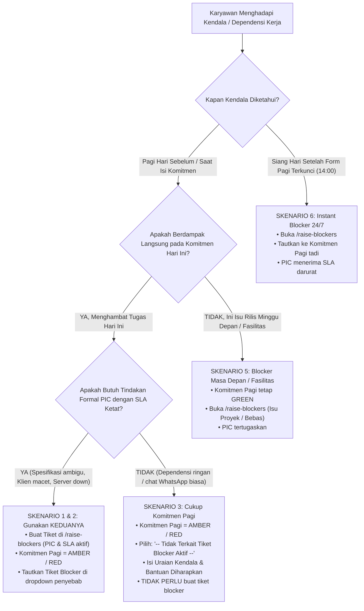

# BUKU PANDUAN KONSEPTUAL & OPERASIONAL WORKPULSE
## Hubungan Komitmen Pagi (*Morning Commitment*) vs Sistem Hambatan (*Blocker System*)

**Penyusun:** Acceptance Owner & AI Engineering Partner (PT Dutamedia Mandiri Pratama)  
**Dokumen Rujukan:** PDD v1.5, PRD v1.6 (§3.2 & §3.4), ADR-017, Visual Design System v1.5.0  
**Status Dokumen:** *Single Source of Truth* untuk Pedoman Pengguna & SOP Operasional (*User Manual Foundation*)

---

## 1. PENDAHULUAN & MODEL MENTAL (*THE CORE MENTAL MODEL*)

Salah satu kebingungan paling umum bagi pengguna baru WorkPulse adalah:  
> *"Jika saya mengalami kendala atau butuh bantuan pihak lain, apakah saya mencatatnya di **Komitmen Pagi** (memilih AMBER/RED), atau saya melaporkannya di menu **Laporkan Blocker** (`/raise-blockers`)?"*

Jawaban fundamentalnya berakar pada perbedaan **objek yang sedang dinilai** dan **tujuan tata kelola (*governance*)**:

```
┌─────────────────────────────────────────────────────────────────────────────┐
│ 1. KOMITMEN PAGI (/daily/morning)                                           │
│    • Objek yang Dinilai : TUGAS / KOMITMEN SAYA HARI INI                    │
│    • Pertanyaan Kunci   : "Bagaimana prospek kelancaran tugas saya hari     │
│                           ini? Bisa selesai mandiri, atau berisiko molor?"  │
│    • Fungsi Utama       : PERISAI AKUNTABILITAS PRIBADI (Melindungi diri    │
│                           dari tuduhan lalai/menunda pekerjaan).            │
└──────────────────────────────────────┬──────────────────────────────────────┘
                                       │
                                       │ Saling melengkapi
                                       │ & dapat ditautkan
                                       ▼
┌─────────────────────────────────────────────────────────────────────────────┐
│ 2. SISTEM BLOCKER RESMI (/raise-blockers & /blockers)                       │
│    • Objek yang Dinilai : MASALAHNYA / AKAR GANGGUANNYA                     │
│    • Pertanyaan Kunci   : "Ada gangguan apa, siapa penanggung jawab (PIC)    │
│                           yang wajib membereskan, dan berapa batas jamnya?" │
│    • Fungsi Utama       : SENJATA ESKALASI FORMAL (Memindahkan beban        │
│                           tindakan ke PIC dengan penghitung waktu mundur).  │
└─────────────────────────────────────────────────────────────────────────────┘
```

---

## 2. MATRIKS PERBANDINGAN *HEAD-TO-HEAD*

| Dimensi Perbandingan | Komitmen Pagi (`/daily/morning`) | Tiket Blocker (`/raise-blockers`) |
| :--- | :--- | :--- |
| **Fokus Penilaian** | Prospek penyelesaian deliverable tugas harian staf. | Masalah eksternal yang menghambat kelancaran kerja. |
| **Sifat Data** | **Catatan Statis Harian** (*snapshot* tanggal kerja). | **Tiket Dinamis Bersiklus Hidup** (*Active Lifecycle Entity*). |
| **Waktu Pengisian** | **Pagi Hari Saja** (Sebelum batas *cut-off* 09:30 WIB). | **Akses Bebas 24/7 Kapan Saja** (Pagi, Siang, Sore). |
| **Mekanisme Alarm** | Menyalakan badge `AMBER` / `RED` pada dashboard pimpinan saat *Morning Sync*. | Menyalakan **Timer Hitung Mundur SLA (1–8 Jam)**, memicu **Notifikasi Email & Push Instan** ke PIC. |
| **Konsekuensi Jika Diabaikan** | Menjadi catatan evaluasi saat pengisian sore (EOD). | **Otomatis Naik Tingkat (*Auto-Escalate*)** ke Head of Dept / Direksi jika melewati batas SLA. |
| **Kapan Berakhir?** | Selesai di sore hari saat mengisi EOD Outcome. | Tetap hidup dan dihitung menua (*Aging*) berhari-hari sampai PIC menekan tombol **Resolved**. |

---

## 3. TINGKAT RISIKO KOMITMEN PAGI: DEFINISI & PANDUAN

Setiap pagi, karyawan merencanakan 1 hingga 3 komitmen terukur dan wajib menentukan **Tingkat Risiko Tugas Hari Ini**:

### A. GREEN (Terkendali Mandiri)
* **Definisi:** Tugas diproyeksikan selesai 100% hari ini tanpa ketergantungan atau hambatan eksternal. Eksekusi sepenuhnya berada dalam kendali mandiri staf.
* **Contoh:** Menulis unit test modul auth, refactoring kode internal, menyusun dokumentasi teknis lokal.
* **Status Awal Hari (*Initial Daily Status*):** `GREEN — Terkendali`.

### B. AMBER (Berisiko — Menunggu Pihak Lain / Berpotensi Tertahan)
* **Definisi:** Tugas memiliki **ketergantungan (dependensi) pada pihak lain** atau potensi risiko yang dapat menunda penyelesaian jika tidak terpenuhi tepat waktu. Sebagian pekerjaan mungkin masih bisa dicicil, namun tidak ada jaminan tuntas hari ini tanpa bantuan.
* **Contoh:** Menunggu rekan tim me-review PR, menunggu konfirmasi jawaban dari vendor API, menunggu masukan dari QA.
* **Status Awal Hari:** Otomatis naik menjadi **`AMBER — Berisiko`**.

### C. RED (Tertahan — Tidak Bisa Berjalan Tanpa Bantuan Atasan)
* **Definisi:** Tugas mengalami **hambatan total (*hard block*)** yang menghentikan progres sama sekali dan mutlak membutuhkan intervensi/keputusan langsung dari pimpinan hari ini.
* **Contoh:** Server staging mati total, lisensi developer kedaluwarsa, scope requirement dari klien berubah drastis dan butuh arahan prioritas baru.
* **Status Awal Hari:** Otomatis naik menjadi **`RED — Terhambat`**.

> [!IMPORTANT]
> **Aturan Otomatis Status Awal Hari (*Initial Daily Status*):**  
> Status harian karyawan mengambil risiko **tertinggi** dari seluruh slot komitmennya. Jika Komitmen 1 = `GREEN` dan Komitmen 2 = `AMBER`, maka status hari itu otomatis menjadi `AMBER`. Jika ada salah satu yang `RED`, status hari itu langsung menjadi `RED`.

---

## 4. ANATOMI SISTEM BLOCKER RESMI (`/raise-blockers`)

Ketika sebuah masalah resmi dilaporkan melalui menu **Laporkan Blocker**, sistem mencatat parameter formal:

### 1. Kategori Kendala (10 Tipe Resmi)
1. **`Technical`**: Bug kode, kegagalan kompilasi, crash query database.
2. **`Requirement`**: Kebutuhan fitur ambigu, spesifikasi PRD belum jelas atau berubah di tengah jalan.
3. **`Client`**: Menunggu konfirmasi, data masukan, atau persetujuan UAT dari klien eksternal.
4. **`Vendor`**: Layanan pihak ketiga bermasalah (SaaS down, API payment gateway error, lisensi habis).
5. **`Resource`**: Kekurangan staf, rekan kerja sakit/cuti mendadak, keterbatasan beban kerja tim.
6. **`Approval`**: Dokumen/izin resmi tertahan menunggu tanda tangan atau verifikasi manajerial.
7. **`Infra`**: Server down, VPN kantor putus, pipeline CI/CD deployment gagal.
8. **`Finance`**: Pembayaran tagihan domain/server tertahan, anggaran pembelian tools belum cair.
9. **`Legal`**: Masalah kontrak, kepatuhan regulasi, atau NDA yang belum disepakati.
10. **`Other`**: Kendala operasional umum lainnya.

### 2. Tingkat Keparahan & Batas Waktu Tindakan (Severity & SLA)
* **`CRITICAL` (SLA 1–2 Jam):** Pekerjaan terhenti total, memicu notifikasi darurat instan dan radar eskalasi pimpinan.
* **`HIGH` (SLA 2–4 Jam):** Hambatan berat yang mengancam target harian atau jadwal sprint tim.
* **`MEDIUM` (SLA 4–8 Jam):** Hambatan parsial, staf masih bisa mengerjakan tugas sampingan lainnya.
* **`LOW` (SLA 8–24 Jam):** Kendala minor atau ketidaknyamanan operasional berisiko rendah.

### 3. Cakupan Dampak (7 Enum Impact)
Banyak yang salah mengira bahwa Blocker hanya untuk "isu kantor massal" (seperti WiFi mati). **Ini keliru.** Blocker mencakup:
* **`Task`**: Menghambat **1 tugas individu** pelapor (bisa terjadi hanya pada 1 orang!).
* **`Milestone`**: Mengancam fase rilis atau milestone sprint.
* **`Project`**: Menghambat jadwal proyek lintas tim.
* **`Production`**: Mengganggu sistem live yang diakses pengguna akhir / klien.
* **`Client`**: Berdampak langsung pada kepuasan atau kontrak klien.
* **`Financial`**: Berpotensi menimbulkan denda atau kerugian finansial.
* **`Compliance`**: Melanggar kepatuhan hukum, audit, atau regulasi.

---

## 5. PETA KEPUTUSAN: 7 SKENARIO KASUS KONKRET

Berikut adalah panduan praktis penanganan kasus sehari-hari:



---

### Skenario 1: Spesifikasi Belum Jelas (*Requirement Ambiguity*)
* **Situasi:** Anda hendak mengimplementasikan fitur perhitungan diskon, tetapi aturan bisnis (*business logic*) dari Product Owner (PO) belum ada atau berubah-ubah.
* **Tindakan yang Benar: GUNAKAN KEDUANYA!**
  1. **Di Komitmen Pagi:** Pasang status **`RED`** (atau `AMBER` jika sebagian UI masih bisa dicicil). Tulis di uraian kendala bahwa requirement belum final.
  2. **Di Lapor Blocker (`/raise-blockers`):** Terbitkan tiket dengan Kategori: `Requirement`, Severity: `High`, Dampak: `Task/Milestone`, dan tunjuk **PO / Tech Lead** sebagai Penanggung Jawab (*Assigned Owner*).
  3. **Penautan:** Pada form komitmen pagi, pilih tiket requirement tersebut pada dropdown **`Tiket Blocker Penyebab (Opsional)`**.
* **Mengapa Keduanya?**
  - Komitmen Pagi melindungi Anda dari evaluasi buruk sore hari (*"Saya tidak lalai, tugas saya tertahan sejak pagi"*).
  - Tiket Blocker mengikat PO dengan SLA 4 jam untuk segera memperjelas spesifikasi tersebut.

---

### Skenario 2: Menunggu Respon / Data dari Klien Eksternal (*Client Wait*)
* **Situasi:** Anda hendak menyelesaikan integrasi sistem pembayaran, namun kredensial sandbox atau data skema dari bank klien belum dikirimkan.
* **Tindakan yang Benar: GUNAKAN KEDUANYA!**
  1. **Di Komitmen Pagi:** Pasang status **`AMBER`** atau **`RED`**.
  2. **Di Lapor Blocker:** Terbitkan tiket Kategori: `Client`, Penanggung Jawab: **Project Manager (PM)**.
  3. **Penautan:** Tautkan tiket tersebut pada komitmen terkait.
* **Mengapa Keduanya?**
  - PM menerima notifikasi resmi untuk mengejar klien hari itu juga.
  - Tercatat di radar manajemen (*Project Risk Radar*) bahwa proyek tertahan oleh klien, bukan karena developer lambat.

---

### Skenario 3: Dependensi Harian Ringan / Koordinasi Biasa Antar Rekan Tim
* **Situasi:** Anda membutuhkan rekan kerja (misal Tech Lead) untuk me-review Pull Request (PR) modul Anda. Anda sudah berkoordinasi santai lewat chat WhatsApp: *"Mas, nanti siang jam 11 bantu review ya"*.
* **Tindakan yang Benar: CUKUP DI KOMITMEN PAGI (TANPA TIKET BLOCKER)!**
  1. **Di Komitmen Pagi:** Pasang status **`AMBER`**.
  2. **Dropdown Blocker:** Biarkan opsi default **`-- Tidak Terkait Tiket Blocker Aktif --`**.
  3. **Uraian Kendala:** Tuliskan: *"Menunggu review PR dari Mas Bambang siang ini"*.
  4. **Bantuan yang Diharapkan:** Tuliskan: *"Minta tolong di-review sebelum jam 13:00 agar bisa merge"*.
* **Mengapa Tidak Perlu Tiket Blocker?**
  - Ini adalah alur kerja harian biasa. Menerbitkan tiket blocker darurat dengan alarm SLA dan ancaman eskalasi untuk review PR rekan kerja justru berlebihan (*over-bureaucratic*) dan mengganggu harmoni tim.

---

### Skenario 4: Blocker Diketahui Sejak Pagi Hari Sebelum Mengisi Komitmen
* **Situasi:** Pukul 08:00 pagi saat menyalakan laptop, Anda mendapati server staging mati total (*crash*), dan salah satu komitmen Anda hari ini adalah testing di staging.
* **Rantai Akibat Logis Sistem:**
  1. Anda laporkan tiket Blocker Tipe `Infra` di `/raise-blockers` (atau tim DevOps sudah menerbitkannya).
  2. Saat membuka Form Komitmen Pagi, tugas testing Anda **secara mutlak berstatus `RED` (Tertahan)** dan Anda tautkan tiket server crash tersebut di dropdown penyebab.
  3. **Status Awal Hari (*Initial Daily Status*):** Secara otomatis dievaluasi sistem menjadi **`RED — Terhambat`**.
  4. **Hukum Sistem:** **MUSTAHIL status awal hari menjadi GREEN.** Jika tugas Anda terkena blocker tapi Anda memilih GREEN, sistem menganggapnya sebagai kontradiksi logis.

---

### Skenario 5: Blocker untuk Isu Mendatang / Fasilitas Umum (Komitmen Hari Ini Aman)
* **Situasi:** Hari ini komitmen Anda adalah riset teknologi baru dan membuat laporan lokal. Kedua tugas ini lancar tanpa hambatan eksternal. Namun pagi ini Anda mengetahui bahwa lisensi software tim akan kedaluwarsa 3 hari lagi.
* **Tindakan yang Benar:**
  1. **Komitmen Pagi:** Pasang **`GREEN`** untuk semua tugas (karena target kerja hari ini tidak terganggu).
  2. **Lapor Blocker:** Buka `/raise-blockers`, pilih opsi tautan komitmen: **`— Tidak Terkait Komitmen Hari Ini —`**, dan terbitkan tiket lisensi ke GA/Finance.
* **Mengapa?**
  - Anda tidak perlu memalsukan komitmen harian Anda menjadi AMBER/RED hanya karena ada masalah umum yang tidak mengganggu target kerja hari ini.

---

### Skenario 6: Masalah Mendadak Muncul di Siang Hari (*Instant Blocker 24/7*)
* **Situasi:** Pukul 08:30 pagi semua lancar (status `GREEN`). Form pagi terkunci pukul 09:30. Pukul 14:00 siang, jaringan API pihak ketiga tiba-tiba padam total.
* **Tindakan yang Benar:**
  1. Form pagi sudah terkunci permanen, Anda tidak bisa lagi mengeditnya langsung.
  2. Buka menu **`+ Laporkan Blocker`** (`/raise-blockers`).
  3. Pilih dropdown *Tautkan ke Komitmen*: Pilih **`[Komitmen #1]`** Anda tadi pagi.
  4. Kirim tiket. Pimpinan langsung menerima notifikasi instan detik itu juga tanpa Anda harus menunggu jam evaluasi sore.

---

### Skenario 7: Komitmen Saya Hari Ini Adalah MEMBERESKAN Blocker Orang Lain
* **Situasi:** Kemarin tim QA menerbitkan tiket `#BLK-0089: Bug kalkulasi diskon checkout`. Hari ini, komitmen yang Anda janjikan ke pimpinan adalah **mengerjakan perbaikan bug tersebut**.
* **Tindakan yang Benar:**
  1. **Teks Komitmen:** `Memperbaiki bug kalkulasi diskon checkout`.
  2. **Input Tautan:** Klik tombol **`Pilih Blocker Aktif`** di samping input tautan, lalu klik `#BLK-0089`.
  3. Sistem otomatis mengisi nomor tiket dan menyesuaikan kode proyeknya.
* **Perbedaan Peran Tombol:**
  - Tombol **`Pilih Blocker Aktif`** di atas = Untuk menyatakan *"Saya sedang MENGERJAKAN blocker ini"*.
  - Dropdown **`Tiket Blocker Penyebab`** di bawah = Untuk menyatakan *"Tugas saya TERHAMBAT oleh blocker ini"*.

---

## 6. TABEL *QUICK CHEAT SHEET* (PANDUAN KEPUTUSAN CEPAT)

| Situasi Kerja yang Anda Alami | Aksi di Form Komitmen Pagi | Aksi di Form Lapor Blocker | Status Awal Hari |
| :--- | :--- | :--- | :---: |
| Pekerjaan lancar jaya, bisa selesai sendiri. | Pilih **`GREEN`** | Tidak perlu buat tiket. | **GREEN** |
| Ada koordinasi biasa antar rekan tim (review PR, info data singkat). | Pilih **`AMBER`**, pilih *Tanpa Tiket Blocker*, tulis catatan kendala. | Tidak perlu buat tiket. | **AMBER** |
| Butuh arahan atasan soal pilihan desain/fitur saat *Morning Sync*. | Pilih **`RED`**, pilih *Tanpa Tiket Blocker*, tulis bantuan yang dibutuhkan. | Tidak perlu buat tiket (cukup dibahas di sync). | **RED** |
| Klien belum kirim data / PO belum beri spesifikasi / server crash. | Pilih **`AMBER / RED`**, tautkan tiket blocker penyebabnya. | **Wajib Buat Tiket Blocker** (Tunjuk PIC & SLA). | **AMBER / RED** |
| Tugas hari ini lancar, tapi nemu bug/isu server untuk minggu depan. | Pilih **`GREEN`** untuk semua tugas. | **Buat Tiket Blocker** (Pilih: *Tidak Terkait Komitmen Hari Ini*). | **GREEN** |
| Siang hari jam 14:00 tiba-tiba ada insiden darurat mematikan tugas. | Form pagi sudah terkunci. | **Buka `/raise-blockers`**, tautkan ke tugas pagi tadi. | - |
| Tugas saya hari ini adalah membetulkan blocker yang dilaporkan orang lain. | Tulis tugas, klik tombol **`Pilih Blocker Aktif`** di samping kolom tautan. | Tidak perlu buat tiket baru (gunakan tiket yang sudah ada). | Sesuai risiko |

---

## 7. KAMUS ISTILAH RESMI PADA ANTARMUKA (*UI MICROCOPY DICTIONARY*)

Gunakan tabel ini sebagai acuan terminologi resmi penulisan dokumen panduan pengguna (*User Manual*):

| Lokasi Halaman | Label Elemen UI | Makna Fungsional Bagi Pengguna |
| :--- | :--- | :--- |
| **Morning Commitment** | `Tautkan Tiket Tugas atau Blocker yang Ingin Dikerjakan (Opsional)` | Kolom input untuk menempelkan URL dokumen, link PR, atau nomor tiket tugas yang sedang dikerjakan. |
| **Morning Commitment** | Tombol `Pilih Blocker Aktif` | Tombol jalan pintas untuk memilih tiket blocker aktif yang menjadi target komitmen perbaikan hari ini. |
| **Morning Commitment** | `Tingkat Risiko Tugas Hari Ini *` | Penilaian prospek kelancaran tugas harian: `GREEN` (Lancar), `AMBER` (Berisiko), `RED` (Tertahan). |
| **Morning Commitment** | `Tiket Blocker Penyebab (Opsional)` | Dropdown untuk menautkan tiket blocker resmi yang menjadi biang keladi hambatan tugas. Default: `-- Tidak Terkait Tiket Blocker Aktif --`. |
| **Morning Commitment** | `Uraian Resiko atau Potensi Kendala *` | Textarea wajib jika memilih AMBER/RED untuk menjelaskan siapa/apa yang ditunggu secara konkret. |
| **Morning Commitment** | `Tindakan / Bantuan yang Diharapkan (Opsional)` | Input opsional untuk mencatat bantuan spesifik yang diharapkan dari pimpinan atau rekan kerja. |
| **Lapor Blocker** | `Tautkan ke Komitmen / Tugas Hari Ini (opsional)` | Dropdown jika blocker dilaporkan setelah submit komitmen dan berdampak pada tugas hari ini. Default: `— Tidak Terkait Komitmen Hari Ini —`. |
| **Lapor Blocker** | `Deskripsi Kendala & Upaya Mandiri *` | Textarea wajib untuk menjelaskan fakta masalah, pihak terdampak, dan langkah mandiri yang sudah dicoba sebelum eskalasi. |
| **Lapor Blocker** | `Bantuan Konkret yang Diharapkan (opsional)` | Input tindakan spesifik yang dituntut dari PIC penanggung jawab tiket. |
| **Lapor Blocker** | `Penanggung Jawab Awal & Jalur Kewenangan` | Pemilihan jalur eskalasi: **Organizational Authority** (Atasan Langsung) atau **Project Authority** (Project Lead). |

