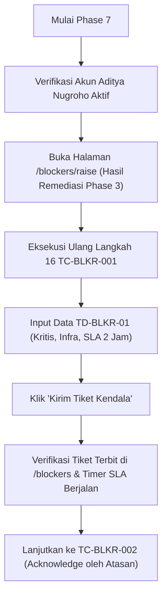

# WorkPulse — Rekaman Titik Checkpoint Eksekusi (UAT Execution Checkpoint)
## Deliverable Subphase 0.2 — UAT Suspension & Execution Preservation

> **Dokumen:** UAT Execution Checkpoint (Phase 0 Deliverable)  
> **Sistem:** WorkPulse — Daily Accountability & Blocker Log System  
> **Organisasi:** PT Dutamedia Mandiri Pratama  
> **Acceptance Owner & Lead Tester:** Harry  
> **Checkpoint ID:** `CHK-UAT-001`  
> **Tanggal & Waktu Penguncian:** 30 Oktober 2026 — 15:20 WIB  
> **Lokasi Penguncian:** Modul Blocker System pada rute `/blockers/raise`  
> **Kasus Uji Terkait:** `TC-BLKR-001` (Langkah 16)  

---

## 1. IDENTIFIKASI CHECKPOINT EKSEKUSI

Checkpoint `CHK-UAT-001` mencatat posisi presisi di mana pengujian manual dihentikan oleh Acceptance Owner:

| Parameter Checkpoint | Nilai Spesifikasi Aktual |
| :--- | :--- |
| **Kelompok Pengujian** | Kelompok 8: Blocker Management, SLA Aging, & Resolution |
| **Kasus Uji Aktif** | `TC-BLKR-001`: Pelaporan Hambatan Baru Tingkat Kritis dengan SLA 2 Jam |
| **Skenario Terkait** | `SCN-BLKR-01` (FR-29, FR-30, DEC-007) |
| **Prioritas Kasus Uji** | **Critical (P0)** |
| **Langkah Terakhir yang Dieksekusi** | **Langkah 16** — Pengisian & Pengiriman Formulir Laporan Blocker Kritis |
| **URL Antarmuka Terakhir** | `https://dutamedia-workpulse.vercel.app/blockers/raise` |
| **Peran Pengguna Aktif** | `EMPLOYEE` (`dev.frontend@dutamedia.com` / Aditya Nugroho) |
| **Status Penyelesaian Test Case** | **PARTIAL (IN PROGRESS — HALTED BEFORE SUBMIT)** |

---

## 2. KONDISI ANTARMUKA (UI/UX STATE) PADA CHECKPOINT

Pada saat eksekusi `TC-BLKR-001` Langkah 16 berlangsung, penguji berada di halaman formulir pelaporan blocker mandiri:

1. **Struktur Halaman `/blockers/raise` Saat Ini:**
   - **Bagian 1 (Detail Kendala, Taksonomi & Dampak):**
     - Field `Judul Kendala *` (placeholder: "Contoh: [Payment Gateway] Kredensial Sandbox Kadaluarsa", limit 140 karakter).
     - Dropdown `Tautkan ke Komitmen / Tugas Hari Ini (opsional)`.
     - Dropdown `Kategori Kendala (Type) *` (10 enum resmi).
     - Dropdown `Dampak Kendala (Impact) *` (7 enum resmi).
     - Pilihan Radio Kartu `Tingkat Keparahan (Severity) *`: `CRITICAL (SLA: 60m)`, `HIGH (SLA: 120m)`, `MEDIUM (SLA: 240m)`, `LOW (SLA: 480m)`.
     - Textarea `Deskripsi Kendala & Upaya Mandiri *` (min 20 karakter).
     - Tag Quick Assist `Bantuan Konkret yang Diharapkan (opsional)`: `+ Approval`, `+ Requirement`, `+ Akses`, `+ Infra`, `+ Code Review`.
   - **Bagian 2 (Penanggung Jawab Awal & Jalur Kewenangan):**
     - Kartu Radio Jalur: `Organizational Authority (Struktural)` vs `Project Authority (Kewenangan Proyek)`.
     - Dropdown `Penanggung Jawab Khusus (opsional)` (default terpilih Aditya Nugroho).
     - Banner info `Jalur Penanganan Otomatis`.
   - **Footer Aksi:** Tombol `Batal` dan `Kirim Tiket Kendala`.

2. **Temuan & Observasi Langsung Harry pada Checkpoint Ini:**
   - **Anomali Tombol di Halaman EOD (`IMP-040`):** Tombol `+ Laporkan Blocker Mendesak` pada halaman EOD sebelumnya memicu popup modal instan (`media_1793343838939_99a0aba8.png`), padahal perancangan UI/UX menghendaki tombol langsung beralih ke halaman `/blockers/raise` pada ketiga tab My Today.
   - **Ketidaksesuaian Header & Navigasi dengan Prototipe 05 (`IMP-041`):** Halaman belum memuat tombol `Kembali ke Ruang Kerja My Today` di kiri atas; judul halaman harus `Laporkan & Pantau Blocker` dengan subtitle panduan resmi; teks breadcrumb atas `Blocker / Laporkan Kendala Cepat (Prototipe 05)` masih membocorkan penamaan artefak internal.
   - **Redundansi Tombol Header (`IMP-042`):** Tombol `Lihat Antrean Blocker Aktif` di kanan atas form formulir lapor perlu dihilangkan agar fokus pengguna tidak terdistraksi saat input kendala.
   - **Pembersihan Footer (`IMP-044`):** Tombol aksi footer perlu diselaraskan dengan tata letak baku prototipe.

---

## 3. STATUS DATA & SESI BASIS DATA PADA CHECKPOINT (SUPABASE STATE)

Kondisi data pada basis data Supabase (`yzsischopwnhztjguoxs`) terverifikasi persisten dan terkunci pada state berikut:

1. **Sesi Karyawan (Aditya Nugroho - Frontend Engineer):**
   - User ID: `550e8400-e29b-41d4-a716-446655440001`
   - Department: Engineering
   - Direct Manager: Bambang Pratama (Engineering Lead - `bambang.pratama@dutamedia.com`)
2. **Rekaman Komitmen Pagi (Morning Commitment):**
   - 3 record komitmen tersimpan di tabel komitmen dengan initial status AMBER (karena Komitmen #2 dipilih berisiko).
3. **Rekaman Pekerjaan Tambahan (Additional Work):**
   - 1 record tugas ad-hoc ("Investigasi performa rendering Vue") tersimpan dengan penugas Bambang Pratama.
4. **Rekaman Evaluasi Sore (EOD Outcome):**
   - 4 tugas terisi evaluasi (3 selesai, 1 sebagian lanjut besok).
   - Kartu EOD Berhasil Disimpan terbit (mengalami cacat `DEF-002` karena form tidak terkunci).
5. **Rekaman Blocker:**
   - Belum ada baris tiket blocker baru yang ter-insert ke tabel `blockers` untuk `TC-BLKR-001` (pengisian dihentikan sebelum klik kirim).

---

## 4. PROSEDUR RESUMPTION PADA PHASE 7 (PANDUAN MELANJUTKAN UAT)

Saat Acceptance Owner memutuskan untuk melanjutkan UAT pada **Phase 7 (Controlled UAT Resumption & Execution)**, tahapan resume harus dilakukan secara deterministik:

### Rincian Langkah Resume:
1. **Prekondisi:** Pastikan browser login sebagai `dev.frontend@dutamedia.com` dengan token sesi aktif.
2. **Navigasi:** Buka rute `/blockers/raise` (yang telah diremediasi pada Phase 3 sesuai Prototipe 05).
3. **Input Data Checkpoint:**
   - Judul: `Database Staging Timeout & Redis Cache Corrupt`
   - Kategori: `INFRASTRUCTURE`
   - Dampak: `TEAM_BLOCKED`
   - Severity: `CRITICAL` (Verifikasi badge target SLA: 2 Jam Kerja / 60-120 menit).
   - Deskripsi: `Koneksi database pool staging terputus berulang kali menyebabkan integrasi terhenti total. Butuh restart service dan reset connection.`
4. **Submit & Validasi:** Klik `Kirim Tiket Kendala`, verifikasi toast sukses muncul, dan verifikasi redirect ke halaman daftar blocker (`/blockers`).
5. **Penutupan Checkpoint:** Catat hasil aktual `TC-BLKR-001` menjadi **PASS**, lalu transisikan pengujian ke **`TC-BLKR-002`** (login sebagai Bambang Pratama untuk konfirmasi penerimaan).

---
*Checkpoint ini diamankan dan dikunci sebagai acuan tunggal penghentian dan kelanjutan pengujian manual UAT.*

