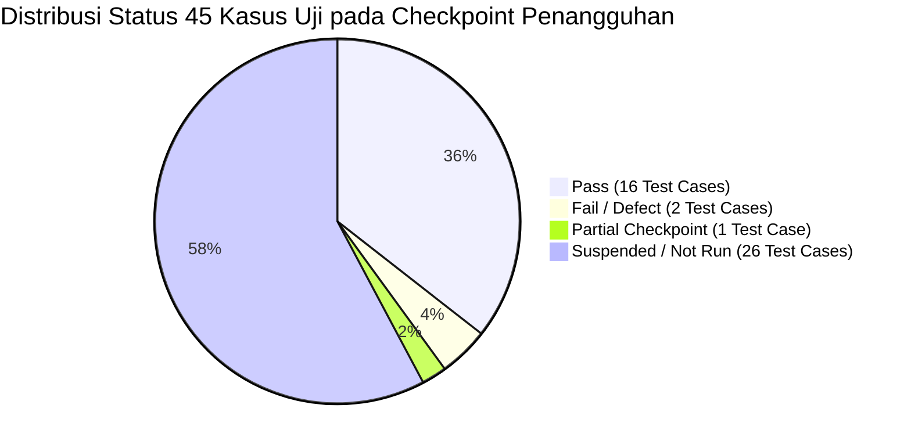

# WorkPulse — Laporan Validasi Penangguhan UAT (UAT Suspension Validation Report)
## Deliverable Subphase 0.6 — UAT Suspension & Execution Preservation

> **Dokumen:** UAT Suspension Validation Report (Phase 0 Final Deliverable)  
> **Proyek:** WorkPulse — Daily Accountability & Blocker Log System  
> **Organisasi:** PT Dutamedia Mandiri Pratama  
> **Acceptance Owner:** Harry  
> **Evaluator:** Co-Pilot (Senior QA Engineer, UAT Architect, Test Manager & Technical Co-Pilot)  
> **Tanggal Pelaksanaan:** 30 Oktober 2026 — 17:15 WIB  
> **Status Fase:** **PHASE 0 COMPLETED — PENDING OWNER APPROVAL FOR PHASE 1**  
> **Prinsip Operasional:** STRICT CHANGE CONTROL — ZERO MUTATION TO APPLICATION CODE & UAT BASELINE  

---

## 1. RINGKASAN EKSEKUTIF PELAKSANAAN PHASE 0

Berdasarkan instruksi langsung Acceptance Owner (Harry) dan merujuk pada tata kelola Master Plan, pelaksanaan **Phase 0 — UAT Suspension & Execution Preservation** telah diselesaikan secara tuntas dan menyeluruh.

Tujuan utama Phase 0 adalah **mengamankan seluruh kondisi aktual pengujian manual, mengunci posisi checkpoint pada `TC-BLKR-001` Langkah 16, menginventarisasi seluruh bukti empiris dan artefak, serta merekonsiliasi konsistensi dokumen tanpa mengubah atau merusak hasil historis yang telah dicapai**.

### Ringkasan Pencapaian Phase 0:
1. **Preservasi Checkpoint `TC-BLKR-001`:** Posisi pengujian manual berhasil dikunci secara presisi pada Langkah 16 (pengisian dan pengiriman formulir laporan blocker kritis pada rute `/blockers/raise`).
2. **Preservasi 45 Kasus Uji:**
   - **16 Kasus Uji PASS:** Diverifikasi memenuhi kriteria penerimaan tanpa cacat fungsional.
   - **2 Kasus Uji FAIL / DEFECT:** Terkunci pada `TC-DLYM-001` (`DEF-001`) dan `TC-DLYE-001` (`DEF-002`).
   - **1 Kasus Uji PARTIAL (Checkpoint):** `TC-BLKR-001` (dihentikan sebelum klik kirim tiket).
   - **26 Kasus Uji NOT RUN / SUSPENDED:** Terjaga utuh untuk dieksekusi pada Phase 7.
3. **Preservasi 44 Calon Peningkatan (Candidate Scope):** Terinventarisasi utuh dari `IMP-001` hingga `IMP-044` sebagai bahan masukan untuk rekonsiliasi Phase 1 dan kurasi Acceptance Owner pada Phase 2.
4. **Inventarisasi Bukti Empiris:** Sebanyak **44 berkas tangkapan layar** dan kondisi data transaksi pada basis data Supabase Singapore berhasil dipetakan secara deterministik.
5. **Integritas Sistem 100% Terjaga:** Tidak ada satu baris kode program aplikasi, konfigurasi basis data, migrasi, maupun data historis UAT yang diubah (**Zero Diff**).

---

## 2. REKONSILIASI KONSISTENSI LINTAS ARTEFAK UAT

Pemeriksaan silang konsistensi (*cross-artifact consistency audit*) dilakukan terhadap 5 artefak primer:
- `UAT/UAT-Execution-Log.csv`
- `UAT/UAT-Execution-Checklist.md`
- `UAT/UAT-Manual-Test-Cases.md`
- `UAT/UAT-Defect-Log.md`
- `UAT/UAT-Improvement-Backlog.md`

### Hasil Audit & Temuan Rekonsiliasi:

| Parameter Evaluasi | Hasil Audit Konsistensi | Analisis & Tindak Lanjut |
| :--- | :---: | :--- |
| **Kuantitas Kasus Uji** | **100% KONSISTEN (45 Test Cases)** | Seluruh 45 Test Case ID terpetakan identik di seluruh dokumen katalog, checklist, log, dan manual test cases. |
| **Pemetaan Defect** | **100% KONSISTEN (2 Defect)** | `DEF-001` terpetakan eksklusif ke `TC-DLYM-001` dan `DEF-002` terpetakan eksklusif ke `TC-DLYE-001`. |
| **Pemetaan Improvement** | **100% KONSISTEN (44 Items)** | 44 item perbaikan tercatat di `UAT-Improvement-Backlog.md` (`IMP-001` s.d. `IMP-044`) dan terpetakan ke kelompok pengujian masing-masing. |
| **Pencatatan Status Eksekusi** | **TERKLARIFIKASI SECARA FORMAL** | Pada `UAT-Execution-Log.csv`, status `TC-BLKR-001` tercatat kosong/Not Run karena form belum disubmit. Melalui deliverable Phase 0 (`UAT-Partial-Execution-Register.csv` dan `UAT-Execution-Checkpoint.md`), status ini secara presisi didefinisikan sebagai **`PARTIALLY EXECUTED (CHECKPOINT STEP 16)`** tanpa menimpa file mentah di `UAT/`. |
| **Data Tester & Tanggal** | **100% KONSISTEN** | Seluruh 18 kasus uji yang telah diuji mencatat Harry sebagai tester dengan tanggal eksekusi 30 Oktober 2026. |

---

## 3. STATUS DETAIL SELURUH KELOMPOK PENGUJIAN (45 TEST CASES)

### Rincian per Kelompok Pengujian:
1. **Kelompok 1 (Environment & Preconditions):** `TC-AUTH-001 (Langkah 1)` — **PASS**.
2. **Kelompok 2 (Authentication & Session Management):** `TC-AUTH-001`, `TC-AUTH-002`, `TC-AUTH-006`, `TC-AUTH-007`, `TC-AUTH-008` — **PASS (5 Kasus Uji)**.
3. **Kelompok 3 (Onboarding & Account Lifecycle):** `TC-AUTH-003`, `TC-AUTH-004` — **PASS (2 Kasus Uji)**.
4. **Kelompok 4 (RBAC & Router Protection):** `TC-AUTH-005` — **PASS (1 Kasus Uji)**.
5. **Kelompok 5 (Daily Accountability — Siklus Pagi):** 
   - `TC-DLYM-003`, `TC-DLYM-005`, `TC-DLYM-006` — **PASS (3 Kasus Uji)**.
   - `TC-DLYM-001` — **FAIL / DEFECT (`DEF-001`)**.
   - `TC-DLYM-002`, `TC-DLYM-004` — **NOT RUN / SUSPENDED (2 Kasus Uji)**.
6. **Kelompok 6 (Daily Accountability — Tugas Tambahan Siang):**
   - `TC-DLYA-001`, `TC-DLYA-002` — **PASS (2 Kasus Uji)**.
   - `TC-DLYA-003` — **NOT RUN / SUSPENDED (1 Kasus Uji)**.
7. **Kelompok 7 (Daily Accountability — Evaluasi Sore EOD):**
   - `TC-DLYE-002`, `TC-DLYE-003` — **PASS (2 Kasus Uji)**.
   - `TC-DLYE-001` — **FAIL / DEFECT (`DEF-002`)**.
   - `TC-DLYE-004` — **NOT RUN / SUSPENDED (1 Kasus Uji)**.
8. **Kelompok 8 (Blocker Management & Escalation):**
   - `TC-BLKR-001` — **PARTIALLY EXECUTED (CHECKPOINT STEP 16)**.
   - `TC-BLKR-002`, `TC-BLKR-003`, `TC-BLKR-004`, `TC-BLKR-005` — **NOT RUN / SUSPENDED (4 Kasus Uji)**.
9. **Kelompok 9 (Tata Kelola Kepatuhan & Koreksi):** `TC-CORR-001` s.d. `TC-CORR-006` — **NOT RUN / SUSPENDED (6 Kasus Uji)**.
10. **Kelompok 10 (Pengelolaan Cuti & Rekonsiliasi Otomatis):** `TC-LEAV-001` s.d. `TC-LEAV-003` — **NOT RUN / SUSPENDED (3 Kasus Uji)**.
11. **Kelompok 11 (Supervisi, Coaching, & Dasbor):** `TC-COAC-001`, `TC-DASH-001`, `TC-DASH-002` — **NOT RUN / SUSPENDED (3 Kasus Uji)**.
12. **Kelompok 12 (Administrasi Sistem & Kebijakan):**
    - `TC-ADMN-002` — **PASS (1 Kasus Uji)**.
    - `TC-ADMN-001` — **NOT RUN / SUSPENDED (1 Kasus Uji)**.
13. **Kelompok 13 (Pelaporan Eksekutif):** `TC-DASH-003` — **NOT RUN / SUSPENDED (1 Kasus Uji)**.
14. **Kelompok 14 (Skenario E2E Journey):** `TC-E2E-001` s.d. `TC-E2E-004` — **NOT RUN / SUSPENDED (4 Kasus Uji)**.
15. **Kelompok 15 (Exploratory Testing & Closure):** Ditangguhkan bersama siklus UAT.

---

## 4. PENCATATAN RISIKO KEAMANAN TERBUKA (OPEN SECURITY RISK)

Sesuai instruksi khusus Acceptance Owner, laporan ini secara eksplisit mencatat risiko keamanan yang masih terbuka:

> [!CAUTION]
> **RISIKO KEAMANAN TERBUKA: `VERIF-FIND-001` (REPOSITORY VISIBILITY & CREDENTIAL EXPOSURE)**  
> 1. **Fakta Lapangan:** Repositori GitHub `https://github.com/harrymx1/Dutamedia-WorkPulse` masih berstatus publik dan file `UAT/UAT-Test-Data-Matrix.csv` serta riwayat commit memuat kredensial akun demo aktif sistem live demo `https://dutamedia-workpulse.vercel.app`.  
> 2. **Tanggung Jawab:** Mitigasi teknis (mengubah visibilitas repositori menjadi Private dan rotasi kredensial live demo) berada di bawah penanganan mandiri Harry.  
> 3. **Pernyataan Integritas:** Co-Pilot **TIDAK MENGKLAIM** masalah ini telah terselesaikan. Masalah ini dicatat sebagai **RISIKO TERBUKA AKTIF** yang harus diselesaikan sebelum pengujian manual dilanjutkan di Phase 7.

---

## 5. EVALUASI EXIT CRITERIA PHASE 0

Berdasarkan Master Plan yang telah diselaraskan pada `DEC-003-UAT` (klausul `VERIF-FIND-007`: *Phase 0 berfokus pada penguncian checkpoint, bukan penyelesaian test case*), berikut evaluasi pemenuhan exit criteria Phase 0:

| No | Kriteria Exit Phase 0 | Persyaratan Mutlak | Hasil Evaluasi Aktual | Status Pemenuhan |
| :-: | :--- | :--- | :--- | :-: |
| **1** | **Penguncian Checkpoint Eksekusi** | Checkpoint `TC-BLKR-001` Langkah 16 terkunci secara presisi beserta prosedur pemulihan (*resumption*). | Terdokumentasi lengkap pada `UAT-Execution-Checkpoint.md` mencakup rute, form state, database state, dan langkah resume Phase 7. | **MET (100%)** |
| **2** | **Preservasi Hasil UAT Historis** | Tidak ada hasil pengujian manual yang diubah, ditimpa, atau dimanipulasi tanpa bukti aktual. | Seluruh 16 Pass, 2 Defect, 1 Partial, dan 26 Not Run terpetakan utuh di `UAT-Partial-Execution-Register.csv`. | **MET (100%)** |
| **3** | **Inventarisasi Bukti Empiris** | Seluruh tangkapan layar dan rekaman database terinventarisasi utuh. | 44 berkas tangkapan layar dan 6 entitas tabel Supabase tercatat di `UAT-Evidence-Inventory.md`. | **MET (100%)** |
| **4** | **Inventarisasi Artefak** | Seluruh berkas UAT primer dan tata kelola terdaftar dengan status integritas 100%. | 31 berkas artefak terdaftar lengkap di `UAT-Artifact-Inventory.csv`. | **MET (100%)** |
| **5** | **Dokumentasi Penangguhan Formal** | Deklarasi penghentian sementara UAT diterbitkan resmi. | Diterbitkan via `UAT-Suspension-Record.md` merujuk pada `DEC-001-UAT`. | **MET (100%)** |
| **6** | **Integritas Non-Governance** | Zero mutation pada source code aplikasi dan database. | `git diff --stat frontend/ backend/ e2e/` membuktikan **0 baris mutasi (Zero Diff)**. | **MET (100%)** |

### KESIMPULAN PENILAIAN PHASE 0:
> **STATUS: COMPLETED & FULLY VALIDATED.**  
> Seluruh 6 kriteria exit Phase 0 terpenuhi 100%. Checkpoint eksekusi UAT, seluruh bukti pengujian, defect log, dan candidate improvements telah diamankan secara sempurna.  
> **Sistem siap beralih ke Phase 1 (UAT State Reconciliation & Finding Consolidation) setelah mendapatkan persetujuan formal Acceptance Owner.**

---

## 6. REKOMENDASI KERJA TAHAP BERIKUTNYA (PHASE 1 TRANSITION PLAN)

Setelah Acceptance Owner menyetujui penutupan Phase 0, pekerjaan Phase 1 akan mencakup:
1. **Subphase 1.1:** Rekonsiliasi Log Eksekusi ke dalam Master Register.
2. **Subphase 1.2:** Rekonsiliasi Defect `DEF-001` dan `DEF-002` (verifikasi root cause awal & dependensi).
3. **Subphase 1.3:** Rekonsiliasi 44 Kandidat Improvement (`IMP-001` s.d. `IMP-044`) untuk penyusunan matriks taksonomi (UI, UX, Copywriting, Layout, Security).
4. **Subphase 1.4:** Rekonsiliasi Matriks Keterlacakan Kebutuhan (RTM gap analysis terhadap FR-01 s.d. FR-55).
5. **Subphase 1.5:** Audit Konsistensi Antar-Artefak Tingkat Lanjut.
6. **Subphase 1.6:** Penerbitan Master Finding Consolidation Register.

---
*Laporan validasi ini diterbitkan oleh UAT Co-Pilot dan diserahkan kepada Harry selaku Acceptance Owner untuk evaluasi dan persetujuan formal gerbang Phase 1.*

