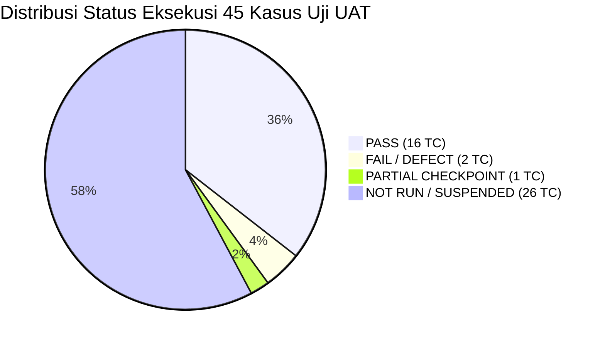
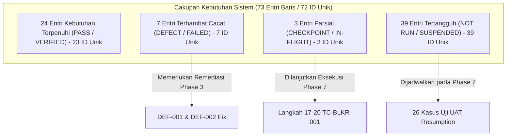

# WorkPulse — Laporan Rekonsiliasi Status UAT & Konsolidasi Temuan Master (Phase 1)
> **Siklus Tata Kelola:** UAT Lifecycle Management Framework  
> **Fase:** Phase 1 — UAT State Reconciliation & Finding Consolidation  
> **Sistem:** WorkPulse (Daily Accountability & Blocker Log System)  
> **Organisasi:** PT Dutamedia Mandiri Pratama  
> **Acceptance Owner & Lead Tester:** Harry  
> **Lead QA, UAT Architect & Technical Co-Pilot:** Senior Software Quality Assurance Engineer  
> **Tanggal Pelaksanaan:** 01 November 2026  
> **Dasar Otorisasi:** `DEC-004-UAT` (Persetujuan Penutupan Phase 0 & Otorisasi Phase 1)  
> **Status Dokumen:** COMPLETED & VALIDATED — PENDING ACCEPTANCE OWNER REVIEW  
> **Prinsip Operasional:** STRICT CHANGE CONTROL — ZERO MUTATION TO APPLICATION SOURCE CODE, DATABASE, & HISTORICAL UAT BASELINE  

---

## 1. RINGKASAN EKSEKUTIF (EXECUTIVE SUMMARY)

Pelaksanaan **Phase 1 — UAT State Reconciliation & Finding Consolidation** telah diselesaikan secara menyeluruh berdasarkan mandat formal Acceptance Owner (`DEC-004-UAT`) dan kerangka kerja `UAT-Lifecycle-Management-Plan.md`. 

Tujuan utama fase ini adalah menyatukan, merekonsiliasi, dan mengonsolidasikan seluruh rekaman hasil pengujian manual dari berbagai artefak (Execution Log, Checklist, Manual Test Cases, Defect Log, Improvement Backlog, dan Evidence Inventory) menjadi satu **Baseline Rekonsiliasi Master Tunggal** tanpa mengubah data historis mentah serta menjaga integritas aplikasi (*Zero Code / DB Mutation*).

### Ringkasan Hasil Kunci Rekonsiliasi:
1. **Rekonsiliasi 45 Kasus Uji Selesai 100%:**
   - **16 PASS (35.6%):** Memenuhi seluruh acceptance criteria dengan bukti empiris valid.
   - **2 FAIL / DEFECT (4.4%):** `TC-DLYM-001` (`DEF-001`) dan `TC-DLYE-001` (`DEF-002`).
   - **1 PARTIALLY EXECUTED (CHECKPOINT) (2.2%):** `TC-BLKR-001` (dihentikan pada Langkah 16 sebelum pengiriman formulir).
   - **26 NOT RUN / SUSPENDED (57.8%):** Pengujian tertangguh selama masa pembekuan, siap dilanjutkan pada Phase 7.
2. **Konsolidasi Defect Kritis Terverifikasi:**
   - Dua cacat fungsional utama (`DEF-001` dan `DEF-002`) berhasil dikonsolidasikan dengan hipotesis awal akar masalah teknis (**Preliminary Root Cause Hypothesis**) pada komponen Vue (`MorningCommitmentView.vue` dan `EodOutcomeView.vue`) terkait evaluasi atribut `:disabled` yang belum memperhitungkan flag `isSubmittedSuccess`. Investigasi teknis mendalam dan validasi definitif tetap dialokasikan pada Subphase 2.1 (Phase 2).
3. **Preservasi 44 Calon Peningkatan (Candidate Scope):**
   - Seluruh 44 usulan perbaikan (`IMP-001` s.d. `IMP-044`) telah diklasifikasikan ke dalam taksonomi baku (UI/UX, Layout, Copywriting, Navigation, RBAC). Seluruhnya ditegaskan berstatus **Candidate Scope** yang menunggu proses seleksi, kurasi, dan persetujuan formal Acceptance Owner pada Phase 2.
4. **Audit Keterlacakan Kebutuhan Sistem (RTM):**
   - Memetakan 73 entri baris hubungan kebutuhan sistem (mewakili 72 ID kebutuhan unik: FR-01 s.d. FR-55, UAT-REQ custom, DEC-001 s.d. DEC-013, dan skenario E2E) menghasilkan rekapitulasi presisi 100%: **24 Entri Terpenuhi (PASS / VERIFIED)** (mencakup 2 entri relasi FR-01 via `TC-AUTH-001` dan `TC-AUTH-002`, merepresentasikan 23 ID unik), **7 Entri Terhambat Defect (BLOCKED BY DEFECT)** (7 ID unik), **3 Entri Parsial Checkpoint (PARTIAL COVERAGE)** (3 ID unik), dan **39 Entri Tertangguh (SUSPENDED / NOT RUN)** (39 ID unik). Total tepat **73 entri baris kebutuhan** (atau **72 ID kebutuhan unik**).
5. **Transparansi Risiko Keamanan Terbuka (`VERIF-FIND-001`):**
   - Status repositori GitHub publik dan keberadaan kredensial demo pada seeder backend dicatat secara konsisten sebagai **Open Security Risk (S1 / P0)** yang berada dalam penanganan Acceptance Owner.
6. **Resolusi Diskrepansi Antar-Artefak:**
   - Seluruh selisih pencatatan antara Execution Log dan Checklist (termasuk status in-flight `TC-BLKR-001`) telah dijelaskan dan diselaraskan pada dokumen pendukung `UAT-Cross-Artifact-Audit-Report.md`.

---

## 2. REKONSILIASI STATUS 45 KASUS UJI MANUAL (TEST CASE RECONCILIATION)

Rekonsiliasi menyeluruh terhadap 45 kasus uji manual mengonfirmasi distribusi status definitif sebagai berikut:

### Tabel Rincian Rekonsiliasi Per Kasus Uji:

| No | Test Case ID | Kelompok & Skenario | Requirement ID | Prioritas | Status Terkonsolidasi | Bukti Empiris Terkait | Defect / Improvement |
| :-: | :--- | :--- | :---: | :---: | :---: | :--- | :---: |
| 1 | `TC-AUTH-001` | GRP 1 - Preconditions (`SCN-AUTH-01`) | FR-01 | P0 | **PASS** | UI Morning Landing Page | `IMP-001`..`010` |
| 2 | `TC-AUTH-002` | GRP 2 - Auth & Session (`SCN-AUTH-02`) | FR-01 | P1 | **PASS** | UI Login Error Message | `IMP-010`, `IMP-013` |
| 3 | `TC-AUTH-003` | GRP 3 - Onboarding (`SCN-AUTH-03`) | FR-02 | P0 | **PASS** | UI Activation Page | `IMP-012` |
| 4 | `TC-AUTH-004` | GRP 3 - Onboarding (`SCN-AUTH-04`) | FR-03 | P1 | **PASS** | UI Activation Page | `IMP-013` |
| 5 | `TC-AUTH-005` | GRP 4 - RBAC & Router (`SCN-AUTH-05`) | FR-08 | P1 | **PASS** | UI Error 403 Page | `IMP-023` |
| 6 | `TC-AUTH-006` | GRP 2 - Auth & Session (`SCN-AUTH-06`) | FR-07 | P1 | **PASS** | UI Login & Router Guard | - |
| 7 | `TC-AUTH-007` | GRP 2 - Auth & Session (`SCN-AUTH-07`) | UAT-REQ-PROFILE-001 | P2 | **PASS** | UI Profile Page | `IMP-014`..`022` |
| 8 | `TC-AUTH-008` | GRP 2 - Auth & Session (`SCN-AUTH-08`) | FR-06 | P1 | **PASS** | UI Profile & Login | - |
| 9 | `TC-DLYM-001` | GRP 5 - Daily Morning (`SCN-DLYM-01`) | FR-09 | P0 | **FAIL / DEFECT** | `media_1793337891857_208a42f5.png` | `DEF-001`, `IMP-027`..`030` |
| 10 | `TC-DLYM-002` | GRP 5 - Daily Morning (`SCN-DLYM-02`) | FR-10 | P1 | **NOT RUN / SUSPENDED** | - | - |
| 11 | `TC-DLYM-003` | GRP 5 - Daily Morning (`SCN-DLYM-03`) | FR-11 | P1 | **PASS** | `media_1793337891857_208a42f5.png` | `IMP-027` |
| 12 | `TC-DLYM-004` | GRP 5 - Daily Morning (`SCN-DLYM-04`) | FR-12 | P2 | **NOT RUN / SUSPENDED** | - | - |
| 13 | `TC-DLYM-005` | GRP 5 - Daily Morning (`SCN-DLYM-05`) | FR-14 | P0 | **PASS** | UI Morning Locked Banner | `IMP-028` |
| 14 | `TC-DLYM-006` | GRP 5 - Daily Morning (`SCN-DLYM-06`) | FR-15 | P2 | **PASS** | UI Morning Commitment Form | - |
| 15 | `TC-DLYA-001` | GRP 6 - Daily Ad-Hoc (`SCN-DLYA-01`) | FR-17 | P1 | **PASS** | `media_1793340550967_1819bf97.png` | `IMP-031`, `IMP-032` |
| 16 | `TC-DLYA-002` | GRP 6 - Daily Ad-Hoc (`SCN-DLYA-02`) | FR-18 | P2 | **PASS** | `media_1793340174212_9725b1d4.jpg` | - |
| 17 | `TC-DLYA-003` | GRP 6 - Daily Ad-Hoc (`SCN-DLYA-03`) | FR-20 | P2 | **NOT RUN / SUSPENDED** | - | - |
| 18 | `TC-DLYE-001` | GRP 7 - Daily EOD (`SCN-DLYE-01`) | FR-21 | P0 | **FAIL / DEFECT** | `media_1793342477791_64b18d0a.png` | `DEF-002`, `IMP-033`..`039` |
| 19 | `TC-DLYE-002` | GRP 7 - Daily EOD (`SCN-DLYE-02`) | FR-22 | P0 | **PASS** | `media_1793342477791_64b18d0a.png` | `IMP-035` |
| 20 | `TC-DLYE-003` | GRP 7 - Daily EOD (`SCN-DLYE-03`) | FR-24 | P1 | **PASS** | `media_1793340550967_1819bf97.png` | - |
| 21 | `TC-DLYE-004` | GRP 7 - Daily EOD (`SCN-DLYE-04`) | FR-27 | P1 | **NOT RUN / SUSPENDED** | - | - |
| 22 | `TC-BLKR-001` | GRP 8 - Blocker Mgmt (`SCN-BLKR-01`) | FR-29 | P0 | **PARTIALLY EXECUTED (CHECKPOINT)** | `media_1793343601793_ab991d08.png`, `media_1793343639591_9cbf93a7.png` | `IMP-040`..`044` |
| 23 | `TC-BLKR-002` | GRP 8 - Blocker Mgmt (`SCN-BLKR-02`) | FR-31 | P1 | **NOT RUN / SUSPENDED** | - | - |
| 24 | `TC-BLKR-003` | GRP 8 - Blocker Mgmt (`SCN-BLKR-03`) | FR-33 | P1 | **NOT RUN / SUSPENDED** | - | - |
| 25 | `TC-BLKR-004` | GRP 8 - Blocker Mgmt (`SCN-BLKR-04`) | FR-34 | P1 | **NOT RUN / SUSPENDED** | - | - |
| 26 | `TC-BLKR-005` | GRP 8 - Blocker Mgmt (`SCN-BLKR-05`) | FR-35 | P2 | **NOT RUN / SUSPENDED** | - | - |
| 27 | `TC-CORR-001` | GRP 9 - Compliance (`SCN-CORR-01`) | FR-37 | P1 | **NOT RUN / SUSPENDED** | - | - |
| 28 | `TC-CORR-002` | GRP 9 - Compliance (`SCN-CORR-02`) | FR-39 | P1 | **NOT RUN / SUSPENDED** | - | - |
| 29 | `TC-CORR-003` | GRP 9 - Compliance (`SCN-CORR-03`) | FR-40 | P2 | **NOT RUN / SUSPENDED** | - | - |
| 30 | `TC-CORR-004` | GRP 9 - Compliance (`SCN-CORR-04`) | FR-41 | P1 | **NOT RUN / SUSPENDED** | - | - |
| 31 | `TC-CORR-005` | GRP 9 - Compliance (`SCN-CORR-05`) | FR-43 | P2 | **NOT RUN / SUSPENDED** | - | - |
| 32 | `TC-CORR-006` | GRP 9 - Compliance (`SCN-CORR-06`) | UAT-REQ-EODCORR-001 | P2 | **NOT RUN / SUSPENDED** | - | - |
| 33 | `TC-LEAV-001` | GRP 10 - Leave Mgmt (`SCN-LEAV-01`) | FR-45 | P1 | **NOT RUN / SUSPENDED** | - | - |
| 34 | `TC-LEAV-002` | GRP 10 - Leave Mgmt (`SCN-LEAV-02`) | FR-46 | P1 | **NOT RUN / SUSPENDED** | - | - |
| 35 | `TC-LEAV-003` | GRP 10 - Leave Mgmt (`SCN-LEAV-03`) | FR-47 | P1 | **NOT RUN / SUSPENDED** | - | - |
| 36 | `TC-COAC-001` | GRP 11 - Coaching (`SCN-COAC-01`) | FR-49 | P2 | **NOT RUN / SUSPENDED** | - | - |
| 37 | `TC-DASH-001` | GRP 11 - Dashboards (`SCN-DASH-01`) | FR-50 | P1 | **NOT RUN / SUSPENDED** | - | - |
| 38 | `TC-DASH-002` | GRP 11 - Dashboards (`SCN-DASH-02`) | FR-51 | P2 | **NOT RUN / SUSPENDED** | - | - |
| 39 | `TC-DASH-003` | GRP 13 - Exec Reporting (`SCN-DASH-03`) | FR-53 | P1 | **NOT RUN / SUSPENDED** | - | - |
| 40 | `TC-ADMN-001` | GRP 12 - Administration (`SCN-ADMN-01`) | FR-54 | P2 | **NOT RUN / SUSPENDED** | - | `IMP-024`..`026` |
| 41 | `TC-ADMN-002` | GRP 12 - Administration (`SCN-ADMN-02`) | FR-55 | P0 | **PASS** | UI Policy Settings View | `IMP-024`..`026` |
| 42 | `TC-E2E-001` | GRP 14 - User Journeys (`SCN-E2E-01`) | FR-09 | P0 | **NOT RUN / SUSPENDED** | - | - |
| 43 | `TC-E2E-002` | GRP 14 - User Journeys (`SCN-E2E-02`) | FR-29 | P0 | **NOT RUN / SUSPENDED** | - | - |
| 44 | `TC-E2E-003` | GRP 14 - User Journeys (`SCN-E2E-03`) | FR-37 | P1 | **NOT RUN / SUSPENDED** | - | - |
| 45 | `TC-E2E-004` | GRP 14 - User Journeys (`SCN-E2E-04`) | FR-47 | P1 | **NOT RUN / SUSPENDED** | - | - |

---

## 3. KONSOLIDASI & ANALISIS DEFECT FUNGSIONAL

Dua cacat fungsional berstatus **Open** yang ditemukan pada pengujian empiris tanggal 30 Oktober 2026 dikonsolidasikan sebagai prioritas utama remediasi pada siklus berikutnya:

### [DEF-001] — Form Morning Commitment Tetap Dapat Diedit Pasca-Pengiriman Berhasil
- **Tingkat Keparahan / Prioritas:** Major (S2) / P1 (High)
- **Modul / Komponen:** `/daily/morning` (`frontend/src/views/daily/MorningCommitmentView.vue`)
- **Test Case Terkait:** `TC-DLYM-001` (Kebutuhan: `FR-09`, `DEC-001`)
- **Perilaku Aktual:** Setelah pengisian komitmen dan penekanan tombol *"Kirim Morning Commitment"*, toast sukses hijau dan panel konfirmasi muncul. Namun formulir input (textarea, radio button risiko, link deliverable) tetap aktif (`disabled = false`) dan tombol submit tetap tampil serta dapat diklik ulang.
- **Dampak Bisnis:** Merusak integritas baseline kerja harian. Karyawan dapat merevisi target komitmen pagi secara sepihak di tengah hari tanpa melalui alur koreksi resmi.
- **Hipotesis Awal Akar Masalah (Preliminary Root Cause Hypothesis):** Pada `MorningCommitmentView.vue`, atribut `:disabled` pada elemen formulir terindikasi hanya dievaluasi terhadap `isMorningLocked` (kondisi jam sistem telah melewati cut-off), tanpa mengevaluasi variabel status keberhasilan pengiriman (`isSubmittedSuccess`) atau keberadaan record komitmen aktif hari ini. *(Catatan: Penyelidikan alur kode mendalam dan konfirmasi root cause definitif menjadi agenda resmi Subphase 2.1 pada Phase 2)*.
- **Rencana Remediasi Awal (Phase 3 Scope):** Tambahkan kondisi penguncian formulir: `isMorningLocked || isSubmittedSuccess || hasActiveCommitmentToday`, serta sembunyikan/nonaktifkan tombol submit dengan menampilkan *Baseline Locked Summary* read-only.
- **Bukti Empiris:** `media_1793337891857_208a42f5.png` dan `media_1793337782808_7cf6d941.png`.

### [DEF-002] — Form Evaluasi EOD Outcome Tetap Dapat Diedit Pasca-Pengiriman Berhasil
- **Tingkat Keparahan / Prioritas:** Major (S2) / P1 (High)
- **Modul / Komponen:** `/daily/eod` (`frontend/src/views/daily/EodOutcomeView.vue`)
- **Test Case Terkait:** `TC-DLYE-001` (Kebutuhan: `FR-21`, `FR-26`, `DEC-001`)
- **Perilaku Aktual:** Setelah seluruh capaian komitmen dievaluasi dan tombol *"Kirim Evaluasi EOD"* diklik, panel konfirmasi penutupan hari muncul. Namun seluruh opsi radio pencapaian (DONE, BLOCKED, IN_PROGRESS, CANCELLED), pilihan kelanjutan, dan refleksi mandiri tetap dapat diubah bebas oleh pengguna.
- **Dampak Bisnis:** Memungkinkan manipulasi data capaian akhir hari setelah laporan diserahkan resmi, merusak validitas data yang menjadi dasar pemantauan atasan dan audit HRGA.
- **Hipotesis Awal Akar Masalah (Preliminary Root Cause Hypothesis):** Pada `EodOutcomeView.vue`, penguncian formulir terindikasi hanya memeriksa `isEodLocked` (cut-off jam 21:00 WIB), dan tidak memeriksa status apakah evaluasi hari ini telah berhasil disubmit (`isSubmittedSuccess` / `hasSubmittedEodToday`). *(Catatan: Penyelidikan alur kode mendalam dan konfirmasi root cause definitif menjadi agenda resmi Subphase 2.1 pada Phase 2)*.
- **Rencana Remediasi Awal (Phase 3 Scope):** Evaluasi atribut `:disabled` pada seluruh input radio dan textarea catatan refleksi terhadap `isEodLocked || isSubmittedSuccess`, serta sembunyikan tombol submit untuk mengunci antarmuka ke mode *EOD Locked Summary*.
- **Bukti Empiris:** `media_1793342477791_64b18d0a.png`.

---

## 4. REKONSILIASI 44 CALON PENINGKATAN (CANDIDATE SCOPE REGISTER)

Sebanyak 44 usulan perbaikan (`IMP-001` s.d. `IMP-044`) telah direkonsiliasi. Sesuai mandat tata kelola, **seluruh 44 item ini berstatus murni CANDIDATE SCOPE**. Tidak ada komitmen implementasi sebelum kurasi Phase 2.

### Ringkasan Sebaran Kategori & Prioritas Usulan:
- **Sebaran Prioritas Usulan:**
  - `High Priority`: 13 item (29.5%)
  - `Medium Priority`: 21 item (47.7%)
  - `Low Priority`: 10 item (22.7%)
  - **Total:** 44 item (100.0%)

- **Klaster Fungsional Utama:**
  1. **Klaster Autentikasi, Hero & Onboarding (`IMP-001` s.d. `IMP-013`):** 13 item. Fokus pada penyempurnaan copywriting hero login, keselarasan visual login-aktivasi, standardisasi vektor SVG, penambahan opsi reset password, dan skenario penolakan akun nonaktif.
  2. **Klaster Shell Navigasi, Header Bar & Manajemen Profil (`IMP-014` s.d. `IMP-023`):** 10 item. Fokus pada eliminasi tombol melayang, standardisasi avatar inisial 2 huruf, pemisahan nama/jabatan, lonceng notifikasi merah, layout body profil sesuai Prototipe 24, dan redirect tombol 403 kanonikal.
  3. **Klaster Administrasi & Topbar Global (`IMP-024` s.d. `IMP-026`):** 3 item. Penyeragaman header breadcrumb, badge peran, dan tata letak menu kebijakan sistem.
  4. **Klaster Morning Commitment UI/UX (`IMP-027` s.d. `IMP-030`):** 4 item. Kejelasan visual early blocker badge, penataan slot komitmen, dan panduan microcopy cut-off pagi.
  5. **Klaster Tugas Tambahan Siang & Integrasi Grid (`IMP-031`, `IMP-032`, `IMP-038`, `IMP-039`):** 4 item. Penataan grid kolom deliverable, selector proyek/atasan penugas, dan tampilan tabel integrasi tugas ad-hoc.
  6. **Klaster Evaluasi Sore EOD Outcome (`IMP-033` s.d. `IMP-037`):** 5 item. Penataan tombol radio capaian, konsistensi label enum status refleksi, dan estetika kartu ringkasan hasil hari.
  7. **Klaster Pelaporan & Pemantauan Blocker (`IMP-040` s.d. `IMP-044`):** 5 item. Navigasi langsung tanpa pop-up redundan, penyelarasan halaman `/blockers/raise` sesuai Prototipe 05 (tombol kembali, 2 tab: Buat Laporan & Blocker Saya), eliminasi tombol antrean blocker aktif bagi karyawan, dan perapian footer form.

---

## 5. AUDIT KETERLACAKAN KEBUTUHAN SISTEM (REQUIREMENT TRACEABILITY GAP ANALYSIS)

Evaluasi terhadap seluruh 73 entri pada matriks keterlacakan kebutuhan sistem (FR-01 s.d. FR-55, kebutuhan profil, kebutuhan koreksi EOD, keputusan arsitektur DEC-001 s.d. DEC-013, dan skenario E2E) menghasilkan temuan cakupan keterlacakan sebagai berikut:

### Ringkasan Status Kebutuhan Kunci:
1. **Kebutuhan Terpenuhi (PASS / VERIFIED — 24 Entri Baris Relasi / 23 ID Kebutuhan Unik):**
   - **Klarifikasi Rekonsiliasi FR-01:** `FR-01` (Autentikasi Pengguna & Kredensial) memiliki dua kriteria penerimaan terpisah pada RTM: `AC-FR-01.1` (Login Sukses via `TC-AUTH-001`) dan `AC-FR-01.2` (Penolakan Password Salah via `TC-AUTH-002`). Kedua kasus uji tersebut berstatus **PASS**, sehingga menyumbang **2 entri baris relasi** dalam register keterlacakan untuk 1 ID kebutuhan unik.
   - Bersama entri `FR-01` (2 entri), kebutuhan yang terpenuhi penuh mencakup: Aktivasi akun 72 jam (`FR-02`), Penolakan token kedaluwarsa (`FR-03`), Landing otomatis peran (`FR-04`), Manajemen profil pribadi (`UAT-REQ-PROFILE-001`), Pembaruan password mandiri (`FR-06`), Manajemen sesi logout aman (`FR-07`), Penegakan RBAC 403 (`FR-08`).
   - Deteksi early blocker pagi (`FR-11`), Penguncian form pagi pasca cut-off 09:30 (`FR-14`, `DEC-002`), Validasi deskripsi komitmen (`FR-15`).
   - Pencatatan tugas tambahan ad-hoc (`FR-17`, `FR-19`), Validasi atasan penugas & proyek (`FR-18`).
   - Heuristik status suggestion & Anti-Lock Green (`FR-22`, `FR-23`, `DEC-003`), Validasi alasan status blocked/cancelled (`FR-24`, `DEC-010`).
   - Konfigurasi kebijakan operasional sistem cut-off & SLA (`FR-55`).
2. **Kebutuhan Terhambat Cacat Fungsional (BLOCKED BY DEFECT — 7 Entri Baris / 7 ID Unik):**
   - `FR-09` (Input 1-3 Komitmen Pagi), `FR-13` (Klasifikasi Waktu Pagi), `FR-16` (Ringkasan Komitmen Hari Ini), dan `DEC-001` (Klasifikasi Waktu Pengisian) terhambat oleh **`DEF-001`** karena form tidak terkunci dan tombol submit tetap aktif pasca-submit.
   - `FR-21` (Pelaporan Realisasi Komitmen EOD), `FR-25` (Catatan Refleksi Mandiri), dan `FR-26` (Klasifikasi Waktu EOD) terhambat oleh **`DEF-002`** karena antarmuka evaluasi sore tetap terbuka pasca-submit.
3. **Kebutuhan Parsial Checkpoint (PARTIAL / IN-FLIGHT — 3 Entri Baris / 3 ID Unik):**
   - `FR-29` (Pelaporan Hambatan Baru), `FR-30` (Klasifikasi Keparahan & SLA), dan `DEC-007` (Siklus Hidup & Batas SLA) berstatus parsial karena `TC-BLKR-001` baru diselesaikan sampai Langkah 16 sebelum pengiriman data.
4. **Kebutuhan Tertangguh (SUSPENDED / PENDING RESUMPTION — 39 Entri Baris / 39 ID Unik):**
   - Mencakup seluruh kebutuhan pada Kelompok 9 (Kepatuhan & Koreksi), Kelompok 10 (Cuti), Kelompok 11 (Coaching & Dasbor), Kelompok 13 (Pelaporan Eksekutif), Kelompok 14 (Skenario E2E), serta kasus uji tepi pada kelompok 5, 6, 7, dan 12.
   - **Rekonsiliasi Total:** 24 + 7 + 3 + 39 = **73 Entri Baris Relasi Kebutuhan** (atau 23 + 7 + 3 + 39 = **72 ID Kebutuhan Unik**). Persis 100% konsisten.

---

## 6. STATUS RISIKO KEAMANAN TERBUKA (`VERIF-FIND-001`)

- **Deskripsi Temuan:** Repositori GitHub `https://github.com/Duta-Media-Mandiri/Dutamedia-WorkPulse` berstatus visibilitas publik dan skrip backend seeder (`backend/prisma/seed.ts` dan artefak terkait) mengandung akun riil karyawan dan kredensial demo.
- **Tingkat Keparahan / Urgensi:** Critical (S1) / P0 (Immediate Remediation Required)
- **Status Mutakhir:** **OPEN — PENDING ACCEPTANCE OWNER MITIGATION**
- **Penetapan Siklus Tata Kelola:**
  1. Tim teknis mencatat `VERIF-FIND-001` sebagai risiko keamanan aktif yang belum terselesaikan.
  2. Dokumen ini **tidak mengklaim** bahwa isu ini telah selesai dimitigasi.
  3. Penutupan resmi temuan ini berada pada ranah kewenangan Acceptance Owner (mengubah visibilitas repositori menjadi Private dan melakukan sanitasi kredensial pada remote).
  4. Status pembekuan UAT tetap dipertahankan hingga penutupan resmi diverifikasi pada gerbang tata kelola terkait.

---

## 7. AUDIT INKONSISTENSI, GAP, & DATA BELUM DIVERIFIKASI

Sesuai hasil penelaahan pada `UAT-Cross-Artifact-Audit-Report.md`, berikut adalah ringkasan diskrepansi yang telah diselesaikan:

| Ref ID | Bidang Audit | Inkonsistensi Awal | Resolusi Rekonsiliasi Phase 1 | Status |
| :---: | :--- | :--- | :--- | :---: |
| **GAP-001** | Status `TC-BLKR-001` | `Not Run` pada CSV Log vs `[ ]` pada Checklist vs Langkah 16 tereksekusi pada Checkpoint | Ditetapkan resmi sebagai **`PARTIALLY EXECUTED (CHECKPOINT)` Langkah 16** pada seluruh register master | **Resolved** |
| **GAP-002** | RTM Kosong | Kolom status pada `UAT-Requirement-Traceability-Matrix.csv` berupa template kosong | Diterbitkan **`UAT-Traceability-Gap-Register.csv`** dengan 73 baris status kebutuhan aktual | **Resolved** |
| **GAP-003** | 26 Suspended TCs | 26 kasus uji tertangguh memerlukan rencana mitigasi | Terpreservasi utuh pada register preservasi; dialokasikan resmi ke **Phase 7 (UAT Resumption)** | **Resolved** |
| **GAP-004** | Dampak Defect ke FR | Defect `DEF-001` dan `DEF-002` berdampak pada 7 kebutuhan sistem | Dipetakan keterhubungannya secara tegas pada register gap; menjadi input wajib Phase 2 & Phase 3 | **Resolved** |
| **GAP-005** | Status 44 Improvements | Potensi salah tafsir bahwa improvement otomatis dikerjakan | Ditegaskan 100% sebagai **Candidate Scope** menunggu kurasi Acceptance Owner pada Phase 2 | **Resolved** |

---

## 8. EVALUASI KRITERIA KELUAR PHASE 1 (EXIT CRITERIA EVALUATION)

Sesuai ketentuan Master Plan, evaluasi terhadap kriteria keluar Phase 1 adalah sebagai berikut:

| Kriteria Keluar (Exit Criteria) | Target Standar | Kondisi Aktual Terverifikasi | Status Evaluasi |
| :--- | :---: | :--- | :---: |
| **1. Rekonsiliasi Kasus Uji** | 45 TC | 45 Kasus Uji terpetakan statusnya secara definitif (16 Pass, 2 Fail, 1 Partial, 26 Not Run) tanpa ambiguitas | **MET (100%)** |
| **2. Konsolidasi Defect** | 100% Cacat | `DEF-001` dan `DEF-002` terkonsolidasi lengkap dengan Preliminary Root Cause Hypothesis, severity, dan file terkait | **MET (100%)** |
| **3. Preservasi Improvement** | 44 Item | 44 calon perbaikan terkatalogisasi utuh sebagai Candidate Scope tanpa komitmen implementasi sepihak | **MET (100%)** |
| **4. Validasi Keterlacakan** | 73 Entri RTM | Matriks keterlacakan 73 entri baris kebutuhan (72 ID unik) selesai dipetakan pada `UAT-Traceability-Gap-Register.csv` | **MET (100%)** |
| **5. Audit Konsistensi Artefak** | Zero Unresolved Conflict | Seluruh diskrepansi antar-artefak diidentifikasi dan diselaraskan pada `UAT-Cross-Artifact-Audit-Report.md` | **MET (100%)** |
| **6. Integritas Kode & DB** | Zero Diff / No Mutation | Tidak ada modifikasi kode aplikasi, migrasi DB, seeder, maupun Git commit/push liar | **MET (100%)** |

> **KESIMPULAN EVALUASI PHASE 1:** **COMPLETED & FULLY VALIDATED.**  
> Seluruh kriteria keluar Phase 1 telah terpenuhi secara sempurna. Data rekonsiliasi telah siap menjadi baseline resmi bagi Acceptance Owner untuk memulai Phase 2.

---

## 9. REKOMENDASI KERJA TAHAP BERIKUTNYA (PHASE 2 TRANSITION)

Setelah Harry meninjau dan memberikan persetujuan formal terhadap hasil rekonsiliasi Phase 1, tahapan pekerjaan berikutnya pada **Phase 2 — Finding Assessment & Remediation Planning** akan mencakup:
1. **Subphase 2.1 (Technical Root Cause Investigation):** Analisis mendalam komponen Vue (`MorningCommitmentView.vue`, `EodOutcomeView.vue`, store Pinia, dan API backend).
2. **Subphase 2.2 (Component & Dependency Impact Analysis):** Penyusunan `UAT-Change-Impact-Matrix.csv` untuk memetakan efek samping remediasi terhadap router guard, timer reactive, dan state store.
3. **Subphase 2.3 (Finding Prioritization & Curation):** Sesi telaah bersama Acceptance Owner untuk menapis 44 candidate improvements (`IMP-001` s.d. `IMP-044`) guna menentukan mana yang **DITERIMA** masuk scope `CYCLE-01` dan mana yang **DITANGGUHKAN** ke siklus mendatang.
4. **Subphase 2.4 (Remediation Decision Rulings):** Penerbitan keputusan arsitektur formal Harry pada `UAT-Decision-Log.md`.
5. **Subphase 2.5 (Master Remediation Plan Formulation):** Penyusunan jadwal, strategi branch kerja, dan rencana remediasi resmi pada `UAT-Remediation-Plan.md`.

---
*Laporan ini disusun oleh Tim QA & UAT Co-Pilot dan diserahkan kepada Harry selaku Acceptance Owner untuk evaluasi dan persetujuan formal penutupan Phase 1.*

