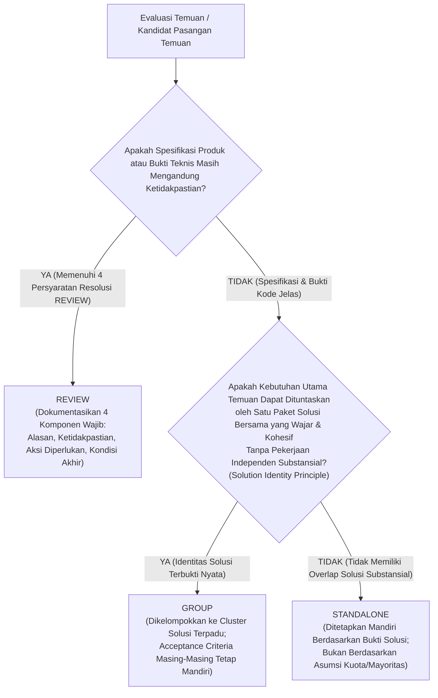

# LAPORAN PENYEMPURNAAN KRITERIA PENGELOMPOKAN BERBASIS SOLUSI (PHASE 2)
## Kalibrasi Ulang Metodologi & Evaluasi Kasus: IMP-015, IMP-019, dan IMP-043
### Versi 1.1 — Final Governance Correction

| Parameter Tata Kelola | Rincian Dokumen |
| :--- | :--- |
| **Siklus Lifecycle** | **Phase 2 — Finding Assessment & Remediation Planning** |
| **Aktivitas** | **Final Governance Calibration of Strict Solution-Based Clustering Criteria** |
| **Peran Penyusun** | Senior Product Analyst, Software Architect, & QA Analyst |
| **Penerima Otoritas** | Harry (Acceptance Owner & Lead Manual UAT Tester, PT Dutamedia Mandiri Pratama) |
| **Cabang Git Aktif** | `remediation/cycle-01-fixes` |
| **Status Dokumen** | **PROPOSED FOR FORMAL RATIFICATION (REVISION 1.1)** |
| **Status Persetujuan Owner** | **Directionally Accepted (Arah Disetujui Secara Terarah; Menunggu Ratifikasi Formal)** |
| **Tanggal Analisis** | 1 November 2026 |
| **Dokumen Pendahulu** | `Clustering-Criteria-Calibration-Report.md` (Dipertahankan Penuh sebagai Riwayat Audit) |

---

## DAFTAR ISI
1. [Akurasi Persetujuan Tata Kelola & Latar Belakang Revisi](#1-akurasi-persetujuan-tata-kelola--latar-belakang-revisi)
2. [Penyempurnaan 6 Kriteria Pengelompokan Berbasis Solusi](#2-penyempurnaan-6-kriteria-pengelompokan-berbasis-solusi)
3. [Evaluasi Ulang IMP-019 dan IMP-043: Kualifikasi Bukti & Batasan Cakupan Wajar](#3-evaluasi-ulang-imp-019-dan-imp-043-kualifikasi-bukti--batasan-cakupan-wajar)
4. [Persyaratan Resolusi Wajib untuk Status REVIEW & Evaluasi Kasus IMP-015](#4-persyaratan-resolusi-wajib-untuk-status-review--evaluasi-kasus-imp-015)
5. [Matriks Komparasi Tumpang-Tindih Solusi (Solution Overlap Comparison Matrix)](#5-matriks-komparasi-tumpang-tindih-solusi-solution-overlap-comparison-matrix)
6. [Penyempurnaan Kerangka Keputusan Operasional (Revised Decision Framework)](#6-penyempurnaan-kerangka-keputusan-operasional-revised-decision-framework)
7. [Rekomendasi bagi Acceptance Owner & Kesiapan Backlog 44 Temuan](#7-rekomendasi-bagi-acceptance-owner--kesiapan-backlog-44-temuan)
8. [Batasan Tata Kelola & Stop Condition](#8-batasan-tata-kelola--stop-condition)

---

## 1. AKURASI PERSETUJUAN TATA KELOLA & LATAR BELAKANG REVISI

Dokumen ini merupakan pemutakhiran terkontrol (*controlled revision 1.1*) terhadap dokumen kalibrasi metodologi pengelompokan temuan improvement. 

### Penegasan Status Persetujuan Tata Kelola (Governance Approval Accuracy):
Sesuai arahan Acceptance Owner (Pak Harry), dokumen ini secara tegas membedakan dua tingkatan persetujuan tata kelola:
- **Directionally Accepted (Diterima Secara Terarah):** Arah pendekatan *Solution-Based Clustering* telah diterima secara prinsip oleh Acceptance Owner sebagai landasan penyempurnaan metodologi, menggantikan pendekatan kluster besar berbasis lokasi/topik yang tidak sesuai kebutuhan.
- **Formally Ratified (Disahkan Secara Formal):** Standar resmi kriteria pengelompokan dan hasil evaluasi kasus uji **belum disahkan secara formal**. Dokumen ini berstatus usulan final (*Proposed for Formal Ratification*) dan menunggu persetujuan eksplisit Acceptance Owner sebelum dapat diterapkan ke seluruh backlog.

### Catatan Penyempurnaan Versi 1.1:
1. **Akurasi Tata Kelola:** Memperbaiki pencatatan status persetujuan agar tidak mencatat ratifikasi formal sebelum ada keputusan eksplisit.
2. **Kualifikasi Cakupan Wajar IMP-019 & IMP-043:** Menegaskan bahwa penggabungan keduanya didasarkan pada paket remediasi yang wajar, kohesif, dan sesuai target desain asli, bukan perluasan cakupan artifisial.
3. **Koreksi Aturan Keputusan STANDALONE:** Menghilangkan asumsi prediktif ("mayoritas standalone") atau kuota ukuran cluster (seperti target 2–4 temuan). Status `STANDALONE` ditetapkan murni berdasarkan ketiadaan tumpang-tindih solusi yang substansial.
4. **Persyaratan Resolusi Status REVIEW:** Menetapkan empat komponen wajib yang harus dipenuhi oleh setiap temuan yang diklasifikasikan sebagai `REVIEW`.

---

## 2. PENYEMPURNAAN 6 KRITERIA PENGELOMPOKAN BERBASIS SOLUSI

Keenam kriteria positif disempurnakan menjadi standar yang operasional, realistis, dan berorientasi pada kesatuan paket rekayasa perangkat lunak:

```
+----------------------------------------------------------------------------------------------------+
| 6 KRITERIA POSITIF PENGELOMPOKAN BERBASIS SOLUSI (REVISED SOLUTION-BASED CRITERIA)                 |
|                                                                                                    |
| 1. Problem & Remediation Relatedness  --> Masalah & kebutuhan remediasi berhubungan substantif     |
| 2. Expected Outcome Convergence      --> Kondisi akhir mengarah pada satu kesatuan visual/fungsi   |
| 3. Solution Identity (PRINSIP INTI)  --> Satu paket remediasi menuntaskan kebutuhan utama anggota   |
| 4. Remediation Package Cohesion      --> Perubahan teknis merupakan satu kesatuan paket rilis      |
| 5. Scope Coherence & Manageability   --> Batasan lingkup padat, terdefinisi, dan terkelola risikonya|
| 6. Independent AC Preservation       --> Kriteria penerimaan individual tetap teruji mandiri       |
+----------------------------------------------------------------------------------------------------+
```

### Rincian 6 Kriteria Positif:

#### 1. Problem & Remediation Relatedness (Keterkaitan Masalah & Kebutuhan Remediasi)
- Akar masalah teknis tidak harus identik 100% secara mutlak.
- Syarat terpenuhi apabila masalah dan kebutuhan remediasinya cukup berhubungan secara fungsional atau arsitektural, sehingga penyelesaian yang satu secara alami menjadi bagian dari penyelesaian yang lain.

#### 2. Expected Outcome Convergence (Konvergensi Hasil Akhir)
- Kondisi ideal yang diharapkan dari masing-masing temuan saling melengkapi dan menyatu membentuk satu kesatuan kondisi akhir yang terpadu (*coherent end-state*).

#### 3. Solution Identity (Identitas Solusi Bersama — PRINSIP INTI)
- **Definisi:** Satu paket remediasi yang terdefinisi dengan jelas (*single cohesive remediation package*) harus mampu memenuhi kebutuhan utama seluruh anggota cluster tanpa memerlukan paket solusi independen yang substansial.
- Jika untuk menyelesaikan Temuan B diperlukan inisiatif rekayasa mandiri yang terpisah secara substansial (misal: membangun pipeline data baru, membuat tabel database baru, atau merancang ulang alur bisnis independen), maka Temuan B tidak boleh dipaksakan masuk ke cluster tersebut.

#### 4. Remediation Package Cohesion (Kesatuan Paket Implementasi)
- Tumpang-tindih implementasi tidak dinilai secara sempit dari kesamaan baris kode, commit, atau file tunggal.
- Syarat terpenuhi apabila perubahan kode (meskipun menyentuh beberapa file view atau komponen berbeda) merupakan satu kesatuan paket pekerjaan teknis yang wajar, dirancang, diintegrasikan, dan diuji bersamaan sebagai satu unit pengiriman (*unit of delivery*).

#### 5. Scope Coherence & Manageability (Kejelasan dan Kerampingan Ruang Lingkup)
- Penggabungan menghasilkan unit kerja yang padat, terdefinisi tegas batasan awalnya dan akhirnya, mudah dipahami tim pengembang, serta tidak berkembang menjadi *mega-epic* yang sulit dikontrol risikonya.
- Besaran anggota cluster ditentukan murni oleh batas solusi teknis yang kohesif, tanpa ada kuota buatan atau batasan artifisial.

#### 6. Preservation of Verifiable Acceptance Criteria (Preservasi Keterujian Kriteria Penerimaan)
- Pengelompokan solusi teknis **tidak menghilangkan identitas mandiri maupun kewajiban verifikasi masing-masing temuan**.
- Setiap temuan anggota cluster tetap mempertahankan nomor ID, deskripsi backlog asli, dan Acceptance Criteria (AC) spesifiknya untuk diverifikasi oleh QA/UAT saat pengujian rilis.

---

### Kondisi Diskualifikasi (Negative Disqualifiers):

Kondisi-kondisi berikut **TIDAK CUKUP dan TIDAK SAH** untuk memaksakan pengelompokan jika *Solution Identity* tidak terpenuhi:
- ❌ **Same Page / Co-location Murni:** Berada pada file view yang sama tanpa kesamaan solusi logika.
- ❌ **Same Module / Menu Group:** Berada dalam sub-menu yang sama (misal: sama-sama di grup 'Workspace').
- ❌ **Same Component Type:** Menggunakan elemen antarmuka yang serupa (misal: sama-sama tombol atau dropdown).
- ❌ **Same Backlog Category Label:** Memiliki label kategori yang sama di spreadsheet backlog.
- ❌ **Concurrency of Work:** Praktis dikerjakan pada sprint yang sama oleh programmer yang sama.
- ❌ **Business Workflow Sequence Murni:** Fitur B digunakan pengguna setelah fitur A dalam SOP operasional, padahal arsitektur kodenya terpisah.

---

## 3. EVALUASI ULANG IMP-019 DAN IMP-043: KUALIFIKASI BUKTI & BATASAN CAKUPAN WAJAR

Sesuai arahan Acceptance Owner, tim mengevaluasi kembali hubungan antara `IMP-019` dan `IMP-043` dengan penekanan pada **kebutuhan original findings, target desain prototipe, dan batasan cakupan yang wajar (tidak artifisial)**.

### A. Kebutuhan Asli Masing-Masing Finding:
1. **`IMP-019` (Standardisasi Navbar Global Bersih):**  
   - *Kebutuhan Original Backlog:* Menyeragamkan bar atas di seluruh halaman sistem menjadi satu standar: menampilkan ikon notifikasi dan avatar inisial pengguna, tanpa tombol teks profil/logout yang berulang di header.
   - *Target Arsitektural:* Menyediakan pola layout topbar terpusat untuk menggantikan implementasi header yang tersebar secara terdesentralisasi di seluruh view aplikasi.
2. **`IMP-043` (Topbar Blocker: Breadcrumb dan Avatar):**  
   - *Kebutuhan Original Backlog:* Mengubah breadcrumb menjadi `Workspace / Laporkan & Pantau Blocker` (menghapus string bocor `(Prototipe 05)`), menyelaraskan sisi kanan dengan avatar inisial, serta menghapus tombol teks manajerial `Antrean Tiket` dan `Aging Radar`.
   - *Target Desain Prototipe 05 (`05-Raise-Instant-Blocker.html` L75–82):* Header bersih dengan breadcrumb kontekstual staf dan avatar pengguna.

### B. Kualifikasi Batasan Cakupan Wajar (Cohesive Remediation Package):
- **Bukan Perluasan Artifisial:** Ruang lingkup `IMP-019` sejak awal adalah menyeragamkan topbar di seluruh halaman internal aplikasi. Halaman `/blockers/raise` (`RaiseBlockerView.vue`) secara alami merupakan salah satu halaman internal tersebut. Memasukkan pembersihan header blocker ke dalam paket remediasi `IMP-019` bukanlah perluasan cakupan yang dipaksakan, melainkan konsekuensi logis dari adopsi standar topbar global.
- **Keterkaitan Perubahan Nyata pada `RaiseBlockerView.vue` (L155–172):**
  Ketika implementasi topbar standar diterapkan pada `RaiseBlockerView.vue`:
  1. Penghapusan tag `<header class="topbar">` lokal secara langsung membuang tombol `Antrean Tiket`, `Aging Radar`, dan `My Today`, serta badge redundan `WP`.
  2. Pemasangan komponen topbar standar dengan atribut `breadcrumb="Workspace / Laporkan & Pantau Blocker"` secara langsung mengeliminasi string `(Prototipe 05)` dan merender teks resmi sesuai Prototipe 05.
  3. Avatar inisial bulat otomatis tampil di sisi kanan sesuai spesifikasi global.
- **Tidak Memerlukan Paket Solusi Independen:** Tidak ada pekerjaan koding tambahan yang substansial di luar integrasi topbar tersebut. Penyetelan string breadcrumb merupakan konfigurasi standar penggunaan komponen di setiap view.

### C. Pembedaan Mandat: Shared Remediation Work vs Independent Acceptance Criteria:
- **Shared Remediation Work:** Satu paket rekayasa kohesif berupa pembuatan komponen topbar terstandarisasi dan integrasinya ke dalam view-view internal aplikasi, termasuk `RaiseBlockerView.vue`.
- **Independent Acceptance Criteria (Tetap Wajib Diuji QA):**
  - Kriteria pengujian `IMP-019`: Menguji keseragaman topbar di seluruh modul internal.
  - Kriteria pengujian `IMP-043`: Menguji secara spesifik pada rute `/blockers/raise` bahwa teks `(Prototipe 05)` tidak ada lagi, tombol antrean manajerial telah hilang, dan avatar inisial berfungsi.

> [!IMPORTANT]
> **Kesimpulan Kualifikasi:**  
> **`IMP-019` dan `IMP-043` DIREKOMENDASIKAN SEBAGAI KANDIDAT `GROUP`**.  
> Pengelompokan ini didasarkan pada satu paket remediasi yang wajar, terpadu, dan kohesif sesuai kebutuhan original backlog dan target desain, bukan atas perluasan cakupan artifisial. Kriteria penerimaan individual `IMP-043` tetap dipertahankan penuh untuk verifikasi UAT.

---

## 4. PERSYARATAN RESOLUSI WAJIB UNTUK STATUS REVIEW & EVALUASI KASUS IMP-015

Sesuai arahan tata kelola Acceptance Owner, status **`REVIEW`** tidak boleh menjadi "tempat penampungan pasif", melainkan status transisi aktif yang terikat pada persyaratan resolusi formal.

### A. Empat Persyaratan Resolusi Wajib untuk Status REVIEW:
Setiap temuan yang ditetapkan berstatus `REVIEW` **wajib mendokumentasikan empat elemen berikut**:
1. **Alasan Status REVIEW (*Reason for REVIEW*):** Penjelasan mengapa temuan belum dapat ditetapkan sebagai `GROUP` maupun `STANDALONE`.
2. **Ketidakpastian / Bukti yang Belum Tersedia (*Uncertainty / Missing Evidence*):** Fakta teknis, kontrak API, atau keputusan produk spesifik yang masih belum ada.
3. **Keputusan / Investigasi yang Diperlukan (*Required Decision / Investigation*):** Tindakan nyata yang harus dilakukan (misal: penetapan kebijakan Acceptance Owner atau technical spike oleh software architect).
4. **Kondisi Penetapan Akhir (*Resolution Transition Conditions*):** Kriteria eksplisit kapan temuan tersebut berpindah menjadi `GROUP` atau `STANDALONE`.

---

### B. Penerapan Persyaratan Resolusi pada Kasus Uji `IMP-015`:

Sesuai instruksi, tim **TIDAK mengambil keputusan produk** atas `IMP-015` dan mendokumentasikan persyaratan resolusinya secara lengkap:

| Parameter Resolusi | Dokumentasi Formal Kasus `IMP-015` |
| :--- | :--- |
| **Finding ID & Judul** | `IMP-015` — Penggantian Tombol Riwayat Menjadi Ikon Notifikasi Ber-badge Merah |
| **1. Alasan Status REVIEW** | Kebutuhan produk belum terdefinisi apakah ikon lonceng sekadar pintasan navigasi statis atau indikator aktif dengan hitungan notifikasi real-time. |
| **2. Ketidakpastian / Bukti Belum Tersedia** | - Belum ada keputusan kebijakan produk dari Acceptance Owner.<br>- Belum ada verifikasi ketersediaan kontrak API backend untuk unread notification count. |
| **3. Keputusan / Investigasi yang Diperlukan** | Penetapan arah kebijakan produk oleh Acceptance Owner (Pak Harry) antara Alternatif A atau Alternatif B. |
| **4. Kondisi Penetapan Akhir** | - **Menjadi `GROUP` (bergabung dengan paket topbar `IMP-019`):** Jika Acceptance Owner memilih **Alternatif A (Direct Link Shortcut)**, karena penambahan ikon lonceng statis dapat diserap langsung ke dalam template `AppTopbar.vue` tanpa pekerjaan data independen.<br>- **Menjadi `STANDALONE` (inisiatif fungsional terpisah):** Jika Acceptance Owner memilih **Alternatif B (Dynamic Counter Polling/Real-time)**, karena memerlukan pekerjaan backend API, reactive Pinia store, dan polling interval yang substansial di luar cakupan topbar layout. |

---

## 5. MATRIKS KOMPARASI TUMPANG-TINDIH SOLUSI (SOLUTION OVERLAP COMPARISON MATRIX)

Matriks berikut membandingkan ketiga temuan kalibrasi secara objektif:

| Dimensi Evaluasi | `IMP-019` (Navbar Global Bersih) | `IMP-043` (Topbar Blocker) | `IMP-015` (Lonceng Notifikasi) |
| :--- | :--- | :--- | :--- |
| **Deskripsi Kebutuhan Asli Backlog** | Standardisasi bar atas di seluruh sistem dengan avatar inisial dan notifikasi, menghapus tombol teks duplikat. | Perbaiki breadcrumb menjadi `Workspace / Laporkan & Pantau Blocker`, hapus tombol antrean tiket dan aging radar, pasang avatar inisial. | Ganti tombol teks `Riwayat Saya` di header harian menjadi ikon notifikasi ber-badge merah. |
| **Paket Pekerjaan Solusi** | Membangun komponen `AppTopbar.vue` dan mengintegrasikannya ke view internal. | Menghapus header lokal `RaiseBlockerView.vue` & pasang `AppTopbar` dengan prop breadcrumb blocker. | Mengganti tombol riwayat dengan lonceng notifikasi (statis vs dinamis). |
| **Shared Remediation Work** | Menyediakan template header terstandarisasi, avatar inisial, dan slot breadcrumb. | Mengonsumsi `AppTopbar.vue`, membersihkan tombol lokal dan teks prototipe secara langsung. | Menyediakan slot/posisi lonceng di sebelah avatar pada header kanan. |
| **Substantial Independent Work** | Tidak ada di luar pembuatan komponen dan migrasi view internal. | **NOL (Terselesaikan langsung oleh paket integrasi `IMP-019`).** | - Alternatif A: Nol.<br>- Alternatif B: Backend API, Pinia store, polling unread badge. |
| **Independent Acceptance Criteria (AC)** | AC 1: Topbar konsisten di seluruh aplikasi.<br>AC 2: Avatar inisial tampil.<br>AC 3: Tidak ada tombol teks duplikat. | AC 1: Breadcrumb bertuliskan `Workspace / Laporkan & Pantau Blocker`.<br>AC 2: Teks `(Prototipe 05)` hilang.<br>AC 3: Tombol manajerial hilang. | AC 1: Tombol `Riwayat Saya` hilang.<br>AC 2: Ikon lonceng tampil di header harian.<br>AC 3: Interaksi notifikasi berfungsi sesuai kebijakan. |
| **Status Rekomendasi** | **`KANDIDAT ANCHOR GROUP`** | **`KANDIDAT GROUP` (Bersama IMP-019)** | **`REVIEW` (Menunggu Keputusan Owner)** |

---

## 6. PENYEMPURNAAN KERANGKA KEPUTUSAN OPERASIONAL (REVISED DECISION FRAMEWORK)

Kerangka keputusan operasional tiga tingkat disempurnakan dengan menghilangkan seluruh asumsi apriori mengenai kuota jumlah atau target ukuran kelompok:



### Definisi Baku 3 Status Keputusan:

#### 1. `GROUP` (Kluster Solusi Terpadu)
- **Kondisi Penetapan:**  
  Prinsip *Solution Identity* terpenuhi. Satu paket remediasi teknis yang terdefinisi dengan jelas dan wajar secara langsung menuntaskan kebutuhan utama seluruh anggota, tanpa memerlukan paket solusi independen yang substansial.
- **Aturan Integritas:**  
  Pengelompokan solusi **tidak menghapus identitas finding**. Setiap finding tetap memiliki nomor ID unik dan Acceptance Criteria individual yang wajib diverifikasi saat UAT.

#### 2. `REVIEW` (Kajian Lanjutan / Menunggu Ketetapan Produk atau Bukti Teknis)
- **Kondisi Penetapan:**  
  Terdapat potensi kesamaan solusi, namun bukti teknis atau keputusan produk dari Acceptance Owner belum cukup final untuk menetapkan `GROUP` atau `STANDALONE`.
- **Kewajiban Dokumentasi:**  
  Wajib mendokumentasikan empat persyaratan resolusi: (1) Alasan, (2) Ketidakpastian, (3) Aksi yang diperlukan, dan (4) Kondisi penetapan akhir.

#### 3. `STANDALONE` (Temuan Mandiri)
- **Kondisi Penetapan:**  
  Ditetapkan apabila hasil evaluasi menunjukkan bahwa suatu finding **tidak memiliki kesamaan solusi remediasi yang substansial** dengan finding lainnya.
- **Koreksi Aturan Penetapan:**  
  Penetapan `STANDALONE` **tidak boleh** didasarkan pada:
  - Asumsi atau prediksi bahwa "mayoritas findings akan standalone".
  - Target ukuran kelompok (seperti asumsi kuota 2–4 temuan).
  - Target jumlah cluster tertentu.  
  Hasil akhir harus murni mengikuti fakta bukti kode dan kebutuhan solusi aktual.

---

## 7. REKOMENDASI BAGI ACCEPTANCE OWNER & KESIAPAN BACKLOG 44 TEMUAN

Berdasarkan koreksi tata kelola final ini, kami menyampaikan rekomendasi kepada Acceptance Owner (Pak Harry):

1. **Rekomendasi Ratifikasi Kriteria:**  
   Mengesahkan secara formal **6 Kriteria Pengelompokan Berbasis Solusi**, **Daftar Kondisi Diskualifikasi**, dan **Kerangka Keputusan Tiga Tingkat (`GROUP`, `REVIEW`, `STANDALONE`)** yang telah disempurnakan dalam dokumen ini sebagai pedoman tunggal evaluasi backlog.
2. **Rekomendasi Hasil Kasus Uji:**
   - Mengesahkan **`IMP-019` & `IMP-043` sebagai kandidat `GROUP`** (Paket Remediasi Topbar Terpadu, dengan preservasi AC individual `IMP-043`).
   - Mengesahkan **`IMP-015` berstatus `REVIEW`** (menunggu penetapan arah fitur notifikasi oleh Acceptance Owner).
3. **Status Kesiapan Eksekusi Backlog 44 Temuan:**  
   Metodologi ini telah terkalibrasi secara ketat dan siap diaplikasikan pada seluruh 44 findings begitu Bapak memberikan ratifikasi dan otorisasi formal.

---

## 8. BATASAN TATA KELOLA & STOP CONDITION

### Kepatuhan terhadap Batasan Ketat:
- Tidak ada evaluasi terhadap 44 findings pada langkah ini.
- Tidak ada pembentukan cluster baru secara prematur.
- Tidak ada modifikasi kode sumber, skema database, atau seeder aplikasi.
- Tidak ada pengubahan identitas nomor ID maupun deskripsi asli pada Master Improvement Backlog.
- Dokumen kalibrasi sebelumnya (`Clustering-Criteria-Calibration-Report.md`) tetap dipertahankan penuh sebagai riwayat audit.
- Berkas final ini diterbitkan di `UAT-Lifecycle/Phase-2-Reconciliation/Theme-Clustering/Clustering-Calibration-Refinement-Report.md` dan dicadangkan ke `Phase-2-Assessment/Theme-Clustering/`.

### Stop Condition:
Proses penyempurnaan dokumen tata kelola telah selesai sepenuhnya. Sesuai mandat tata kelola, tim **MENGHENTIKAN SELURUH AKSI LANJUTAN** pada titik ini.

Kami menyerahkan laporan final ini kepada **Pak Harry (Acceptance Owner)** untuk ditinjau dan diberikan ratifikasi formal. Tim **TIDAK AKAN** memulai evaluasi 44 findings sebelum memperoleh otorisasi eksplisit dari Bapak.
