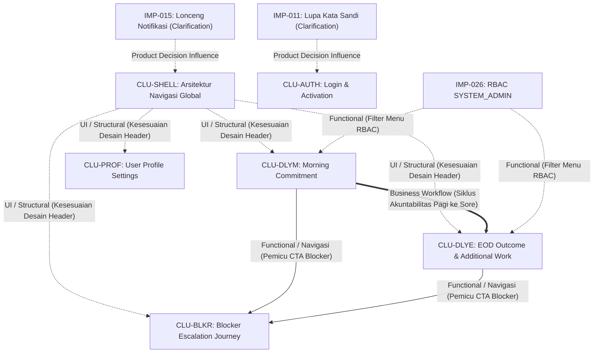

# ANALISIS THEME CLUSTERING & HUBUNGAN TEMUAN (PHASE 2)
## Ruang Lingkup: 44 Improvement Findings (IMP-001 s.d. IMP-044)

| Parameter Tata Kelola | Rincian Dokumen |
| :--- | :--- |
| **Siklus Lifecycle** | **Phase 2 — Finding Assessment & Remediation Planning** |
| **Aktivitas** | **Theme Clustering, Relationship Classification & Dependency Refinement** |
| **Peran Penyusun** | Senior Software Architect & Product Analyst |
| **Penerima Otoritas** | Harry (Acceptance Owner & Lead Manual UAT Tester, PT Dutamedia Mandiri Pratama) |
| **Cabang Git Aktif** | `remediation/cycle-01-fixes` |
| **Status Dokumen** | **PROPOSED FOR ACCEPTANCE OWNER REVIEW (REFINED)** |
| **Tanggal Analisis** | 1 November 2026 |
| **Total Scope** | **Tepat 44 Temuan (`IMP-001` s.d. `IMP-044`)** |

---

## DAFTAR ISI
1. [Latar Belakang, Prinsip Dasar, & Taksonomi Klasifikasi Hubungan](#1-latar-belakang-prinsip-dasar--taksonomi-klasifikasi-hubungan)
2. [Rekapitulasi Struktur Tema & Temuan Mandiri](#2-rekapitulasi-struktur-tema--temuan-mandiri)
3. [Analisis Rinci 6 Usulan Theme Clusters](#3-analisis-rinci-6-usulan-theme-clusters)
   - [Cluster 1 (CLU-AUTH): Autentikasi, Identitas Produk, & Orientasi Pengguna](#cluster-1-clu-auth-autentikasi-identitas-produk--orientasi-pengguna)
   - [Cluster 2 (CLU-SHELL): Arsitektur Navigasi Global & Standarisasi Header Bar](#cluster-2-clu-shell-arsitektur-navigasi-global--standarisasi-header-bar)
   - [Cluster 3 (CLU-PROF): Manajemen Profil Pengguna & Tata Letak Akun](#cluster-3-clu-prof-manajemen-profil-pengguna--tata-letak-akun)
   - [Cluster 4 (CLU-DLYM): Alur Akuntabilitas Pagi — Komitmen Harian](#cluster-4-clu-dlym-alur-akuntabilitas-pagi--komitmen-harian)
   - [Cluster 5 (CLU-DLYE): Alur Evaluasi Sore & Pengelolaan Pekerjaan Tambahan](#cluster-5-clu-dlye-alur-evaluasi-sore--pengelolaan-pekerjaan-tambahan)
   - [Cluster 6 (CLU-BLKR): Alur Kerja & Manajemen Pelaporan Kendala (Blocker)](#cluster-6-clu-blkr-alur-kerja--manajemen-pelaporan-kendala-blocker)
4. [Analisis Rinci 6 Standalone Findings](#4-analisis-rinci-6-standalone-findings)
5. [Analisis Hubungan Lintas Kelompok & Evaluasi Ketergantungan Teknis](#5-analisis-hubungan-lintas-kelompok--evaluasi-ketergantungan-teknis)
6. [Penegasan Status Keputusan Tertunda (Preserved Outstanding Decisions)](#6-penegasan-status-keputusan-tertunda-preserved-outstanding-decisions)
7. [Batasan Tata Kelola & Stop Condition](#7-batasan-tata-kelola--stop-condition)

---

## 1. LATAR BELAKANG, PRINSIP DASAR, & TAKSONOMI KLASIFIKASI HUBUNGAN

Setelah seluruh **44 temuan improvement (`IMP-001` s.d. `IMP-044`)** diinvestigasi secara individual, diaudit mutunya (*Quality Review*), dan diverifikasi kelayakannya (*Formal Acceptance Review*), tahap selanjutnya adalah melakukan analisis hubungan antar-temuan untuk menyusun usulan pengelompokan tema (*Theme Clustering*).

Berdasarkan tinjauan kritis (*critical review*) dari Acceptance Owner, analisis hubungan harus membedakan secara tegas antara keterkaitan konseptual/bisnis dengan ketergantungan teknis implementasi yang sebenarnya. Tidak dibenarkan melabeli suatu hubungan sebagai *implementation dependency* hanya karena kesamaan halaman, keterkaitan alur bisnis, atau keseragaman rancangan visual.

### Taksonomi 5 Kategori Hubungan:
Untuk menjamin objektivitas dan ketepatan arsitektural, setiap hubungan antar-temuan dan antar-kelompok diklasifikasikan ke dalam salah satu atau kombinasi dari lima kategori baku berikut:

1. **Functional Relationship (Hubungan Fungsional):**  
   Hubungan kebutuhan atau fungsionalitas produk di mana dua atau lebih elemen saling melengkapi fitur, berbagi domain data fungsional, atau terikat pada spesifikasi kebutuhan fungsional yang sama.
2. **Business Workflow Relationship (Hubungan Alur Kerja Bisnis):**  
   Hubungan urutan proses atau tata laksana operasional pengguna (SOP) dalam menjalankan tugas sehari-hari (misalnya urutan waktu siklus kerja dari penetapan rencana di pagi hari menuju evaluasi capaian di sore hari).
3. **UI / Structural Relationship (Hubungan Antarmuka / Struktural):**  
   Keterkaitan susunan tata letak visual, konvensi hierarki visual, atau konsistensi komponen antarmuka pengguna (misalnya keseragaman pola header bar, breadcrumb, avatar, atau sistem form grid).
4. **Implementation Dependency (Ketergantungan Implementasi):**  
   Ketergantungan teknis tingkat kode (*hard technical blocking dependency*) yang secara mutlak mengharuskan suatu unit pekerjaan teknis diselesaikan dan berfungsi terlebih dahulu sebelum unit pekerjaan lain dapat dikompilasi, dijalankan, atau diuji.
5. **Product Decision Influence (Pengaruh Keputusan Produk):**  
   Ketergantungan terhadap penetapan arah kebijakan produk dari Acceptance Owner yang secara langsung memengaruhi batasan ruang lingkup (*scope*), spesifikasi arsitektur, atau alur kerja suatu kluster.

### Prinsip Analisis Hubungan:
- **Anti-Co-Location Bias:** Dua temuan tidak otomatis digabungkan hanya karena berada pada file atau halaman yang sama jika tujuan bisnis dan sifat perubahannya berbeda secara substansial.
- **Integritas Standalone Findings:** Temuan yang tidak memiliki keterikatan logis atau dependensi kuat dipertahankan secara terhormat sebagai **Standalone Finding** tanpa pengelompokan paksa.
- **Preservasi Identitas Temuan:** Seluruh 44 Finding ID dipertahankan 100% tanpa perubahan nomor, nama, maupun status validitasnya (`VALID`, `NEEDS CLARIFICATION`, `DEFERRED CANDIDATE`).
- **Netralitas Arsitektur:** Analisis ini tidak mengasumsikan penggunaan *shared component* tertentu sebagai keputusan teknis final, melainkan mencatatnya sebagai opsi rekayasa perangkat lunak.

---

## 2. REKAPITULASI STRUKTUR TEMA & TEMUAN MANDIRI

Dari **44 temuan improvement**, tim analisis mempertahankan **6 Theme Clusters (38 Temuan)** dan **6 Standalone Findings (6 Temuan)** dengan ketelitian klasifikasi hubungan yang telah disempurnakan:

| ID Kelompok | Nama Tema / Cluster | Jumlah Anggota | Persentase | Klasifikasi Hubungan Utama |
| :---: | :--- | :---: | :---: | :--- |
| **`CLU-AUTH`** | Autentikasi, Identitas Produk, & Orientasi Pengguna | 11 Temuan | 25.0% | UI / Structural Relationship & Functional Relationship |
| **`CLU-SHELL`** | Arsitektur Navigasi Global & Standarisasi Header Bar | 7 Temuan | 15.9% | UI / Structural Relationship (Global Layout Shell) |
| **`CLU-PROF`** | Manajemen Profil Pengguna & Tata Letak Akun | 2 Temuan | 4.5% | Functional Relationship & UI / Structural Relationship |
| **`CLU-DLYM`** | Alur Akuntabilitas Pagi — Komitmen Harian | 4 Temuan | 9.1% | Business Workflow Relationship & Functional Relationship |
| **`CLU-DLYE`** | Alur Evaluasi Sore & Pengelolaan Pekerjaan Tambahan | 9 Temuan | 20.5% | Business Workflow Relationship & Functional Relationship |
| **`CLU-BLKR`** | Alur Kerja & Manajemen Pelaporan Kendala (Blocker) | 5 Temuan | 11.4% | Business Workflow Relationship & UI / Structural Relationship |
| **`STANDALONE`** | Temuan Mandiri (Klarifikasi, Tata Kelola, QA) | 6 Temuan | 13.6% | Product Decision Influence, QA Hardening, RBAC Policy |
| **TOTAL** | **6 Cluster + Standalone Findings** | **44 Temuan** | **100.0%** | **Cakupan Sempurna (Zero Omission)** |

---

## 3. ANALISIS RINCI 6 USULAN THEME CLUSTERS

### Cluster 1 (CLU-AUTH): Autentikasi, Identitas Produk, & Orientasi Pengguna
- **Cluster ID:** `CLU-AUTH`
- **Anggota Temuan (11 Temuan):**
  [`IMP-001`](file:///d:/PKL%20Duta%20Media/Dutamedia-WorkPulse/UAT-Lifecycle/Phase-2-Reconciliation/Improvement-Investigation/Improvement-Investigation-Report.md#imp-001-penyempurnaan-tagline-value-proposition-hero-login), [`IMP-002`](file:///d:/PKL%20Duta%20Media/Dutamedia-WorkPulse/UAT-Lifecycle/Phase-2-Reconciliation/Improvement-Investigation/Improvement-Investigation-Report.md#imp-002-penyesuaian-judul-poin-fitur-1-komitmen-harian-menyeluruh), [`IMP-003`](file:///d:/PKL%20Duta%20Media/Dutamedia-WorkPulse/UAT-Lifecycle/Phase-2-Reconciliation/Improvement-Investigation/Improvement-Investigation-Report.md#imp-003-penyesuaian-deskripsi-subtitle-poin-fitur-1-komitmen-harian), [`IMP-004`](file:///d:/PKL%20Duta%20Media/Dutamedia-WorkPulse/UAT-Lifecycle/Phase-2-Reconciliation/Improvement-Investigation/Improvement-Investigation-Report.md#imp-004-penyelarasan-judul--subtitle-poin-fitur-2-dengan-desain-uiux), [`IMP-005`](file:///d:/PKL%20Duta%20Media/Dutamedia-WorkPulse/UAT-Lifecycle/Phase-2-Reconciliation/Improvement-Investigation/Improvement-Investigation-Report.md#imp-005-penyelarasan-judul--subtitle-poin-fitur-3-dengan-desain-uiux), [`IMP-006`](file:///d:/PKL%20Duta%20Media/Dutamedia-WorkPulse/UAT-Lifecycle/Phase-2-Reconciliation/Improvement-Investigation/Improvement-Investigation-Report.md#imp-006-standardisasi-ikon-vektor-svg-pada-3-poin-fitur-panel-kiri), [`IMP-007`](file:///d:/PKL%20Duta%20Media/Dutamedia-WorkPulse/UAT-Lifecycle/Phase-2-Reconciliation/Improvement-Investigation/Improvement-Investigation-Report.md#imp-007-penyesuaian-headline-form-kanan-menjadi-lebih-inklusif-alur), [`IMP-008`](file:///d:/PKL%20Duta%20Media/Dutamedia-WorkPulse/UAT-Lifecycle/Phase-2-Reconciliation/Improvement-Investigation/Improvement-Investigation-Report.md#imp-008-fleksibilitas--penyesuaian-label-versi-sistem-di-header-form), [`IMP-009`](file:///d:/PKL%20Duta%20Media/Dutamedia-WorkPulse/UAT-Lifecycle/Phase-2-Reconciliation/Improvement-Investigation/Improvement-Investigation-Report.md#imp-009-penyesuaian-label-lingkungan-kerja-internal-workspace-environment), [`IMP-010`](file:///d:/PKL%20Duta%20Media/Dutamedia-WorkPulse/UAT-Lifecycle/Phase-2-Reconciliation/Improvement-Investigation/Improvement-Investigation-Report.md#imp-010-penggantian-microcopy-teknis-menjadi-bantuan-akses-pengguna), [`IMP-012`](file:///d:/PKL%20Duta%20Media/Dutamedia-WorkPulse/UAT-Lifecycle/Phase-2-Reconciliation/Improvement-Investigation/Improvement-Investigation-Report.md#imp-012-keselarasan-visual-panel-hero-kiri-antara-tab-login-dan-aktivasi).
- **Tujuan / Permasalahan Utama:**
  Membangun impresi pertama (*first impression*) yang profesional, terpercaya, dan ramah pengguna pada gerbang masuk aplikasi WorkPulse, selaras dengan naskah dan rancangan visual kanonikal Prototipe 01 (`01-Login-Activation.html`).
- **Dasar Hubungan Antaranggota:**
  - *UI / Structural Relationship:* `IMP-001` s.d. `IMP-006` menyelaraskan tipografi, naskah pilar nilai, dan ikon vektor SVG pada panel hero kiri. `IMP-012` menjamin keselarasan estetika dan layout panel hero tersebut antara halaman `/login` dan `/activate`.
  - *Functional Relationship (Komunikasi Form Masuk):* `IMP-007` s.d. `IMP-010` menyelesaikan kebutuhan penyampaian konteks kerja pada form login kanan (headline inklusif, fleksibilitas versi rilis, identifikasi lingkungan kerja internal, dan bantuan operasional pengganti jargon teknis).
- **Klasifikasi Hubungan:** **UI / Structural Relationship** & **Functional Relationship**.
- **Potensi Pendekatan Bersama:**
  Penyelarasan naskah hero dan form login secara terkoordinasi, didukung opsi refaktor layout hero menjadi komponen terbagi (*shared layout*) guna menghindari duplikasi markup antara `LoginView.vue` dan `ActivateView.vue`.
- **Ketergantungan Terhadap Keputusan Produk:**
  Temuan `IMP-011` (Lupa Kata Sandi) memengaruhi formulir ini tetapi dipisahkan sebagai Standalone karena menunggu arahan kebijakan Acceptance Owner (lihat Bab 4 & 5).

---

### Cluster 2 (CLU-SHELL): Arsitektur Navigasi Global & Standarisasi Header Bar
- **Cluster ID:** `CLU-SHELL`
- **Anggota Temuan (7 Temuan):**
  [`IMP-014`](file:///d:/PKL%20Duta%20Media/Dutamedia-WorkPulse/UAT-Lifecycle/Phase-2-Reconciliation/Improvement-Investigation/Improvement-Investigation-Report.md#imp-014-penggantian-tombol-profil-kanan-atas-menggunakan-ikon-avatar), [`IMP-018`](file:///d:/PKL%20Duta%20Media/Dutamedia-WorkPulse/UAT-Lifecycle/Phase-2-Reconciliation/Improvement-Investigation/Improvement-Investigation-Report.md#imp-018-eliminasi-badge-redundan-wp-workpulse-pada-navbar-atas), [`IMP-019`](file:///d:/PKL%20Duta%20Media/Dutamedia-WorkPulse/UAT-Lifecycle/Phase-2-Reconciliation/Improvement-Investigation/Improvement-Investigation-Report.md#imp-019-standardisasi-navbar-global-bersih-avatar-inisial--notifikasi), [`IMP-020`](file:///d:/PKL%20Duta%20Media/Dutamedia-WorkPulse/UAT-Lifecycle/Phase-2-Reconciliation/Improvement-Investigation/Improvement-Investigation-Report.md#imp-020-konsistensi-penjanaan-huruf-inisial-avatar-2-huruf-nama-lengkap), [`IMP-024`](file:///d:/PKL%20Duta%20Media/Dutamedia-WorkPulse/UAT-Lifecycle/Phase-2-Reconciliation/Improvement-Investigation/Improvement-Investigation-Report.md#imp-024-penyeragaman-topbar-administrasi-menggunakan-breadcrumb-hirarkis-menggantikan-badge-duplikat-wp), [`IMP-025`](file:///d:/PKL%20Duta%20Media/Dutamedia-WorkPulse/UAT-Lifecycle/Phase-2-Reconciliation/Improvement-Investigation/Improvement-Investigation-Report.md#imp-025-konsolidasi-topbar-administrasi-eliminasi-tautan-navigasi-duplikat--penggantian-teks-profil-dengan-avatar-inisial-bulat), [`IMP-043`](file:///d:/PKL%20Duta%20Media/Dutamedia-WorkPulse/UAT-Lifecycle/Phase-2-Reconciliation/Improvement-Investigation/Improvement-Investigation-Report.md#imp-043-penyeragaman-topbar-blocker-breadcrumb-workspace--laporkan--pantau-blocker-avatar-inisial--lonceng-notifikasi).
- **Tujuan / Permasalahan Utama:**
  Menghilangkan fragmentasi implementasi topbar yang saat ini diduplikasi secara lokal di berbagai view aplikasi, serta mewujudkan struktur header global yang bersih dan terstandarisasi (breadcrumb hirarkis di kiri, avatar profil inisial di kanan).
- **Dasar Hubungan Antaranggota:**
  - *UI / Structural Relationship:* Seluruh 7 temuan beroperasi pada level tata letak navigasi atas (topbar/shell antarmuka). `IMP-019` mendefinisikan rancangan navbar global bersih; `IMP-014`, `IMP-018`, `IMP-024`, `IMP-025`, dan `IMP-043` menerapkan pola konsisten tersebut pada modul harian, profil, administrasi, dan blocker.
  - *Functional Utility Relationship:* `IMP-020` menyediakan algoritma pembentukan inisial avatar 2 huruf kapital yang dipakai langsung oleh elemen avatar pada struktur topbar ini.
- **Klasifikasi Hubungan:** **UI / Structural Relationship** (Global UI Shell).
- **Potensi Pendekatan Bersama:**
  Pengabstraksian tata letak topbar menjadi komponen shell bersama yang menerima konfigurasi breadcrumb, sehingga mengeliminasi markup header redundant di seluruh halaman modul.
- **Ketergantungan Terhadap Keputusan Produk:**
  Temuan `IMP-015` (Lonceng Notifikasi) berlokasi fisik pada topbar ini, namun dipisahkan sebagai Standalone karena menunggu kepastian kebutuhan fungsional (lihat Bab 4 & 5).

---

### Cluster 3 (CLU-PROF): Manajemen Profil Pengguna & Tata Letak Akun
- **Cluster ID:** `CLU-PROF`
- **Anggota Temuan (2 Temuan):**
  [`IMP-021`](file:///d:/PKL%20Duta%20Media/Dutamedia-WorkPulse/UAT-Lifecycle/Phase-2-Reconciliation/Improvement-Investigation/Improvement-Investigation-Report.md#imp-021-pemisahan-nama-lengkap-dan-jabatan-pada-tampilan-user), [`IMP-022`](file:///d:/PKL%20Duta%20Media/Dutamedia-WorkPulse/UAT-Lifecycle/Phase-2-Reconciliation/Improvement-Investigation/Improvement-Investigation-Report.md#imp-022-penyelarasan-layout-body-profil-sesuai-3-seksi-prototipe-24).
- **Tujuan / Permasalahan Utama:**
  Menyajikan informasi identitas profesional karyawan secara bermartabat dan terstruktur, serta melengkapi tata kelola pengaturan akun mandiri sesuai rancangan Prototipe 24 (`24-Profile-Settings.html`).
- **Dasar Hubungan Antaranggota:**
  - *Functional Relationship:* Keduanya berada pada domain fungsional pengelolaan identitas pengguna (`ProfileView.vue`).
  - *UI / Structural Relationship:* `IMP-021` memisahkan data nama dan jabatan fungsional pada kartu identitas, sedangkan `IMP-022` menempatkan kartu tersebut ke dalam struktur tata letak 3 seksi kanonikal (Informasi Pribadi, Posisi & Unit Kerja, Keamanan Akun).
- **Klasifikasi Hubungan:** **Functional Relationship** & **UI / Structural Relationship**.
- **Potensi Pendekatan Bersama:**
  Restrukturisasi template dan form layout `ProfileView.vue` secara menyeluruh sesuai Prototipe 24.

---

### Cluster 4 (CLU-DLYM): Alur Akuntabilitas Pagi — Komitmen Harian
- **Cluster ID:** `CLU-DLYM`
- **Anggota Temuan (4 Temuan):**
  [`IMP-027`](file:///d:/PKL%20Duta%20Media/Dutamedia-WorkPulse/UAT-Lifecycle/Phase-2-Reconciliation/Improvement-Investigation/Improvement-Investigation-Report.md#imp-027-restrukturisasi--pembersihan-kartu-metrik-konteks-hari-ini-di-formulir-morning-commitment), [`IMP-028`](file:///d:/PKL%20Duta%20Media/Dutamedia-WorkPulse/UAT-Lifecycle/Phase-2-Reconciliation/Improvement-Investigation/Improvement-Investigation-Report.md#imp-028-penyempurnaan-microcopy-banner-keterlambatan-pengisian-komitmen-eliminasi-istilah-grace-period-yang-membingungkan), [`IMP-029`](file:///d:/PKL%20Duta%20Media/Dutamedia-WorkPulse/UAT-Lifecycle/Phase-2-Reconciliation/Improvement-Investigation/Improvement-Investigation-Report.md#imp-029-eliminasi-kode-keputusan-arsitektur-internal-dec-004-dari-label-checkbox-komitmen-nol), [`IMP-030`](file:///d:/PKL%20Duta%20Media/Dutamedia-WorkPulse/UAT-Lifecycle/Phase-2-Reconciliation/Improvement-Investigation/Improvement-Investigation-Report.md#imp-030-transformasi-microcopy-penjelasan-komitmen-nol-dari-enum-database-teknis-menjadi-bahasa-bisnis).
- **Tujuan / Permasalahan Utama:**
  Meningkatkan kejelasan kontekstual batas pengisian, menghilangkan istilah arsitektur teknis internal, dan menyajikan penjelasan status komitmen nol yang ramah pada alur check-in pagi (`MorningCommitmentView.vue`) sesuai Prototipe 02 (`02-Morning-Commitment.html`).
- **Dasar Hubungan Antaranggota:**
  - *Business Workflow Relationship:* Keempat temuan terikat secara langsung pada fase pembukaan hari kerja operasional (Morning Check-in).
  - *Functional Relationship (Kejelasan Kebijakan Komitmen):* `IMP-027` menata kartu jadwal, `IMP-028` menghapus istilah ambigu "Grace Period" pada banner keterlambatan, `IMP-029` membuang string arsitektur "DEC-004", dan `IMP-030` mengganti enum mentah `NOT_APPLICABLE_NO_COMMITMENT` dengan bahasa bisnis yang tenang dan jelas.
- **Klasifikasi Hubungan:** **Business Workflow Relationship** & **Functional Relationship**.
- **Potensi Pendekatan Bersama:**
  Pembersihan template formulir komitmen pagi dan penyelarasan teks kebijakan secara terpadu pada `MorningCommitmentView.vue`.

---

### Cluster 5 (CLU-DLYE): Alur Evaluasi Sore & Pengelolaan Pekerjaan Tambahan
- **Cluster ID:** `CLU-DLYE`
- **Anggota Temuan (9 Temuan):**
  [`IMP-031`](file:///d:/PKL%20Duta%20Media/Dutamedia-WorkPulse/UAT-Lifecycle/Phase-2-Reconciliation/Improvement-Investigation/Improvement-Investigation-Report.md#imp-031-eliminasi-kebocoran-kode-desain-prototipe-03-pada-subtitle-halaman-additional-work), [`IMP-032`](file:///d:/PKL%20Duta%20Media/Dutamedia-WorkPulse/UAT-Lifecycle/Phase-2-Reconciliation/Improvement-Investigation/Improvement-Investigation-Report.md#imp-032-perbaikan-overflow-horizontal-kolom-input-atasan-penugas-pada-grid-dua-kolom-additional-work), [`IMP-033`](file:///d:/PKL%20Duta%20Media/Dutamedia-WorkPulse/UAT-Lifecycle/Phase-2-Reconciliation/Improvement-Investigation/Improvement-Investigation-Report.md#imp-033-restrukturisasi--pembersihan-kartu-metrik-konteks-waktu-eod-di-halaman-eod-outcome), [`IMP-034`](file:///d:/PKL%20Duta%20Media/Dutamedia-WorkPulse/UAT-Lifecycle/Phase-2-Reconciliation/Improvement-Investigation/Improvement-Investigation-Report.md#imp-034-eliminasi-kebocoran-kode-desain-prototipe-04-pada-subtitle-halaman-eod-outcome), [`IMP-035`](file:///d:/PKL%20Duta%20Media/Dutamedia-WorkPulse/UAT-Lifecycle/Phase-2-Reconciliation/Improvement-Investigation/Improvement-Investigation-Report.md#imp-035-eliminasi-kode-arsitektur-dec-003--penyempurnaan-narasi-humanis-pada-seksi-refleksi-mandiri-eod), [`IMP-036`](file:///d:/PKL%20Duta%20Media/Dutamedia-WorkPulse/UAT-Lifecycle/Phase-2-Reconciliation/Improvement-Investigation/Improvement-Investigation-Report.md#imp-036-eliminasi-kode-enum-teknis-continue-do_not_continue-dan-not_completed-pada-opsi-evaluasi-eod), [`IMP-037`](file:///d:/PKL%20Duta%20Media/Dutamedia-WorkPulse/UAT-Lifecycle/Phase-2-Reconciliation/Improvement-Investigation/Improvement-Investigation-Report.md#imp-037-perbaikan-tata-letak-kolom-textarea-catatan-kelanjutan-tugas-eod-pelebaran-100--penyelarasan-label-vertikal), [`IMP-038`](file:///d:/PKL%20Duta%20Media/Dutamedia-WorkPulse/UAT-Lifecycle/Phase-2-Reconciliation/Improvement-Investigation/Improvement-Investigation-Report.md#imp-038-penyelarasan-kelengkapan-opsi-evaluasi-pekerjaan-tambahan-opsi-dibatalkan--alur-kelanjutan--alasan), [`IMP-039`](file:///d:/PKL%20Duta%20Media/Dutamedia-WorkPulse/UAT-Lifecycle/Phase-2-Reconciliation/Improvement-Investigation/Improvement-Investigation-Report.md#imp-039-transformasi-format-badge-alasan-pekerjaan-tambahan-dari-enum-raw-database-menjadi-bahasa-bisnis).
- **Tujuan / Permasalahan Utama:**
  Menyempurnakan alur evaluasi pencapaian kerja akhir hari (EOD Outcome) dan pencatatan tugas tambahan, menjamin kesetaraan fitur evaluasi, kerapian tata letak grid, serta eliminasi kebocoran kode teknis/prototipe sesuai acuan Prototipe 03 (`03-Additional-Work.html`) dan Prototipe 04 (`04-EOD-Outcome.html`).
- **Dasar Hubungan Antaranggota:**
  - *Business Workflow Relationship:* Pekerjaan tambahan yang dicatat pada `AdditionalWorkView.vue` (`IMP-031`, `IMP-032`) dievaluasi hasilnya secara terpadu di sore hari pada `EodOutcomeView.vue` (`IMP-038`, `IMP-039`).
  - *Functional Relationship (Kesetaraan Logika Evaluasi):* `IMP-038` melengkapi opsi pembatalan dan kelanjutan tugas tambahan agar setara dengan komitmen utama; `IMP-036` dan `IMP-039` memetakan enum database teknis menjadi label bahasa bisnis yang dapat dipahami.
  - *UI / Structural Relationship:* `IMP-032` dan `IMP-037` memperbaiki permasalahan pembagian kolom form grid kaku (overflow input atasan dan perbaikan textarea 100% full width); `IMP-031` dan `IMP-034` membuang kebocoran penanda nama prototipe.
- **Klasifikasi Hubungan:** **Business Workflow Relationship**, **Functional Relationship**, & **UI / Structural Relationship**.
- **Potensi Pendekatan Bersama:**
  Penataan terpadu pada dua view yang saling melengkapi data transaksi kerja harian (`AdditionalWorkView.vue` dan `EodOutcomeView.vue`), didukung penyediaan fungsi kamus data pemformatan label enum pekerjaan tambahan.

---

### Cluster 6 (CLU-BLKR): Alur Kerja & Manajemen Pelaporan Kendala (Blocker)
- **Cluster ID:** `CLU-BLKR`
- **Anggota Temuan (5 Temuan):**
  [`IMP-016`](file:///d:/PKL%20Duta%20Media/Dutamedia-WorkPulse/UAT-Lifecycle/Phase-2-Reconciliation/Improvement-Investigation/Improvement-Investigation-Report.md#imp-016-penempatan-tombol-lapor-blocker-konsisten-pada-3-tab-my-today), [`IMP-040`](file:///d:/PKL%20Duta%20Media/Dutamedia-WorkPulse/UAT-Lifecycle/Phase-2-Reconciliation/Improvement-Investigation/Improvement-Investigation-Report.md#imp-040-pengalihan-tombol-lapor-blocker-menjadi-navigasi-langsung-ke-blockersraise-eliminasi-modal-pop-up-redundan), [`IMP-041`](file:///d:/PKL%20Duta%20Media/Dutamedia-WorkPulse/UAT-Lifecycle/Phase-2-Reconciliation/Improvement-Investigation/Improvement-Investigation-Report.md#imp-041-penyelarasan-menyeluruh-halaman-blocker-sesuai-prototipe-05-tombol-kembali-judul--2-tab-buat-laporan--blocker-saya), [`IMP-042`](file:///d:/PKL%20Duta%20Media/Dutamedia-WorkPulse/UAT-Lifecycle/Phase-2-Reconciliation/Improvement-Investigation/Improvement-Investigation-Report.md#imp-042-eliminasi-tombol-lihat-antrean-blocker-aktif-dari-formulir-pelaporan-blocker-karyawan), [`IMP-044`](file:///d:/PKL%20Duta%20Media/Dutamedia-WorkPulse/UAT-Lifecycle/Phase-2-Reconciliation/Improvement-Investigation/Improvement-Investigation-Report.md#imp-044-pembersihan-footer-form-pelaporan-blocker-penyesuaian-tombol-aksi-bersihkan--kirim).
- **Tujuan / Permasalahan Utama:**
  Mewujudkan alur kerja eskalasi kendala yang terpadu dan efisien (*instant blocker escalation workflow*) sesuai PRD v1.6 §3 dan acuan Prototipe 05 (`05-Raise-Instant-Blocker.html`), mulai dari titik pemicu pada formulir harian hingga pengalaman pelaporan dan pemantauan tiket staf.
- **Dasar Hubungan Antaranggota:**
  - *Business Workflow Relationship & Functional Trigger:* `IMP-016` dan `IMP-040` menyelaraskan tombol tindakan `+ Lapor Blocker` pada ketiga tab harian agar langsung menavigasikan staf ke halaman `/blockers/raise` (tanpa modal popup redundan).
  - *UI / Structural Relationship:* `IMP-041` merekonstruksi halaman blocker dengan tombol kembali dan sistem 2 tab (Buat Laporan & Blocker Saya), `IMP-042` membersihkan tombol antrean manajerial yang salah sasaran dari staf, dan `IMP-044` membersihkan kebocoran kode audit DEC-008 serta membetulkan rute tombol pembatalan.
- **Klasifikasi Hubungan:** **Business Workflow Relationship** & **UI / Structural Relationship**.
- **Potensi Pendekatan Bersama:**
  Restrukturisasi komponen `RaiseBlockerView.vue` sesuai Prototipe 05, didukung integrasi rute navigasi tombol CTA blocker pada modul-modul kerja harian.

---

## 4. ANALISIS RINCI 6 STANDALONE FINDINGS

Sesuai hasil audit dan mandat tanpa pengelompokan paksa (*anti-co-location bias*), keenam temuan berikut dipertahankan secara tegas sebagai **Standalone Finding**:

### 1. `IMP-011` — Prosedur Penanganan "Lupa Kata Sandi?"
- **Status Investigasi:** **`NEEDS CLARIFICATION`**
- **Klasifikasi Hubungan dengan Sistem:** **Product Decision Influence** terhadap `CLU-AUTH` & **Functional Relationship**.
- **Alasan Penempatan Standalone:**  
  Meskipun tautan pemicunya berada pada formulir login, penanganan temuan ini merupakan keputusan strategis Acceptance Owner mengenai arah kebijakan produk (Bantuan Administratif IT/HRGA vs Modul Self-Service via Email SMTP). Menempatkannya secara mandiri menjaga ruang lingkup teknis `CLU-AUTH` tetap bersih, pasti, dan tidak menggantung.

### 2. `IMP-013` — Skenario Uji Khusus State Akun Nonaktif & Rate Limit
- **Status Investigasi:** **`DEFERRED CANDIDATE`**
- **Klasifikasi Hubungan dengan Sistem:** **QA Testing Hardening** (Bukan cacat kode aplikasi).
- **Alasan Penempatan Standalone:**  
  Temuan ini bukan merupakan perubahan antarmuka atau logika sistem aplikasi, melainkan usulan perluasan cakupan automated test suite QA. Temuan ini secara tegas ditangguhkan ke fase hardening pasca-remediasi, sehingga tidak boleh digabungkan dengan cluster kode produktif.

### 3. `IMP-015` — Ikon Lonceng Notifikasi di Header Bar
- **Status Investigasi:** **`NEEDS CLARIFICATION`**
- **Klasifikasi Hubungan dengan Sistem:** **Product Decision Influence** terhadap `CLU-SHELL` & **UI / Structural Relationship**.
- **Alasan Penempatan Standalone:**  
  Meskipun berlokasi fisik pada area topbar, temuan ini menunggu penetapan kebutuhan fungsional Acceptance Owner (apakah sekadar tautan langsung navigasi ke Notification Center atau indikator aktif dengan polling jumlah unread count). Memisahkannya mencegah ketidakpastian membebani pekerjaan standarisasi topbar global `CLU-SHELL`.

### 4. `IMP-017` — Penyelarasan Caption Subtitle Brand Sidebar
- **Status Investigasi:** **`VALID`**
- **Klasifikasi Hubungan dengan Sistem:** **UI / Structural Relationship Lokal** (Perubahan teks statis tunggal).
- **Alasan Penempatan Standalone:**  
  Temuan ini hanya melibatkan penyesuaian string statis tunggal pada header sidebar (`EnterpriseSidebar.vue` baris 135: *"Dutamedia Intranet"* $\rightarrow$ *"Dutamedia Accountability"*). Temuan ini tidak memiliki keterkaitan fungsional maupun struktural yang mengikat dengan topbar atau formulir harian.

### 5. `IMP-023` — Pengalihan Rute Pemulihan Layar 403 Mengikuti Rute Kanonikal Peran
- **Status Investigasi:** **`VALID`**
- **Klasifikasi Hubungan dengan Sistem:** **Functional Relationship Lokal** (Error Recovery Route).
- **Alasan Penempatan Standalone:**  
  Temuan ini terlokalisasi secara eksklusif pada halaman error otorisasi (`ErrorPageView.vue` baris 25-27), menghubungkan navigasi tombol pemulihan dengan utilitas kanonikal peran (`getLandingRouteForRole()`). Tidak ada temuan lain yang beroperasi pada domain penanganan error sistem.

### 6. `IMP-026` — Tata Kelola Persona SYSTEM_ADMIN: Penonaktifan Akses Grup Navigasi 'Workspace'
- **Status Investigasi:** **`VALID`**
- **Klasifikasi Hubungan dengan Sistem:** **Functional Relationship** (Penegakan Aturan Otorisasi Akses / RBAC Policy).
- **Alasan Penempatan Standalone:**  
  Merupakan penegakan kebijakan otorisasi hak akses peran pada level konfigurasi router (`router/navigation.ts` baris 50-63). Temuan ini murni memisahkan peran administrator dari navigasi staf, berdiri sendiri dari perbaikan antarmuka visual transaksi harian.

---

## 5. ANALISIS HUBUNGAN LINTAS KELOMPOK & EVALUASI KETERGANTUNGAN TEKNIS

Sesuai arahan evaluasi kritis Acceptance Owner, bagian ini membedah hubungan spesifik antar-entitas untuk menguji apakah hubungan tersebut merupakan **ketergantungan implementasi sejati (*true implementation dependency*)** atau sebatas hubungan alur bisnis, kesamaan UI, maupun pengaruh keputusan produk.

---

### Evaluasi Rinci 6 Hubungan Spesifik:

#### 1. Hubungan `CLU-SHELL` terhadap `CLU-DLYM`, `CLU-DLYE`, `CLU-BLKR`, dan `CLU-PROF`
- **Jenis Hubungan:** **UI / Structural Relationship**.
- **Dasar Faktual:**  
  Setiap modul saat ini memiliki baris kode markup header lokal tersendiri (di `MorningCommitmentView.vue`, `AdditionalWorkView.vue`, `EodOutcomeView.vue`, `RaiseBlockerView.vue`, dan `ProfileSettingsView.vue`). Prototipe mengindikasikan pola header yang seragam (breadcrumb di kiri, avatar inisial di kanan).
- **Apakah Implementation Dependency Sejati?** **TIDAK.**
  - *Penjelasan Arsitektural:* Tidak ada keterkaitan kode kompilasi yang memblokir. Modul-modul kerja harian, blocker, atau profil dapat disempurnakan (misalnya memperbaiki layout grid, merapikan teks, atau membersihkan kebocoran kode audit) secara mandiri tanpa harus menunggu komponen `CLU-SHELL` selesai dibangun.
  - *Catatan Rekayasa:* Penyediaan komponen *shared topbar* merupakan **opsi strategi perancangan perangkat lunak**, bukan keputusan teknis final yang mengunci urutan implementasi.

#### 2. Hubungan `CLU-DLYM` terhadap `CLU-DLYE`
- **Jenis Hubungan:** **Business Workflow Relationship** & **Functional Relationship**.
- **Dasar Faktual:**  
  Dalam operasional bisnis, staf menetapkan komitmen di pagi hari (`CLU-DLYM`) dan mengevaluasi pencapaian komitmen tersebut di sore hari (`CLU-DLYE`). Keduanya juga terikat pada domain data akuntabilitas kerja harian yang sama.
- **Apakah Implementation Dependency Sejati?** **TIDAK.**
  - *Penjelasan Arsitektural:* Dari perspektif kode sumber di Phase 2, temuan `CLU-DLYM` (seperti microcopy "Grace Period" dan pembersihan "DEC-004") berada pada `MorningCommitmentView.vue`, sedangkan temuan `CLU-DLYE` (seperti perbaikan grid input atasan, textarea 100%, opsi CANCELLED tugas tambahan) berada pada `AdditionalWorkView.vue` dan `EodOutcomeView.vue`.
  - Masing-masing file dan store Pinia dapat diperbaiki dan diuji secara terpisah tanpa saling memblokir eksekusi kode.

#### 3. Hubungan `CLU-DLYM` dan `CLU-DLYE` terhadap `CLU-BLKR`
- **Jenis Hubungan:** **Functional Relationship** (Pemicu Navigasi) & **Business Workflow Relationship** (Integrasi Titik Eskalasi).
- **Dasar Faktual:**  
  Pada header formulir kerja harian pagi dan sore terdapat tombol aksi `+ Lapor Blocker` (`IMP-016` dan `IMP-040`) yang mengarahkan pengguna secara langsung ke halaman `/blockers/raise` agar staf yang menemui kendala dapat segera melapor.
- **Apakah Implementation Dependency Sejati?** **TIDAK.**
  - *Penjelasan Arsitektural:* Rute `/blockers/raise` dan komponen halamannya (`RaiseBlockerView.vue`) sudah ada di dalam router aplikasi. Menyelaraskan tombol CTA menjadi `router.push('/blockers/raise')` tidak membutuhkan rekonstruksi halaman blocker selesai terlebih dahulu.
  - Sebaliknya, perbaikan internal halaman blocker (`IMP-041`, `IMP-042`, `IMP-044`) dapat dikerjakan secara independen tanpa bergantung pada perubahan tombol CTA di halaman harian.

#### 4. Hubungan Standalone `IMP-026` terhadap Modul Harian (`CLU-DLYM` & `CLU-DLYE`)
- **Jenis Hubungan:** **Functional Relationship** (Penegakan Kebijakan Otorisasi / RBAC Policy).
- **Dasar Faktual:**  
  `IMP-026` beroperasi pada `router/navigation.ts` untuk menyaring menu 'Workspace' agar tidak ditampilkan pada antarmuka akun dengan peran `SYSTEM_ADMIN`.
- **Apakah Implementation Dependency Sejati?** **TIDAK.**
  - *Penjelasan Arsitektural:* Logika filter menu navigasi administrator tidak mengubah cara kerja internal formulir Morning Commitment atau EOD Outcome bagi karyawan atau manajer yang berhak mengaksesnya. Keduanya dapat dikembangkan dan diuji secara terpisah.

#### 5. Hubungan Standalone `IMP-015` terhadap `CLU-SHELL`
- **Jenis Hubungan:** **Product Decision Influence** & **UI / Structural Relationship**.
- **Dasar Faktual:**  
  Elemen lonceng notifikasi berlokasi fisik di area kanan topbar. Kebutuhan fungsionalnya (apakah sekadar link navigasi ke `/notifications` atau indikator aktif dengan counter angka dan background sync) masih menunggu keputusan Acceptance Owner.
- **Apakah Implementation Dependency Sejati?** **TIDAK (untuk pekerjaan topbar lainnya).**
  - *Penjelasan Arsitektural:* Pekerjaan standarisasi topbar pada `CLU-SHELL` (breadcrumb `IMP-024`, avatar profil `IMP-014`/`IMP-020`, pembersihan badge `IMP-018`, dan eliminasi menu duplikat `IMP-025`) dapat dilakukan secara independen tanpa memblokir atau diblokir oleh keputusan lonceng notifikasi (area lonceng dapat dipertahankan sebagai slot atau link statis sementara).

#### 6. Hubungan Standalone `IMP-011` terhadap `CLU-AUTH`
- **Jenis Hubungan:** **Product Decision Influence** & **Functional Relationship**.
- **Dasar Faktual:**  
  Tautan "Lupa Kata Sandi?" berada pada formulir login. Arah penanganannya (panduan operasional bantuan HRGA/IT vs modul pemulihan mandiri via email SMTP) masih menunggu keputusan Acceptance Owner.
- **Apakah Implementation Dependency Sejati?** **TIDAK.**
  - *Penjelasan Arsitektural:* Ke-11 temuan lainnya pada `CLU-AUTH` (naskah hero, ikon SVG, headline inklusif, penanda versi, dan keselarasan estetika hero aktivasi) dapat diselesaikan dan diuji secara independen tanpa harus menunggu penetapan arsitektur lupa kata sandi.

---

### Tabel Evaluasi Hubungan & Ketergantungan Lintas Entitas

| Pasangan Entitas | Hubungan Faktual | Klasifikasi Hubungan Berdasarkan Taksonomi | Apakah Implementation Dependency Sejati? | Dampak Terhadap Perencanaan Remediasi |
| :--- | :--- | :---: | :---: | :--- |
| **`CLU-SHELL` $\rightarrow$ Seluruh Modul** | Kesamaan visual pada area header bar di seluruh view aplikasi. | **UI / Structural Relationship** | **TIDAK** | Fleksibel: shared topbar dapat diterapkan di awal sebagai opsi efisiensi, atau modul diperbaiki mandiri. |
| **`CLU-DLYM` $\rightarrow$ `CLU-DLYE`** | Siklus kerja harian di mana komitmen pagi dievaluasi di sore hari. | **Business Workflow Relationship** & **Functional Relationship** | **TIDAK** | Fleksibel: perbaikan form Morning dan EOD dapat dikerjakan secara paralel atau berurutan. |
| **`CLU-DLYM`/`E` $\rightarrow$ `CLU-BLKR`** | Tombol CTA `+ Lapor Blocker` menavigasi ke rute pelaporan kendala. | **Functional Relationship** & **Business Workflow Relationship** | **TIDAK** | Independen: navigasi tombol dan isi halaman blocker tidak saling memblokir secara teknis. |
| **`IMP-026` $\rightarrow$ `CLU-DLYM`/`E`** | Penonaktifan menu Workspace untuk persona `SYSTEM_ADMIN`. | **Functional Relationship** (RBAC Policy) | **TIDAK** | Independen: filter menu router admin tidak mengubah fungsi internal form harian staf. |
| **`IMP-015` $\rightarrow$ `CLU-SHELL`** | Lonceng notifikasi pada topbar menunggu kepastian fitur. | **Product Decision Influence** & **UI / Structural Relationship** | **TIDAK** | Mandiri: topbar dapat dirapikan tanpa menunggu keputusan final counter notifikasi. |
| **`IMP-011` $\rightarrow$ `CLU-AUTH`** | Penanganan Lupa Sandi pada login menunggu arah kebijakan produk. | **Product Decision Influence** & **Functional Relationship** | **TIDAK** | Mandiri: naskah dan estetika login/hero dapat dirapikan tanpa memicu blokir teknis. |

**Kesimpulan Evaluasi Ketergantungan:**  
**Tidak ditemukan ketergantungan implementasi keras (*zero hard blocking implementation dependencies*) antar-kelompok tema pada tataran produk/backlog.** Hal ini memberikan fleksibilitas penuh bagi Acceptance Owner dan tim pengembang dalam menentukan prioritas dan pembagian siklus remediasi (*Remediation Cycles*) di masa mendatang tanpa terkunci oleh batasan teknis semu.

---

## 6. PENEGASAN STATUS KEPUTUSAN TERTUNDA (PRESERVED OUTSTANDING DECISIONS)

Sesuai aturan tata kelola, status temuan berikut dipertahankan secara utuh tanpa keputusan sepihak:

| Finding ID | Status Investigasi | Isu Kebijakan yang Menunggu Keputusan Owner | Pengaruh terhadap Batas Kelompok |
| :---: | :---: | :--- | :--- |
| **`IMP-011`** | `NEEDS CLARIFICATION` | **Prosedur Lupa Kata Sandi:**   - *Alternatif A:* Bantuan Administratif HRGA/IT (modal info). - *Alternatif B:* Pemulihan Mandiri via Email SMTP (modul baru). | Jika Alternatif A dipilih, item ini dapat digabungkan ke `CLU-AUTH` saat perencanaan remediasi. Jika Alternatif B, menjadi inisiatif backend terpisah. |
| **`IMP-015`** | `NEEDS CLARIFICATION` | **Lonceng Notifikasi di Topbar:**   - *Alternatif A:* Pintasan Navigasi Langsung ke `/notifications`. - *Alternatif B:* Indikator Aktif Unread Count (live polling). | Jika Alternatif A dipilih, item ini menyatu dengan `CLU-SHELL`. Jika Alternatif B, membutuhkan verifikasi kontrak API backend. |
| **`IMP-013`** | `DEFERRED CANDIDATE` | **Skenario Uji Akun Nonaktif & Rate Limit:**   - Penambahan skenario automated test suite QA. | Ditangguhkan ke fase hardening pasca-remediasi, tidak membebani rilis MVP. |

---

## 7. BATASAN TATA KELOLA & STOP CONDITION

- **Strict Scope Terpenuhi:** Dokumen ini murni menyajikan penyempurnaan analisis hubungan dan evaluasi ketergantungan teknis (*Theme Relationship & Dependency Refinement*).
- **Larangan Dipatuhi:** Tidak ada penyusunan Remediation Plan, tidak ada penentuan solusi koding final, tidak ada modifikasi kode sumber/database, dan tidak ada commit/push Git.
- **Status Repositori:** Tetap bersih pada cabang `remediation/cycle-01-fixes`.

Laporan penyempurnaan ini diserahkan kepada **Acceptance Owner (Harry)** untuk ditinjau secara kritis dan diberikan persetujuan final sebelum melangkah ke tahapan perencanaan remediasi.
