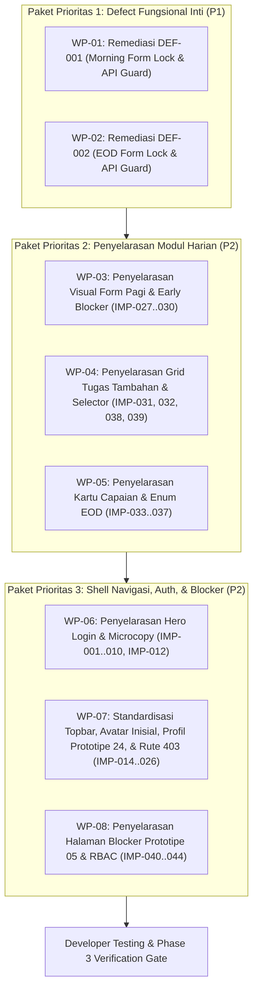

# WorkPulse — Rencana Induk Remediasi Produk (Master Remediation Plan)
> **Siklus Tata Kelola:** UAT Lifecycle Management Framework — Phase 2 (Finding Assessment & Remediation Planning)  
> **Sistem:** WorkPulse (Daily Accountability & Blocker Log System)  
> **Organisasi:** PT Dutamedia Mandiri Pratama  
> **Acceptance Owner:** Harry  
> **Lead QA / UAT Architect & Technical Co-Pilot:** Senior Software Quality Assurance Engineer  
> **Tanggal Rencana:** 01 November 2026  
> **Target Siklus:** `CYCLE-01` (Remediation of Core UAT Findings)  
> **Target Versi Rilis:** Application Release `v1.0.0-rc2` & UAT Package `v1.1.0-uat-pkg`  
> **Status Dokumen:** COMPLETED — PENDING FORMAL ACCEPTANCE OWNER APPROVAL  
> **Prinsip Pelaksanaan:** STRICT CHANGE CONTROL — NO CODE MODIFICATION PRIOR TO FORMAL PHASE 2 SIGN-OFF  

---

## 1. TUJUAN & STRATEGI REMEDIASI TERKENDALI

Rencana Induk Remediasi (*Master Remediation Plan*) ini menjadi cetak biru operasional (*operational blueprint*) bagi pelaksanaan **Phase 3 (Product Remediation & Change Verification)**. Rencana ini memastikan setiap modifikasi kode aplikasi dilakukan secara terkontrol, berurutan, terisolasi dalam git branch kerja terpisah, dan memiliki kriteria keberhasilan yang terukur secara objektif.

### Prinsip Utama Remediasi:
1. **Prioritas Utama Defect Kritis (Zero Compromise on Business Integrity):**  
   Perbaikan cacat integritas akuntabilitas (`DEF-001` dan `DEF-002`) menjadi prioritas P1 yang wajib diselesaikan pertama kali sebelum perbaikan antarmuka visual lainnya.
2. **Dual-Layer Enforcement (Frontend UI + Backend API Guard):**  
   Penguncian formulir komitmen pagi dan evaluasi sore tidak hanya ditegakkan pada tingkat tampilan antarmuka (Vue computed lock state), tetapi juga diproteksi pada tingkat API backend (`daily.service.ts`) guna mencegah manipulasi langsung dari DevTools atau API client.
3. **Penyelarasan Desain Terpadu (Co-Located Polish):**  
   Usulan calon penyempurnaan UI/UX yang telah disetujui Harry dikelompokkan ke dalam paket kerja modular (*work packages*) berdasarkan file komponen yang disentuh untuk memaksimalkan efisiensi kerja.
4. **Zero Regresi Sintaks & Runtime:**  
   Setiap paket kerja wajib melalui pengujian build lokal (`npm run build`), linting (`npm run lint`), dan unit test spec sebelum didokumentasikan ke dalam Change Register.

---

## 2. STRUKTUR KERJA REMEDIASI (WORK BREAKDOWN STRUCTURE — CYCLE-01)

Siklus remediasi `CYCLE-01` diorganisasikan ke dalam delapan (8) paket kerja terstruktur:

---

## 3. SPESIFIKASI RINCI PAKET KERJA REMEDIASI (WORK PACKAGES)

### Paket Kerja WP-01: Remediasi `DEF-001` (Morning Commitment Baseline Lock)
- **Komponen Terdampak:**  
  - Frontend: `frontend/src/views/daily/MorningCommitmentView.vue`
  - Backend: `backend/src/daily/services/daily.service.ts`
  - Test Suite: `frontend/src/views/daily/MorningCommitmentView.spec.ts`
- **Tindakan Perbaikan:**
  1. *Frontend:* Buat computed property `isFormLocked = computed(() => isMorningLocked.value || isSubmittedSuccess.value);`.
  2. *Frontend:* Ikat seluruh textarea deliverable, radio risiko, dan link ke `:disabled="isFormLocked"`.
  3. *Frontend:* Sembunyikan tombol penambahan slot dan tombol hapus slot jika `isFormLocked` bernilai `true`.
  4. *Frontend:* Sembunyikan `
` pasca-submit dan tampilkan *Baseline Locked Summary Panel* yang memuat informasi waktu submit dan tautan ke permohonan koreksi `/corrections/morning`.
  5. *Backend:* Pada `submitMorningCheckin()`, tambahkan validasi: jika `record.morningSubmittedAt` sudah ada, tolak dengan `AppException(422, 'Morning Commitment untuk hari ini telah diserahkan dan terkunci. Gunakan alur koreksi resmi.')`.
- **Kriteria Penerimaan (Acceptance Criteria):**
  - Setelah klik *"Kirim Morning Commitment"*, form 100% beralih ke mode read-only.
  - Tombol submit tidak lagi tampak di layar.
  - Percobaan pengiriman ulang via inspect/console ditolak oleh backend dengan kode status HTTP 422.

---

### Paket Kerja WP-02: Remediasi `DEF-002` (EOD Outcome Form Lock)
- **Komponen Terdampak:**  
  - Frontend: `frontend/src/views/daily/EodOutcomeView.vue`
  - Backend: `backend/src/daily/services/daily.service.ts`
  - Test Suite: `frontend/src/views/daily/EodOutcomeView.spec.ts`
- **Tindakan Perbaikan:**
  1. *Frontend:* Buat computed property `isFormLocked = computed(() => isEodLocked.value || isSubmittedSuccess.value);`.
  2. *Frontend:* Ikat seluruh radio outcome (COMPLETED, PARTIALLY, NOT_COMPLETED, CANCELLED), radio carry-over, textarea alasan, dan radio status refleksi mandiri ke `:disabled="isFormLocked"`.
  3. *Frontend:* Sembunyikan `
` pasca-submit dan tampilkan *EOD Closed Summary Panel* yang memuat status hari dan tautan ke permohonan koreksi `/corrections/eod`.
  4. *Backend:* Pada `submitEodOutcome()`, tambahkan validasi: jika `record.eodSubmittedAt` sudah terisi, tolak dengan `AppException(422, 'Evaluasi EOD untuk hari ini telah ditutup resmi dan terkunci.')`.
- **Kriteria Penerimaan (Acceptance Criteria):**
  - Setelah klik *"Kirim Evaluasi EOD"*, seluruh pilihan radio dan textarea otomatis terkunci (disabled).
  - Tombol *"Kirim Evaluasi EOD"* hilang dari layar.
  - Percobaan pengiriman ulang ditolak backend dengan status HTTP 422.

---

### Paket Kerja WP-03: Penyelarasan Visual Form Pagi & Early Blocker (`IMP-027` s.d. `IMP-030`)
- **Komponen Terdampak:** `frontend/src/views/daily/MorningCommitmentView.vue`
- **Tindakan Perbaikan:**
  1. Perjelas kontras visual badge *Early Blocker Flag* saat opsi AMBER/RED dipilih (`IMP-027`).
  2. Selaraskan microcopy panduan jam cut-off pagi pada alert banner (`IMP-028`).
  3. Rapikan jarak spasi (spacing & padding) antar-kartu slot komitmen (`IMP-029`, `IMP-030`).

---

### Paket Kerja WP-04: Penyelarasan Grid Tugas Tambahan & Selector (`IMP-031`, `032`, `038`, `039`)
- **Komponen Terdampak:** `frontend/src/views/daily/AdditionalWorkView.vue`, `frontend/src/views/daily/EodOutcomeView.vue`
- **Tindakan Perbaikan:**
  1. Rapikan tata letak grid 2-kolom pada formulir tugas tambahan ad-hoc (`IMP-031`).
  2. Perbaiki placeholder dan kejelasan selector atasan penugas (`IMP-032`).
  3. Selaraskan visualisasi kartu tugas tambahan yang diintegrasikan ke layar evaluasi sore (`IMP-038`, `IMP-039`).

---

### Paket Kerja WP-05: Penyelarasan Kartu Capaian & Enum EOD (`IMP-033` s.d. `IMP-037`)
- **Komponen Terdampak:** `frontend/src/views/daily/EodOutcomeView.vue`
- **Tindakan Perbaikan:**
  1. Standardisasi label enum refleksi mandiri (Hijau, Kuning, Merah) sesuai Prototipe 02 (`IMP-033`, `IMP-034`).
  2. Berikan visual cue yang jelas bahwa hak prerogatif Anti-Lock Green tetap aktif saat ada tugas belum selesai (`IMP-035`).
  3. Rapikan estetika kartu ringkasan hasil hari dan area input alasan (`IMP-036`, `IMP-037`).

---

### Paket Kerja WP-06: Penyelarasan Hero Login & Microcopy (`IMP-001` s.d. `IMP-010`, `IMP-012`)
- **Komponen Terdampak:** `frontend/src/views/auth/LoginView.vue`, `frontend/src/views/auth/ActivationView.vue`
- **Tindakan Perbaikan:**
  1. Perbarui copywriting tagline hero login agar lebih tajam pada mitigasi risiko (`IMP-001` s.d. `IMP-005`).
  2. Gunakan ikon vektor SVG standar yang serasi pada 3 poin fitur panel hijau kiri (`IMP-006`).
  3. Selaraskan headline dan microcopy formulir kanan (`IMP-007` s.d. `IMP-010`).
  4. Samakan styling hero panel kiri antara halaman `/login` dan `/activate` (`IMP-012`).

---

### Paket Kerja WP-07: Standardisasi Topbar, Avatar, Profil Prototipe 24, & Rute 403 (`IMP-014` s.d. `IMP-026`)
- **Komponen Terdampak:**  
  - Shell & Header: `frontend/src/components/Topbar.vue`, `frontend/src/components/Sidebar.vue`
  - Profil: `frontend/src/views/profile/ProfileView.vue`
  - Error Page: `frontend/src/views/ErrorPageView.vue`
- **Tindakan Perbaikan:**
  1. Ganti tombol teks profil dengan avatar inisial 2 huruf nama lengkap (`IMP-014`, `IMP-020`).
  2. Sediakan tombol *"Lapor Blocker"* konsisten pada seluruh tab *My Today* (`IMP-016`).
  3. Rapikan menu sidebar induk *My Today* dan hilangkan label berlebih (`IMP-017`).
  4. Hilangkan badge redundan "WP WorkPulse" pada header halaman profil (`IMP-018`).
  5. Pisahkan visualisasi Nama Lengkap dan Jabatan Penugasan (`IMP-021`).
  6. Selaraskan layout body profil menjadi 3 seksi sesuai Prototipe 24 kanonikal (`IMP-022`).
  7. Sesuaikan tombol pemulihan error 403 agar mengarahkan ke rute pendaratan spesifik peran pengguna aktif (`IMP-023`).
  8. Standardisasi topbar administrasi, badge peran, dan tata letak menu kebijakan (`IMP-024` s.d. `IMP-026`).

---

### Paket Kerja WP-08: Penyelarasan Halaman Blocker Prototipe 05 & RBAC (`IMP-040` s.d. `IMP-044`)
- **Komponen Terdampak:** `frontend/src/views/blockers/RaiseBlockerView.vue`, `frontend/src/views/daily/EodOutcomeView.vue`
- **Tindakan Perbaikan:**
  1. Ubah tombol *"Lapor Blocker"* di EOD menjadi navigasi langsung ke `/blockers/raise` (tanpa pop-up redundan) (`IMP-040`).
  2. Selaraskan antarmuka `/blockers/raise` dengan Prototipe 05: tambahkan tombol kembali, judul yang jelas, dan 2 tab (*"Buat Laporan"* & *"Blocker Saya"*) (`IMP-041`).
  3. Sembunyikan tombol antrean manajemen blocker dari tampilan karyawan biasa (`IMP-042`).
  4. Seragamkan breadcrumb topbar dan rapikan footer formulir blocker (`IMP-043`, `IMP-044`).

---

## 4. STRATEGI BRANCHING & ISOLASI LINGKUNGAN PENGEMBANGAN

Untuk menjamin kepatuhan *Strict Change Control*:
1. **Branch Kerja Terisolasi:**  
   Seluruh perbaikan pada Phase 3 akan dikerjakan pada branch khusus:
   `git checkout -b remediation/cycle-01-fixes`
2. **Keterlacakan Commit Linear:**  
   Setiap paket kerja (WP-01 s.d. WP-08) akan di-commit secara terpisah dan terperinci dengan merujuk Finding ID resmi (contoh: `fix(daily): enforce morning baseline form lock DEF-001`).
3. **Pencatatan Change Register:**  
   Setiap commit kode aplikasi akan dicatat baris per baris ke dalam `UAT-Change-Register.csv` lengkap dengan commit SHA, file yang berubah, dan hasil verifikasi lokal.

---

## 5. ANALISIS RISIKO TEKNIS & RENCANA KONTINGENSI (RISK ASSESSMENT)

| Risiko Teknis | Dampak Potensial | Probabilitas | Rencana Mitigasi & Kontingensi |
| :--- | :--- | :---: | :--- |
| **Premature Form Locking** | Karyawan tidak bisa mengisi form pagi saat pertama kali membuka halaman di jam normal. | Rendah | Evaluasi `isFormLocked` secara presisi: hanya aktif jika `isMorningLocked` (waktu lewat) ATAU `isSubmittedSuccess` (sudah ada record aktif hari ini). |
| **API Rejection False-Positive** | Request pertama ditolak backend karena deteksi record lama tanggal berbeda. | Rendah | Pastikan query database menggunakan `userId_workDate` dengan tanggal hari ini dalam timezone `Asia/Jakarta`. |
| **CSS Layout Shift pada Layar Mobile** | Perubahan topbar, avatar, dan tab blocker menyebabkan visual terpotong pada layar 375px. | Sedang | Verifikasi responsivitas pada viewport 375px, 768px, dan 1440px menggunakan Chrome DevTools sebelum menandai paket kerja selesai. |
| **Regresi Test Unit Eksisting** | Unit test `MorningCommitmentView.spec.ts` gagal karena perubahan struktur DOM tombol submit. | Sedang | Jalankan `npm run test` pada frontend dan backend setelah setiap paket kerja selesai; perbarui assertions sesuai perilaku locked yang benar. |

---

## 6. STRATEGI VERIFIKASI PENGEMBANG (DEVELOPER VERIFICATION PLAN)

Sebelum menyerahkan hasil perbaikan kepada Harry untuk uji ulang (retest), tim teknis wajib menyelesaikan tahapan verifikasi internal:
1. **Sintaksis & Tipe:** `npm run type-check` (Frontend & Backend) bebas dari kesalahan TypeScript.
2. **Linting & Code Style:** `npm run lint` lulus tanpa warning kritis.
3. **Build Verifikasi:** `npm run build` sukses menghasilkan bundel produksi pada frontend dan backend.
4. **Console Audit:** Console browser bebas dari *unhandled exception* atau *reactivity cycle warning*.
5. **Developer Smoke Retest:** Pengujian mandiri alur submit komitmen pagi dan EOD untuk memastikan form terkunci sempurna pasca-pengiriman.

---
*Master Remediation Plan ini diajukan kepada Harry selaku Acceptance Owner untuk dievaluasi dan disahkan sebelum pekerjaan penulisan kode pada Phase 3 dimulai.*

