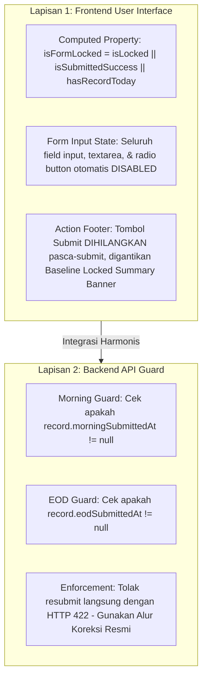

# WorkPulse — Laporan Analisis Akar Masalah Teknis (Technical Root Cause Analysis)
> **Siklus Tata Kelola:** UAT Lifecycle Management Framework — Phase 2 (Finding Assessment & Remediation Planning)  
> **Sistem:** WorkPulse (Daily Accountability & Blocker Log System)  
> **Organisasi:** PT Dutamedia Mandiri Pratama  
> **Acceptance Owner:** Harry  
> **Lead QA / UAT Architect & Technical Co-Pilot:** Senior Software Quality Assurance Engineer  
> **Tanggal Penyelidikan:** 01 November 2026  
> **Dasar Otorisasi:** Persetujuan Formal Penutupan Phase 1 & Otorisasi Phase 2 oleh Acceptance Owner  
> **Status:** INVESTIGATED & CONFIRMED — PENDING ACCEPTANCE OWNER REMEDIATION APPROVAL  
> **Prinsip Operasional:** STRICT READ-ONLY AUDIT — ZERO SOURCE CODE & DATABASE MUTATION  

---

## 1. RINGKASAN EKSEKUTIF INVESTIGASI TEKNIS

Dalam rangka memenuhi mandat **Subphase 2.1 (Technical Root Cause Investigation)**, tim teknis telah melakukan penyelidikan mendalam terhadap basis kode aplikasi WorkPulse pada lapisan frontend (`frontend/src/views/daily/`), lapisan API service backend (`backend/src/daily/services/daily.service.ts`), serta skema basis data PostgreSQL/Prisma.

Penyelidikan ini berhasil memvalidasi hipotesis awal (*Preliminary Root Cause Hypothesis*) yang diajukan pada Phase 1, dan kini menetapkan **Akar Masalah Teknis Definitif (Confirmed Technical Root Cause)** yang didukung oleh bukti potongan kode program aktual:

1. **Akar Masalah `DEF-001` (Morning Commitment Form Lock Failure):**  
   Ditemukan adanya inkonsistensi arsitektur antara spesifikasi bisnis dan implementasi kode. Pada `MorningCommitmentView.vue`, seluruh input kontrol formulir dan visibilitas tombol kirim terikat secara eksklusif pada variabel waktu `isMorningLocked` (jam cut-off 09:30 WIB), tanpa memperhitungkan status transaksi berhasil (`isSubmittedSuccess`) atau keberadaan data komitmen aktif hari ini. Di lapisan backend (`daily.service.ts`), logika `submitMorningCheckin` bahkan secara sengaja menghapus dan menulis ulang (*delete-and-overwrite*) komitmen lama jika dikirim ulang sebelum cut-off.
2. **Akar Masalah `DEF-002` (EOD Outcome Form Lock Failure):**  
   Pola kecacatan yang identik ditemukan pada `EodOutcomeView.vue`. Seluruh tombol radio capaian (COMPLETED, PARTIALLY, NOT_COMPLETED, CANCELLED), opsi carry-over, kartu refleksi mandiri, dan footer formulir hanya terikat pada `isEodLocked` (cut-off 21:00 WIB). Di backend (`daily.service.ts`), fungsi `submitEodOutcome` hanya memeriksa jam cut-off malam tanpa memeriksa apakah `record.eodSubmittedAt` telah terisi.

---

## 2. INVESTIGASI MENDALAM DEFECT [DEF-001]

### A. Informasi & Gejala Cacat
- **Defect ID:** `DEF-001` (Major S2 / P1)
- **Rute / Modul:** `/daily/morning`
- **Komponen Terdampak:**  
  - Frontend: `frontend/src/views/daily/MorningCommitmentView.vue`
  - Backend: `backend/src/daily/services/daily.service.ts` (`submitMorningCheckin`)
- **Gejala Empiris:** Pengguna berhasil mengirimkan 3 komitmen pagi, toast hijau dan panel *"Morning Commitment Berhasil Tercatat"* muncul di bagian bawah layar, namun seluruh textarea deliverable, radio button risiko, tombol tambah slot, tombol hapus slot, dan tombol utama *"Kirim Morning Commitment"* tetap aktif dan dapat diklik ulang secara bebas.

### B. Bukti Potongan Kode Frontend (`MorningCommitmentView.vue`)
Pemeriksaan kode sumber pada `MorningCommitmentView.vue` menunjukkan bahwa formulir tidak memiliki *unified lock state*:

```html
<!-- Cuplikan MorningCommitmentView.vue Baris 369-371 -->
<input
  type="checkbox"
  v-model="isZeroCommitment"
  :disabled="isMorningLocked"
/>

<!-- Cuplikan Baris 450-452 (Tombol Tambah Slot) -->
<button
  v-if="commitmentSlots.length < 3 && !isMorningLocked"
  type="button"
  class="btn btn-outline"
  @click="addSlot"
>

<!-- Cuplikan Baris 492-494 (Textarea Deliverable) -->
<textarea
  v-model="slot.taskText"
  :disabled="isMorningLocked"
  required
></textarea>

<!-- Cuplikan Baris 594-603 (Action Footer & Tombol Kirim) -->
<div v-if="!isMorningLocked" class="action-footer">
  <div class="footer-info">...</div>
  <button
    type="button"
    class="btn btn-primary"
    :disabled="submitting"
    @click="submitMorningCheckin"
  >
    Kirim Morning Commitment
  </button>
</div>

<!-- Cuplikan Baris 611 (Panel Notifikasi Sukses Pasca-Submit) -->
<div v-if="isSubmittedSuccess" class="post-submit-panel">...</div>
```

**Analisis Alur Eksekusi Frontend:**
1. Sebelum jam cut-off pagi (misal pengujian pada jam 12:25 WIB dengan cut-off 23:59 WIB), `isMorningLocked` bernilai `false`.
2. Setelah formulir dikirim, fungsi `submitMorningCheckin()` mengeksekusi `isSubmittedSuccess.value = true;`.
3. Panel `<div v-if="isSubmittedSuccess" class="post-submit-panel">` muncul di bagian bawah layar.
4. Namun karena `isMorningLocked` tetap `false`, kondisi `<div v-if="!isMorningLocked" class="action-footer">` tetap bernilai `true`. Tombol *"Kirim Morning Commitment"* tetap tampak dan `:disabled="submitting"` kembali menjadi `false` setelah request selesai.
5. Seluruh elemen textarea dan radio button tetap aktif karena `:disabled="isMorningLocked"` bernilai `false`.
6. Ketika halaman di-*refresh*, `loadTodayState()` memuat data komitmen dari backend dan menyetel `isSubmittedSuccess.value = true;`, namun seluruh form tetap dapat diedit kembali karena `isMorningLocked` masih `false`.

### C. Bukti Potongan Kode Backend (`backend/src/daily/services/daily.service.ts`)
Pemeriksaan pada `submitMorningCheckin()` mengungkap temuan penting:

```typescript
// Cuplikan backend/src/daily/services/daily.service.ts Baris 314-325
update: {
  morningSubmittedAt: this.clockService.now(),
  morningTiming,
  initialDailyStatus,
  zeroCommitmentReason: dto.zeroCommitmentReason ? dto.zeroCommitmentReason.trim() : null,
},
});

// Hapus komitmen lama jika ada pengiriman ulang sebelum cutoff
await tx.commitment.deleteMany({
  where: { dailyRecordId: record.id },
});
```

**Analisis Alur Eksekusi Backend:**
- Kode backend secara eksplisit dirancang oleh developer awal untuk mendukung pengiriman ulang (*resubmission*) sebelum cut-off dengan menghapus komitmen lama (`tx.commitment.deleteMany`).
- Hal ini **bertentangan secara fundamental** dengan aturan tata kelola **DEC-001**, **FR-09**, dan Prototipe 02, di mana komitmen pagi yang telah diserahkan resmi merupakan **Baseline Tetap (Immutable Baseline)** yang tidak boleh diubah sepihak di tengah hari tanpa permohonan koreksi atasan (`/corrections/morning`).

---

## 3. INVESTIGASI MENDALAM DEFECT [DEF-002]

### A. Informasi & Gejala Cacat
- **Defect ID:** `DEF-002` (Major S2 / P1)
- **Rute / Modul:** `/daily/eod`
- **Komponen Terdampak:**  
  - Frontend: `frontend/src/views/daily/EodOutcomeView.vue`
  - Backend: `backend/src/daily/services/daily.service.ts` (`submitEodOutcome`)
- **Gejala Empiris:** Pengguna mengisi evaluasi capaian komitmen dan memilih status refleksi (AMBER), tombol *"Kirim Evaluasi EOD"* diklik, dan panel konfirmasi penutupan hari kerja muncul. Namun seluruh tombol radio capaian (COMPLETED, PARTIALLY, NOT_COMPLETED, CANCELLED), opsi carry-over, textarea alasan, kartu refleksi, dan tombol kirim evaluasi tetap aktif dan dapat diubah secara bebas.

### B. Bukti Potongan Kode Frontend (`EodOutcomeView.vue`)
Pemeriksaan kode sumber pada `EodOutcomeView.vue` menunjukkan cacat struktural yang serupa:

```html
<!-- Cuplikan EodOutcomeView.vue Baris 380-382 (Radio Outcome Komitmen) -->
<input
  type="radio"
  :name="`outcome-${c.id}`"
  value="COMPLETED"
  v-model="c.outcome"
  :disabled="isEodLocked"
/>

<!-- Cuplikan Baris 416-418 (Radio Carry-over) -->
<input
  type="radio"
  :name="`cont-${c.id}`"
  value="CONTINUE"
  v-model="c.continuation"
  :disabled="isEodLocked"
/>

<!-- Cuplikan Baris 496-498 (Kartu Status Refleksi Mandiri) -->
<input
  type="radio"
  value="GREEN"
  v-model="finalDailyStatus"
  :disabled="isEodLocked"
/>

<!-- Cuplikan Baris 533-541 (Action Footer) -->
<div v-if="!isEodLocked" class="action-footer">
  <button
    type="button"
    class="btn btn-primary"
    :disabled="submitting"
    @click="submitEod"
  >
    Kirim Evaluasi EOD
  </button>
</div>

<!-- Cuplikan Baris 548 (Post-Submit Panel) -->
<div v-if="isSubmittedSuccess" class="post-submit-panel">...</div>
```

**Analisis Alur Eksekusi Frontend:**
1. Sebelum jam cut-off malam (21:00 WIB), `isEodLocked` bernilai `false`.
2. Saat pengiriman selesai, `isSubmittedSuccess.value = true;` diaktifkan, memicu panel hijau *"Evaluasi EOD Berhasil Disimpan"*.
3. Seluruh elemen input radio, textarea carry-over, dan pemilihan refleksi status tetap berstatus aktif (`disabled = false`) karena seluruhnya hanya mengacu pada `:disabled="isEodLocked"`.
4. Footer `<div v-if="!isEodLocked" class="action-footer">` tetap tampak dan tombol submit siap menerima klik pengiriman ulang kapan pun sebelum jam 21:00 WIB.

### C. Bukti Potongan Kode Backend (`backend/src/daily/services/daily.service.ts`)
Pemeriksaan pada `submitEodOutcome()` menunjukkan:

```typescript
// Cuplikan backend/src/daily/services/daily.service.ts Baris 448-455
// Penegakan DEC-002: EOD Cut-off Lock pasca 21:00
if (currentTimeStr > (timingConfig.eodLockCutoff || '21:00')) {
  throw new AppException({
    code: ErrorCode.BUSINESS_RULE_CUTOFF_LOCKED,
    message: `Batas waktu pengisian EOD Outcome telah terlewati (${timingConfig.eodLockCutoff || '21:00'} WIB) dan formulir terkunci (DEC-002).`,
    statusCode: HttpStatus.UNPROCESSABLE_ENTITY,
  });
}
```

**Analisis Alur Eksekusi Backend:**
- Backend hanya memvalidasi apakah waktu pengiriman telah melewati jam 21:00 WIB.
- Backend sama sekali tidak memeriksa apakah field `record.eodSubmittedAt` sudah terisi nilai waktu sebelumnya.
- Jika pengguna mengirimkan ulang permintaan HTTP POST ke `/daily/eod`, backend akan secara langsung memperbarui `eodSubmittedAt = now()` dan menimpa status hasil capaian sebelumnya tanpa menghasilkan pesan kesalahan apa pun.

---

## 4. KESIMPULAN AKAR MASALAH (ROOT CAUSE VERDICT)

Berdasarkan bukti teknis di atas, ditarik kesimpulan definitif:

| Defect ID | Lapisan | Akar Masalah Terkonfirmasi | Dampak Integritas Sistem |
| :---: | :---: | :--- | :--- |
| **`DEF-001`** | **Frontend** | Tidak adanya abstraksi status terkunci terpadu (`isFormLocked`). Kontrol input dan tombol kirim hanya memeriksa `isMorningLocked` (jam cut-off), mengabaikan `isSubmittedSuccess` dan record aktif. | Karyawan dapat memanipulasi deliverable pagi di tengah hari tanpa jejak audit. |
| **`DEF-001`** | **Backend** | Logika `upsert` pada `submitMorningCheckin` secara aktif menghapus komitmen lama (`deleteMany`) jika dikirim ulang sebelum cut-off. | Ketiadaan perlindungan integritas data di level API memungkinkan bypass antarmuka. |
| **`DEF-002`** | **Frontend** | Seluruh radio button capaian, carry-over, refleksi, dan tombol submit hanya memeriksa `isEodLocked` (cut-off 21:00), mengabaikan `isSubmittedSuccess`. | Laporan hasil kerja harian dapat diubah sepihak setelah diserahkan. |
| **`DEF-002`** | **Backend** | Fungsi `submitEodOutcome` tidak memvalidasi keberadaan `record.eodSubmittedAt`, sehingga mengizinkan penimpaan data berkali-kali. | Merusak validitas pelaporan akhir hari yang menjadi rujukan evaluasi atasan dan HRGA. |

---

## 5. REKOMENDASI ARSITEKTUR SOLUSI REMEDIASI (DUAL-LAYER ENFORCEMENT)

Untuk menyelesaikan cacat ini secara tuntas dan kokoh (*bulletproof*), tim QA merekomendasikan penerapan **Dual-Layer Enforcement**:



1. **Lapisan 1 (Frontend UI):**
   - Di `MorningCommitmentView.vue` dan `EodOutcomeView.vue`, buat computed property:
     `const isFormLocked = computed(() => isMorningLocked.value || isSubmittedSuccess.value);`
   - Ikat seluruh elemen input ke `:disabled="isFormLocked"`.
   - Ganti footer tombol submit dengan *Read-Only Baseline Summary Banner* yang mengarahkan pengguna ke halaman koreksi resmi jika ingin melakukan revisi.
2. **Lapisan 2 (Backend API):**
   - Pada `submitMorningCheckin()`, jika `record.morningSubmittedAt` sudah terisi, tolak permintaan dengan error `ALREADY_SUBMITTED` (422) dan instruksikan penggunaan modul koreksi `/corrections/morning`.
   - Pada `submitEodOutcome()`, jika `record.eodSubmittedAt` sudah terisi, tolak permintaan dengan error `ALREADY_SUBMITTED` (422) dan instruksikan penggunaan modul koreksi `/corrections/eod`.

*Laporan analisis akar masalah teknis ini menjadi dasar faktual untuk penyusunan Matriks Dampak Komponen dan Master Remediation Plan.*

