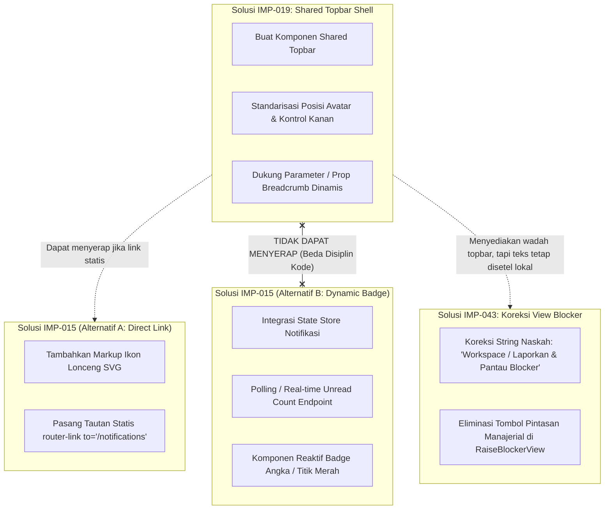
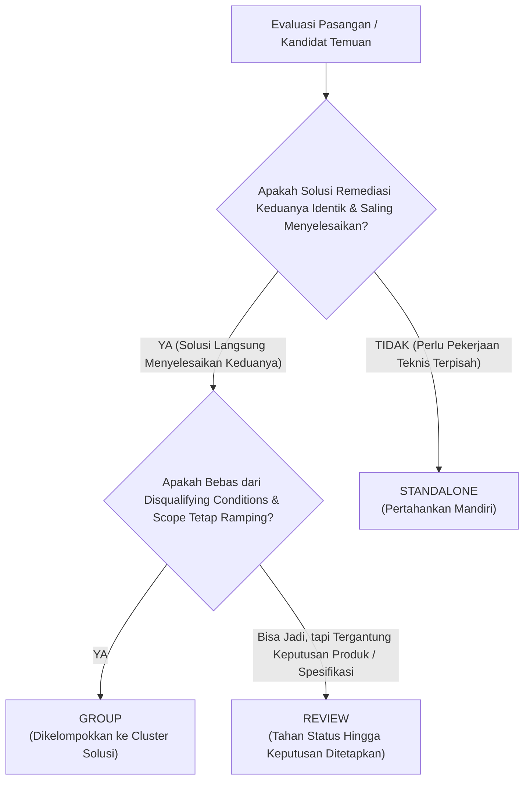

# LAPORAN KALIBRASI KRITERIA KETAT PENGELOMPOKAN IMPROVEMENT (PHASE 2)
## Kalibrasi Solusi Terpadu: Studi Kasus IMP-015, IMP-019, dan IMP-043

| Parameter Tata Kelola | Rincian Dokumen |
| :--- | :--- |
| **Siklus Lifecycle** | **Phase 2 — Finding Assessment & Remediation Planning** |
| **Aktivitas** | **Strict Improvement Clustering Criteria Calibration** |
| **Peran Penyusun** | Senior Product Analyst, Software Architect, & QA Analyst |
| **Penerima Otoritas** | Harry (Acceptance Owner & Lead Manual UAT Tester, PT Dutamedia Mandiri Pratama) |
| **Cabang Git Aktif** | `remediation/cycle-01-fixes` |
| **Status Dokumen** | **PROPOSED FOR ACCEPTANCE OWNER REVIEW & CALIBRATION APPROVAL** |
| **Tanggal Analisis** | 1 November 2026 |
| **Ruang Lingkup Analisis** | **Kalibrasi Metodologis (Kasus Uji: IMP-015, IMP-019, IMP-043)** |

---

## DAFTAR ISI
1. [Latar Belakang & Pergeseran Paradigma Clustering](#1-latar-belakang--pergeseran-paradigma-clustering)
2. [Analisis Individual Tiga Temuan Kalibrasi (IMP-015, IMP-019, IMP-043)](#2-analisis-individual-tiga-temuan-kalibrasi-imp-015-imp-019-imp-043)
3. [Analisis Overlap Solusi & Matriks Komparasi](#3-analisis-overlap-solusi--matriks-komparasi)
4. [Penilaian Kelayakan Pengelompokan Tiga Temuan Kasus](#4-penilaian-kelayakan-pengelompokan-tiga-temuan-kasus)
5. [Rumusan Kriteria Ketat Pengelompokan Berbasis Solusi (Strict Solution-Based Criteria)](#5-rumusan-kriteria-ketat-pengelompokan-berbasis-solusi-strict-solution-based-criteria)
6. [Mekanisme Kerangka Keputusan Tiga Tingkat (Decision Framework)](#6-mekanisme-kerangka-keputusan-tiga-tingkat-decision-framework)
7. [Rekomendasi Strategis bagi Acceptance Owner](#7-rekomendasi-strategis-bagi-acceptance-owner)
8. [Batasan Tata Kelola & Stop Condition](#8-batasan-tata-kelola--stop-condition)

---

## 1. LATAR BELAKANG & PERGESERAN PARADIGMA CLUSTERING

Pada tahap awal evaluasi Phase 2, telah disusun 6 Theme Clusters berukuran relatif besar untuk memetakan 44 improvement findings (`IMP-001` s.d. `IMP-044`). Namun, evaluasi kritis dari Acceptance Owner (Pak Harry) menegaskan bahwa pendekatan tersebut **terlalu luas (*overly broad*)** karena cenderung mengelompokkan temuan berdasarkan kesamaan lokasi halaman (*page co-location*), kesamaan modul fungsional, atau topik umum.

### Pergeseran Menuju "Solution-Based Clustering":
Acceptance Owner menetapkan bahwa **tujuan clustering yang sebenarnya adalah menemukan beberapa improvement findings yang memiliki kebutuhan sangat mirip dan berpotensi diselesaikan secara langsung dan substansial menggunakan satu solusi remediasi yang sama (*single shared remediation solution*)**.

Dengan paradigma baru ini:
- Pengelompokan **tidak diwajibkan** mencakup seluruh 44 temuan.
- Sebagian besar temuan (*majority of findings*) diperkirakan dan diperbolehkan tetap berstatus **Standalone Findings**.
- Suatu kelompok hanya dibentuk jika terdapat **identitas solusi (*solution identity*)** dan **tumpang-tindih implementasi (*implementation overlap*)** yang nyata.

Untuk merumuskan standar seleksi yang objektif, dokumen ini mengkaji interaksi antara tiga temuan konkret:
- `IMP-015` — Fungsionalitas Lonceng Notifikasi di Header Bar.
- `IMP-019` — Standardisasi Navbar Global Bersih.
- `IMP-043` — Topbar Blocker: Breadcrumb dan Avatar.

---

## 2. ANALISIS INDIVIDUAL TIGA TEMUAN KALIBRASI (IMP-015, IMP-019, IMP-043)

Analisis dilakukan secara independen terhadap fakta kode aktual, naskah backlog asli, dan berkas acuan desain prototipe tanpa memaksakan kesamaan semu.

```
+---------------------------------------------------------------------------------------------------+
| STRUKTUR TOPBAR AKTUAL VS PROTO DESIGN                                                            |
|                                                                                                   |
| [IMP-019: Global Scope]                                                                           |
|   Aktual: Desentralisasi <header> di setiap view (Morning, Profile, Admin, Blocker)                |
|   Target: Navbar global bersih, avatar 2 huruf, breadcrumb/title, akses notifikasi                |
|                                                                                                   |
| [IMP-043: View-Level Blocker Topbar]                                                              |
|   Aktual: Breadcrumb bocor "(Prototipe 05)", tombol kanan: "Antrean Tiket", "Aging Radar"         |
|   Target: Breadcrumb bersih "Workspace / Laporkan & Pantau Blocker", avatar & notifikasi          |
|                                                                                                   |
| [IMP-015: Element-Level Notification Access]                                                      |
|   Aktual: Topbar harian merender teks "Riwayat Saya" (/daily/history)                             |
|   Target: Ikon lonceng notifikasi (Alternatif A: Direct Link vs Alternatif B: Dynamic Badge)      |
+---------------------------------------------------------------------------------------------------+
```

---

### A. `IMP-015` — Penggantian Tombol Riwayat Menjadi Ikon Notifikasi Ber-badge Merah
1. **Masalah Aktual yang Ditemukan:**  
   Pada `frontend/src/views/daily/MorningCommitmentView.vue` (baris 12), area kanan topbar merender tombol teks `<AccessLink to="/daily/history" class="nav-btn">Riwayat Saya</AccessLink>`. Tidak tersedia kontrol akses ke notifikasi/pemberitahuan sistem di area header harian.
2. **Kondisi / Perilaku yang Diharapkan:**  
   Berdasarkan Prototipe 02 (`02-Morning-Commitment.html` baris 85–87), tombol teks `Riwayat Saya` dieliminasi dan digantikan oleh ikon lonceng notifikasi yang mengarahkan pengguna ke pusat notifikasi atau menampilkan sinyal notifikasi baru.
3. **Kebutuhan Improvement yang Sebenarnya:**  
   Menyediakan akses cepat ke notifikasi sistem dari bar navigasi atas formulir harian karyawan untuk memantau status persetujuan atau eskalasi kendala.
4. **Komponen / Bagian Sistem yang Terdampak:**  
   - Area kanan header bar pada modul kerja harian (`MorningCommitmentView.vue`, `AdditionalWorkView.vue`, `EodOutcomeView.vue`).
   - Rute navigasi menuju Pusat Notifikasi (`NotificationCenterView.vue`).
   - *(Kondisional):* Store notifikasi (`notification.ts` / API unread count) jika badge dinamis dipilih.
5. **Bentuk Perubahan yang Kemungkinan Diperlukan:**  
   - *Alternatif A (Direct Link Shortcut):* Menghapus tautan `Riwayat Saya`, menambahkan markup elemen ikon lonceng SVG dengan tag `router-link to="/notifications"`.
   - *Alternatif B (Dynamic Polling / Unread Counter):* Membangun komponen lonceng interaktif, mengintegrasikan client state watcher untuk jumlah notifikasi belum dibaca, menghubungkan endpoint unread badge, dan mengelola event click flyout/halaman.
6. **Hasil Akhir yang Harus Dicapai:**  
   Staf operasional dapat melihat ikon lonceng pada header harian dan dapat mengakses notifikasi dengan mudah tanpa kebingungan fungsi tombol riwayat lokal.

---

### B. `IMP-019` — Standardisasi Navbar Global Bersih (Avatar Inisial & Notifikasi)
1. **Masalah Aktual yang Ditemukan:**  
   Setiap modul aplikasi mengimplementasikan header bar secara terdesentralisasi dengan markup HTML dan CSS lokal masing-masing. Terjadi inkonsistensi layout yang mencolok:
   - `MorningCommitmentView.vue` menampilkan badge `WP`, teks `WorkPulse`, teks `Riwayat Saya`, dan `Profil`.
   - `ProfileView.vue` menampilkan badge `WP`, teks `WorkPulse`, tag `Profil Akun`, link `Kelola Pengguna`, dan tombol `Keluar`.
   - `AdminUsersView.vue` menampilkan badge `WP`, teks `WorkPulse`, tag `Admin Panel`, dan link `Profil Saya`.
   - `RaiseBlockerView.vue` menampilkan breadcrumb dengan nama prototipe dan deretan tombol pintasan manajerial.
2. **Kondisi / Perilaku yang Diharapkan:**  
   Mengikuti rancangan arsitektur Prototipe 08 dan 24, seluruh halaman di dalam shell aplikasi memiliki struktur header bar yang seragam: sisi kiri memuat penanda hirarki lokasi (breadcrumb/section title), dan sisi kanan memuat kontrol terstandarisasi (ikon notifikasi dan avatar inisial bulat), tanpa pengulangan logo WP atau tombol logout yang sudah tersedia di sidebar bawah.
3. **Kebutuhan Improvement yang Sebenarnya:**  
   Standardisasi arsitektur navigasi atas (*topbar shell*) di seluruh aplikasi untuk mengeliminasi inkonsistensi visual, menghapus redundansi kontrol, dan memusatkan tata letak header.
4. **Komponen / Bagian Sistem yang Terdampak:**  
   - Struktur shell aplikasi (`DefaultLayout.vue` atau komponen topbar terpusat).
   - Seluruh view halaman internal (`MorningCommitmentView`, `AdditionalWorkView`, `EodOutcomeView`, `RaiseBlockerView`, `ProfileView`, `AdminUsersView`, dll.).
5. **Bentuk Perubahan yang Kemungkinan Diperlukan:**  
   - Membuat komponen bersama terstandarisasi (misal: `AppTopbar.vue`) yang menerima konfigurasi breadcrumb dinamis.
   - Menghapus puluhan baris tag `<header class="topbar">` lokal dari setiap file view dan menggantikannya dengan integrasi komponen shell terpusat.
6. **Hasil Akhir yang Harus Dicapai:**  
   Tampilan bar atas di seluruh halaman aplikasi terlihat seragam, rapi, bebas dari badge duplikat, dan memiliki posisi kontrol kanan (lonceng & avatar) yang identik di setiap modul.

---

### C. `IMP-043` — Penyeragaman Topbar Blocker: Breadcrumb dan Avatar
1. **Masalah Aktual yang Ditemukan:**  
   Pada `frontend/src/views/blockers/RaiseBlockerView.vue` (baris 159), breadcrumb kiri atas tertulis:  
   `Blocker / Laporkan Kendala Cepat (Prototipe 05)`.  
   Terdapat kebocoran string dokumen desain `(Prototipe 05)`. Sisi kanan topbar juga memuat tombol teks manajerial `Antrean Tiket` dan `Aging Radar` yang menempel di ujung layar serta tidak memiliki avatar pengguna.
2. **Kondisi / Perilaku yang Diharapkan:**  
   Berdasarkan Prototipe 05 (`05-Raise-Instant-Blocker.html` baris 75–82), breadcrumb kiri harus bersih tanpa teks prototipe (yaitu: `Workspace / Laporkan & Pantau Blocker`), dan sisi kanan topbar diselaraskan dengan standar aplikasi (menampilkan avatar inisial pengguna).
3. **Kebutuhan Improvement yang Sebenarnya:**  
   - Menghilangkan kebocoran teks teknis/desain `(Prototipe 05)` dari breadcrumb blocker.
   - Merapikan breadcrumb menjadi hirarki resmi `Workspace / Laporkan & Pantau Blocker`.
   - Menghilangkan tombol pintasan manajerial yang salah sasaran dari header pelaporan staf.
4. **Komponen / Bagian Sistem yang Terdampak:**  
   - Header bar lokal pada file `frontend/src/views/blockers/RaiseBlockerView.vue` (baris 155–172).
5. **Bentuk Perubahan yang Kemungkinan Diperlukan:**  
   - Mengoreksi string teks breadcrumb pada template `RaiseBlockerView.vue`.
   - Menghapus elemen `<AccessLink to="/blockers">` dan `<AccessLink to="/blockers/aging">` dari header bar.
   - Menyelaraskan sisi kanan topbar dengan elemen profil/avatar standar.
6. **Hasil Akhir yang Harus Dicapai:**  
   Halaman `/blockers/raise` menampilkan breadcrumb profesional yang bersih dan header bar yang konsisten tanpa tombol manajerial yang mengacaukan antarmuka staf.

---

## 3. ANALISIS OVERLAP SOLUSI & MATRIKS KOMPARASI

Untuk menguji apakah ketiga temuan layak disatukan, tim membandingkan kelima dimensi hubungan solusi:

| Dimensi Evaluasi | `IMP-015` (Lonceng Notifikasi) | `IMP-019` (Navbar Global Bersih) | `IMP-043` (Topbar Blocker) | Derajat Overlap Antara Ketiganya |
| :--- | :--- | :--- | :--- | :---: |
| **Spesifisitas Masalah** | Absennya akses notifikasi di topbar harian & adanya link teks `Riwayat Saya`. | Fragmentasi implementasi topbar di banyak view tanpa standar bersama. | Kebocoran teks `(Prototipe 05)` di breadcrumb blocker & tombol kanan berlebih. | **Rendah (Low):** Tiga akar masalah berbeda (elemen spesifik vs arsitektur global vs string teks lokal). |
| **Karakteristik Hasil yang Diharapkan** | Ikon lonceng notifikasi tersedia di header. | Bar atas seragam di seluruh modul aplikasi. | Breadcrumb blocker bersih & tombol antrean terhapus. | **Sedang (Medium):** Bertemu pada visi visual header yang rapi, tetapi target rincian berbeda. |
| **Lokasi Perubahan Kode** | Area kanan header view harian (atau shell). | Shell layout aplikasi dan seluruh view internal. | File spesifik `RaiseBlockerView.vue` (L155–172). | **Tumpang-tindih Parsial:** Sama-sama menyentuh tag header, namun skala jangkauan berbeda. |
| **Sifat Solusi Remediasi** | Penambahan kontrol ikon navigasi / widget notifikasi. | Abstraksi arsitektural (pembuatan shared topbar component). | Koreksi naskah breadcrumb & pembersihan tombol lokal. | **Berbeda (Distinct):** Satu solusi abstraksi shell tidak serta-merta mengoreksi string naskah lokal blocker. |

---

### Detail Analisis Tumpang-Tindih Solusi:



#### 1. Apakah satu solusi terpadu secara langsung memenuhi ketiganya?
- **TIDAK SECARA LANGSUNG.**
- Membuat komponen shared topbar (`IMP-019`) menyediakan wadah struktur header, tetapi **tidak secara otomatis membetulkan kesalahan redaksional breadcrumb lokal pada `RaiseBlockerView.vue` (`IMP-043`)**. Nilai teks breadcrumb tetap harus didefinisikan secara spesifik oleh halaman blocker.
- Terhadap `IMP-015`, kemampuan shared topbar menyerap solusinya **sangat bergantung pada keputusan Acceptance Owner**:
  - *Jika Alternatif A dipilih (link navigasi statis):* Shared topbar otomatis memuat ikon lonceng statis di sisi kanan avatar. Dalam skenario ini, solusi `IMP-019` **secara langsung dan substansial menyelesaikan `IMP-015`**.
  - *Jika Alternatif B dipilih (live unread count):* Pembuatan topbar layout **TIDAK menyelesaikan** kebutuhan `IMP-015`. Diperlukan pekerjaan independen berupa integrasi Pinia notification store, logic polling/SSE, penanganan unread count state, dan koneksi endpoint backend.

#### 2. Bagian mana yang dapat diselesaikan bersama?
- Pola tata letak kontrol kanan: menempatkan avatar inisial bulat dan ikon lonceng notifikasi pada posisi horizontal yang konsisten di sebelah kanan layar.
- Penghapusan tombol teks redundan yang menempel di header kanan (`Riwayat Saya`, `Profil`, `Antrean Tiket`).

#### 3. Bagian mana yang memerlukan pekerjaan independen?
- **Pembersihan teks spesifik `IMP-043`:** Menghilangkan string `(Prototipe 05)` dan merumuskan teks breadcrumb resmi `Workspace / Laporkan & Pantau Blocker` adalah pekerjaan koreksi redaksional lokal pada modul blocker.
- **Logika fungsional `IMP-015` (jika Alternatif B):** Pembuatan reaktivitas badge notifikasi belum dibaca memerlukan pekerjaan data/state independen yang tidak ada hubungannya dengan standarisasi layout CSS/HTML header.

---

## 4. PENILAIAN KELAYAKAN PENGELOMPOKAN TIGA TEMUAN KASUS

Berdasarkan analisis bukti di atas, tim memberikan penilaian kelayakan pengelompokan (*Clustering Assessment*) sebagai berikut:

### Evaluasi Kombinasi:

1. **Opsi Penggabungan Menyeluruh (`IMP-015` + `IMP-019` + `IMP-043` menjadi 1 Cluster):**
   - **Status:** **DITOLAK (TIDAK LAYAK).**
   - *Alasan:* Penggabungan ketiga temuan ini mengulang kesalahan pengelompokan luas berbasis lokasi (*co-location bias*). Menyatukan perbaikan arsitektur global (`IMP-019`), koreksi redaksional lokal view blocker (`IMP-043`), dan fitur notifikasi yang belum jelas arah produknya (`IMP-015`) akan menghasilkan ruang lingkup yang kabur, menyulitkan penyusunan Acceptance Criteria, dan mencampurkan pekerjaan CSS shell dengan logika data.

2. **Opsi Pengelompokan Selektif (`IMP-019` + `IMP-043`):**
   - **Status:** **REVIEW / BERSYARAT.**
   - *Alasan:* Ada irisan struktural di mana `RaiseBlockerView.vue` akan mengonsumsi komponen topbar dari `IMP-019`. Namun, `IMP-043` memiliki mandat independen yang tegas: membuang teks bocor `(Prototipe 05)` dan membuang tombol manajerial. Menggabungkannya berisiko menenggelamkan verifikasi hilangnya teks `(Prototipe 05)` di bawah pengujian besar shared topbar.

3. **Opsi Pengelompokan Selektif (`IMP-019` + `IMP-015`):**
   - **Status:** **TERGANTUNG KEPUTUSAN PRODUK (CONDITIONAL ON DECISION).**
   - *Skenario A (Lonceng = Link Statis):* **LAYAK DIGABUNG (`GROUP`).** Karena ikon lonceng hanyalah satu tag SVG statis tambahan di dalam template shared topbar `IMP-019`. Satu PR/solusi CSS/HTML langsung menuntaskan keduanya.
   - *Skenario B (Lonceng = Live Counter Reaktif):* **HARUS DIPISAHKAN (`STANDALONE`).** `IMP-019` tetap fokus pada pembersihan layout navigasi, sedangkan `IMP-015` menjadi inisiatif fungsional data notifikasi tersendiri.

---

## 5. RUMUSAN KRITERIA KETAT PENGELOMPOKAN BERBASIS SOLUSI (STRICT SOLUTION-BASED CRITERIA)

Belajar dari studi kasus di atas, tim software architect dan product analyst merumuskan standar baku pengelompokan yang ketat. Standar ini tidak lagi berbasis modul atau halaman, melainkan berbasis **kesamaan solusi remediasi teknis**.

### A. 6 Kriteria Positif (Wajib Terpenuhi):
Dua atau lebih temuan improvement hanya boleh dikelompokkan ke dalam satu cluster jika memenuhi seluruh kriteria berikut:

1. **Problem Root-Cause Similarity (Kesamaan Akar Masalah):**  
   Masalah yang dialami bukan sekadar mirip secara visual, melainkan bersumber dari kegagalan teknis, ketiadaan pola, atau kebutuhan bisnis yang identik.
2. **Expected Outcome Convergence (Konvergensi Hasil Akhir):**  
   Kondisi ideal yang diharapkan dari masing-masing temuan saling melengkapi dan mengarah pada satu kesatuan kondisi akhir yang terpadu.
3. **Solution Identity (Identitas Solusi Bersama):**  
   **Prinsip Inti:** *Satu unit solusi remediasi yang diterapkan untuk Finding A secara langsung, otomatis, dan substansial juga menyelesaikan kebutuhan Finding B.* Jika penyelesaian Finding B masih menuntut pekerjaan koding atau refaktor independen yang terpisah, maka syarat ini gagal.
4. **Implementation Overlap (Tumpang-Tindih Perubahan Kode Nyata):**  
   Perubahan kode yang diperlukan berada pada cakupan commit / file / logic block yang terpadu, bukan serangkaian pekerjaan terpisah yang hanya dikerjakan bersamaan karena efisiensi waktu.
5. **Scope Coherence & Manageability (Kejelasan Batasan Ruang Lingkup):**  
   Penggabungan menghasilkan unit kerja yang padat, terdefinisi tegas, mudah dipahami tim pengembang, dan tidak berkembang menjadi "mega-epic".
6. **Preservation of Verifiable Acceptance Criteria (Keterujian Mandiri):**  
   Setiap temuan anggota tetap dapat diuji pemenuhannya secara individual melalui skenario uji UAT masing-masing tanpa ada kriteria yang tertutupi (*obscured*) oleh temuan lain di dalam kelompok.

---

### B. Disqualifying Conditions (Kondisi yang Secara Tegas DILARANG Menjadi Dasar Pengelompokan):

Berikut adalah kondisi-kondisi yang **TIDAK CUKUP dan TIDAK SAH** untuk dijadikan pembenaran clustering:

| Kondisi Negatif | Alasan Mengapa Ditolak sebagai Dasar Clustering |
| :--- | :--- |
| ❌ **Same Page / Co-location** | Berada pada file view yang sama (misal: tombol blocker dan input atasan pada `AdditionalWorkView.vue`) tidak berarti solusinya sama. Keduanya memiliki domain logika yang terpisah. |
| ❌ **Same Module / Menu Group** | Berada di dalam kelompok menu yang sama (misal: sama-sama modul "Workspace") bukan alasan menggabungkan form morning dengan form EOD. |
| ❌ **Same Component Usage** | Menggunakan elemen UI serupa (misal: sama-sama memakai tombol atau dropdown) tidak berarti masalahnya dapat diselesaikan oleh satu solusi kode yang sama. |
| ❌ **Same Backlog Topic / Category** | Memiliki label kategori yang sama di backlog (misal: sama-sama berlabel `Navigation & Architecture` atau `UI/UX Consistency`) hanyalah klasifikasi taksonomi, bukan identitas solusi. |
| ❌ **Convenience of Concurrency** | "Dapat dikerjakan pada waktu yang bersamaan oleh programmer yang sama" adalah pertimbangan manajemen proyek sprint, bukan kriteria clustering arsitektural. |
| ❌ **Business Workflow Sequence** | Hubungan bahwa "fitur B diakses setelah fitur A" dalam alur kerja pengguna (misal: pagi ke sore) adalah hubungan workflow bisnis, bukan alasan menggabungkan remediasi kode. |

---

## 6. MEKANISME KERANGKA KEPUTUSAN TIGA TINGKAT (DECISION FRAMEWORK)

Untuk mengevaluasi seluruh 44 temuan secara konsisten, cepat, dan objektif, tim menetapkan kerangka keputusan operasional dengan tiga kemungkinan hasil:



### Definisi Tiga Status Keputusan:

1. **`GROUP` (Kelompok Terpadu):**
   - *Kondisi:* Kesamaan solusi terbukti kuat dan nyata. Penerapan satu solusi teknis secara substansial menuntaskan seluruh temuan dalam kelompok. Tidak ada ketergantungan keputusan yang menggantung.
   - *Contoh Karakteristik:* Penyelarasan naskah 3 poin fitur hero panel login (`IMP-002`, `IMP-003`, `IMP-004`, `IMP-005`) yang diubah dalam satu array konfigurasi naskah yang sama.

2. **`REVIEW` (Butuh Konfirmasi / Kajian Lanjutan):**
   - *Kondisi:* Terdapat indikasi tumpang-tindih solusi, namun kelayakan penggabungannya bergantung pada keputusan kebijakan produk Acceptance Owner, hasil investigasi teknis mendalam (*spike*), atau spesifikasi API yang belum final.
   - *Contoh Karakteristik:* `IMP-015` terhadap `IMP-019` (menunggu pilihan link statis vs unread counter aktif).

3. **`STANDALONE` (Temuan Mandiri — Hasil Mayoritas):**
   - *Kondisi:* Temuan memiliki solusi teknis yang spesifik, terisolasi, atau tumpang-tindih solusinya sangat minim. Termasuk temuan yang hanya memiliki kesamaan lokasi atau topik tanpa kesamaan solusi kode.
   - *Contoh Karakteristik:* `IMP-017` (perubahan string statis subtitle sidebar), `IMP-023` (rute recovery error 403), `IMP-026` (filter menu RBAC admin).

---

## 7. REKOMENDASI STRATEGIS BAGI ACCEPTANCE OWNER

Berdasarkan hasil kalibrasi pada studi kasus `IMP-015`, `IMP-019`, dan `IMP-043`:

1. **Penetapan Status untuk 3 Temuan Kasus Uji:**
   - **`IMP-019`** direkomendasikan berdiri sebagai **Anchor Solusi Topbar Global**.
   - **`IMP-043`** direkomendasikan berstatus **`STANDALONE`** (dengan catatan bahwa saat `IMP-019` diimplementasikan, `RaiseBlockerView.vue` akan mengadopsinya, namun kriteria keberhasilan `IMP-043` mengenai pembersihan teks `(Prototipe 05)` dan penghapusan tombol antrean harus diverifikasi secara mandiri).
   - **`IMP-015`** direkomendasikan berstatus **`REVIEW`** hingga Pak Harry menetapkan arah kebijakan produk:
     - Jika Bapak memilih **Alternatif A (Link Statis)** $\rightarrow$ Masuk ke `GROUP` bersama `IMP-019`.
     - Jika Bapak memilih **Alternatif B (Dynamic Counter)** $\rightarrow$ Ditetapkan sebagai **`STANDALONE`**.

2. **Penerapan Standar Baru ke Seluruh 44 Findings:**
   - Enam Theme Clusters besar sebelumnya yang berbasis topik/lokasi diakui tidak lagi representatif.
   - Jika standar ketat ini disetujui, tim akan melakukan **re-evaluasi menyeluruh terhadap 44 findings**, di mana diperkirakan akan terbentuk **beberapa Micro-Clusters yang sangat ramping (2–4 temuan per kelompok)** dan **mayoritas temuan lainnya akan menjadi Standalone Findings murni**.
   - Pendekatan ini menjamin bahwa setiap cluster yang terbentuk benar-benar merepresentasikan satu paket solusi teknis yang efisien dan presisi.

---

## 8. BATASAN TATA KELOLA & STOP CONDITION

### Kepatuhan Tata Kelola:
- Tidak ada perubahan kode sumber atau database aplikasi.
- Tidak ada modifikasi massal terhadap backlog master atau status historis UAT.
- Tidak ada pengambilan keputusan sepihak atas isu produk `IMP-015` atau `IMP-011`.
- Seluruh 44 temuan dipertahankan identitas aslinya.

### Stop Condition:
Sesuai instruksi penugasan, proses kalibrasi berhenti pada titik ini. Tim **TIDAK AKAN** melanjutkan pengelompokan 44 temuan sebelum Acceptance Owner memberikan tinjauan kritis dan persetujuan formal terhadap:
1. Hasil analisis individual dan studi kasus ketiga temuan (`IMP-015`, `IMP-019`, `IMP-043`).
2. Rumusan 6 Kriteria Positif dan Kondisi Diskualifikasi Pengelompokan.
3. Kerangka Keputusan Tiga Tingkat (`GROUP`, `REVIEW`, `STANDALONE`).

Laporan kalibrasi ini diserahkan kepada **Pak Harry (Acceptance Owner)** untuk ditinjau dan diberikan persetujuan eksplisit.

