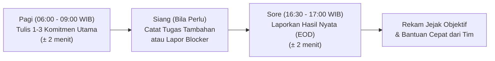

# BUKU PANDUAN PENGGUNA — VERSI KARYAWAN & ANAK MAGANG
# WORKPULSE — SISTEM PENCATATAN KOMITMEN HARIAN & PENANGANAN KENDALA KERJA

**PT Dutamedia Mandiri Pratama — Malang (Waktu Indonesia Barat / WIB)**  
**Alamat Aplikasi:** `https://dutamedia-workpulse.vercel.app`  
**Versi Panduan:** `v1.5` *(Selaras 100% dengan Aplikasi Live & Dokumen Induk Alur Sistem)*

> [!NOTE]
> **Untuk Siapa Buku Panduan Ini?**  
> Buku ini khusus disusun untuk **seluruh karyawan operasional lintas divisi** (*Engineering, Quality, Operations & Infrastructure, R&D, Delivery, Business Development, Sales, Finance, HRGA*) dan **karyawan magang (*Intern*)**.  
> Untuk panduan khusus Pimpinan, Kepala Divisi, Project Manager, HRGA, Direktur, dan Admin Sistem, silakan baca dokumen terpisah: **`Buku-Panduan-Pimpinan-HRGA-dan-Admin.md`**.

---

## DAFTAR ISI

1. **BAB 1 — Mengenal WorkPulse & Cara Memulai**
   - 1.1 Apa Itu WorkPulse dan Mengapa Kita Menggunakannya?
   - 1.2 Perangkat & Peramban (*Browser*) yang Disarankan
   - 1.3 Aktivasi Akun Baru dari Tautan Undangan (Berlaku 72 Jam)
   - 1.4 Cara Masuk (*Login*), Fitur Ingat Email, & Prosedur Jika Lupa Kata Sandi
   - 1.5 Mengenal Tampilan Layar & Menu Utama Karyawan
   - 1.6 Memeriksa Profil Akun, Mengganti Kata Sandi, & Mengaktifkan Notifikasi Perangkat
   - 1.7 Mengapa Dua Karyawan Bisa Melihat Menu yang Berbeda? (Wewenang Tambahan)
   - 1.8 Memahami Layar "Akses Dibatasi (403)" & "Halaman Tidak Ditemukan (404)"
2. **BAB 2 — Rutinitas Kerja Harian (`My Today`)**
   - 2.1 Jadwal Waktu Kerja & Jam Batas Pelaporan (WIB)
   - 2.2 Langkah 1: Mengisi Komitmen Pagi (`/daily/morning`)
   - 2.3 Langkah 2: Mencatat Pekerjaan Tambahan Siang Hari (`/daily/additional-work`)
   - 2.4 Langkah 3: Mengisi Evaluasi Sore / EOD (`/daily/eod`)
   - 2.5 Memantau Riwayat Kerja & Mengunduh Arsip Pribadi (`/daily/history`)
3. **BAB 3 — Melaporkan & Memantau Kendala Kerja (`Lapor Blocker`)**
   - 3.1 Kapan Cukup Pilih `AMBER/RED` vs Kapan Wajib Buat Tiket Blocker? (7 Situasi Nyata)
   - 3.2 Cara Membuat Laporan Kendala Baru (`/raise-blockers`)
   - 3.3 Memantau, Mengubah, Menanggapi Bantuan, Menutup, atau Menghapus Tiket (`Blocker Saya`)
   - 3.4 Panduan Singkat bagi Staf yang Ditunjuk Sebagai Penanggung Jawab Kategori Kendala (`/blockers`)
4. **BAB 4 — Mengajukan Koreksi Laporan Harian**
   - 4.1 Perbedaan Koreksi Ringan (*Minor*) vs Koreksi Penting (*Material*)
   - 4.2 Mengajukan Koreksi Komitmen Pagi (`/corrections/morning`)
   - 4.3 Mengajukan Koreksi Evaluasi Sore (`/corrections/eod`)
   - 4.4 Cara Merevisi Permohonan Koreksi Jika Ditolak Atasan
5. **BAB 5 — Mengajukan Cuti & Izin (`Cuti Saya`)**
   - 5.1 Aturan Cuti Karyawan Tetap/Kontrak vs Aturan Izin Anak Magang (`Intern`)
   - 5.2 Langkah Mengajukan Cuti / Izin & Cara Membatalkan Mandiri (`/leave/my`)
   - 5.3 Apa yang Terjadi Otomatis Setelah Cuti / Izin Disetujui?
6. **BAB 6 — Pusat Notifikasi (`/notifications`)**
7. **BAB 7 — Tanya-Jawab & Solusi Masalah Sehari-hari (FAQ)**
8. **LAMPIRAN**
   - Lampiran A: Daftar Lengkap 16 Kategori Kendala (5 Kelompok) & Tujuan Pengarahannya
   - Lampiran B: Daftar Lengkap 9 Dampak Kendala (Pilih 1 s/d 3)
   - Lampiran C: Kamus Istilah Sehari-hari WorkPulse

---

# BAB 1: MENGENAL WORKPULSE & CARA MEMULAI

### 1.1 Apa Itu WorkPulse dan Mengapa Kita Menggunakannya?

**WorkPulse** adalah sistem pencatatan target kerja harian dan pelaporan hambatan kerja di PT Dutamedia Mandiri Pratama.



**Tiga hal penting yang perlu Anda ketahui sejak hari pertama:**
1. **Bukan alat mata-mata atau pemotong gaji:** WorkPulse tidak merekam layar komputer Anda, tidak menghitung ketikan papan ketik, dan tidak memotong gaji secara otomatis.
2. **Hanya butuh 2–3 menit di pagi hari dan 2–3 menit di sore hari:** Anda cukup menuliskan 1 sampai 3 target kerja utama di pagi hari, lalu melaporkan hasilnya di sore hari.
3. **Pelindung kerja dan jalur bantuan resmi:** Jika pekerjaan Anda terhambat oleh kendala teknis, perangkat rusak, atau menunggu rekan/divisi lain, Anda dapat melaporkannya lewat **Lapor Blocker** agar penanggung jawab yang tepat langsung membantu dengan target waktu yang jelas.

---

### 1.2 Perangkat & Peramban (*Browser*) yang Disarankan

WorkPulse dapat dibuka langsung lewat internet tanpa perlu memasang aplikasi tambahan.
- **Peramban yang disarankan:** Google Chrome, Microsoft Edge, Mozilla Firefox, atau Safari versi terbaru.
- **Ukuran layar:** Bisa digunakan dengan nyaman di komputer/laptop, tablet, maupun HP (*smartphone*). Di layar HP, menu sebelah kiri tersembunyi di balik tombol garis tiga di pojok kiri atas.

---

### 1.3 Aktivasi Akun Baru dari Tautan Undangan (Berlaku 72 Jam)

Saat pertama kali bergabung, Admin atau Tim HRGA akan mendaftarkan email kantor Anda dan mengirimkan **tautan aktivasi akun**. Tautan ini hanya bisa dipakai **1 kali** dan berlaku selama **72 jam**.

> **[Gambar `WP-SS-02` — Halaman Aktivasi Akun (`/activate`)]**  
> *Tampilkan halaman `/activate` saat kartu pratinjau akun muncul dan 3 syarat kata sandi baru sudah tercentang hijau.*

#### Langkah Mengaktifkan Akun:
1. Klik tautan aktivasi yang Anda terima dari HRGA/Admin (alamatnya diawali `https://dutamedia-workpulse.vercel.app/activate?token=...`).
2. Periksa **Kartu Pratinjau Akun** yang muncul otomatis: pastikan Nama Lengkap, Email, dan Divisi Anda sudah benar serta bertanda **`UNDANGAN AKTIF`**.
3. Pada kolom **`Kata Sandi Baru`**, ketikkan kata sandi pribadi Anda dengan memenuhi **3 syarat keamanan**:
   - Minimal **8 karakter**.
   - Memadukan **huruf dan angka** (misalnya: `Dutamedia2026!`).
   - Pastikan meteran kekuatan sandi menyala hijau dan seluruh tanda centang syarat sudah berwarna hijau.
4. Ketik ulang kata sandi yang sama persis pada kolom **`Konfirmasi Kata Sandi`**.
5. Klik tombol hijau **`Aktivasi Akun`**.
6. Jika berhasil, muncul kartu **Aktivasi Berhasil!** — klik tombol **`Lanjut ke Halaman Masuk`** untuk mulai login.

> [!WARNING]
> **Jika Muncul Pesan "Undangan Tidak Berlaku":**
> - **Kedaluwarsa (lewat 72 jam):** Hubungi HRGA atau Admin untuk meminta pengiriman ulang tautan undangan baru.
> - **Sudah Pernah Digunakan:** Artinya akun Anda sudah aktif; silakan langsung masuk melalui halaman `/login`.
> - **Dibatalkan / Dicabut:** Hubungi HRGA untuk memastikan status pendaftaran akun Anda.

---

### 1.4 Cara Masuk (*Login*), Fitur Ingat Email, & Prosedur Jika Lupa Kata Sandi

> **[Gambar `WP-SS-01` — Halaman Masuk Sistem (`/login`)]**  
> *Tampilkan halaman `/login` dengan panel pengenalan kiri dan formulir masuk kanan terisi contoh email.*

#### Langkah Masuk ke Sistem:
1. Buka alamat **`https://dutamedia-workpulse.vercel.app/login`**.
2. Isi **`Email Perusahaan`** (contoh: `dev.frontend@dutamedia.com`).
3. Isi **`Kata Sandi`**. Klik **ikon mata** di ujung kanan kolom jika ingin melihat huruf yang Anda ketik.
4. *(Opsional)* Centang **`Ingat email di perangkat ini`** agar saat Anda keluar nanti, alamat email sudah otomatis terisi di perangkat pribadi Anda.
5. Klik tombol hijau **`Masuk Sistem`**.
6. Karyawan operasional dan anak magang akan langsung diarahkan ke halaman utama **`My Today` (`/daily/morning`)**.

#### Pesan Peringatan yang Mungkin Muncul Saat Masuk:
- **"Alamat email atau kata sandi tidak valid":** Periksa ejaan email dan pastikan tombol `Caps Lock` tidak menyala.
- **"Batas Percobaan Terlampaui" (Hitung Mundur Detik):** Jika Anda salah memasukkan sandi 5 kali berturut-turut, tombol masuk dikunci sementara demi keamanan. Tunggu sampai hitungan detik selesai lalu coba lagi.
- **"Akun Anda belum diaktifkan":** Selesaikan langkah aktivasi pada Sub-bab 1.3 terlebih dahulu.
- **"Akun Anda dinonaktifkan oleh administrator":** Hubungi Tim HRGA untuk klarifikasi status akun.

#### Prosedur Jika Lupa Kata Sandi:
Demi keamanan sistem internal perusahaan, halaman masuk **tidak menyediakan tombol reset kata sandi publik**.
- **Jika Anda masih dalam posisi masuk (*login*) di perangkat lain:** Buka menu **Profil Akun (`/profile`)** lalu ubah kata sandi Anda secara mandiri.
- **Jika Anda lupa kata sandi dan sudah keluar dari semua perangkat:** Hubungi **Admin Sistem (`admin@dutamedia.com`)** atau **Tim HRGA (`hrga@dutamedia.com`)** agar akses akun Anda dibantu dipulihkan secara aman.

---

### 1.5 Mengenal Tampilan Layar & Menu Utama Karyawan

> **[Gambar `WP-SS-03` — Tampilan Utama Kerja Karyawan (`/daily/morning`)]**  
> *Tampilkan tampilan desktop penuh memperlihatkan bilah atas, bilah menu kiri (`Workspace`), dan area kerja utama.*

Layar WorkPulse dibagi menjadi 3 bagian sederhana:
1. **Bilah Atas:** Menampilkan nama halaman yang sedang dibuka, **ikon lonceng notifikasi** (dengan angka merah jika ada pesan belum dibaca), dan **avatar profil** Anda di kanan atas.
2. **Bilah Menu Kiri (`Workspace`):**
   - **`My Today`** (`/daily/morning`) — Tempat mengisi Komitmen Pagi, Tugas Tambahan, dan Evaluasi Sore.
   - **`Lapor Blocker`** (`/raise-blockers`) — Tempat melaporkan kendala kerja dan memantau tiket kendala Anda.
   - **`Riwayat Saya`** (`/daily/history`) — Tempat melihat riwayat kerja harian Anda dan mengunduh arsip CSV.
   - **`Cuti Saya`** (`/leave/my`) — Tempat mengajukan cuti/izin (untuk anak magang: Izin & Sakit).
   - **`Koreksi Komitmen Pagi`** (`/corrections/morning`) — Tempat mengajukan perbaikan komitmen pagi yang sudah terkunci.
   - **`Koreksi Evaluasi Sore`** (`/corrections/eod`) — Tempat mengajukan perbaikan laporan sore yang sudah terkunci.
   - **`Notifikasi`** (`/notifications`) — Daftar seluruh pemberitahuan masuk.
   - Tombol **`Keluar`** di pojok kiri bawah untuk mengakhiri sesi dengan aman.
3. **Area Kerja Utama:** Tempat formulir, kartu ringkasan, dan daftar tabel tampil.

---

### 1.6 Memeriksa Profil Akun, Mengganti Kata Sandi, & Mengaktifkan Notifikasi Perangkat

Buka halaman **`/profile`** dengan mengeklik nama/avatar Anda di pojok kanan atas.

> **[Gambar `WP-SS-17` — Halaman Profil Akun & Ubah Kata Sandi (`/profile`)]**  
> *Tampilkan kartu identitas akun, info atasan langsung, dan formulir ganti kata sandi dengan 3 syarat tercentang hijau.*

1. **Panel Identitas & Penugasan (Hanya Baca):** Menampilkan Nama, Email, Divisi, Jabatan, Nama Atasan Langsung, dan **Status Karyawan** (`Karyawan Tetap`, `Kontrak`, atau pil ungu **`Intern`** lengkap dengan baris **Tanggal Selesai Magang** khusus untuk anak magang). Jika ada data yang salah, hubungi Tim HRGA.
2. **Panel Pembaruan Kata Sandi Mandiri:**
   - Isi **`Kata Sandi Saat Ini`**, **`Kata Sandi Baru`** (minimal 8 karakter, gabungan huruf dan angka, berbeda dari sandi lama), dan **`Konfirmasi Kata Sandi Baru`**.
   - Centang opsi **`Akhiri seluruh sesi aktif di perangkat/peramban lain`** bila Anda ingin perangkat lain otomatis keluar setelah sandi diganti.
   - Klik **`Simpan Kata Sandi Baru`**.
3. **Panel Notifikasi Perangkat (*Browser Push*):** Menampilkan status izin notifikasi di peramban Anda. Pengingat otomatis akan dikirim **60 menit sebelum batas waktu tepat waktu** pagi dan sore.

---

### 1.7 Mengapa Dua Karyawan Bisa Melihat Menu yang Berbeda? (Wewenang Tambahan)

Di WorkPulse, dua orang yang sama-sama berstatus Karyawan (`EMPLOYEE`) bisa melihat tambahan menu di bilah kiri jika salah satunya mendapat penugasan resmi berikut:
- **Ditunjuk sebagai Penanggung Jawab Kategori Kendala:** Otomatis terbuka menu **`Antrean Blocker` (`/blockers`)** dan **`Penuaan & Eskalasi` (`/blockers/aging`)** agar bisa menangani tiket sesuai bidang keahliannya (misalnya IT Support, GA, Network & Infra, Finance, atau Sales).
- **Ditunjuk sebagai Reviewer Sementara:** Selama masa delegasi aktif (menggantikan atasan yang sedang cuti/dinas luar), otomatis terbuka menu **`Persetujuan Cuti`**, **`Review Koreksi & Cuti`**, dan **`Antrean Blocker`** untuk divisi terkait.
- **Memiliki Bawahan Langsung di Bagan Organisasi:** Otomatis terbuka menu **`Catatan Coaching` (`/coaching`)**.
- **Khusus Anak Magang (`Intern`):** Sesuai aturan perusahaan, anak magang tidak dapat ditunjuk sebagai Atasan Langsung, Pimpinan Proyek, Penanggung Jawab Khusus Blocker, maupun Reviewer Sementara.

---

### 1.8 Memahami Layar "Akses Dibatasi (403)" & "Halaman Tidak Ditemukan (404)"

> **[Gambar `WP-SS-18` — Layar 403 Akses Dibatasi (`/forbidden`)]**  
> *Tampilkan layar `403 — Akses Dibatasi` saat akun karyawan mencoba membuka URL khusus admin.*

- **`403 — Akses Dibatasi`:** Muncul jika Anda mengetik manual alamat halaman milik Pimpinan/HRGA/Admin yang bukan wewenang akun Anda. Cukup klik **`Kembali ke Beranda`**.
- **`404 — Halaman Tidak Ditemukan`:** Muncul jika alamat URL yang diketik salah atau tidak tersedia. Klik **`Kembali ke Beranda`**.

---

# BAB 2: RUTINITAS KERJA HARIAN (`MY TODAY`)

### 2.1 Jadwal Waktu Kerja & Jam Batas Pelaporan (WIB)

Seluruh jadwal di WorkPulse menggunakan **Waktu Indonesia Barat (WIB)**:

```
06:00            09:00        09:30                   16:30       17:00            21:00 WIB
  |-- PAGI ON-TIME --|-- LATE --|---- PAGI TERKUNCI ----|-- SORE --|-- LEMBUR FLEKSIBEL --| TERKUNCI
      (Hijau)          (Kuning)     (Gunakan Opsi A /      (Hijau)   (Tetap Boleh Lapor)    (Kunci Malam)
                                     Koreksi Pagi)
```

| Sesi Laporan | Rentang Waktu (WIB) | Status yang Tercatat | Keterangan |
|---|---|---|---|
| **Komitmen Pagi — Tepat Waktu** | `06:00 – 09:00` | **`ON-TIME`** (Hijau) | Waktu ideal menetapkan rencana kerja hari ini. |
| **Komitmen Pagi — Toleransi** | `09:01 – 09:30` | **`Terlambat (LATE)`** (Kuning) | Masih bisa dikirim, namun tercatat terlambat. |
| **Komitmen Pagi — Terkunci** | Lewat `09:30` | **`Terkunci (LOCKED)`** (Merah) | Formulir pagi dikunci. Anda tetap bisa mencatat pekerjaan di **Tugas Tambahan (Opsi A)** atau mengajukan **Koreksi Komitmen Pagi**. |
| **Tugas Tambahan Siang** | `09:30 – sebelum EOD` | Aktif (maks. 5 tugas) | Otomatis terkunci begitu Anda mengirim Evaluasi Sore atau lewat `21:00 WIB`. |
| **Evaluasi Sore — Normal** | `16:30 – 17:00` | **`ON-TIME`** (Hijau) | Waktu standar melaporkan capaian hari ini. |
| **Evaluasi Sore — Lembur Fleksibel** | `17:01 – 21:00` | **`Di Luar Jam Normal (Lembur Fleksibel)`** | Tetap bisa mengirim laporan sore jika masih lembur atau rapat sore. |
| **Evaluasi Sore — Terkunci Malam** | Lewat `21:00` | **`Terkunci (LOCKED)`** | Formulir sore dan tugas tambahan terkunci untuk menjaga disiplin hari yang sama. |

> [!TIP]
> **Jika Anda Sedang Cuti atau Izin Resmi Disetujui (`APPROVED`):**  
> Formulir Komitmen Pagi, Tugas Tambahan, dan Evaluasi Sore otomatis terkunci dan menampilkan **Spanduk Hijau Cuti Resmi**. Anda tidak perlu melapor apa pun dan bebas dari catatan alpa.

---

### 2.2 Langkah 1: Mengisi Komitmen Pagi (`/daily/morning`)

**Tujuan:** Menuliskan **1 sampai 3 target kerja utama** hari ini beserta tingkat risikonya agar prioritas Anda jelas sejak pagi.

> **[Gambar `WP-SS-04` — Formulir Komitmen Pagi Terisi (`/daily/morning`)]**  
> *Tampilkan kotak `Prioritas Kemarin Sore`, panel `Draf Tugas Berlanjut dari Kemarin`, slot komitmen terisi lengkap dengan pilihan proyek & risiko warna, serta tombol `Simpan Draf` dan `Kirim Morning Commitment`.*

#### A. Memanfaatkan Bantuan Pengingat dari Kemarin
Di bagian atas formulir, perhatikan dua alat bantu praktis:
1. **Kotak `Prioritas Kemarin Sore`:** Menampilkan catatan prioritas yang kemarin sore Anda tuliskan sendiri saat menutup hari. Kotak ini tetap terlihat baik sebelum maupun sesudah komitmen pagi dikirim.
2. **Panel `Draf Tugas Berlanjut dari Kemarin`:** Jika kemarin ada tugas yang Anda tandai **`Lanjutkan Besok`**, klik **`Lihat Draf`**. Anda bisa langsung menyalinnya satu per satu (**`Salin ke Slot`**) atau mencentang beberapa sekaligus lalu klik **`Gunakan Item Terpilih ke Slot Hari Ini`**.
   - Jika suatu tugas sudah berlanjut **2 hari berturut-turut (`Carry-Over #2+`)**, sistem otomatis memberi saran risiko **`AMBER`** dan mengisi kolom *Potensi Kendala* dari catatan evaluasi kemarin agar Anda tidak lupa meminta bantuan.

#### B. Langkah Mengisi 1 s/d 3 Slot Komitmen
1. Buka menu **`My Today`** (`/daily/morning`).
2. Pada **Slot Komitmen #1**, isi **`Deskripsi Komitmen & Kriteria Selesai *`** (minimal 3 karakter).
   - Kotak ketik akan otomatis menampilkan contoh kalimat sesuai divisi Anda. Berikut **panduan contoh kalimat untuk 10 divisi**:
     1. **Engineering:** *Menyelesaikan implementasi fitur dan memastikan perubahan siap diuji.*
     2. **Quality (QA/QC):** *Menyelesaikan pengujian fitur, verifikasi kualitas, atau penelusuran temuan defect hari ini.*
     3. **Operations & Infrastructure:** *Menyelesaikan konfigurasi atau pekerjaan infrastruktur yang direncanakan hari ini.*
     4. **R&D:** *Menyelesaikan eksplorasi teknis, evaluasi arsitektur, atau penyusunan rekomendasi riset hari ini.*
     5. **Delivery:** *Menyelesaikan koordinasi atau pekerjaan yang mendukung delivery proyek hari ini.*
     6. **Business Development:** *Menyelesaikan penjajakan kemitraan, tindak lanjut prospek, atau penyusunan proposal bisnis hari ini.*
     7. **Sales Enablement & Presales:** *Menyelesaikan materi atau kebutuhan pendukung aktivitas penjualan hari ini.*
     8. **Finance:** *Menyelesaikan rekonsiliasi atau proses administrasi keuangan yang menjadi prioritas hari ini.*
     9. **HRGA:** *Menyelesaikan proses administrasi atau kebutuhan operasional karyawan hari ini.*
     10. **Management:** *Menyelesaikan prioritas koordinasi atau keputusan yang perlu ditindaklanjuti hari ini.*
3. *(Opsional)* Pilih **`Proyek Terkait`**, atau biarkan *Non-Proyek / Operasional Rutin*.
4. *(Opsional)* Jika target ini adalah **tugas untuk membereskan tiket kendala aktif**, klik tombol **`Pilih Blocker Aktif`** di sebelah kolom Tautan Referensi.
5. Pilih **`Tingkat Risiko *`**:
   - **`GREEN (Terkendali)`:** Tugas bisa dikerjakan lancar tanpa hambatan berarti.
   - **`AMBER (Berisiko)`:** Ada potensi kendala atau ketergantungan pada rekan lain. **Wajib** mengisi kolom **`Potensi Kendala / Hambatan *`** (dan opsional **`Bantuan yang Dibutuhkan`**).
   - **`RED (Kritis)`:** Sangat berisiko gagal hari ini bila tidak segera dibantu. **Wajib** mengisi **`Potensi Kendala / Hambatan *`**, dan Anda bisa memilih **`Tiket Blocker Penyebab`** jika tiket kendalanya sudah dibuat.
6. Klik **`+ Tambah Slot Komitmen`** jika ingin menambah Slot #2 atau Slot #3 (maksimal 3 slot).
7. *(Opsional)* Klik **`Simpan Draf`** jika Anda ingin menyimpan ketikan sementara di peramban sebelum dikirim (aman jika halaman di-refresh; tersedia tombol **`Reset Draf`** untuk menghapus draf sementara).
8. Klik tombol hijau **`Kirim Morning Commitment`**.

#### C. Jika Hari Ini Mengikuti Pelatihan / Rapat Seharian (`0 Komitmen`)
> **[Gambar `WP-SS-05` — Opsi 0 Komitmen Hari Ini (`/daily/morning`)]**  
> *Tampilkan kotak centang `0 Komitmen` dalam keadaan tercentang dan kolom alasan minimal 10 karakter terisi.*

1. Centang kotak **`0 Komitmen Hari Ini (Fokus Non-Operasional / Rapat Seharian / Workshop)`**.
2. Slot tugas 1–3 otomatis disembunyikan dan muncul kolom wajib **`Alasan 0 Komitmen *`** (minimal **10 karakter**, contoh: *Mengikuti pelatihan keamanan informasi seharian penuh bersama tim HRGA*).
3. Klik **`Kirim Morning Commitment`**.

#### D. Tampilan Setelah Komitmen Pagi Terkirim
> **[Gambar `WP-SS-06` — Kartu Ringkasan Komitmen Pagi Terkirim (`/daily/morning`)]**  
> *Tampilkan kartu ringkasan terkunci lengkap dengan jam kirim, lencana status (`ON-TIME`/`LATE`), dan tombol `Ajukan Koreksi Komitmen Pagi`.*

- Formulir otomatis **terkunci** agar rencana pagi tetap jujur dan tidak diubah-ubah diam-diam.
- Jika ternyata ada salah ketik atau perubahan rencana resmi, klik tombol **`Ajukan Koreksi Komitmen Pagi`**.

---

### 2.3 Langkah 2: Mencatat Pekerjaan Tambahan Siang Hari (`/daily/additional-work`)

**Tujuan:** Mencatat pekerjaan mendadak di siang hari (misalnya permintaan mendadak atasan, perbaikan bug darurat, atau urusan klien) tanpa merusak 1–3 komitmen pagi yang sudah terkunci. Maksimal **5 tugas tambahan per hari**.

> **[Gambar `WP-SS-07` — Halaman Pekerjaan Tambahan (`/daily/additional-work`)]**  
> *Tampilkan formulir pengisian tugas tambahan dan daftar kartu tugas tambahan yang sudah tercatat beserta tombol `Edit` dan `Hapus`.*

#### A. Langkah Menambah Pekerjaan Tambahan
1. Klik tab langkah ke-2 **`Additional Work`** pada bilah atas `My Today` (atau buka `/daily/additional-work`).
2. Isi **`Deskripsi Pekerjaan Tambahan *`** (minimal 5 karakter).
3. Pilih **`Alasan Pekerjaan Tambahan *`**:
   - Jika memilih **`Penugasan Baru dari Atasan`**, wajib memilih nama atasan pada dropdown **`Ditugaskan Oleh *`** *(akun anak magang otomatis tidak muncul di daftar ini)*.
   - Jika memilih **`Lainnya`**, wajib mengisi kolom keterangan tambahan.
4. *(Opsional)* Pilih Proyek Terkait atau tautkan referensi.
5. Klik tombol **`Tambahkan Pekerjaan`**.

#### B. Jika Pagi Tadi Terlewat Mengisi Komitmen Pagi (**Opsi A**)
- Jika waktu sudah melewati jam kunci pagi (`09:30 WIB`) dan pagi tadi Anda belum sempat mengirim komitmen pagi, Anda **tetap bisa** mencatat pekerjaan hari ini di halaman **`/daily/additional-work`**.
- Sistem otomatis memilihkan alasan **`Komitmen Pagi Terlewat`** agar aktivitas siang dan sore Anda tetap terdokumentasi dengan jujur (sementara status pagi tetap tercatat apa adanya).

#### C. Mengubah (`Edit`) atau Menghapus (`Hapus`) Tugas Tambahan
- Selama Evaluasi Sore (EOD) belum Anda kirim, Anda bisa mengeklik **`Edit`** untuk memperbaiki salah ketik atau **`Hapus`** (wajib mengisi alasan penghapusan minimal **5 karakter**).
- Jika tugas tersebut berstatus *Penugasan Baru dari Atasan*, atasan yang menugaskan akan **otomatis menerima notifikasi** bila Anda mengubah atau menghapusnya.
- **Kunci Otomatis Pasca-EOD:** Begitu Evaluasi Sore dikirim atau jam melewati `21:00 WIB`, formulir ini otomatis terkunci bertuliskan **`Evaluasi Sore (EOD) Hari Ini Telah Ditutup — Formulir Terkunci`**. Jika ada kendala darurat malam hari, klik tautan **`Lapor Blocker`** yang tetap aktif 24 jam.

---

### 2.4 Langkah 3: Mengisi Evaluasi Sore / EOD (`/daily/eod`)

**Tujuan:** Melaporkan hasil nyata dari seluruh Komitmen Pagi dan Pekerjaan Tambahan hari ini sebelum pulang kerja.

> **[Gambar `WP-SS-08` — Formulir Evaluasi Sore (`/daily/eod`)]**  
> *Tampilkan daftar tugas hari ini dengan pilihan status hasil (`Selesai Penuh`, `Selesai Sebagian`, `Belum Selesai`, `Dibatalkan`), pilihan `Status Akhir Hari`, dan kolom `Prioritas Utama Besok`.*

#### Langkah Mengisi Evaluasi Sore:
1. Klik tab langkah ke-3 **`EOD Outcome`** pada bilah atas `My Today` (atau buka `/daily/eod`).
2. Untuk **setiap tugas** (Komitmen Pagi + Tugas Tambahan), pilih salah satu status hasil:
   - **`Selesai Penuh`:** Tugas tuntas 100%.
   - **`Selesai Sebagian`** atau **`Belum Selesai`:** Wajib memilih keputusan kelanjutan (**`Lanjutkan Besok`** atau **`Tidak Dilanjutkan`**) dan mengisi **`Catatan Progres / Alasan`** (catatan ini otomatis muncul besok pagi jika Anda memilih *Lanjutkan Besok*).
   - **`Dibatalkan`:** Wajib mengisi **`Alasan Pembatalan`**.
3. Pilih **`Status Akhir Hari`** (`GREEN`, `AMBER`, atau `RED`). Pilihan **`GREEN` selalu terbuka** dan tidak pernah dikunci secara sepihak oleh sistem.
4. *(Opsional)* Isi kolom **`Prioritas Utama Besok`** — catatan ini akan muncul sebagai pengingat di bagian atas layar Komitmen Pagi besok.
5. Klik tombol hijau **`Kirim Evaluasi EOD`**.

> **[Gambar `WP-SS-09` — Kartu Ringkasan Evaluasi Sore Terkirim (`/daily/eod`)]**  
> *Tampilkan kartu ringkasan EOD terkunci beserta rekap status tiap tugas dan tombol `Ajukan Koreksi EOD`.*

---

### 2.5 Memantau Riwayat Kerja & Mengunduh Arsip Pribadi (`/daily/history`)

> **[Gambar `WP-SS-10` — Halaman Riwayat Saya (`/daily/history`)]**  
> *Tampilkan 4 kartu ringkasan angka di atas, tombol `Unduh CSV`, dan tabel log harian dengan salah satu baris dibuka (`expanded`).*

1. Buka menu **`Riwayat Saya`** (`/daily/history`).
2. Atur **`Dari Tanggal`** dan **`Sampai Tanggal`**, lalu klik **`Terapkan Rentang`**.
3. Perhatikan **4 Kartu Ringkasan** di bagian atas (Persentase Ketepatan Waktu, jumlah Hari Hijau, Hari Kuning/Amber, dan Hari Merah).
4. **Klik baris tanggal mana pun** di tabel untuk membuka rincian lengkap komitmen pagi, tugas tambahan, dan hasil sore pada tanggal tersebut.
5. Klik **`Unduh CSV`** di pojok kanan atas jika Anda ingin menyimpan salinan arsip pribadi ke komputer Anda.

---

# BAB 3: MELAPORKAN & MEMANTAU KENDALA KERJA (`LAPOR BLOCKER`)

### 3.1 Kapan Cukup Pilih `AMBER/RED` vs Kapan Wajib Buat Tiket Blocker? (7 Situasi Nyata)

Tidak semua masalah harus dibuatkan tiket Blocker. Gunakan panduan 7 situasi sehari-hari ini:

| No | Situasi Nyata di Kantor | Cukup di Komitmen Pagi (`AMBER`/`RED`)? | Wajib Buat Tiket Blocker (`/raise-blockers`)? |
|---|---|---|---|
| 1 | Tugas agak padat tapi masih bisa selesai sendiri jika fokus. | **Ya**, pilih `AMBER` dan tulis alasannya. | **Tidak perlu.** |
| 2 | Baru menduga besok mungkin butuh review rekan, hari ini masih jalan lancar. | **Ya**, pilih `AMBER` sebagai tanda waspada. | **Belum perlu**, buat tiket baru jika benar-benar tertahan. |
| 3 | Laptop rusak, internet mati, server staging error, atau akun kerja terkunci. | Bisa tandai `RED` jika menghambat target hari ini. | **YA, WAJIB** buat tiket Blocker agar tim IT/Infra segera menangani. |
| 4 | Menunggu data/review dari divisi lain dan pekerjaan Anda berhenti total. | Tandai `AMBER`/`RED` pada komitmen terkait. | **YA, WAJIB** pilih kategori `Menunggu Tim / Rekan Lain` (`CROSS_TEAM`) dan pilih divisi yang ditunggu. |
| 5 | AC mati, listrik padam, kendaraan operasional mogok, atau ATK habis. | Tidak perlu ubah risiko tugas jika tugas pribadi jalan. | **YA, WAJIB** pilih kategori `Fasilitas & Sarana Kantor` (`OFFICE_FACILITY`) agar Tim GA segera bertindak. |
| 6 | Menunggu ACC/tanda tangan atasan atau pencairan dana vendor yang menghambat jadwal. | Tandai `AMBER`/`RED` pada target proyek. | **YA, WAJIB** pilih kategori `Persetujuan & Tanda Tangan` atau `Keuangan & Pembayaran`. |
| 7 | Kendala terjadi di malam hari setelah EOD ditutup (misalnya website klien tiba-tiba error). | Formulir harian sudah terkunci. | **YA, WAJIB** — halaman `/raise-blockers` aktif **24 jam penuh**. |

#### Perbedaan 2 Tombol Penautan Blocker di Komitmen Pagi:
- **`Pilih Blocker Aktif`** (di sebelah kolom Tautan Referensi): Dipakai jika **tugas Anda hari ini adalah membereskan tiket kendala tersebut** (misalnya staf IT yang hari ini bertugas memperbaiki server dari tiket yang masuk).
- **`Tiket Blocker Penyebab`** (muncul saat Anda memilih risiko `AMBER`/`RED`): Dipakai jika **tugas Anda hari ini terhambat/terganjal oleh tiket kendala tersebut**.

---

### 3.2 Cara Membuat Laporan Kendala Baru (`/raise-blockers`)

> **[Gambar `WP-SS-11` — Formulir Lapor Blocker (`/raise-blockers`)]**  
> *Tampilkan Bagian 1 (Judul, 16 Kategori dalam 5 kelompok, 9 kotak centang Dampak tercentang 2 kotak, Tingkat Keparahan) dan Bagian 2 (Jalur Kewenangan + Panel Pratinjau Jalur Penanganan Otomatis).*

#### Langkah Mengirim Laporan Kendala:
1. Buka menu **`Lapor Blocker`** (`/raise-blockers`) pada tab **`Buat Laporan Blocker`**.
2. **Bagian 1 — Detail Kendala:**
   - **`Judul Kendala *`:** Tulis singkat dan jelas (10–140 karakter).
   - **`Tautkan ke Komitmen Hari Ini`** *(Opsional)*: Pilih target harian yang terdampak.
   - **`Kategori Kendala *`:** Pilih 1 dari **16 Kategori** dalam 5 kelompok (lihat daftar lengkap di **Lampiran A**).
     * *Khusus kategori `Menunggu Tim / Rekan Lain` (`CROSS_TEAM`):* Wajib memilih **Divisi yang Sedang Ditunggu**.
   - **`Dampak Kendala *`:** Centang **minimal 1 dan maksimal 3 kotak** dari **9 Dampak** (lihat **Lampiran B**). Begitu 3 kotak tercentang, 6 kotak sisanya otomatis terkunci agar fokus pada dampak paling terasa.
   - **`Tingkat Keparahan *`:**
     * **`CRITICAL` (Target 1 Jam):** Pekerjaan macet total / sistem aktif klien mati. Memicu pemberitahuan darurat ke Kepala Divisi & Sponsor Proyek.
     * **`HIGH` (Target 4 Jam):** Hambatan berat yang mengancam tenggat hari ini.
     * **`MEDIUM` (Target 8 Jam):** Hambatan sedang, masih ada tugas lain yang bisa dikerjakan.
     * **`LOW` (Target 24 Jam):** Kendala ringan / permintaan bantuan non-mendesak.
   - **`Deskripsi Kendala & Upaya Mandiri *`** (minimal 20 karakter): Jelaskan fakta masalah dan apa yang sudah Anda coba. Klik **`+ Gunakan Format Terstruktur`** jika ingin memakai kerangka siap isi.
   - **`Bantuan Konkret yang Diharapkan`** *(Opsional)*: Tulis bantuan yang dibutuhkan atau klik tombol cepat (`+ Approval`, `+ Akses`, `+ Infra`, dll.).
3. **Bagian 2 — Jalur Kewenangan & Penanggung Jawab:**
   - Pilih **`Organizational Authority (Struktural)`** untuk kendala umum/operasional/spesialis, atau **`Project Authority (Kewenangan Proyek)`** (wajib pilih nama proyek) untuk kendala yang menjadi wewenang Project Manager.
   - Biarkan **Penanggung Jawab Khusus** pada posisi *Ditentukan Otomatis oleh Sistem* agar sistem menunjuk pejabat/spesialis resmi yang tepat.
   - Periksa **Panel Jalur Penanganan Otomatis** di bagian bawah untuk melihat siapa yang akan menerima tiket Anda.
     * *Aturan Cuti Otomatis:* Jika penanggung jawab yang seharusnya sedang **Cuti Resmi (`APPROVED`)**, tiket otomatis naik ke atasan langsungnya agar tidak terhenti.
4. Klik tombol hijau **`Kirim Laporan Blocker`**.

> **[Gambar `WP-SS-12` — Kartu Konfirmasi Tiket Blocker Terbit (`/raise-blockers`)]**  
> *Tampilkan kartu sukses dengan Nomor ID Tiket, status `Menunggu Respons`, nama penanggung jawab, dan tombol `Lihat di Blocker Saya`.*

---

### 3.3 Memantau, Mengubah, Menanggapi Bantuan, Menutup, atau Menghapus Tiket (`Blocker Saya`)

Klik tab **`Blocker Saya`** di `/raise-blockers?tab=mine` untuk memantau semua tiket yang pernah Anda buat.

- **Status Tiket yang Akan Anda Lihat:**
  1. **`Menunggu Respons`:** Tiket baru masuk ke antrean penanggung jawab.
  2. **`Sedang Ditangani`:** Penanggung jawab sudah menerima dan mulai mengerjakan solusi.
  3. **`Solusi Diberikan`:** Penanggung jawab sudah mengirim solusi — kini giliran Anda mengecek apakah masalah benar-benar beres.
  4. **`Risiko Diterima`:** Masalah berada di luar kendali internal dan disertai rencana mitigasi resmi.
  5. **`Selesai Ditutup`:** Masalah tuntas dan tiket resmi ditutup.

- **Tindakan yang Bisa Anda Lakukan sebagai Pelapor:**
  1. **Menanggapi Bantuan Bertahap:** Jika rekan/pimpinan mengirim catatan bantuan, Anda memiliki 3 tombol tanggapan:
     - **`Terima sbg Penyelesaian (Tutup Tiket)`** — langsung menutup tiket jika bantuan tersebut sudah membereskan masalah.
     - **`Terima Bantuan (Membantu Sebagian)`** — wajib isi catatan progres sisa masalah (min. 10 karakter).
     - **`Bantuan Belum Membantu`** — wajib isi penjelasan masalah yang masih terjadi (min. 10 karakter).
  2. **Memverifikasi Solusi Akhir (`Solusi Diberikan`):**
     - Klik **`Konfirmasi & Tutup Tiket`** jika masalah sudah tuntas.
     - Klik **`Belum Memadai (Kembalikan)`** (wajib alasan min. 10 karakter) jika masalah masih terjadi agar tiket kembali ke penanggung jawab.
  3. **Mengubah Tiket (`Edit`):** Jika Anda salah memilih kategori atau divisi tujuan saat tiket masih aktif, klik **`Edit`**. Jika kategori berubah, sistem **otomatis memindahkan tiket ke penanggung jawab baru yang tepat**.
  4. **Menghapus Tiket (`Hapus Tiket`):** Jika salah lapor atau masalah sudah selesai sendiri, klik **`Hapus Tiket`**, lalu pilih 1 dari 3 alasan cepat (*Salah Input / Tiket Duplikat*, *Sudah Teratasi Mandiri*, *Kendala Tidak Jadi*) atau ketik *Alasan Lainnya* (min. 10 karakter).

---

### 3.4 Panduan Singkat bagi Staf yang Ditunjuk Sebagai Penanggung Jawab Kategori Kendala (`/blockers`)

Jika Anda adalah staf spesialis yang ditunjuk resmi sebagai **Penanggung Jawab Kategori** (misalnya IT Support, Network & Infrastructure, Specialist IT, General Affairs, Finance, atau Sales/BD), menu **`Antrean Blocker` (`/blockers`)** dan **`Penuaan & Eskalasi` (`/blockers/aging`)** otomatis terbuka di bilah kiri Anda.

**Langkah singkat menangani tiket yang masuk ke Anda:**
1. Buka **`Antrean Blocker`** (`/blockers`), pilih tiket bertanda **`Tugas Anda`**.
2. Klik **`Terima & Tangani`** agar status berubah menjadi **`Sedang Ditangani`** dan pelapor tahu kendalanya sedang Anda urus.
3. Jika perlu memberi kabar progres bertahap, klik **`Beri Bantuan`** lalu tulis tindakan Anda (min. 5 karakter).
4. Jika masalah sudah beres, klik **`Selesaikan`**, tulis penjelasan solusinya (min. 10 karakter), lalu klik **`Kirim Solusi`**. Pelapor akan mendapat notifikasi untuk memverifikasi dan menutup tiket.
5. Jika Anda sedang mengambil **Cuti Resmi (`APPROVED`)**, Anda tidak perlu khawatir: tiket baru pada kategori Anda otomatis dialihkan naik ke atasan langsung Anda selama Anda cuti.

---

# BAB 4: MENGAJUKAN KOREKSI LAPORAN HARIAN

### 4.1 Perbedaan Koreksi Ringan (*Minor*) vs Koreksi Penting (*Material*)

Setelah laporan pagi atau sore terkunci, Anda masih diberi waktu **maksimal 24 jam** untuk mengajukan perbaikan resmi:
- **Koreksi Ringan (*Minor*):** Hanya memperbaiki salah ketik (*typo*) atau melengkapi tautan referensi tanpa mengubah makna target/hasil. Perubahan **langsung berlaku otomatis (`AUTO_APPLIED`)**.
- **Koreksi Penting (*Material*):** Mengubah isi target kerja, mengubah tingkat risiko (`GREEN`/`AMBER`/`RED`), atau mengubah status capaian sore. Permohonan ini **masuk ke antrean persetujuan atasan (`PENDING`)** dengan jendela tinjauan 24 jam.

---

### 4.2 Mengajukan Koreksi Komitmen Pagi (`/corrections/morning`)

> **[Gambar `WP-SS-14` — Formulir Koreksi Komitmen Pagi (`/corrections/morning`)]**  
> *Tampilkan pemilihan komitmen sasaran, pilihan Minor vs Material, kotak perbandingan Nilai Asli vs Nilai Diajukan, dan tabel riwayat koreksi.*

1. Buka menu **`Koreksi Komitmen Pagi`** (`/corrections/morning`).
2. Pilih komitmen yang ingin diperbaiki pada dropdown **`Pilih Komitmen yang Dikoreksi *`**.
3. Pilih **`Klasifikasi Koreksi *`** (*Minor* atau *Material*).
4. Isi perbaikan pada bagian **`Nilai yang Diajukan`** (Deskripsi baru min. 3 karakter, tautan referensi, atau tingkat risiko baru).
5. Isi **`Alasan Permohonan Koreksi *`** (minimal **10 karakter**).
6. Klik **`Kirim Permohonan Koreksi`**. Pantau statusnya di tabel **Riwayat Permohonan Koreksi Saya** di sisi kanan.

---

### 4.3 Mengajukan Koreksi Evaluasi Sore (`/corrections/eod`)

> **[Gambar `WP-SS-15` — Formulir Koreksi Evaluasi Sore (`/corrections/eod`)]**  
> *Tampilkan pemilihan tugas sasaran, pilihan hasil capaian baru, keputusan kelanjutan, dan kolom alasan koreksi.*

1. Buka menu **`Koreksi Evaluasi Sore`** (`/corrections/eod`).
2. Pilih tugas yang ingin diperbaiki pada dropdown **`Pilih Tugas / Komitmen yang Dikoreksi *`**.
3. Pilih klasifikasi (*Minor* atau *Material*), tentukan **`Hasil Capaian Baru *`**, **`Keputusan Kelanjutan Tugas Besok *`**, dan **`Alasan Permohonan Koreksi *`** (minimal **10 karakter**).
4. Klik **`Kirim Permohonan Koreksi EOD`**.

---

### 4.4 Cara Merevisi Permohonan Koreksi Jika Ditolak Atasan

Jika permohonan koreksi *Material* Anda ditolak oleh atasan (`REJECTED`), Anda akan menerima notifikasi lengkap dengan **Catatan Peninjau** dari atasan.
1. Buka kembali halaman `/corrections/morning` atau `/corrections/eod`.
2. Pada tabel riwayat koreksi Anda, baca **Catatan Peninjau** pada baris yang ditolak.
3. Klik tombol **`Gunakan Draf Sebelumnya & Sesuaikan`** agar isian sebelumnya otomatis dimuat ulang ke formulir.
4. Perbaiki isian sesuai arahan atasan, lalu kirim ulang permohonan Anda.

---

# BAB 5: MENGAJUKAN CUTI & IZIN (`CUTI SAYA`)

### 5.1 Aturan Cuti Karyawan Tetap/Kontrak vs Aturan Izin Anak Magang (`Intern`)

| Aspek | Karyawan Tetap & Kontrak | Karyawan Magang (`Intern`) |
|---|---|---|
| **Jatah Cuti Tahunan** | **12 hari kerja/tahun** (ditampilkan di kotak hijau `Jatah Cuti Tahunan`). | **Tidak ada kuota Cuti Tahunan 12 hari** (ditampilkan kotak ungu `Aturan Izin Karyawan Magang`). |
| **Pilihan Jenis Pengajuan** | 6 pilihan: *Cuti Tahunan, Cuti Sakit, Cuti Khusus, Cuti Melahirkan, Di Luar Tanggungan, Izin (Keperluan Mendesak / Alasan Logis)*. | 2 pilihan khusus: **`Izin (Keperluan Mendesak / Alasan Logis)`** dan **`Sakit`**. |
| **Hitungan Hari Kerja** | Hanya menghitung **Senin–Jumat** (Sabtu & Minggu tidak memotong kuota). | Hanya menghitung **Senin–Jumat** (Sabtu & Minggu otomatis dilewati). |

---

### 5.2 Langkah Mengajukan Cuti / Izin & Cara Membatalkan Mandiri (`/leave/my`)

> **[Gambar `WP-SS-13` — Halaman Cuti Saya untuk Karyawan Tetap (`/leave/my`)]**  
> *Tampilkan kotak hijau `Jatah Cuti Tahunan`, formulir pengajuan cuti terisi, dan tabel riwayat pengajuan.*

> **[Gambar `WP-SS-19` — Halaman Izin Saya Khusus Karyawan Magang (`/leave/my`)]**  
> *Tampilkan kotak ungu `Aturan Izin Karyawan Magang` dengan 2 pilihan (`Izin` & `Sakit`) saat login sebagai akun Intern.*

1. Buka menu **`Cuti Saya`** (`/leave/my`).
2. Pilih **`Jenis Cuti / Izin *`**, **`Tanggal Mulai *`**, dan **`Tanggal Selesai *`** (jika hanya 1 hari, samakan kedua tanggalnya).
3. Isi **`Alasan *`** (minimal **5 karakter**).
4. Klik tombol hijau **`Ajukan Permohonan`**.
5. **Membatalkan Sendiri:** Selama permohonan masih berstatus **`Menunggu Review` (`PENDING`)**, Anda dapat mengeklik tombol merah **`Batalkan`** pada baris riwayat Anda. Kuota tidak akan terpotong.

*Catatan validasi:* Tanggal selesai tidak boleh lebih awal dari tanggal mulai, dan tidak boleh bentrok dengan pengajuan cuti lain yang masih aktif.

---

### 5.3 Apa yang Terjadi Otomatis Setelah Cuti / Izin Disetujui?

1. **Bebas Laporan Harian:** Selama tanggal cuti/izin tersebut, halaman Komitmen Pagi, Tugas Tambahan, dan Evaluasi Sore otomatis menampilkan **Spanduk Hijau Cuti Resmi**.
2. **Pemutihan Kepatuhan Otomatis:** Jika Anda sakit mendadak di pagi hari dan izin sakit baru disetujui atasan pada siang/sore hari (setelah lewat `09:30 WIB`), catatan belum melapor hari itu otomatis diputihkan dari daftar kepatuhan HRGA.
3. **Pengalihan Tiket Kendala:** Jika Anda adalah Penanggung Jawab Kategori Kendala, tiket baru selama Anda cuti otomatis naik ke atasan langsung Anda.

---

# BAB 6: PUSAT NOTIFIKASI (`/notifications`)

> **[Gambar `WP-SS-16` — Pusat Notifikasi & Jendela Rincian (`/notifications`)]**  
> *Tampilkan tab `Daftar Notifikasi`, filter kategori, tombol `Tandai Semua Dibaca`, dan jendela rincian notifikasi yang terbuka.*

1. Klik **ikon lonceng** di kanan atas atau buka menu **`Notifikasi`** (`/notifications`).
2. Gunakan penyaring cepat: **`Semua`**, **`Belum Dibaca`**, **`Kendala & Blocker`**, atau **`Komitmen Harian`**.
3. Klik salah satu kartu pesan untuk membaca rinciannya (status otomatis berubah menjadi terbaca). Klik **`Tandai Semua Dibaca`** untuk menandai seluruh pesan sekaligus.
4. **Pengaman Tautan Cerdas:** Jika Anda menerima notifikasi pengumuman perubahan kebijakan atau catatan pembinaan dari manajemen, Anda tetap bisa membaca isi lengkap pesannya, sementara tombol menuju halaman khusus Admin disembunyikan agar Anda tidak tersesat ke layar `403`.
5. **Mengaktifkan Notifikasi Peramban:** Pindah ke tab **`Pengaturan Kanal & Perangkat`**, lalu klik **`Aktifkan Notifikasi di Perangkat Ini`** dan pilih **Izinkan (*Allow*)** saat peramban bertanya.

---

# BAB 7: TANYA-JAWAB & SOLUSI MASALAH SEHARI-HARI (FAQ)

| Pertanyaan / Situasi Sehari-hari | Jawaban & Solusi Praktis |
|---|---|
| **1. Pagi ini saya lupa mengisi Komitmen Pagi sampai lewat jam `09:30 WIB` dan formulir terkunci. Apa yang harus saya lakukan?** | Buka **`Additional Work` (`/daily/additional-work`)**. Sistem otomatis menyediakan **Opsi A (`Komitmen Pagi Terlewat`)** sehingga Anda tetap bisa mencatat pekerjaan hari ini dan mengisi Evaluasi Sore seperti biasa. Jika perlu mencatat komitmen pagi secara resmi, ajukan juga **Koreksi Komitmen Pagi**. |
| **2. Apakah WorkPulse memotong gaji jika saya terlambat melapor?** | **Tidak.** WorkPulse tidak terhubung dengan pemotongan gaji. Sistem bertujuan membantu pembinaan dan mempercepat bantuan saat tim menghadapi hambatan. |
| **3. Mengapa saya hanya boleh memilih maksimal 3 komitmen pagi dan maksimal 3 dampak kendala?** | Agar prioritas harian tetap fokus dan realistis, serta agar pimpinan langsung tahu 1–3 dampak paling serius dari sebuah kendala. |
| **4. Bagaimana jika saya lupa kata sandi saat sedang keluar dari sistem?** | Hubungi **Admin Sistem (`admin@dutamedia.com`)** atau **Tim HRGA (`hrga@dutamedia.com`)**. Demi keamanan kantor, reset sandi tidak dibuka secara publik di halaman login. |
| **5. Mengapa saya tidak bisa menghapus/menambah Tugas Tambahan di malam hari?** | Begitu Evaluasi Sore (EOD) dikirim atau jam melewati `21:00 WIB`, formulir Tugas Tambahan otomatis terkunci. Catat lembur malam di hari kerja berikutnya; bila ada kendala darurat, gunakan **`Lapor Blocker`** yang buka 24 jam. |
| **6. Saya salah memilih kategori kendala sehingga tiket masuk ke orang yang salah. Apakah harus hapus dan buat ulang?** | Tidak perlu. Buka tab **`Blocker Saya`**, klik **`Edit`** pada tiket aktif tersebut, lalu ganti kategorinya. Sistem otomatis memindahkan tiket ke penanggung jawab yang benar. |
| **7. Saya sakit mendadak pagi hari dan belum sempat isi Komitmen Pagi. Apakah saya dicatat alpa?** | Ajukan **Cuti Sakit** di **`Cuti Saya` (`/leave/my`)**. Begitu disetujui atasan (meskipun di siang/sore hari), catatan belum melapor hari itu otomatis diputihkan. |
| **8. Saya anak magang (`Intern`), mengapa tidak ada kotak Jatah Cuti Tahunan 12 hari?** | Sesuai kebijakan perusahaan, anak magang menggunakan alur khusus **`Izin (Keperluan Mendesak / Alasan Logis)`** dan **`Sakit`** tanpa kuota cuti tahunan 12 hari. |
| **9. Apakah saya bisa membaca Catatan Coaching yang dibuat atasan saya?** | Jika atasan memilih mode **`Dibagikan ke Karyawan`**, catatan akan langsung masuk ke Pusat Notifikasi Anda. Jika dipilih **`Rahasia Manajemen`**, catatan tersebut hanya untuk internal pimpinan dan HRGA. |
| **10. Tampilan layar saya terasa aneh setelah ada pembaruan aplikasi.** | Tekan **`Ctrl + Shift + R`** (Windows) atau **`Cmd + Shift + R`** (Mac) untuk memuat ulang tampilan terbaru. |

---

# LAMPIRAN

### Lampiran A: Daftar Lengkap 16 Kategori Kendala (5 Kelompok)

| Kelompok | Kategori Kendala | Contoh Nyata Sehari-hari | Diarahkan Otomatis Ke |
|---|---|---|---|
| **1. Teknis & Sistem** | **Teknis & Kode Program** (`TECHNICAL`) | Bug aplikasi, error kode, query lambat, tes gagal | Technical Lead / Atasan Teknis → Head Engineering |
| | **Server & Rilis Sistem** (`INFRA`) | Server kantor/cloud bermasalah, staging mati, deploy gagal | Network & Infrastructure / Specialist IT → Head Ops & Infra |
| | **Hosting, Cloud & Domain** (`HOSTING_DOMAIN`) | Hosting/cloud gangguan, domain mati, SSL habis | Specialist IT → Head Ops & Infra |
| | **Akses & Keamanan Digital** (`ACCESS_SECURITY`) | Tidak bisa login akun kerja, belum punya akses aplikasi, email mencurigakan | IT Support → Specialist IT & Head Ops & Infra |
| **2. Kantor & Perangkat** | **Jaringan & Koneksi** (`NETWORK`) | Internet kantor mati, WiFi lemah, VPN gagal konek | Network & Infrastructure → Head Ops & Infra |
| | **Perangkat Kerja** (`WORK_DEVICE`) | Laptop error, HP operasional rusak, printer macet, butuh kabel/mouse | IT Support / Technical Support → Head Ops & Infra |
| | **Fasilitas & Sarana Kantor** (`OFFICE_FACILITY`) | Listrik mati, AC rusak, ruang rapat penuh, ATK habis, mobil kantor mogok | Tim GA → HRGA |
| **3. Orang & Keputusan** | **Kebutuhan & Arahan Kerja** (`REQUIREMENT`) | Instruksi tugas belum jelas, spesifikasi berubah, butuh arahan kerja | Proyek: PM / Product Manager → Head Delivery; Rutin: Atasan Langsung |
| | **Persetujuan & Tanda Tangan** (`APPROVAL`) | Menunggu ACC atau tanda tangan atasan untuk dokumen/rilis | Atasan Langsung → Head Divisi |
| | **Menunggu Tim / Rekan Lain** (`CROSS_TEAM`) | Menunggu data divisi lain, review kode, materi desain/konten | Kepala Divisi dari divisi yang sedang ditunggu |
| | **Tenaga & Kapasitas Tim** (`RESOURCE`) | Beban kerja menumpuk, rekan sakit/cuti mendadak, butuh keahlian khusus | Atasan Langsung → Head Divisi (Rekrutmen: HRGA) |
| **4. Pihak Luar, Uang & Hukum** | **Klien & Calon Klien** (`CLIENT`) | Klien lambat kirim data/umpan balik, jadwal demo diundur, penawaran belum dibalas | Proyek: PM → Head Delivery; Penawaran baru: Sales/BD → Head Sales |
| | **Vendor & Pihak Ketiga** (`VENDOR`) | API/payment gateway error, lisensi habis, vendor cetak/jasa telat | Tim pengelola vendor terkait → Head Divisi terkait |
| | **Keuangan & Pembayaran** (`FINANCE`) | Pencairan dana tertahan, tagihan server belum dibayar, kendala pajak/invoicing | Tim Finance → Penanggung Jawab Finance |
| | **Hukum, Kontrak & Kepatuhan** (`LEGAL`) | Draft kontrak belum selesai, menunggu review NDA, aturan hukum/perizinan | HRGA & Corporate Legal → Direktur |
| **5. Lainnya** | **Kendala Lainnya** (`OTHER`) | Kendala pekerjaan di luar 15 kategori di atas (bukan keluhan pribadi) | Atasan Langsung → Head Divisi pelapor |

---

### Lampiran B: Daftar Lengkap 9 Dampak Kendala (Centang 1 s/d 3)

| No | Nama Dampak | Artinya Apa? | Contoh Nyata |
|---|---|---|---|
| 1 | **Tugas Pribadi** (`TASK`) | Hanya menghambat 1 tugas milik Anda sendiri. | Laptop pribadi hang, akun kerja sendiri belum aktif. |
| 2 | **Satu Tim / Divisi** (`TEAM`) | Menghambat pekerjaan beberapa rekan dalam satu tim. | Form rekap tim Finance error bersamaan, printer tim macet. |
| 3 | **Target & Tenggat Waktu** (`MILESTONE`) | Mengancam jadwal penting (deadline rilis, tutup buku, kirim laporan). | Dokumen penawaran belum selesai padahal sore ini harus dikirim. |
| 4 | **Jadwal Proyek Lintas Tim** (`PROJECT`) | Menghambat jadwal proyek besar yang melibatkan beberapa tim. | Desain telat kirim sehingga tim programmer dan QA belum bisa lanjut. |
| 5 | **Operasional Kantor** (`COMPANY_OPS`) | Mengganggu aktivitas kerja banyak orang di kantor di luar proyek. | Internet kantor mati total, listrik gedung padam, AC rusak. |
| 6 | **Layanan Langsung Pengguna** (`PRODUCTION`) | Aplikasi/website yang sedang aktif dipakai klien atau publik gangguan/mati. | Server website klien mati, tombol bayar aplikasi error. |
| 7 | **Kepuasan & Hubungan Klien** (`CLIENT`) | Berisiko membuat klien komplain, batal kerja sama, atau merusak citra kantor. | Jadwal pelatihan klien diundur sepihak, penawaran telat dikirim. |
| 8 | **Keuangan & Kerugian Uang** (`FINANCIAL`) | Berpotensi menimbulkan denda, kerugian uang tunai, atau pemborosan anggaran. | Tagihan server telat dibayar hingga kena denda, salah hitung faktur. |
| 9 | **Hukum & Keamanan Data** (`COMPLIANCE`) | Berisiko melanggar aturan hukum, kontrak resmi, atau kebocoran data rahasia. | Dokumen rahasia tersebar, terlambat lapor pajak resmi. |

---

### Lampiran C: Kamus Istilah Sehari-hari WorkPulse

- **Additional Work (Tugas Tambahan):** Pekerjaan mendadak yang muncul di siang hari di luar 1–3 komitmen pagi.
- **Blocker (Kendala Kerja):** Hambatan nyata yang menghentikan laju pekerjaan dan membutuhkan bantuan pihak lain.
- **Carry-Over:** Tugas dari kemarin yang belum tuntas dan dilanjutkan hari ini.
- **Cut-off:** Jam batas akhir pengiriman laporan pagi (`09:30 WIB`) atau evaluasi sore (`21:00 WIB`).
- **EOD (End-of-Day / Evaluasi Sore):** Laporan hasil kerja yang diisi di sore hari.
- **Intern:** Status karyawan magang dengan aturan izin khusus (*Izin* & *Sakit*) tanpa kuota cuti tahunan 12 hari.
- **Koreksi Minor vs Material:** Perbaikan salah ketik yang langsung berlaku (*Minor*) vs perubahan target/hasil yang memerlukan persetujuan atasan (*Material*).
- **Penanggung Jawab Kategori:** Staf spesialis resmi yang ditunjuk menangani tiket kendala pada bidang tertentu.
- **Reviewer Sementara:** Pejabat pengganti sementara yang diberi wewenang meninjau cuti/koreksi saat atasan utama berhalangan.
