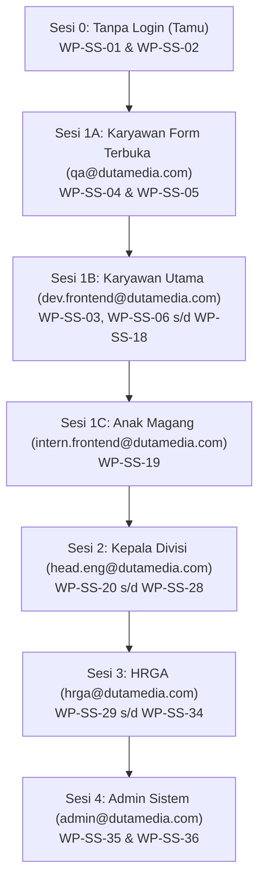

# DAFTAR & PANDUAN URUTAN PENGAMBILAN GAMBAR BUKU PANDUAN WORKPULSE

**Situs Live:** `https://dutamedia-workpulse.vercel.app`  
**Target Dokumen:**
1. **`UAT/Buku-Panduan-Pengguna-Karyawan-dan-Magang.md`** (`WP-SS-01` s/d `WP-SS-19`)
2. **`UAT/Buku-Panduan-Pimpinan-HRGA-dan-Admin.md`** (`WP-SS-20` s/d `WP-SS-36`)

**Folder Penyimpanan Gambar yang Disarankan:** `docs/assets/screenshots/`  
*(Semua kata sandi akun uji awal di bawah ini adalah **`Password123!`**).*

---

## 1. Aturan Sederhana Sebelum Mulai Mengambil Gambar

1. **Ukuran Layar:** Gunakan browser Chrome/Edge pada layar laptop/desktop dengan zoom **`100%`** (disarankan lebar **`1440 x 900 px`** agar tampilan paling rapi dan seragam).
2. **Format Gambar:** Simpan dalam format **`.png`** dengan nama berkas persis seperti di tabel bawah agar mudah ditempel ke kedua buku panduan.
3. **Perhatikan Tanda Aksi Penting:**
   - **`[JANGAN KLIK KIRIM]`** $\rightarrow$ Isi formulirnya dulu agar terlihat nyata, lalu ambil gambarnya **tanpa menekan tombol Kirim/Simpan** supaya data uji di sistem live tetap bersih.
   - **`[KLIK KIRIM]`** $\rightarrow$ Boleh ditekan karena gambar berikutnya memang memotret tampilan hasil setelah dikirim.

---

## 2. Alur Cepat 6 Sesi Login (Sekali Jalan Tanpa Bolak-Balik)

---

## 3. Daftar Lengkap 36 Tangkapan Layar (Berurutan per Sesi Login)

### SESI 0 — TANPA LOGIN (*Buka Jendela Penyamaran / Incognito*)

| Kode | Nama Berkas (`.png`) | Alamat Halaman | Buku Panduan | Petunjuk Pengambilan Gambar | Aturan Tombol | Selesai |
|---|---|---|---|---|---|:---:|
| **`WP-SS-01`** | `WP-SS-01-auth-login.png` | `/login` | Versi 1 (Bab 1.4) | Isi email `dev.frontend@dutamedia.com` & sandi bertitik hitam, centang `Ingat email di perangkat ini`. | **`[JANGAN KLIK MASUK]`** | [ ] |
| **`WP-SS-02`** | `WP-SS-02-auth-activate.png` | `/activate` | Versi 1 (Bab 1.3) | Tempel token aktivasi di kotak `Token Aktivasi` hingga Kartu Pratinjau Akun muncul + isi sandi baru **`Password123!`** sampai 3 syarat centang hijau menyala. | **`[JANGAN KLIK AKTIFKAN]`** | [ ] |

---

### SESI 1A — FORM KOMITMEN PAGI TERBUKA (*Dio Bayu Bagaskara — `product@dutamedia.com` atau Nadia Kusuma — `qa@dutamedia.com` / `Password123!`*)
*(Direkomendasikan memakai `product@dutamedia.com` untuk `WP-SS-04` karena sudah punya data `H-2 → H-1` yang langsung memunculkan kotak `Prioritas Kemarin Sore` dan panel `Draf Tugas Berlanjut dari Kemarin (2 Tersedia)`).*

| Kode | Nama Berkas (`.png`) | Alamat Halaman | Buku Panduan | Petunjuk Pengambilan Gambar | Aturan Tombol | Selesai |
|---|---|---|---|---|---|:---:|
| **`WP-SS-04`** | `WP-SS-04-morning-form.png` | `/daily/morning` | Versi 1 (Bab 2.2) | Login `product@dutamedia.com`: tampilkan kotak `Prioritas Kemarin Sore` + panel `Draf Tugas Berlanjut dari Kemarin`, isi 2–3 slot komitmen dengan proyek & warna risiko (Hijau & Amber), pastikan tombol `Simpan Draf` & `Kirim Morning Commitment` terlihat. | **`[JANGAN KLIK KIRIM]`** | [ ] |
| **`WP-SS-05`** | `WP-SS-05-morning-zero-commitment.png` | `/daily/morning` | Versi 1 (Bab 2.2) | Centang kotak **`0 Komitmen Hari Ini`**, lalu isi kolom alasan minimal 10 karakter (mis. *Mengikuti pelatihan keamanan informasi seharian penuh bersama tim HRGA*). | **`[JANGAN KLIK KIRIM]`** | [ ] |

*(Keluar / Logout dari akun Sesi 1A).*

---

### SESI 1B — KARYAWAN UTAMA (*Aditya Nugroho — `dev.frontend@dutamedia.com` / `Password123!`*)

| Kode | Nama Berkas (`.png`) | Alamat Halaman | Buku Panduan | Petunjuk Pengambilan Gambar | Aturan Tombol | Selesai |
|---|---|---|---|---|---|:---:|
| **`WP-SS-03`** | `WP-SS-03-layout-workspace.png` | `/daily/morning` | Versi 1 (Bab 1.5) | Tangkap tampilan layar desktop penuh memperlihatkan Bilah Atas, Menu Kiri `Workspace`, dan Area Kerja Utama. | Hanya Tampil | [ ] |
| **`WP-SS-06`** | `WP-SS-06-morning-locked.png` | `/daily/morning` | Versi 1 (Bab 2.2) | Fokus pada Kartu Ringkasan Komitmen Pagi yang sudah terkunci (`ON-TIME`/`LATE`), kotak `Prioritas Kemarin Sore`, dan tombol `Ajukan Koreksi Komitmen Pagi`. | Hanya Tampil | [ ] |
| **`WP-SS-07`** | `WP-SS-07-additional-work.png` | `/daily/additional-work` | Versi 1 (Bab 2.3) | Isi contoh deskripsi tugas tambahan & pilih alasan `Penugasan Baru dari Atasan` + nama atasan (terlihat daftar tugas tambahan berjalan). | **`[JANGAN KLIK TAMBAH]`** | [ ] |
| **`WP-SS-08`** | `WP-SS-08-eod-form.png` | `/daily/eod` | Versi 1 (Bab 2.4) | Pilih status capaian pada daftar tugas (`Selesai Penuh` / `Selesai Sebagian`), isi catatan progres, pilih `Status Akhir Hari`, dan isi `Prioritas Utama Besok`. | **`[JANGAN KLIK KIRIM DULU]`** | [ ] |
| **`WP-SS-09`** | `WP-SS-09-eod-submitted.png` | `/daily/eod` | Versi 1 (Bab 2.4) | Lanjutan dari `WP-SS-08`: klik **`Kirim Evaluasi EOD`**, lalu foto Kartu Ringkasan Evaluasi Sore yang sudah terkunci (terlihat tombol `Ajukan Koreksi EOD`). | **`[KLIK KIRIM]`** | [ ] |
| **`WP-SS-10`** | `WP-SS-10-daily-history.png` | `/daily/history` | Versi 1 (Bab 2.5) | Tampilkan 4 kartu ringkasan atas, tombol `Unduh CSV`, dan klik 1 baris tanggal pada tabel agar rinciannya terbuka (*expanded*). | Hanya Tampil | [ ] |
| **`WP-SS-11`** | `WP-SS-11-raise-blocker-form.png` | `/raise-blockers` | Versi 1 (Bab 3.2) | Isi Judul, pilih Kategori `Server & Rilis Sistem (INFRA)`, centang 2 dari 9 Dampak, pilih `High`, isi deskripsi, dan pastikan Panel **Jalur Penanganan Otomatis** (menunjuk *Fakhrizal Asshiddiq*) terlihat. | **`[JANGAN KLIK KIRIM DULU]`** | [ ] |
| **`WP-SS-12`** | `WP-SS-12-raise-blocker-success.png` | `/raise-blockers` | Versi 1 (Bab 3.2) | Lanjutan dari `WP-SS-11`: klik **`Kirim Laporan Blocker`**, lalu foto Kartu Konfirmasi Tiket Terbit lengkap dengan ID Tiket & tombol `Lihat di Blocker Saya`. | **`[KLIK KIRIM]`** | [ ] |
| **`WP-SS-13`** | `WP-SS-13-leave-my-permanent.png` | `/leave/my` | Versi 1 (Bab 5.2) | Tampilkan kotak hijau `Jatah Cuti Tahunan`, isi formulir cuti (jangan kirim), dan tampilkan tabel riwayat pengajuan di sebelah kanan. | **`[JANGAN KLIK AJUKAN]`** | [ ] |
| **`WP-SS-14`** | `WP-SS-14-correction-morning.png` | `/corrections/morning` | Versi 1 (Bab 4.2) | Pilih 1 komitmen sasaran, pilih `Koreksi Material`, isi teks usulan & alasan (min. 10 huruf) agar panel perbandingan terlihat. | **`[JANGAN KLIK KIRIM]`** | [ ] |
| **`WP-SS-15`** | `WP-SS-15-correction-eod.png` | `/corrections/eod` | Versi 1 (Bab 4.3) | Pilih 1 tugas sasaran dari EOD, ubah hasil capaian & isi alasan koreksi (min. 10 huruf). | **`[JANGAN KLIK KIRIM]`** | [ ] |
| **`WP-SS-16`** | `WP-SS-16-notifications-modal.png` | `/notifications` | Versi 1 (Bab 6) | Klik salah satu kartu notifikasi agar jendela **Rincian Notifikasi** terbuka di atas daftar notifikasi. | Hanya Tampil | [ ] |
| **`WP-SS-17`** | `WP-SS-17-profile-password.png` | `/profile` | Versi 1 (Bab 1.6) | Tampilkan kartu identitas + formulir ganti kata sandi terisi contoh sandi baru sampai 3 tanda centang syarat hijau menyala. | **`[JANGAN KLIK SIMPAN]`** | [ ] |
| **`WP-SS-18`** | `WP-SS-18-forbidden-403.png` | `/admin/policies` *(ketik manual di URL)* | Versi 1 (Bab 1.8) | Ketik `/admin/policies` di address bar saat login sebagai Aditya agar muncul layar resmi **`403 — Akses Dibatasi`**. | Hanya Tampil | [ ] |

*(Keluar / Logout dari akun Aditya Nugroho).*

---

### SESI 1C — ANAK MAGANG / INTERN (*Raka Pratama — `intern.frontend@dutamedia.com` / `Password123!`*)

| Kode | Nama Berkas (`.png`) | Alamat Halaman | Buku Panduan | Petunjuk Pengambilan Gambar | Aturan Tombol | Selesai |
|---|---|---|---|---|---|:---:|
| **`WP-SS-19`** | `WP-SS-19-leave-my-intern.png` | `/leave/my` | Versi 1 (Bab 5.2) | Tampilkan kotak ungu **`Aturan Izin Karyawan Magang`** dan dropdown yang hanya berisi 2 pilihan (`Izin` & `Sakit`). | Hanya Tampil | [ ] |

*(Keluar / Logout dari akun Raka Pratama).*

---

### SESI 2 — KEPALA DIVISI (*Arif Budiman — `head.eng@dutamedia.com` / `Password123!`*)

| Kode | Nama Berkas (`.png`) | Alamat Halaman | Buku Panduan | Petunjuk Pengambilan Gambar | Aturan Tombol | Selesai |
|---|---|---|---|---|---|:---:|
| **`WP-SS-20`** | `WP-SS-20-dashboard-head.png` | `/dashboard` | Versi 2 (Bab 2.1) | Tampilkan tab `Divisi Saya`, filter `Status Karyawan`, 4 kartu metrik, daftar `Personil Butuh Bantuan Hari Ini` (tombol `Bantu Unblock`), dan `Feed Dukungan Lintas Fungsi`. | Hanya Tampil | [ ] |
| **`WP-SS-21`** | `WP-SS-21-blockers-queue.png` | `/blockers` | Versi 2 (Bab 3.1) | Tampilkan 2 panel berdampingan: daftar kartu tiket kiri (dengan `Sisa Waktu`) dan rincian tiket kanan (Kategori & 1–3 Dampak lengkap Bahasa Indonesia + tombol aksi). | Hanya Tampil | [ ] |
| **`WP-SS-22`** | `WP-SS-22-blockers-help-modal.png` | `/blockers` | Versi 2 (Bab 3.1) | Klik **`Beri Bantuan`** pada tiket aktif, isi contoh tindakan bantuan (min. 5 huruf) dan catatan hasil progres. | **`[JANGAN KLIK SIMPAN]`** | [ ] |
| **`WP-SS-23`** | `WP-SS-23-blockers-aging.png` | `/blockers/aging` | Versi 2 (Bab 3.2) | Tampilkan 4 kartu metrik batas waktu, filter keparahan, dan tabel radar penuaan yang memperlihatkan lencana merah `Lewat Batas Waktu`. | Hanya Tampil | [ ] |
| **`WP-SS-24`** | `WP-SS-24-projects-risk-modal.png` | `/projects/risk` | Versi 2 (Bab 2.2) | Klik tombol **`Rincian`** pada proyek `WP-CORE` sehingga jendela modal `Rincian Risiko Proyek` terbuka di atas daftar proyek. | Hanya Tampil | [ ] |
| **`WP-SS-25`** | `WP-SS-25-leave-queue-modal.png` | `/leave/queue` | Versi 2 (Bab 4.1) | Klik tombol **`Setujui`** pada salah satu permohonan `Menunggu Review`, isi contoh catatan persetujuan di modal. | **`[JANGAN KLIK KONFIRMASI]`** | [ ] |
| **`WP-SS-26`** | `WP-SS-26-corrections-review-diff.png` | `/corrections/review` | Versi 2 (Bab 4.2) | Tampilkan kartu permohonan koreksi dengan kotak perbandingan visual `Sebelum` vs `Diajukan` serta tombol `Setujui` & `Tolak`. | Hanya Tampil | [ ] |
| **`WP-SS-27`** | `WP-SS-27-coaching-notes.png` | `/coaching` | Versi 2 (Bab 5.3) | Pilih anggota tim (`Aditya Nugroho`), pilih jenis `Bimbingan` & `Dibagikan ke Karyawan`, klik template cepat `Bimbingan 1-on-1`, berdampingan dengan riwayat di kanan. | **`[JANGAN KLIK SIMPAN]`** | [ ] |
| **`WP-SS-28`** | `WP-SS-28-executive-reports.png` | `/reports` | Versi 2 (Bab 2.3) | Pilih periode `Bulan Ini`, tampilkan 4 kartu KPI, tabel performa divisi, filter `Status Karyawan`, dan tombol `Unduh Laporan (CSV)`. | Hanya Tampil | [ ] |

*(Keluar / Logout dari akun Arif Budiman).*

---

### SESI 3 — HRGA (*Dewi Lestari — `hrga@dutamedia.com` / `Password123!`*)

| Kode | Nama Berkas (`.png`) | Alamat Halaman | Buku Panduan | Petunjuk Pengambilan Gambar | Aturan Tombol | Selesai |
|---|---|---|---|---|---|:---:|
| **`WP-SS-29`** | `WP-SS-29-compliance-queue-modal.png` | `/compliance` | Versi 2 (Bab 5.1) | Klik **`Tindak Lanjut`** pada 1 baris `Belum Ditangani`, isi contoh catatan tindak lanjut min. 5 huruf di modal. | **`[JANGAN KLIK SIMPAN]`** | [ ] |
| **`WP-SS-30`** | `WP-SS-30-exemptions-split.png` | `/exemptions` | Versi 2 (Bab 5.2) | Isi contoh formulir dispensasi `Dinas Luar` di panel kiri (dengan nomor surat tugas) berdampingan dengan tabel dispensasi aktif di panel kanan. | **`[JANGAN KLIK DAFTARKAN]`** | [ ] |
| **`WP-SS-31`** | `WP-SS-31-admin-users.png` | `/admin/users` | Versi 2 (Bab 6.1) | Tampilkan tombol `Undang Pengguna Baru`, filter status, dan tabel direktori 25 pengguna (terlihat pil ungu `Intern`). | Hanya Tampil | [ ] |
| **`WP-SS-32`** | `WP-SS-32-admin-invitations-modal.png` | `/admin/invitations` | Versi 2 (Bab 6.2) | Klik **`Undang Pengguna Baru`**, isi contoh data calon karyawan baru (terlihat keterangan token berlaku 72 jam). | **`[JANGAN KLIK KIRIM]`** | [ ] |
| **`WP-SS-33`** | `WP-SS-33-admin-org-mapping.png` | `/admin/organization` | Versi 2 (Bab 6.3) | Tampilkan Tab 1 `Struktur & Penugasan Karyawan` aktif, tabel garis pelaporan, tombol `Atur Penugasan Baru`, dan Tab 2 `Kewenangan Proyek` terlihat di atas. | Hanya Tampil | [ ] |
| **`WP-SS-34`** | `WP-SS-34-admin-temp-reviewers.png` | `/admin/temporary-reviewers` | Versi 2 (Bab 6.4) | Klik **`Delegasikan Reviewer Baru`**, pilih pejabat yang digantikan & pengganti sementara, isi tanggal & alasan di modal. | **`[JANGAN KLIK TERBITKAN]`** | [ ] |

*(Keluar / Logout dari akun Dewi Lestari).*

---

### SESI 4 — ADMINISTRATOR SISTEM (*Sistem Administrator — `admin@dutamedia.com` / `Password123!`*)

| Kode | Nama Berkas (`.png`) | Alamat Halaman | Buku Panduan | Petunjuk Pengambilan Gambar | Aturan Tombol | Selesai |
|---|---|---|---|---|---|:---:|
| **`WP-SS-35`** | `WP-SS-35-admin-policies.png` | `/admin/policies` | Versi 2 (Bab 6.5) | Tampilkan 4 kartu metrik jam cut-off, kartu konfigurasi kebijakan, seksi tabel `Penugasan Pemilik Kebijakan`, dan `Jejak Audit Perubahan Kebijakan`. | Hanya Tampil | [ ] |
| **`WP-SS-36`** | `WP-SS-36-admin-notification-channels.png` | `/admin/notifications` | Versi 2 (Bab 6.6) | Tampilkan 3 kartu status saluran notifikasi (`Aktif` / `Mode Simulasi Aktif`), matriks 9 pemicu resmi, dan panel simulasi uji kirim terisi contoh. | **`[JANGAN KLIK KIRIM UJI]`** | [ ] |
