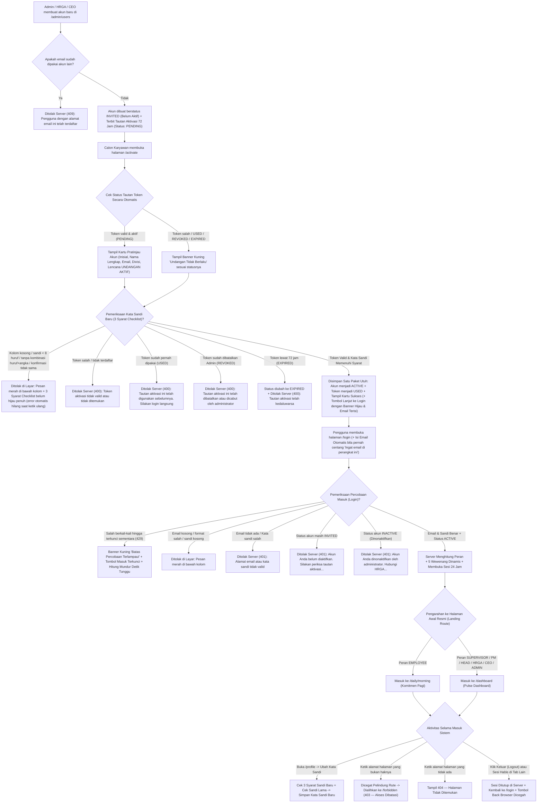
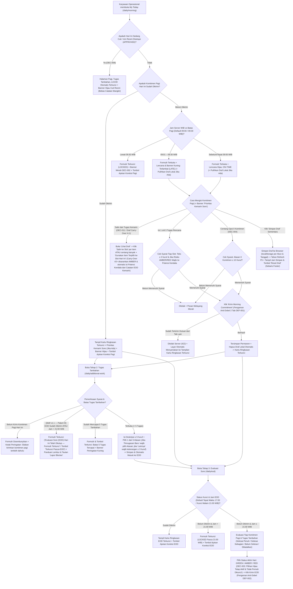
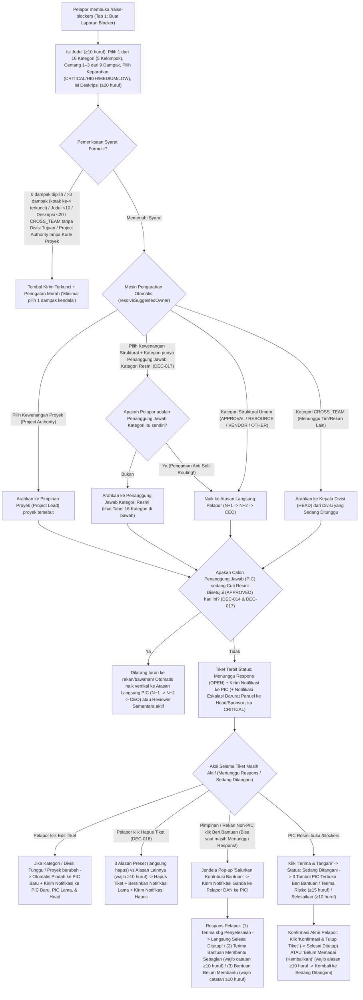
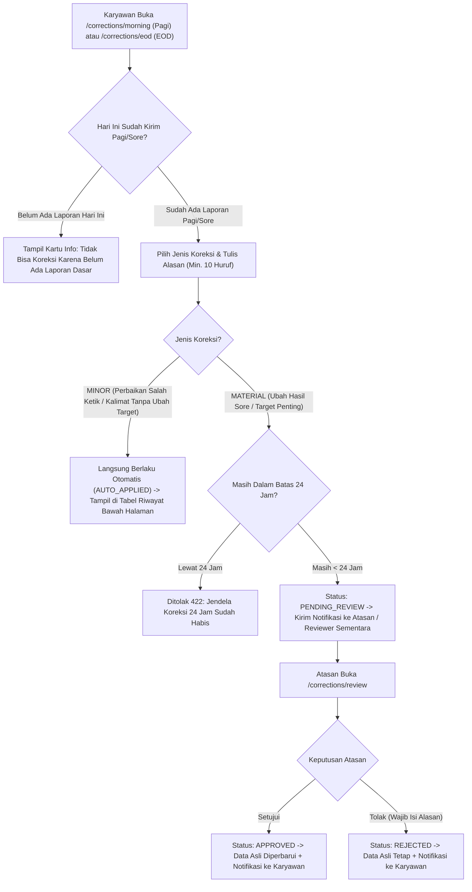
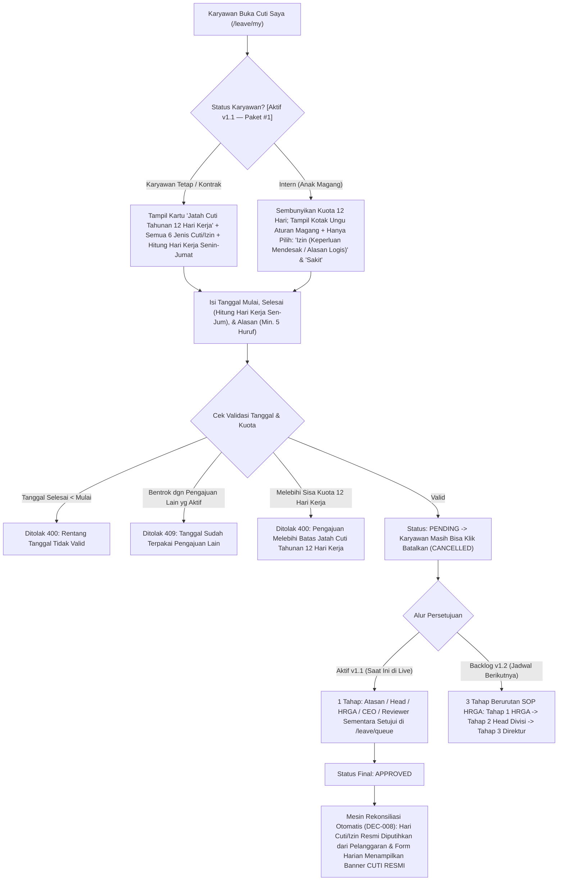
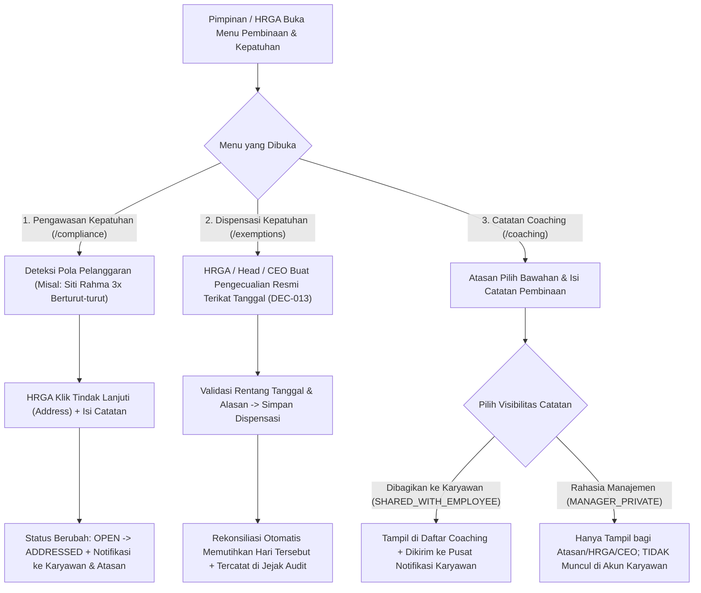
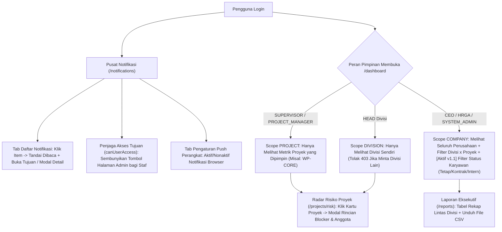
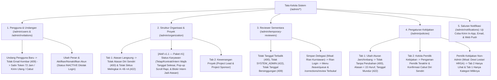

# Dokumen Induk 3-Lapisan: Peta Perjalanan Bercabang (E2E Journeys), Panduan Skenario Prosedural Lengkap (Aksi, Input & Hasil yang Diharapkan), serta Master Katalog Kondisi Sistem WorkPulse

> **Sistem:** WorkPulse — Sistem Pencatatan Komitmen Harian & Penanganan Kendala Kerja  
> **Organisasi:** PT Dutamedia Mandiri Pratama (Malang — WIB / UTC+7)  
> **Versi Dokumen:** `v1.2 — Edisi Sistem Live Pasca-UAT & Penyelarasan Audit Prototype` (Seluruh **4 Paket Pasca-UAT + Perbaikan Uji Chrome `commit 56cbead` + Pembaruan Morning Commitment `commit dabb266` & `69bb068`** sudah aktif 100% di `https://dutamedia-workpulse.vercel.app`)  
> **Pemilik Proyek:** Harry  
> **Dokumen Pendamping Wajib untuk Auditor:**
> - [Daftar-Perubahan-Pasca-UAT-4-Paket.md](file:///d:/PKL%20Duta%20Media/Dutamedia-WorkPulse/UAT/Daftar-Perubahan-Pasca-UAT-4-Paket.md) — Rincian perbedaan resmi **4 Paket Pasca-UAT** (*Dulu vs Sekarang di Live*) agar tidak dianggap kesalahan.
> - [Daftar-Perubahan-Audit-Prototype-vs-Live.md](file:///d:/PKL%20Duta%20Media/Dutamedia-WorkPulse/UAT/Daftar-Perubahan-Audit-Prototype-vs-Live.md) — Peta status audit **26 File Prototype HTML** dan catatan perbaikan hasil perbandingan sistem vs prototype (`Audit #1: Morning Commitment` selesai).  
> *(Catatan Lokasi File Prototype HTML: Seluruh 26 file HTML yang diacu singkat `UI-UX-Design/...html` di bawah ini berada lengkap di folder `Dokumen-Perancangan-untuk-Pengerjaan-Baru/UI-UX-Design/`).*
> **4 Fungsi Utama Dokumen Ini:**
> 1. **Panduan Skenario Prosedural Mandiri dari A sampai Z:** Memandu siapa saja (penguji, teman auditor, maupun pengguna baru) untuk mencoba **seluruh kemampuan, halaman, jendela pop-up, dan aturan sistem** secara berurutan tanpa merusak/mengunci data lebih dulu, lengkap dengan **Aksi Klik/Ketik Siap Salin (*Copy-Paste*)** dan ***Hasil yang Diharapkan*** di setiap langkah.
> 2. **Dasar Langsung Pembuatan 2 Versi Buku Panduan (*User Manual*):**
>    - **Versi Stakeholder / Pimpinan (Lead, HRGA, Direktur, Penilai Proyek):** Menjelaskan tujuan bisnis, aturan wewenang, pagar pengaman anti-kecurangan, dan bukti pengawasan.
>    - **Versi Pengguna Umum (Seluruh Karyawan & Anak Magang):** Menjelaskan langkah pakai sehari-hari dan cara mengatasi setiap pesan kesalahan atau kondisi khusus.
> 3. **Acuan Utama Slide Presentasi & Skrip Demo Live:** Menunjukkan urutan demo terbaik beserta akun dan kalimat penjelasnya.
> 4. **Daftar Periksa (*Checklist*) Audit Tampilan 4 Ukuran Layar (`HP 375px`, `Tablet 768/1024px`, `Desktop 1440px`, `Layar Lebar 1920px`) & Perbandingan 26 File Prototype HTML / Dokumen Baseline.**

---

## 0. Daftar Lengkap 25 Akun Resmi Sistem (`Password123!`) & Peta Wewenang

Seluruh langkah di dokumen ini menggunakan **25 akun resmi** yang sudah disiapkan di database awal (`seed.ts`). Kata sandi awal untuk semua akun aktif adalah **`Password123!`**.
- **Komposisi Populasi Live di Dashboard & Laporan (`/dashboard` & `/reports`):** Dari 25 akun, terdapat **25 personil operasional terhitung** (*23 Karyawan Tetap + 0 Kontrak + 2 Anak Magang / Intern*). *(Akun `Fajar Ramadhan / calon.karyawan@dutamedia.com` tetap berada pada status akun belum diaktifkan `INVITED`, sementara seluruh akun yang memiliki penugasan organisasi aktif tercatat sebagai populasi laporan).*

| No | Nama Lengkap | Email Login | Peran Sistem & Status Akun | Divisi & Jabatan | Atasan Langsung | Wewenang Khusus yang Dimiliki |
|---|---|---|---|---|---|---|
| 1 | **Sistem Administrator** | `admin@dutamedia.com` | `SYSTEM_ADMIN` (`ACTIVE`) | Management — Infrastructure & System Administrator | — | Mengelola seluruh menu `Administration`. **Pemisahan Tugas (`IMP-026`):** Tidak punya menu kerja harian (`Workspace` diblokir `403`) dan tidak boleh ditunjuk menjadi peninjau cuti/koreksi. |
| 2 | **Hendra Wijaya** | `direktur@dutamedia.com` | `CEO_MANAGEMENT` (`ACTIVE`) | Management — Chief Executive Officer (CEO) | — | Memantau `Seluruh Perusahaan`, Pemilik Kebijakan di semua 5 kategori, pengelola daftar Pemilik Kebijakan, tujuan akhir eskalasi. |
| 3 | **Dewi Lestari** | `hrga@dutamedia.com` | `HRGA` (`ACTIVE`) | HRGA — HRGA & Corporate Legal Administration | Hendra Wijaya | Mengelola `Antrean Kepatuhan`, `Manajemen Dispensasi`, `Kelola Pengguna`, `Struktur Organisasi`, `Reviewer Sementara`, penerima kategori **`LEGAL`** (via pengarahan divisi HRGA & Legal), Pemilik Kebijakan, `[Backlog v1.2]` Tahap 1 Persetujuan Cuti 3 Tahap. |
| 4 | **Sugito Erik Fajar** | `ga@dutamedia.com` | `EMPLOYEE` (`ACTIVE`) | HRGA — General Affairs (GA) Officer | Dewi Lestari | Staf HRGA yang ditunjuk resmi sebagai **Penanggung Jawab Kategori `OFFICE_FACILITY` (Fasilitas & Sarana Kantor)** → otomatis bisa membuka menu `Antrean Blocker` (`/blockers`) & `Penuaan & Eskalasi` (`/blockers/aging`). |
| 5 | **Arif Budiman** | `head.eng@dutamedia.com` | `HEAD` (`ACTIVE`) | Engineering — Head of Engineering | Hendra Wijaya | Kepala Divisi Engineering (memantau tab `Divisi Saya`), Sponsor Proyek `WP-CORE`, menyetujui cuti & koreksi tim Engineering, membuat `Catatan Coaching` untuk bawahan langsungnya. |
| 6 | **Bambang Pratama** | `lead.tech@dutamedia.com` | `SUPERVISOR` (`ACTIVE`) | Engineering — Technical Lead 1 | Arif Budiman | Pimpinan Proyek **`WP-CORE`** & **`PRJ-CORE`**, serta **Penanggung Jawab Kategori `TECHNICAL` (Teknis & Kode Program)**. Memantau tab `Tim (Proyek)` di dasbor. |
| 7 | **Aditya Nugroho** | `dev.frontend@dutamedia.com` | `EMPLOYEE` (`ACTIVE`) | Engineering — Frontend Developer | Arif Budiman | Staf operasional murni (`Karyawan Tetap`) — tidak punya bawahan dan bukan penanggung jawab kategori → menu `Management` dan `Administration` tertutup & diblokir `403`. Di `seed.ts` sudah ditanam **data H-1 selesai + `Prioritas Kemarin Sore`** agar kotak referensi prioritas kemarin tetap tampil saat komitmen hari ini sudah terkunci (`SUBMITTED`). |
| 8 | **Siti Rahma** | `dev.backend@dutamedia.com` | `EMPLOYEE` (`ACTIVE`) | Engineering — Backend Developer | Arif Budiman | Staf operasional Engineering (memiliki data contoh pola tidak melapor 3x berturut-turut di `/compliance`). |
| 9 | **Fajar Ramadhan** | `calon.karyawan@dutamedia.com` | `EMPLOYEE` (`INVITED`) | Engineering — Junior Developer | Arif Budiman | Akun karyawan baru yang **belum aktif** (untuk menguji penolakan login `INVITED` dan aktivasi akun dengan token 72 jam `wp_seed_invite_token_72h_demo_secret`). |
| 10 | **Dharma Putra** | `head.delivery@dutamedia.com` | `HEAD` (`ACTIVE`) | Delivery — Head of Delivery | Hendra Wijaya | Kepala Divisi Delivery, menyetujui cuti/koreksi & coaching Divisi Delivery. |
| 11 | **Dimas Prakoso** | `pm@dutamedia.com` | `PROJECT_MANAGER` (`ACTIVE`) | Delivery — Project Manager | Dharma Putra | Manajer Proyek (`PRJ-PORTAL`, `PRJ-MOBILE`), memantau `/dashboard` & `/projects/risk` proyeknya; pada jalur Proyek menangani kendala proyek kategori `REQUIREMENT` / `CLIENT`. |
| 12 | **Dio Bayu Bagaskara** | `product@dutamedia.com` | `EMPLOYEE` (`ACTIVE`) | Delivery — Product Manager | Dharma Putra | Staf Product Manager di bawah Head Delivery (formulir komitmen pagi hari ini **terbuka / belum disubmit**). Di `seed.ts` sudah ditanam rantai **`H-2 → H-1` lengkap** sehingga langsung menampilkan kotak **`Prioritas Kemarin Sore`** dan panel **`Draf Tugas Berlanjut dari Kemarin (2 Tersedia: Carry-Over #2 AMBER & Carry-Over #1 GREEN)`**. |
| 13 | **Nadia Kusuma** | `qa@dutamedia.com` | `EMPLOYEE` (`ACTIVE`) | Quality — Software QA Specialist | Dharma Putra | Staf QA (cocok dipakai untuk menguji pengiriman `0 Komitmen` dan simulasi penonaktifan akun `INACTIVE`). |
| 14 | **Gunawan Setiawan** | `head.ops@dutamedia.com` | `HEAD` (`ACTIVE`) | Operations & Infrastructure — Head of Ops & Infra | Hendra Wijaya | Kepala Divisi Operations & Infrastructure, tujuan pengarahan kendala lintas divisi (`CROSS_TEAM`) ke Ops & Infra, serta atasan langsung Fakhrizal/Achmad/Rahian. |
| 15 | **Rian Kurniawan** | `lead.creative@dutamedia.com` | `SUPERVISOR` (`ACTIVE`) | Operations & Infrastructure — Ops Supervisor | Gunawan Setiawan | Supervisor Ops & Infra (dipakai untuk menguji pendelegasian **Reviewer Sementara** lintas divisi). |
| 16 | **Fakhrizal Asshiddiq** | `network.infra@dutamedia.com` | `EMPLOYEE` (`ACTIVE`) | Operations & Infrastructure — Network & Infrastructure | Gunawan Setiawan | Staf spesialis yang ditunjuk resmi sebagai **Penanggung Jawab Kategori `INFRA` (Server & Rilis Sistem)** dan **`NETWORK` (Jaringan & Koneksi)** → punya akses `/blockers` & `/blockers/aging`. |
| 17 | **Achmad Noer Wahid** | `specialist.it@dutamedia.com` | `EMPLOYEE` (`ACTIVE`) | Operations & Infrastructure — Specialist IT | Gunawan Setiawan | Staf spesialis yang ditunjuk resmi sebagai **Penanggung Jawab Kategori `HOSTING_DOMAIN` (Hosting, Cloud & Domain)** → punya akses `/blockers` & `/blockers/aging`. |
| 18 | **Rahian M. Suari** | `it.support@dutamedia.com` | `EMPLOYEE` (`ACTIVE`) | Operations & Infrastructure — IT Support | Gunawan Setiawan | Staf spesialis yang ditunjuk resmi sebagai **Penanggung Jawab Kategori `ACCESS_SECURITY` (Akses & Keamanan Digital)** dan **`WORK_DEVICE` (Perangkat Kerja)** → punya akses `/blockers` & `/blockers/aging`. |
| 19 | **Maya Putri** | `designer@dutamedia.com` | `EMPLOYEE` (`ACTIVE`) | R&D — Principal Engineer (R&D & Technical Advisory) | Hendra Wijaya | Staf R&D Advisory (melapor langsung ke Direktur; dipakai untuk menguji batas isolasi lintas divisi). |
| 20 | **Lukman Hakim** | `head.sales@dutamedia.com` | `HEAD` (`ACTIVE`) | Commercial — Head of Sales Enablement & Presales | Hendra Wijaya | Kepala Divisi Sales Enablement & Presales (atasan langsung Hari Wibowo). |
| 21 | **Hari Wibowo** | `sales.bd@dutamedia.com` | `EMPLOYEE` (`ACTIVE`) | Commercial — Business Development Executive | Lukman Hakim | Staf Sales & Business Development sekaligus **Penanggung Jawab Kategori `CLIENT`** (untuk kendala calon klien/penawaran jalur Struktural) → punya akses `/blockers` & `/blockers/aging`. |
| 22 | **Ratna Sari** | `finance@dutamedia.com` | `EMPLOYEE` (`ACTIVE`) | Finance — Senior Finance Staff | Hendra Wijaya | Penanggung jawab senior Divisi Finance (atasan langsung Oivi Deasepta & Nisa Amelia; memiliki menu `Coaching` bagi bawahannya). |
| 23 | **Oivi Deasepta** | `staff.finance@dutamedia.com` | `EMPLOYEE` (`ACTIVE`) | Finance — Finance & Invoicing Staff | Ratna Sari | Staf Finance berstatus **`Karyawan Tetap` (`PERMANENT`)** dan **Penanggung Jawab Kategori `FINANCE` (Keuangan & Pembayaran)** → punya akses `/blockers` & `/blockers/aging`. |
| 24 | **Raka Pratama** | `intern.frontend@dutamedia.com` | `EMPLOYEE` (`ACTIVE`) · **Status: `Intern`** | Engineering — Frontend Developer | Arif Budiman | **`[Aktif v1.1 — Paket #1]`** Akun **Karyawan Magang (`Intern`)** Divisi Engineering (masa magang 90 hari: `20 Nov 2026 s/d 18 Feb 2027`). Tidak punya kuota cuti tahunan (hanya Izin & Sakit) dan dikecualikan dari seluruh daftar atasan/PIC. Formulir pagi hari ini terbuka lengkap dengan data **H-1 (`Prioritas Kemarin Sore` + `1 Tersedia Carry-Over #1`)**. |
| 25 | **Nisa Amelia** | `intern.finance@dutamedia.com` | `EMPLOYEE` (`ACTIVE`) · **Status: `Intern`** | Finance — Finance Staff | Ratna Sari | **`[Aktif v1.1 — Paket #1]`** Akun **Karyawan Magang (`Intern`)** Divisi Finance (masa magang 90 hari: `20 Nov 2026 s/d 18 Feb 2027`). Dipakai menguji isolasi `Intern` dan pelaporan kerja magang lintas divisi. |

---

# BAGIAN I — SIKLUS AKUN, KEAMANAN AKSES, & AKUNTABILITAS HARIAN

---

## JOURNEY 1: Siklus Akun, Undangan 72 Jam, Login, Profil, Sesi, & Proteksi Rute (403/404)

### 1.A. Lapisan 1 — Peta Alur Bercabang & Intisari User Manual / Demo (Journey 1)

#### Intisari untuk *User Manual* & *Skrip Demo Presentasi* (Journey 1)
- **Untuk Panduan Pengguna Umum (*User Manual Karyawan*):**
  - **Cara Mengaktifkan Akun Baru:** Buka tautan aktivasi dari Admin/HRGA sebelum 72 jam habis, buat kata sandi minimal 8 karakter (wajib gabungan huruf dan angka). Setelah aktif, tautan tersebut otomatis hangus dan tidak bisa dipakai lagi.
  - **Jika Gagal Masuk (*Login*):** Periksa pesan di kotak merah atas formulir — sistem memberi tahu dengan jelas apakah karena salah email/kata sandi, akun belum diaktifkan, akun sudah dinonaktifkan HRGA, atau sedang diminta menunggu beberapa detik karena terlalu sering salah memasukkan kata sandi.
- **Untuk Panduan Stakeholder / Pimpinan & Skrip Demo:**
  - **Keamanan Undangan Sekali Pakai (`DEC-005`):** Mencegah kebocoran akses; tautan aktivasi hanya berlaku 1 kali dalam 72 jam dan dapat dicabut sewaktu-waktu oleh Admin/HRGA.
  - **Pemisahan Tugas Administrator (`IMP-026`):** Akun `SYSTEM_ADMIN` fokus mengurus pengaturan teknis dan **diblokir (`403`)** dari pengisian kerja harian maupun persetujuan cuti agar data kinerja karyawan murni berisi staf operasional.

---

### 1.B. Lapisan 2 — Panduan Skenario Prosedural Langkah demi Langkah (Journey 1)

#### Skenario Prosedural `SP-01.1` — Menyisir Seluruh Kondisi Halaman Login (`/login`): Kolom Kosong, Sandi Salah, Akun Belum Aktif (`INVITED`), Akun Dinonaktifkan (`INACTIVE`), Kunci Tunggu Percobaan Beruntun (`429`), & Login Sukses
- **Acuan Prototype & Baseline:** `UI-UX-Design/01-Login-Activation.html` · `02-PRD.md` (`FR-01..04`) · `TC-AUTH-001`, `TC-AUTH-002`, `TC-AUTH-009`, `TC-AUTH-010`

1. **Langkah 1.1.1 — Inspeksi Tampilan Awal, Logo Layar HP, & Pengalihan Otomatis Alamat Dasar `/` (`ST-AUTH-01`):**
   - **Aksi:** Pastikan belum login (jika sedang login, klik tombol **Keluar** di pojok kiri bawah). Buka alamat dasar `/` di browser.
   - **Hasil yang Diharapkan:**
     - Alamat otomatis berpindah ke **`/login`**.
     - Bagian kiri layar menampilkan informasi pengenalan WorkPulse (`Komitmen jelas, hambatan tuntas`) dengan 3 poin keunggulan beserta ikon gambarnya.
     - Bagian kanan layar menampilkan tab **`Masuk Sistem`** | **`Aktivasi Akun`**, formulir masuk berisi kolom **Email Perusahaan**, kolom **Kata Sandi** (dilengkapi tombol ikon mata untuk melihat/menyembunyikan ketikan sandi), kotak centang **`Ingat email di perangkat ini`**, tautan **`Belum aktivasi akun?`**, dan tombol hijau **`Masuk ke Sistem`**.
   - **Pemeriksaan Tampilan 4 Ukuran Layar (`375px` · `768px` · `1440px` · `1920px`):**
     - Ubah lebar layar di Chrome DevTools (F12): pastikan di layar lebar (`1440px` & `1920px`) panel kiri dan kanan tampil berdampingan rapi, sedangkan di layar HP (`375px`) dan Tablet (`768px`) panel hijau kiri disembunyikan dan **digantikan oleh header logo `WP · WorkPulse — DUTAMEDIA ACCOUNTABILITY` tepat di atas kartu formulir** tanpa ada kotak input atau tombol yang terpotong ke samping.

2. **Langkah 1.1.2 — Uji Validasi Kolom Kosong, Format Email Salah, Tombol Ikon Mata, & Fungsi `"Ingat email di perangkat ini"` (`ST-AUTH-03`, `ST-AUTH-08`):**
   - **Aksi:**
     1. Biarkan kolom Email dan Kata Sandi kosong, lalu langsung klik **`Masuk ke Sistem`**.
     2. Ketik `bukan-format-email` pada kolom Email dan ketik `Rahasia123` pada kolom Kata Sandi, lalu klik tombol **ikon mata** di ujung kanan kolom Kata Sandi.
     3. *(Uji Fungsi Ingat Email):* Centang **`Ingat email di perangkat ini`**, masukkan `product@dutamedia.com` + `Password123!`, masuk ke sistem, lalu klik **Keluar (Logout)** agar kembali ke `/login`. Kemudian coba lepas centangnya dan muat ulang halaman.
   - **Hasil yang Diharapkan:**
     1. Saat kosong: formulir tidak terkirim ke server dan muncul tulisan peringatan merah tepat di bawah kolom yang kosong.
     2. Saat ikon mata diklik: tampilan titik-titik pada kolom Kata Sandi berubah menjadi tulisan terbaca `Rahasia123` (dan kembali tersembunyi saat diklik sekali lagi).
     3. Setelah logout dalam keadaan tadi dicentang: alamat email `product@dutamedia.com` **otomatis terisi kembali** dan centang tetap aktif; saat centang dilepas, email tersimpan otomatis dihapus lagi.

3. **Langkah 1.1.3 — Uji Penolakan Kata Sandi Salah / Email Tidak Terdaftar (`ST-AUTH-04`):**
   - **Aksi:**
     - **Email Perusahaan:** `dev.frontend@dutamedia.com`
     - **Kata Sandi:** `SandiSalah123!`
     - Klik **`Masuk ke Sistem`**.
   - **Hasil yang Diharapkan:**
     - Muncul kotak peringatan merah di atas formulir dengan kalimat persis: **`"Alamat email atau kata sandi tidak valid."`**
     - Pengguna tetap tertahan di halaman `/login`.

4. **Langkah 1.1.4 — Uji Penolakan Akun Belum Diaktifkan (`INVITED` — `ST-AUTH-05`):**
   - **Aksi:**
     - **Email Perusahaan:** `calon.karyawan@dutamedia.com` (akun Fajar Ramadhan yang berstatus `INVITED`)
     - **Kata Sandi:** `Password123!`
     - Klik **`Masuk ke Sistem`**.
   - **Hasil yang Diharapkan:**
     - Muncul kotak peringatan merah di atas formulir dengan kalimat persis: **`"Akun Anda belum diaktifkan. Silakan periksa tautan aktivasi pada email Anda atau hubungi administrator."`**

5. **Langkah 1.1.5 — Uji Penolakan Akun yang Dinonaktifkan (`INACTIVE` — `ST-AUTH-06`):**
   - **Aksi:**
     1. Login terlebih dahulu sebagai **Sistem Administrator** (`admin@dutamedia.com` / `Password123!`), buka menu **Kelola Pengguna (`/admin/users`)**.
     2. Cari baris **`Nadia Kusuma`** (`qa@dutamedia.com`), klik tombol **`Nonaktifkan`** hingga statusnya berubah menjadi **`INACTIVE`**, lalu klik **Keluar (Logout)**.
     3. Di halaman `/login`, masukkan Email **`qa@dutamedia.com`** dan Kata Sandi **`Password123!`**, lalu klik **`Masuk ke Sistem`**.
     4. **Pemulihan Wajib:** Login kembali sebagai **Sistem Administrator** (`admin@dutamedia.com`), buka `/admin/users`, klik **`Aktifkan`** pada baris **`Nadia Kusuma`** hingga statusnya kembali **`ACTIVE`**, lalu klik **Keluar**.
   - **Hasil yang Diharapkan:**
     - Saat `qa@dutamedia.com` mencoba login dalam keadaan `INACTIVE`, server menolak (`401`) dan muncul kotak peringatan merah di atas formulir dengan kalimat persis: **`"Akun Anda dinonaktifkan oleh administrator. Hubungi HRGA untuk informasi lebih lanjut."`**

6. **Langkah 1.1.6 — Uji Penguncian Sementara Saat Terlalu Banyak Percobaan Masuk (`429` — `ST-AUTH-07`):**
   - **Aksi:** Di halaman `/login`, masukkan email `uji.salah@dutamedia.com` dan kata sandi salah `SalahTerus1!`, lalu klik **`Masuk ke Sistem`** 5 kali berturut-turut hingga batas pengaman percobaan masuk terpicu. *(Tunggu hingga hitung mundur selesai atau pindah halaman sebelum lanjut ke langkah berikutnya).*
   - **Hasil yang Diharapkan:**
     - Tombol **`Masuk ke Sistem`** otomatis terkunci (`Terkunci (Xs)`) dan muncul **kotak peringatan kuning** berjudul **`Batas Percobaan Terlampaui`** dengan hitung mundur detik: `"Terlalu banyak percobaan masuk. Demi keamanan sistem, silakan tunggu X detik sebelum mencoba kembali."`

7. **Langkah 1.1.7 — Uji Login Sukses & Pendaratan Halaman Awal Sesuai Peran (`ST-AUTH-02`, `ST-AUTH-09`):**
   - **Aksi:**
     1. Masukkan Email **`dev.frontend@dutamedia.com`** dan Kata Sandi **`Password123!`**, lalu klik **`Masuk ke Sistem`**.
     2. Setelah berhasil masuk, coba ketik manual `/login` di bilah alamat browser lalu tekan Enter.
   - **Hasil yang Diharapkan:**
     1. Sebagai staf operasional (`EMPLOYEE`), Aditya langsung diarahkan ke halaman **`/daily/morning`** (`My Today / Morning Commitment`). Di pojok kiri bawah menu samping (sidebar) tertulis **`Aditya Nugroho`** (`Frontend Developer`).
     2. Saat mengetik `/login` ketika statusnya sudah masuk sistem, aplikasi otomatis mengembalikannya ke **`/daily/morning`** (tidak menampilkan form login lagi).

---

#### Skenario Prosedural `SP-01.2` — Menyisir Seluruh Kondisi Halaman Aktivasi Akun (`/activate`): Validasi Kata Sandi, Token Salah, Token Dicabut (`REVOKED`), Token Bekas Pakai (`USED`), & Aktivasi Sukses
- **Acuan Prototype & Baseline:** `UI-UX-Design/01-Login-Activation.html` · `DEC-005` · `TC-AUTH-003`, `TC-AUTH-004`

1. **Langkah 1.2.1 — Uji Logo Layar HP, Kotak 3 Syarat Kata Sandi, Kombinasi Huruf & Angka, & Tombol Mata Konfirmasi (`ST-ACTV-01`, `ST-ACTV-03`):**
   - **Aksi:** Pastikan dalam keadaan **Keluar (Logout)**. Buka halaman `/activate` (cek juga di layar HP `375px`):
     1. Klik **`Aktifkan Akun Saya`** saat semua kolom masih kosong.
     2. Isi **Token Aktivasi:** `token_percobaan`, **Kata Sandi Baru:** `hanyahuruf` (≥ 8 karakter tetapi tanpa angka), dan **Konfirmasi Kata Sandi:** `hanyahuruf`, lalu klik **`Aktifkan Akun Saya`**.
     3. Setelah error muncul, ubah keduanya menjadi `FajarBaru123!`, lalu klik **tombol ikon mata** pada kolom **Konfirmasi Kata Sandi**.
   - **Hasil yang Diharapkan:**
     1. Di layar HP/tablet (`<= 900px`), tampil header logo **`WP · WorkPulse`** di atas kartu tanpa layar melebar ke samping.
     2. Di bawah kolom **Kata Sandi Baru**, tampil 4 batang kekuatan sandi beserta **kotak daftar periksa 3 syarat** (`Minimal 8 karakter`, `Kombinasi huruf & angka`, `Konfirmasi kata sandi cocok`).
     3. Ketikan `hanyahuruf` ditolak dengan pesan merah persis **`"Kata sandi wajib minimal 8 karakter dengan kombinasi huruf dan angka."`** (centang hijau hanya menyala pada syarat 1 & 3, bukan syarat 2).
     4. Begitu sandi diubah menjadi `FajarBaru123!`, **pesan error merah langsung hilang otomatis**, ketiga syarat menyala hijau tercentang, dan klik tombol mata konfirmasi membuat teks `FajarBaru123!` terlihat/tersembunyi dengan benar.

2. **Langkah 1.2.2 — Uji Peringatan Token Tidak Berlaku (`NOT_FOUND` / `REVOKED` — `ST-ACTV-04`, `ST-ACTV-06`):**
   - **Aksi:**
     1. Buka `/activate?token=token_tidak_terdaftar_999000111222`.
     2. Untuk menguji **Token Dicabut (`REVOKED`)**: Login sebagai **Admin** (`admin@dutamedia.com`), buka `/admin/users`, klik **`+ Undang Pengguna Baru`**, isi Nama `Tes Cabut Token` dan Email `tes.cabut@dutamedia.com`, klik simpan → salin kode tokennya → tutup pop-up → pada baris `Tes Cabut Token` klik tombol **`Cabut`** → Logout Admin → buka `/activate` dan tempelkan token yang sudah dicabut tadi.
   - **Hasil yang Diharapkan:**
     1. Begitu token tidak dikenal atau dicabut terdeteksi (atau dikirim), tampil **kotak peringatan kuning `Undangan Tidak Berlaku`** bertuliskan **`"Token aktivasi tidak valid atau tidak ditemukan."`** (atau `"Tautan aktivasi ini telah dibatalkan atau dicabut oleh administrator."`).

3. **Langkah 1.2.3 — Uji Kartu Pratinjau Akun Token 72 Jam, Aktivasi Sukses + Banner Sambutan Login, & Penolakan Token Bekas Pakai (`USED` — `ST-ACTV-02`, `ST-ACTV-05`):**
   - **Aksi:**
     1. Buka alamat `/activate?token=wp_seed_invite_token_72h_demo_secret` *(memerlukan akun contoh berstatus `INVITED`, misal `calon.karyawan@dutamedia.com` — Fajar Ramadhan, jika belum terpakai)*. Periksa **Kartu Pratinjau Akun** di atas formulir.
     2. Isi **Kata Sandi Baru:** `Password123!` dan **Konfirmasi Kata Sandi:** `Password123!`, klik **`Aktifkan Akun Saya`**, lalu klik **`Lanjut ke Halaman Masuk`**.
     3. Buka kembali `/activate?token=wp_seed_invite_token_72h_demo_secret`.
   - **Hasil yang Diharapkan:**
     1. Saat token berstatus `PENDING` aktif: tampil **Kartu Pratinjau Akun** berisi inisial **`FR`**, nama **`Fajar Ramadhan`**, detail **`calon.karyawan@dutamedia.com · Engineering`**, dan lencana **`UNDANGAN AKTIF`**.
     2. Setelah aktivasi berhasil: muncul **Kartu Sukses Aktivasi** (`"Akun Anda berhasil diaktifkan dengan aman. Silakan masuk menggunakan kata sandi yang baru dibuat."`), dan saat klik **`Lanjut ke Halaman Masuk`**, halaman `/login` terbuka dengan **banner info hijau** **`"Aktivasi berhasil! Silakan masuk dengan kata sandi baru Anda."`** beserta email otomatis terisi.
     3. Pada kunjungan ulang token yang sudah dipakai (`USED`): langsung tampil **kotak peringatan kuning `Undangan Tidak Berlaku`** bertuliskan **`"Tautan aktivasi ini telah digunakan sebelumnya. Silakan login langsung."`**.

---

#### Skenario Prosedural `SP-01.3` — Menyisir Halaman Profil (`/profile`), Ubah Kata Sandi Mandiri, Layar 403 & 404, Pemisahan Tugas Admin (`IMP-026`), & Sesi Habis Lintas 2 Tab
- **Acuan Prototype & Baseline:** `UI-UX-Design/24-Profile-Settings.html` · `TC-AUTH-005..008`, `TC-ADMN-003`, `CH-EXP-04`

1. **Langkah 1.3.1 — Inspeksi 3 Bagian Halaman Profil (`/profile`), Tampilan Khusus Akun `Intern`, & Uji Lengkap Ubah Kata Sandi Mandiri (`ST-PROF-01..04`):**
   - **Aksi:**
     1. Login terlebih dahulu sebagai akun magang **Raka Pratama** (`intern.frontend@dutamedia.com` / `Password123!`), klik lingkaran inisial **`RP`** di pojok kanan atas untuk membuka `/profile`, lalu periksa lencana di samping nama serta baris **`Status Karyawan`** dan **`Masa Magang Berakhir`** pada Panel 1. Setelah itu klik tombol **`Keluar Sesi`** pada Panel 2.
     2. Login sebagai karyawan tetap **Aditya Nugroho** (`dev.frontend@dutamedia.com` / `Password123!`), klik lingkaran inisial **`AN`** di pojok kanan atas untuk membuka `/profile`:
        - Periksa 3 panel utama di halaman Profil (Panel 1 Identitas, Panel 2 Keamanan & Kata Sandi beserta kotak centang **`Akhiri seluruh sesi aktif di perangkat/peramban lain setelah kata sandi diperbarui`**, dan Panel 3 Ringkasan Kanal Notifikasi beserta tombol **`Kelola Kanal & Uji Perangkat di Pusat Notifikasi →`**).
     3. Pada formulir **Panel 2: Keamanan & Kata Sandi — Pembaruan Mandiri**, uji 5 kondisi salah secara berurutan:
        - Kosongkan **Kata Sandi Saat Ini**, isi sandi baru `Baru1234!` → klik **`Simpan Kata Sandi Baru`**.
        - Isi **Kata Sandi Saat Ini:** `Password123!`, **Kata Sandi Baru:** `abc12` (kurang dari 8 karakter) → klik **`Simpan Kata Sandi Baru`**.
        - Ubah **Kata Sandi Baru:** `semuahurufsaja` (tanpa angka) → klik **`Simpan Kata Sandi Baru`**.
        - Ubah **Kata Sandi Baru:** `Baru1234!`, **Konfirmasi Kata Sandi Baru:** `Beda9999!` → klik **`Simpan Kata Sandi Baru`**.
        - Isi **Kata Sandi Saat Ini:** `SandiLamaSalah1!`, **Kata Sandi Baru:** `Baru1234!`, **Konfirmasi:** `Baru1234!` → klik **`Simpan Kata Sandi Baru`**.
     4. Sekarang isi data yang benar: **Kata Sandi Saat Ini:** `Password123!`, **Kata Sandi Baru:** `PasswordBaru123!`, **Konfirmasi:** `PasswordBaru123!` → klik **`Simpan Kata Sandi Baru`**.
     5. **Pemulihan Wajib:** Segera ubah kembali kata sandi Aditya dari `PasswordBaru123!` kembali ke **`Password123!`**.
   - **Hasil yang Diharapkan:**
     1. Pada akun magang **Raka Pratama**: tampil pil ungu **`Intern`** di sebelah nama, baris **Status Karyawan** menampilkan **`Intern`**, dan muncul baris **`Masa Magang Berakhir: 18 Feb 2027`**.
     2. Pada akun tetap **Aditya Nugroho**:
        - **Panel 1:** Menampilkan `Aditya Nugroho`, `dev.frontend@dutamedia.com`, `Frontend Engineer`, `Engineering`, `Employee`, `Status Karyawan: Karyawan Tetap` (tanpa baris Masa Magang Berakhir), Atasan `Bambang Pratama` / `Arif Budiman`, dan Status `Aktif · Terdaftar`.
        - **Panel 2:** Menampilkan 4 balok pengukur kekuatan kata sandi (`Belum diisi` → `Sangat Lemah` → `Cukup` → `Kuat` → `Sangat Kuat`) dan 3 baris syarat yang berubah menjadi ikon centang hijau saat terpenuhi.
        - **Panel 3:** Menampilkan kartu `Browser Push Perangkat Ini`, kartu `Aturan Tetap Pengingat` (`08:00 WIB` & `16:00 WIB`, kalimat Bahasa Indonesia jelas tanpa rumus kurung siku `[Deadline - 60m, Deadline)`), dan kartu `Web Center & Email Resmi`.
     3. Kelima percobaan salah menampilkan kotak peringatan merah di atas form dengan pesan persis:
        - **`"Kata sandi saat ini wajib diisi."`**
        - **`"Kata sandi baru minimal 8 karakter."`**
        - **`"Kata sandi baru harus kombinasi huruf dan angka."`**
        - **`"Konfirmasi kata sandi baru tidak cocok dengan kata sandi baru."`**
        - **`"Kata sandi lama yang Anda masukkan tidak sesuai."`**
     4. Saat semua benar: muncul kotak hijau **`"Kata sandi berhasil diperbarui."`**

2. **Langkah 1.3.2 — Uji Pencegatan Alamat Terlarang (`403`), Alamat Tidak Dikenal (`404`), Pemisahan Admin (`IMP-026`), & Sesi Berakhir Lintas 2 Tab (`ST-ERR-01`, `ST-ERR-02`):**
   - **Aksi:**
     1. Masih login sebagai **Aditya Nugroho (`EMPLOYEE`)**, ketik `/admin/organization` di bilah alamat browser. Klik tombol **`Kembali ke Beranda`** yang muncul.
     2. Ketik `/alamat-tidak-ada-123` di bilah alamat browser.
     3. Buka **2 tab browser** yang sama-sama login sebagai Aditya (`/daily/morning` di Tab 1 dan `/profile` di Tab 2). Di **Tab 2**, klik tombol **Keluar (Logout)**. Lalu kembali ke **Tab 1** dan klik menu lain atau coba kirim form.
     4. Login sebagai **Sistem Administrator** (`admin@dutamedia.com` / `Password123!`), periksa daftar menu di sidebar kiri, lalu coba ketik manual `/daily/morning` dan `/raise-blockers`.
   - **Hasil yang Diharapkan:**
     1. Saat Aditya mengetik `/admin/organization`: langsung dialihkan ke **`/forbidden?from=/admin/organization`** yang menampilkan judul **`403 — Akses Dibatasi`**, keterangan `"Peran Anda (EMPLOYEE) tidak memiliki hak akses ke halaman /admin/organization."`, dan tombol **`Kembali ke Beranda`** (yang mengembalikan Aditya ke `/daily/morning`).
     2. Saat mengetik `/alamat-tidak-ada-123`: tampil layar **`404 — Halaman Tidak Ditemukan`** (`"Alamat yang Anda tuju tidak tersedia."`).
     3. Saat Logout di Tab 2 lalu beraktivitas di Tab 1: Tab 1 otomatis mendeteksi sesi telah dicabut (`401`) dan langsung melempar pengguna kembali ke halaman **`/login`**.
     4. Saat login sebagai `SYSTEM_ADMIN`: grup menu `Workspace` tidak ditampilkan di sidebar, dan percobaan mengetik `/daily/morning` atau `/raise-blockers` langsung dihadang ke layar **`403 — Akses Dibatasi`**.

---

## JOURNEY 2: Siklus Akuntabilitas Harian (`Morning Commitment` → `Additional Work` → `EOD Outcome` → `Riwayat Saya`)

### 2.A. Lapisan 1 — Peta Alur Bercabang & Intisari User Manual / Demo (Journey 2)

---

### 2.B. Lapisan 2 — Panduan Skenario Prosedural Langkah demi Langkah (Journey 2)

#### Skenario Prosedural `SP-02.1` — Menyisir Halaman Komitmen Pagi (`/daily/morning`): Batas 3 Slot, Validasi Gagal, Risiko `AMBER/RED`, Picker Blocker, Salin Kemarin (`DEC-011`), Kirim `0 Komitmen` Tuntas (`DEC-004`), Kirim `1–3 Komitmen` Tuntas, Konflik 2 Tab (`DEF-001`), & Simulasi Lewat Batas Waktu (`LOCKED`)
- **Akun Uji:**
  - Akun 1 (Untuk uji lengkap 1–3 komitmen & konflik 2 tab): **Aditya Nugroho** (`dev.frontend@dutamedia.com` / `Password123!`)
  - Akun 2 (Untuk uji kirim `0 Komitmen` sampai tersimpan tuntas): **Nadia Kusuma** (`qa@dutamedia.com` / `Password123!`)
  - Akun 3 (Untuk simulasi lewat jam batas cut-off): **Hendra Wijaya / Direktur** (`direktur@dutamedia.com` / `Password123!`) + **Dio Bayu** (`product@dutamedia.com` / `Password123!`)
- **Acuan Prototype & Baseline:** `UI-UX-Design/02-Morning-Commitment.html` · `TC-DLYM-001..007`

1. **Langkah 2.1.1 — Uji Tambah/Hapus Slot & Batas Maksimum 3 Komitmen (`ST-DLYM-01`, `ST-DLYM-09`):**
   - **Aksi:** Login sebagai **Aditya Nugroho** (`dev.frontend@dutamedia.com`), pastikan berada di `/daily/morning` (**jangan klik Kirim dulu!**):
     1. Klik tombol **`+ Tambah Slot Komitmen`** dua kali sehingga terbuka 3 kotak tugas (Slot #1, Slot #2, Slot #3).
     2. Periksa area tombol tambah slot di bagian bawah.
     3. Klik tombol hapus/kosongkan pada Slot #3.
   - **Hasil yang Diharapkan:**
     1. Saat 3 slot sudah terbuka: tombol `+ Tambah Slot Komitmen` hilang dan berganti menjadi teks petunjuk bahwa batas maksimal adalah 3 komitmen utama per hari.
     2. Saat Slot #3 dikosongkan: muncul pesan melayang hijau: **`"Slot komitmen dikosongkan."`**

2. **Langkah 2.1.2 — Uji Validasi Teks Pendek (< 3 Huruf), Risiko `AMBER/RED` Tanpa Catatan, & Menu `Pilih Blocker Aktif` (`ST-DLYM-07`, `ST-DLYM-09`):**
   - **Aksi:**
     1. Pada Slot #1, ketik 2 huruf `Te`, lalu klik **`Kirim Morning Commitment`**.
     2. Ubah teks Slot #1 menjadi `Optimasi komponen tabel riwayat komitmen harian`, lalu klik pilihan risiko **`AMBER`** (atau **`RED`**). Amati perubahan lencana status harian di bagian atas dan kotak tambahan yang terbuka di bawah Slot #1.
     3. Biarkan kotak **Potensi Kendala / Hambatan (*)** kosong, lalu klik **`Kirim Morning Commitment`**.
     4. Klik tombol **`Pilih Blocker Aktif`** di sebelah kolom Tautan Referensi pada Slot #1.
   - **Hasil yang Diharapkan:**
     1. Teks 2 huruf `Te` ditolak dengan pesan melayang merah persis: **`"Slot #1: Deskripsi komitmen wajib diisi minimal 3 karakter."`**
     2. Saat risiko `AMBER` dipilih: lencana status harian di kartu atas otomatis berubah menjadi kuning **`AMBER — Berisiko`** (atau merah **`RED — Kritis`** jika memilih `RED`), dan muncul 2 kotak input tambahan: **`Potensi Kendala / Hambatan *`** serta **`Bantuan yang Dibutuhkan`**.
     3. Saat dikirim tanpa mengisi Potensi Kendala: ditolak dengan pesan melayang merah persis: **`"Slot #1: Komitmen dengan risiko AMBER wajib menyertakan potensi kendala."`**
     4. Saat `Pilih Blocker Aktif` diklik: muncul daftar tiket kendala aktif untuk ditautkan ke komitmen pagi (atau keterangan `"Tidak ada tiket blocker aktif saat ini."`).

3. **Langkah 2.1.3 — Uji Spanduk `Prioritas Kemarin Sore` (`1a`), Draf Pekerjaan Berlanjut dari Kemarin (`1b`: *Copy-Forward* H-1 → H & `Carry-Over #2+ AMBER`), serta Fitur `Simpan Draf` Lokal & Footer 1 Baris (`1c`) — Akun Nyata Dio Bayu (`product@dutamedia.com`):**
   - **Aksi:** *(Sangat disarankan menggunakan akun **Dio Bayu Bagaskara — `product@dutamedia.com`**, sandi `Password123!`, karena `seed.ts` sudah menanam data evaluasi sore H-2 & H-1 nyata pada akun ini tanpa menyentuh form komitmen hari ini).* Buka `/daily/morning` (pada layar desktop `1280px+` & pastikan belum mengirim komitmen hari ini):
     1. **Cek `Prioritas Kemarin Sore`:** Amati kotak referensi di bagian atas panel daftar slot komitmen. *(Catatan: setelah nanti dikirim pun, pada akun seperti **Aditya Nugroho** `dev.frontend@dutamedia.com`, kotak `Prioritas Kemarin Sore` tetap tampil di atas Kartu Ringkasan Terkunci).*
     2. **Buka Panel `Draf Tugas Berlanjut dari Kemarin`:** Klik **`Lihat Draf`** pada panel berjudul **`Draf Tugas Berlanjut dari Kemarin`** (`2 Tersedia`). Periksa isi kedua kartu draf (`Carry-Over #2` dan `Carry-Over #1`), lalu centang kedua kotak centang (*checkbox*) dan klik tombol **`Gunakan Item Terpilih ke Slot Hari Ini`** (atau uji tombol **`Salin ke Slot`** per item).
     3. **Uji Tombol `Simpan Draf`, Tata Letak Footer 1 Baris, Refresh `F5`, & `Reset Draf`:**
        - Periksa baris bagian paling bawah formulir (`.action-footer`). Pastikan tulisan **`Pastikan seluruh komitmen telah diisi dengan akurat sebelum batas cut-off.`** di sebelah kiri berada **dalam satu baris horizontal yang sama** dengan tombol **`Simpan Draf`** dan **`Kirim Morning Commitment`** di sebelah kanan.
        - Tambahkan catatan uji di Slot #2 (misal tambahkan kata ` — Revisi draf pagi`), lalu klik tombol **`Simpan Draf`**.
        - Setelah muncul pemberitahuan simpan & lencana waktu simpan draf, tekan **`F5` (Refresh Halaman)**.
        - Terakhir, klik tombol **`Reset Draf`** agar formulir akun Dio kembali bersih (jangan tekan `Kirim Morning Commitment` jika masih ingin memakai akun Dio untuk uji ulang terbuka).
   - **Hasil yang Diharapkan:**
     1. **`Prioritas Kemarin Sore`:** Tampil spanduk kuning bertuliskan **`"Prioritas Kemarin Sore: Selesaikan spesifikasi penagihan PRJ-PORTAL dan validasi kriteria UAT bersama QA sebelum pukul 14:00 WIB"`** dengan lencana **`Hanya Referensi`**.
     2. **`Draf Tugas Berlanjut dari Kemarin`:**
        - Menampilkan **2 item**: item #1 berlabel **`Carry-Over #2`** dan peringatan **`Carry-over 2+ hari berturut-turut — Disarankan AMBER`** (lengkap dengan `Sumber: Komitmen Pagi Kemarin`, `Keputusan EOD: Dilanjutkan`, `Proyek: PRJ-PORTAL`, & `Catatan EOD Kemarin`), serta item #2 berlabel **`Carry-Over #1`** (`PRJ-CORE`).
        - Setelah klik **`Gunakan Item Terpilih ke Slot Hari Ini`**: muncul toast **`"2 draf tugas berlanjut diterapkan ke slot komitmen hari ini."`**, Slot #1 & Slot #2 terisi otomatis tanpa menimpa slot yang sudah diisi manual, **Slot #1 (`Carry-Over #2`) otomatis terpilih berisiko `AMBER` dan kotak `Uraian Resiko atau Potensi Kendala *` otomatis terisi dari `Catatan EOD Kemarin`**, dan tombol pada kedua item draf berubah menjadi **`Sudah Tersalin`** (kotak centang ikut nonaktif agar tidak tersalin ganda). Jika Slot #2 kemudian dihapus, tombol draf item tersebut kembali aktif.
     3. **`Simpan Draf` & Footer 1 Baris:**
        - Di layar komputer/laptop (`> 768px`), tulisan footer dan kedua tombol (`Simpan Draf` dan `Kirim Morning Commitment`) tampil sejajar pada **1 baris yang sama**.
        - Klik **`Simpan Draf`** memunculkan pesan hijau **`"Draf Morning Commitment berhasil disimpan secara lokal."`**, lencana biru **`Draf tersimpan pukul HH:mm WIB`**, dan tautan tombol **`Reset Draf`**.
        - Setelah menekan **`F5`**, seluruh slot hasil salinan, pilihan proyek/risiko `AMBER`, serta ketikan tambahan di Slot #2 tetap **utuh tidak hilang**, dan lencana jam simpan draf masih tampil.
        - Setelah klik **`Reset Draf`**, muncul pesan **`"Draf lokal berhasil dihapus."`** dan formulir kembali kosong ke 1 slot bersih *(dan jika nantinya komitmen resmi dikirim lewat `Kirim Morning Commitment`, draf lokal otomatis terhapus dari browser).*

4. **Langkah 2.1.4 — Uji Pengiriman `1–3 Komitmen` Valid & Pengaman Anti-Dobel 2 Tab (`DEF-001` — `ST-DLYM-04`, `ST-DLYM-10`):**
   - **Aksi:**
     1. Buka **Tab Kedua** di browser yang sama dan buka `/daily/morning` (sehingga Tab 1 dan Tab 2 sama-sama menampilkan formulir pagi Aditya yang belum dikirim).
     2. Di **Tab 1**, pastikan Slot #1 berisi `Optimasi komponen tabel riwayat komitmen harian` (risiko `AMBER`, potensi kendala `Menunggu kepastian format kolom waktu WIB dari tim desain`, bantuan `Keputusan final format jam 24 jam`) dan Slot #2 berisi `Penyusunan unit test komponen formulir komitmen pagi` (risiko `GREEN`). Klik **`Kirim Morning Commitment`** di **Tab 1**.
     3. Segera pindah ke **Tab 2** (tanpa menekan Refresh/F5), isi Slot #1 dengan `Percobaan kirim ganda dari tab kedua`, lalu klik **`Kirim Morning Commitment`** di **Tab 2**.
   - **Hasil yang Diharapkan:**
     - **Di Tab 1:** Muncul pesan hijau **`"Morning Commitment berhasil dikirim dan dicatat."`**, lencana atas berubah menjadi **`SUBMITTED (Terkunci)`**, muncul banner hijau waktu kirim (`Disubmit pada HH:mm WIB` + tombol `Ajukan Koreksi Pagi`), dan formulir berubah permanen menjadi **Kartu Ringkasan Resmi (*Summary Cards*)** yang hanya bisa dibaca (*read-only*).
     - **Di Tab 2:** Server menolak pengiriman kedua (`HTTP 422`: `"Morning Commitment hari ini telah diserahkan dan terkunci. Perubahan data wajib melalui alur permohonan koreksi resmi."`), lalu tampilan Tab 2 otomatis memuat data yang sudah terkunci dari Tab 1 tanpa menghasilkan data ganda.

5. **Langkah 2.1.5 — Uji Pengiriman Opsi `0 Komitmen` Sampai Tersimpan Tuntas (`DEC-004` — `ST-DLYM-08`):**
   - **Aksi:**
     1. Logout Aditya → Login sebagai **Nadia Kusuma** (`qa@dutamedia.com` / `Password123!`), buka `/daily/morning`.
     2. Centang kotak **`Saya tidak menetapkan komitmen terencana hari ini (0 Komitmen)`**.
     3. Ketik alasan pendek 5 huruf `Riset` → klik **`Kirim Morning Commitment`**.
     4. Ketik alasan lengkap (≥ 10 karakter): `Mengikuti pelatihan penuh standar pengujian keamanan aplikasi bersama tim QA eksternal seharian` → klik **`Kirim Morning Commitment`**.
   - **Hasil yang Diharapkan:**
     1. Saat dicentang: kotak slot 1–3 disembunyikan dan lencana status harian berubah menjadi **`0 KOMITMEN`**.
     2. Saat alasan hanya 5 huruf (`Riset`): ditolak dengan pesan merah **`"Alasan tidak menetapkan komitmen wajib diisi minimal 10 karakter."`**
     3. Saat alasan ≥ 10 karakter dikirim: berhasil tersimpan, formulir terkunci rapi menampilkan alasan 0 komitmen tersebut dengan status **`0 KOMITMEN`** (bukan dianggap mangkir/`No Submission`).

6. **Langkah 2.1.6 — Uji Kondisi Formulir Terkunci Karena Lewat Jam Batas Cut-Off (`DEC-002` — `ST-DLYM-03`):**
   - **Aksi:** *(Jika saat pengujian jam sudah lewat `09:30 WIB`, cukup login sebagai **`product@dutamedia.com` — Dio Bayu** yang belum mengisi komitmen pagi dan buka `/daily/morning`. Jika pengujian dilakukan sebelum `09:30 WIB`, login dulu sebagai **Direktur `direktur@dutamedia.com`** → buka `/admin/policies` → klik `Buat Versi Kebijakan Baru` kategori `Jam Kerja & Waktu Komitmen` → ubah `Cut-Off Pagi` ke `00:01` dengan alasan audit → lalu login sebagai **`product@dutamedia.com`** dan buka `/daily/morning` → setelah selesai melihat tampilannya, kembalikan `Cut-Off Pagi` di `/admin/policies` ke `09:30`/`23:59` semula).*
   - **Hasil yang Diharapkan:**
     - Pada akun yang belum mengisi saat jam sudah melewati batas `Cut-Off Pagi`: lencana atas berwarna merah **`LOCKED (Pasca Cut-Off)`**, muncul banner merah **`"Batas Cut-Off (HH:mm WIB) Telah Berakhir — Formulir Terkunci"`** lengkap dengan tombol **`Ajukan Koreksi Pagi`**, seluruh kotak input terkunci (*disabled*), dan tombol kirim disembunyikan.

---

#### Skenario Prosedural `SP-02.2` — Menyisir Halaman Tugas Tambahan (`/daily/additional-work`): Prasyarat Pagi, 5 Alasan Kondisional, Batas Maksimum 5 Tugas, & Penguncian Pasca-EOD
- **Acuan Prototype & Baseline:** `UI-UX-Design/03-Additional-Work.html` · `FR-06..07` · `TC-DLYA-001..003`

1. **Langkah 2.2.1 — Uji Peringatan Saat Belum Mengisi Komitmen Pagi (`ST-DLYA-01`):**
   - **Aksi:** Login sebagai **Dio Bayu** (`product@dutamedia.com` / `Password123!` — yang belum mengirim komitmen pagi hari ini), lalu buka menu `/daily/additional-work`.
   - **Hasil yang Diharapkan:**
     - Formulir input tugas tambahan tidak ditampilkan; muncul kotak peringatan berikon tanda seru: **`"Belum Mengisi Morning Commitment: Silakan kirimkan komitmen pagi terlebih dahulu sebelum menambahkan pekerjaan tambahan siang hari."`** beserta tautan **`Buka Morning Commitment →`**.

2. **Langkah 2.2.2 — Uji Validasi Input, 5 Pilihan Alasan Kondisional, & Batas Maksimum 5 Tugas (`ST-DLYA-02..05`):**
   - **Aksi:** Logout Dio → Login kembali sebagai **Aditya Nugroho** (`dev.frontend@dutamedia.com` — yang sudah mengirim komitmen pagi di `SP-02.1`), buka `/daily/additional-work`:
     1. Periksa tampilan daftar bawah saat belum ada tugas tambahan hari ini (*empty state*).
     2. Ketik deskripsi 3 huruf `Cek` → klik **`Tambahkan Pekerjaan`**.
     3. Ketik deskripsi `Perbaikan bug validasi token kadaluarsa di halaman aktivasi`, pilih alasan **`Penugasan Baru dari Atasan`**, biarkan pilihan **`Ditugaskan Oleh (Atasan Langsung/Lead) *`** kosong → coba klik **`Tambahkan Pekerjaan`**.
     4. Ubah alasan menjadi **`Lainnya`**, isi kotak **`Keterangan Alasan Lainnya *`** dengan 2 huruf `Ya` → klik **`Tambahkan Pekerjaan`**.
     5. Pilih kembali alasan **`Penugasan Baru dari Atasan`**, buka dropdown **`Ditugaskan Oleh (Atasan Langsung/Lead) *`** dan pastikan **tidak ada nama karyawan `Intern`** (*Raka Pratama* / *Nisa Amelia*) di dalamnya (`[Aktif v1.1 — Paket #1]`), lalu pilih atasan **`Bambang Pratama`**, pilih proyek **`[PRJ-CORE] Enterprise Core Engine & Identity Sync`**, dan klik **`Tambahkan Pekerjaan`**.
     6. Tambahkan lagi 4 tugas tambahan singkat lainnya (misalnya alasan `Perbaikan Error / Bug Kritis` atau `Pengalihan Prioritas Kerja`) hingga total tugas tambahan hari ini mencapai **5 tugas**.
   - **Hasil yang Diharapkan:**
     1. Saat belum ada tugas: panel bawah menampilkan tampilan kosong berikon tas kerja (`Briefcase`).
     2. Deskripsi 3 huruf ditolak dengan pesan merah: **`"Deskripsi pekerjaan tambahan minimal 5 karakter."`**
     3. `Penugasan Baru` tanpa memilih atasan ditolak (`"Pekerjaan dengan alasan Penugasan Baru wajib memilih atasan yang menugaskan."`).
     4. `Lainnya` dengan keterangan < 3 huruf ditolak dengan pesan merah: **`"Keterangan alasan lainnya wajib diisi minimal 3 karakter untuk menjelaskan konteks pekerjaan."`**
     5. Saat dikirim valid: muncul pesan hijau **`"Pekerjaan tambahan berhasil dicatat."`** dan kartu tugas muncul di daftar bawah lengkap dengan lencana proyek serta nama atasan penugas.
     6. Begitu mencapai **5 tugas**: muncul banner kuning **`"Batas maksimum 5 tugas tambahan per hari telah tercapai. Anda tidak dapat menambahkan tugas baru lagi hari ini."`**, seluruh kotak input terkunci, dan tombol berubah menjadi **`Batas 5 Tugas Tercapai`**.

---

#### Skenario Prosedural `SP-02.3` — Menyisir Halaman Evaluasi Sore (`/daily/eod`) & Riwayat Saya (`/daily/history`): Penahanan Pra-Cut-Off Pagi (`Opsi A`), Wajib Alasan Batal/Lanjut & Risiko `AMBER`/`RED` (`FR-10`), Saran Status & Hak Pilih Hijau (`FR-13`/`FR-14`/`DEC-003`), Kunci Atomik (`DEF-002`), Kunci Additional Work Pasca-EOD (`[Aktif v1.1 — Paket #2]`), & Buka Rincian Riwayat
- **Acuan Prototype & Baseline:** `UI-UX-Design/04-EOD-Outcome.html` · `06-My-History-Weekly-Summary.html` · `FR-08..14` · `DEC-003` · `TC-DLYE-001..005`

1. **Langkah 2.3.0 — Uji Kondisi Belum Mengisi Komitmen Pagi Sebelum Batas Pagi (`Opsi A` Pra-Cut-Off):**
   - **Aksi:** Login sebagai **Dio Bayu Bagaskara** (`product@dutamedia.com` / `Password123!`, yang belum mengisi komitmen pagi hari ini) sebelum batas pagi lewat, lalu buka `/daily/eod` (**jangan submit komitmen pagi di akun Dio**).
   - **Hasil yang Diharapkan:** Layar menampilkan kotak kuning **`Belum Mengisi Morning Commitment`** lengkap dengan tautan **`Buka Morning Commitment →`**, sedangkan formulir evaluasi dan tombol **`Kirim Evaluasi EOD`** disembunyikan agar tidak terjadi error pengisian. *(Bila jam sudah melewati batas pagi, layar otomatis membuka formulir EOD dengan kotak info **`Komitmen Pagi Hari Ini Terlewat`**).*

2. **Langkah 2.3.1 — Uji Validasi Wajib Alasan `Dibatalkan`, `Lanjutkan Besok`, Perubahan Status Kembali ke `Selesai`, & Wajib Penjelasan Risiko `AMBER`/`RED` (`ST-DLYE-01..03`):**
   - **Aksi:** Login sebagai **Aditya Nugroho** (`dev.frontend@dutamedia.com`), buka `/daily/eod`:
     1. Pastikan seluruh Komitmen Pagi **dan** seluruh Tugas Tambahan yang baru dicatat di `SP-02.2` muncul di daftar evaluasi.
     2. Pada Komitmen #1, pilih **`Dibatalkan`** (`CANCELLED`), kosongkan kotak alasan pembatalan, lalu klik **`Kirim Evaluasi EOD`**.
     3. Ubah Komitmen #1 menjadi **`Selesai Sebagian`** (`PARTIALLY_COMPLETED`), pilih kelanjutan **`Lanjutkan Besok (Carry-Over)`** (`CONTINUE`), kosongkan kotak alasan kelanjutan, lalu klik **`Kirim Evaluasi EOD`**.
     4. Setelah melihat penolakan error kelanjutan, ubah kembali Komitmen #1 menjadi **`Selesai`** (`COMPLETED`) lalu kembali ke **`Selesai Sebagian`** (`Lanjutkan Besok`). Pastikan mengganti ke **`Selesai`** tidak memicu error catatan kelanjutan usang.
     5. Pada bagian **Status Akhir Hari (`Final Daily Status`)**, klik kartu **`AMBER`** atau **`RED`** dan amati munculnya kolom **`Penjelasan Risiko / Kendala Hari Ini *`**. Coba ketik kurang dari 10 huruf (misal `"Pendek"`) dan klik **`Kirim Evaluasi EOD`**.
   - **Hasil yang Diharapkan:**
     1. Saat `Dibatalkan` tanpa alasan: ditolak dengan pesan merah persis: **`"Komitmen #1: Alasan pembatalan wajib diisi bila status Dibatalkan."`**
     2. Saat `Lanjutkan Besok` tanpa alasan: ditolak dengan pesan merah persis: **`"Komitmen #1: Alasan kelanjutan (Continuation) wajib diisi bila tugas dilanjutkan."`**
     3. Saat memilih **`AMBER`** / **`RED`** dengan penjelasan risiko < 10 huruf: ditolak dengan pesan **`"Penjelasan risiko atau kendala hari ini wajib diisi minimal 10 karakter ketika status akhir hari AMBER atau RED."`**

3. **Langkah 2.3.2 — Uji Saran Status Sistem (`FR-13`/`FR-14`), Hak Pilih Status Hijau (`DEC-003`), Penguncian Permanen Pasca-Kirim (`DEF-002`), & Penguncian `Additional Work` Pasca-EOD (`[Aktif v1.1 — Paket #2]` — `ST-DLYE-02`, `ST-DLYE-04`, `ST-DLYA-06`):**
   - **Aksi:**
     1. Isi alasan kelanjutan pada Komitmen #1 (`CONTINUE`): `Menunggu penggabungan cabang kode utama besok pagi`, dan pilih **`Selesai Penuh`** (`COMPLETED`) untuk tugas lainnya (amati panel **`Saran Status Sistem`** tampil menyesuaikan kondisi tugas/blocker aktif tanpa mengunci pilihan radio).
     2. Pada bagian **Status Akhir Hari (`Final Daily Status`)**, klik pilihan **`GREEN` (Hijau — Terkendali)** dan klik **`Kirim Evaluasi EOD`**: jika kotak **`Konfirmasi Pilihan Status Akhir Hari`** muncul karena pilihan lebih ringan dari saran, klik **`Tetap Kirim sebagai GREEN`** (atau pilih **`AMBER`** dengan mengisi kolom wajib **`Penjelasan Risiko / Kendala Hari Ini *`** >= 10 huruf bila menguji penyimpanan catatan risiko).
     3. Isi kolom opsional **Prioritas Utama Besok (`Tomorrow Priority`)**: `Menjalankan verifikasi integrasi tabel waktu WIB pada pukul 09:00 WIB`.
     4. Klik **`Kirim Evaluasi EOD`**, lalu tekan `F5` (Refresh) dan uji juga pada lebar layar HP `375px`.
     5. **`[Aktif v1.1 — Paket #2]`:** Buka kembali halaman `/daily/additional-work` setelah EOD terkunci, dan periksa juga lencana status waktu di `/daily/eod` jika mengirim antara pukul `17:01–21:00 WIB`.
   - **Hasil yang Diharapkan:**
     - Pilihan **`GREEN` tetap aktif dan dapat dikirim** meskipun Komitmen #1 belum selesai penuh atau ada blocker aktif (`DEC-003`).
     - Setelah dikirim: muncul pesan hijau **`"Evaluasi EOD Outcome berhasil dikirim dan dicatat."`**, lencana atas menjadi **`SUBMITTED (Terkunci)`**, muncul banner hijau waktu kirim (`HH:mm WIB` tanpa detik) + tombol **`Ajukan Koreksi EOD`**, seluruh item berubah menjadi **Kartu Ringkasan Evaluasi** (termasuk kartu **`Penjelasan Risiko / Kendala Hari Ini`** bila mengirim `AMBER`/`RED`) yang tetap terkunci setelah `F5`, dan tampil rapi tanpa terpotong ke samping pada layar HP `375px`.
     - Jika mengisi EOD pada jam `17:01–21:00 WIB`, lencana waktu bertuliskan **`Di Luar Jam Normal (Lembur Fleksibel)`** (bukan `LATE`).
     - **`[Aktif v1.1 — Paket #2]`:** Saat membuka `/daily/additional-work` setelah EOD terkunci, seluruh kotak input tidak aktif (`disabled`), tombol berubah menjadi **`Terkunci Pasca-EOD`**, dan tampil banner **`"Evaluasi Sore (EOD) Hari Ini Telah Ditutup — Formulir Terkunci"`** dengan panduan mencatat lembur mendadak di hari kerja berikutnya serta tautan **`Lapor Blocker`** yang tetap bisa diklik 24 jam.

4. **Langkah 2.3.3 — Menyisir Halaman Riwayat Saya (`/daily/history` — `ST-HIST-01..05`):**
   - **Aksi:**
     1. Buka menu **Riwayat Saya (`/daily/history`)** pada layar desktop maupun HP (`375px`). Perhatikan rentang bawaan 7 hari terakhir (termasuk tetap akurat pada pukul `00:00–06:59 WIB`), label status di kolom tabel, dan tombol **`Unduh CSV`**.
     2. Klik baris catatan hari ini (atau hari dengan `AMBER`/`RED` dan tugas `Batal`/`Lanjut`) pada tabel untuk membuka rinciannya (`Tutup ^`), lalu klik sekali lagi untuk menutupnya.
     3. Coba isi **Dari Tanggal** lebih akhir daripada **Sampai Tanggal** (misal `25/11/2026` s/d `20/11/2026`), lalu klik **`Terapkan Rentang`**.
     4. Setelah itu, atur filter **Dari Tanggal** & **Sampai Tanggal** ke tanggal masa depan yang belum punya catatan (misal `01/01/2027` s/d `05/01/2027`), klik **`Terapkan Rentang`**, lalu klik kembali tombol **`Unduh CSV`**.
   - **Hasil yang Diharapkan:**
     1. Seluruh kolom tabel menampilkan label Bahasa Indonesia bersih (tanpa `(Prototipe 06)` dan tanpa kode bahasa Inggris bergaris bawah: `Tepat Waktu`, `Terlambat` / `Di Luar Jam Normal`, `Belum Mengisi`, `Hijau (Terkendali)`, `Kuning (Waspada)`, `Merah (Kritis)`, `Tidak Ada Komitmen`), serta tersusun rapi 2 kolom kartu pada layar HP `375px` tanpa meluap ke samping.
     2. Saat baris diklik: baris melebar menampilkan **`Penjelasan Risiko Hari Ini`** (jika status `AMBER`/`RED`), **`Prioritas Esok Hari`** (jika diisi), seluruh **Komitmen Pagi** dan **Pekerjaan Tambahan Siang** lengkap dengan label Bahasa Indonesia, warna lencana sesuai hasil (`Selesai` hijau, `Selesai Sebagian` kuning, `Belum Selesai` merah, `Dibatalkan` abu-abu), **Kelanjutan Besok**, **Alasan Pembatalan**, dan alasan **`0 Komitmen`** jika ada.
     3. Saat rentang tanggal terbalik (`Dari Tanggal > Sampai Tanggal`): sistem memunculkan pesan peringatan merah **`"Dari Tanggal tidak boleh lebih akhir daripada Sampai Tanggal."`**, tidak mengirim query ke server, dan tetap mempertahankan isi tabel sebelumnya; saat filter valid mengarah ke tanggal kosong, tabel menampilkan keterangan kosong (`empty-cell`) dan klik **`Unduh CSV`** memunculkan pesan merah **`"Tidak ada data riwayat untuk diunduh."`**. Saat data tersedia, **`Unduh CSV`** mengunduh file `.csv` dengan label Bahasa Indonesia yang terbaca rapi.

---

### 2.C. Lapisan 3 — Tabel Ceklis Katalog Kondisi per Halaman (Bagian I: Halaman 1 s/d 8)

| ID Kondisi | Halaman & Rute | Acuan Prototype | Ringkasan Kondisi yang Diaudit | HP (375) | Tablet (768/1024) | Desktop (1440) | Lebar (1920) |
|---|---|---|---|:---:|:---:|:---:|:---:|
| `ST-AUTH-01..09` | **1. Login** (`/login`) | `01-Login-Activation.html` | Tampilan awal 2 panel + **header logo HP/tablet (`<= 900px`)**, validasi kosong/format email, tombol ikon mata sandi, **fungsi centang `Ingat email di perangkat ini` (`localStorage`)**, error `401` sandi salah, error akun `INVITED`, error akun `INACTIVE`, **banner kuning kunci hitung mundur `Batas Percobaan Terlampaui` (`429`)**, **banner info hijau + email otomatis pasca-aktivasi (`?activated=1&email=...`)**, login sukses, & pengalihan balik bila sudah login. | `[ ]` | `[ ]` | `[ ]` | `[ ]` |
| `ST-ACTV-01..07` | **2. Aktivasi Akun** (`/activate`) | `01-Login-Activation.html` | Auto-isi `?token=` + **header logo HP/tablet (`<= 900px`)**, **Kartu Pratinjau Akun undangan (`FR · Fajar Ramadhan · UNDANGAN AKTIF`)**, **kotak daftar periksa 3 syarat sandi (minimal 8 karakter, kombinasi huruf & angka, konfirmasi cocok) + auto-clear error saat mengetik ulang + tombol ikon mata kolom konfirmasi**, garis indikator kekuatan sandi, **banner kuning `Undangan Tidak Berlaku` (`NOT_FOUND`/`USED`/`REVOKED`/`EXPIRED`)**, & kartu sukses aktivasi menuju `/login`. | `[ ]` | `[ ]` | `[ ]` | `[ ]` |
| `ST-PROF-01..04` | **3. Profil Pribadi** (`/profile`) | `24-Profile-Settings.html` | 3 kartu profil (`[Aktif v1.1]` Status Karyawan & lencana `Intern` + Panel 3 bebas rumus kurung siku), 3 indikator centang hijau sandi baru, 5 pesan error merah validasi sandi, & banner hijau sukses. | `[ ]` | `[ ]` | `[ ]` | `[ ]` |
| `ST-ERR-01..02` | **4. Error 403 & 404** (`/forbidden`, `/*`) | Standar Design System | Layar `403 — Akses Dibatasi` (menampilkan nama peran & alamat yang diblokir + tombol kembali ke beranda peran `IMP-023`) & layar `404 — Halaman Tidak Ditemukan`. | `[ ]` | `[ ]` | `[ ]` | `[ ]` |
| `ST-DLYM-01..11` | **5. Komitmen Pagi** (`/daily/morning`) | `02-Morning-Commitment.html` | `ON-TIME` vs `Terlambat (LATE)` vs `LOCKED` (>09:30) vs `SUBMITTED (Kartu Ringkasan)` vs `CUTI RESMI`, format `HH:mm WIB`, panel **`Draf Tugas Berlanjut dari Kemarin`** (`Carry-Over #2+ Disarankan AMBER`, centang multi-item `Gunakan Item Terpilih ke Slot Hari Ini`, `Salin ke Slot`, auto-isi kendala dari `Catatan EOD Kemarin`), banner **`Prioritas Kemarin Sore`** (tampil baik saat terbuka maupun sesudah terkunci), fitur **`Simpan Draf` lokal tahan `F5` + `Reset Draf`**, tata letak footer **1 baris** (`Pastikan seluruh komitmen...` sejajar `Simpan Draf` & `Kirim`), risiko `AMBER/RED`, `Pilih Blocker Aktif`, opsi `0 Komitmen` (`DEC-004`), batas 3 slot, & pengaman 2 tab (`DEF-001`). | `[ ]` | `[ ]` | `[ ]` | `[ ]` |
| `ST-DLYA-01..06` | **6. Tugas Tambahan** (`/daily/additional-work`) | `03-Additional-Work.html` | Peringatan belum isi pagi, tampilan daftar kosong, 5 alasan kondisional (pilih atasan bebas `Intern` pada `Penugasan Baru` & teks wajib pada `Lainnya`), pemilih proyek & blocker, kunci batas maksimum 5 tugas, & `[Aktif v1.1 — Paket #2]` kunci pasca-EOD (`Terkunci Pasca-EOD` + tautan `Lapor Blocker`). | `[ ]` | `[ ]` | `[ ]` | `[ ]` |
| `ST-DLYE-01..09` | **7. Evaluasi Sore EOD** (`/daily/eod`) | `04-EOD-Outcome.html` | Penahanan pra-Cut-Off pagi (`Belum Mengisi Morning Commitment`) vs info pasca-Cut-Off (`Komitmen Pagi Hari Ini Terlewat` — `Opsi A`), `ON-TIME` vs **`Di Luar Jam Normal (Lembur Fleksibel)`** (`17:01–21:00 WIB`) vs `LOCKED` (>21:00 WIB) vs `SUBMITTED (Kartu Ringkasan)` vs `CUTI RESMI`, alasan wajib `Dibatalkan` & `Lanjutkan Besok` (termasuk saat ubah balik ke `Selesai`), kolom wajib **`Penjelasan Risiko / Kendala Hari Ini *`** (`AMBER`/`RED`), panel **`Saran Status Sistem`** + konfirmasi ketidaksesuaian inline + hak pilih bebas `GREEN` (`DEC-003`), pengaman anti-dobel (`DEF-002`), & responsif HP `375px` tanpa terpotong. | `[ ]` | `[ ]` | `[ ]` | `[ ]` |
| `ST-HIST-01..05` | **8. Riwayat Saya** (`/daily/history`) | `06-My-History-Weekly-Summary.html` | Bebas `(Prototipe 06)`, rentang bawaan 7 hari WIB akurat pukul `00:00–06:59 WIB`, label tabel/rincian/CSV Bahasa Indonesia + `Di Luar Jam Normal`, warna lencana hasil sesuai status, rincian **`Penjelasan Risiko Hari Ini`**, **`Prioritas Esok Hari`**, **`Alasan Pembatalan`**, & `0 Komitmen`, tolak tanggal terbalik, responsif HP `375px`, serta tolak unduh saat kosong. | `[ ]` | `[ ]` | `[ ]` | `[ ]` |

---

# BAGIAN II — SIKLUS PENANGANAN KENDALA (BLOCKER) LINTAS DIVISI, 16 KATEGORI, 9 DAMPAK, & ESKALASI

---

## JOURNEY 3: Siklus Penanganan Kendala / Blocker Lintas Divisi (`DEC-014` s/d `DEC-017` / `CR-018`)

### 3.A. Lapisan 1 — Peta Alur Bercabang & Intisari User Manual / Demo (Journey 3)

#### Tabel Acuan Pengarahan Otomatis 16 Kategori Kendala (Untuk *User Manual* & Pengujian Pratinjau Kotak Hijau)

| Kelompok | Kode & Nama Kategori di Layar | Tujuan Pengarahan Otomatis (`Organizational Authority`) | Nama Penanggung Jawab Otomatis (Jika Dilaporkan oleh Aditya Nugroho) |
|---|---|---|---|
| **1. Teknis & Sistem** | `TECHNICAL` — **Teknis & Kode Program** | Penanggung Jawab Kategori `TECHNICAL` | **Bambang Pratama** *(Jika Bambang yang melapor → naik ke **Arif Budiman**)* |
| | `INFRA` — **Server & Rilis Sistem** | Penanggung Jawab Kategori `INFRA` | **Fakhrizal Asshiddiq** *(Jika Fakhrizal cuti/melapor → naik ke **Gunawan Setiawan**)* |
| | `HOSTING_DOMAIN` — **Hosting, Cloud & Domain** | Penanggung Jawab Kategori `HOSTING_DOMAIN` | **Achmad Noer Wahid** *(Jika cuti/melapor → naik ke **Gunawan Setiawan**)* |
| | `ACCESS_SECURITY` — **Akses & Keamanan Digital** | Penanggung Jawab Kategori `ACCESS_SECURITY` | **Rahian M. Suari** *(Jika cuti/melapor → naik ke **Gunawan Setiawan**)* |
| **2. Kantor & Perangkat** | `NETWORK` — **Jaringan & Koneksi** | Penanggung Jawab Kategori `NETWORK` | **Fakhrizal Asshiddiq** *(Jika cuti/melapor → naik ke **Gunawan Setiawan**)* |
| | `WORK_DEVICE` — **Perangkat Kerja** | Penanggung Jawab Kategori `WORK_DEVICE` | **Rahian M. Suari** *(Jika cuti/melapor → naik ke **Gunawan Setiawan**)* |
| | `OFFICE_FACILITY` — **Fasilitas & Sarana Kantor** | Penanggung Jawab Kategori `OFFICE_FACILITY` | **Sugito Erik Fajar** *(Jika cuti/melapor → naik ke **Dewi Lestari**)* |
| **3. Orang & Keputusan** | `REQUIREMENT` — **Kebutuhan & Arahan Kerja** | Struktural: Atasan Langsung Pelapor (`directManagerId`); Jalur Proyek: Pimpinan Proyek | **Arif Budiman** *(Jika pilih jalur Proyek: Pimpinan Proyek)* |
| | `APPROVAL` — **Persetujuan & Tanda Tangan** | Atasan Langsung Pelapor (`directManagerId`) | **Arif Budiman** (Atasan Langsung Aditya) |
| | `CROSS_TEAM` — **Menunggu Tim / Rekan Lain** | Kepala Divisi (`HEAD`) dari **Divisi yang Sedang Ditunggu** | Sesuai divisi yang dipilih (contoh: pilih Ops & Infra → **Gunawan Setiawan**; pilih Delivery → **Dharma Putra**; pilih Sales → **Lukman Hakim**) |
| | `RESOURCE` — **Tenaga & Kapasitas Tim** | Atasan Langsung Pelapor (`directManagerId`) | **Arif Budiman** (Atasan Langsung Aditya) |
| **4. Pihak Luar, Uang & Hukum** | `CLIENT` — **Klien & Calon Klien** | Penanggung Jawab Kategori `CLIENT` (atau Pimpinan Proyek jika jalur Proyek) | **Hari Wibowo** *(Jika cuti/melapor → naik ke **Lukman Hakim**)* |
| | `VENDOR` — **Vendor & Pihak Ketiga** | Atasan Langsung Pelapor (`directManagerId`) | **Arif Budiman** (Atasan Langsung Aditya) |
| | `FINANCE` — **Keuangan & Pembayaran** | Penanggung Jawab Kategori `FINANCE` | **Oivi Deasepta** *(Jika cuti/melapor → naik ke **Ratna Sari**)* |
| | `LEGAL` — **Hukum, Kontrak & Kepatuhan** | Tujuan Divisi `HRGA & Legal` (`BLOCKER_TYPE_DIVISION_ROUTING`) | **Dewi Lestari** *(Jika cuti/melapor → naik ke **Hendra Wijaya / Direktur**)* |
| **5. Lainnya** | `OTHER` — **Kendala Lainnya** | Atasan Langsung Pelapor (`directManagerId`) | **Arif Budiman** (Atasan Langsung Aditya) |

---

### 3.B. Lapisan 2 — Panduan Skenario Prosedural Mandiri Langkah demi Langkah (Journey 3)

#### Skenario Prosedural `SP-03.1` — Menyisir Formulir Lapor Blocker (16 Kategori, 9 Dampak Batas 1–3, Pratinjau Otomatis) & Siklus Lengkap 6-Riwayat oleh PIC Resmi
- **Akun Uji:** Aditya Nugroho (`dev.frontend@dutamedia.com` — Pelapor) ↔ Arif Budiman (`head.eng@dutamedia.com` — PIC Atasan Langsung)
- **Acuan Prototype & Baseline:** `UI-UX-Design/05-Raise-Instant-Blocker.html` · `09-Blocker-Escalation-Queue.html` · `TC-BLKR-001..006`, `TC-E2E-002` (Skenario 1)

1. **Langkah 3.1.1 — Uji Validasi Judul Pendek (< 10 Huruf), Nomor Urut Komitmen (`#1`–`#3`), Konfirmasi `+ Gunakan Format Terstruktur`, Tombol Bantu Format, & Bersihkan Formulir (`ST-BLKR-01`, `ST-BLKR-04`, `ST-BLKR-05`):**
   - **Aksi:** Login sebagai **Aditya Nugroho** (`dev.frontend@dutamedia.com`), buka menu **Lapor Blocker (`/raise-blockers`)** (Tab 1: `Buat Laporan Blocker`):
     1. Buka dropdown **Tautkan ke Komitmen / Tugas Hari Ini (opsional)** dan amati pilihan komitmen pagi.
     2. Pada **Judul Kendala (*)**, ketik 8 huruf: `Error DB`.
     3. Pastikan kolom Deskripsi kosong → klik **`+ Gunakan Format Terstruktur`**. Kemudian ganti isi Deskripsi dengan kalimat bebas `"Saya sedang menulis kendala jaringan sejak pagi."`, lalu klik lagi **`+ Gunakan Format Terstruktur`** → klik **`Batal`** → klik **`+ Gunakan Format Terstruktur`** lagi dan klik **`Ganti dengan Format Terstruktur`**.
     4. Pada kolom **Bantuan Konkret yang Diharapkan**, klik tombol cepat **`+ Code Review`** dan **`+ Approval`**.
     5. Klik tombol **`Bersihkan Formulir`** di kiri bawah.
   - **Hasil yang Diharapkan:**
     1. Dropdown **Tautkan ke Komitmen / Tugas Hari Ini** menampilkan nomor urut lengkap (`[Komitmen #1]`, `[Komitmen #2]`, dst., bukan `[Komitmen #]` kosong).
     2. Saat judul baru 8 huruf: penghitung menunjukkan `8 / 140` (`min 10`) dan tombol **`Kirim Laporan Blocker`** tetap terkunci (*disabled*).
     3. Saat Deskripsi kosong, klik `+ Gunakan Format Terstruktur` langsung mengisi kerangka 4 poin tanpa dialog konfirmasi. Saat Deskripsi sudah berisi teks, klik tombol tersebut menampilkan kotak konfirmasi kuning (`Batal` menjaga ketikan tetap utuh; `Ganti dengan Format Terstruktur` menggantinya ke kerangka 4 poin). Klik `+ Code Review` dan `+ Approval` mengisi teks `Review Solusi / Arsitektur | Approval PR/Tiket`.
     4. Klik `Bersihkan Formulir` mengosongkan seluruh isian dan memunculkan pesan melayang hijau: **`"Formulir berhasil dibersihkan."`**

2. **Langkah 3.1.2 — Uji Seluruh 16 Kategori (5 Kelompok) & Perubahan Kotak Hijau `Jalur Penanganan Otomatis` (`ST-BLKR-01`, `ST-BLKR-03`):**
   - **Aksi:** Buka dropdown **Kategori Kendala *** dan pilih kategori berikut satu per satu sambil mengamati perubahan kalimat di kotak hijau **`Jalur Penanganan Otomatis`** (Bagian 2):
     1. Pilih **`Teknis & Kode Program`** (`TECHNICAL`).
     2. Pilih **`Server & Rilis Sistem`** (`INFRA`) lalu **`Jaringan & Koneksi`** (`NETWORK`).
     3. Pilih **`Hosting, Cloud & Domain`** (`HOSTING_DOMAIN`).
     4. Pilih **`Akses & Keamanan Digital`** (`ACCESS_SECURITY`) lalu **`Perangkat Kerja`** (`WORK_DEVICE`).
     5. Pilih **`Fasilitas & Sarana Kantor`** (`OFFICE_FACILITY`).
     6. Pilih **`Kebutuhan & Arahan Kerja`** (`REQUIREMENT`) lalu **`Klien & Calon Klien`** (`CLIENT`).
     7. Pilih **`Keuangan & Pembayaran`** (`FINANCE`) lalu **`Hukum, Kontrak & Kepatuhan`** (`LEGAL`).
     8. Pilih **`Menunggu Tim / Rekan Lain`** (`CROSS_TEAM`) → amati dropdown baru yang muncul → pilih **`Divisi Operations & Infrastructure (IT, Server & Jaringan)`**.
     9. Pilih **`Persetujuan & Tanda Tangan`** (`APPROVAL`) (atau `RESOURCE` / `VENDOR` / `OTHER`).
   - **Hasil yang Diharapkan:**
     - Dropdown menampilkan 16 kategori yang terbagi rapi dalam 5 kelompok judul (`1. Teknis & Sistem`, `2. Kantor & Perangkat`, `3. Orang & Keputusan`, `4. Pihak Luar, Uang & Hukum`, `5. Lainnya`).
     - Kotak hijau `Jalur Penanganan Otomatis` langsung berganti menunjuk penanggung jawab yang sesuai dengan **Tabel 16 Kategori** di atas (`Bambang Pratama`, `Fakhrizal Asshiddiq`, `Achmad Noer Wahid`, `Rahian M. Suari`, `Sugito Erik Fajar`, `Hari Wibowo`, `Oivi Deasepta`, `Dewi Lestari`).
     - Selain itu, pada dropdown **Penanggung Jawab Khusus (opsional)** (`#assignedOwner`), akun berstatus **`Intern`** (*Raka Pratama* & *Nisa Amelia*) **otomatis disaring keluar dari seluruh opsi termasuk kelompok `── Lainnya ──`** (`[Aktif v1.1 — Perbaikan Chrome B3]`).
     - Khusus saat memilih **`Menunggu Tim / Rekan Lain` (`CROSS_TEAM`)**: muncul dropdown wajib **`Divisi yang Sedang Ditunggu *`** (selama belum dipilih, tombol kirim terkunci); begitu dipilih `Divisi Operations & Infrastructure`, kotak hijau menunjuk **`Gunawan Setiawan`**.
     - Saat dikembalikan ke **`Persetujuan & Tanda Tangan` (`APPROVAL`)**: dropdown divisi tunggu otomatis hilang dan kotak hijau menampilkan: **`"Tiket akan langsung diteruskan otomatis ke Atasan Langsung Anda: Arif Budiman."`**

3. **Langkah 3.1.3 — Uji Batas Kotak Centang 9 Dampak (Minimal 1, Maksimal 3 Pilihan) (`ST-BLKR-02`):**
   - **Aksi:**
     1. Pada bagian **Dampak Kendala (Pilih 1–3 Dampak) ***, centang 3 kotak sekaligus: **`Target & Tenggat Waktu`**, **`Satu Tim / Divisi`**, dan **`Jadwal Proyek Lintas Tim`**.
     2. Lepaskan centang ketiga kotak tersebut satu per satu hingga tidak ada satu pun yang tercentang (`0 / 3 dipilih`).
     3. Centang kembali 2 kotak: **`Target & Tenggat Waktu`** dan **`Satu Tim / Divisi`**.
   - **Hasil yang Diharapkan:**
     1. Saat 3 kotak tercentang: penghitung menjadi **`3 / 3 dipilih`** dan **6 kotak dampak lainnya otomatis terkunci (*disabled*)** sehingga mustahil mencentang dampak ke-4.
     2. Saat 0 kotak tercentang: penghitung berubah menjadi merah **`0 / 3 dipilih`**, muncul tulisan peringatan merah tepat di atas daftar kotak centang: **`"Minimal pilih 1 dampak kendala."`**, dan tombol **`Kirim Laporan Blocker`** terkunci (*disabled*).
     3. Saat 2 kotak dicentang kembali: tulisan peringatan merah hilang dan penghitung menunjukkan **`2 / 3 dipilih`**.

4. **Langkah 3.1.4 — Kirim Tiket `HIGH` & Verifikasi Tampilan Baru di Tab `Blocker Saya` (`ST-BLKR-05`, `ST-BLKM-01`):**
   - **Aksi:** Isi formulir dengan data berikut:
     - **Judul Kendala (*):** `Endpoint API Komitmen Harian Mengembalikan Error 500 Saat Submit Form`
     - **Kategori Kendala *:** `Persetujuan & Tanda Tangan — Menunggu ACC atau tanda tangan atasan untuk dokumen, penawaran, pengajuan, atau rilis`
     - **Dampak Kendala *:** Centang 2 kotak: **`Target & Tenggat Waktu`** dan **`Satu Tim / Divisi`**
     - **Tingkat Keparahan (*):** Klik kartu **`HIGH`** (`Target: 4 jam`)
     - **Deskripsi Kendala & Upaya Mandiri (*):** `Integrasi halaman komitmen pagi ke endpoint POST /api/v1/daily/morning gagal dengan HTTP 500 Internal Server Error ketika payload berisi lebih dari satu item komitmen. Sudah dicek format payload JSON di browser DevTools sudah sesuai kontrak API, namun transaksi database di sisi backend gagal dieksekusi.`
     - **Bantuan Konkret yang Diharapkan:** `Perbaikan query transaksi di endpoint backend dan persetujuan deploy hotfix ke server staging Engineering`
     - **Bagian 2:** Pastikan terpilih **`Organizational Authority (Struktural)`** (otomatis mengarah ke **`Arif Budiman`**).
     - Klik **`Kirim Laporan Blocker`** → setelah muncul panel konfirmasi sukses, klik **`Lihat di Blocker Saya`**.
   - **Hasil yang Diharapkan:**
     - Muncul pesan hijau **`"Tiket kendala berhasil diterbitkan dan dinotifikasi ke penanggung jawab."`**
     - Di tab **`Blocker Saya`**: kartu tiket menampilkan status `Menunggu Respons`, `Tingkat HIGH`, `Penanggung Jawab: Arif Budiman`, sisa waktu hitung mundur, **tanpa lencana singkatan kode kategori kaku** di bagian atas kartu, serta menampilkan kotak rincian utuh **Kategori Kendala** dan **2 poin Dampak Kendala** lengkap dengan kalimat penjelasnya.

5. **Langkah 3.1.5 — Cek Notifikasi Bersih & Penguncian Tombol Tahap 1 di `/blockers` oleh PIC (`ST-NOTF-02`, `ST-BLKQ-01`, `ST-BLKQ-02`):**
   - **Aksi:** Logout Aditya → Login sebagai **Arif Budiman** (`head.eng@dutamedia.com` / `Password123!`):
     1. Buka menu **Notifikasi (`/notifications`)** → klik notifikasi teratas `Kendala Baru Dialokasikan: Endpoint API Komitmen Harian Mengembalikan Error 500 Saat Submit Form`.
     2. Klik tombol hijau **`Buka Antrean Eskalasi Blocker`** di bawah jendela pop-up notifikasi untuk menuju `/blockers`.
     3. Pilih tiket tersebut di daftar kiri, amati tombol aksi yang tersedia di kanan atas panel rincian, lalu klik **`Terima & Tangani`**.
   - **Hasil yang Diharapkan:**
     1. Di dalam jendela pop-up notifikasi: tertulis **`Kategori Kendala: Persetujuan & Tanda Tangan`** dan **`Dampak Kendala: Target & Tenggat Waktu (...); Satu Tim / Divisi (...)`** — **100% Bahasa Indonesia bersih tanpa kode Inggris `(APPROVAL)` atau `[MILESTONE]`**.
     2. Di `/blockers` sebelum diklik `Terima & Tangani`: kartu kiri dan panel kanan menampilkan lencana hijau **`Tugas Anda`**, dan di kanan atas **hanya ada 1 tombol yaitu `Terima & Tangani`** (tombol `Beri Bantuan`, `Terima Risiko`, dan `Selesaikan` belum muncul).
     3. Setelah klik **`Terima & Tangani`**: muncul pesan hijau **`"Tiket kendala berhasil diterima dan berstatus Sedang Ditangani."`**, status berubah menjadi **`Sedang Ditangani`**, dan sekarang ke-3 tombol kerja PIC (**`Beri Bantuan`**, **`Terima Risiko`**, **`Selesaikan`**) terbuka!

6. **Langkah 3.1.6 — Jalankan Siklus 6 Riwayat Penuh (`Beri Bantuan #1 [Belum Membantu]` → `Beri Bantuan #2 [Membantu Sebagian]` → `Selesaikan #1` → `Belum Memadai [Kembalikan]` → `Selesaikan #2` → `Konfirmasi & Tutup Tiket`) (`ST-BLKQ-03`, `ST-BLKM-04`, `ST-BLKM-05`):**
   - **Aksi & Hasil yang Diharapkan secara Berurutan:**
     1. **Arif klik `Beri Bantuan` di `/blockers`:** Jendela pop-up berjudul **`Catat Bantuan / Progres Penanganan Bertahap`**. Ketik 3 huruf `Cek` lalu klik **`Simpan Kontribusi`** → muncul kotak peringatan merah persisten **di dalam jendela pop-up**: **`"Tindakan bantuan minimal 5 karakter."`** Isi Aksi: `Menambahkan pengecekan null-check pada array commitments di controller backend staging` dan Hasil: `Endpoint sudah di-restart di server staging, silakan dicoba submit ulang dari form komitmen pagi` → klik **`Simpan Kontribusi`** → masuk ke `Riwayat Penanganan & Kontribusi (1)` (status tiket tetap `Sedang Ditangani`).
     2. **Logout Arif → Login Aditya (`/raise-blockers?tab=mine`):** Pada entri bantuan ke-1 tampil 3 tombol (`Terima sbg Penyelesaian (Tutup Tiket)`, `Terima Bantuan (Membantu Sebagian)`, `Bantuan Belum Membantu`). Klik tombol ke-3 **`Bantuan Belum Membantu`** → ketik 5 huruf `Gagal` lalu klik kirim → ditolak dengan pesan merah **`"Penjelasan kendala yang masih terjadi wajib diisi minimal 10 karakter."`** Isi catatan valid: `Sudah dicoba submit 2 komitmen di staging, tetapi masih muncul error 500 karena kegagalan transaksi Prisma di service.` → klik **`Kirim Catatan Kendala`** → lencana entri ke-1 berubah menjadi **`Bantuan Belum Membantu`**.
     3. **Logout Aditya → Login Arif (`/notifications` & `/blockers`):** Arif menerima notifikasi **`Bantuan Belum Membantu: ...`**. Di `/blockers`, Arif klik lagi **`Beri Bantuan`** dan mengisi Bantuan #2 (Aksi: `Memperbaiki query nested create commitments di dalam transaksi Prisma pada DailyService`, Hasil: `Query insert multi-komitmen sudah berhasil masuk ke database staging, tinggal uji regresi penguncian form`) → klik **`Simpan Kontribusi`**.
     4. **Logout Arif → Login Aditya (`/raise-blockers?tab=mine`):** Pada entri bantuan ke-2, klik tombol biru ke-2 **`Terima Bantuan (Membantu Sebagian)`** → ketik 8 huruf `Baru 50%` lalu klik kirim → ditolak dengan pesan merah **`"Catatan progres dan sisa kendala yang masih terjadi wajib diisi minimal 10 karakter."`** Isi catatan valid: `Penyimpanan 2 komitmen sudah berhasil masuk ke DB staging, namun status penguncian form pasca-submit masih perlu disesuaikan.` → klik **`Kirim Catatan Membantu Sebagian`** → muncul pesan hijau **`"Bantuan diterima (membantu sebagian). Tiket tetap dilanjutkan penanggung jawab."`** dan lencana entri ke-2 menjadi **`Bantuan Diterima (Membantu Sebagian)`** (Arif menerima notifikasi `Bantuan Diterima (Membantu Sebagian)`).
     5. **Logout Aditya → Login Arif (`/blockers`):** Klik tombol hijau **`Selesaikan`** → ketik 8 huruf `Sudah ok` lalu klik **`Kirim Solusi`** → muncul kotak peringatan merah persisten di dalam jendela pop-up: **`"Catatan resolusi wajib diisi minimal 10 karakter."`** Isi solusi #1: `Hotfix transaksi komitmen harian dan respons serializer telah di-deploy ke staging, namun cache Redis gateway belum di-flush.` → klik **`Kirim Solusi`** → status tiket berubah menjadi **`Solusi Diberikan`**, tombol kerja PIC disembunyikan, dan muncul banner kuning `"Menunggu verifikasi dan konfirmasi penutupan dari pelapor (Aditya Nugroho)."`
     6. **Logout Arif → Login Aditya (`/raise-blockers?tab=mine`):** Klik tombol **`Belum Memadai (Kembalikan)`** → ketik 7 huruf `Masih 5` lalu klik kirim → ditolak dengan pesan merah **`"Alasan pengembalian minimal 10 karakter."`** Isi alasan valid: `Saat submit pertama kali berhasil, namun halaman langsung error saat memuat ulang status komitmen karena cache API lama.` → klik **`Kirim & Kembalikan ke PIC`** → status tiket kembali ke **`Sedang Ditangani`** dan tercatat entri ke-4 `Dikembalikan Pelapor (Belum Memadai)`.
     7. **Logout Aditya → Login Arif (`/notifications` & `/blockers`):** Arif menerima notifikasi **`Solusi Belum Memadai: ...`**. Di `/blockers`, Arif klik **`Selesaikan`** dan mengisi solusi akhir: `Cache Redis API gateway staging sudah di-flush dan invalidasi otomatis ditambahkan pasca-submit komitmen harian.` → klik **`Kirim Solusi`** (status kembali `Solusi Diberikan`, entri riwayat ke-5).
     8. **Logout Arif → Login Aditya (`/raise-blockers?tab=mine`):** Klik tombol hijau **`Konfirmasi & Tutup Tiket`** → muncul pesan hijau **`"Tiket kendala telah dikonfirmasi dan ditutup permanen."`**, status tiket menjadi **`Selesai Ditutup`**, tombol Edit/Hapus hilang, dan di bawah **`Riwayat Penanganan & Kontribusi (6)`** tampil utuh 6 entri riwayat dari awal sampai akhir!

---

#### Skenario Prosedural `SP-03.2` — Kolaborasi Lintas Peran pada Tiket `CRITICAL` Proyek `WP-CORE`: Eskalasi Paralel ke Atasan, Bantuan Non-PIC Saat Masih `Menunggu Respons` (Notifikasi Ganda ke Pelapor & PIC), & Penutupan Instan via `Terima sbg Penyelesaian`
- **Akun Uji:** Aditya Nugroho (`dev.frontend@dutamedia.com` — Pelapor) ↔ Arif Budiman (`head.eng@dutamedia.com` — Non-PIC / Atasan) ↔ Bambang Pratama (`lead.tech@dutamedia.com` — PIC Pimpinan Proyek `WP-CORE`)
- **Acuan Prototype & Baseline:** `TC-E2E-002` (Skenario 2) · `DEC-015`

1. **Langkah 3.2.1 — Buat Tiket `CRITICAL` Kategori `TECHNICAL` pada Proyek `WP-CORE`:**
   - **Aksi:** Login sebagai **Aditya Nugroho**, buka `/raise-blockers` (Tab 1: `Buat Laporan Blocker`):
     - **Judul Kendala (*):** `Deadlock Query Transaksi Saat Agregasi Data Dashboard Proyek WP-CORE`
     - **Kategori Kendala *:** `Teknis & Kode Program — Bug aplikasi, error kode, query database lambat, skenario tes gagal`
     - **Dampak Kendala *:** Centang 2 kotak: **`Jadwal Proyek Lintas Tim`** dan **`Layanan Langsung Pengguna`**
     - **Tingkat Keparahan (*):** Klik kartu **`CRITICAL`** (`Target: 2 jam`)
     - **Deskripsi Kendala & Upaya Mandiri (*):** `Query agregasi komitmen mingguan pada modul backend WP-CORE mengalami deadlock transaksi PostgreSQL ketika dijalankan bersamaan oleh lebih dari 5 pengguna aktif.`
     - **Bantuan Konkret yang Diharapkan:** `Optimasi urutan lock transaksi Prisma dan penambahan composite index pada tabel daily_records`
     - **Bagian 2:** Klik kartu kanan **`Project Authority (Kewenangan Proyek)`**, lalu pada dropdown **Pilih Proyek Terdaftar (*)** pilih **`WP-CORE — WorkPulse Platform Core 2026`**.
     - Klik **`Kirim Laporan Blocker`**.
   - **Hasil yang Diharapkan:**
     - Saat `CRITICAL` diklik: muncul kotak peringatan merah **`"Perhatian Skala Critical: Opsi ini mengaktifkan timer darurat (target respons 2 jam) dan memicu eskalasi prioritas ke pimpinan divisi."`**
     - Saat proyek `WP-CORE` dipilih: kotak hijau `Jalur Penanganan Otomatis` menampilkan: **`"Tiket akan langsung diteruskan otomatis ke Pimpinan Proyek WP-CORE: Bambang Pratama untuk ditindaklanjuti."`**

2. **Langkah 3.2.2 — Cek Eskalasi Paralel `CRITICAL` & Salurkan Bantuan oleh Non-PIC Saat Tiket Masih `Menunggu Respons`:**
   - **Aksi:** Logout Aditya → Login sebagai **Arif Budiman** (`head.eng@dutamedia.com` — Non-PIC):
     1. Buka `/notifications` → klik notifikasi **`Eskalasi Darurat (CRITICAL): Deadlock Query Transaksi Saat Agregasi Data Dashboard Proyek WP-CORE`** → klik **`Buka Antrean Eskalasi Blocker`** (`/blockers`).
     2. Pilih tiket tersebut di `/blockers` (statusnya masih `Menunggu Respons`). Periksa tampilan nama PIC dan tombol yang tersedia di kanan atas.
     3. Klik tombol **`Beri Bantuan`**, periksa judul jendela pop-up yang terbuka, lalu isi:
        - **Aksi Bantuan yang Diberikan (*):** `Menambahkan composite index pada kolom userId dan workDate serta mengurutkan operasi upsert transaksi Prisma`
        - **Hasil / Progres yang Dicapai (*):** `Migration index sudah dijalankan di database staging dan uji beban 20 request paralel selesai dalam 45ms tanpa deadlock`
     4. Klik **`Simpan Kontribusi`**.
   - **Hasil yang Diharapkan:**
     1. Di `/notifications` Arif: masuk notifikasi eskalasi paralel darurat dengan pengantar `"Aditya Nugroho melaporkan kendala darurat yang ditugaskan kepada Bambang Pratama. Pemberitahuan ini diteruskan kepada Anda selaku pimpinan untuk pemantauan dan bantuan percepatan penanganan."`
     2. Di `/blockers` Arif (Non-PIC): bagian Penanggung Jawab Awal tertulis bersih **`Bambang Pratama`** (tanpa lencana tambahan `PIC Rekan / Lainnya`), dan di kanan atas **hanya muncul 1 tombol yaitu `Beri Bantuan`** (tombol `Terima & Tangani`, `Terima Risiko`, dan `Selesaikan` tidak muncul).
     3. Saat Non-PIC klik `Beri Bantuan`: judul jendela pop-up tertulis bersih **`Salurkan Kontribusi Bantuan`** (tanpa istilah Inggris *Peer Support*). Setelah disimpan, bantuan masuk ke `Riwayat Penanganan & Kontribusi (1)` dan status tiket tetap `Menunggu Respons`.

3. **Langkah 3.2.3 — Verifikasi Notifikasi Ganda pada PIC Proyek (`Bambang Pratama`) & Tutup Tiket Instan oleh Pelapor:**
   - **Aksi:**
     1. Logout Arif → Login sebagai **Bambang Pratama** (`lead.tech@dutamedia.com`), buka `/notifications`.
     2. Buka `/blockers`, pilih tiket `Deadlock Query Transaksi...` (berlabel hijau `Tugas Anda`), lalu klik **`Terima & Tangani`**.
     3. Logout Bambang → Login sebagai **Aditya Nugroho** (`dev.frontend@dutamedia.com`), buka tab **Blocker Saya (`/raise-blockers?tab=mine`)**.
     4. Pada entri bantuan dari Arif Budiman di bawah tiket `Deadlock Query Transaksi...`, klik tombol hijau ke-1: **`Terima sbg Penyelesaian (Tutup Tiket)`**.
   - **Hasil yang Diharapkan:**
     1. Di `/notifications` Bambang (PIC): terdapat **2 notifikasi** untuk tiket tersebut — (a) `Kendala Baru Dialokasikan` dan (b) **`Bantuan Kendala Diberikan: ...`** dengan kalimat pengantar khusus PIC: **`"Arif Budiman telah menyalurkan kontribusi bantuan pada tiket kendala yang ditugaskan kepada Anda. Silakan pantau perkembangan ini sembari menunggu konfirmasi Pelapor."`**
     2. Saat Aditya menekan **`Terima sbg Penyelesaian (Tutup Tiket)`**: muncul pesan hijau **`"Bantuan diterima sebagai penyelesaian. Tiket ditutup permanen."`**, status tiket **langsung berubah menjadi `Selesai Ditutup`** (tanpa perlu Bambang klik `Selesaikan` lagi) dengan 2 entri riwayat (`Bantuan Diterima sbg Penyelesaian` dan `Dikonfirmasi & Ditutup Pelapor`), dan baik Bambang maupun Arif menerima notifikasi `Tiket Ditutup Pelapor`!

---

#### Skenario Prosedural `SP-03.3` — Edit Tiket Aktif (Termasuk Pemindahan Penanggung Jawab Otomatis / *Dynamic Re-Routing* Lintas Divisi) & 2 Varian Hapus Tiket oleh Pelapor (`DEC-016`)
- **Akun Uji:** Aditya Nugroho (`dev.frontend@dutamedia.com`) ↔ Arif Budiman (`head.eng@dutamedia.com`) ↔ Gunawan Setiawan (`head.ops@dutamedia.com`)
- **Acuan Prototype & Baseline:** `TC-E2E-002` (Skenario 3) · `DEC-016`

1. **Langkah 3.3.1 — Buat Tiket Uji, Edit Kategori ke `CROSS_TEAM`, & Verifikasi Pindah Penanggung Jawab Otomatis (*Dynamic Re-Routing*) (`ST-BLKM-03`):**
   - **Aksi:**
     1. Login sebagai **Aditya Nugroho**, buka `/raise-blockers`, buat tiket baru:
        - **Judul:** `Salah Konfigurasi Variabel Environment Modul Pembayaran di Lokal`
        - **Kategori:** `Persetujuan & Tanda Tangan` (`APPROVAL` — mengarah ke **Arif Budiman**)
        - **Dampak:** Centang `Tugas Pribadi`
        - **Keparahan:** `LOW` (`Target: 24 jam`)
        - **Deskripsi:** `Variabel environment sandbox payment gateway belum sesuai dengan kunci pengujian terbaru di komputer lokal.`
        - Klik **`Kirim Laporan Blocker`** → klik **`Lihat di Blocker Saya`**.
     2. Pada kartu tiket baru tersebut di `Blocker Saya`, klik tombol **`Edit Tiket`**.
     3. Di dalam jendela pop-up `Edit Tiket Kendala`:
        - Ubah **Judul** menjadi `Akses Firewall Sandbox Payment Gateway Diblokir oleh Router Jaringan Kantor`
        - Ubah **Kategori Kendala** menjadi **`Menunggu Tim / Rekan Lain`** (`CROSS_TEAM`)
        - Pada dropdown **Divisi yang Sedang Ditunggu (*)** yang muncul, pilih **`Divisi Operations & Infrastructure (IT, Server & Jaringan)`**
        - Centang tambahan dampak **`Satu Tim / Divisi`** (`2 / 3 dipilih`) dan ubah **Keparahan** menjadi **`MEDIUM`**.
        - Amati kotak hijau pratinjau jalur otomatis di dalam pop-up edit, lalu klik **`Simpan Perubahan`**.
   - **Hasil yang Diharapkan:**
     - Di dalam pop-up edit: begitu kategori diubah ke `Menunggu Tim / Rekan Lain` (`Divisi Operations & Infrastructure`), kotak pratinjau langsung berubah menunjuk Kepala Divisi Ops & Infra: **`Gunawan Setiawan`**.
     - Setelah klik `Simpan Perubahan`: muncul pesan hijau **`"Perubahan tiket kendala disimpan dan dinotifikasikan ke PIC, Lead, serta Head terkait."`**
     - Pada kartu tiket di `Blocker Saya`: judul, kategori, 2 dampak, dan tingkat keparahan (`MEDIUM`) terbarui, serta **`Penanggung Jawab:` otomatis berpindah dari `Arif Budiman` menjadi `Gunawan Setiawan`**!

2. **Langkah 3.3.2 — Uji 2 Varian Hapus Tiket oleh Pelapor (`Alasan Lainnya` Wajib ≥ 10 Karakter vs Alasan Preset Tanpa Ketik Teks) (`ST-BLKM-03`):**
   - **Aksi:**
     1. Pada tiket `Akses Firewall Sandbox...` di `Blocker Saya`, klik tombol merah **`Hapus Tiket`**.
     2. Di dalam jendela pop-up `Hapus Tiket Kendala`: pilih radio ke-4 **`Alasan Lainnya`**, ketik alasan pendek 5 huruf `Salah`, lalu klik **`Konfirmasi Hapus Tiket`**.
     3. Perbaiki detail alasan menjadi: `Setelah dicek bersama tim Ops, kendala berasal dari pengaturan proxy lokal yang sudah disetel ulang.` (≥ 10 karakter), lalu klik **`Konfirmasi Hapus Tiket`**.
     4. Buat 1 tiket singkat lagi (judul `Duplikat Laporan Uji Penghapusan Cepat Preset`, kategori `Kendala Lainnya`, dampak `Tugas Pribadi`, keparahan `LOW`, deskripsi `Tiket uji coba untuk menguji penghapusan menggunakan pilihan alasan preset tanpa teks tambahan.`), lalu di `Blocker Saya` klik **`Hapus Tiket`**, pilih radio ke-1 **`Salah Input / Tiket Duplikat`**, dan langsung klik **`Konfirmasi Hapus Tiket`**.
   - **Hasil yang Diharapkan:**
     1. Saat memilih `Alasan Lainnya` dengan teks < 10 karakter: penghapusan ditolak dan muncul kotak error merah persisten **di dalam jendela pop-up**: **`"Detail alasan penghapusan wajib diisi minimal 10 karakter untuk kategori Alasan Lainnya."`**
     2. Saat dihapus dengan alasan ≥ 10 karakter: muncul pesan hijau **`"Tiket kendala telah dihapus dan pemberitahuan dikirim ke PIC, Lead, serta Head terkait."`**, tiket hilang dari daftar, dan di akun Gunawan Setiawan notifikasi alokasi lama otomatis dibersihkan lalu diganti notifikasi `Tiket Kendala Dihapus Pelapor`.
     3. Saat memilih alasan preset (`Salah Input / Tiket Duplikat`, `Sudah Teratasi Mandiri`, atau `Kendala Tidak Jadi / Batal Relevan`): tiket langsung terhapus tanpa mewajibkan pengetikan teks panjang.

---

#### Skenario Prosedural `SP-03.4` — Pengaman *Anti-Self-Routing* Saat Penanggung Jawab Kategori Melapor Sendiri, Siklus `Terima Risiko` (`ACCEPTED_RISK`), & Pengembalian / Penutupan Tiket Langsung dari `/blockers`
- **Akun Uji:** Bambang Pratama (`lead.tech@dutamedia.com` — Penanggung Jawab Kategori `TECHNICAL`) ↔ Arif Budiman (`head.eng@dutamedia.com` — Atasan Langsung Bambang)
- **Acuan Prototype & Baseline:** `TC-E2E-002` (Skenario 4) · `DEC-017`

1. **Langkah 3.4.1 — Uji Pengaman *Anti-Self-Routing* & Perlindungan Laporan Sendiri di `/blockers`:**
   - **Aksi:** Login sebagai **Bambang Pratama** (`lead.tech@dutamedia.com`), buka `/raise-blockers`:
     1. Pilih Kategori **`Teknis & Kode Program`** (`TECHNICAL` — kategori yang penanggung jawab resminya adalah Bambang sendiri!) dan pastikan terpilih **`Organizational Authority (Struktural)`**. Amati kotak hijau `Jalur Penanganan Otomatis`.
     2. Isi Judul `Ketidakcocokan Versi Library PDF Generator pada Service Pelaporan`, centang dampak `Satu Tim / Divisi`, keparahan `MEDIUM`, deskripsi `Library PDF generator versi terbaru membutuhkan pembaruan runtime Node di container produksi.`, lalu klik **`Kirim Laporan Blocker`**.
     3. Masih sebagai **Bambang Pratama**, buka menu **Antrean Blocker (`/blockers`)** dan klik tiket `Ketidakcocokan Versi Library...` yang baru dibuatnya.
   - **Hasil yang Diharapkan:**
     1. **Bukti *Anti-Self-Routing*:** Kotak hijau `Jalur Penanganan Otomatis` **tidak menunjuk Bambang Pratama sendiri**, melainkan otomatis naik menunjuk Atasan Langsung Bambang yaitu **`Arif Budiman`**!
     2. **Bukti Perlindungan Laporan Sendiri di `/blockers`:** Pada kartu tiket milik sendiri tampil lencana `Laporan Anda`; di kanan atas panel rincian **tidak ada tombol `Terima & Tangani`** (diganti keterangan `"Laporan Anda Sendiri"`), sedangkan di bagian bawah panel rincian tersedia tombol **`Edit Tiket`** dan **`Hapus Tiket`** bagi Bambang selaku pelapor.

2. **Langkah 3.4.2 — Uji Siklus Keputusan `Terima Risiko` (`ACCEPTED_RISK`), `Mitigasi Belum Memadai`, & `Setujui Mitigasi & Tutup Tiket`:**
   - **Aksi:**
     1. Logout Bambang → Login sebagai **Arif Budiman** (`head.eng@dutamedia.com`), buka `/blockers`, pilih tiket `Ketidakcocokan Versi Library...`, klik **`Terima & Tangani`**.
     2. Klik tombol oranye **`Terima Risiko`** → di dalam jendela pop-up `Tetapkan Terima Risiko`, ketik 8 huruf `Ditunda` lalu klik **`Tetapkan Terima Risiko`**.
     3. Isi alasan & rencana mitigasi valid (≥ 15 karakter): `Pembaruan library PDF ditunda ke sprint depan; selama periode ini ekspor laporan menggunakan format CSV resmi.` → klik **`Tetapkan Terima Risiko`**.
     4. Logout Arif → Login kembali sebagai **Bambang Pratama**, buka `/blockers`, pilih tiket tersebut → klik tombol **`Mitigasi Belum Memadai`**, isi alasan pengembalian `Tim keuangan masih membutuhkan petunjuk konversi CSV ke PDF di panduan internal` (≥ 10 karakter), klik kirim.
     5. Logout Bambang → Login sebagai **Arif Budiman** di `/blockers` → klik kembali **`Terima Risiko`**, isi mitigasi lengkap `Panduan konversi CSV ke PDF sudah ditambahkan di halaman laporan dan pembaruan library dijadwalkan pada rilis v1.1.`, klik **`Tetapkan Terima Risiko`**.
     6. Logout Arif → Login sebagai **Bambang Pratama** di `/blockers` → klik tombol hijau **`Setujui Mitigasi & Tutup Tiket`**.
   - **Hasil yang Diharapkan:**
     - Input `Terima Risiko` < 15 karakter ditolak dengan kotak error merah persisten di dalam jendela pop-up: **`"Alasan penerimaan risiko dan rencana mitigasi wajib diisi minimal 15 karakter."`**
     - Saat `Terima Risiko` disimpan: status tiket berubah menjadi **`Risiko Diterima`** (`ACCEPTED_RISK`) dan menampilkan kotak rincian keputusan risiko.
     - Saat Bambang menekan `Mitigasi Belum Memadai`: status kembali ke **`Sedang Ditangani`** dan Arif menerima notifikasi pengembalian tiket.
     - Saat Bambang menekan **`Setujui Mitigasi & Tutup Tiket`** langsung dari `/blockers`: status berubah permanen menjadi **`Selesai Ditutup`** (`CLOSED`).

---

#### Skenario Prosedural `SP-03.5` — Akses Staf Penanggung Jawab Kategori (`isCategoryOwner`), Penyisiran Halaman Radar Penuaan & Eskalasi (`/blockers/aging`), serta Aturan Cuti Vertikal Penanggung Jawab Kategori (`DEC-014` & `DEC-017`)
- **Akun Uji:** Aditya Nugroho (`dev.frontend@dutamedia.com`), Fakhrizal Asshiddiq (`network.infra@dutamedia.com` — `EMPLOYEE` dengan `isCategoryOwner = true`), Gunawan Setiawan (`head.ops@dutamedia.com` — Head Ops & Infra)
- **Acuan Prototype & Baseline:** `UI-UX-Design/14-Escalation-Aging.html` · `TC-BLKR-004`, `TC-E2E-002` (Skenario 5 & 6) · `DEC-014`, `DEC-017`

1. **Langkah 3.5.1 — Uji Akses `/blockers` & `/blockers/aging` oleh Staf Spesialis Penanggung Jawab Kategori (`Fakhrizal Asshiddiq` — `EMPLOYEE`):**
   - **Aksi:**
     1. Login sebagai **Aditya Nugroho**, buka `/raise-blockers`, buat tiket baru:
        - **Judul:** `Koneksi VPN Tunnel ke Server Staging Terputus Setiap 15 Menit`
        - **Kategori:** `Server & Rilis Sistem` (`INFRA` — mengarah otomatis ke **Fakhrizal Asshiddiq**)
        - **Dampak:** Centang `Satu Tim / Divisi` dan `Operasional Kantor`
        - **Keparahan:** `CRITICAL` (`Target: 2 jam`)
        - **Deskripsi:** `Koneksi VPN dari jaringan kantor lantai 2 ke server staging terputus berulang kali sehingga proses deploy terhenti.`
        - Klik **`Kirim Laporan Blocker`**.
     2. Logout Aditya → Login sebagai **Fakhrizal Asshiddiq** (`network.infra@dutamedia.com` / `Password123!`).
     3. Periksa daftar menu di sidebar kiri Fakhrizal (meskipun perannya `EMPLOYEE`), lalu buka menu **Antrean Blocker (`/blockers`)** dan terima/selesaikan tiket `Koneksi VPN Tunnel...` tersebut.
     4. Masih sebagai **Fakhrizal Asshiddiq**, buka menu **Penuaan & Eskalasi (`/blockers/aging`)**:
        - Periksa 4 kartu metrik di bagian atas (`Total Kendala Aktif`, `Melewati Batas Waktu`, `Skala Critical Aktif`, `Kepatuhan Target Waktu %`).
        - Centang kotak filter **`Hanya yang Lewat Batas Waktu`**, lalu ubah dropdown filter **`Keparahan`**, dan klik tombol **`Segarkan Data`** di kanan atas.
   - **Hasil yang Diharapkan:**
     1. Berkat penanda `isCategoryOwner = true`, Fakhrizal (`EMPLOYEE`) melihat dan dapat mengakses penuh menu **`Antrean Blocker` (`/blockers`)** serta **`Penuaan & Eskalasi` (`/blockers/aging`)** di sidebar kiri!
     2. Di `/blockers/aging`: tabel menampilkan daftar tiket kendala aktif lengkap dengan pil merah **`Lewat Batas Waktu`** (untuk tiket yang melewati target jam penanganan) dan pil hijau **`Dalam Target`** (beserta sisa jam). Klik `Segarkan Data` memperbarui waktu evaluasi dan menampilkan pesan hijau **`"Metrik aging eskalasi berhasil diperbarui."`**

2. **Langkah 3.5.2 — Uji Kondisi Langka: Penanggung Jawab Kategori (`Fakhrizal`) Sedang Cuti Resmi Hari Ini → Tiket Otomatis Naik Vertikal ke Atasannya (`Gunawan Setiawan`) (`DEC-014` & `DEC-017`):**
   - **Aksi:**
     1. Masih login sebagai **Fakhrizal Asshiddiq** (`network.infra@dutamedia.com`), buka menu **Cuti Saya (`/leave/my`)**, ajukan izin/cuti untuk **Tanggal Hari Ini** (Tanggal Mulai = Hari Ini, Tanggal Selesai = Hari Ini, Jenis `Izin Khusus` / `Sakit`, Alasan `Izin pemeriksaan kesehatan untuk pengujian pengalihan otomatis kategori INFRA saat cuti`).
     2. Logout Fakhrizal → Login sebagai **Gunawan Setiawan** (`head.ops@dutamedia.com` / `Password123!`), buka menu **Persetujuan Cuti (`/leave/queue`)**, klik **`Setujui`** pada permohonan Fakhrizal hari ini, lalu konfirmasi setuju.
     3. Logout Gunawan → Login sebagai **Aditya Nugroho** (`dev.frontend@dutamedia.com`), buka `/raise-blockers` (Tab 1: `Buat Laporan Blocker`).
     4. Pilih Kategori **`Server & Rilis Sistem` (`INFRA`)** lalu coba juga **`Jaringan & Koneksi` (`NETWORK`)**, dan periksa kalimat di kotak hijau **`Jalur Penanganan Otomatis`** (Bagian 2).
   - **Hasil yang Diharapkan:**
     - Karena Penanggung Jawab Kategori `INFRA` dan `NETWORK` (`Fakhrizal Asshiddiq`) sedang dalam masa cuti resmi `APPROVED` hari ini, sistem **tidak menugaskan tiket ke Fakhrizal** dan **tidak pernah menurunkannya ke rekan sejajar**, melainkan kotak hijau `Jalur Penanganan Otomatis` otomatis naik vertikal menunjuk Atasan Langsung Fakhrizal yaitu **`Gunawan Setiawan`**!

---

### 3.C. Lapisan 3 — Tabel Ceklis Katalog Kondisi per Halaman (Bagian II: Halaman 9A s/d 11)

| ID Kondisi | Halaman & Rute | Acuan Prototype | Ringkasan Kondisi yang Diaudit | HP (375) | Tablet (768/1024) | Desktop (1440) | Lebar (1920) |
|---|---|---|---|:---:|:---:|:---:|:---:|
| `ST-BLKR-01..05` | **9A. Lapor Blocker — Tab 1: Buat Laporan** (`/raise-blockers`) | `05-Raise-Instant-Blocker.html` | Form 2 bagian, judul < 10 huruf (tombol terkunci), dropdown `[Komitmen #1]` bernomor urut, tombol `+ Gunakan Format Terstruktur` (langsung isi saat kosong vs kotak konfirmasi sebelum menimpa teks yang sudah diketik) & chip cepat, 16 kategori (5 kelompok), dropdown wajib `Divisi yang Sedang Ditunggu *` (`CROSS_TEAM`), 9 dampak (`0/3` peringatan merah `"Minimal pilih 1 dampak kendala."` vs `3/3` kunci 6 kotak lain), peringatan merah `CRITICAL`, `Project Authority` vs `Organizational Authority`, dropdown `#assignedOwner` bebas `Intern` (termasuk `── Lainnya ──`), pratinjau kotak hijau 16 kategori + pengalihan cuti vertikal, panel sukses pasca-kirim, & responsif HP `375px`. | `[ ]` | `[ ]` | `[ ]` | `[ ]` |
| `ST-BLKM-01..05` | **9B. Lapor Blocker — Tab 2: Blocker Saya** (`/raise-blockers?tab=mine`) | `05-Raise-Instant-Blocker.html` | 5 pil filter status, tampilan kosong, kartu tiket tanpa lencana singkatan kaku, `0` kata `SLA` & cap waktu `HH:mm WIB` (`[Aktif v1.1 Paket #3/#4]`), kotak Kategori + 1–3 Dampak lengkap kalimat penjelas, pop-up Edit (dengan pratinjau *Dynamic Re-Routing* & error merah di dalam pop-up), pop-up Hapus (3 alasan preset vs `Alasan Lainnya` wajib ≥ 10 huruf), 3 tombol respons bantuan (`Terima sbg Penyelesaian`, `Terima Bantuan Membantu Sebagian` wajib ≥ 10 huruf, `Bantuan Belum Membantu` wajib ≥ 10 huruf), serta kotak konfirmasi `Solusi Diberikan` / `Risiko Diterima` & *Kembalikan*. | `[ ]` | `[ ]` | `[ ]` | `[ ]` |
| `ST-BLKQ-01..05` | **10. Antrean Eskalasi Blocker** (`/blockers`) | `09-Blocker-Escalation-Queue.html` | 3 kartu metrik atas, filter Status (`Sedang Ditangani` mencakup `ACKNOWLEDGED` & `IN_PROGRESS`)/Kepemilikan/16 Kategori (panel kanan otomatis sinkron/kosong saat filter kategori), layout 2 kolom (responsif penuh `375px`: toolbar bertumpuk & `.info-grid-2` 1 kolom), `0` kata `SLA` & cap waktu `HH:mm WIB` (`[Aktif v1.1 Paket #3/#4]`), perbedaan tombol PIC saat `Menunggu Respons` (`Terima & Tangani`) vs PIC saat `Sedang Ditangani` (`Beri Bantuan` bervalidasi min. 5 karakter di UI & server `400`, `Terima Risiko`, `Selesaikan`) vs Non-PIC (hanya `Beri Bantuan` dengan pop-up `Salurkan Kontribusi Bantuan` tanpa lencana `PIC Rekan`) vs Pelapor sendiri (`Laporan Anda Sendiri` + Edit/Hapus/Konfirmasi), ke-6 jendela pop-up dengan kotak error merah persisten, akses staf `isCategoryOwner` (Fakhrizal/Sugito/Rahian/Achmad/Oivi/Hari), & blokir `403` staf biasa. | `[ ]` | `[ ]` | `[ ]` | `[ ]` |
| `ST-AGNG-01..02` | **11. Radar Penuaan & Eskalasi** (`/blockers/aging`) | `14-Escalation-Aging.html` | Waktu evaluasi (`[Aktif v1.1 Paket #4]`: `HH:mm WIB`, bebas `SLA`), tombol `Segarkan Data`, 4 kartu KPI (`Total Kendala Tertahan`, `Lewat Batas Waktu`, `Prioritas Kritis (Critical)`, `Tingkat Ketepatan Waktu`), filter `Hanya Lewat Batas Waktu` + `Keparahan`, tabel penuaan dengan pil merah `Terlewat (...)` vs hijau `Sisa ...`, & tampilan kosong hijau saat semua tepat waktu. | `[ ]` | `[ ]` | `[ ]` | `[ ]` |
---

# BAGIAN III: KOREKSI LAPORAN, CUTI & IZIN, SERTA PENGAWASAN KEPATUHAN & COACHING

---

## JOURNEY 4: Koreksi Laporan Pagi & Sore (Minor Otomatis vs Material 24 Jam)

### 4.A. Lapisan 1 — Peta Alur & Percabangan (`Journey 4`)

- **Intisari untuk User Manual Versi Pengguna Umum:**
  - *Beda Perubahan Minor vs Perubahan Material:* Jika hanya memperbaiki salah ketik (*typo*) atau menambahkan tautan referensi tanpa mengubah target utama/hasil capaian, pilih **Perubahan Minor (`MINOR`)** — perubahan langsung berlaku otomatis (`AUTO_APPLIED`) saat itu juga. Jika ingin mengubah target komitmen, tingkat risiko, atau mengubah status hasil evaluasi sore (misalnya dari `BLOCKED` menjadi `DONE`), pilih **Perubahan Material (`MATERIAL`)** maksimal dalam **24 jam** setelah laporan terkunci — perubahan ini masuk ke antrean peninjauan atasan.
- **Intisari untuk User Manual Stakeholder & Skrip Demo:**
  - *Kejujuran Data yang Tetap Manusiawi:* Karyawan bisa saja mengalami salah ketik atau salah pilih tombol setelah jam kunci lewat, namun sistem menjaga keaslian data: perubahan penting tidak langsung mengubah catatan resmi, melainkan wajib melalui persetujuan atasan di `/corrections/review` dengan menampilkan perbandingan nilai **Sebelum** dan **Diajukan** secara berdampingan.

---

### 4.B. Lapisan 2 — Panduan Skenario Prosedural Langkah demi Langkah (`Journey 4`)

#### Skenario Prosedural `SP-04.1`: Uji Belum Ada Laporan Dasar (`Tidak Ada Komitmen Hari Ini`), Validasi Form, Kirim Koreksi Pagi (`/corrections/morning`) & Koreksi Sore (`/corrections/eod`), serta Uji Tolak (`REJECTED`) & Setujui (`APPROVED`) oleh Atasan di `/corrections/review`
- **Akun Uji:**
  1. `product@dutamedia.com` (Dio Bayu Bagaskara — Staf yang belum kirim komitmen pagi hari ini)
  2. `dev.frontend@dutamedia.com` (Aditya Nugroho — Staf yang sudah kirim laporan pagi & sore di `Journey 2`)
  3. `head.eng@dutamedia.com` (Arif Budiman — Head of Engineering, atasan langsung Aditya)
- **Langkah Pelaksanaan & Hasil yang Diharapkan:**
  1. **Uji Kondisi Belum Ada Laporan Hari Ini (`Tidak Ada Komitmen Hari Ini`):**
     - **Aksi:** Masuk (*Login*) sebagai **`product@dutamedia.com`** (sandi `Password123!`), lalu klik menu kiri **Koreksi Komitmen Pagi** (`/corrections/morning`) dan **Koreksi Evaluasi Sore** (`/corrections/eod`).
     - ***Hasil yang Diharapkan:***
       - Karena Dio belum mengirim Komitmen Pagi hari ini, kedua halaman menyembunyikan formulir koreksi dan menampilkan kartu informasi **`"Tidak Ada Komitmen Hari Ini"`** beserta tombol **`Buka Morning Commitment`** (mencegah pengajuan koreksi saat belum ada laporan dasar; di server juga dijaga dengan kode `422`).
  2. **Uji Validasi Batas Minimal Karakter di Formulir Koreksi Komitmen Pagi (`/corrections/morning`):**
     - **Aksi:** Keluar (*Logout*) dari akun Dio, lalu masuk sebagai **`dev.frontend@dutamedia.com`** (Aditya Nugroho) dan buka menu **Koreksi Komitmen Pagi** (`/corrections/morning`).
     - **Aksi:** Pada panel kiri **Formulir Pengajuan Koreksi Komparatif**:
       - Pilih komitmen pada dropdown **`Pilih Komitmen yang Ingin Dikoreksi *`** (`#comSelect`), lalu periksa kotak **`Baseline Tersimpan (Locked)`** di bawahnya.
       - Pilih kartu **`Perubahan Minor`** (`MINOR`).
       - Isi **`Deskripsi Komitmen Baru yang Diajukan *`** (`#newTaskInput`) hanya 2 huruf (`OK`) dan **`Alasan Resmi Permohonan Koreksi *`** (`#reasonInput`) hanya 5 huruf (`Salah`).
     - ***Hasil yang Diharapkan:***
       - Selama alasan kurang dari 10 karakter, tombol **`Kirim Permohonan Koreksi`** otomatis terkunci (`disabled`). Deskripsi komitmen baru juga wajib minimal **3 karakter**.
  3. **Kirim Koreksi Pagi `Perubahan Minor` (`MINOR` — Langsung Berlaku Otomatis) & `Perubahan Material` (`MATERIAL` — Menunggu Atasan):**
     - **Aksi (Kirim Minor):** Masih di `/corrections/morning` sebagai Aditya, isi:
       - **Klasifikasi Perubahan \*:** Klik kartu **`Perubahan Minor`**
       - **Deskripsi Komitmen Baru yang Diajukan \*:** `Optimasi komponen tabel riwayat komitmen harian dan penyesuaian format jam WIB`
       - **Tautan Referensi Baru (opsional):** `https://github.com/dutamedia/workpulse/pull/104`
       - **Tingkat Risiko Baru:** `AMBER (Waspada)`
       - **Alasan Resmi Permohonan Koreksi \*:** `Memperbaiki salah ketik penamaan komponen tabel dan menambahkan tautan PR referensi.`
       - Klik **`Kirim Permohonan Koreksi`**, lalu periksa panel kanan **Riwayat Permohonan Koreksi**.
     - **Aksi (Kirim Material Pagi untuk Diuji Penolakan):** Masih di `/corrections/morning`, pilih **`[Komitmen #2]`** pada `#comSelect`, klik kartu **`Perubahan Material`**, ubah deskripsi komitmen baru menjadi `Mengganti seluruh cakupan tugas #2 menjadi eksplorasi desain halaman baru`, isi alasan `Ingin mengganti target komitmen kedua setelah diskusi singkat tadi pagi`, lalu klik **`Kirim Permohonan Koreksi`**.
     - ***Hasil yang Diharapkan:***
       - Saat kirim Minor: muncul pesan hijau **`"Koreksi minor berhasil diterapkan seketika (AUTO_APPLIED)."`** dan di panel kanan muncul kartu riwayat berstatus **`AUTO_APPLIED`** dengan cap waktu `HH:mm WIB`.
       - Saat kirim Material: muncul pesan hijau **`"Permohonan koreksi material telah diajukan. Jendela keberatan aktif 24 jam."`** dan di panel kanan muncul kartu riwayat berstatus **`PENDING`**.
  4. **Kirim Koreksi Evaluasi Sore (`MATERIAL` EOD) di `/corrections/eod`:**
     - **Aksi:** Klik menu kiri **Koreksi Evaluasi Sore** (`/corrections/eod`).
     - **Aksi:** Pada panel kiri **Formulir Pengajuan Koreksi Evaluasi Sore**, isi:
       - **Pilih Komitmen / Tugas Target \*:** Pilih `[Tugas #1] ...` pada dropdown `#eodSelect` (periksa kotak `Baseline EOD Tersimpan` di bawahnya).
       - **Klasifikasi Perubahan \*:** Klik kartu **`Perubahan Material`** (`MATERIAL`).
       - **Hasil Baru yang Diajukan (Outcome) \*:** Klik kartu **`DONE (Tuntas)`**.
       - **Keterangan Hasil yang Diajukan:** `Cabang kode utama sudah digabungkan pada pukul 17:25 WIB sehingga tugas selesai tuntas hari ini.`
       - **Status Kelanjutan Tugas:** Pilih **`Arsipkan / Tuntas`** (`ARCHIVE`) pada dropdown `#continuationSelect`.
       - **Alasan Resmi Permohonan Koreksi \*:** `Salah memilih tombol status Selesai Sebagian saat mengisi evaluasi sore tadi padahal PR sudah selesai digabungkan.`
     - **Aksi:** Klik **`Kirim Permohonan Koreksi EOD`**, lalu periksa panel kanan **Riwayat Permohonan Koreksi EOD**.
     - ***Hasil yang Diharapkan:***
       - Muncul pesan hijau **`"Permohonan koreksi material EOD diajukan. Jendela sanggahan 24 jam dibuka."`** dan kartu riwayat di panel kanan tampil berstatus **`PENDING`**.
       - *Kondisi Khusus Bentrok & Batas Waktu:* Jika karyawan mengirim koreksi material kedua pada tugas yang sama saat pengajuan pertama masih `PENDING`, sistem menolak (`409 Conflict`). Jika sudah melewati batas jendela koreksi, sistem menolak (`422`).
  5. **Uji Blokir Akses Halaman Review Koreksi bagi Staf Biasa (`403`):**
     - **Aksi:** Masih menggunakan akun Aditya (`dev.frontend@dutamedia.com`), ketik alamat `/corrections/review` secara manual di browser.
     - ***Hasil yang Diharapkan:***
       - Sistem memblokir akses dan mengalihkan Aditya ke layar **`403 — Akses Dibatasi`** karena staf biasa tidak berwenang menyetujui koreksi.
  6. **Review di `/corrections/review`: Uji Tolak Tanpa Alasan, Tolak Resmi (`REJECTED`), Setujui Resmi (`APPROVED`), & Filter Riwayat:**
     - **Aksi:** Keluar dari akun Aditya, lalu masuk sebagai **`head.eng@dutamedia.com`** (Arif Budiman — Head of Engineering) dan buka menu kiri **Review Koreksi & Cuti** (`/corrections/review`).
     - ***Hasil yang Diharapkan:***
       - Tabel **Permohonan Koreksi Material** menampilkan pengajuan `MATERIAL` milik Aditya lengkap dengan kotak **PERBANDINGAN NILAI (DIFF)** (`Sebelum:` vs `Diajukan:`), alasan permohonan, dan sisa waktu jendela sanggahan.
     - **Aksi (Cabang 1 — Uji Validasi Penolakan & Tolak Resmi `REJECTED` pada Koreksi Pagi):**
       1. Pada baris koreksi pagi (`MORNING_COMMITMENT`) milik Aditya, klik tombol **`Tolak`**.
       2. Kosongkan kolom catatan penolakan, lalu coba klik konfirmasi tolak.
       3. Isi catatan penolakan: `Target komitmen pagi yang sudah dikunci tidak boleh diganti ke topik lain; silakan catat sebagai Pekerjaan Tambahan.` lalu klik konfirmasi tolak.
     - **Aksi (Cabang 2 — Setujui Resmi `APPROVED` pada Koreksi EOD & Cek Filter Status):**
       1. Pada baris koreksi sore (`EOD_OUTCOME`) milik Aditya, klik tombol **`Setujui`**, isi catatan: `Disetujui sesuai bukti penggabungan kode sebelum pukul 17:30 WIB`, lalu konfirmasi setuju.
       2. Ubah dropdown filter di kanan atas tabel dari `Menunggu Review (PENDING)` menjadi **`Semua Status`**.
     - **Aksi (Verifikasi Catatan Penolakan & Persetujuan di Akun Aditya):** Keluar dari Arif, masuk kembali sebagai **Aditya Nugroho** (`dev.frontend@dutamedia.com`), lalu buka `/corrections/morning` dan `/corrections/eod`.
     - ***Hasil yang Diharapkan:***
       - Saat menolak tanpa alasan: sistem menahan penolakan karena alasan penolakan wajib diisi.
       - Setelah koreksi pagi ditolak dan koreksi EOD disetujui: pada filter `Semua Status` di `/corrections/review`, kedua baris tampil berstatus **`REJECTED`** dan **`APPROVED`**.
       - Di akun Aditya: panel kanan `/corrections/morning` menampilkan kartu berstatus **`REJECTED`** lengkap dengan kotak merah catatan penolakan dari Arif Budiman, sedangkan panel kanan `/corrections/eod` menampilkan kartu berstatus **`APPROVED`** lengkap dengan catatan persetujuan Arif Budiman (dan Aditya menerima kedua notifikasinya di `/notifications`).

---

### 4.C. Lapisan 3 — Tabel Ceklis Katalog Kondisi per Halaman Bagian III-A (Halaman 12–14)

| ID Kondisi | Halaman & Rute | Kondisi / State yang Diuji | Peran Uji | HP (375) | Tablet (768/1024) | Desktop (1440) | Lebar (1920) | Cek Prototype & Baseline |
|---|---|---|---|---|---|---|---|---|
| **K-12.1** | **Koreksi Komitmen Pagi** (`/corrections/morning`) · *(Acuan `16a-Morning-Correction-Request.html`)* | Belum ada laporan pagi hari ini (`No Baseline`), form `MINOR` vs `MATERIAL` + validasi min. 10 huruf, & tabel riwayat bawah halaman (`AUTO_APPLIED`, `PENDING`, `APPROVED`, `REJECTED`) berformat `HH:mm WIB` | `EMPLOYEE` (`product` & `dev.frontend`) | `[ ]` | `[ ]` | `[ ]` | `[ ]` | `[ ]` |
| **K-13.1** | **Koreksi Evaluasi Sore** (`/corrections/eod`) · *(Acuan `16b-EOD-Correction-Request.html`)* | Belum ada laporan EOD, form `MINOR` vs `MATERIAL` koreksi hasil sore, jendela 24 jam, & tabel riwayat bawah halaman berformat `HH:mm WIB` | `EMPLOYEE` (`product` & `dev.frontend`) | `[ ]` | `[ ]` | `[ ]` | `[ ]` | `[ ]` |
| **K-14.1** | **Review Koreksi** (`/corrections/review`) · *(Acuan `22-Correction-and-Leave-Review.html`)* | Kartu perbandingan nilai Sebelum vs Diajukan (*Diff*) + modal Setujui / Tolak wajib alasan | `HEAD` / `HRGA` / `CEO` / `Reviewer Sementara` | `[ ]` | `[ ]` | `[ ]` | `[ ]` | `[ ]` |

---

## JOURNEY 5: Pengajuan Cuti, Izin `Intern`, Persetujuan Berjenjang, & Pemutihan Kepatuhan Otomatis (`DEC-008`)

### 5.A. Lapisan 1 — Peta Alur & Percabangan (`Journey 5`)

- **Intisari untuk User Manual Versi Pengguna Umum:**
  - *Karyawan Tetap/Kontrak vs Anak Magang (`Intern`):* Karyawan memiliki hak Cuti Tahunan **12 hari kerja per tahun** (Sabtu dan Minggu tidak mengurangi kuota), sedangkan anak magang (`Intern`) tidak memiliki kuota Cuti Tahunan namun tetap wajib mengajukan **Izin (`Izin (Keperluan Mendesak / Alasan Logis)`)** atau **Sakit** lewat halaman **`/leave/my`** agar tidak tercatat mangkir dari laporan harian.
  - *Bebas Denda Laporan Saat Cuti/Izin Resmi:* Begitu pengajuan cuti atau izin Anda berstatus **Disetujui (`APPROVED`)** — bahkan jika baru disetujui siang hari setelah batas pukul 09:00 WIB lewat — sistem otomatis memutihkan catatan keterlambatan/alpha hari itu.
- **Intisari untuk User Manual Stakeholder & Skrip Demo:**
  - *Otomasi Kepatuhan Cerdas (`DEC-008`) & Pemisahan Hak `Intern` (`Paket #1`):* Tunjukkan bahwa HRGA tidak perlu menghapus denda karyawan yang sakit mendadak secara manual satu per satu — begitu cuti/izin disetujui, daftar pelanggaran di `/compliance` otomatis bersih sendiri; sekaligus buktikan pembatasan kuota 12 hari kerja dan perbedaan aturan anak magang! *(Catatan transparan untuk penguji/stakeholder: di versi v1.1 saat ini persetujuan cuti/izin masih 1 tahap; pengembangan alur 3 tahap HRGA → Head → Direktur dijadwalkan pada v1.2).*

---

### 5.B. Lapisan 2 — Panduan Skenario Prosedural Langkah demi Langkah (`Journey 5`)

#### Skenario Prosedural `SP-05.1`: Uji Validasi Tanggal Terbalik & Bentrok (`409`), Batal Mandiri (`CANCELLED`), Kuota 12 Hari Kerja Senin–Jumat, Aturan `Intern` (`Raka Pratama`), Persetujuan Atasan & Pemutihan Kepatuhan Otomatis (`DEC-008`)
- **Akun Uji:**
  1. `product@dutamedia.com` (Dio Bayu Bagaskara — Staf Tetap yang belum kirim komitmen pagi hari ini, untuk pembuktian pemutihan otomatis hari berjalan & batas kuota 12 hari kerja)
  2. `intern.frontend@dutamedia.com` (Raka Pratama — Akun resmi **`Intern`** untuk pembuktian aturan izin magang)
  3. `head.delivery@dutamedia.com` (Dharma Putra — Head of Delivery, atasan langsung Dio)
  4. `head.eng@dutamedia.com` (Arif Budiman — Head of Engineering, atasan langsung Raka Pratama)
  5. `hrga@dutamedia.com` (Dewi Lestari — HRGA, untuk mengecek pemutihan di `/compliance`)
- **Langkah Pelaksanaan & Hasil yang Diharapkan:**
  1. **Uji Validasi Tanggal Terbalik (`400`), Hitungan Hari Kerja Senin–Jumat, Alasan Kurang dari 5 Huruf, & Penolakan Melebihi Kuota 12 Hari Kerja (`Over-Quota 400`):**
     - **Aksi:** Masuk (*Login*) sebagai **`product@dutamedia.com`** (Dio Bayu Bagaskara, sandi `Password123!`), lalu buka menu kiri **Cuti Saya** (`/leave/my`).
     - **Aksi (Cek Tanggal Terbalik & Alasan Pendek):** Periksa kotak **Jatah Cuti Tahunan 12 Hari Kerja** di atas formulir. Pilih Jenis Cuti **Cuti Tahunan (`ANNUAL`)**, *Tanggal Mulai*: besok, *Tanggal Selesai*: kemarin (terbalik), dan *Alasan*: `Cuti` (4 huruf), kemudian klik **Ajukan Permohonan**.
     - **Aksi (Uji Pengajuan Melebihi Jatah 12 Hari Kerja):** Pilih Jenis Cuti **Cuti Tahunan (`ANNUAL`)**, isi rentang tanggal melintasi 3 akhir pekan (`03/12/2026` s/d `22/12/2026`), isi *Alasan*: `Mengambil cuti akhir tahun panjang melebihi batas kuota tahunan`, lalu klik **Ajukan Permohonan**.
     - ***Hasil yang Diharapkan:***
       - Saat tanggal terbalik atau alasan < 5 huruf, sistem menolak pengiriman (`"Tanggal selesai tidak boleh lebih awal dari tanggal mulai."` / `"Alasan permohonan cuti minimal 5 karakter."`).
       - Saat mengisi `03/12/2026` s/d `22/12/2026`, di bawah kolom tanggal langsung muncul **`Durasi cuti: 14 hari kerja`** (Sabtu dan Minggu tidak ikut dihitung), dan saat dikirim server menolak dengan pesan merah: **`"Pengajuan melebihi batas jatah Cuti Tahunan 12 hari kerja per tahun..."`**
  2. **Uji Pengajuan Pertama, Bentrok Tanggal (`409`), Batal Mandiri (`CANCELLED`), serta Filter & Pencarian:**
     - **Aksi:** Ubah *Tanggal Mulai* dan *Tanggal Selesai* menjadi **7 hari kerja dari sekarang** (1 hari), isi *Alasan*: `Mengurus perpanjangan dokumen kependudukan keluarga di luar kota`, lalu klik **Ajukan Permohonan**.
     - ***Hasil yang Diharapkan:***
       - Pengajuan berhasil masuk ke tabel **Riwayat Permohonan Cuti** di sebelah kanan dengan status **`Menunggu Review` (`PENDING`)**, dan angka `Menunggu Review` pada kotak kuota bertambah 1 hari.
     - **Aksi (Uji Bentrok Tanggal `409 Conflict`):** Coba kirim pengajuan cuti kedua dengan tanggal yang **sama persis (7 hari kerja dari sekarang)**.
     - ***Hasil yang Diharapkan:***
       - Sistem menolak dengan pesan jelas bahwa sudah ada permohonan cuti aktif pada rentang tanggal tersebut (`409 Conflict`).
     - **Aksi (Uji Batal Mandiri & Filter Riwayat):** Pada baris pengajuan cuti 7 hari mendatang yang masih berstatus `Menunggu Review` di tabel riwayat, klik tombol **Batalkan** lalu konfirmasi. Setelah itu uji tombol filter (`Semua`, `Menunggu`, `Disetujui`, `Ditolak`) dan kotak pencarian (`Cari alasan, ID tiket, atau tanggal...`).
     - ***Hasil yang Diharapkan:***
       - Status pengajuan langsung berubah menjadi **`Dibatalkan` (`CANCELLED`)**, tombol Batalkan hilang, dan sisa kuota tahunan kembali utuh.
  3. **Ajukan 2 Permohonan (1 untuk Diuji Penolakan `REJECTED`, 1 Sakit Hari Ini untuk Diuji Pemutihan Otomatis `DEC-008`):**
     - **Aksi:** Masih sebagai Dio (`product@dutamedia.com`) di `/leave/my`:
       1. Buat pengajuan ke-1 (untuk diuji Tolak): **Jenis Cuti:** `Cuti Tahunan`, **Tanggal Mulai & Selesai:** **14 hari kerja dari sekarang**, **Alasan:** `Pengajuan cuti tahunan saat jadwal rilis produk utama` → klik **Ajukan Permohonan**.
       2. Buat pengajuan ke-2 (untuk diuji Setuju & Pemutihan Hari Ini): **Jenis Cuti / Izin:** `Sakit` (`SICK`), **Tanggal Mulai & Selesai:** **Hari Ini**, **Alasan:** `Demam tinggi mendadak sejak pagi dan harus pemeriksaan dokter di klinik.` → klik **Ajukan Permohonan**.
     - ***Hasil yang Diharapkan:***
       - Kedua pengajuan tercatat berstatus **`Menunggu Review` (`PENDING`)**.
  4. **Uji Blokir Akses Antrean Persetujuan Cuti bagi Staf Biasa (`403`):**
     - **Aksi:** Masih sebagai Dio, ketik alamat `/leave/queue` di browser.
     - ***Hasil yang Diharapkan:***
       - Sistem memblokir akses (`403 — Akses Dibatasi`) karena staf biasa tidak berwenang membuka antrean persetujuan cuti.
  5. **Review di `/leave/queue`: Uji 4 Kartu Filter Metrik, Tolak Wajib Alasan (`REJECTED`), & Setujui Cuti Hari Ini (`APPROVED`):**
     - **Aksi:** Keluar dari akun Dio, lalu masuk sebagai **`head.delivery@dutamedia.com`** (Dharma Putra — Head of Delivery) atau **`hrga@dutamedia.com`** (Dewi Lestari — HRGA) dan buka menu kiri **Persetujuan Cuti** (`/leave/queue`).
     - ***Hasil yang Diharapkan:***
       - Tampil 4 kartu metrik filter di bagian atas (`Total Permohonan`, `Menunggu Review`, `Telah Disetujui`, `Ditolak`), kotak pencarian, dan kedua pengajuan milik Dio Bayu Bagaskara.
       - *Aturan Keamanan:* Sistem menolak jika seseorang mencoba menyetujui pengajuan miliknya sendiri (`403`).
     - **Aksi (Cabang 1 — Uji Tolak Tanpa Alasan & Tolak Resmi `REJECTED`):**
       1. Pada baris `Pengajuan cuti tahunan saat jadwal rilis produk utama` milik Dio, klik tombol merah **`Tolak`**.
       2. Biarkan kolom **Catatan Reviewer** (`Wajib diisi untuk penolakan`) kosong, lalu klik **`Tolak Permohonan`**.
       3. Isi catatan alasan penolakan: `Tanggal tersebut bertepatan dengan jadwal rilis utama divisi Delivery, mohon dijadwalkan ulang pekan berikutnya` → klik **`Tolak Permohonan`**.
     - **Aksi (Cabang 2 — Setujui Resmi `APPROVED` pada Sakit Hari Ini):**
       1. Pada baris `Demam tinggi mendadak...` (Hari Ini) milik Dio, klik tombol hijau **`Setujui`**, periksa kotak biru **`Kebijakan Rekonsiliasi Kehadiran`**, isi catatan: `Semoga lekas sembuh, izin sakit hari ini disetujui`, lalu klik **`Setujui Permohonan`**.
     - ***Hasil yang Diharapkan:***
       - Saat menolak tanpa catatan: sistem menahan proses dengan pesan merah **`"Catatan alasan penolakan wajib diisi."`**
       - Setelah pengajuan ke-1 ditolak: statusnya menjadi **`Ditolak` (`REJECTED`)**, sisa kuota 12 hari kerja Dio kembali pulih (tidak terpotong), dan di `/leave/my` Dio tampil keterangan `"Ditolak · Check-in harian tetap berlaku"` beserta kotak merah catatan reviewer.
       - Setelah pengajuan sakit hari ini disetujui: statusnya menjadi **`Disetujui` (`APPROVED`)** disertai lencana `Rekonsiliasi Sah`, dan mesin pemutihan kehadiran otomatis (`DEC-008`) langsung berjalan untuk tanggal hari ini.
  6. **Verifikasi Hasil Pemutihan Otomatis di `/compliance` (HRGA) & Banner `Masa Cuti Resmi Disetujui` di Akun Dio:**
     - **Aksi:** Masuk sebagai **`hrga@dutamedia.com`** (Dewi Lestari) dan buka menu **Antrean Kepatuhan** (`/compliance`). Cari nama **Dio Bayu Bagaskara** untuk tanggal hari ini.
     - ***Hasil yang Diharapkan:***
       - Dio Bayu Bagaskara **tidak tercatat sebagai pelanggar/mangkir aktif**, melainkan berstatus dikecualikan otomatis karena cuti/izin resmi (`LEAVE_APPROVED` / `EXEMPT`).
     - **Aksi:** Masuk kembali sebagai **`product@dutamedia.com`** (Dio) dan buka halaman **Komitmen Pagi** (`/daily/morning`), **Pekerjaan Tambahan** (`/daily/additional-work`), serta **Evaluasi Sore** (`/daily/eod`).
     - ***Hasil yang Diharapkan:***
       - Ketiga halaman harian tersebut menampilkan **Banner `Masa Cuti Resmi Disetujui`** dan formulir terkunci otomatis (Dio tidak ditagih mengisi laporan harian pada hari cuti/sakitnya).
  7. **Ceklis Aktif Khusus Karyawan Magang (`Intern`) & Pembatasan Izin (`[Aktif v1.1 — Paket #1 & Perbaikan Chrome B1/B2]`):**
     - **Aksi (Akun `Intern`):** Keluar dari akun Dio, lalu masuk sebagai **`intern.frontend@dutamedia.com`** (Raka Pratama, sandi `Password123!`), dan buka `/leave/my`.
     - **Aksi:** Periksa isi kotak info atas, buka dropdown **Jenis Pengajuan**, isi tanggal melintasi akhir pekan (`03/12/2026` s/d `07/12/2026`), uji alasan pendek 3 huruf (`Tes`) → klik **Ajukan Permohonan**, lalu perbaiki menjadi permohonan **`Izin (Keperluan Mendesak / Alasan Logis)`** dengan alasan valid (misal: `Bimbingan skripsi di kampus sesuai jadwal dosen pembimbing`) dan ajukan.
     - **Aksi (Peninjauan oleh Atasan):** Keluar dari Raka, masuk sebagai **`head.eng@dutamedia.com`** (Arif Budiman) dan buka `/leave/queue`, lalu klik **Setujui** pada baris Raka Pratama.
     - ***Hasil yang Diharapkan:***
       - Di `/leave/my` Raka Pratama: kartu kuota **Jatah Cuti Tahunan 12 Hari disembunyikan** dan diganti kotak ungu **`Aturan Izin Karyawan Magang`**; pilihan dropdown hanya **`Izin (Keperluan Mendesak / Alasan Logis)`** (utuh tanpa terpotong `...`) dan **`Sakit`** (tidak ada `Cuti Tahunan`, dan pengiriman `ANNUAL` via API ditolak `400`).
       - Rentang `03/12/2026` s/d `07/12/2026` (Kamis–Senin) menampilkan **`Durasi izin: 3 hari kerja`**.
       - Alasan pendek (`Tes`) menampilkan pesan merah **`"Alasan permohonan izin minimal 5 karakter."`** (memakai kata *"izin"*, bukan *"cuti"*).
       - Di `/leave/queue` Arif Budiman: di samping nama Raka tampil pil ungu **`Intern`**, jendela tinjauan menampilkan label **`Alasan Izin / Pengajuan`**, dan setelah disetujui muncul pesan hijau **`"Permohonan izin berhasil disetujui."`**
       - *(Catatan Jadwal `Backlog v1.2` — SOP HRGA 3 Tahap):* Pada versi live `v1.1` saat ini persetujuan berjalan **1 tahap** langsung ke `APPROVED`. Alur **3 tahap berurutan** (`Tahap 1: HRGA → Tahap 2: Head Divisi → Tahap 3: Direktur`) dijadwalkan untuk tahap pengembangan berikutnya (`v1.2`).

---

### 5.C. Lapisan 3 — Tabel Ceklis Katalog Kondisi per Halaman Bagian III-B (Halaman 18–19)

| ID Kondisi | Halaman & Rute | Kondisi / State yang Diuji | Peran Uji | HP (375) | Tablet (768/1024) | Desktop (1440) | Lebar (1920) | Cek Prototype & Baseline |
|---|---|---|---|---|---|---|---|---|
| **K-15.1** | **Cuti Saya** (`/leave/my`) · *(Acuan `20-My-Leave-Request.html`)* | Kartu **Jatah Cuti Tahunan 12 hari kerja** + 6 jenis cuti + hitung hari kerja Senin–Jumat (`03/12–22/12` = `14 hari kerja`) + tolak tanggal terbalik (`400`), bentrok (`409`), & over-kuota (`400`) | `EMPLOYEE` (`product@dutamedia.com`) | `[ ]` | `[ ]` | `[ ]` | `[ ]` | `[ ]` |
| **K-15.2** | **Cuti Saya** (`/leave/my`) | `[Aktif v1.1 — Paket #1]` Tampilan khusus `Intern`: kotak ungu `Aturan Izin Karyawan Magang`, sembunyikan kuota 12 hari, pilihan utuh `Izin (Keperluan Mendesak / Alasan Logis)` & `Sakit`, hitung `Durasi izin: X hari kerja`, & validasi kata `izin` | `EMPLOYEE` (`intern.frontend@dutamedia.com`) | `[ ]` | `[ ]` | `[ ]` | `[ ]` | `[ ]` |
| **K-15.3** | **Cuti Saya** (`/leave/my`) | Tabel riwayat cuti/izin pribadi + catatan reviewer + aksi **Batalkan (`CANCELLED`)** | `EMPLOYEE` | `[ ]` | `[ ]` | `[ ]` | `[ ]` | `[ ]` |
| **K-16.1** | **Persetujuan Cuti** (`/leave/queue`) · *(Acuan `21-Leave-Approval-Queue.html`)* | Antrean persetujuan (1 tahap aktif `v1.1`) + pil ungu `Intern` + hitung hari kerja Senin–Jumat + label modal dinamis `Alasan Izin / Pengajuan` + Setujui / Tolak wajib alasan | `HEAD` / `HRGA` / `CEO` / `Reviewer Sementara` | `[ ]` | `[ ]` | `[ ]` | `[ ]` | `[ ]` |

---

## JOURNEY 6: Pengawasan Kepatuhan HRGA (Pola 3x), Dispensasi Resmi (`DEC-013`), & Catatan Coaching Atasan

### 6.A. Lapisan 1 — Peta Alur & Percabangan (`Journey 6`)

- **Intisari untuk User Manual Versi Pengguna Umum:**
  - *Menerima Catatan Pembinaan (Coaching) dari Atasan:* Jika atasan membagikan catatan evaluasi atau arahan kerja kepada Anda (*Dibagikan ke Karyawan*), Anda akan menerima notifikasi di ikon lonceng (`/notifications`). Klik notifikasi tersebut untuk membaca isi lengkap pesan pembinaan dari atasan Anda.
- **Intisari untuk User Manual Stakeholder & Skrip Demo:**
  - *Pembinaan Berdasarkan Catatan Kehadiran Nyata:* Tunjukkan kombinasi 3 fitur pengawasan pimpinan: (1) `/compliance` otomatis menandai karyawan yang tidak melapor **3 kali berturut-turut** (seperti data contoh Siti Rahma), (2) `/exemptions` memberi jalur pencatatan resmi yang terikat rentang tanggal (`DEC-013`) bila karyawan sedang dinas luar tanpa sinyal sehingga tidak bisa dihapus tanpa catatan, dan (3) `/coaching` menyediakan buku catatan pembinaan dengan 2 mode kerahasiaan (*Dibagikan ke Karyawan* vs *Rahasia Manajemen*).

---

### 6.B. Lapisan 2 — Panduan Skenario Prosedural Langkah demi Langkah (`Journey 6`)

#### Skenario Prosedural `SP-06.1`: Tindak Lanjut Pola 3x di `/compliance`, Daftarkan Dispensasi Resmi di `/exemptions`, serta Uji 2 Mode Kerahasiaan Catatan Coaching & Pembinaan Karyawan `Intern` di `/coaching`
- **Akun Uji:**
  1. `dev.frontend@dutamedia.com` (Aditya Nugroho) & `intern.frontend@dutamedia.com` (Raka Pratama — `Intern`) — untuk uji blokir `403` dan menerima coaching *Dibagikan ke Karyawan*
  2. `head.eng@dutamedia.com` (Arif Budiman — Head of Engineering, membuat catatan coaching)
  3. `dev.backend@dutamedia.com` (Siti Rahma — memiliki data contoh 3x pelanggaran kepatuhan & target coaching *Rahasia Manajemen*)
  4. `hrga@dutamedia.com` (Dewi Lestari — HRGA, menindaklanjuti pola 3x di `/compliance` & mendaftarkan dispensasi di `/exemptions`)
- **Langkah Pelaksanaan & Hasil yang Diharapkan:**
  1. **Uji Blokir Akses `/compliance`, `/exemptions`, dan `/coaching` bagi Staf Biasa & Akun `Intern` (`403`):**
     - **Aksi:** Masuk (*Login*) sebagai **`dev.frontend@dutamedia.com`** (Aditya Nugroho) atau **`intern.frontend@dutamedia.com`** (Raka Pratama), lalu coba buka alamat `/compliance`, `/exemptions`, dan `/coaching` satu per satu di browser.
     - ***Hasil yang Diharapkan:***
       - Ketiga halaman tersebut menolak akses dan mengalihkan pengguna ke layar **`403 — Akses Dibatasi`** karena staf tanpa bawahan maupun karyawan magang tidak berwenang membuka halaman kepatuhan atau membuat catatan coaching.
  2. **Tindak Lanjuti Pola Pelanggaran 3x Berturut-turut di `/compliance` (HRGA):**
     - **Aksi:** Keluar dari akun staf, lalu masuk sebagai **`hrga@dutamedia.com`** (Dewi Lestari — HRGA) dan buka menu kiri **Antrean Kepatuhan** (`/compliance`).
     - ***Hasil yang Diharapkan:***
       - Tampil kartu ringkasan kepatuhan, filter status/divisi, dan tabel daftar ketidakpatuhan harian.
       - Terlihat data contoh **Siti Rahma** (`dev.backend@dutamedia.com`) dengan penanda peringatan merah **Pola Pelanggaran Berulang (`3x`)** berstatus **`OPEN`**.
     - **Aksi:** Klik tombol **Tindak Lanjuti** pada baris pelanggaran Siti Rahma, isi catatan tindak lanjut: `Sudah dilakukan panggilan pengingat disiplin pelaporan harian bersama Head of Engineering`, lalu klik simpan.
     - ***Hasil yang Diharapkan:***
       - Status baris kepatuhan tersebut berubah dari `OPEN` menjadi **`ADDRESSED`** lengkap dengan nama penindak lanjut (Dewi Lestari) dan jam tindakan (`HH:mm WIB`).
  3. **Daftarkan Dispensasi Resmi Terikat Tanggal di `/exemptions` (`DEC-013`):**
     - **Aksi:** Masih sebagai Dewi Lestari (`hrga@dutamedia.com`), klik menu kiri **Manajemen Dispensasi** (`/exemptions`).
     - **Aksi (Uji Validasi Tanggal Terbalik pada Panel Kiri `Daftarkan Dispensasi Baru`):**
       - Pilih **`Karyawan Penerima Dispensasi *`** (`#empSelect`): **Siti Rahma (`dev.backend@dutamedia.com`)**.
       - Isi **`Tanggal Mulai *`** (`#startDateInput`): besok, dan **`Tanggal Selesai *`** (`#endDateInput`): hari ini (terbalik), isi alasan, lalu klik **`Daftarkan Dispensasi`**.
     - ***Hasil yang Diharapkan:***
       - Sistem menolak penyimpanan (`400`) karena tanggal selesai tidak boleh mendahului tanggal mulai.
     - **Aksi (Simpan Dispensasi Resmi):** Perbaiki **`Tanggal Mulai *`** dan **`Tanggal Selesai *`** menjadi **Kemarin** (atau salah satu tanggal kerja minggu ini), pilih **`Kategori Pengecualian *`** (`#catSelect`): **`Dinas Luar (Penugasan Luar Kantor / Klien)`**, isi **`Nomor Surat Tugas / Referensi (opsional)`** (`#refNoInput`): `ST/HRGA/2026/XI/042`, isi **`Alasan Resmi Dispensasi *`** (`#reasonInput`): `Pendampingan instalasi server on-premise di lokasi klien dari pukul 07:30 sampai 20:00 WIB`, lalu klik **`Daftarkan Dispensasi`**.
     - ***Hasil yang Diharapkan:***
       - Dispensasi baru langsung muncul di panel kanan **Daftar Pengecualian Resmi Aktif** lengkap dengan nama karyawan, periode tanggal WIB, pil kategori `Dinas Luar`, nomor referensi `ST/HRGA/2026/XI/042`, alasan, dan nama pencatat (`Dewi Lestari`).
       - Catatan ketidakhadiran laporan pada tanggal tersebut otomatis diputihkan menjadi `EXEMPT`.
  4. **Buat 2 Jenis Catatan Pembinaan (`SHARED_WITH_EMPLOYEE` vs `MANAGER_PRIVATE`) & Uji Tombol Template Cepat di `/coaching`:**
     - **Aksi:** Keluar dari akun HRGA, lalu masuk sebagai **`head.eng@dutamedia.com`** (Arif Budiman — Head of Engineering) dan buka menu kiri **Catatan Coaching** (`/coaching`).
     - ***Hasil yang Diharapkan:***
       - Dropdown karyawan hanya menampilkan bawahan di dalam ruang lingkup Arif Budiman (termasuk staf tetap *Aditya Nugroho*, *Siti Rahma*, maupun bawahan magang *Raka Pratama*; sistem menolak `400` jika atasan mencoba membuat catatan coaching untuk dirinya sendiri).
       - Tombol template cepat di atas kolom catatan menggunakan bahasa sehari-hari yang jelas (`[Aktif v1.1 — Paket #3]`: bertuliskan **`[Apresiasi Prestasi]: Penanganan cepat kendala kritis layanan aktif (waktu respon < 45 menit)`**, tanpa istilah teknis `SLA`).
     - **Aksi (Coaching #1 — Dibagikan ke Karyawan):**
       - Pilih Karyawan: **Aditya Nugroho** (`dev.frontend@dutamedia.com`)
       - Pilih Visibilitas: **Dibagikan ke Karyawan (`SHARED_WITH_EMPLOYEE`)**
       - Klik salah satu tombol template cepat atau isi Catatan: `Apresiasi untuk ketepatan waktu pengisian komitmen pagi minggu ini. Pertahankan rincian kriteria selesai yang sudah sangat jelas.`
       - Klik **Simpan Catatan Coaching**.
     - **Aksi (Coaching #2 — Rahasia Manajemen):**
       - Pilih Karyawan: **Siti Rahma** (`dev.backend@dutamedia.com`)
       - Pilih Visibilitas: **Rahasia Manajemen (`MANAGER_PRIVATE`)**
       - Isi Catatan: `Catatan evaluasi internal: perlu pemantauan khusus kedisiplinan pengisian laporan pagi selama 2 minggu ke depan pasca teguran HRGA.`
       - Klik **Simpan Catatan Coaching**.
     - ***Hasil yang Diharapkan:***
       - Kedua catatan tampil di daftar riwayat coaching Arif Budiman dengan lencana pembeda yang jelas: **`Dibagikan ke Karyawan`** (untuk Aditya) dan **`Rahasia Manajemen`** (untuk Siti Rahma), serta dapat difilter per anggota tim.
  5. **Verifikasi Isolasi Kerahasiaan Catatan Coaching pada Akun Karyawan:**
     - **Aksi (Cek Akun Aditya):** Masuk sebagai **`dev.frontend@dutamedia.com`** (Aditya Nugroho) dan buka **Pusat Notifikasi** (`/notifications`). Klik notifikasi **Catatan Pembinaan (Coaching) Baru**.
     - ***Hasil yang Diharapkan:***
       - Muncul jendela modal yang menampilkan isi lengkap pesan apresiasi dari Arif Budiman.
     - **Aksi (Cek Akun Siti Rahma):** Keluar dari akun Aditya, lalu masuk sebagai **`dev.backend@dutamedia.com`** (Siti Rahma) dan buka **Pusat Notifikasi** (`/notifications`).
     - ***Hasil yang Diharapkan:***
       - **TIDAK ADA** notifikasi maupun bocoran teks mengenai catatan coaching `Rahasia Manajemen` yang dibuat Arif Budiman tadi (100% terisolasi hanya untuk manajemen).

---

### 6.C. Lapisan 3 — Tabel Ceklis Katalog Kondisi per Halaman Bagian III-C (Halaman 12–14)

| ID Kondisi | Halaman & Rute | Kondisi / State yang Diuji | Peran Uji | HP (375) | Tablet (768/1024) | Desktop (1440) | Lebar (1920) | Cek Prototype & Baseline |
|---|---|---|---|---|---|---|---|---|
| **K-17.1** | **Pengawasan Kepatuhan** (`/compliance`) · *(Acuan `11-Compliance-Queue-HRGA.html`)* | Kartu ringkasan + filter + lencana merah pola 3x (`Repeat Offender`) + modal Tindak Lanjuti (`OPEN` → `ADDRESSED`) + format `HH:mm WIB` | `HRGA` / `HEAD` / `CEO` | `[ ]` | `[ ]` | `[ ]` | `[ ]` | `[ ]` |
| **K-18.1** | **Dispensasi Kepatuhan** (`/exemptions`) · *(Acuan `12-Exemption-Management.html`)* | Form buat dispensasi terikat tanggal (`DEC-013`) + tabel riwayat jejak audit dispensasi berformat tanggal WIB | `HRGA` / `HEAD` / `CEO` | `[ ]` | `[ ]` | `[ ]` | `[ ]` | `[ ]` |
| **K-19.1** | **Catatan Coaching** (`/coaching`) · *(Acuan `10-Manager-Note-Coaching-Record.html`)* | Form coaching + chip template cepat (`[Aktif v1.1 Paket #3]` tanpa kata `SLA`: `(waktu respon < 45 menit)`) + lencana `Dibagikan ke Karyawan` vs `Rahasia Manajemen` | `HEAD` / `SUPERVISOR` / `HRGA` / `CEO` | `[ ]` | `[ ]` | `[ ]` | `[ ]` | `[ ]` |

---

# BAGIAN IV: PUSAT NOTIFIKASI, DASHBOARD & LAPORAN EKSEKUTIF, SERTA TATA KELOLA ADMIN

---

## JOURNEY 7: Pusat Notifikasi, Pulse Dashboard (3 Ruang Lingkup), Radar Risiko Proyek, & Laporan Eksekutif CSV

### 7.A. Lapisan 1 — Peta Alur & Percabangan (`Journey 7`)

- **Intisari untuk User Manual Versi Pengguna Umum:**
  - *Cara Menggunakan Pusat Notifikasi (`/notifications`):* Angka merah pada lonceng di pojok kanan atas menunjukkan jumlah pemberitahuan yang belum dibaca. Saat Anda mengeklik salah satu pemberitahuan, angka otomatis berkurang 1. Jika pemberitahuan berasal dari perubahan aturan oleh Admin (halaman yang tidak boleh dibuka staf), sistem tetap menampilkan isi perubahannya namun menyembunyikan tombol menuju halaman Admin agar Anda tidak diarahkan ke halaman yang dibatasi.
- **Intisari untuk User Manual Stakeholder & Skrip Demo:**
  - *Satu Layar Pantau sesuai Jabatan (3 Scope Dashboard):* Bagian penting presentasi untuk manajemen — tunjukkan perbandingan nyata: saat `PROJECT_MANAGER` (Dimas Prakoso) membuka `/dashboard`, ia fokus pada proyeknya; saat `HEAD` (Arif Budiman) membuka `/dashboard`, ia fokus pada divisinya; dan saat `CEO` (Hendra Wijaya) membuka `/dashboard`, `/projects/risk`, serta `/reports`, beliau bisa memfilter seluruh divisi, proyek, hingga memisahkan kinerja karyawan tetap vs anak magang (`Intern`) lalu mengunduh laporan CSV dalam satu klik.

---

### 7.B. Lapisan 2 — Panduan Skenario Prosedural Langkah demi Langkah (`Journey 7`)

#### Skenario Prosedural `SP-07.1`: Uji Lengkap Pusat Notifikasi (`/notifications`), 4 Tab Kategori & Pencarian, Pengaman Tombol Tujuan (`canUserAccess`), Navigasi Kartu Ringkasan, Status Browser Push Bahasa Indonesia, & Layar HP `375px`
- **Akun Uji:** `dev.frontend@dutamedia.com` (Aditya Nugroho) atau `lead.tech@dutamedia.com` (Bambang Pratama)
- **Langkah Pelaksanaan & Hasil yang Diharapkan:**
  1. **Uji 4 Tab Filter Kategori, Pencarian, Klik 1 Notifikasi, & Pengurangan Angka Lencana Lonceng:**
     - **Aksi:** Masuk (*Login*) sebagai **`lead.tech@dutamedia.com`** atau **`dev.frontend@dutamedia.com`**. Perhatikan angka pada lencana lonceng di baris atas (*TopBar*) dan di menu kiri **Notifikasi**, lalu buka `/notifications`.
     - **Aksi:** Klik secara berurutan 4 tombol tab filter kategori (**`Semua`**, **`Belum Dibaca`**, **`Blocker & Eskalasi`**, **`Komitmen & Pengingat`**), ketik kata kunci di kotak **`Cari notifikasi...`**, lalu klik salah satu kartu notifikasi yang masih memiliki titik hijau (belum dibaca).
     - ***Hasil yang Diharapkan:***
       - Daftar notifikasi tersaring sesuai tab dan kata kunci pencarian; tab **`Komitmen & Pengingat`** ikut menampilkan notifikasi **Pekerjaan Tambahan**, **Koreksi Komitmen**, **Pengajuan Cuti**, **Catatan Pembinaan**, **Pembaruan Kebijakan**, dan **Pengingat Harian**. Item perubahan/penghapusan Pekerjaan Tambahan memakai lencana chip **`Pekerjaan Tambahan`**, dan seluruh cap waktu tampil dalam format `HH:mm WIB` tanpa detik serta bebas kata `SLA`.
       - Saat satu notifikasi belum dibaca diklik: status kartu berubah menjadi sudah dibaca dan angka belum dibaca berkurang **1** secara langsung tanpa memuat ulang halaman.
       - Jika notifikasi adalah *Catatan Coaching*, *Blocker*, *Delegasi Reviewer*, atau *Perubahan Kebijakan*, muncul jendela pop-up berisi rincian pesannya. Tombol menuju halaman asal menampilkan label spesifik (misal **`Buka Pekerjaan Tambahan`**, **`Buka Antrean Eskalasi Blocker`**, **`Buka Cuti Saya`**, **`Buka Koreksi Komitmen Pagi`**), kecuali jika asal halamannya dibatasi untuk peran pengguna.
       - *Pengaman Akses Tujuan (`canUserAccess`):* Pada notifikasi yang asalnya dari halaman khusus Admin/Pimpinan (misal `/admin/policies` bagi staf atau `/coaching` bagi non-atasan), sistem **menyembunyikan tombol menuju halaman terkait** agar staf tidak diarahkan ke halaman yang diblokir `403`.
  2. **Uji Tombol `Tandai semua dibaca`, Kartu Ringkasan Tab-Switch, Tab `Pengaturan Kanal & Perangkat`, & Layar HP `375px`:**
     - **Aksi:** Klik kartu ke-3 (**`Browser Push Perangkat`**) untuk berpindah ke tab **`Pengaturan Kanal & Perangkat`**, lalu klik kartu ke-1 (**`Total Notifikasi`**) atau kartu ke-2 (**`Belum Dibaca`**). Jika ingin menguji penguncian saat `0` belum dibaca, perhatikan status tombol **`Tandai semua dibaca`** saat angka belum dibaca bernilai `0`. Uji juga halaman pada lebar layar HP `375px`.
     - ***Hasil yang Diharapkan:***
       - Status izin peramban di kartu ke-3 maupun di tab **`Pengaturan Kanal & Perangkat`** tampil dalam Bahasa Indonesia (**`Belum Diatur`**, **`Aktif`**, **`Ditolak Peramban`**, atau **`Tidak Didukung`**), tombol dinonaktifkan apabila izin sudah aktif / ditolak / tidak didukung, dan catatan informasi menyebut menu **`Saluran Notifikasi (khusus Admin / Pimpinan)`**.
       - Mengklik kartu **`Total Notifikasi`** atau **`Belum Dibaca`** dari tab pengaturan langsung mengembalikan tampilan ke tab **`Daftar Notifikasi`** dengan penyaring yang sesuai.
       - Saat jumlah belum dibaca bernilai `0`, tombol **`Tandai semua dibaca`** nonaktif dan tidak dapat ditekan; saat `> 0` lalu diklik, seluruh notifikasi berubah menjadi sudah dibaca.
       - Pada layar HP `375px`, 3 kartu ringkasan menumpuk 1 kolom, 2 tab utama bertumpuk lebar penuh, tombol filter & kotak pencarian tertata rapi tanpa meluap ke samping (`scrollWidth = 375`).

---

#### Skenario Prosedural `SP-07.2`: Pembuktian 3 Ruang Lingkup `/dashboard` (`SUPERVISOR`, `PROJECT_MANAGER`, `HEAD`, `CEO`), Radar Risiko Proyek (`/projects/risk`), & Unduh CSV Laporan Eksekutif (`/reports`)
- **Akun Uji:**
  1. `lead.tech@dutamedia.com` (Bambang Pratama — `SUPERVISOR` & Project Lead `WP-CORE`)
  2. `pm@dutamedia.com` (Dimas Prakoso — `PROJECT_MANAGER` & Penanggung Jawab Kategori `REQUIREMENT` dan `CLIENT`)
  3. `head.eng@dutamedia.com` (Arif Budiman — `HEAD` Divisi Engineering)
  4. `direktur@dutamedia.com` (Hendra Wijaya — `CEO_MANAGEMENT`)
- **Langkah Pelaksanaan & Hasil yang Diharapkan:**
  1. **Uji Ruang Lingkup Proyek (`Scope: PROJECT`) menggunakan Akun `SUPERVISOR` & `PROJECT_MANAGER`:**
     - **Aksi (Akun Supervisor):** Masuk sebagai **`lead.tech@dutamedia.com`** (Bambang Pratama) dan buka **Pulse Dashboard** (`/dashboard`).
     - ***Hasil yang Diharapkan:***
       - Dashboard menampilkan lencana ruang lingkup **Proyek (`PROJECT`)** yang berfokus pada proyek yang dipimpin Bambang (`WP-CORE`).
     - **Aksi (Akun Project Manager — Pembuktian Peran `PROJECT_MANAGER`):** Keluar dari akun Bambang, lalu masuk sebagai **`pm@dutamedia.com`** (Dimas Prakoso — `PROJECT_MANAGER`, sandi `Password123!`).
     - **Aksi:** Periksa menu navigasi kiri Dimas Prakoso, lalu buka halaman **Pulse Dashboard** (`/dashboard`), **Radar Risiko Proyek** (`/projects/risk`), dan **Antrean Blocker** (`/blockers`).
     - ***Hasil yang Diharapkan:***
       - Di `/dashboard`, Dimas melihat ruang lingkup proyek yang dikelolanya.
       - Di `/projects/risk`, Dimas dapat melihat kartu kesehatan proyek, mengeklik salah satu kartu proyek, dan membuka **Modal Rincian Proyek** yang menampilkan daftar kendala aktif beserta anggota tim proyeknya.
       - Di `/blockers`, Dimas dapat membuka antrean kendala proyek sekaligus kendala kategori `REQUIREMENT` dan `CLIENT` karena ia adalah Penanggung Jawab Kategori tersebut.
       - **Uji Batas Wewenang `PROJECT_MANAGER`:** Saat Dimas mencoba mengetik alamat `/reports` (Laporan Eksekutif), `/compliance`, atau `/admin/users` di browser, sistem **menolak akses (`403`)** dan mengalihkannya kembali karena laporan tingkat perusahaan dan pengawasan HRGA hanya untuk `HEAD` / `HRGA` / `CEO` / `ADMIN`.
  2. **Uji Ruang Lingkup Divisi (`Scope: DIVISION`) & Blokir Lintas Divisi (`metrics` & `feed`) menggunakan Akun `HEAD`:**
     - **Aksi:** Keluar dari akun Dimas, lalu masuk sebagai **`head.eng@dutamedia.com`** (Arif Budiman — Head of Engineering) dan buka **Pulse Dashboard** (`/dashboard`).
     - ***Hasil yang Diharapkan:***
       - Dashboard terkunci pada **Divisi Engineering (`Scope: DIVISION`)**; dropdown pemilihan divisi lain tidak muncul dan tab **`Seluruh Perusahaan`** disembunyikan.
       - Jika dipaksa meminta data cakupan **`management`** atau divisi lain lewat parameter URL baik pada **`/dashboard/metrics`** maupun **`/dashboard/feed`**, mesin belakang menolak kedua permintaan dengan kode **`403 AUTH_FORBIDDEN_SCOPE`**.
  3. **Uji Ruang Lingkup Perusahaan (`Scope: COMPANY`), Filter Silang, Filter Periode Waktu, Pengecualian Cuti/Dispensasi (`FR-27`), Responsif HP `375px`, Radar Risiko Proyek, & Unduh CSV di `/reports` menggunakan Akun `CEO`:**
     - **Aksi:** Keluar dari akun Arif, lalu masuk sebagai **`direktur@dutamedia.com`** (Hendra Wijaya — CEO) dan buka **Pulse Dashboard** (`/dashboard`). Coba ubah filter **Periode Waktu** (`Hari Ini` → `Pekan Ini` → `Kemarin`), coba juga buka di lebar layar HP `375px`.
     - ***Hasil yang Diharapkan:***
       - Dashboard menampilkan lencana **Seluruh Perusahaan (`COMPANY`)**.
       - Mengubah filter periode **`Hari Ini` / `Kemarin` / `Pekan Ini`** langsung memperbarui 4 kartu metrik, judul daftar (**`Personil Butuh Bantuan Hari Ini` / `Kemarin` / `Pekan Ini`**), serta **Feed Dukungan Lintas Fungsi** (pada `Pekan Ini`, karyawan yang check-in lebih dari 1 hari dihitung unik 1 orang per partisipasi).
       - Karyawan yang sedang **Cuti Resmi disetujui** atau memiliki **Dispensasi aktif** (`FR-27`) dikecualikan dari hitungan `Belum Mengisi Komitmen` dan penyebut persentase partisipasi (bila ada, kartu 1 menampilkan catatan **`· X Cuti/Dispensasi`**).
       - Hendra Wijaya dapat mengubah filter **Divisi** (misal: *Semua Divisi* → *Engineering* → *Ops & Infra*) dan filter **Proyek** secara bebas, serta angka kepatuhan pagi, sore, dan jumlah blocker kritis ikut berubah secara akurat.
       - `[Aktif v1.1 — Paket #1]:` Tersedia filter **Status Karyawan** (*Semua Status*, *Karyawan Tetap*, *Kontrak*, *Intern*) sehingga Direktur dapat memisahkan tingkat kepatuhan karyawan tetap (`23 orang`) dari anak magang (`2 orang`) dengan total perusahaan **25 orang** (pil ungu `Intern` tampil pada baris anggota magang).
       - Pada layar HP `375px`, keempat pilihan penyaring menumpuk rapi dalam lebar layar, 4 kartu metrik tersusun 1 kolom vertikal, dan tombol **`Bantu Unblock`** terlipat penuh di bawah deskripsi kartu tanpa melebar keluar layar (`scrollWidth = 375`).
     - **Aksi (Radar Risiko Proyek):** Klik menu kiri **Radar Risiko Proyek** (`/projects/risk`), lalu klik kartu proyek **WorkPulse Core Platform (`WP-CORE`)**.
     - ***Hasil yang Diharapkan:***
       - Kartu proyek menampilkan lencana tingkat risiko (*Normal / Waspada / Kritis*), skor kesehatan proyek, jumlah blocker aktif, dan saat diklik membuka **Modal Rincian Risiko Proyek** secara utuh.
     - **Aksi (Laporan Eksekutif & Unduh CSV):** Klik menu kiri **Laporan Eksekutif** (`/reports`), pilih rentang tanggal hari ini/minggu ini, uji filter **Status Karyawan** (`Semua` → `Intern` → `Kontrak`), periksa tabel rekapitulasi lintas divisi, lalu klik tombol **Export Data (CSV)**.
     - ***Hasil yang Diharapkan:***
       - Tabel menampilkan rekap persentase ketepatan komitmen pagi, penyelesaian hasil sore, waktu respon penanganan kendala, kolom **Status Karyawan**, dan skor kesehatan per divisi.
       - Saat memilih filter **`Kontrak`** yang saat ini berjumlah **0 orang (`0 Unit Kerja`)**, isi tabel tidak kosong melompong melainkan menampilkan pesan penjelas: **`"Belum ada data karyawan untuk status karyawan yang dipilih."`** (`[Aktif v1.1 — Perbaikan Polesan Chrome]`).
       - Browser berhasil mengunduh file `.csv` berisi data laporan eksekutif yang rapi termasuk kolom **`Status Karyawan`**.

---

### 7.C. Lapisan 3 — Tabel Ceklis Katalog Kondisi per Halaman Bagian IV-A (Halaman 15–18)

| ID Kondisi | Halaman & Rute | Kondisi / State yang Diuji | Peran Uji | HP (375) | Tablet (768/1024) | Desktop (1440) | Lebar (1920) | Cek Prototype & Baseline |
|---|---|---|---|---|---|---|---|---|
| **K-20.1** | **Pusat Notifikasi** (`/notifications`) · *(Acuan `07-Notification-Center-Browser-Push.html`)* | 4 filter termasuk `Komitmen & Pengingat` (mencakup `Pekerjaan Tambahan`, Koreksi, Cuti, Coaching), klik item kurangi counter, tombol tujuan spesifik + kunci `Tandai semua dibaca` saat `0` belum dibaca, & responsif HP `375px` (`scrollWidth = 375`) | Semua Peran (`dev.frontend` / `lead.tech`) | `[ ]` | `[ ]` | `[ ]` | `[ ]` | `[ ]` |
| **K-20.2** | **Pusat Notifikasi** (`/notifications`) | Pengaman `canUserAccess` (sembunyikan tombol halaman terlarang bagi staf), navigasi balik dari Tab 2 lewat klik kartu atas, & status izin peramban Bahasa Indonesia (`Belum Diatur`/`Aktif`/`Ditolak Peramban`/`Tidak Didukung`) + wording `Saluran Notifikasi` | `EMPLOYEE` / `SUPERVISOR` | `[ ]` | `[ ]` | `[ ]` | `[ ]` | `[ ]` |
| **K-21.1** | **Pulse Dashboard** (`/dashboard`) · *(Acuan `08-Pulse-Dashboard.html`)* | `Scope: PROJECT` (`SUPERVISOR` & `PROJECT_MANAGER`) vs `Scope: DIVISION` (`HEAD`) vs `Scope: COMPANY` (`CEO`/`HRGA`/`ADMIN`), blokir `403` lintas cakupan di metrics & feed, + pengecualian `Cuti/Dispensasi` (`FR-27`) | `lead.tech`, `pm`, `head.eng`, `direktur` | `[ ]` | `[ ]` | `[ ]` | `[ ]` | `[ ]` |
| **K-21.2** | **Pulse Dashboard** (`/dashboard`) | Filter silang Divisi × Proyek × Periode (`Hari Ini`/`Kemarin`/`Pekan Ini`) + `[Aktif v1.1 — Paket #1]` Filter Status Karyawan (`Tetap/Kontrak/Intern`, pil ungu `Intern`) + responsif HP `375px` (`scrollWidth = 375`) | `CEO_MANAGEMENT` (`direktur@dutamedia.com`) | `[ ]` | `[ ]` | `[ ]` | `[ ]` | `[ ]` |
| **K-22.1** | **Radar Risiko Proyek** (`/projects/risk`) · *(Acuan `13-Project-Risk-View.html`)* | Grid kartu kesehatan proyek + lencana risiko + **Modal Rincian Proyek** saat kartu diklik | `PROJECT_MANAGER` / `HEAD` / `CEO` | `[ ]` | `[ ]` | `[ ]` | `[ ]` | `[ ]` |
| **K-23.1** | **Laporan Eksekutif** (`/reports`) · *(Acuan `23-Reports.html`)* | Tabel rekapitulasi lintas divisi + filter rentang tanggal + filter Status Karyawan + pesan kosong filter `0 Unit Kerja` + tombol **Export Data (CSV)** berkolom Status Karyawan | `HEAD` / `HRGA` / `CEO` / `SYSTEM_ADMIN` | `[ ]` | `[ ]` | `[ ]` | `[ ]` | `[ ]` |

---

## JOURNEY 8: Tata Kelola Admin, Struktur Organisasi & Proyek, Reviewer Sementara, Kebijakan Sistem & Pemilik Kebijakan, serta Saluran Notifikasi

### 8.A. Lapisan 1 — Peta Alur & Percabangan (`Journey 8`)

- **Intisari untuk User Manual Versi Pengguna Umum:**
  - *Ketika Anda Ditunjuk Sebagai Reviewer Sementara atau Pemilik Kebijakan:* Jika atasan Anda sedang cuti dan Admin menunjuk Anda sebagai **Reviewer Sementara**, menu **Persetujuan Cuti** (`/leave/queue`), **Review Koreksi** (`/corrections/review`), dan **Antrean Blocker** (`/blockers`) akan otomatis muncul di menu kiri Anda selama masa tugas tersebut. Begitu pula jika Direktur/Admin menunjuk Anda sebagai **Pemilik Kebijakan**, menu **Pengaturan Kebijakan** (`/admin/policies`) akan muncul di menu kiri Anda khusus untuk kategori aturan yang dipercayakan kepada Anda.
- **Intisari untuk User Manual Stakeholder & Skrip Demo:**
  - *Tata Kelola Perusahaan yang Aman dari Kesalahan Manusia:* Tunjukkan kepada penguji bagaimana sistem mencegah kesalahan fatal: tidak bisa membuat struktur atasan melingkar (`A bawahannya B, B bawahannya A`), tidak bisa mencabut pemilik kebijakan terakhir sampai suatu kategori kosong tanpa penanggung jawab, tidak bisa mengubah jam batas laporan tanpa alasan minimal 15 huruf atau berlaku surut ke masa lalu (*anti-backdating*), tidak bisa menunjuk karyawan magang (`Intern`) menjadi atasan/penanggung jawab, dan setiap perubahan aturan otomatis mengirim pengumuman ke seluruh pihak terkait!

---

### 8.B. Lapisan 2 — Panduan Skenario Prosedural Langkah demi Langkah (`Journey 8`)

#### Skenario Prosedural `SP-08.1`: Kelola Pengguna (`/admin/users`), Siklus Undangan (`/admin/invitations`), Pengaman Peran `Intern`, & Struktur Organisasi Anti-Siklus Melingkar (`/admin/organization`)
- **Akun Uji:** `admin@dutamedia.com` (System Administrator, sandi `Password123!`)
- **Langkah Pelaksanaan & Hasil yang Diharapkan:**
  1. **Uji Undang Pengguna Baru, Pengaman Otomatis Status `Intern`, Tolak Email Kembar (`409`), Ubah Peran, & Kelola Undangan (`/admin/users` & `/admin/invitations`):**
     - **Aksi:** Masuk (*Login*) sebagai **`admin@dutamedia.com`**, lalu buka menu kiri **Kelola Pengguna** (`/admin/users`).
     - **Aksi (Inspeksi Tabel 25 Pengguna & Baris `Intern`):** Periksa baris **`Raka Pratama`** (`intern.frontend@dutamedia.com`) dan **`Nisa Amelia`** (`intern.finance@dutamedia.com`) pada tabel pengguna.
     - **Aksi (Uji Pengaman Status `Intern` di Pop-up `+ Undang Pengguna Baru`):** Klik tombol **`+ Undang Pengguna Baru`**, ubah dropdown **`Status Karyawan`** (`#new-emp-status`) menjadi **`Intern`**, lalu amati perubahan pada dropdown **`Peran (Role)`** (`#new-role`) dan kemunculan kolom **`Tanggal Selesai Magang *`** (`#new-end-date`).
     - **Aksi (Uji Email Kembar `409`):** Kembalikan `Status Karyawan` ke `Karyawan Tetap`, masukkan email yang sudah terdaftar: `dev.frontend@dutamedia.com`, isi Nama Lengkap, lalu klik **`Terbitkan Undangan (72 Jam)`**.
     - **Aksi (Undang Email Baru & Kelola di `/admin/invitations`):** Ubah email menjadi `staf.baru.uji@dutamedia.com`, Nama Lengkap: `Raka Prasetya`, Status Karyawan: `Karyawan Tetap`, Peran: `EMPLOYEE`, Fungsi/Divisi: `Engineering`, Jabatan: `Junior Frontend Developer`, lalu klik **`Terbitkan Undangan (72 Jam)`** → klik **`Salin Tautan Aktivasi`** → klik **`Selesai`**. Setelah itu buka menu kiri **Undangan Karyawan** (`/admin/invitations`), cari baris `staf.baru.uji@dutamedia.com`, klik tombol **Kirim Ulang (Resend)**, lalu klik tombol **Cabut (Revoke)**.
     - **Aksi (Uji Larangan Mengubah Peran `Intern` ke Peran Manajerial):** Kembali ke `/admin/users`, pada baris **`Raka Pratama`** (`Intern`), coba ubah perannya dari `EMPLOYEE` ke peran atasan (`SUPERVISOR` / `HEAD`).
     - ***Hasil yang Diharapkan:***
       - Pada tabel `/admin/users`: baris Raka Pratama & Nisa Amelia menampilkan pil ungu **`Intern`**, keterangan `Engineering · Intern` / `Finance · Intern`, dan tanggal `Selesai magang: 18 Feb 2027` (atau lencana merah **`Masa Magang Berakhir`** bila tanggal selesai magang sudah terlewati).
       - Di pop-up `+ Undang Pengguna Baru` saat memilih `Intern`: dropdown **`Peran (Role)` otomatis terkunci pada `EMPLOYEE`** disertai keterangan `"Karyawan Intern otomatis menggunakan peran EMPLOYEE."`, dan kolom **`Tanggal Selesai Magang *`** muncul serta wajib diisi.
       - Saat email kembar dikirim: sistem menolak dengan kode **`409 Conflict`**.
       - Saat email baru dikirim: muncul tautan aktivasi 72 jam dan statusnya **`INVITED`**. Di `/admin/invitations`, tombol *Kirim Ulang* memperbarui masa berlaku token 72 jam ke depan, sedangkan tombol *Cabut* mengubah status undangan menjadi **`REVOKED`**.
       - Saat mencoba mengubah peran akun `Intern` menjadi peran manajerial (`SUPERVISOR`/`HEAD`): ditolak oleh sistem (`422`) karena karyawan magang hanya boleh memegang peran `EMPLOYEE`.
  2. **Uji Pencegahan Atasan Diri Sendiri (`400`) & Siklus Melingkar (`422 BUSINESS_RULE_REPORTING_CYCLE`) di `/admin/organization`:**
     - **Aksi:** Klik menu kiri **Struktur Organisasi** (`/admin/organization`). Pastikan berada di **Tab 1: Struktur & Penugasan Organisasi**.
     - **Aksi (Uji Atasan Diri Sendiri):** Klik **`+ Atur Penugasan Baru`**, pilih karyawan **Arif Budiman** (`head.eng@dutamedia.com`), coba atur kolom *Atasan Langsung (Direct Manager)* menjadi **Arif Budiman** sendiri, lalu simpan.
     - ***Hasil yang Diharapkan:***
       - Sistem menolak penyimpanan (`400`) karena seseorang tidak boleh menjadi atasan langsung bagi dirinya sendiri (atau opsi dirinya sendiri sudah otomatis dikecualikan dari dropdown).
     - **Aksi (Uji Siklus Melingkar `A -> B -> A`):**
       - Diketahui di data awal: **Bambang Pratama** (`lead.tech@dutamedia.com`) memiliki atasan langsung **Arif Budiman** (`head.eng@dutamedia.com`).
       - Pilih karyawan **Arif Budiman** (`head.eng@dutamedia.com`), ubah *Atasan Langsung*-nya dari Hendra Wijaya menjadi **Bambang Pratama** (bawahan Arif sendiri), isi alasan penugasan, lalu klik **`Simpan Penugasan`**.
     - ***Hasil yang Diharapkan:***
       - Mesin pendeteksi pohon organisasi menolak penyimpanan dengan kode **`422 BUSINESS_RULE_REPORTING_CYCLE`** dan menampilkan pesan jelas bahwa perubahan tersebut menciptakan **siklus pelaporan melingkar** (atasan tidak boleh melapor kepada bawahannya sendiri).
  3. **Uji Tab 1 Pengaman Status `Intern` & Tab 2 Kewenangan Proyek (Termasuk `Akhiri` Kewenangan Proyek) (`[Aktif v1.1 — Paket #1]`):**
     - **Aksi:**
       1. Di Tab 1 `/admin/organization`, klik **`+ Atur Penugasan Baru`**, pilih **`Intern`** pada kolom **Status Karyawan**, periksa kewajiban kolom **`Tanggal Selesai Magang *`**, coba pilih peran selain `EMPLOYEE` (misal `HEAD`), dan periksa seluruh daftar nama pada dropdown **`Atasan Langsung (Direct Manager)`**. Tutup pop-up.
       2. Klik **Tab 2: Kewenangan Proyek (Project Authority)**, periksa tabel proyek aktif (`WP-CORE`, `PRJ-CORE`, dll.) beserta tombol **`Akhiri`** di kolom aksi, lalu klik **`+ Tetapkan Kewenangan Proyek`** dan periksa isi dropdown **`Project Manager`** (`#pa-pm`) serta **`Escalation Reviewer`** (`#pa-rev`).
     - ***Hasil yang Diharapkan (`[Aktif v1.1 — Paket #1]`):***
       - Jendela pop-up Tab 1 memiliki jarak aman dari tepi layar dan dapat digulir (*scroll*) sampai tombol **`Simpan Penugasan`** tanpa terpotong di layar standar.
       - Saat memilih status **`Intern`**: kolom **`Tanggal Selesai Magang *`** wajib diisi, pemilihan peran selain `EMPLOYEE` ditolak (`422`), dan pil ungu `Intern` tampil otomatis di tabel tanpa perlu menulis kata `"Intern"` di nama jabatan.
       - Akun berstatus `Intern` (*Raka Pratama* & *Nisa Amelia*) **0 kali muncul** di dropdown `Atasan Langsung` (Tab 1) maupun dropdown `Project Manager` dan `Escalation Reviewer` (Tab 2).
       - Pada Tab 2: Admin dapat menambahkan kewenangan proyek baru maupun menekan tombol **`Akhiri`** untuk mengakhiri masa berlaku kewenangan proyek yang sedang aktif.

---

#### Skenario Prosedural `SP-08.2`: Delegasi Reviewer Sementara (`/admin/temporary-reviewers`) & Pembuktian Login Akun Penerima Delegasi (`Rian Kurniawan`)
- **Akun Uji:**
  1. `admin@dutamedia.com` (System Administrator — pembuat delegasi)
  2. `lead.creative@dutamedia.com` (Rian Kurniawan — `SUPERVISOR` Ops & Infra yang ditunjuk sebagai Reviewer Sementara menggantikan Head yang cuti)
- **Langkah Pelaksanaan & Hasil yang Diharapkan:**
  1. **Uji Validasi Tanggal Terbalik (`400`), Larangan Menunjuk `SYSTEM_ADMIN` (`422`), & Bentrok Tanggal (`409`):**
     - **Aksi:** Masuk sebagai **`admin@dutamedia.com`** dan buka menu kiri **Reviewer Sementara** (`/admin/temporary-reviewers`).
     - **Aksi (Uji Tanggal Terbalik):** Klik **Tambah Reviewer Sementara**, pilih Pejabat yang Digantikan: **Gunawan Setiawan** (`head.ops@dutamedia.com`), pilih Pengganti: **Rian Kurniawan** (`lead.creative@dutamedia.com`), isi *Tanggal Mulai*: besok dan *Tanggal Selesai*: hari ini (terbalik), lalu coba simpan.
     - ***Hasil yang Diharapkan:***
       - Sistem menolak penyimpanan (`400`) karena tanggal selesai tidak boleh mendahului tanggal mulai.
     - **Aksi (Uji Larangan Menunjuk `SYSTEM_ADMIN`):** Coba pilih akun **System Administrator** (`admin@dutamedia.com`) sebagai Reviewer Sementara.
     - ***Hasil yang Diharapkan:***
       - Sistem mengecualikan akun `SYSTEM_ADMIN` dari dropdown atau menolak dengan kode **`422`** karena Admin Sistem dilarang memegang wewenang operasional persetujuan bisnis (`DEC-015`).
  2. **Terbitkan Delegasi Aktif Hari Ini untuk Rian Kurniawan:**
     - **Aksi:** Isi formulir delegasi dengan data valid berikut:
       - **Pejabat yang Digantikan (Principal):** `Gunawan Setiawan (Head of Ops & Infra)`
       - **Reviewer Sementara (Delegate):** `Rian Kurniawan (lead.creative@dutamedia.com)`
       - **Ruang Lingkup Divisi:** `Ops & Infra`
       - **Tanggal Mulai:** **Hari Ini**
       - **Tanggal Selesai:** **3 Hari dari Sekarang**
       - **Alasan Penunjukan:** `Menggantikan Head of Ops & Infra selama dinas luar kota dan audit pusat data.`
     - **Aksi:** Klik **Simpan Delegasi**.
     - ***Hasil yang Diharapkan:***
       - Delegasi baru tampil di tabel `/admin/temporary-reviewers` dengan lencana status **`AKTIF (ACTIVE)`**.
     - **Aksi (Uji Bentrok Tanggal `409 Conflict`):** Coba buat satu lagi delegasi baru dengan pasangan pejabat dan pengganti yang sama pada rentang tanggal yang bersinggungan (Hari Ini s/d Besok).
     - ***Hasil yang Diharapkan:***
       - Sistem menolak dengan kode **`409 Conflict`** karena sudah ada delegasi aktif pada tanggal yang bersinggungan.
  3. **Buktikan Wewenang Aktif dengan Login sebagai Penerima Delegasi (`Rian Kurniawan`):**
     - **Aksi:** Keluar (*Logout*) dari akun Admin, lalu masuk sebagai **`lead.creative@dutamedia.com`** (Rian Kurniawan, sandi `Password123!`).
     - **Aksi:** Perhatikan menu navigasi di sisi kiri layar Rian Kurniawan, lalu klik menu **Persetujuan Cuti** (`/leave/queue`), **Review Koreksi** (`/corrections/review`), dan **Antrean Blocker** (`/blockers`).
     - ***Hasil yang Diharapkan:***
       - Karena penanda `isTemporaryReviewer: true` aktif pada sesi Rian Kurniawan hari ini, ketiga menu pimpinan tersebut (**Persetujuan Cuti**, **Review Koreksi**, dan **Antrean Blocker**) **terbuka penuh tanpa blokir `403`** untuk mewakili divisi Ops & Infra!
  4. **Edit & Cabut Delegasi oleh Admin:**
     - **Aksi:** Keluar dari akun Rian Kurniawan, masuk kembali sebagai **`admin@dutamedia.com`**, dan buka `/admin/temporary-reviewers`.
     - **Aksi:** Klik tombol **Ubah (Edit)** pada baris delegasi Rian Kurniawan untuk memperbarui catatan alasan, simpan, lalu klik tombol **Cabut / Nonaktifkan (Revoke)** bila masa tugas selesai lebih cepat.
     - ***Hasil yang Diharapkan:***
       - Perubahan tersimpan dengan rapi dan saat dicabut, status delegasi berubah menjadi nonaktif serta wewenang tambahan Rian otomatis berakhir.

---

#### Skenario Prosedural `SP-08.3`: Pengaturan Kebijakan Sistem (`/admin/policies`), Uji Pengaman Pemilik Kebijakan (`CEO` vs `HRGA Non-Admin`), & Simulasi Saluran Notifikasi (`/admin/notifications`)
- **Akun Uji:**
  1. `direktur@dutamedia.com` (Hendra Wijaya — `CEO_MANAGEMENT`, pemegang hak penuh Tab 1 & Tab 2 `/admin/policies`)
  2. `hrga@dutamedia.com` (Dewi Lestari — `HRGA`, contoh **Pemilik Kebijakan Non-Admin / Non-CEO** untuk membuktikan tampilan terkunci sebagian)
  3. `admin@dutamedia.com` (System Administrator — untuk uji `/admin/notifications`)
- **Langkah Pelaksanaan & Hasil yang Diharapkan:**
  1. **Uji Pembuatan Versi Kebijakan Baru (`+ Buat Versi Kebijakan Baru`) sebagai Direktur (`direktur@dutamedia.com`) — Inspeksi 5 Kategori, Tolak Simpan Tanpa Perubahan Nilai, Alasan `< 15` Huruf, Larangan Tanggal Mundur (*Anti-Backdating*), & Unduh Audit CSV:**
     - **Aksi:** Masuk sebagai **`direktur@dutamedia.com`** (Hendra Wijaya) dan buka menu kiri **Kebijakan & Cut-off** (`/admin/policies`).
     - **Aksi (Inspeksi 5 Seksi Kebijakan & Modal `+ Buat Versi Kebijakan Baru`):** Periksa kartu ringkasan atas dan Seksi 1 s/d 5 di halaman utama, lalu klik tombol **`+ Buat Versi Kebijakan Baru`** di kanan atas. Di dalam pop-up, ganti pilihan dropdown **`Kategori Kebijakan *`** (`#select-cat`) satu per satu dari kategori ke-1 sampai kategori ke-5 untuk memeriksa seluruh kolom pengaturannya.
     - ***Hasil yang Diharapkan:***
       - `[Aktif v1.1 — Paket #3 + Fix]:` Seluruh nama kategori kebijakan tampil dalam Bahasa Indonesia yang bersih tanpa istilah teknis `SLA` atau akhiran kurung bahasa Inggris — pada kartu/tabel tampil sebagai **`Target Waktu Respon & Penanganan Kendala`** dan di dalam dropdown modal `#select-cat` tampil 5 opsi:
         1. **`Jam Kerja & Batas Pengiriman (Cut-Off) — [Wewenang Anda Aktif]`** (kolom: `Batas Tepat Waktu Pagi *`, `Batas Kunci Pengisian Pagi (Cut-Off) *`, `Batas Tepat Waktu Sore (EOD) *`, `Batas Kunci Pengisian Sore (Cut-Off) *`)
         2. **`Target Waktu Penanganan Kendala — [Wewenang Anda Aktif]`** (kolom: `Batas Respon Jenjang Pertama (Jam Kerja) *`, `Batas Penanganan Jenjang Lanjutan (Jam Kerja) *`, `Batas Waktu Naik ke Atasan Berikutnya (Jam Kerja) *`)
         3. **`Ambang Batas Carry-Over Berulang — [Wewenang Anda Aktif]`** (kolom: `Ambang Saran Amber Carry-Over (Hari) *` & lencana `Proteksi Hak Hijau: Bebas Dipilih (Tidak Terkunci)`)
         4. **`Jendela Pengajuan Koreksi — [Wewenang Anda Aktif]`** (kolom: `Batas Jendela Pengajuan Koreksi (Hari Kerja) *`)
         5. **`Ambang Notifikasi & Pengingat — [Wewenang Anda Aktif]`** (kolom: `Pengingat Pagi (Menit Sebelum Deadline) *`, `Pengingat Sore EOD (Menit Sebelum Deadline) *`, `Ambang Peringatan Batas Waktu Kendala (%) *`)
       - Kolom tanggal dan alasan di bagian bawah modal juga berbahasa Indonesia jelas: **`Tanggal Mulai Berlaku *`**, **`Tanggal Berakhir (Opsional)`**, dan **`Alasan Perubahan Kebijakan *`**.
     - **Aksi (Uji Pencegahan Simpan Tanpa Mengubah Nilai):** Pilih kategori `Jam Kerja & Batas Pengiriman (Cut-Off)`, **jangan ubah angka jamnya sama sekali**, isi alasan 20 huruf, lalu klik **`Simpan & Terapkan Versi Baru`**.
     - ***Hasil yang Diharapkan:***
       - Sistem menahan penyimpanan dengan pesan merah di dalam modal: **`"Tidak ada perubahan nilai parameter dibandingkan kebijakan yang sedang berlaku saat ini. Silakan ubah minimal satu parameter sebelum menyimpan."`** (mencegah terbentuknya riwayat audit tanpa perubahan nilai).
     - **Aksi (Uji Alasan Kurang dari 15 Huruf & Tanggal Berlaku Mundur ke Kemarin `422`):** Ubah salah satu jam (misal `Batas Tepat Waktu Pagi *` dari `09:00` ke `09:15`), isi alasan hanya 8 huruf (`Diundur`) → klik **`Simpan & Terapkan Versi Baru`**. Lalu isi alasan ≥ 15 huruf tetapi pilih **`Tanggal Mulai Berlaku *`**: **Kemarin** → klik **`Simpan & Terapkan Versi Baru`**.
     - ***Hasil yang Diharapkan:***
       - Sistem menahan pengiriman: alasan wajib minimal **15 karakter** (`"Alasan perubahan kebijakan minimal 15 karakter untuk kebutuhan jejak audit kepatuhan."`) dan tanggal mulai berlaku dilarang mundur ke masa lalu (`"Tanggal mulai berlaku tidak boleh di masa lampau (Dilarang Backdating / Ubah Surut)."`).
     - **Aksi (Simpan Perubahan Kebijakan Resmi, Kembalikan ke Nilai Semula, & Unduh Audit CSV):** Isi alasan lengkap: `Penyesuaian batas waktu komitmen pagi selama evaluasi triwulan berjalan`, pilih **`Tanggal Mulai Berlaku *`**: **Hari Ini**, klik **`Simpan & Terapkan Versi Baru`** (setelah berhasil, kembalikan jam ke nilai semula dengan cara yang sama). Setelah itu gulir ke bagian bawah **Jejak Audit Perubahan Kebijakan (Policy Audit Trail)** dan klik tombol **`Unduh Audit CSV`**.
     - ***Hasil yang Diharapkan:***
       - Versi kebijakan baru tersimpan, tercatat di tabel **Jejak Audit Perubahan Kebijakan** lengkap dengan waktu `HH:mm WIB`, nilai sebelum vs sesudah, serta sistem mengirim notifikasi pengumuman perubahan kebijakan ke pihak terkait. Klik `Unduh Audit CSV` mengunduh file `.csv` jejak audit. *(Catatan untuk auditor: pada 2 baris log audit sejarah tanggal 11 Nov 2026 di bagian paling bawah tabel masih tersimpan kalimat lama yang memuat kata `"SLA"` karena catatan sejarah tidak boleh diubah surut).*
  2. **Uji Seksi 6 `Penugasan Pemilik Kebijakan (Policy Owners)` — Bebas `Intern`, Tambah/Ubah Pemilik, Pengaman Pemilik Terakhir, & Konfirmasi Cabut Diri Sendiri:**
     - **Aksi:** Masih sebagai Hendra Wijaya (`direktur@dutamedia.com`) di `/admin/policies`, gulir ke **Seksi 6: Penugasan Pemilik Kebijakan (Policy Owners)**.
     - **Aksi (Cek Bebas `Intern` & Tambah/Ubah Pemilik):** Klik tombol **`Tetapkan Pemilik`** (atau `+ Tambah Pemilik` pada salah satu baris kategori), buka dropdown **`Pejabat Penanggung Jawab (Pemilik Kebijakan) *`** (`#owner-user`), pastikan **tidak ada nama karyawan `Intern`** (*Raka Pratama* / *Nisa Amelia*) di dalamnya, dan pastikan opsi yang sudah aktif memiliki tanda `— [Sudah Aktif Ditugaskan]`. Tutup modal, lalu klik tombol **`Ubah`** pada salah satu kartu pemilik untuk melihat mode `Ubah Penugasan Pemilik Kebijakan`.
     - **Aksi (Uji Pengaman Pemilik Terakhir):** Pada kategori kebijakan yang saat ini hanya memiliki **1 orang pemilik aktif**, klik tombol **`Cabut`** pada satu-satunya pemilik tersebut.
     - ***Hasil yang Diharapkan:***
       - Muncul kotak peringatan **`Tidak Dapat Mencabut Pemilik Terakhir`** dan tombol konfirmasi cabut terkunci (`disabled`) dengan penjelasan bahwa **setiap kategori kebijakan tidak boleh kosong tanpa penanggung jawab** (wajib menetapkan pemilik pengganti terlebih dahulu).
     - **Aksi (Uji Konfirmasi Ekstra Cabut Diri Sendiri):** Pada kategori yang memiliki lebih dari 1 pemilik aktif (misal terdapat Hendra Wijaya dan Dewi Lestari), klik tombol **`Cabut`** pada kartu milik **Hendra Wijaya** sendiri.
     - ***Hasil yang Diharapkan:***
       - Muncul kotak peringatan ekstra **`"Peringatan: Anda Mencabut Wewenang Akun Anda Sendiri"`** dengan kotak centang wajib (`#confirm-self-revoke-checkbox`); tombol konfirmasi cabut tetap terkunci sebelum kotak centang tersebut dicentang. (Klik **Batal** setelah melihatnya agar wewenang Direktur tetap utuh).
  3. **Buktikan Tampilan Khusus Pemilik Kebijakan Non-Admin / Non-CEO (`Dewi Lestari — HRGA`):**
     - **Aksi:** Keluar dari akun Hendra Wijaya, lalu masuk sebagai **`hrga@dutamedia.com`** (Dewi Lestari — HRGA, bukan CEO dan bukan System Admin) dan klik menu kiri **Kebijakan & Cut-off** (`/admin/policies`).
     - ***Hasil yang Diharapkan:***
       - Menu `/admin/policies` muncul di bilah navigasi kiri Dewi Lestari karena penanda `isPolicyOwner: true` aktif pada sesinya.
       - Pada **Seksi 6 (Penugasan Pemilik Kebijakan)**: muncul lencana **`Dikelola Direktur & Admin`** dan **`Hanya Lihat (Direktur/Admin)`** — Dewi dapat melihat daftar siapa saja pemilik tiap kebijakan secara transparan, namun tombol `Tetapkan Pemilik`, `Ubah`, dan `Cabut` disembunyikan karena hanya Direktur (`CEO_MANAGEMENT`) dan `SYSTEM_ADMIN` yang boleh menunjuk atau mencabut Pemilik Kebijakan.
       - Saat Dewi mengeklik **`+ Buat Versi Kebijakan Baru`**: dropdown `#select-cat` membedakan secara jelas antara kategori yang berada di bawah wewenang Dewi (bertuliskan **`— [Wewenang Anda Aktif]`**, formulir bisa disimpan) dan kategori yang bukan wewenang Dewi (bertuliskan **`— [Terkunci: Bukan Pemilik]`**, muncul kotak peringatan kuning bahwa ia tidak terdaftar sebagai pemilik aktif kategori tersebut).
  4. **Uji Halaman Pengaturan Saluran Notifikasi (`/admin/notifications`):**
     - **Aksi:** Keluar dari akun Dewi Lestari, masuk sebagai **`admin@dutamedia.com`** (atau `direktur@dutamedia.com`), lalu klik menu kiri **Saluran Notifikasi** (`/admin/notifications`).
     - **Aksi:** Periksa status ketiga kartu saluran pengiriman (**Notifikasi Dalam Aplikasi / In-App**, **Email SMTP**, dan **Web Push Browser**), lalu klik tombol **Kirim Uji Coba Notifikasi (Send Test Notification)**.
     - ***Hasil yang Diharapkan:***
       - Sistem memproses simulasi pengiriman uji coba dan menampilkan hasil pengiriman (*Terkirim / Mode Simulasi Aktif*) serta mencatatnya di tabel log pengiriman terbaru di bawah halaman.

---

### 8.C. Lapisan 3 — Tabel Ceklis Katalog Kondisi per Halaman Bagian IV-B (Halaman 19–29)

| ID Kondisi | Halaman & Rute | Kondisi / State yang Diuji | Peran Uji | HP (375) | Tablet (768/1024) | Desktop (1440) | Lebar (1920) | Cek Prototype & Baseline |
|---|---|---|---|---|---|---|---|---|
| **K-24.1** | **Kelola Pengguna** (`/admin/users`) · *(Acuan `25-Admin-User-Invitation-Management.html`)* | Tabel 25 pengguna (`Intern` & `Karyawan Tetap`), tanggal `Selesai magang` `WIB`, filter status/peran, modal Undang Pengguna Baru (+ pilihan Status Karyawan), tolak email kembar (`409`), & toggle Aktif/Nonaktif | `SYSTEM_ADMIN` (`admin@dutamedia.com`) | `[ ]` | `[ ]` | `[ ]` | `[ ]` | `[ ]` |
| **K-25.1** | **Undangan Pengguna** (`/admin/invitations`) · *(Acuan `25-Admin-User-Invitation-Management.html`)* | Daftar undangan (`PENDING`, `ACCEPTED`, `EXPIRED`, `REVOKED`) + salin token 72 jam + Kirim Ulang + Cabut | `SYSTEM_ADMIN` | `[ ]` | `[ ]` | `[ ]` | `[ ]` | `[ ]` |
| **K-26.1** | **Struktur Organisasi** (`/admin/organization`) · *(Acuan `15-Admin-Organizational-Mapping.html`)* | Tab 1 Atasan Langsung: tolak diri sendiri (`400`) & siklus melingkar (`422`) + `[Aktif v1.1]` Status Karyawan `Intern` wajib tanggal selesai, blokir `Intern` jadi atasan, & modal scroll tidak terpotong | `SYSTEM_ADMIN` | `[ ]` | `[ ]` | `[ ]` | `[ ]` | `[ ]` |
| **K-26.2** | **Struktur Organisasi** (`/admin/organization`) | Tab 2 Kewenangan Proyek (*Project Lead* & *Project Sponsor*, bebas `Intern`) | `SYSTEM_ADMIN` | `[ ]` | `[ ]` | `[ ]` | `[ ]` | `[ ]` |
| **K-27.1** | **Reviewer Sementara** (`/admin/temporary-reviewers`) · *(Acuan `17-Admin-Temporary-Reviewer.html`)* | Form delegasi: tolak tanggal terbalik (`400`), tolak `SYSTEM_ADMIN` (`422`), blokir `Intern`, tolak bentrok (`409`) + Edit & Cabut + bukti login `Rian Kurniawan` | `SYSTEM_ADMIN` & `lead.creative@dutamedia.com` | `[ ]` | `[ ]` | `[ ]` | `[ ]` | `[ ]` |
| **K-28.1** | **Pengaturan Kebijakan** (`/admin/policies`) · *(Acuan `18-Policy-Settings.html`)* | Tab 1 Aturan: `[Aktif v1.1]` bebas `SLA` & kurung Inggris, 6 label modal Bahasa Indonesia, tolak tanpa ubah nilai (`400`), alasan `< 15` huruf, tanggal mundur (`422`), riwayat versi `HH:mm WIB` | `CEO_MANAGEMENT` (`direktur@dutamedia.com`) | `[ ]` | `[ ]` | `[ ]` | `[ ]` | `[ ]` |
| **K-28.2** | **Pengaturan Kebijakan** (`/admin/policies`) | Tab 2 Pemilik Kebijakan: pengaman pemilik terakhir (`422`), blokir `Intern`, konfirmasi cabut diri sendiri, & tampilan khusus Pemilik Non-Admin (`Dewi Lestari`) | `CEO_MANAGEMENT` & `hrga@dutamedia.com` | `[ ]` | `[ ]` | `[ ]` | `[ ]` | `[ ]` |
| **K-29.1** | **Saluran Notifikasi** (`/admin/notifications`) · *(Acuan `19-Admin-Notification-Channel-Setup.html`)* | Kartu status 3 saluran (In-App, Email, Web Push) + tombol **Kirim Uji Coba Notifikasi** + tabel log pengiriman | `SYSTEM_ADMIN` / `CEO_MANAGEMENT` | `[ ]` | `[ ]` | `[ ]` | `[ ]` | `[ ]` |

---

# LAMPIRAN: VERIFIKASI KELENGKAPAN 100% & PAGAR PENGAMAN KERJA PARALEL

## A. Rekapitulasi Cakupan Dokumen Induk (Tidak Ada Satu pun yang Terlewat)
1. **Seluruh 25 Akun Pengguna Resmi (`seed.ts`):** Tercantum lengkap dengan email, sandi, peran utama, divisi, status karyawan (`23 Tetap + 2 Intern`), dan wewenang khususnya di **Bagian 0**.
2. **Seluruh 7 Peran Utama + 2 Status Akun + 5 Penanda Wewenang Dinamis + 3 Status Karyawan (`[Aktif v1.1]`):**
   - `EMPLOYEE`, `SUPERVISOR`, `PROJECT_MANAGER`, `HEAD`, `HRGA`, `CEO_MANAGEMENT`, `SYSTEM_ADMIN`.
   - Status akun `INVITED` (`/activate` token 72 jam & `REVOKED`) dan `INACTIVE` (ditolak login setelah dinonaktifkan Admin).
   - Penanda dinamis `hasSubordinates`, `isProjectLead`, `isTemporaryReviewer` (dibuktikan dengan login `Rian Kurniawan`), `isCategoryOwner` (dibuktikan dengan login staf spesialis `Fakhrizal Asshiddiq`), dan `isPolicyOwner` (dibuktikan dengan login non-Admin `Dewi Lestari`).
   - Status Karyawan: `Karyawan Tetap (PERMANENT)`, `Kontrak (CONTRACT)`, dan `Intern` (dibuktikan dengan akun `intern.frontend@dutamedia.com` & `intern.finance@dutamedia.com`).
3. **Seluruh 29 Rute & Halaman Aplikasi (`K-01` s/d `K-29`):** Setiap halaman memiliki skenario prosedural langkah demi langkah beserta *Hasil yang Diharapkan* dan baris ceklis **4 ukuran layar (`375px`, `768/1024px`, `1440px`, `1920px`)** serta ceklis perbandingan *Prototype & Baseline*.
4. **Seluruh 16 Kategori Kendala (5 Kelompok) & 9 Dampak Kendala (Kotak Centang 1–3 Pilihan):** Terkunci lengkap dengan tabel pemetaan siapa staf/pejabat penerima otomatisnya di **Journey 3 (`Bagian II`)**.
5. **Seluruh 4 Paket Penyesuaian Pasca-UAT + Audit Prototype (`[Aktif v1.2]` pasca `commit 69bb068`):**
   - **Paket #1:** Status Karyawan (`Tetap/Kontrak/Intern`), kuota cuti `12 hari kerja/tahun` (hitungan Senin–Jumat), `Intern` tanpa cuti tahunan (hanya `Izin (Keperluan Mendesak / Alasan Logis)` & `Sakit`), blokir otomatis `Intern` dari 7 daftar atasan/PIC termasuk grup `── Lainnya ──`, filter Status Karyawan di `/dashboard` & `/reports` (beserta CSV dan pesan tabel kosong `0 Unit Kerja`), serta lokasi kantor **Malang**. *(Catatan jujur: **Alur Persetujuan Cuti 3 Tahap HRGA → Head Divisi → Direktur** masuk **`[Backlog v1.2]`**; di situs live saat ini persetujuan berjalan 1 tahap).*
   - **Paket #2:** Halaman `/daily/additional-work` langsung terkunci begitu Evaluasi Sore (EOD) dikirim atau lewat pukul `21:00 WIB` (`Evaluasi Sore (EOD) Hari Ini Telah Ditutup — Formulir Terkunci` & tombol `Terkunci Pasca-EOD`), disertai panduan lembur mendadak & tautan `Lapor Blocker` serta lencana **`Di Luar Jam Normal (Lembur Fleksibel)`** di `/daily/eod`.
   - **Paket #3:** Penghapusan seluruh istilah teknis `"SLA"` dan akhiran bahasa Inggris kategori di layar operasional (`/raise-blockers`, `/blockers`, `/blockers/aging`, `/coaching`, `/notifications`, dan `/admin/policies` + 6 label input modal kebijakan dalam Bahasa Indonesia).
   - **Paket #4:** Penyeragaman format waktu **`Asia/Jakarta` (`HH:mm WIB`, misal `10:45 WIB`)** dengan titik dua (`:`), tanpa detik, wajib diakhiri `WIB`, angka sejajar rapi, serta penghapusan rumus kurung siku di Panel 3 `/profile`.
   - **Audit Prototype vs Live — Audit #1 (`02-Morning-Commitment.html`, `commit dabb266` & `69bb068`):** Kotak **`Prioritas Kemarin Sore`** tampil persisten baik sebelum maupun sesudah kirim; data `H-2 → H-1` nyata tertanam di `seed.ts` (`product@dutamedia.com`, `intern.frontend@dutamedia.com`, `dev.frontend@dutamedia.com`); panel **`Draf Tugas Berlanjut dari Kemarin`** mendukung `Carry-Over #2+ (Disarankan AMBER)`, centang multi-item **`Gunakan Item Terpilih ke Slot Hari Ini`**, dan auto-isi `Potensi Kendala` dari `Catatan EOD Kemarin`; fitur **`Simpan Draf` lokal tahan `F5` + `Reset Draf`** aktif; serta tata letak footer **1 baris sejajar** sesuai prototype. Rincian lengkap di [Daftar-Perubahan-Audit-Prototype-vs-Live.md](file:///d:/PKL%20Duta%20Media/Dutamedia-WorkPulse/UAT/Daftar-Perubahan-Audit-Prototype-vs-Live.md).

## B. Aturan Pagar Pengaman untuk Teman Auditor (Saat Bekerja Paralel)
1. **Baca Dokumen Pembanding Dulu Sebelum Menilai Perbedaan Prototype:**
   - Buka [Daftar-Perubahan-Pasca-UAT-4-Paket.md](file:///d:/PKL%20Duta%20Media/Dutamedia-WorkPulse/UAT/Daftar-Perubahan-Pasca-UAT-4-Paket.md) beserta [Daftar-Perubahan-Audit-Prototype-vs-Live.md](file:///d:/PKL%20Duta%20Media/Dutamedia-WorkPulse/UAT/Daftar-Perubahan-Audit-Prototype-vs-Live.md), dan pahami folder prototype asli di `Dokumen-Perancangan-untuk-Pengerjaan-Baru/UI-UX-Design/`.
2. **Hanya Menguji & Mencatat (Dilarang Mengubah Kode Sendiri Tanpa Koordinasi):**
   - Teman auditor menjalankan skenario `SP-01.1` sampai `SP-08.3` secara berurutan di browser menggunakan Chrome DevTools (*Device Toolbar*) pada **4 ukuran layar**: **HP (`375px`)**, **Tablet (`768px` & `1024px`)**, **Desktop (`1440px`)**, dan **Layar Lebar (`1920px`)**.
3. **Cara Mencatat Temuan Tampilan atau Perbedaan Prototype:**
   - Centang kotak `[x]` pada tabel **Lapisan 3 (`K-01` s/d `K-29`)** jika tampilan dan perilaku sudah 100% sesuai dengan *Hasil yang Diharapkan*.
   - Jika menemukan teks terpotong, tombol bertumpuk di layar HP, atau bagian yang berbeda di luar daftar perubahan resmi pada 26 file HTML Prototype, catat dengan format: **`[ID Kondisi, misal K-10.3] — [Ukuran Layar, misal 375px] — [Penjelasan singkat apa yang kurang pas & tangkapan layar]`**.
4. **File yang Dilarang Keras Diubah:**
   - Jangan pernah mengubah atau menimpa file `UAT/UAT-Execution-Checklist.md` dan `UAT/UAT-Execution-Log.csv` karena kedua file tersebut adalah bukti rekam jejak UAT resmi yang sudah lulus.
