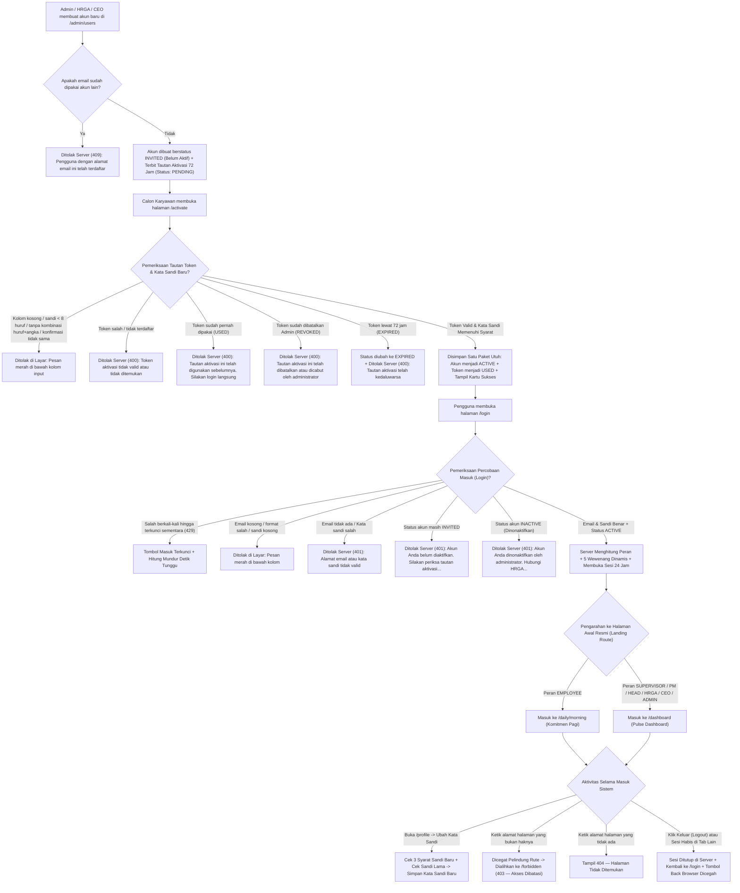
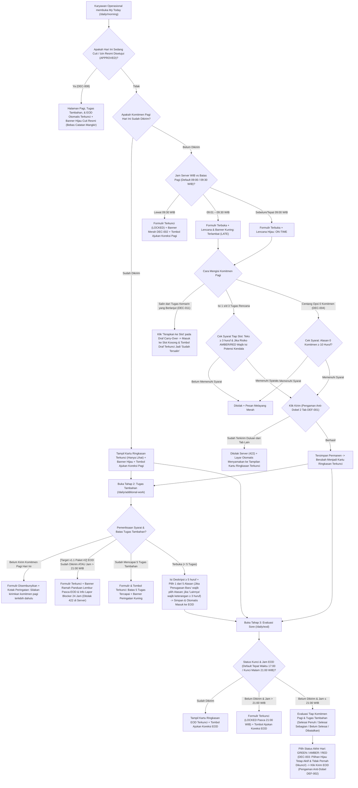
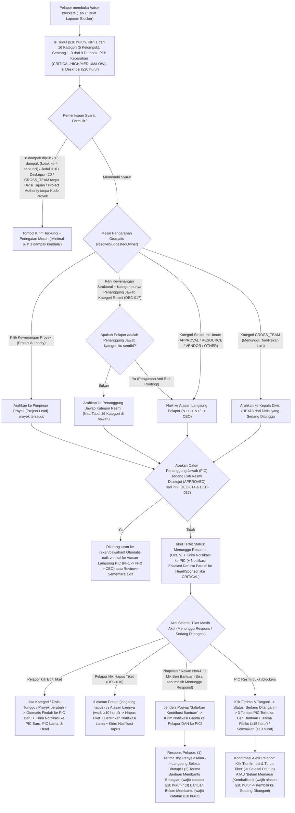
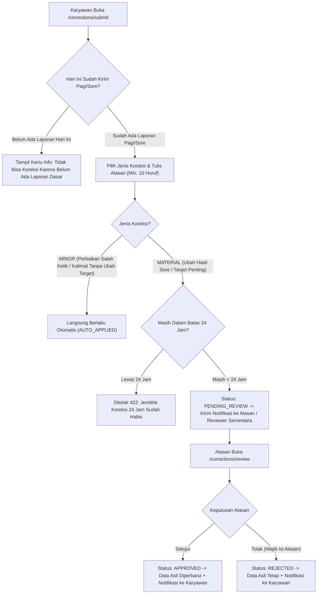
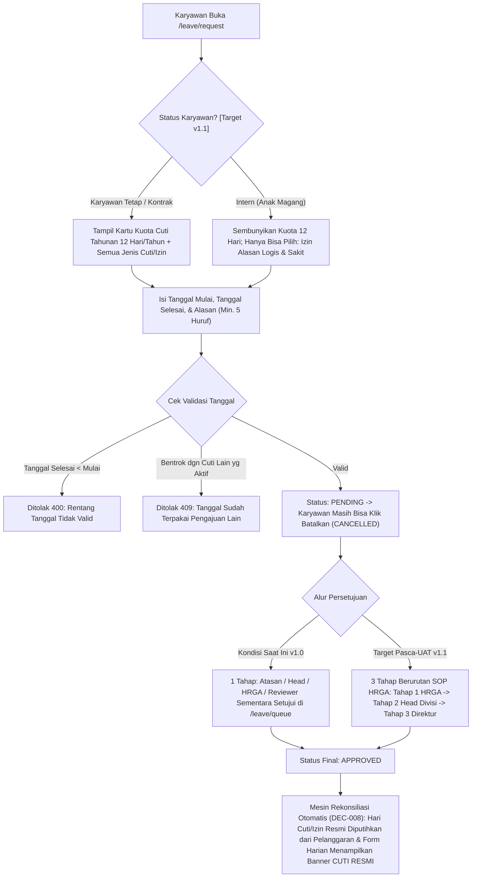
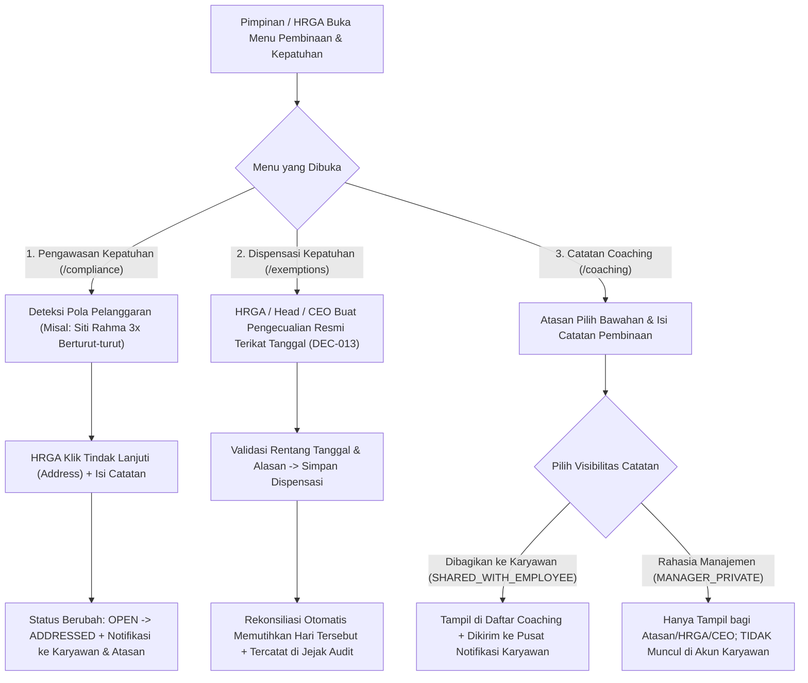
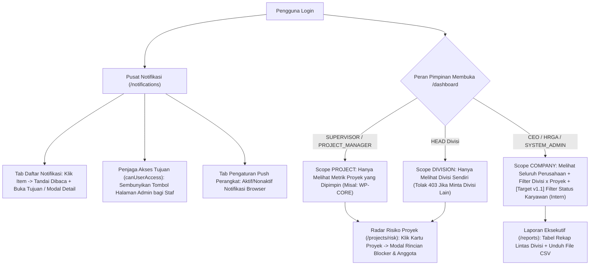
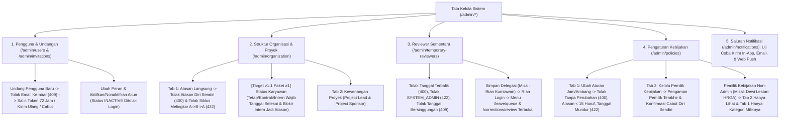

# Dokumen Induk 3-Lapisan: Peta Perjalanan Bercabang (E2E Journeys), Panduan Skenario Prosedural Lengkap (Aksi, Input & Hasil yang Diharapkan), serta Master Katalog Kondisi Sistem WorkPulse

> **Sistem:** WorkPulse — Sistem Pencatatan Komitmen Harian & Penanganan Kendala Kerja  
> **Organisasi:** PT Dutamedia Mandiri Pratama (Malang — WIB / UTC+7)  
> **Versi Dokumen:** `v1.0 — Edisi Mandiri Lengkap` (Mencakup 100% Kondisi Aktif Saat Ini + Penanda Evolusi `[Target v1.1 — Pasca-UAT]`)  
> **Pemilik Proyek:** Harry  
> **4 Fungsi Utama Dokumen Ini:**
> 1. **Panduan Skenario Prosedural Mandiri dari A sampai Z:** Memandu siapa saja (penguji, teman auditor, maupun pengguna baru) untuk mencoba **seluruh kemampuan, halaman, jendela pop-up, dan aturan sistem** secara berurutan tanpa merusak/mengunci data lebih dulu, lengkap dengan **Aksi Klik/Ketik Siap Salin (*Copy-Paste*)** dan ***Hasil yang Diharapkan*** di setiap langkah.
> 2. **Dasar Langsung Pembuatan 2 Versi Buku Panduan (*User Manual*):**
>    - **Versi Stakeholder / Pimpinan (Lead, HRGA, Direktur, Penilai Proyek):** Menjelaskan tujuan bisnis, aturan wewenang, pagar pengaman anti-kecurangan, dan bukti pengawasan.
>    - **Versi Pengguna Umum (Seluruh Karyawan & Anak Magang):** Menjelaskan langkah pakai sehari-hari dan cara mengatasi setiap pesan kesalahan atau kondisi khusus.
> 3. **Acuan Utama Slide Presentasi & Skrip Demo Live:** Menunjukkan urutan demo terbaik beserta akun dan kalimat penjelasnya.
> 4. **Daftar Periksa (*Checklist*) Audit Tampilan 4 Ukuran Layar (`HP 375px`, `Tablet 768/1024px`, `Desktop 1440px`, `Layar Lebar 1920px`) & Perbandingan 26 File Prototype HTML / Dokumen Baseline.**

---

## 0. Daftar Lengkap 23 Akun Resmi Sistem (`Password123!`) & Peta Wewenang

Seluruh langkah di dokumen ini menggunakan 23 akun resmi yang sudah disiapkan di database awal (`seed.ts`). Kata sandi awal untuk semua akun aktif adalah **`Password123!`**.

| No | Nama Lengkap | Email Login | Peran Sistem & Status Akun | Divisi & Jabatan | Atasan Langsung | Wewenang Khusus yang Dimiliki |
|---|---|---|---|---|---|---|
| 1 | **Sistem Administrator** | `admin@dutamedia.com` | `SYSTEM_ADMIN` (`ACTIVE`) | Management — System Administrator | — | Mengelola seluruh menu `Administration`. **Pemisahan Tugas (`IMP-026`):** Tidak punya menu kerja harian (`Workspace` diblokir `403`) dan tidak boleh ditunjuk menjadi peninjau cuti/koreksi. |
| 2 | **Hendra Wijaya** | `direktur@dutamedia.com` | `CEO_MANAGEMENT` (`ACTIVE`) | Management — Chief Executive Officer | — | Memantau `Seluruh Perusahaan`, Pemilik Kebijakan di semua 5 kategori, pengelola daftar Pemilik Kebijakan, tujuan akhir eskalasi. |
| 3 | **Dewi Lestari** | `hrga@dutamedia.com` | `HRGA` (`ACTIVE`) | HRGA — HRGA & Corporate Legal Manager | Hendra Wijaya | Mengelola `Antrean Kepatuhan`, `Manajemen Dispensasi`, `Kelola Pengguna`, `Struktur Organisasi`, `Reviewer Sementara`, Penanggung Jawab Kategori **`LEGAL`**, Pemilik Kebijakan kategori Kepatuhan/Koreksi, `[Target v1.1]` Tahap 1 Persetujuan Cuti. |
| 4 | **Sugito Erik Fajar** | `ga@dutamedia.com` | `EMPLOYEE` (`ACTIVE`) | HRGA — General Affairs (GA) Specialist | Dewi Lestari | Staf HRGA yang ditunjuk resmi sebagai **Penanggung Jawab Kategori `OFFICE_FACILITY` (Fasilitas & Sarana Kantor)** → otomatis bisa membuka menu `Antrean Blocker` (`/blockers`) & `Penuaan & Eskalasi` (`/blockers/aging`). |
| 5 | **Arif Budiman** | `head.eng@dutamedia.com` | `HEAD` (`ACTIVE`) | Engineering — Head of Engineering | Hendra Wijaya | Kepala Divisi Engineering (memantau tab `Divisi Saya`), Sponsor Proyek `WP-CORE`, menyetujui cuti & koreksi tim Engineering, membuat `Catatan Coaching` untuk bawahan langsungnya. |
| 6 | **Bambang Pratama** | `lead.tech@dutamedia.com` | `SUPERVISOR` (`ACTIVE`) | Engineering — Technical Lead 1 | Arif Budiman | Pimpinan Proyek **`WP-CORE`** & **`PRJ-CORE`**, serta **Penanggung Jawab Kategori `TECHNICAL` (Teknis & Kode Program)**. Memantau tab `Tim (Proyek)` di dasbor. |
| 7 | **Aditya Nugroho** | `dev.frontend@dutamedia.com` | `EMPLOYEE` (`ACTIVE`) | Engineering — Frontend Developer | Arif Budiman | Staf operasional murni (tidak punya bawahan dan bukan penanggung jawab kategori → menu `Management` dan `Administration` tertutup & diblokir `403`). |
| 8 | **Siti Rahma** | `dev.backend@dutamedia.com` | `EMPLOYEE` (`ACTIVE`) | Engineering — Backend Developer | Arif Budiman | Staf operasional Engineering (memiliki data contoh pola tidak melapor 3x berturut-turut di `/compliance`). |
| 9 | **Fajar Ramadhan** | `calon.karyawan@dutamedia.com` | `EMPLOYEE` (`INVITED`) | Engineering — Junior Developer | Arif Budiman | Akun karyawan baru yang **belum aktif** (untuk menguji penolakan login `INVITED` dan aktivasi akun dengan token 72 jam `wp_seed_invite_token_72h_demo_secret`). |
| 10 | **Dharma Putra** | `head.delivery@dutamedia.com` | `HEAD` (`ACTIVE`) | Delivery — Head of Delivery | Hendra Wijaya | Kepala Divisi Delivery, menyetujui cuti/koreksi & coaching Divisi Delivery. |
| 11 | **Dimas Prakoso** | `pm@dutamedia.com` | `PROJECT_MANAGER` (`ACTIVE`) | Delivery — Project Manager | Dharma Putra | Manajer Proyek, serta **Penanggung Jawab Kategori `REQUIREMENT` (Kebutuhan & Arahan Kerja)** dan **`CLIENT` (Klien & Calon Klien)**. |
| 12 | **Dio Bayu Bagaskara** | `product@dutamedia.com` | `EMPLOYEE` (`ACTIVE`) | Delivery — Product Manager | Dharma Putra | Staf Product Manager di bawah Head Delivery (cocok dipakai untuk menguji kondisi belum isi komitmen pagi). |
| 13 | **Nadia Kusuma** | `qa@dutamedia.com` | `EMPLOYEE` (`ACTIVE`) | Quality — QA Engineer | Dharma Putra | Staf QA (cocok dipakai untuk menguji pengiriman `0 Komitmen` dan simulasi penonaktifan akun `INACTIVE`). |
| 14 | **Gunawan Setiawan** | `head.ops@dutamedia.com` | `HEAD` (`ACTIVE`) | Operations & Infrastructure — Head of Ops & Infra | Hendra Wijaya | Kepala Divisi Operations & Infrastructure, tujuan pengarahan kendala lintas divisi (`CROSS_TEAM`) ke Ops & Infra, serta atasan langsung Fakhrizal/Achmad/Rahian. |
| 15 | **Rian Kurniawan** | `lead.creative@dutamedia.com` | `SUPERVISOR` (`ACTIVE`) | Operations & Infrastructure — Ops Supervisor | Gunawan Setiawan | Supervisor Ops & Infra (dipakai untuk menguji pendelegasian **Reviewer Sementara** lintas divisi). |
| 16 | **Fakhrizal Asshiddiq** | `network.infra@dutamedia.com` | `EMPLOYEE` (`ACTIVE`) | Operations & Infrastructure — Network & Infrastructure | Gunawan Setiawan | Staf spesialis yang ditunjuk resmi sebagai **Penanggung Jawab Kategori `INFRA` (Server & Rilis Sistem)** dan **`NETWORK` (Jaringan & Koneksi)** → punya akses `/blockers` & `/blockers/aging`. |
| 17 | **Achmad Noer Wahid** | `specialist.it@dutamedia.com` | `EMPLOYEE` (`ACTIVE`) | Operations & Infrastructure — Specialist IT | Gunawan Setiawan | Staf spesialis yang ditunjuk resmi sebagai **Penanggung Jawab Kategori `HOSTING_DOMAIN` (Hosting, Cloud & Domain)** → punya akses `/blockers` & `/blockers/aging`. |
| 18 | **Rahian M. Suari** | `it.support@dutamedia.com` | `EMPLOYEE` (`ACTIVE`) | Operations & Infrastructure — IT Support | Gunawan Setiawan | Staf spesialis yang ditunjuk resmi sebagai **Penanggung Jawab Kategori `ACCESS_SECURITY` (Akses & Keamanan Digital)** dan **`WORK_DEVICE` (Perangkat Kerja)** → punya akses `/blockers` & `/blockers/aging`. |
| 19 | **Maya Putri** | `designer@dutamedia.com` | `EMPLOYEE` (`ACTIVE`) | R&D — Principal Designer & R&D Advisory | Hendra Wijaya | Staf R&D Advisory (melapor langsung ke Direktur; dipakai untuk menguji batas isolasi lintas divisi). |
| 20 | **Lukman Hakim** | `head.sales@dutamedia.com` | `HEAD` (`ACTIVE`) | Business Development — Head of Sales | Hendra Wijaya | Kepala Divisi Business Development / Sales. |
| 21 | **Hari Wibowo** | `sales.bd@dutamedia.com` | `EMPLOYEE` (`ACTIVE`) | Business Development — Sales & BD Executive | Lukman Hakim | Staf Sales & Business Development. |
| 22 | **Ratna Sari** | `finance@dutamedia.com` | `HEAD` (`ACTIVE`) | Finance — Senior Finance Manager | Hendra Wijaya | Kepala Divisi Finance sekaligus **Penanggung Jawab Kategori `FINANCE` (Keuangan & Pembayaran)**. |
| 23 | **Oivi Deasepta** | `staff.finance@dutamedia.com` | `EMPLOYEE` (`ACTIVE`) | Finance — Finance Staff | Ratna Sari | Staf Finance (`[Target v1.1 Paket #1]: digunakan sebagai contoh akun berstatus Intern / Magang`). |

---

# BAGIAN I — SIKLUS AKUN, KEAMANAN AKSES, & AKUNTABILITAS HARIAN

---

## JOURNEY 1: Siklus Akun, Undangan 72 Jam, Login, Profil, Sesi, & Proteksi Rute (403/404)

### 1.A. Lapisan 1 — Peta Alur Bercabang & Intisari User Manual / Demo (Journey 1)

#### Intisari untuk *User Manual* & *Skrip Demo Presentasi* (Journey 1)
- **Untuk Panduan Pengguna Umum (*User Manual Karyawan*):**
  - **Cara Mengaktifkan Akun Baru:** Buka tautan aktivasi dari Admin/HRGA sebelum 72 jam habis, buat kata sandi minimal 8 karakter (wajib gabungan huruf dan angka). Setelah aktif, tautan tersebut otomatis hangus dan tidak bisa dipakai lagi.
  - **Jika Gagal Masuk (*Login*):** Periksa pesan di kotak merah atas formulir — sistem memberi tahu dengan jelas apakah karena salah email/kata sandi, akun belum diaktifkan, akun sudah dinonaktifkan HRGA, atau sedang diminta menunggu beberapa detik karena terlalu sering salah memasukkan kata sandi.
- **Untuk Panduan Stakeholder / Pimpinan & Skrip Demo:**
  - **Keamanan Undangan Sekali Pakai (`DEC-005`):** Mencegah kebocoran akses; tautan aktivasi hanya berlaku 1 kali dalam 72 jam dan dapat dicabut sewaktu-waktu oleh Admin/HRGA.
  - **Pemisahan Tugas Administrator (`IMP-026`):** Akun `SYSTEM_ADMIN` fokus mengurus pengaturan teknis dan **diblokir (`403`)** dari pengisian kerja harian maupun persetujuan cuti agar data kinerja karyawan murni berisi staf operasional.

---

### 1.B. Lapisan 2 — Panduan Skenario Prosedural Langkah demi Langkah (Journey 1)

#### Skenario Prosedural `SP-01.1` — Menyisir Seluruh Kondisi Halaman Login (`/login`): Kolom Kosong, Sandi Salah, Akun Belum Aktif (`INVITED`), Akun Dinonaktifkan (`INACTIVE`), Kunci Tunggu Percobaan Beruntun (`429`), & Login Sukses
- **Acuan Prototype & Baseline:** `UI-UX-Design/01-Login-Activation.html` · `02-PRD.md` (`FR-01..04`) · `TC-AUTH-001`, `TC-AUTH-002`, `TC-AUTH-009`, `TC-AUTH-010`

1. **Langkah 1.1.1 — Inspeksi Tampilan Awal & Pengalihan Otomatis Alamat Dasar `/` (`ST-AUTH-01`):**
   - **Aksi:** Pastikan belum login (jika sedang login, klik tombol **Keluar** di pojok kiri bawah). Buka alamat dasar `/` di browser.
   - **Hasil yang Diharapkan:**
     - Alamat otomatis berpindah ke **`/login`**.
     - Bagian kiri layar menampilkan informasi pengenalan WorkPulse dengan 3 poin keunggulan beserta ikon gambarnya.
     - Bagian kanan layar menampilkan formulir masuk berisi kolom **Alamat Email Kerja**, kolom **Kata Sandi** (dilengkapi tombol ikon mata untuk melihat/menyembunyikan ketikan sandi), tombol hijau **`Masuk ke WorkPulse`**, dan tautan menuju halaman aktivasi akun (`/activate`).
   - **Pemeriksaan Tampilan 4 Ukuran Layar (`375px` · `768px` · `1440px` · `1920px`):**
     - Ubah lebar layar di Chrome DevTools (F12): pastikan di layar lebar (`1440px` & `1920px`) panel kiri dan kanan tampil berdampingan rapi, sedangkan di layar HP (`375px`) dan Tablet (`768px`) formulir masuk menyesuaikan diri di tengah layar tanpa ada kotak input atau tombol yang terpotong ke samping.

2. **Langkah 1.1.2 — Uji Validasi Kolom Kosong, Format Email Salah, & Tombol Ikon Mata (`ST-AUTH-03`, `ST-AUTH-08`):**
   - **Aksi:**
     1. Biarkan kolom Email dan Kata Sandi kosong, lalu langsung klik **`Masuk ke WorkPulse`**.
     2. Ketik `bukan-format-email` pada kolom Email dan ketik `Rahasia123` pada kolom Kata Sandi, lalu klik tombol **ikon mata** di ujung kanan kolom Kata Sandi.
   - **Hasil yang Diharapkan:**
     1. Saat kosong: formulir tidak terkirim ke server dan muncul tulisan peringatan merah tepat di bawah kolom yang kosong.
     2. Saat ikon mata diklik: tampilan titik-titik `••••••••••` pada kolom Kata Sandi berubah menjadi tulisan terbaca `Rahasia123` (dan kembali menjadi titik-titik saat diklik sekali lagi).

3. **Langkah 1.1.3 — Uji Penolakan Kata Sandi Salah / Email Tidak Terdaftar (`ST-AUTH-04`):**
   - **Aksi:**
     - **Alamat Email Kerja:** `dev.frontend@dutamedia.com`
     - **Kata Sandi:** `SandiSalah123!`
     - Klik **`Masuk ke WorkPulse`**.
   - **Hasil yang Diharapkan:**
     - Muncul kotak peringatan merah di atas formulir dengan kalimat persis: **`"Alamat email atau kata sandi tidak valid."`**
     - Pengguna tetap tertahan di halaman `/login`.

4. **Langkah 1.1.4 — Uji Penolakan Akun Belum Diaktifkan (`INVITED` — `ST-AUTH-05`):**
   - **Aksi:**
     - **Alamat Email Kerja:** `calon.karyawan@dutamedia.com` (akun Fajar Ramadhan yang berstatus `INVITED`)
     - **Kata Sandi:** `Password123!`
     - Klik **`Masuk ke WorkPulse`**.
   - **Hasil yang Diharapkan:**
     - Muncul kotak peringatan merah di atas formulir dengan kalimat persis: **`"Akun Anda belum diaktifkan. Silakan periksa tautan aktivasi pada email Anda atau hubungi administrator."`**

5. **Langkah 1.1.5 — Uji Penolakan Akun yang Dinonaktifkan (`INACTIVE` — `ST-AUTH-06`):**
   - **Aksi:**
     1. Login terlebih dahulu sebagai **Sistem Administrator** (`admin@dutamedia.com` / `Password123!`), buka menu **Kelola Pengguna (`/admin/users`)**.
     2. Cari baris **`Nadia Kusuma`** (`qa@dutamedia.com`), klik tombol **`Nonaktifkan`** hingga statusnya berubah menjadi **`INACTIVE`**, lalu klik **Keluar (Logout)**.
     3. Di halaman `/login`, masukkan Email **`qa@dutamedia.com`** dan Kata Sandi **`Password123!`**, lalu klik **`Masuk ke WorkPulse`**.
     4. **Pemulihan Wajib:** Login kembali sebagai **Sistem Administrator** (`admin@dutamedia.com`), buka `/admin/users`, klik **`Aktifkan`** pada baris **`Nadia Kusuma`** hingga statusnya kembali **`ACTIVE`**, lalu klik **Keluar**.
   - **Hasil yang Diharapkan:**
     - Saat `qa@dutamedia.com` mencoba login dalam keadaan `INACTIVE`, server menolak (`401`) dan muncul kotak peringatan merah di atas formulir dengan kalimat persis: **`"Akun Anda dinonaktifkan oleh administrator. Hubungi HRGA untuk informasi lebih lanjut."`**

6. **Langkah 1.1.6 — Uji Penguncian Sementara Saat Terlalu Banyak Percobaan Masuk (`429` — `ST-AUTH-07`):**
   - **Aksi:** Di halaman `/login`, masukkan email `dev.frontend@dutamedia.com` dan kata sandi salah `SalahTerus1!`, lalu klik **`Masuk ke WorkPulse`** berulang-ulang secara cepat (lebih dari 5–10 kali berturut-turut) hingga batas pengaman percobaan masuk terpicu. *(Tunggu hingga hitung mundur selesai sebelum lanjut ke langkah berikutnya).*
   - **Hasil yang Diharapkan:**
     - Tombol **`Masuk ke WorkPulse`** otomatis terkunci (tidak bisa diklik) dan muncul kotak peringatan merah dengan hitung mundur detik: **`"Terlalu banyak percobaan masuk. Demi keamanan sistem, silakan tunggu X detik sebelum mencoba kembali."`**

7. **Langkah 1.1.7 — Uji Login Sukses & Pendaratan Halaman Awal Sesuai Peran (`ST-AUTH-02`, `ST-AUTH-09`):**
   - **Aksi:**
     1. Masukkan Email **`dev.frontend@dutamedia.com`** dan Kata Sandi **`Password123!`**, lalu klik **`Masuk ke WorkPulse`**.
     2. Setelah berhasil masuk, coba ketik manual `/login` di bilah alamat browser lalu tekan Enter.
   - **Hasil yang Diharapkan:**
     1. Sebagai staf operasional (`EMPLOYEE`), Aditya langsung diarahkan ke halaman **`/daily/morning`** (`My Today / Morning Commitment`). Di pojok kiri bawah menu samping (sidebar) tertulis **`Aditya Nugroho`** (`Frontend Developer`).
     2. Saat mengetik `/login` ketika statusnya sudah masuk sistem, aplikasi otomatis mengembalikannya ke **`/daily/morning`** (tidak menampilkan form login lagi).

---

#### Skenario Prosedural `SP-01.2` — Menyisir Seluruh Kondisi Halaman Aktivasi Akun (`/activate`): Validasi Kata Sandi, Token Salah, Token Dicabut (`REVOKED`), Token Bekas Pakai (`USED`), & Aktivasi Sukses
- **Acuan Prototype & Baseline:** `UI-UX-Design/01-Login-Activation.html` · `DEC-005` · `TC-AUTH-003`, `TC-AUTH-004`

1. **Langkah 1.2.1 — Uji Validasi Kolom & Indikator Kekuatan Kata Sandi (`ST-ACTV-01`, `ST-ACTV-03`):**
   - **Aksi:** Pastikan dalam keadaan **Keluar (Logout)**. Buka halaman `/activate`:
     1. Klik **`Aktifkan Akun Saya`** saat semua kolom masih kosong.
     2. Isi **Token Aktivasi:** `token_percobaan`, **Kata Sandi Baru:** `pendek` (6 huruf tanpa angka), dan **Konfirmasi Kata Sandi:** `tidak_sama_123`.
   - **Hasil yang Diharapkan:**
     - Muncul garis indikator kekuatan kata sandi saat mengetik, disertai pesan kesalahan merah tepat di bawah kolom yang belum memenuhi syarat (kata sandi wajib minimal 8 karakter kombinasi huruf & angka, dan konfirmasi wajib sama persis).

2. **Langkah 1.2.2 — Uji Token Tidak Ditemukan & Token yang Sudah Dicabut Admin (`REVOKED` — `ST-ACTV-04`, `ST-ACTV-06`):**
   - **Aksi:**
     1. Di `/activate`, isi **Token Aktivasi:** `token_tidak_terdaftar_999`, **Kata Sandi Baru:** `Password123!`, **Konfirmasi Kata Sandi:** `Password123!`, lalu klik **`Aktifkan Akun Saya`**.
     2. Untuk menguji **Token Dicabut (`REVOKED`)**: Login sebagai **Admin** (`admin@dutamedia.com`), buka `/admin/users`, klik **`+ Undang Pengguna Baru`**, isi Nama `Tes Cabut Token` dan Email `tes.cabut@dutamedia.com`, klik simpan → salin kode tokennya → tutup pop-up → pada baris `Tes Cabut Token` klik tombol **`Cabut`** → Logout Admin → buka `/activate`, tempelkan token yang sudah dicabut tadi, isi kata sandi `Password123!`, lalu klik **`Aktifkan Akun Saya`**.
   - **Hasil yang Diharapkan:**
     1. Untuk token yang tidak terdaftar: muncul kotak peringatan merah di atas form: **`"Token aktivasi tidak valid atau tidak ditemukan."`**
     2. Untuk token yang sudah dicabut Admin: muncul kotak peringatan merah di atas form: **`"Tautan aktivasi ini telah dibatalkan atau dicabut oleh administrator."`**

3. **Langkah 1.2.3 — Uji Aktivasi Sukses Token 72 Jam & Penolakan Pemakaian Kedua Kali (`USED` — `ST-ACTV-02`, `ST-ACTV-05`):**
   - **Aksi:**
     1. Buka alamat `/activate?token=wp_seed_invite_token_72h_demo_secret` (milik akun `calon.karyawan@dutamedia.com` — Fajar Ramadhan).
     2. Pastikan kolom Token Aktivasi otomatis terisi. Isi **Kata Sandi Baru:** `Password123!` dan **Konfirmasi Kata Sandi:** `Password123!`, lalu klik **`Aktifkan Akun Saya`**.
     3. Setelah muncul kartu sukses, buka kembali `/activate?token=wp_seed_invite_token_72h_demo_secret`, isi kembali kata sandi `Password123!`, dan klik **`Aktifkan Akun Saya`** untuk kedua kalinya.
   - **Hasil yang Diharapkan:**
     1. Pada klik pertama: formulir berubah menjadi **Kartu Sukses Aktivasi** dengan kalimat persis: **`"Akun Anda berhasil diaktifkan dengan aman. Silakan masuk menggunakan kata sandi yang baru dibuat."`** beserta tombol menuju halaman `/login`.
     2. Pada percobaan kedua dengan token yang sama: sistem menolak dengan kotak peringatan merah: **`"Tautan aktivasi ini telah digunakan sebelumnya. Silakan login langsung."`**

---

#### Skenario Prosedural `SP-01.3` — Menyisir Halaman Profil (`/profile`), Ubah Kata Sandi Mandiri, Layar 403 & 404, Pemisahan Tugas Admin (`IMP-026`), & Sesi Habis Lintas 2 Tab
- **Acuan Prototype & Baseline:** `UI-UX-Design/24-Profile-Settings.html` · `TC-AUTH-005..008`, `TC-ADMN-003`, `CH-EXP-04`

1. **Langkah 1.3.1 — Inspeksi 3 Bagian Halaman Profil & Uji Lengkap Ubah Kata Sandi Mandiri (`ST-PROF-01..04`):**
   - **Aksi:** Login sebagai **Aditya Nugroho** (`dev.frontend@dutamedia.com` / `Password123!`), klik lingkaran inisial **`AN`** di pojok kanan atas untuk membuka `/profile`:
     1. Periksa 3 kartu informasi di halaman Profil.
     2. Pada formulir **Ubah Kata Sandi**, uji 5 kondisi salah secara berurutan:
        - Kosongkan **Kata Sandi Saat Ini**, isi sandi baru `Baru1234!` → klik simpan.
        - Isi **Kata Sandi Saat Ini:** `Password123!`, **Kata Sandi Baru:** `abc12` (kurang dari 8 karakter) → klik simpan.
        - Ubah **Kata Sandi Baru:** `semuahurufsaja` (tanpa angka) → klik simpan.
        - Ubah **Kata Sandi Baru:** `Baru1234!`, **Konfirmasi Kata Sandi Baru:** `Beda9999!` → klik simpan.
        - Isi **Kata Sandi Saat Ini:** `SandiLamaSalah1!`, **Kata Sandi Baru:** `Baru1234!`, **Konfirmasi:** `Baru1234!` → klik simpan.
     3. Sekarang isi data yang benar: **Kata Sandi Saat Ini:** `Password123!`, **Kata Sandi Baru:** `PasswordBaru123!`, **Konfirmasi:** `PasswordBaru123!` → klik simpan.
     4. **Pemulihan Wajib:** Segera ubah kembali kata sandi Aditya dari `PasswordBaru123!` kembali ke **`Password123!`**.
   - **Hasil yang Diharapkan:**
     1. Halaman Profil menampilkan: (a) Kartu Identitas & Organisasi (`Aditya Nugroho`, `dev.frontend@dutamedia.com`, `Frontend Developer`, `Engineering`, `EMPLOYEE`, Atasan `Arif Budiman`, Status `ACTIVE`, `+ [Target v1.1] Status Karyawan`), (b) Kartu Hak Otoritas & Jadwal Pengingat (`08:00 WIB` & `16:00 WIB`), dan (c) Formulir Ubah Kata Sandi dengan 3 baris syarat yang berubah menjadi ikon centang hijau saat terpenuhi.
     2. Kelima percobaan salah menampilkan kotak peringatan merah di atas form dengan pesan persis:
        - **`"Kata sandi saat ini wajib diisi."`**
        - **`"Kata sandi baru minimal 8 karakter."`**
        - **`"Kata sandi baru harus kombinasi huruf dan angka."`**
        - **`"Konfirmasi kata sandi baru tidak cocok dengan kata sandi baru."`**
        - **`"Kata sandi lama yang Anda masukkan tidak sesuai."`**
     3. Saat semua benar: muncul kotak hijau **`"Kata sandi berhasil diperbarui dengan aman."`**

2. **Langkah 1.3.2 — Uji Pencegatan Alamat Terlarang (`403`), Alamat Tidak Dikenal (`404`), Pemisahan Admin (`IMP-026`), & Sesi Berakhir Lintas 2 Tab (`ST-ERR-01`, `ST-ERR-02`):**
   - **Aksi:**
     1. Masih login sebagai **Aditya Nugroho (`EMPLOYEE`)**, ketik `/admin/organization` di bilah alamat browser. Klik tombol **`Kembali ke Beranda`** yang muncul.
     2. Ketik `/alamat-tidak-ada-123` di bilah alamat browser.
     3. Buka **2 tab browser** yang sama-sama login sebagai Aditya (`/daily/morning` di Tab 1 dan `/profile` di Tab 2). Di **Tab 2**, klik tombol **Keluar (Logout)**. Lalu kembali ke **Tab 1** dan klik menu lain atau coba kirim form.
     4. Login sebagai **Sistem Administrator** (`admin@dutamedia.com` / `Password123!`), periksa daftar menu di sidebar kiri, lalu coba ketik manual `/daily/morning` dan `/raise-blockers`.
   - **Hasil yang Diharapkan:**
     1. Saat Aditya mengetik `/admin/organization`: langsung dialihkan ke **`/forbidden?from=/admin/organization`** yang menampilkan judul **`403 — Akses Dibatasi`**, keterangan `"Peran Anda (EMPLOYEE) tidak memiliki hak akses ke halaman /admin/organization."`, dan tombol **`Kembali ke Beranda`** (yang mengembalikan Aditya ke `/daily/morning`).
     2. Saat mengetik `/alamat-tidak-ada-123`: tampil layar **`404 — Halaman Tidak Ditemukan`** (`"Alamat yang Anda tuju tidak tersedia."`).
     3. Saat Logout di Tab 2 lalu beraktivitas di Tab 1: Tab 1 otomatis mendeteksi sesi telah dicabut (`401`) dan langsung melempar pengguna kembali ke halaman **`/login`**.
     4. Saat login sebagai `SYSTEM_ADMIN`: grup menu `Workspace` tidak ditampilkan di sidebar, dan percobaan mengetik `/daily/morning` atau `/raise-blockers` langsung dihadang ke layar **`403 — Akses Dibatasi`**.

---

## JOURNEY 2: Siklus Akuntabilitas Harian (`Morning Commitment` → `Additional Work` → `EOD Outcome` → `Riwayat Saya`)

### 2.A. Lapisan 1 — Peta Alur Bercabang & Intisari User Manual / Demo (Journey 2)

---

### 2.B. Lapisan 2 — Panduan Skenario Prosedural Langkah demi Langkah (Journey 2)

#### Skenario Prosedural `SP-02.1` — Menyisir Halaman Komitmen Pagi (`/daily/morning`): Batas 3 Slot, Validasi Gagal, Risiko `AMBER/RED`, Picker Blocker, Salin Kemarin (`DEC-011`), Kirim `0 Komitmen` Tuntas (`DEC-004`), Kirim `1–3 Komitmen` Tuntas, Konflik 2 Tab (`DEF-001`), & Simulasi Lewat Batas Waktu (`LOCKED`)
- **Akun Uji:**
  - Akun 1 (Untuk uji lengkap 1–3 komitmen & konflik 2 tab): **Aditya Nugroho** (`dev.frontend@dutamedia.com` / `Password123!`)
  - Akun 2 (Untuk uji kirim `0 Komitmen` sampai tersimpan tuntas): **Nadia Kusuma** (`qa@dutamedia.com` / `Password123!`)
  - Akun 3 (Untuk simulasi lewat jam batas cut-off): **Hendra Wijaya / Direktur** (`direktur@dutamedia.com` / `Password123!`) + **Dio Bayu** (`product@dutamedia.com` / `Password123!`)
- **Acuan Prototype & Baseline:** `UI-UX-Design/02-Morning-Commitment.html` · `TC-DLYM-001..007`

1. **Langkah 2.1.1 — Uji Tambah/Hapus Slot & Batas Maksimum 3 Komitmen (`ST-DLYM-01`, `ST-DLYM-09`):**
   - **Aksi:** Login sebagai **Aditya Nugroho** (`dev.frontend@dutamedia.com`), pastikan berada di `/daily/morning` (**jangan klik Kirim dulu!**):
     1. Klik tombol **`+ Tambah Slot Komitmen`** dua kali sehingga terbuka 3 kotak tugas (Slot #1, Slot #2, Slot #3).
     2. Periksa area tombol tambah slot di bagian bawah.
     3. Klik tombol hapus/kosongkan pada Slot #3.
   - **Hasil yang Diharapkan:**
     1. Saat 3 slot sudah terbuka: tombol `+ Tambah Slot Komitmen` hilang dan berganti menjadi teks petunjuk bahwa batas maksimal adalah 3 komitmen utama per hari.
     2. Saat Slot #3 dikosongkan: muncul pesan melayang hijau: **`"Slot komitmen dikosongkan."`**

2. **Langkah 2.1.2 — Uji Validasi Teks Pendek (< 3 Huruf), Risiko `AMBER/RED` Tanpa Catatan, & Menu `Pilih Blocker Aktif` (`ST-DLYM-07`, `ST-DLYM-09`):**
   - **Aksi:**
     1. Pada Slot #1, ketik 2 huruf `Te`, lalu klik **`Kirim Morning Commitment`**.
     2. Ubah teks Slot #1 menjadi `Optimasi komponen tabel riwayat komitmen harian`, lalu klik pilihan risiko **`AMBER`** (atau **`RED`**). Amati perubahan lencana status harian di bagian atas dan kotak tambahan yang terbuka di bawah Slot #1.
     3. Biarkan kotak **Potensi Kendala / Hambatan (*)** kosong, lalu klik **`Kirim Morning Commitment`**.
     4. Klik tombol **`Pilih Blocker Aktif`** di sebelah kolom Tautan Referensi pada Slot #1.
   - **Hasil yang Diharapkan:**
     1. Teks 2 huruf `Te` ditolak dengan pesan melayang merah persis: **`"Slot #1: Deskripsi komitmen wajib diisi minimal 3 karakter."`**
     2. Saat risiko `AMBER` dipilih: lencana status harian di kartu atas otomatis berubah menjadi kuning **`AMBER — Berisiko`** (atau merah **`RED — Kritis`** jika memilih `RED`), dan muncul 2 kotak input tambahan: **`Potensi Kendala / Hambatan *`** serta **`Bantuan yang Dibutuhkan`**.
     3. Saat dikirim tanpa mengisi Potensi Kendala: ditolak dengan pesan melayang merah persis: **`"Slot #1: Komitmen dengan risiko AMBER wajib menyertakan potensi kendala."`**
     4. Saat `Pilih Blocker Aktif` diklik: muncul daftar tiket kendala aktif untuk ditautkan ke komitmen pagi (atau keterangan `"Tidak ada tiket blocker aktif saat ini."`).

3. **Langkah 2.1.3 — Uji Fitur Salin Komitmen Kemarin (*Copy-Forward* `DEC-011` — `ST-DLYM-06`):**
   - **Aksi:** Jika di bagian atas formulir terdapat panel **Koleksi Draf Carry-Over dari Hari Kerja Sebelumnya** (tugas kemarin yang dievaluasi dengan status `Lanjutkan Besok / CONTINUE`):
     1. Periksa informasi pada kartu draf tersebut (lencana `Carry-Over #N` dan catatan alasan kelanjutan dari EOD kemarin).
     2. Klik tombol **`Terapkan ke Slot`** pada kartu draf tersebut.
   - **Hasil yang Diharapkan:**
     - Muncul pesan melayang hijau **`"Draf tugas carry-over #1 diterapkan ke slot #..."`**, teks tugas otomatis masuk ke slot kosong yang tersedia tanpa menimpa slot yang sudah terisi, dan tombol pada kartu draf berubah menjadi **`Sudah Tersalin`** (terkunci agar tidak disalin dua kali).

4. **Langkah 2.1.4 — Uji Pengiriman `1–3 Komitmen` Valid & Pengaman Anti-Dobel 2 Tab (`DEF-001` — `ST-DLYM-04`, `ST-DLYM-10`):**
   - **Aksi:**
     1. Buka **Tab Kedua** di browser yang sama dan buka `/daily/morning` (sehingga Tab 1 dan Tab 2 sama-sama menampilkan formulir pagi Aditya yang belum dikirim).
     2. Di **Tab 1**, pastikan Slot #1 berisi `Optimasi komponen tabel riwayat komitmen harian` (risiko `AMBER`, potensi kendala `Menunggu kepastian format kolom waktu WIB dari tim desain`, bantuan `Keputusan final format jam 24 jam`) dan Slot #2 berisi `Penyusunan unit test komponen formulir komitmen pagi` (risiko `GREEN`). Klik **`Kirim Morning Commitment`** di **Tab 1**.
     3. Segera pindah ke **Tab 2** (tanpa menekan Refresh/F5), isi Slot #1 dengan `Percobaan kirim ganda dari tab kedua`, lalu klik **`Kirim Morning Commitment`** di **Tab 2**.
   - **Hasil yang Diharapkan:**
     - **Di Tab 1:** Muncul pesan hijau **`"Morning Commitment berhasil dikirim dan dicatat."`**, lencana atas berubah menjadi **`SUBMITTED (Terkunci)`**, muncul banner hijau waktu kirim (`Disubmit pada HH:mm WIB` + tombol `Ajukan Koreksi Pagi`), dan formulir berubah permanen menjadi **Kartu Ringkasan Resmi (*Summary Cards*)** yang hanya bisa dibaca (*read-only*).
     - **Di Tab 2:** Server menolak pengiriman kedua (`HTTP 422`: `"Morning Commitment hari ini telah diserahkan dan terkunci. Perubahan data wajib melalui alur permohonan koreksi resmi."`), lalu tampilan Tab 2 otomatis memuat data yang sudah terkunci dari Tab 1 tanpa menghasilkan data ganda.

5. **Langkah 2.1.5 — Uji Pengiriman Opsi `0 Komitmen` Sampai Tersimpan Tuntas (`DEC-004` — `ST-DLYM-08`):**
   - **Aksi:**
     1. Logout Aditya → Login sebagai **Nadia Kusuma** (`qa@dutamedia.com` / `Password123!`), buka `/daily/morning`.
     2. Centang kotak **`Saya tidak menetapkan komitmen terencana hari ini (0 Komitmen)`**.
     3. Ketik alasan pendek 5 huruf `Riset` → klik **`Kirim Morning Commitment`**.
     4. Ketik alasan lengkap (≥ 10 karakter): `Mengikuti pelatihan penuh standar pengujian keamanan aplikasi bersama tim QA eksternal seharian` → klik **`Kirim Morning Commitment`**.
   - **Hasil yang Diharapkan:**
     1. Saat dicentang: kotak slot 1–3 disembunyikan dan lencana status harian berubah menjadi **`0 KOMITMEN`**.
     2. Saat alasan hanya 5 huruf (`Riset`): ditolak dengan pesan merah **`"Alasan tidak menetapkan komitmen wajib diisi minimal 10 karakter."`**
     3. Saat alasan ≥ 10 karakter dikirim: berhasil tersimpan, formulir terkunci rapi menampilkan alasan 0 komitmen tersebut dengan status **`0 KOMITMEN`** (bukan dianggap mangkir/`No Submission`).

6. **Langkah 2.1.6 — Uji Kondisi Formulir Terkunci Karena Lewat Jam Batas Cut-Off (`DEC-002` — `ST-DLYM-03`):**
   - **Aksi:** *(Jika saat pengujian jam sudah lewat `09:30 WIB`, cukup login sebagai **`product@dutamedia.com` — Dio Bayu** yang belum mengisi komitmen pagi dan buka `/daily/morning`. Jika pengujian dilakukan sebelum `09:30 WIB`, login dulu sebagai **Direktur `direktur@dutamedia.com`** → buka `/admin/policies` → klik `Buat Versi Kebijakan Baru` kategori `Jam Kerja & Waktu Komitmen` → ubah `Cut-Off Pagi` ke `00:01` dengan alasan audit → lalu login sebagai **`product@dutamedia.com`** dan buka `/daily/morning` → setelah selesai melihat tampilannya, kembalikan `Cut-Off Pagi` di `/admin/policies` ke `09:30`/`23:59` semula).*
   - **Hasil yang Diharapkan:**
     - Pada akun yang belum mengisi saat jam sudah melewati batas `Cut-Off Pagi`: lencana atas berwarna merah **`LOCKED (Pasca Cut-Off)`**, muncul banner merah **`"Batas Cut-Off (HH:mm WIB) Telah Berakhir — Formulir Terkunci"`** lengkap dengan tombol **`Ajukan Koreksi Pagi`**, seluruh kotak input terkunci (*disabled*), dan tombol kirim disembunyikan.

---

#### Skenario Prosedural `SP-02.2` — Menyisir Halaman Tugas Tambahan (`/daily/additional-work`): Prasyarat Pagi, 5 Alasan Kondisional, Batas Maksimum 5 Tugas, & Penguncian Pasca-EOD
- **Acuan Prototype & Baseline:** `UI-UX-Design/03-Additional-Work.html` · `FR-06..07` · `TC-DLYA-001..003`

1. **Langkah 2.2.1 — Uji Peringatan Saat Belum Mengisi Komitmen Pagi (`ST-DLYA-01`):**
   - **Aksi:** Login sebagai **Dio Bayu** (`product@dutamedia.com` / `Password123!` — yang belum mengirim komitmen pagi hari ini), lalu buka menu `/daily/additional-work`.
   - **Hasil yang Diharapkan:**
     - Formulir input tugas tambahan tidak ditampilkan; muncul kotak peringatan berikon tanda seru: **`"Belum Mengisi Morning Commitment: Silakan kirimkan komitmen pagi terlebih dahulu sebelum menambahkan pekerjaan tambahan siang hari."`** beserta tautan **`Buka Morning Commitment →`**.

2. **Langkah 2.2.2 — Uji Validasi Input, 5 Pilihan Alasan Kondisional, & Batas Maksimum 5 Tugas (`ST-DLYA-02..05`):**
   - **Aksi:** Logout Dio → Login kembali sebagai **Aditya Nugroho** (`dev.frontend@dutamedia.com` — yang sudah mengirim komitmen pagi di `SP-02.1`), buka `/daily/additional-work`:
     1. Periksa tampilan daftar bawah saat belum ada tugas tambahan hari ini (*empty state*).
     2. Ketik deskripsi 3 huruf `Cek` → klik **`Tambahkan Pekerjaan`**.
     3. Ketik deskripsi `Perbaikan bug validasi token kadaluarsa di halaman aktivasi`, pilih alasan **`Penugasan Baru dari Atasan`**, biarkan pilihan **`Ditugaskan Oleh (Atasan Langsung/Lead) *`** kosong → coba klik **`Tambahkan Pekerjaan`**.
     4. Ubah alasan menjadi **`Lainnya`**, isi kotak **`Keterangan Alasan Lainnya *`** dengan 2 huruf `Ya` → klik **`Tambahkan Pekerjaan`**.
     5. Pilih kembali alasan **`Penugasan Baru dari Atasan`**, pilih atasan **`Bambang Pratama`**, pilih proyek **`[PRJ-CORE] Enterprise Core Engine & Identity Sync`**, lalu klik **`Tambahkan Pekerjaan`**.
     6. Tambahkan lagi 4 tugas tambahan singkat lainnya (misalnya alasan `Perbaikan Error / Bug Kritis` atau `Pengalihan Prioritas Kerja`) hingga total tugas tambahan hari ini mencapai **5 tugas**.
   - **Hasil yang Diharapkan:**
     1. Saat belum ada tugas: panel bawah menampilkan tampilan kosong berikon tas kerja (`Briefcase`).
     2. Deskripsi 3 huruf ditolak dengan pesan merah: **`"Deskripsi pekerjaan tambahan minimal 5 karakter."`**
     3. `Penugasan Baru` tanpa memilih atasan ditolak (`"Pekerjaan dengan alasan Penugasan Baru wajib memilih atasan yang menugaskan."`).
     4. `Lainnya` dengan keterangan < 3 huruf ditolak dengan pesan merah: **`"Keterangan alasan lainnya wajib diisi minimal 3 karakter untuk menjelaskan konteks pekerjaan."`**
     5. Saat dikirim valid: muncul pesan hijau **`"Pekerjaan tambahan berhasil dicatat."`** dan kartu tugas muncul di daftar bawah lengkap dengan lencana proyek serta nama atasan penugas.
     6. Begitu mencapai **5 tugas**: muncul banner kuning **`"Batas maksimum 5 tugas tambahan per hari telah tercapai. Anda tidak dapat menambahkan tugas baru lagi hari ini."`**, seluruh kotak input terkunci, dan tombol berubah menjadi **`Batas 5 Tugas Tercapai`**.

---

#### Skenario Prosedural `SP-02.3` — Menyisir Halaman Evaluasi Sore (`/daily/eod`) & Riwayat Saya (`/daily/history`): Wajib Alasan Batal/Lanjut, Hak Pilih Hijau (`DEC-003`), Kunci Atomik (`DEF-002`), Kunci Additional Work Pasca-EOD (`[Target v1.1]`), & Buka Rincian Riwayat
- **Acuan Prototype & Baseline:** `UI-UX-Design/04-EOD-Outcome.html` · `06-My-History-Weekly-Summary.html` · `DEC-003` · `TC-DLYE-001..005`

1. **Langkah 2.3.1 — Uji Validasi Wajib Alasan pada Status `Dibatalkan` & `Lanjutkan Besok` (`ST-DLYE-01..03`):**
   - **Aksi:** Masih login sebagai **Aditya Nugroho**, buka `/daily/eod`:
     1. Pastikan seluruh Komitmen Pagi **dan** seluruh Tugas Tambahan yang baru dicatat di `SP-02.2` muncul di daftar evaluasi.
     2. Pada Komitmen #1, pilih **`Dibatalkan`** (`CANCELLED`), kosongkan kotak alasan pembatalan, lalu klik **`Kirim Evaluasi EOD`**.
     3. Ubah Komitmen #1 menjadi **`Selesai Sebagian`** (`PARTIALLY_COMPLETED`), pilih kelanjutan **`Lanjutkan Besok (Carry-Over)`** (`CONTINUE`), kosongkan kotak alasan kelanjutan, lalu klik **`Kirim Evaluasi EOD`**.
   - **Hasil yang Diharapkan:**
     1. Saat `Dibatalkan` tanpa alasan: ditolak dengan pesan merah persis: **`"Komitmen #1: Alasan pembatalan wajib diisi bila status Dibatalkan."`**
     2. Saat `Lanjutkan Besok` tanpa alasan: ditolak dengan pesan merah persis: **`"Komitmen #1: Alasan kelanjutan (Continuation) wajib diisi bila tugas dilanjutkan."`**

2. **Langkah 2.3.2 — Uji Hak Pilih Status Hijau (`DEC-003`), Penguncian Permanen Pasca-Kirim (`DEF-002`), & Penguncian `Additional Work` Pasca-EOD (`[Target v1.1 Paket #2]` — `ST-DLYE-02`, `ST-DLYE-04`, `ST-DLYA-06`):**
   - **Aksi:**
     1. Isi alasan kelanjutan pada Komitmen #1 (`CONTINUE`): `Menunggu penggabungan cabang kode utama besok pagi`, dan pilih **`Selesai Penuh`** (`COMPLETED`) untuk tugas lainnya.
     2. Pada bagian **Status Akhir Hari (`Final Daily Status`)**, klik pilihan **`GREEN` (Hijau — Terkendali)**.
     3. Isi kolom opsional **Prioritas Utama Besok (`Tomorrow Priority`)**: `Menjalankan verifikasi integrasi tabel waktu WIB pada pukul 09:00 WIB`.
     4. Klik **`Kirim Evaluasi EOD`**, lalu tekan `F5` (Refresh).
     5. **`[Target v1.1 Paket #2]`:** Buka kembali tab `/daily/additional-work` setelah EOD terkunci.
   - **Hasil yang Diharapkan:**
     - Pilihan **`GREEN` tetap aktif dan dapat dikirim** meskipun Komitmen #1 belum selesai penuh (`DEC-003`).
     - Setelah dikirim: muncul pesan hijau **`"Evaluasi EOD Outcome berhasil dikirim dan dicatat."`**, lencana atas menjadi **`SUBMITTED (Terkunci)`**, muncul banner hijau waktu kirim + tombol **`Ajukan Koreksi EOD`**, dan seluruh item berubah menjadi **Kartu Ringkasan Evaluasi** yang tetap terkunci setelah `F5`.
     - **`[Target v1.1 Paket #2]`:** Saat membuka `/daily/additional-work` setelah EOD terkunci, formulir tugas tambahan ikut terkunci (*read-only*) dengan banner panduan ramah lembur pasca-EOD & informasi bahwa menu `Lapor Blocker` tetap terbuka 24 jam.

3. **Langkah 2.3.3 — Menyisir Halaman Riwayat Saya (`/daily/history` — `ST-HIST-01..03`):**
   - **Aksi:**
     1. Buka menu **Riwayat Saya (`/daily/history`)**.
     2. Klik baris catatan hari ini pada tabel untuk membuka rinciannya, lalu klik sekali lagi untuk menutupnya.
     3. Atur filter tanggal awal & akhir ke tanggal masa depan yang belum punya catatan (misal `2027-01-01` s/d `2027-01-05`), klik terapkan, lalu klik tombol unduh.
   - **Hasil yang Diharapkan:**
     1. Saat baris diklik: baris melebar menampilkan rincian seluruh Komitmen Pagi (beserta hasil evaluasi & alasan kelanjutan) dan seluruh Tugas Tambahan hari tersebut. (Pada baris milik Nadia Kusuma dari Langkah 2.1.5, rincian menampilkan alasan `0 Komitmen`).
     2. Saat filter tanggal kosong: tabel menampilkan keterangan kosong (`empty-cell`), dan klik tombol unduh memunculkan pesan merah: **`"Tidak ada data riwayat untuk diunduh."`**

---

### 2.C. Lapisan 3 — Tabel Ceklis Katalog Kondisi per Halaman (Bagian I: Halaman 1 s/d 8)

| ID Kondisi | Halaman & Rute | Acuan Prototype | Ringkasan Kondisi yang Diaudit | HP (375) | Tablet (768/1024) | Desktop (1440) | Lebar (1920) |
|---|---|---|---|:---:|:---:|:---:|:---:|
| `ST-AUTH-01..09` | **1. Login** (`/login`) | `01-Login-Activation.html` | Tampilan awal 2 panel, validasi kosong/format email, tombol ikon mata sandi, error `401` sandi salah, error akun `INVITED`, error akun `INACTIVE`, kunci hitung mundur `429`, login sukses, & pengalihan balik bila sudah login. | `[ ]` | `[ ]` | `[ ]` | `[ ]` |
| `ST-ACTV-01..06` | **2. Aktivasi Akun** (`/activate`) | `01-Login-Activation.html` | Auto-isi `?token=`, garis indikator kekuatan sandi, error token salah / bekas pakai (`USED`) / dicabut (`REVOKED`) / kedaluwarsa (`EXPIRED`), & kartu sukses aktivasi. | `[ ]` | `[ ]` | `[ ]` | `[ ]` |
| `ST-PROF-01..04` | **3. Profil Pribadi** (`/profile`) | `24-Profile-Settings.html` | 3 kartu profil (`+ [Target v1.1] Status Karyawan & lencana Intern`), 3 indikator centang hijau sandi baru, 5 pesan error merah validasi sandi, & banner hijau sukses. | `[ ]` | `[ ]` | `[ ]` | `[ ]` |
| `ST-ERR-01..02` | **4. Error 403 & 404** (`/forbidden`, `/*`) | Standar Design System | Layar `403 — Akses Dibatasi` (menampilkan nama peran & alamat yang diblokir + tombol kembali ke beranda peran `IMP-023`) & layar `404 — Halaman Tidak Ditemukan`. | `[ ]` | `[ ]` | `[ ]` | `[ ]` |
| `ST-DLYM-01..10` | **5. Komitmen Pagi** (`/daily/morning`) | `02-Morning-Commitment.html` | `ON-TIME` vs `Terlambat (LATE)` vs `LOCKED` (>09:30) vs `SUBMITTED (Kartu Ringkasan)` vs `CUTI RESMI`, draf *Carry-Over* (`DEC-011`), banner `Prioritas Besok`, risiko `AMBER/RED`, menu `Pilih Blocker Aktif`, opsi `0 Komitmen` (`DEC-004`), batas 3 slot, & pengaman anti-dobel 2 tab (`DEF-001`). | `[ ]` | `[ ]` | `[ ]` | `[ ]` |
| `ST-DLYA-01..06` | **6. Tugas Tambahan** (`/daily/additional-work`) | `03-Additional-Work.html` | Peringatan belum isi pagi, tampilan daftar kosong, 5 alasan kondisional (pilih atasan pada `Penugasan Baru` & teks wajib pada `Lainnya`), pemilih proyek & blocker, kunci batas maksimum 5 tugas, & `[Target v1.1 Paket #2]` kunci pasca-EOD. | `[ ]` | `[ ]` | `[ ]` | `[ ]` |
| `ST-DLYE-01..06` | **7. Evaluasi Sore EOD** (`/daily/eod`) | `04-EOD-Outcome.html` | `ON-TIME` vs `Lembur Fleksibel` (`17:01–21:00`) vs `LOCKED` (>21:00) vs `SUBMITTED (Kartu Ringkasan)` vs `CUTI RESMI`, alasan wajib `Dibatalkan` & `Lanjutkan Besok`, hak pilih `GREEN` (`DEC-003`), & pengaman anti-dobel (`DEF-002`). | `[ ]` | `[ ]` | `[ ]` | `[ ]` |
| `ST-HIST-01..03` | **8. Riwayat Saya** (`/daily/history`) | `06-My-History-Weekly-Summary.html` | Filter tanggal, 4 kartu KPI mingguan, buka/tutup rincian baris (komitmen + tugas tambahan + 0 komitmen), baris kosong, & pesan merah tolak unduh saat kosong. | `[ ]` | `[ ]` | `[ ]` | `[ ]` |

---

# BAGIAN II — SIKLUS PENANGANAN KENDALA (BLOCKER) LINTAS DIVISI, 16 KATEGORI, 9 DAMPAK, & ESKALASI

---

## JOURNEY 3: Siklus Penanganan Kendala / Blocker Lintas Divisi (`DEC-014` s/d `DEC-017` / `CR-018`)

### 3.A. Lapisan 1 — Peta Alur Bercabang & Intisari User Manual / Demo (Journey 3)

#### Tabel Acuan Pengarahan Otomatis 16 Kategori Kendala (Untuk *User Manual* & Pengujian Pratinjau Kotak Hijau)

| Kelompok | Kode & Nama Kategori di Layar | Tujuan Pengarahan Otomatis (`Organizational Authority`) | Nama Penanggung Jawab Otomatis (Jika Dilaporkan oleh Aditya Nugroho) |
|---|---|---|---|
| **1. Teknis & Sistem** | `TECHNICAL` — **Teknis & Kode Program** | Penanggung Jawab Kategori `TECHNICAL` | **Bambang Pratama** *(Jika Bambang yang melapor → naik ke **Arif Budiman**)* |
| | `INFRA` — **Server & Rilis Sistem** | Penanggung Jawab Kategori `INFRA` | **Fakhrizal Asshiddiq** *(Jika Fakhrizal cuti/melapor → naik ke **Gunawan Setiawan**)* |
| | `HOSTING_DOMAIN` — **Hosting, Cloud & Domain** | Penanggung Jawab Kategori `HOSTING_DOMAIN` | **Achmad Noer Wahid** *(Jika cuti/melapor → naik ke **Gunawan Setiawan**)* |
| | `ACCESS_SECURITY` — **Akses & Keamanan Digital** | Penanggung Jawab Kategori `ACCESS_SECURITY` | **Rahian M. Suari** *(Jika cuti/melapor → naik ke **Gunawan Setiawan**)* |
| **2. Kantor & Perangkat** | `NETWORK` — **Jaringan & Koneksi** | Penanggung Jawab Kategori `NETWORK` | **Fakhrizal Asshiddiq** *(Jika cuti/melapor → naik ke **Gunawan Setiawan**)* |
| | `WORK_DEVICE` — **Perangkat Kerja** | Penanggung Jawab Kategori `WORK_DEVICE` | **Rahian M. Suari** *(Jika cuti/melapor → naik ke **Gunawan Setiawan**)* |
| | `OFFICE_FACILITY` — **Fasilitas & Sarana Kantor** | Penanggung Jawab Kategori `OFFICE_FACILITY` | **Sugito Erik Fajar** *(Jika cuti/melapor → naik ke **Dewi Lestari**)* |
| **3. Orang & Keputusan** | `REQUIREMENT` — **Kebutuhan & Arahan Kerja** | Penanggung Jawab Kategori `REQUIREMENT` | **Dimas Prakoso** *(Jika cuti/melapor → naik ke **Dharma Putra**)* |
| | `APPROVAL` — **Persetujuan & Tanda Tangan** | Atasan Langsung Pelapor (`directManagerId`) | **Arif Budiman** (Atasan Langsung Aditya) |
| | `CROSS_TEAM` — **Menunggu Tim / Rekan Lain** | Kepala Divisi (`HEAD`) dari **Divisi yang Sedang Ditunggu** | Sesuai divisi yang dipilih (contoh: pilih Ops & Infra → **Gunawan Setiawan**; pilih Delivery → **Dharma Putra**; pilih Sales → **Lukman Hakim**) |
| | `RESOURCE` — **Tenaga & Kapasitas Tim** | Atasan Langsung Pelapor (`directManagerId`) | **Arif Budiman** (Atasan Langsung Aditya) |
| **4. Pihak Luar, Uang & Hukum** | `CLIENT` — **Klien & Calon Klien** | Penanggung Jawab Kategori `CLIENT` | **Dimas Prakoso** *(Jika cuti/melapor → naik ke **Dharma Putra**)* |
| | `VENDOR` — **Vendor & Pihak Ketiga** | Atasan Langsung Pelapor (`directManagerId`) | **Arif Budiman** (Atasan Langsung Aditya) |
| | `FINANCE` — **Keuangan & Pembayaran** | Penanggung Jawab Kategori `FINANCE` | **Ratna Sari** *(Jika cuti/melapor → naik ke **Hendra Wijaya / Direktur**)* |
| | `LEGAL` — **Hukum, Kontrak & Kepatuhan** | Penanggung Jawab Kategori `LEGAL` | **Dewi Lestari** *(Jika cuti/melapor → naik ke **Hendra Wijaya / Direktur**)* |
| **5. Lainnya** | `OTHER` — **Kendala Lainnya** | Atasan Langsung Pelapor (`directManagerId`) | **Arif Budiman** (Atasan Langsung Aditya) |

---

### 3.B. Lapisan 2 — Panduan Skenario Prosedural Mandiri Langkah demi Langkah (Journey 3)

#### Skenario Prosedural `SP-03.1` — Menyisir Formulir Lapor Blocker (16 Kategori, 9 Dampak Batas 1–3, Pratinjau Otomatis) & Siklus Lengkap 6-Riwayat oleh PIC Resmi
- **Akun Uji:** Aditya Nugroho (`dev.frontend@dutamedia.com` — Pelapor) ↔ Arif Budiman (`head.eng@dutamedia.com` — PIC Atasan Langsung)
- **Acuan Prototype & Baseline:** `UI-UX-Design/05-Raise-Instant-Blocker.html` · `09-Blocker-Escalation-Queue.html` · `TC-BLKR-001..006`, `TC-E2E-002` (Skenario 1)

1. **Langkah 3.1.1 — Uji Validasi Judul Pendek (< 10 Huruf), Tombol Bantu Format, & Bersihkan Formulir (`ST-BLKR-01`, `ST-BLKR-04`, `ST-BLKR-05`):**
   - **Aksi:** Login sebagai **Aditya Nugroho** (`dev.frontend@dutamedia.com`), buka menu **Lapor Blocker (`/raise-blockers`)** (Tab 1: `Buat Laporan Blocker`):
     1. Pada **Judul Kendala (*)**, ketik 8 huruf: `Error DB`.
     2. Klik tombol **`+ Gunakan Format Terstruktur`** di atas kolom Deskripsi, lalu pada kolom **Bantuan Konkret yang Diharapkan** klik tombol cepat **`+ Code Review`** dan **`+ Approval`**.
     3. Klik tombol **`Bersihkan Formulir`** di kiri bawah.
   - **Hasil yang Diharapkan:**
     1. Saat judul baru 8 huruf: penghitung menunjukkan `8 / 140` (`min 10`) dan tombol **`Kirim Laporan Blocker`** tetap terkunci (*disabled*).
     2. Klik `+ Gunakan Format Terstruktur` otomatis mengisi kerangka 3 poin ke dalam kolom Deskripsi; klik `+ Code Review` dan `+ Approval` mengisi teks `Review Solusi / Arsitektur | Approval PR/Tiket`.
     3. Klik `Bersihkan Formulir` mengosongkan seluruh isian dan memunculkan pesan melayang hijau: **`"Formulir berhasil dibersihkan."`**

2. **Langkah 3.1.2 — Uji Seluruh 16 Kategori (5 Kelompok) & Perubahan Kotak Hijau `Jalur Penanganan Otomatis` (`ST-BLKR-01`, `ST-BLKR-03`):**
   - **Aksi:** Buka dropdown **Kategori Kendala *** dan pilih kategori berikut satu per satu sambil mengamati perubahan kalimat di kotak hijau **`Jalur Penanganan Otomatis`** (Bagian 2):
     1. Pilih **`Teknis & Kode Program`** (`TECHNICAL`).
     2. Pilih **`Server & Rilis Sistem`** (`INFRA`) lalu **`Jaringan & Koneksi`** (`NETWORK`).
     3. Pilih **`Hosting, Cloud & Domain`** (`HOSTING_DOMAIN`).
     4. Pilih **`Akses & Keamanan Digital`** (`ACCESS_SECURITY`) lalu **`Perangkat Kerja`** (`WORK_DEVICE`).
     5. Pilih **`Fasilitas & Sarana Kantor`** (`OFFICE_FACILITY`).
     6. Pilih **`Kebutuhan & Arahan Kerja`** (`REQUIREMENT`) lalu **`Klien & Calon Klien`** (`CLIENT`).
     7. Pilih **`Keuangan & Pembayaran`** (`FINANCE`) lalu **`Hukum, Kontrak & Kepatuhan`** (`LEGAL`).
     8. Pilih **`Menunggu Tim / Rekan Lain`** (`CROSS_TEAM`) → amati dropdown baru yang muncul → pilih **`Divisi Operations & Infrastructure (IT, Server & Jaringan)`**.
     9. Pilih **`Persetujuan & Tanda Tangan`** (`APPROVAL`) (atau `RESOURCE` / `VENDOR` / `OTHER`).
   - **Hasil yang Diharapkan:**
     - Dropdown menampilkan 16 kategori yang terbagi rapi dalam 5 kelompok judul (`1. Teknis & Sistem`, `2. Kantor & Perangkat`, `3. Orang & Keputusan`, `4. Pihak Luar, Uang & Hukum`, `5. Lainnya`).
     - Kotak hijau `Jalur Penanganan Otomatis` langsung berganti menunjuk penanggung jawab yang sesuai dengan **Tabel 16 Kategori** di atas (`Bambang Pratama`, `Fakhrizal Asshiddiq`, `Achmad Noer Wahid`, `Rahian M. Suari`, `Sugito Erik Fajar`, `Dimas Prakoso`, `Ratna Sari`, `Dewi Lestari`).
     - Khusus saat memilih **`Menunggu Tim / Rekan Lain` (`CROSS_TEAM`)**: muncul dropdown wajib **`Divisi yang Sedang Ditunggu *`** (selama belum dipilih, tombol kirim terkunci); begitu dipilih `Divisi Operations & Infrastructure`, kotak hijau menunjuk **`Gunawan Setiawan`**.
     - Saat dikembalikan ke **`Persetujuan & Tanda Tangan` (`APPROVAL`)**: dropdown divisi tunggu otomatis hilang dan kotak hijau menampilkan: **`"Tiket akan langsung diteruskan otomatis ke Atasan Langsung Anda: Arif Budiman."`**

3. **Langkah 3.1.3 — Uji Batas Kotak Centang 9 Dampak (Minimal 1, Maksimal 3 Pilihan) (`ST-BLKR-02`):**
   - **Aksi:**
     1. Pada bagian **Dampak Kendala (Pilih 1–3 Dampak) ***, centang 3 kotak sekaligus: **`Target & Tenggat Waktu`**, **`Satu Tim / Divisi`**, dan **`Jadwal Proyek Lintas Tim`**.
     2. Lepaskan centang ketiga kotak tersebut satu per satu hingga tidak ada satu pun yang tercentang (`0 / 3 dipilih`).
     3. Centang kembali 2 kotak: **`Target & Tenggat Waktu`** dan **`Satu Tim / Divisi`**.
   - **Hasil yang Diharapkan:**
     1. Saat 3 kotak tercentang: penghitung menjadi **`3 / 3 dipilih`** dan **6 kotak dampak lainnya otomatis terkunci (*disabled*)** sehingga mustahil mencentang dampak ke-4.
     2. Saat 0 kotak tercentang: penghitung berubah menjadi merah **`0 / 3 dipilih`**, muncul tulisan peringatan merah tepat di atas daftar kotak centang: **`"Minimal pilih 1 dampak kendala."`**, dan tombol **`Kirim Laporan Blocker`** terkunci (*disabled*).
     3. Saat 2 kotak dicentang kembali: tulisan peringatan merah hilang dan penghitung menunjukkan **`2 / 3 dipilih`**.

4. **Langkah 3.1.4 — Kirim Tiket `HIGH` & Verifikasi Tampilan Baru di Tab `Blocker Saya` (`ST-BLKR-05`, `ST-BLKM-01`):**
   - **Aksi:** Isi formulir dengan data berikut:
     - **Judul Kendala (*):** `Endpoint API Komitmen Harian Mengembalikan Error 500 Saat Submit Form`
     - **Kategori Kendala *:** `Persetujuan & Tanda Tangan — Menunggu ACC atau tanda tangan atasan untuk dokumen, penawaran, pengajuan, atau rilis`
     - **Dampak Kendala *:** Centang 2 kotak: **`Target & Tenggat Waktu`** dan **`Satu Tim / Divisi`**
     - **Tingkat Keparahan (*):** Klik kartu **`HIGH`** (`Target: 4 jam`)
     - **Deskripsi Kendala & Upaya Mandiri (*):** `Integrasi halaman komitmen pagi ke endpoint POST /api/v1/daily/morning gagal dengan HTTP 500 Internal Server Error ketika payload berisi lebih dari satu item komitmen. Sudah dicek format payload JSON di browser DevTools sudah sesuai kontrak API, namun transaksi database di sisi backend gagal dieksekusi.`
     - **Bantuan Konkret yang Diharapkan:** `Perbaikan query transaksi di endpoint backend dan persetujuan deploy hotfix ke server staging Engineering`
     - **Bagian 2:** Pastikan terpilih **`Organizational Authority (Struktural)`** (otomatis mengarah ke **`Arif Budiman`**).
     - Klik **`Kirim Laporan Blocker`** → setelah muncul panel konfirmasi sukses, klik **`Lihat di Blocker Saya`**.
   - **Hasil yang Diharapkan:**
     - Muncul pesan hijau **`"Tiket kendala berhasil diterbitkan dan dinotifikasi ke penanggung jawab."`**
     - Di tab **`Blocker Saya`**: kartu tiket menampilkan status `Menunggu Respons`, `Tingkat HIGH`, `Penanggung Jawab: Arif Budiman`, sisa waktu hitung mundur, **tanpa lencana singkatan kode kategori kaku** di bagian atas kartu, serta menampilkan kotak rincian utuh **Kategori Kendala** dan **2 poin Dampak Kendala** lengkap dengan kalimat penjelasnya.

5. **Langkah 3.1.5 — Cek Notifikasi Bersih & Penguncian Tombol Tahap 1 di `/blockers` oleh PIC (`ST-NOTF-02`, `ST-BLKQ-01`, `ST-BLKQ-02`):**
   - **Aksi:** Logout Aditya → Login sebagai **Arif Budiman** (`head.eng@dutamedia.com` / `Password123!`):
     1. Buka menu **Notifikasi (`/notifications`)** → klik notifikasi teratas `Kendala Baru Dialokasikan: Endpoint API Komitmen Harian Mengembalikan Error 500 Saat Submit Form`.
     2. Klik tombol hijau **`Buka Antrean Eskalasi Blocker`** di bawah jendela pop-up notifikasi untuk menuju `/blockers`.
     3. Pilih tiket tersebut di daftar kiri, amati tombol aksi yang tersedia di kanan atas panel rincian, lalu klik **`Terima & Tangani`**.
   - **Hasil yang Diharapkan:**
     1. Di dalam jendela pop-up notifikasi: tertulis **`Kategori Kendala: Persetujuan & Tanda Tangan`** dan **`Dampak Kendala: Target & Tenggat Waktu (...); Satu Tim / Divisi (...)`** — **100% Bahasa Indonesia bersih tanpa kode Inggris `(APPROVAL)` atau `[MILESTONE]`**.
     2. Di `/blockers` sebelum diklik `Terima & Tangani`: kartu kiri dan panel kanan menampilkan lencana hijau **`Tugas Anda`**, dan di kanan atas **hanya ada 1 tombol yaitu `Terima & Tangani`** (tombol `Beri Bantuan`, `Terima Risiko`, dan `Selesaikan` belum muncul).
     3. Setelah klik **`Terima & Tangani`**: muncul pesan hijau **`"Tiket kendala berhasil diterima dan berstatus Sedang Ditangani."`**, status berubah menjadi **`Sedang Ditangani`**, dan sekarang ke-3 tombol kerja PIC (**`Beri Bantuan`**, **`Terima Risiko`**, **`Selesaikan`**) terbuka!

6. **Langkah 3.1.6 — Jalankan Siklus 6 Riwayat Penuh (`Beri Bantuan #1 [Belum Membantu]` → `Beri Bantuan #2 [Membantu Sebagian]` → `Selesaikan #1` → `Belum Memadai [Kembalikan]` → `Selesaikan #2` → `Konfirmasi & Tutup Tiket`) (`ST-BLKQ-03`, `ST-BLKM-04`, `ST-BLKM-05`):**
   - **Aksi & Hasil yang Diharapkan secara Berurutan:**
     1. **Arif klik `Beri Bantuan` di `/blockers`:** Jendela pop-up berjudul **`Catat Bantuan / Progres Penanganan Bertahap`**. Ketik 3 huruf `Cek` lalu klik **`Simpan Kontribusi`** → muncul kotak peringatan merah persisten **di dalam jendela pop-up**: **`"Tindakan bantuan minimal 5 karakter."`** Isi Aksi: `Menambahkan pengecekan null-check pada array commitments di controller backend staging` dan Hasil: `Endpoint sudah di-restart di server staging, silakan dicoba submit ulang dari form komitmen pagi` → klik **`Simpan Kontribusi`** → masuk ke `Riwayat Penanganan & Kontribusi (1)` (status tiket tetap `Sedang Ditangani`).
     2. **Logout Arif → Login Aditya (`/raise-blockers?tab=mine`):** Pada entri bantuan ke-1 tampil 3 tombol (`Terima sbg Penyelesaian (Tutup Tiket)`, `Terima Bantuan (Membantu Sebagian)`, `Bantuan Belum Membantu`). Klik tombol ke-3 **`Bantuan Belum Membantu`** → ketik 5 huruf `Gagal` lalu klik kirim → ditolak dengan pesan merah **`"Penjelasan kendala yang masih terjadi wajib diisi minimal 10 karakter."`** Isi catatan valid: `Sudah dicoba submit 2 komitmen di staging, tetapi masih muncul error 500 karena kegagalan transaksi Prisma di service.` → klik **`Kirim Catatan Kendala`** → lencana entri ke-1 berubah menjadi **`Bantuan Belum Membantu`**.
     3. **Logout Aditya → Login Arif (`/notifications` & `/blockers`):** Arif menerima notifikasi **`Bantuan Belum Membantu: ...`**. Di `/blockers`, Arif klik lagi **`Beri Bantuan`** dan mengisi Bantuan #2 (Aksi: `Memperbaiki query nested create commitments di dalam transaksi Prisma pada DailyService`, Hasil: `Query insert multi-komitmen sudah berhasil masuk ke database staging, tinggal uji regresi penguncian form`) → klik **`Simpan Kontribusi`**.
     4. **Logout Arif → Login Aditya (`/raise-blockers?tab=mine`):** Pada entri bantuan ke-2, klik tombol biru ke-2 **`Terima Bantuan (Membantu Sebagian)`** → ketik 8 huruf `Baru 50%` lalu klik kirim → ditolak dengan pesan merah **`"Catatan progres dan sisa kendala yang masih terjadi wajib diisi minimal 10 karakter."`** Isi catatan valid: `Penyimpanan 2 komitmen sudah berhasil masuk ke DB staging, namun status penguncian form pasca-submit masih perlu disesuaikan.` → klik **`Kirim Catatan Membantu Sebagian`** → muncul pesan hijau **`"Bantuan diterima (membantu sebagian). Tiket tetap dilanjutkan penanggung jawab."`** dan lencana entri ke-2 menjadi **`Bantuan Diterima (Membantu Sebagian)`** (Arif menerima notifikasi `Bantuan Diterima (Membantu Sebagian)`).
     5. **Logout Aditya → Login Arif (`/blockers`):** Klik tombol hijau **`Selesaikan`** → ketik 8 huruf `Sudah ok` lalu klik **`Kirim Solusi`** → muncul kotak peringatan merah persisten di dalam jendela pop-up: **`"Catatan resolusi wajib diisi minimal 10 karakter."`** Isi solusi #1: `Hotfix transaksi komitmen harian dan respons serializer telah di-deploy ke staging, namun cache Redis gateway belum di-flush.` → klik **`Kirim Solusi`** → status tiket berubah menjadi **`Solusi Diberikan`**, tombol kerja PIC disembunyikan, dan muncul banner kuning `"Menunggu verifikasi dan konfirmasi penutupan dari pelapor (Aditya Nugroho)."`
     6. **Logout Arif → Login Aditya (`/raise-blockers?tab=mine`):** Klik tombol **`Belum Memadai (Kembalikan)`** → ketik 7 huruf `Masih 5` lalu klik kirim → ditolak dengan pesan merah **`"Alasan pengembalian minimal 10 karakter."`** Isi alasan valid: `Saat submit pertama kali berhasil, namun halaman langsung error saat memuat ulang status komitmen karena cache API lama.` → klik **`Kirim & Kembalikan ke PIC`** → status tiket kembali ke **`Sedang Ditangani`** dan tercatat entri ke-4 `Dikembalikan Pelapor (Belum Memadai)`.
     7. **Logout Aditya → Login Arif (`/notifications` & `/blockers`):** Arif menerima notifikasi **`Solusi Belum Memadai: ...`**. Di `/blockers`, Arif klik **`Selesaikan`** dan mengisi solusi akhir: `Cache Redis API gateway staging sudah di-flush dan invalidasi otomatis ditambahkan pasca-submit komitmen harian.` → klik **`Kirim Solusi`** (status kembali `Solusi Diberikan`, entri riwayat ke-5).
     8. **Logout Arif → Login Aditya (`/raise-blockers?tab=mine`):** Klik tombol hijau **`Konfirmasi & Tutup Tiket`** → muncul pesan hijau **`"Tiket kendala telah dikonfirmasi dan ditutup permanen."`**, status tiket menjadi **`Selesai Ditutup`**, tombol Edit/Hapus hilang, dan di bawah **`Riwayat Penanganan & Kontribusi (6)`** tampil utuh 6 entri riwayat dari awal sampai akhir!

---

#### Skenario Prosedural `SP-03.2` — Kolaborasi Lintas Peran pada Tiket `CRITICAL` Proyek `WP-CORE`: Eskalasi Paralel ke Atasan, Bantuan Non-PIC Saat Masih `Menunggu Respons` (Notifikasi Ganda ke Pelapor & PIC), & Penutupan Instan via `Terima sbg Penyelesaian`
- **Akun Uji:** Aditya Nugroho (`dev.frontend@dutamedia.com` — Pelapor) ↔ Arif Budiman (`head.eng@dutamedia.com` — Non-PIC / Atasan) ↔ Bambang Pratama (`lead.tech@dutamedia.com` — PIC Pimpinan Proyek `WP-CORE`)
- **Acuan Prototype & Baseline:** `TC-E2E-002` (Skenario 2) · `DEC-015`

1. **Langkah 3.2.1 — Buat Tiket `CRITICAL` Kategori `TECHNICAL` pada Proyek `WP-CORE`:**
   - **Aksi:** Login sebagai **Aditya Nugroho**, buka `/raise-blockers` (Tab 1: `Buat Laporan Blocker`):
     - **Judul Kendala (*):** `Deadlock Query Transaksi Saat Agregasi Data Dashboard Proyek WP-CORE`
     - **Kategori Kendala *:** `Teknis & Kode Program — Bug aplikasi, error kode, query database lambat, skenario tes gagal`
     - **Dampak Kendala *:** Centang 2 kotak: **`Jadwal Proyek Lintas Tim`** dan **`Layanan Langsung Pengguna`**
     - **Tingkat Keparahan (*):** Klik kartu **`CRITICAL`** (`Target: 2 jam`)
     - **Deskripsi Kendala & Upaya Mandiri (*):** `Query agregasi komitmen mingguan pada modul backend WP-CORE mengalami deadlock transaksi PostgreSQL ketika dijalankan bersamaan oleh lebih dari 5 pengguna aktif.`
     - **Bantuan Konkret yang Diharapkan:** `Optimasi urutan lock transaksi Prisma dan penambahan composite index pada tabel daily_records`
     - **Bagian 2:** Klik kartu kanan **`Project Authority (Kewenangan Proyek)`**, lalu pada dropdown **Pilih Proyek Terdaftar (*)** pilih **`WP-CORE — WorkPulse Platform Core 2026`**.
     - Klik **`Kirim Laporan Blocker`**.
   - **Hasil yang Diharapkan:**
     - Saat `CRITICAL` diklik: muncul kotak peringatan merah **`"Perhatian Skala Critical: Opsi ini mengaktifkan timer darurat (target respons 2 jam) dan memicu eskalasi prioritas ke pimpinan divisi."`**
     - Saat proyek `WP-CORE` dipilih: kotak hijau `Jalur Penanganan Otomatis` menampilkan: **`"Tiket akan langsung diteruskan otomatis ke Pimpinan Proyek WP-CORE: Bambang Pratama untuk ditindaklanjuti."`**

2. **Langkah 3.2.2 — Cek Eskalasi Paralel `CRITICAL` & Salurkan Bantuan oleh Non-PIC Saat Tiket Masih `Menunggu Respons`:**
   - **Aksi:** Logout Aditya → Login sebagai **Arif Budiman** (`head.eng@dutamedia.com` — Non-PIC):
     1. Buka `/notifications` → klik notifikasi **`Eskalasi Darurat (CRITICAL): Deadlock Query Transaksi Saat Agregasi Data Dashboard Proyek WP-CORE`** → klik **`Buka Antrean Eskalasi Blocker`** (`/blockers`).
     2. Pilih tiket tersebut di `/blockers` (statusnya masih `Menunggu Respons`). Periksa tampilan nama PIC dan tombol yang tersedia di kanan atas.
     3. Klik tombol **`Beri Bantuan`**, periksa judul jendela pop-up yang terbuka, lalu isi:
        - **Aksi Bantuan yang Diberikan (*):** `Menambahkan composite index pada kolom userId dan workDate serta mengurutkan operasi upsert transaksi Prisma`
        - **Hasil / Progres yang Dicapai (*):** `Migration index sudah dijalankan di database staging dan uji beban 20 request paralel selesai dalam 45ms tanpa deadlock`
     4. Klik **`Simpan Kontribusi`**.
   - **Hasil yang Diharapkan:**
     1. Di `/notifications` Arif: masuk notifikasi eskalasi paralel darurat dengan pengantar `"Aditya Nugroho melaporkan kendala darurat yang ditugaskan kepada Bambang Pratama. Pemberitahuan ini diteruskan kepada Anda selaku pimpinan untuk pemantauan dan bantuan percepatan penanganan."`
     2. Di `/blockers` Arif (Non-PIC): bagian Penanggung Jawab Awal tertulis bersih **`Bambang Pratama`** (tanpa lencana tambahan `PIC Rekan / Lainnya`), dan di kanan atas **hanya muncul 1 tombol yaitu `Beri Bantuan`** (tombol `Terima & Tangani`, `Terima Risiko`, dan `Selesaikan` tidak muncul).
     3. Saat Non-PIC klik `Beri Bantuan`: judul jendela pop-up tertulis bersih **`Salurkan Kontribusi Bantuan`** (tanpa istilah Inggris *Peer Support*). Setelah disimpan, bantuan masuk ke `Riwayat Penanganan & Kontribusi (1)` dan status tiket tetap `Menunggu Respons`.

3. **Langkah 3.2.3 — Verifikasi Notifikasi Ganda pada PIC Proyek (`Bambang Pratama`) & Tutup Tiket Instan oleh Pelapor:**
   - **Aksi:**
     1. Logout Arif → Login sebagai **Bambang Pratama** (`lead.tech@dutamedia.com`), buka `/notifications`.
     2. Buka `/blockers`, pilih tiket `Deadlock Query Transaksi...` (berlabel hijau `Tugas Anda`), lalu klik **`Terima & Tangani`**.
     3. Logout Bambang → Login sebagai **Aditya Nugroho** (`dev.frontend@dutamedia.com`), buka tab **Blocker Saya (`/raise-blockers?tab=mine`)**.
     4. Pada entri bantuan dari Arif Budiman di bawah tiket `Deadlock Query Transaksi...`, klik tombol hijau ke-1: **`Terima sbg Penyelesaian (Tutup Tiket)`**.
   - **Hasil yang Diharapkan:**
     1. Di `/notifications` Bambang (PIC): terdapat **2 notifikasi** untuk tiket tersebut — (a) `Kendala Baru Dialokasikan` dan (b) **`Bantuan Kendala Diberikan: ...`** dengan kalimat pengantar khusus PIC: **`"Arif Budiman telah menyalurkan kontribusi bantuan pada tiket kendala yang ditugaskan kepada Anda. Silakan pantau perkembangan ini sembari menunggu konfirmasi Pelapor."`**
     2. Saat Aditya menekan **`Terima sbg Penyelesaian (Tutup Tiket)`**: muncul pesan hijau **`"Bantuan diterima sebagai penyelesaian. Tiket ditutup permanen."`**, status tiket **langsung berubah menjadi `Selesai Ditutup`** (tanpa perlu Bambang klik `Selesaikan` lagi) dengan 2 entri riwayat (`Bantuan Diterima sbg Penyelesaian` dan `Dikonfirmasi & Ditutup Pelapor`), dan baik Bambang maupun Arif menerima notifikasi `Tiket Ditutup Pelapor`!

---

#### Skenario Prosedural `SP-03.3` — Edit Tiket Aktif (Termasuk Pemindahan Penanggung Jawab Otomatis / *Dynamic Re-Routing* Lintas Divisi) & 2 Varian Hapus Tiket oleh Pelapor (`DEC-016`)
- **Akun Uji:** Aditya Nugroho (`dev.frontend@dutamedia.com`) ↔ Arif Budiman (`head.eng@dutamedia.com`) ↔ Gunawan Setiawan (`head.ops@dutamedia.com`)
- **Acuan Prototype & Baseline:** `TC-E2E-002` (Skenario 3) · `DEC-016`

1. **Langkah 3.3.1 — Buat Tiket Uji, Edit Kategori ke `CROSS_TEAM`, & Verifikasi Pindah Penanggung Jawab Otomatis (*Dynamic Re-Routing*) (`ST-BLKM-03`):**
   - **Aksi:**
     1. Login sebagai **Aditya Nugroho**, buka `/raise-blockers`, buat tiket baru:
        - **Judul:** `Salah Konfigurasi Variabel Environment Modul Pembayaran di Lokal`
        - **Kategori:** `Persetujuan & Tanda Tangan` (`APPROVAL` — mengarah ke **Arif Budiman**)
        - **Dampak:** Centang `Tugas Pribadi`
        - **Keparahan:** `LOW` (`Target: 24 jam`)
        - **Deskripsi:** `Variabel environment sandbox payment gateway belum sesuai dengan kunci pengujian terbaru di komputer lokal.`
        - Klik **`Kirim Laporan Blocker`** → klik **`Lihat di Blocker Saya`**.
     2. Pada kartu tiket baru tersebut di `Blocker Saya`, klik tombol **`Edit Tiket`**.
     3. Di dalam jendela pop-up `Edit Tiket Kendala`:
        - Ubah **Judul** menjadi `Akses Firewall Sandbox Payment Gateway Diblokir oleh Router Jaringan Kantor`
        - Ubah **Kategori Kendala** menjadi **`Menunggu Tim / Rekan Lain`** (`CROSS_TEAM`)
        - Pada dropdown **Divisi yang Sedang Ditunggu (*)** yang muncul, pilih **`Divisi Operations & Infrastructure (IT, Server & Jaringan)`**
        - Centang tambahan dampak **`Satu Tim / Divisi`** (`2 / 3 dipilih`) dan ubah **Keparahan** menjadi **`MEDIUM`**.
        - Amati kotak hijau pratinjau jalur otomatis di dalam pop-up edit, lalu klik **`Simpan Perubahan`**.
   - **Hasil yang Diharapkan:**
     - Di dalam pop-up edit: begitu kategori diubah ke `Menunggu Tim / Rekan Lain` (`Divisi Operations & Infrastructure`), kotak pratinjau langsung berubah menunjuk Kepala Divisi Ops & Infra: **`Gunawan Setiawan`**.
     - Setelah klik `Simpan Perubahan`: muncul pesan hijau **`"Perubahan tiket kendala disimpan dan dinotifikasikan ke PIC, Lead, serta Head terkait."`**
     - Pada kartu tiket di `Blocker Saya`: judul, kategori, 2 dampak, dan tingkat keparahan (`MEDIUM`) terbarui, serta **`Penanggung Jawab:` otomatis berpindah dari `Arif Budiman` menjadi `Gunawan Setiawan`**!

2. **Langkah 3.3.2 — Uji 2 Varian Hapus Tiket oleh Pelapor (`Alasan Lainnya` Wajib ≥ 10 Karakter vs Alasan Preset Tanpa Ketik Teks) (`ST-BLKM-03`):**
   - **Aksi:**
     1. Pada tiket `Akses Firewall Sandbox...` di `Blocker Saya`, klik tombol merah **`Hapus Tiket`**.
     2. Di dalam jendela pop-up `Hapus Tiket Kendala`: pilih radio ke-4 **`Alasan Lainnya`**, ketik alasan pendek 5 huruf `Salah`, lalu klik **`Konfirmasi Hapus Tiket`**.
     3. Perbaiki detail alasan menjadi: `Setelah dicek bersama tim Ops, kendala berasal dari pengaturan proxy lokal yang sudah disetel ulang.` (≥ 10 karakter), lalu klik **`Konfirmasi Hapus Tiket`**.
     4. Buat 1 tiket singkat lagi (judul `Duplikat Laporan Uji Penghapusan Cepat Preset`, kategori `Kendala Lainnya`, dampak `Tugas Pribadi`, keparahan `LOW`, deskripsi `Tiket uji coba untuk menguji penghapusan menggunakan pilihan alasan preset tanpa teks tambahan.`), lalu di `Blocker Saya` klik **`Hapus Tiket`**, pilih radio ke-1 **`Salah Input / Tiket Duplikat`**, dan langsung klik **`Konfirmasi Hapus Tiket`**.
   - **Hasil yang Diharapkan:**
     1. Saat memilih `Alasan Lainnya` dengan teks < 10 karakter: penghapusan ditolak dan muncul kotak error merah persisten **di dalam jendela pop-up**: **`"Detail alasan penghapusan wajib diisi minimal 10 karakter untuk kategori Alasan Lainnya."`**
     2. Saat dihapus dengan alasan ≥ 10 karakter: muncul pesan hijau **`"Tiket kendala telah dihapus dan pemberitahuan dikirim ke PIC, Lead, serta Head terkait."`**, tiket hilang dari daftar, dan di akun Gunawan Setiawan notifikasi alokasi lama otomatis dibersihkan lalu diganti notifikasi `Tiket Kendala Dihapus Pelapor`.
     3. Saat memilih alasan preset (`Salah Input / Tiket Duplikat`, `Sudah Teratasi Mandiri`, atau `Kendala Tidak Jadi / Batal Relevan`): tiket langsung terhapus tanpa mewajibkan pengetikan teks panjang.

---

#### Skenario Prosedural `SP-03.4` — Pengaman *Anti-Self-Routing* Saat Penanggung Jawab Kategori Melapor Sendiri, Siklus `Terima Risiko` (`ACCEPTED_RISK`), & Pengembalian / Penutupan Tiket Langsung dari `/blockers`
- **Akun Uji:** Bambang Pratama (`lead.tech@dutamedia.com` — Penanggung Jawab Kategori `TECHNICAL`) ↔ Arif Budiman (`head.eng@dutamedia.com` — Atasan Langsung Bambang)
- **Acuan Prototype & Baseline:** `TC-E2E-002` (Skenario 4) · `DEC-017`

1. **Langkah 3.4.1 — Uji Pengaman *Anti-Self-Routing* & Perlindungan Laporan Sendiri di `/blockers`:**
   - **Aksi:** Login sebagai **Bambang Pratama** (`lead.tech@dutamedia.com`), buka `/raise-blockers`:
     1. Pilih Kategori **`Teknis & Kode Program`** (`TECHNICAL` — kategori yang penanggung jawab resminya adalah Bambang sendiri!) dan pastikan terpilih **`Organizational Authority (Struktural)`**. Amati kotak hijau `Jalur Penanganan Otomatis`.
     2. Isi Judul `Ketidakcocokan Versi Library PDF Generator pada Service Pelaporan`, centang dampak `Satu Tim / Divisi`, keparahan `MEDIUM`, deskripsi `Library PDF generator versi terbaru membutuhkan pembaruan runtime Node di container produksi.`, lalu klik **`Kirim Laporan Blocker`**.
     3. Masih sebagai **Bambang Pratama**, buka menu **Antrean Blocker (`/blockers`)** dan klik tiket `Ketidakcocokan Versi Library...` yang baru dibuatnya.
   - **Hasil yang Diharapkan:**
     1. **Bukti *Anti-Self-Routing*:** Kotak hijau `Jalur Penanganan Otomatis` **tidak menunjuk Bambang Pratama sendiri**, melainkan otomatis naik menunjuk Atasan Langsung Bambang yaitu **`Arif Budiman`**!
     2. **Bukti Perlindungan Laporan Sendiri di `/blockers`:** Pada kartu tiket milik sendiri tampil lencana `Laporan Anda`; di kanan atas panel rincian **tidak ada tombol `Terima & Tangani`** (diganti keterangan `"Laporan Anda Sendiri"`), sedangkan di bagian bawah panel rincian tersedia tombol **`Edit Tiket`** dan **`Hapus Tiket`** bagi Bambang selaku pelapor.

2. **Langkah 3.4.2 — Uji Siklus Keputusan `Terima Risiko` (`ACCEPTED_RISK`), `Mitigasi Belum Memadai`, & `Setujui Mitigasi & Tutup Tiket`:**
   - **Aksi:**
     1. Logout Bambang → Login sebagai **Arif Budiman** (`head.eng@dutamedia.com`), buka `/blockers`, pilih tiket `Ketidakcocokan Versi Library...`, klik **`Terima & Tangani`**.
     2. Klik tombol oranye **`Terima Risiko`** → di dalam jendela pop-up `Tetapkan Terima Risiko`, ketik 8 huruf `Ditunda` lalu klik **`Tetapkan Terima Risiko`**.
     3. Isi alasan & rencana mitigasi valid (≥ 15 karakter): `Pembaruan library PDF ditunda ke sprint depan; selama periode ini ekspor laporan menggunakan format CSV resmi.` → klik **`Tetapkan Terima Risiko`**.
     4. Logout Arif → Login kembali sebagai **Bambang Pratama**, buka `/blockers`, pilih tiket tersebut → klik tombol **`Mitigasi Belum Memadai`**, isi alasan pengembalian `Tim keuangan masih membutuhkan petunjuk konversi CSV ke PDF di panduan internal` (≥ 10 karakter), klik kirim.
     5. Logout Bambang → Login sebagai **Arif Budiman** di `/blockers` → klik kembali **`Terima Risiko`**, isi mitigasi lengkap `Panduan konversi CSV ke PDF sudah ditambahkan di halaman laporan dan pembaruan library dijadwalkan pada rilis v1.1.`, klik **`Tetapkan Terima Risiko`**.
     6. Logout Arif → Login sebagai **Bambang Pratama** di `/blockers` → klik tombol hijau **`Setujui Mitigasi & Tutup Tiket`**.
   - **Hasil yang Diharapkan:**
     - Input `Terima Risiko` < 15 karakter ditolak dengan kotak error merah persisten di dalam jendela pop-up: **`"Alasan penerimaan risiko dan rencana mitigasi wajib diisi minimal 15 karakter."`**
     - Saat `Terima Risiko` disimpan: status tiket berubah menjadi **`Risiko Diterima`** (`ACCEPTED_RISK`) dan menampilkan kotak rincian keputusan risiko.
     - Saat Bambang menekan `Mitigasi Belum Memadai`: status kembali ke **`Sedang Ditangani`** dan Arif menerima notifikasi pengembalian tiket.
     - Saat Bambang menekan **`Setujui Mitigasi & Tutup Tiket`** langsung dari `/blockers`: status berubah permanen menjadi **`Selesai Ditutup`** (`CLOSED`).

---

#### Skenario Prosedural `SP-03.5` — Akses Staf Penanggung Jawab Kategori (`isCategoryOwner`), Penyisiran Halaman Radar Penuaan & Eskalasi (`/blockers/aging`), serta Aturan Cuti Vertikal Penanggung Jawab Kategori (`DEC-014` & `DEC-017`)
- **Akun Uji:** Aditya Nugroho (`dev.frontend@dutamedia.com`), Fakhrizal Asshiddiq (`network.infra@dutamedia.com` — `EMPLOYEE` dengan `isCategoryOwner = true`), Gunawan Setiawan (`head.ops@dutamedia.com` — Head Ops & Infra)
- **Acuan Prototype & Baseline:** `UI-UX-Design/14-Escalation-Aging.html` · `TC-BLKR-004`, `TC-E2E-002` (Skenario 5 & 6) · `DEC-014`, `DEC-017`

1. **Langkah 3.5.1 — Uji Akses `/blockers` & `/blockers/aging` oleh Staf Spesialis Penanggung Jawab Kategori (`Fakhrizal Asshiddiq` — `EMPLOYEE`):**
   - **Aksi:**
     1. Login sebagai **Aditya Nugroho**, buka `/raise-blockers`, buat tiket baru:
        - **Judul:** `Koneksi VPN Tunnel ke Server Staging Terputus Setiap 15 Menit`
        - **Kategori:** `Server & Rilis Sistem` (`INFRA` — mengarah otomatis ke **Fakhrizal Asshiddiq**)
        - **Dampak:** Centang `Satu Tim / Divisi` dan `Operasional Kantor`
        - **Keparahan:** `CRITICAL` (`Target: 2 jam`)
        - **Deskripsi:** `Koneksi VPN dari jaringan kantor lantai 2 ke server staging terputus berulang kali sehingga proses deploy terhenti.`
        - Klik **`Kirim Laporan Blocker`**.
     2. Logout Aditya → Login sebagai **Fakhrizal Asshiddiq** (`network.infra@dutamedia.com` / `Password123!`).
     3. Periksa daftar menu di sidebar kiri Fakhrizal (meskipun perannya `EMPLOYEE`), lalu buka menu **Antrean Blocker (`/blockers`)** dan terima/selesaikan tiket `Koneksi VPN Tunnel...` tersebut.
     4. Masih sebagai **Fakhrizal Asshiddiq**, buka menu **Penuaan & Eskalasi (`/blockers/aging`)**:
        - Periksa 4 kartu metrik di bagian atas (`Total Kendala Aktif`, `Melewati Batas Waktu`, `Skala Critical Aktif`, `Kepatuhan Target Waktu %`).
        - Centang kotak filter **`Hanya yang Lewat Batas Waktu`**, lalu ubah dropdown filter **`Keparahan`**, dan klik tombol **`Segarkan Data`** di kanan atas.
   - **Hasil yang Diharapkan:**
     1. Berkat penanda `isCategoryOwner = true`, Fakhrizal (`EMPLOYEE`) melihat dan dapat mengakses penuh menu **`Antrean Blocker` (`/blockers`)** serta **`Penuaan & Eskalasi` (`/blockers/aging`)** di sidebar kiri!
     2. Di `/blockers/aging`: tabel menampilkan daftar tiket kendala aktif lengkap dengan pil merah **`Lewat Batas Waktu`** (untuk tiket yang melewati target jam penanganan) dan pil hijau **`Dalam Target`** (beserta sisa jam). Klik `Segarkan Data` memperbarui waktu evaluasi dan menampilkan pesan hijau **`"Metrik aging eskalasi berhasil diperbarui."`**

2. **Langkah 3.5.2 — Uji Kondisi Langka: Penanggung Jawab Kategori (`Fakhrizal`) Sedang Cuti Resmi Hari Ini → Tiket Otomatis Naik Vertikal ke Atasannya (`Gunawan Setiawan`) (`DEC-014` & `DEC-017`):**
   - **Aksi:**
     1. Masih login sebagai **Fakhrizal Asshiddiq** (`network.infra@dutamedia.com`), buka menu **Cuti Saya (`/leave/my`)**, ajukan izin/cuti untuk **Tanggal Hari Ini** (Tanggal Mulai = Hari Ini, Tanggal Selesai = Hari Ini, Jenis `Izin Khusus` / `Sakit`, Alasan `Izin pemeriksaan kesehatan untuk pengujian pengalihan otomatis kategori INFRA saat cuti`).
     2. Logout Fakhrizal → Login sebagai **Gunawan Setiawan** (`head.ops@dutamedia.com` / `Password123!`), buka menu **Persetujuan Cuti (`/leave/queue`)**, klik **`Setujui`** pada permohonan Fakhrizal hari ini, lalu konfirmasi setuju.
     3. Logout Gunawan → Login sebagai **Aditya Nugroho** (`dev.frontend@dutamedia.com`), buka `/raise-blockers` (Tab 1: `Buat Laporan Blocker`).
     4. Pilih Kategori **`Server & Rilis Sistem` (`INFRA`)** lalu coba juga **`Jaringan & Koneksi` (`NETWORK`)**, dan periksa kalimat di kotak hijau **`Jalur Penanganan Otomatis`** (Bagian 2).
   - **Hasil yang Diharapkan:**
     - Karena Penanggung Jawab Kategori `INFRA` dan `NETWORK` (`Fakhrizal Asshiddiq`) sedang dalam masa cuti resmi `APPROVED` hari ini, sistem **tidak menugaskan tiket ke Fakhrizal** dan **tidak pernah menurunkannya ke rekan sejajar**, melainkan kotak hijau `Jalur Penanganan Otomatis` otomatis naik vertikal menunjuk Atasan Langsung Fakhrizal yaitu **`Gunawan Setiawan`**!

---

### 3.C. Lapisan 3 — Tabel Ceklis Katalog Kondisi per Halaman (Bagian II: Halaman 9A s/d 11)

| ID Kondisi | Halaman & Rute | Acuan Prototype | Ringkasan Kondisi yang Diaudit | HP (375) | Tablet (768/1024) | Desktop (1440) | Lebar (1920) |
|---|---|---|---|:---:|:---:|:---:|:---:|
| `ST-BLKR-01..05` | **9A. Lapor Blocker — Tab 1: Buat Laporan** (`/raise-blockers`) | `05-Raise-Instant-Blocker.html` | Form 2 bagian, judul < 10 huruf (tombol terkunci), tombol format terstruktur & chip cepat, 16 kategori (5 kelompok), dropdown wajib `Divisi yang Sedang Ditunggu *` (`CROSS_TEAM`), 9 dampak (`0/3` peringatan merah `"Minimal pilih 1 dampak kendala."` vs `3/3` kunci 6 kotak lain), peringatan merah `CRITICAL`, `Project Authority` vs `Organizational Authority`, pratinjau kotak hijau 16 kategori + pengalihan cuti vertikal, & panel sukses pasca-kirim. | `[ ]` | `[ ]` | `[ ]` | `[ ]` |
| `ST-BLKM-01..05` | **9B. Lapor Blocker — Tab 2: Blocker Saya** (`/raise-blockers?tab=mine`) | `05-Raise-Instant-Blocker.html` | 5 pil filter status, tampilan kosong, kartu tiket tanpa lencana singkatan kaku, kotak Kategori + 1–3 Dampak lengkap kalimat penjelas, pop-up Edit (dengan pratinjau *Dynamic Re-Routing* & error merah di dalam pop-up), pop-up Hapus (3 alasan preset vs `Alasan Lainnya` wajib ≥ 10 huruf), 3 tombol respons bantuan (`Terima sbg Penyelesaian`, `Terima Bantuan Membantu Sebagian` wajib ≥ 10 huruf, `Bantuan Belum Membantu` wajib ≥ 10 huruf), serta kotak konfirmasi `Solusi Diberikan` / `Risiko Diterima` & *Kembalikan*. | `[ ]` | `[ ]` | `[ ]` | `[ ]` |
| `ST-BLKQ-01..05` | **10. Antrean Eskalasi Blocker** (`/blockers`) | `09-Blocker-Escalation-Queue.html` | 3 kartu metrik atas, filter Status/Kepemilikan/16 Kategori, layout 2 kolom (responsif di `≤ 1024px`), perbedaan tombol PIC saat `Menunggu Respons` (`Terima & Tangani`) vs PIC saat `Sedang Ditangani` (`Beri Bantuan`, `Terima Risiko`, `Selesaikan`) vs Non-PIC (hanya `Beri Bantuan` dengan pop-up `Salurkan Kontribusi Bantuan` tanpa lencana `PIC Rekan`) vs Pelapor sendiri (`Laporan Anda Sendiri` + Edit/Hapus/Konfirmasi), ke-6 jendela pop-up dengan kotak error merah persisten di dalam pop-up, akses staf `isCategoryOwner` (Fakhrizal/Sugito/Rahian/Achmad), & blokir `403` staf biasa. | `[ ]` | `[ ]` | `[ ]` | `[ ]` |
| `ST-AGNG-01..02` | **11. Radar Penuaan & Eskalasi** (`/blockers/aging`) | `14-Escalation-Aging.html` | Waktu evaluasi (`[Target v1.1: 14:14 WIB]`), tombol `Segarkan Data`, 4 kartu KPI (`Total Aktif`, `Melewati Batas Waktu`, `Critical Aktif`, `Kepatuhan %`), filter `Hanya yang Lewat Batas Waktu` + `Keparahan`, tabel penuaan dengan pil merah `Lewat Batas Waktu` vs hijau `Dalam Target`, & tampilan kosong hijau saat semua tepat waktu. | `[ ]` | `[ ]` | `[ ]` | `[ ]` |
---

# BAGIAN III: KOREKSI LAPORAN, CUTI & IZIN, SERTA PENGAWASAN KEPATUHAN & COACHING

---

## JOURNEY 4: Koreksi Laporan Pagi & Sore (Minor Otomatis vs Material 24 Jam)

### 4.A. Lapisan 1 — Peta Alur & Percabangan (`Journey 4`)

- **Intisari untuk User Manual Versi Pengguna Umum:**
  - *Beda Koreksi Ringan (Minor) vs Koreksi Isi Penting (Material):* Jika hanya salah ketik kata atau memperjelas kalimat tanpa mengubah jumlah komitmen atau status hasil sore, pilih **Koreksi Ringan (Minor)** — perubahan langsung diterapkan otomatis saat itu juga. Jika ingin mengubah status hasil sore (misal dari *Belum Selesai* menjadi *Selesai*) atau mengganti target utama, pilih **Koreksi Isi Penting (Material)** maksimal dalam **24 jam** setelah laporan dikirim — perubahan ini butuh persetujuan atasan.
- **Intisari untuk User Manual Stakeholder & Skrip Demo:**
  - *Integritas Data Tanpa Kaku:* Karyawan tetap manusia yang bisa salah ketik atau salah klik, tapi sistem menjaga kejujuran data: perubahan besar tidak langsung mengubah rapor, melainkan lewat meja persetujuan atasan (`/corrections/review`) dan selalu meninggalkan jejak sebelum-sesudah (*Diff*).

---

### 4.B. Lapisan 2 — Panduan Skenario Prosedural Langkah demi Langkah (`Journey 4`)

#### Skenario Prosedural `SP-04.1`: Uji Belum Ada Laporan Dasar, Validasi Form, Kirim Koreksi Ringan (`MINOR`) & Koreksi Penting (`MATERIAL`), serta Persetujuan Atasan
- **Akun Uji:**
  1. `product@dutamedia.com` (Dio Bayu Bagaskara — Staf yang belum kirim komitmen pagi hari ini)
  2. `dev.frontend@dutamedia.com` (Aditya Nugroho — Staf yang sudah kirim laporan pagi & sore di `Journey 2`)
  3. `head.eng@dutamedia.com` (Arif Budiman — Head of Engineering, atasan langsung Aditya)
- **Langkah Pelaksanaan & Hasil yang Diharapkan:**
  1. **Uji Kondisi Belum Ada Laporan Hari Ini (`No Baseline`):**
     - **Aksi:** Masuk (*Login*) sebagai **`product@dutamedia.com`** (sandi `Password123!`), lalu klik menu kiri **Ajukan Koreksi** (`/corrections/submit`).
     - ***Hasil yang Diharapkan:***
       - Karena Dio belum mengirim Komitmen Pagi hari ini, sistem menampilkan pesan informasi yang jelas bahwa **koreksi belum dapat diajukan sebelum ada laporan pagi atau sore yang dikirim hari ini**, atau pilihan target koreksi kosong sehingga pengguna tidak bisa mengirim koreksi palsu (`422 BUSINESS_RULE_CORRECTION_NO_BASELINE`).
  2. **Uji Validasi Batas Minimal Karakter di Formulir Koreksi:**
     - **Aksi:** Keluar (*Logout*) dari akun Dio, lalu masuk sebagai **`dev.frontend@dutamedia.com`** (Aditya Nugroho) dan buka menu **Ajukan Koreksi** (`/corrections/submit`).
     - **Aksi:** Pilih Sasaran Koreksi: **Komitmen Pagi (`MORNING`)** dan Kategori Koreksi: **Koreksi Ringan (`MINOR`)**.
     - **Aksi:** Isi kolom *Ringkasan Perubahan / Data Baru* hanya 2 huruf (`OK`) dan kolom *Alasan Koreksi* hanya 5 huruf (`Salah`), lalu coba klik **Kirim Pengajuan Koreksi**.
     - ***Hasil yang Diharapkan:***
       - Sistem menahan pengiriman: ringkasan perubahan wajib minimal **3 huruf** dan alasan koreksi wajib minimal **10 huruf** agar riwayat audit jelas.
  3. **Kirim Koreksi Ringan (`MINOR` — Langsung Berlaku Otomatis):**
     - **Aksi:** Masih di `/corrections/submit` sebagai Aditya, ubah isian menjadi:
       - **Sasaran Koreksi:** `Komitmen Pagi (MORNING)`
       - **Kategori Koreksi:** `Koreksi Ringan / Salah Ketik (MINOR)`
       - **Isi Perubahan / Perbaikan Kalimat:** `Finalisasi komponen tabel riwayat blocker dan filter status responsif (revisi ejaan judul tugas #1)`
       - **Alasan Koreksi:** `Memperbaiki salah ketik pada penamaan komponen tabel agar sesuai standar dokumentasi tim.`
     - **Aksi:** Klik **Kirim Pengajuan Koreksi**, lalu klik menu kiri **Riwayat Koreksi** (`/corrections/history`).
     - ***Hasil yang Diharapkan:***
       - Muncul pesan sukses bahwa koreksi ringan telah langsung diterapkan.
       - Di tabel `/corrections/history`, baris koreksi `MINOR` tersebut langsung berstatus **`DITERAPKAN OTOMATIS (AUTO_APPLIED)`** tanpa perlu menunggu persetujuan atasan.
  4. **Kirim Koreksi Isi Penting (`MATERIAL` — Butuh Persetujuan Atasan dalam 24 Jam):**
     - **Aksi:** Kembali ke menu **Ajukan Koreksi** (`/corrections/submit`).
     - **Aksi:** Isi formulir berikut:
       - **Sasaran Koreksi:** `Hasil Sore (EOD)`
       - **Kategori Koreksi:** `Koreksi Isi Penting / Material (MATERIAL)`
       - **Isi Perubahan / Perbaikan Data:** `Mengubah status tugas #2 (Perbaikan tampilan modal detail blocker) menjadi SELESAI (DONE) karena perbaikan CSS berhasil diunggah tepat sebelum pukul 17:30 WIB.`
       - **Alasan Koreksi:** `Salah memilih tombol status Sebagian saat mengisi laporan sore tadi padahal PR sudah digabungkan.`
     - **Aksi:** Klik **Kirim Pengajuan Koreksi**, lalu buka **Riwayat Koreksi** (`/corrections/history`).
     - ***Hasil yang Diharapkan:***
       - Baris koreksi `MATERIAL` tampil di `/corrections/history` dengan lencana status **`MENUNGGU PERSETUJUAN (PENDING_REVIEW)`**.
       - *Catatan Kondisi Khusus:* Jika karyawan mencoba mengirim koreksi kedua dengan sasaran yang sama saat koreksi pertama masih menunggu persetujuan, atau jika laporan sudah lewat **24 jam**, sistem menolak dengan pesan jelas (`409` / `422`).
  5. **Uji Blokir Akses Halaman Review Koreksi bagi Staf Biasa (`403`):**
     - **Aksi:** Masih menggunakan akun Aditya (`dev.frontend@dutamedia.com`), ketik alamat `/corrections/review` secara manual di browser.
     - ***Hasil yang Diharapkan:***
       - Sistem memblokir akses dan mengalihkan Aditya dari halaman tersebut karena staf biasa tidak berwenang menyetujui koreksi.
  6. **Review, Uji Tolak Tanpa Alasan, Tolak Resmi, & Setujui Koreksi oleh Atasan (`/corrections/review`):**
     - **Aksi:** Keluar dari akun Aditya, lalu masuk sebagai **`head.eng@dutamedia.com`** (Arif Budiman — Head of Engineering).
     - **Aksi:** Buka menu kiri **Review Koreksi** (`/corrections/review`).
     - ***Hasil yang Diharapkan:***
       - Kartu pengajuan koreksi `MATERIAL` milik Aditya Nugroho muncul di antrean lengkap dengan perbandingan nilai lama vs nilai baru (*Diff*), alasan pengajuan, dan waktu kirim (`WIB`).
       - *Aturan Keamanan:* Jika yang login adalah pemohon itu sendiri atau pimpinan dari divisi lain yang tidak berwenang, sistem menolak tindakan review (`403 AUTH_FORBIDDEN`).
     - **Aksi (Uji Validasi Penolakan):** Klik tombol **Tolak**, kosongkan kolom catatan penolakan, lalu coba klik konfirmasi tolak.
     - ***Hasil yang Diharapkan:***
       - Sistem menolak memproses jika alasan penolakan kosong (wajib diisi agar karyawan tahu alasan penolakannya).
     - **Aksi (Setujui Koreksi):** Tutup modal tolak, lalu klik tombol **Setujui (Approve)** pada pengajuan koreksi Aditya, isi catatan: `Disetujui sesuai bukti PR yang sudah masuk sebelum batas waktu`, dan konfirmasi.
     - ***Hasil yang Diharapkan:***
       - Pengajuan koreksi Aditya berubah status menjadi **`DISETUJUI (APPROVED)`** dan berpindah dari tab antrean aktif ke riwayat keputusan.
       - Aditya Nugroho menerima notifikasi bahwa pengajuan koreksinya telah disetujui oleh Arif Budiman.

---

### 4.C. Lapisan 3 — Tabel Ceklis Katalog Kondisi per Halaman Bagian III-A (Halaman 12–14)

| ID Kondisi | Halaman & Rute | Kondisi / State yang Diuji | Peran Uji | Cek 375px (HP) | Cek 768/1024px (Tablet) | Cek 1440/1920px (Desktop) | Cek Prototype & Baseline |
|---|---|---|---|---|---|---|---|
| **K-12.1** | **Ajukan Koreksi** (`/corrections/submit`) | Belum ada laporan pagi/sore hari ini (`No Baseline` info card) | `EMPLOYEE` (`product@dutamedia.com`) | [ ] | [ ] | [ ] | [ ] |
| **K-12.2** | **Ajukan Koreksi** (`/corrections/submit`) | Form koreksi `MINOR` vs `MATERIAL` + validasi min. 3 & 10 karakter | `EMPLOYEE` (`dev.frontend@dutamedia.com`) | [ ] | [ ] | [ ] | [ ] |
| **K-13.1** | **Riwayat Koreksi** (`/corrections/history`) | Tabel riwayat: lencana `AUTO_APPLIED`, `PENDING_REVIEW`, `APPROVED`, `REJECTED` | `EMPLOYEE` | [ ] | [ ] | [ ] | [ ] |
| **K-14.1** | **Review Koreksi** (`/corrections/review`) | Kartu perbandingan nilai lama vs baru (*Diff*) + modal Setujui / Tolak wajib alasan | `HEAD` / `Reviewer Sementara` | [ ] | [ ] | [ ] | [ ] |

---

## JOURNEY 5: Pengajuan Cuti, Izin `Intern`, Persetujuan Berjenjang, & Pemutihan Kepatuhan Otomatis (`DEC-008`)

### 5.A. Lapisan 1 — Peta Alur & Percabangan (`Journey 5`)

- **Intisari untuk User Manual Versi Pengguna Umum:**
  - *Karyawan Tetap/Kontrak vs Anak Magang (`Intern`):* Karyawan memiliki hak Cuti Tahunan **12 hari per tahun**, sedangkan anak magang (`Intern`) tidak memiliki kuota Cuti Tahunan namun tetap wajib mengajukan **Izin (dengan alasan logis)** atau **Sakit** lewat halaman yang sama agar tidak tercatat mangkir dari laporan harian.
  - *Bebas Denda Laporan Saat Cuti/Izin Resmi:* Begitu pengajuan cuti atau izin Anda berstatus **Disetujui (`APPROVED`)** — bahkan jika baru disetujui siang hari setelah batas pukul 09:00 WIB lewat — sistem otomatis memutihkan catatan keterlambatan/alpha hari itu.
- **Intisari untuk User Manual Stakeholder & Skrip Demo:**
  - *Otomasi Kepatuhan Cerdas (`DEC-008`) & Kepatuhan SOP HRGA 3 Pintu:* Tunjukkan bahwa HRGA tidak perlu menghapus denda karyawan yang sakit mendadak secara manual satu per satu — begitu cuti/izin disetujui, daftar pelanggaran di `/compliance` otomatis bersih sendiri!

---

### 5.B. Lapisan 2 — Panduan Skenario Prosedural Langkah demi Langkah (`Journey 5`)

#### Skenario Prosedural `SP-05.1`: Uji Validasi Tanggal Terbalik & Bentrok (`409`), Batal Mandiri (`CANCELLED`), Persetujuan Cuti Hari Ini & Pembuktian Pemutihan Kepatuhan Otomatis (`DEC-008`), serta Aturan `Intern` & 3 Tahap HRGA (`[Target v1.1]`)
- **Akun Uji:**
  1. `product@dutamedia.com` (Dio Bayu Bagaskara — Staf yang belum kirim komitmen pagi hari ini, dipakai untuk membuktikan pemutihan otomatis hari berjalan)
  2. `head.delivery@dutamedia.com` (Dharma Putra — Head of Delivery, atasan langsung Dio)
  3. `hrga@dutamedia.com` (Dewi Lestari — HRGA, untuk mengecek pemutihan di `/compliance`)
- **Langkah Pelaksanaan & Hasil yang Diharapkan:**
  1. **Uji Validasi Tanggal Terbalik (`400`) & Alasan Kurang dari 5 Huruf:**
     - **Aksi:** Masuk (*Login*) sebagai **`product@dutamedia.com`** (Dio Bayu Bagaskara, sandi `Password123!`), lalu buka menu kiri **Pengajuan Cuti** (`/leave/request`).
     - **Aksi:** Pilih Jenis Cuti: **Cuti Tahunan (`ANNUAL`)**, isi *Tanggal Mulai*: besok, *Tanggal Selesai*: kemarin (tanggal selesai lebih awal dari tanggal mulai), dan *Alasan*: `Cuti` (4 huruf), lalu klik **Ajukan Cuti**.
     - ***Hasil yang Diharapkan:***
       - Sistem menolak pengiriman karena tanggal selesai tidak boleh lebih awal dari tanggal mulai (`400`) dan alasan wajib minimal **5 karakter**.
  2. **Uji Pengajuan Pertama & Batal Mandiri oleh Karyawan (`CANCELLED`):**
     - **Aksi:** Ubah *Tanggal Mulai* dan *Tanggal Selesai* menjadi **7 hari dari sekarang**, isi *Alasan*: `Mengurus perpanjangan dokumen kependudukan keluarga di luar kota`, lalu klik **Ajukan Cuti**.
     - ***Hasil yang Diharapkan:***
       - Pengajuan berhasil masuk ke tabel **Riwayat Pengajuan Cuti Saya** di bawah formulir dengan status **`MENUNGGU PERSETUJUAN (PENDING)`**.
     - **Aksi (Uji Bentrok Tanggal `409 Conflict`):** Coba kirim pengajuan cuti kedua dengan tanggal yang **sama persis (7 hari dari sekarang)**.
     - ***Hasil yang Diharapkan:***
       - Sistem menolak dengan pesan jelas bahwa sudah ada pengajuan cuti aktif pada rentang tanggal tersebut (`409 Conflict`).
     - **Aksi (Uji Batal Mandiri):** Pada baris pengajuan cuti 7 hari mendatang yang masih berstatus `PENDING` di tabel riwayat, klik tombol **Batalkan**.
     - ***Hasil yang Diharapkan:***
       - Status pengajuan tersebut langsung berubah menjadi **`DIBATALKAN (CANCELLED)`** dan tombol Batalkan hilang.
  3. **Ajukan Cuti/Sakit untuk Hari Ini (Pembuktian Rekonsiliasi Otomatis `DEC-008`):**
     - **Aksi:** Masih sebagai Dio (`product@dutamedia.com`), buat pengajuan baru di `/leave/request`:
       - **Jenis Cuti/Izin:** `Sakit / Izin Medis (SICK)`
       - **Tanggal Mulai:** **Hari Ini**
       - **Tanggal Selesai:** **Hari Ini**
       - **Alasan:** `Demam tinggi mendadak sejak pagi dan harus pemeriksaan dokter di klinik.`
     - **Aksi:** Klik **Ajukan Cuti**.
     - ***Hasil yang Diharapkan:***
       - Pengajuan sakit untuk hari ini tercatat berstatus **`PENDING`**.
  4. **Uji Blokir Akses Antrean Persetujuan Cuti bagi Staf Biasa (`403`):**
     - **Aksi:** Masih sebagai Dio, ketik alamat `/leave/queue` di browser.
     - ***Hasil yang Diharapkan:***
       - Sistem memblokir akses dan mengalihkan Dio karena staf biasa tidak berwenang membuka antrean persetujuan cuti.
  5. **Review, Uji Tolak Wajib Alasan, & Setujui Cuti Hari Ini di `/leave/queue`:**
     - **Aksi:** Keluar dari akun Dio, lalu masuk sebagai **`head.delivery@dutamedia.com`** (Dharma Putra — Head of Delivery) atau **`hrga@dutamedia.com`** (Dewi Lestari — HRGA).
     - **Aksi:** Buka menu kiri **Persetujuan Cuti** (`/leave/queue`).
     - ***Hasil yang Diharapkan:***
       - Pengajuan sakit hari ini milik Dio Bayu Bagaskara tampil di daftar antrean.
       - *Aturan Keamanan:* Sistem menolak jika seseorang mencoba menyetujui pengajuan cuti miliknya sendiri (`403`).
     - **Aksi:** Klik tombol **Setujui (Approve)** pada pengajuan Dio Bayu Bagaskara, isi catatan: `Semoga lekas sembuh, izin sakit hari ini disetujui`, lalu konfirmasi.
     - ***Hasil yang Diharapkan:***
       - Status pengajuan berubah menjadi **`DISETUJUI (APPROVED)`**.
       - Mesin rekonsiliasi kepatuhan otomatis (`DEC-008`) langsung berjalan di latar belakang untuk tanggal hari ini.
  6. **Verifikasi Hasil Pemutihan Otomatis di `/compliance` (HRGA) & Banner `CUTI RESMI` di Akun Dio:**
     - **Aksi:** Masuk sebagai **`hrga@dutamedia.com`** (Dewi Lestari) dan buka menu **Pengawasan Kepatuhan** (`/compliance`). Cari nama **Dio Bayu Bagaskara** untuk tanggal hari ini.
     - ***Hasil yang Diharapkan:***
       - Dio Bayu Bagaskara **tidak tercatat sebagai pelanggar/mangkir aktif**, melainkan berstatus dikecualikan otomatis karena cuti/izin resmi (`LEAVE_APPROVED` / `EXEMPT`).
     - **Aksi:** Masuk kembali sebagai **`product@dutamedia.com`** (Dio) dan buka halaman **Komitmen Pagi** (`/daily/morning`), **Pekerjaan Tambahan** (`/daily/additional-work`), serta **Hasil Sore (EOD)** (`/daily/eod`).
     - ***Hasil yang Diharapkan:***
       - Ketiga halaman harian tersebut menampilkan **Banner `CUTI / IZIN RESMI DISETUJUI`** dan formulir dalam keadaan terkunci tenang (Dio tidak ditagih mengisi laporan harian pada hari cuti/sakitnya).
  7. **Ceklis Tambahan Khusus `[Target Pasca-UAT v1.1 — Paket #1 HRGA Dutamedia]`:**
     - ***Hasil yang Diharapkan Setelah Paket #1 Diterapkan:***
       - Saat login menggunakan akun berstatus **`Intern` (Anak Magang)** dan membuka `/leave/request`: kartu kuota **Cuti Tahunan 12 Hari disembunyikan**, pilihan `Cuti Tahunan (ANNUAL)` dan `Cuti Melahirkan (MATERNITY)` tidak tersedia/ditolak (`422`), dan hanya tersedia pilihan **Izin (dengan alasan logis)** serta **Sakit**.
       - Saat pengajuan cuti/izin dikirim, status persetujuan berjalan **3 tahap berurutan sesuai SOP HRGA Dutamedia**:
         1. **Tahap 1 (`PENDING_HRGA`):** Diverifikasi oleh **HRGA** (`hrga@dutamedia.com`).
         2. **Tahap 2 (`PENDING_HEAD`):** Disetujui oleh **Head Divisi** terkait.
         3. **Tahap 3 (`PENDING_DIRECTOR`):** Disahkan final oleh **Direktur / CEO** (`direktur@dutamedia.com`) menjadi `APPROVED`.

---

### 5.C. Lapisan 3 — Tabel Ceklis Katalog Kondisi per Halaman Bagian III-B (Halaman 15–16)

| ID Kondisi | Halaman & Rute | Kondisi / State yang Diuji | Peran Uji | Cek 375px (HP) | Cek 768/1024px (Tablet) | Cek 1440/1920px (Desktop) | Cek Prototype & Baseline |
|---|---|---|---|---|---|---|---|
| **K-15.1** | **Pengajuan Cuti** (`/leave/request`) | Kartu kuota 12 hari (`[Target v1.1]`) + form pengajuan + validasi tanggal terbalik (`400`) & bentrok (`409`) | `EMPLOYEE` (`product@dutamedia.com`) | [ ] | [ ] | [ ] | [ ] |
| **K-15.2** | **Pengajuan Cuti** (`/leave/request`) | `[Target v1.1]` Tampilan khusus `Intern`: sembunyikan kuota 12 hari, hanya Izin Alasan Logis & Sakit | `EMPLOYEE` (`Intern`) | [ ] | [ ] | [ ] | [ ] |
| **K-15.3** | **Pengajuan Cuti** (`/leave/request`) | Tabel riwayat cuti pribadi + aksi **Batalkan (`CANCELLED`)** + indikator tahapan persetujuan (`1 Tahap v1.0` / `3 Tahap v1.1`) | `EMPLOYEE` | [ ] | [ ] | [ ] | [ ] |
| **K-16.1** | **Persetujuan Cuti** (`/leave/queue`) | Antrean persetujuan cuti divisi/perusahaan + modal Setujui / Tolak wajib alasan | `HEAD` / `HRGA` / `CEO` / `Reviewer Sementara` | [ ] | [ ] | [ ] | [ ] |

---

## JOURNEY 6: Pengawasan Kepatuhan HRGA (Pola 3x), Dispensasi Resmi (`DEC-013`), & Catatan Coaching Atasan

### 6.A. Lapisan 1 — Peta Alur & Percabangan (`Journey 6`)

- **Intisari untuk User Manual Versi Pengguna Umum:**
  - *Menerima Catatan Pembinaan (Coaching) dari Atasan:* Jika atasan membagikan catatan evaluasi atau arahan kerja kepada Anda (*Dibagikan ke Karyawan*), Anda akan menerima notifikasi di ikon lonceng (`/notifications`). Klik notifikasi tersebut untuk membaca isi lengkap pesan pembinaan dari atasan Anda.
- **Intisari untuk User Manual Stakeholder & Skrip Demo:**
  - *Pembinaan Berbasis Data, Bukan Perasaan:* Tunjukkan kombinasi 3 fitur pengawasan pimpinan: (1) `/compliance` otomatis menandai karyawan yang terlambat/bolos **3 kali berturut-turut** (seperti data contoh Siti Rahma), (2) `/exemptions` memberi jalan resmi yang tercatat audit (`DEC-013`) bila karyawan sedang dinas luar tanpa sinyal sehingga tidak bisa semaunya dihapus tanpa jejak, dan (3) `/coaching` menyediakan buku catatan pembinaan dengan 2 mode kerahasiaan (*Dibagikan ke Karyawan* vs *Rahasia Manajemen*).

---

### 6.B. Lapisan 2 — Panduan Skenario Prosedural Langkah demi Langkah (`Journey 6`)

#### Skenario Prosedural `SP-06.1`: Tindak Lanjut Pola 3x di `/compliance`, Buat Dispensasi Resmi di `/exemptions`, serta Uji 2 Mode Kerahasiaan Catatan Coaching di `/coaching`
- **Akun Uji:**
  1. `dev.frontend@dutamedia.com` (Aditya Nugroho — untuk uji blokir `403` dan menerima coaching *Dibagikan ke Karyawan*)
  2. `head.eng@dutamedia.com` (Arif Budiman — Head of Engineering, membuat 2 jenis coaching)
  3. `dev.backend@dutamedia.com` (Siti Rahma — memiliki data contoh 3x pelanggaran kepatuhan & target coaching *Rahasia Manajemen*)
  4. `hrga@dutamedia.com` (Dewi Lestari — HRGA, menindaklanjuti pola 3x di `/compliance` & membuat dispensasi di `/exemptions`)
- **Langkah Pelaksanaan & Hasil yang Diharapkan:**
  1. **Uji Blokir Akses `/compliance`, `/exemptions`, dan `/coaching` bagi Staf Biasa (`403`):**
     - **Aksi:** Masuk (*Login*) sebagai **`dev.frontend@dutamedia.com`** (Aditya Nugroho), lalu coba buka alamat `/compliance`, `/exemptions`, dan `/coaching` satu per satu di browser.
     - ***Hasil yang Diharapkan:***
       - Ketiga halaman tersebut menolak akses Aditya dan mengalihkannya kembali ke beranda karena staf tanpa bawahan tidak berwenang membuka halaman kepatuhan maupun coaching.
  2. **Tindak Lanjuti Pola Pelanggaran 3x Berturut-turut di `/compliance` (HRGA):**
     - **Aksi:** Keluar dari akun Aditya, lalu masuk sebagai **`hrga@dutamedia.com`** (Dewi Lestari — HRGA) dan buka menu kiri **Pengawasan Kepatuhan** (`/compliance`).
     - ***Hasil yang Diharapkan:***
       - Tampil kartu ringkasan kepatuhan dan tabel daftar pelanggaran disiplin harian.
       - Terlihat data contoh **Siti Rahma** (`dev.backend@dutamedia.com`) dengan penanda peringatan merah **Pola Pelanggaran Berulang (`3x` / *Repeat Offender*)** berstatus **`TERBUKA (OPEN)`**.
     - **Aksi:** Klik tombol **Tindak Lanjuti (Address)** pada baris pelanggaran Siti Rahma, isi catatan tindak lanjut: `Sudah dilakukan panggilan pengingat disiplin pelaporan harian bersama Head of Engineering`, lalu klik **Simpan Tindak Lanjut**.
     - ***Hasil yang Diharapkan:***
       - Status baris kepatuhan tersebut berubah dari `OPEN` menjadi **`DITINDAKLANJUTI (ADDRESSED)`** lengkap dengan nama penindak lanjut (Dewi Lestari) dan jam tindakan (`WIB`).
  3. **Buat Dispensasi Resmi Terikat Tanggal di `/exemptions` (`DEC-013`):**
     - **Aksi:** Masih sebagai Dewi Lestari (`hrga@dutamedia.com`), klik menu kiri **Dispensasi Kepatuhan** (`/exemptions`).
     - **Aksi (Uji Validasi Tanggal Terbalik):** Klik **Buat Dispensasi Baru**, pilih karyawan **Siti Rahma**, isi *Tanggal Mulai*: besok, *Tanggal Selesai*: hari ini (terbalik), lalu coba simpan.
     - ***Hasil yang Diharapkan:***
       - Sistem menolak penyimpanan karena tanggal selesai tidak boleh mendahului tanggal mulai (`400`).
     - **Aksi (Simpan Dispensasi Resmi):** Perbaiki *Tanggal Mulai* dan *Tanggal Selesai* menjadi **Kemarin** (atau salah satu tanggal kerja minggu ini), pilih Kategori Dispensasi: **Dinas Luar / Kunjungan Klien Tanpa Akses Jaringan**, isi *Alasan Resmi*: `Pendampingan instalasi server on-premise di lokasi klien dari pukul 07:30 sampai 20:00 WIB`, lalu klik **Simpan Dispensasi**.
     - ***Hasil yang Diharapkan:***
       - Dispensasi baru tampil di tabel daftar dispensasi resmi lengkap dengan pembuat, rentang tanggal, dan alasan audit (`DEC-013`).
       - Catatan ketidakhadiran laporan pada tanggal tersebut otomatis diputihkan menjadi `EXEMPT`.
  4. **Buat 2 Jenis Catatan Pembinaan (`SHARED_WITH_EMPLOYEE` vs `MANAGER_PRIVATE`) di `/coaching`:**
     - **Aksi:** Keluar dari akun HRGA, lalu masuk sebagai **`head.eng@dutamedia.com`** (Arif Budiman — Head of Engineering) dan buka menu kiri **Catatan Coaching** (`/coaching`).
     - ***Hasil yang Diharapkan:***
       - Dropdown karyawan hanya menampilkan bawahan di dalam ruang lingkup Arif Budiman (sistem menolak `400` jika atasan mencoba membuat catatan coaching untuk dirinya sendiri).
       - Tombol template cepat di atas kolom catatan menggunakan bahasa sehari-hari yang jelas (`[Target v1.1 Paket #3]`: bertuliskan **`(waktu respon < 45 menit)`**, bukan istilah teknis `SLA`).
     - **Aksi (Coaching #1 — Dibagikan ke Karyawan):**
       - Pilih Karyawan: **Aditya Nugroho** (`dev.frontend@dutamedia.com`)
       - Pilih Visibilitas: **Dibagikan ke Karyawan (`SHARED_WITH_EMPLOYEE`)**
       - Isi Catatan: `Apresiasi untuk ketepatan waktu pengisian komitmen pagi minggu ini. Pertahankan rincian kriteria selesai yang sudah sangat jelas.`
       - Klik **Simpan Catatan Coaching**.
     - **Aksi (Coaching #2 — Rahasia Manajemen):**
       - Pilih Karyawan: **Siti Rahma** (`dev.backend@dutamedia.com`)
       - Pilih Visibilitas: **Rahasia Manajemen (`MANAGER_PRIVATE`)**
       - Isi Catatan: `Catatan evaluasi internal: perlu pemantauan khusus kedisiplinan pengisian laporan pagi selama 2 minggu ke depan pasca teguran HRGA.`
       - Klik **Simpan Catatan Coaching**.
     - ***Hasil yang Diharapkan:***
       - Kedua catatan tampil di daftar riwayat coaching Arif Budiman dengan lencana pembeda yang jelas: **`Dibagikan ke Karyawan`** (untuk Aditya) dan **`Rahasia Manajemen`** (untuk Siti Rahma).
  5. **Verifikasi Isolasi Kerahasiaan Catatan Coaching pada Akun Karyawan:**
     - **Aksi (Cek Akun Aditya):** Masuk sebagai **`dev.frontend@dutamedia.com`** (Aditya Nugroho) dan buka **Pusat Notifikasi** (`/notifications`). Klik notifikasi **Catatan Pembinaan (Coaching) Baru**.
     - ***Hasil yang Diharapkan:***
       - Muncul jendela modal yang menampilkan isi lengkap pesan apresiasi dari Arif Budiman.
     - **Aksi (Cek Akun Siti Rahma):** Keluar dari akun Aditya, lalu masuk sebagai **`dev.backend@dutamedia.com`** (Siti Rahma) dan buka **Pusat Notifikasi** (`/notifications`).
     - ***Hasil yang Diharapkan:***
       - **TIDAK ADA** notifikasi maupun bocoran teks mengenai catatan coaching `Rahasia Manajemen` yang dibuat Arif Budiman tadi (100% terisolasi hanya untuk manajemen).

---

### 6.C. Lapisan 3 — Tabel Ceklis Katalog Kondisi per Halaman Bagian III-C (Halaman 17–19)

| ID Kondisi | Halaman & Rute | Kondisi / State yang Diuji | Peran Uji | Cek 375px (HP) | Cek 768/1024px (Tablet) | Cek 1440/1920px (Desktop) | Cek Prototype & Baseline |
|---|---|---|---|---|---|---|---|
| **K-17.1** | **Pengawasan Kepatuhan** (`/compliance`) | Kartu ringkasan + filter + lencana merah pola 3x (`Repeat Offender`) + modal Tindak Lanjuti (`OPEN` → `ADDRESSED`) | `HRGA` / `HEAD` / `CEO` | [ ] | [ ] | [ ] | [ ] |
| **K-18.1** | **Dispensasi Kepatuhan** (`/exemptions`) | Form buat dispensasi terikat tanggal (`DEC-013`) + tabel riwayat jejak audit dispensasi | `HRGA` / `HEAD` / `CEO` | [ ] | [ ] | [ ] | [ ] |
| **K-19.1** | **Catatan Coaching** (`/coaching`) | Form coaching + chip template cepat (`[Target v1.1]` tanpa kata `SLA`) + lencana `Dibagikan ke Karyawan` vs `Rahasia Manajemen` | `HEAD` / `SUPERVISOR` / `HRGA` / `CEO` | [ ] | [ ] | [ ] | [ ] |

---

# BAGIAN IV: PUSAT NOTIFIKASI, DASHBOARD & LAPORAN EKSEKUTIF, SERTA TATA KELOLA ADMIN

---

## JOURNEY 7: Pusat Notifikasi, Pulse Dashboard (3 Ruang Lingkup), Radar Risiko Proyek, & Laporan Eksekutif CSV

### 7.A. Lapisan 1 — Peta Alur & Percabangan (`Journey 7`)

- **Intisari untuk User Manual Versi Pengguna Umum:**
  - *Cara Menggunakan Pusat Notifikasi (`/notifications`):* Angka merah pada lonceng di pojok kanan atas menunjukkan jumlah pemberitahuan yang belum dibaca. Saat Anda mengeklik salah satu pemberitahuan, angka otomatis berkurang 1. Jika pemberitahuan berasal dari perubahan aturan oleh Admin (halaman yang tidak boleh dibuka staf), sistem tetap menampilkan isi perubahannya namun menyembunyikan tombol menuju halaman Admin agar Anda tidak tersesat ke halaman terlarang.
- **Intisari untuk User Manual Stakeholder & Skrip Demo:**
  - *Satu Layar Pantau sesuai Jabatan (3 Scope Dashboard):* Ini adalah puncak presentasi untuk manajemen! Tunjukkan perbandingan nyata: saat `PROJECT_MANAGER` (Dimas Prakoso) membuka `/dashboard`, ia fokus pada proyeknya; saat `HEAD` (Arif Budiman) membuka `/dashboard`, ia fokus pada divisinya; dan saat `CEO` (Hendra Wijaya) membuka `/dashboard`, `/projects/risk`, serta `/reports`, beliau bisa memfilter seluruh divisi, proyek, hingga memisahkan kinerja karyawan tetap vs anak magang (`Intern`) lalu mengunduh laporan CSV dalam satu klik.

---

### 7.B. Lapisan 2 — Panduan Skenario Prosedural Langkah demi Langkah (`Journey 7`)

#### Skenario Prosedural `SP-07.1`: Uji Lengkap Pusat Notifikasi (`/notifications`) & Pengaman Tombol Tujuan (`canUserAccess`)
- **Akun Uji:** `dev.frontend@dutamedia.com` (Aditya Nugroho — Staf yang sudah menerima berbagai notifikasi dari Journey 2–6)
- **Langkah Pelaksanaan & Hasil yang Diharapkan:**
  1. **Uji Klik 1 Notifikasi & Pengurangan Angka Lencana Lonceng:**
     - **Aksi:** Masuk (*Login*) sebagai **`dev.frontend@dutamedia.com`** (Aditya Nugroho). Perhatikan angka pada lencana lonceng di baris atas (*TopBar*) dan di menu kiri **Notifikasi**, lalu klik menu **Notifikasi** (`/notifications`).
     - **Aksi:** Gunakan filter **Belum Dibaca (Unread)**, lalu klik salah satu kartu notifikasi yang masih memiliki titik biru (belum dibaca).
     - ***Hasil yang Diharapkan:***
       - Status kartu notifikasi tersebut berubah menjadi sudah dibaca, dan angka pada lonceng berkurang **1** secara langsung tanpa perlu memuat ulang halaman.
       - Jika notifikasi adalah *Catatan Coaching* atau *Perubahan Kebijakan*, muncul jendela modal berisi rincian pesannya.
       - *Pengaman Akses Tujuan (`canUserAccess`):* Pada notifikasi yang asalnya dari halaman khusus Admin/Pimpinan (misal perubahan kebijakan `/admin/policies`), sistem **menyembunyikan tombol "Buka Halaman Terkait"** bagi akun staf Aditya agar staf tidak diarahkan ke halaman yang akan memblokirnya.
  2. **Uji Tombol `Tandai Semua Dibaca` & Tab `Pengaturan Push Perangkat`:**
     - **Aksi:** Klik tombol **Tandai Semua Dibaca (Mark All as Read)** di bagian kanan atas daftar notifikasi.
     - ***Hasil yang Diharapkan:***
       - Seluruh notifikasi berubah menjadi sudah dibaca dan lencana angka merah pada lonceng menjadi **0 / hilang**.
     - **Aksi:** Klik tab **Pengaturan Push Perangkat** di halaman `/notifications`.
     - ***Hasil yang Diharapkan:***
       - Tampil kartu status langganan notifikasi browser (*Web Push*) lengkap dengan tombol aktifkan/nonaktifkan notifikasi perangkat.

---

#### Skenario Prosedural `SP-07.2`: Pembuktian 3 Ruang Lingkup `/dashboard` (`SUPERVISOR`, `PROJECT_MANAGER`, `HEAD`, `CEO`), Radar Risiko Proyek (`/projects/risk`), & Unduh CSV Laporan Eksekutif (`/reports`)
- **Akun Uji:**
  1. `lead.tech@dutamedia.com` (Bambang Pratama — `SUPERVISOR` & Project Lead `WP-CORE`)
  2. `pm@dutamedia.com` (Dimas Prakoso — `PROJECT_MANAGER` & Penanggung Jawab Kategori `REQUIREMENT` dan `CLIENT`)
  3. `head.eng@dutamedia.com` (Arif Budiman — `HEAD` Divisi Engineering)
  4. `direktur@dutamedia.com` (Hendra Wijaya — `CEO_MANAGEMENT`)
- **Langkah Pelaksanaan & Hasil yang Diharapkan:**
  1. **Uji Ruang Lingkup Proyek (`Scope: PROJECT`) menggunakan Akun `SUPERVISOR` & `PROJECT_MANAGER`:**
     - **Aksi (Akun Supervisor):** Masuk sebagai **`lead.tech@dutamedia.com`** (Bambang Pratama) dan buka **Pulse Dashboard** (`/dashboard`).
     - ***Hasil yang Diharapkan:***
       - Dashboard menampilkan lencana ruang lingkup **Proyek (`PROJECT`)** yang berfokus pada proyek yang dipimpin Bambang (`WP-CORE`).
     - **Aksi (Akun Project Manager — Pembuktian Peran `PROJECT_MANAGER`):** Keluar dari akun Bambang, lalu masuk sebagai **`pm@dutamedia.com`** (Dimas Prakoso — `PROJECT_MANAGER`, sandi `Password123!`).
     - **Aksi:** Periksa menu navigasi kiri Dimas Prakoso, lalu buka halaman **Pulse Dashboard** (`/dashboard`), **Radar Risiko Proyek** (`/projects/risk`), dan **Antrean Blocker** (`/blockers`).
     - ***Hasil yang Diharapkan:***
       - Di `/dashboard`, Dimas melihat ruang lingkup proyek yang dikelolanya.
       - Di `/projects/risk`, Dimas dapat melihat kartu kesehatan proyek, mengeklik salah satu kartu proyek, dan membuka **Modal Rincian Proyek** yang menampilkan daftar kendala aktif beserta anggota tim proyeknya.
       - Di `/blockers`, Dimas dapat membuka antrean kendala proyek sekaligus kendala kategori `REQUIREMENT` dan `CLIENT` karena ia adalah Penanggung Jawab Kategori tersebut.
       - **Uji Batas Wewenang `PROJECT_MANAGER`:** Saat Dimas mencoba mengetik alamat `/reports` (Laporan Eksekutif), `/compliance`, atau `/admin/users` di browser, sistem **menolak akses (`403`)** dan mengalihkannya kembali karena laporan tingkat perusahaan dan pengawasan HRGA hanya untuk `HEAD` / `HRGA` / `CEO` / `ADMIN`.
  2. **Uji Ruang Lingkup Divisi (`Scope: DIVISION`) & Blokir Lintas Divisi menggunakan Akun `HEAD`:**
     - **Aksi:** Keluar dari akun Dimas, lalu masuk sebagai **`head.eng@dutamedia.com`** (Arif Budiman — Head of Engineering) dan buka **Pulse Dashboard** (`/dashboard`).
     - ***Hasil yang Diharapkan:***
       - Dashboard terkunci pada **Divisi Engineering (`Scope: DIVISION`)**; dropdown pemilihan divisi lain terkunci atau jika dipaksa meminta data divisi lain lewat parameter URL, mesin belakang menolak dengan kode **`403 AUTH_FORBIDDEN`**.
  3. **Uji Ruang Lingkup Perusahaan (`Scope: COMPANY`), Filter Silang, Radar Risiko Proyek, & Unduh CSV di `/reports` menggunakan Akun `CEO`:**
     - **Aksi:** Keluar dari akun Arif, lalu masuk sebagai **`direktur@dutamedia.com`** (Hendra Wijaya — CEO) dan buka **Pulse Dashboard** (`/dashboard`).
     - ***Hasil yang Diharapkan:***
       - Dashboard menampilkan lencana **Seluruh Perusahaan (`COMPANY`)**.
       - Hendra Wijaya dapat mengubah filter **Divisi** (misal: *Semua Divisi* → *Engineering* → *Ops & Infra*) dan filter **Proyek** secara bebas, serta angka kepatuhan pagi, sore, dan jumlah blocker kritis ikut berubah secara akurat.
       - `[Target Pasca-UAT v1.1 — Paket #1]:` Tersedia filter **Status Karyawan** (*Semua*, *Karyawan Tetap*, *Kontrak*, *Intern*) sehingga Direktur dapat memisahkan tingkat kepatuhan karyawan tetap dari anak magang.
     - **Aksi (Radar Risiko Proyek):** Klik menu kiri **Radar Risiko Proyek** (`/projects/risk`), lalu klik kartu proyek **WorkPulse Core Platform (`WP-CORE`)**.
     - ***Hasil yang Diharapkan:***
       - Kartu proyek menampilkan lencana tingkat risiko (*Normal / Waspada / Kritis*), skor kesehatan proyek, jumlah blocker aktif, dan saat diklik membuka **Modal Rincian Risiko Proyek** secara utuh.
     - **Aksi (Laporan Eksekutif & Unduh CSV):** Klik menu kiri **Laporan Eksekutif** (`/reports`), pilih rentang tanggal minggu ini, periksa tabel rekapitulasi lintas divisi, lalu klik tombol **Unduh CSV (Export CSV)**.
     - ***Hasil yang Diharapkan:***
       - Tabel menampilkan rekap persentase ketepatan komitmen pagi, penyelesaian hasil sore, waktu respon penanganan kendala, dan skor kesehatan per divisi.
       - Browser berhasil mengunduh file `.csv` berisi data laporan eksekutif yang rapi (dan pada `[Target v1.1 Paket #1]` menyertakan kolom/filter Status Karyawan `Intern`).

---

### 7.C. Lapisan 3 — Tabel Ceklis Katalog Kondisi per Halaman Bagian IV-A (Halaman 20–23)

| ID Kondisi | Halaman & Rute | Kondisi / State yang Diuji | Peran Uji | Cek 375px (HP) | Cek 768/1024px (Tablet) | Cek 1440/1920px (Desktop) | Cek Prototype & Baseline |
|---|---|---|---|---|---|---|---|
| **K-20.1** | **Pusat Notifikasi** (`/notifications`) | Daftar notifikasi + filter Belum Dibaca + klik item kurangi counter + modal detail coaching/kebijakan | Semua Peran (`dev.frontend@dutamedia.com`) | [ ] | [ ] | [ ] | [ ] |
| **K-20.2** | **Pusat Notifikasi** (`/notifications`) | Pengaman `canUserAccess` (sembunyikan tombol halaman Admin bagi staf) + tab **Pengaturan Push Perangkat** | `EMPLOYEE` | [ ] | [ ] | [ ] | [ ] |
| **K-21.1** | **Pulse Dashboard** (`/dashboard`) | `Scope: PROJECT` (`SUPERVISOR` & `PROJECT_MANAGER`) vs `Scope: DIVISION` (`HEAD`) vs `Scope: COMPANY` (`CEO`/`HRGA`/`ADMIN`) | `lead.tech`, `pm`, `head.eng`, `direktur` | [ ] | [ ] | [ ] | [ ] |
| **K-21.2** | **Pulse Dashboard** (`/dashboard`) | Filter silang Divisi × Proyek + `[Target v1.1 Paket #1]` Filter Status Karyawan (`Tetap/Kontrak/Intern`) | `CEO_MANAGEMENT` (`direktur@dutamedia.com`) | [ ] | [ ] | [ ] | [ ] |
| **K-22.1** | **Radar Risiko Proyek** (`/projects/risk`) | Grid kartu kesehatan proyek + lencana risiko + **Modal Rincian Proyek** saat kartu diklik | `PROJECT_MANAGER` / `HEAD` / `CEO` | [ ] | [ ] | [ ] | [ ] |
| **K-23.1** | **Laporan Eksekutif** (`/reports`) | Tabel rekapitulasi kepatuhan lintas divisi + filter rentang tanggal + tombol **Unduh CSV** | `HEAD` / `HRGA` / `CEO` / `SYSTEM_ADMIN` | [ ] | [ ] | [ ] | [ ] |

---

## JOURNEY 8: Tata Kelola Admin, Struktur Organisasi & Proyek, Reviewer Sementara, Kebijakan Sistem & Pemilik Kebijakan, serta Saluran Notifikasi

### 8.A. Lapisan 1 — Peta Alur & Percabangan (`Journey 8`)

- **Intisari untuk User Manual Versi Pengguna Umum:**
  - *Ketika Anda Ditunjuk Sebagai Reviewer Sementara atau Pemilik Kebijakan:* Jika atasan Anda sedang cuti dan Admin menunjuk Anda sebagai **Reviewer Sementara**, menu **Persetujuan Cuti** (`/leave/queue`), **Review Koreksi** (`/corrections/review`), dan **Antrean Blocker** (`/blockers`) akan otomatis muncul di menu kiri Anda selama masa tugas tersebut. Begitu pula jika Direktur/Admin menunjuk Anda sebagai **Pemilik Kebijakan**, menu **Pengaturan Kebijakan** (`/admin/policies`) akan muncul di menu kiri Anda khusus untuk kategori aturan yang dipercayakan kepada Anda.
- **Intisari untuk User Manual Stakeholder & Skrip Demo:**
  - *Tata Kelola Perusahaan yang Aman dari Kesalahan Manusia:* Tunjukkan kepada penguji bagaimana sistem mencegah kesalahan fatal: tidak bisa membuat struktur atasan melingkar (`A bawahannya B, B bawahannya A`), tidak bisa menghapus pemilik kebijakan terakhir sampai aturan menjadi yatim piatu, tidak bisa mengubah jam batas laporan tanpa alasan minimal 15 huruf atau berlaku surut ke masa lalu (*anti-backdating*), dan setiap perubahan aturan otomatis mengirim pengumuman ke seluruh pihak terkait!

---

### 8.B. Lapisan 2 — Panduan Skenario Prosedural Langkah demi Langkah (`Journey 8`)

#### Skenario Prosedural `SP-08.1`: Kelola Pengguna (`/admin/users`), Siklus Undangan (`/admin/invitations`), & Struktur Organisasi Anti-Siklus Melingkar (`/admin/organization`)
- **Akun Uji:** `admin@dutamedia.com` (System Administrator, sandi `Password123!`)
- **Langkah Pelaksanaan & Hasil yang Diharapkan:**
  1. **Uji Undang Pengguna Baru, Tolak Email Kembar (`409`), & Kelola Undangan:**
     - **Aksi:** Masuk (*Login*) sebagai **`admin@dutamedia.com`**, lalu buka menu kiri **Kelola Pengguna** (`/admin/users`).
     - **Aksi (Uji Email Kembar `409`):** Klik tombol **Undang Pengguna Baru**, masukkan email yang sudah terdaftar: `dev.frontend@dutamedia.com`, isi nama dan peran, lalu klik **Kirim Undangan**.
     - ***Hasil yang Diharapkan:***
       - Sistem menolak pembuatan undangan dengan kode **`409 Conflict`** karena email tersebut sudah terdaftar di sistem.
     - **Aksi (Undang Email Baru):** Ubah email menjadi `staf.baru.uji@dutamedia.com`, Nama Lengkap: `Raka Prasetya`, Peran: `EMPLOYEE`, Divisi: `Engineering`, Jabatan: `Junior Frontend Developer`, lalu klik **Kirim Undangan**.
     - ***Hasil yang Diharapkan:***
       - Muncul modal/kotak informasi berisi **Tautan & Token Undangan (berlaku 72 jam)** lengkap dengan tombol **Salin Tautan/Token**.
       - Di tabel `/admin/users`, Raka Prasetya tampil dengan status **`DIUNDANG (INVITED)`**.
     - **Aksi (Kelola di `/admin/invitations`):** Klik menu kiri **Undangan Pengguna** (`/admin/invitations`), cari baris `staf.baru.uji@dutamedia.com`, klik tombol **Kirim Ulang (Resend)**, lalu klik tombol **Cabut (Revoke)**.
     - ***Hasil yang Diharapkan:***
       - Saat diklik *Kirim Ulang*, masa berlaku token diperbarui 72 jam ke depan.
       - Saat diklik *Cabut (Revoke)*, status undangan berubah menjadi **`DICABUT (REVOKED)`** dan tokennya tidak bisa lagi dipakai di `/activate`.
  2. **Uji Pencegahan Atasan Diri Sendiri (`400`) & Siklus Melingkar (`422 BUSINESS_RULE_REPORTING_CYCLE`) di `/admin/organization`:**
     - **Aksi:** Klik menu kiri **Struktur Organisasi** (`/admin/organization`). Pastikan berada di **Tab 1: Penugasan Organisasi & Atasan Langsung**.
     - **Aksi (Uji Atasan Diri Sendiri):** Pilih karyawan **Arif Budiman** (`head.eng@dutamedia.com`), coba atur kolom *Atasan Langsung (Direct Manager)* menjadi **Arif Budiman** sendiri, lalu simpan.
     - ***Hasil yang Diharapkan:***
       - Sistem menolak penyimpanan (`400`) karena seseorang tidak boleh menjadi atasan langsung bagi dirinya sendiri (atau opsi dirinya sendiri sudah otomatis dikecualikan dari dropdown).
     - **Aksi (Uji Siklus Melingkar `A -> B -> A`):**
       - Diketahui di data awal: **Bambang Pratama** (`lead.tech@dutamedia.com`) memiliki atasan langsung **Arif Budiman** (`head.eng@dutamedia.com`).
       - Sekarang buka pengaturan organisasi milik **Arif Budiman** (`head.eng@dutamedia.com`), ubah *Atasan Langsung*-nya dari Hendra Wijaya menjadi **Bambang Pratama** (bawahan Arif sendiri), lalu klik **Simpan Penugasan**.
     - ***Hasil yang Diharapkan:***
       - Mesin pendeteksi pohon organisasi menolak penyimpanan dengan kode **`422 BUSINESS_RULE_REPORTING_CYCLE`** dan menampilkan pesan jelas bahwa perubahan tersebut menciptakan **siklus pelaporan melingkar** (atasan tidak boleh melapor kepada bawahannya sendiri).
  3. **Uji Tab 2 Kewenangan Proyek & Ceklis `[Target Pasca-UAT v1.1 — Paket #1 Status Karyawan Intern]`:**
     - **Aksi:** Klik **Tab 2: Kewenangan Proyek (Project Authority)** di halaman `/admin/organization`.
     - ***Hasil yang Diharapkan:***
       - Tampil daftar proyek aktif (seperti `WP-CORE`) beserta siapa **Pemimpin Proyek (*Project Lead*)** dan **Sponsor Proyek (*Project Sponsor*)**-nya, yang dapat diperbarui oleh Admin.
       - ***Hasil yang Diharapkan pada `[Target v1.1 Paket #1]`:* **
         - Di Tab 1 `/admin/organization`, terdapat pilihan **Status Karyawan**: `Karyawan Tetap`, `Kontrak`, dan `Intern`.
         - Saat memilih `Intern`, kolom **Tanggal Selesai Magang (`endDate`) wajib diisi**, lencana `Intern` tampil otomatis tanpa perlu menulis kata `"Intern"` di nama jabatan, dan akun berstatus `Intern` otomatis diblokir/dikecualikan dari daftar pilihan Atasan Langsung, Project Lead, Project Sponsor, Penanggung Jawab Kategori, Reviewer Sementara, maupun Pemilik Kebijakan.

---

#### Skenario Prosedural `SP-08.2`: Delegasi Reviewer Sementara (`/admin/temporary-reviewers`) & Pembuktian Login Akun Penerima Delegasi (`Rian Kurniawan`)
- **Akun Uji:**
  1. `admin@dutamedia.com` (System Administrator — pembuat delegasi)
  2. `lead.creative@dutamedia.com` (Rian Kurniawan — `SUPERVISOR` Ops & Infra yang ditunjuk sebagai Reviewer Sementara menggantikan Head yang cuti)
- **Langkah Pelaksanaan & Hasil yang Diharapkan:**
  1. **Uji Validasi Tanggal Terbalik (`400`), Larangan Menunjuk `SYSTEM_ADMIN` (`422`), & Bentrok Tanggal (`409`):**
     - **Aksi:** Masuk sebagai **`admin@dutamedia.com`** dan buka menu kiri **Reviewer Sementara** (`/admin/temporary-reviewers`).
     - **Aksi (Uji Tanggal Terbalik):** Klik **Tambah Reviewer Sementara**, pilih Pejabat yang Digantikan: **Gunawan Setiawan** (`head.ops@dutamedia.com`), pilih Pengganti: **Rian Kurniawan** (`lead.creative@dutamedia.com`), isi *Tanggal Mulai*: besok dan *Tanggal Selesai*: hari ini (terbalik), lalu coba simpan.
     - ***Hasil yang Diharapkan:***
       - Sistem menolak penyimpanan (`400`) karena tanggal selesai tidak boleh mendahului tanggal mulai.
     - **Aksi (Uji Larangan Menunjuk `SYSTEM_ADMIN`):** Coba pilih akun **System Administrator** (`admin@dutamedia.com`) sebagai Reviewer Sementara.
     - ***Hasil yang Diharapkan:***
       - Sistem mengecualikan akun `SYSTEM_ADMIN` dari dropdown atau menolak dengan kode **`422`** karena Admin Sistem dilarang memegang wewenang operasional persetujuan bisnis (`DEC-015`).
  2. **Terbitkan Delegasi Aktif Hari Ini untuk Rian Kurniawan:**
     - **Aksi:** Isi formulir delegasi dengan data valid berikut:
       - **Pejabat yang Digantikan (Principal):** `Gunawan Setiawan (Head of Ops & Infra)`
       - **Reviewer Sementara (Delegate):** `Rian Kurniawan (lead.creative@dutamedia.com)`
       - **Ruang Lingkup Divisi:** `Ops & Infra`
       - **Tanggal Mulai:** **Hari Ini**
       - **Tanggal Selesai:** **3 Hari dari Sekarang**
       - **Alasan Penunjukan:** `Menggantikan Head of Ops & Infra selama dinas luar kota dan audit pusat data.`
     - **Aksi:** Klik **Simpan Delegasi**.
     - ***Hasil yang Diharapkan:***
       - Delegasi baru tampil di tabel `/admin/temporary-reviewers` dengan lencana status **`AKTIF (ACTIVE)`**.
     - **Aksi (Uji Bentrok Tanggal `409 Conflict`):** Coba buat satu lagi delegasi baru dengan pasangan pejabat dan pengganti yang sama pada rentang tanggal yang bersinggungan (Hari Ini s/d Besok).
     - ***Hasil yang Diharapkan:***
       - Sistem menolak dengan kode **`409 Conflict`** karena sudah ada delegasi aktif pada tanggal yang bersinggungan.
  3. **Buktikan Wewenang Aktif dengan Login sebagai Penerima Delegasi (`Rian Kurniawan`):**
     - **Aksi:** Keluar (*Logout*) dari akun Admin, lalu masuk sebagai **`lead.creative@dutamedia.com`** (Rian Kurniawan, sandi `Password123!`).
     - **Aksi:** Perhatikan menu navigasi di sisi kiri layar Rian Kurniawan, lalu klik menu **Persetujuan Cuti** (`/leave/queue`), **Review Koreksi** (`/corrections/review`), dan **Antrean Blocker** (`/blockers`).
     - ***Hasil yang Diharapkan:***
       - Karena penanda `isTemporaryReviewer: true` aktif pada sesi Rian Kurniawan hari ini, ketiga menu pimpinan tersebut (**Persetujuan Cuti**, **Review Koreksi**, dan **Antrean Blocker**) **terbuka penuh tanpa blokir `403`** untuk mewakili divisi Ops & Infra!
  4. **Edit & Cabut Delegasi oleh Admin:**
     - **Aksi:** Keluar dari akun Rian Kurniawan, masuk kembali sebagai **`admin@dutamedia.com`**, dan buka `/admin/temporary-reviewers`.
     - **Aksi:** Klik tombol **Ubah (Edit)** pada baris delegasi Rian Kurniawan untuk memperbarui catatan alasan, simpan, lalu klik tombol **Cabut / Nonaktifkan (Revoke)** bila masa tugas selesai lebih cepat.
     - ***Hasil yang Diharapkan:***
       - Perubahan tersimpan dengan rapi dan saat dicabut, status delegasi berubah menjadi nonaktif serta wewenang tambahan Rian otomatis berakhir.

---

#### Skenario Prosedural `SP-08.3`: Pengaturan Kebijakan Sistem (`/admin/policies`), Uji Pengaman Pemilik Kebijakan (`CEO` vs `HRGA Non-Admin`), & Simulasi Saluran Notifikasi (`/admin/notifications`)
- **Akun Uji:**
  1. `direktur@dutamedia.com` (Hendra Wijaya — `CEO_MANAGEMENT`, pemegang hak penuh Tab 1 & Tab 2 `/admin/policies`)
  2. `hrga@dutamedia.com` (Dewi Lestari — `HRGA`, contoh **Pemilik Kebijakan Non-Admin / Non-CEO** untuk membuktikan tampilan terkunci sebagian)
  3. `admin@dutamedia.com` (System Administrator — untuk uji `/admin/notifications`)
- **Langkah Pelaksanaan & Hasil yang Diharapkan:**
  1. **Uji Tab 1 Pengaturan Kebijakan sebagai Direktur (`direktur@dutamedia.com`) — Validasi Anti-Iseng (*No-Op*), Alasan `< 15` Huruf, & Larangan Tanggal Mundur (*Anti-Backdating*):**
     - **Aksi:** Masuk sebagai **`direktur@dutamedia.com`** (Hendra Wijaya) dan buka menu kiri **Pengaturan Kebijakan** (`/admin/policies`).
     - ***Hasil yang Diharapkan:***
       - `[Target Pasca-UAT v1.1 — Paket #3]:` Seluruh nama kategori kebijakan tampil dalam Bahasa Indonesia yang bersih tanpa istilah teknis `SLA` atau bahasa Inggris di dalam kurung — khususnya kategori ke-2 tampil sebagai **`Target Waktu Respon & Penanganan Kendala`** dan label inputnya tampil sebagai **`Ambang Peringatan Batas Waktu Kendala (%) *`**.
     - **Aksi (Uji Simpan Tanpa Mengubah Nilai — *No-Op Guard* `400`):** Pilih salah satu kategori kebijakan (misal: *Batas Waktu Komitmen Pagi*), **jangan ubah angka jamnya sama sekali**, isi alasan 20 huruf, lalu klik **Simpan Perubahan Kebijakan**.
     - ***Hasil yang Diharapkan:***
       - Sistem menolak penyimpanan (`400`) karena tidak ada nilai aturan yang berubah (mencegah riwayat audit sampah).
     - **Aksi (Uji Alasan Kurang dari 15 Huruf & Tanggal Berlaku Mundur ke Kemarin `422`):** Ubah nilai batas waktu komitmen pagi dari `09:00` menjadi `09:15`, isi alasan hanya 8 huruf (`Diundur`), dan pilih *Tanggal Mulai Berlaku (Effective From)*: **Kemarin**, lalu klik **Simpan Perubahan Kebijakan**.
     - ***Hasil yang Diharapkan:***
       - Sistem menahan pengiriman: alasan perubahan kebijakan wajib minimal **15 karakter** dan tanggal mulai berlaku dilarang mundur ke masa lalu (`422` *anti-backdating*).
     - **Aksi (Simpan Perubahan Kebijakan Resmi & Kembalikan ke `09:00`):** Isi alasan lengkap: `Penyesuaian batas waktu komitmen pagi selama evaluasi triwulan berjalan`, pilih *Tanggal Mulai Berlaku*: **Hari Ini (Sekarang)**, lalu klik **Simpan Perubahan Kebijakan** (setelah berhasil, Anda boleh mengubahnya kembali ke `09:00` dengan cara yang sama agar pengaturan standar tetap terjaga).
     - ***Hasil yang Diharapkan:***
       - Versi kebijakan naik (misal `v1` → `v2`), tercatat di tabel **Riwayat Versi Kebijakan** di bagian bawah halaman lengkap dengan nilai lama vs nilai baru, dan sistem mengirim notifikasi pengumuman perubahan kebijakan ke pihak terkait.
  2. **Uji Tab 2 Kelola Pemilik Kebijakan (`Policy Owners`) — Pengaman Pemilik Terakhir & Konfirmasi Cabut Diri Sendiri:**
     - **Aksi:** Masih sebagai Hendra Wijaya (`direktur@dutamedia.com`) di `/admin/policies`, klik **Tab 2: Pemilik Kebijakan (Policy Owners)**.
     - **Aksi (Uji Pengaman Pemilik Terakhir):** Pada kategori kebijakan yang saat ini hanya memiliki **1 orang pemilik aktif**, perhatikan tombol hapus/cabut di samping nama satu-satunya pemilik tersebut, atau coba hapus pemilik terakhir tersebut.
     - ***Hasil yang Diharapkan:***
       - Tombol cabut terkunci atau sistem menolak penghapusan (`422`) dengan penjelasan bahwa **setiap kategori kebijakan wajib memiliki minimal 1 Pemilik Kebijakan aktif** (tidak boleh yatim piatu).
     - **Aksi (Tambah Pemilik Kebijakan Baru):** Pada kategori **Batas Waktu Komitmen Pagi (`MORNING_CUTOFF`)**, pastikan **Dewi Lestari** (`hrga@dutamedia.com`) terdaftar sebagai salah satu Pemilik Kebijakan aktif (tambahkan jika belum ada).
     - ***Hasil yang Diharapkan:***
       - Dewi Lestari tercatat sebagai Pemilik Kebijakan pada kategori tersebut dan menerima notifikasi penunjukan wewenang.
     - **Aksi (Uji Konfirmasi Ekstra Cabut Diri Sendiri):** Jika Hendra Wijaya mencoba mencabut namanya sendiri dari salah satu kategori (yang masih memiliki pemilik lain), perhatikan pesan konfirmasi yang muncul.
     - ***Hasil yang Diharapkan:***
       - Muncul kotak peringatan ekstra yang menegaskan konsekuensi pencabutan akses diri sendiri sebelum benar-benar diproses.
  3. **Buktikan Tampilan Khusus Pemilik Kebijakan Non-Admin / Non-CEO (`Dewi Lestari — HRGA`):**
     - **Aksi:** Keluar dari akun Hendra Wijaya, lalu masuk sebagai **`hrga@dutamedia.com`** (Dewi Lestari — HRGA, bukan CEO dan bukan System Admin).
     - **Aksi:** Klik menu kiri **Pengaturan Kebijakan** (`/admin/policies`).
     - ***Hasil yang Diharapkan:***
       - Menu `/admin/policies` muncul di bilah navigasi kiri Dewi Lestari karena penanda `isPolicyOwner: true` aktif pada sesinya.
       - Pada **Tab 1 (Daftar Kategori Kebijakan)**: dropdown kategori membedakan secara jelas antara kategori yang berada di bawah wewenang Dewi (bertuliskan **`— [Wewenang Anda Aktif]`**, formulir bisa diedit) dan kategori yang bukan wewenang Dewi (bertuliskan **`— [Terkunci: Bukan Pemilik]`**, formulir terkunci hanya-baca).
       - Pada **Tab 2 (Pemilik Kebijakan)**: muncul lencana **`Hanya Lihat (Direktur/Admin)`** — Dewi dapat melihat daftar siapa saja pemilik tiap kebijakan secara transparan, namun tombol tambah/hapus pemilik kebijakan disembunyikan karena hanya Direktur (`CEO_MANAGEMENT`) dan `SYSTEM_ADMIN` yang boleh menunjuk atau mencabut Pemilik Kebijakan.
  4. **Uji Halaman Pengaturan Saluran Notifikasi (`/admin/notifications`):**
     - **Aksi:** Keluar dari akun Dewi Lestari, masuk sebagai **`admin@dutamedia.com`** (atau `direktur@dutamedia.com`), lalu klik menu kiri **Saluran Notifikasi** (`/admin/notifications`).
     - **Aksi:** Periksa status ketiga kartu saluran pengiriman (**Notifikasi Dalam Aplikasi / In-App**, **Email SMTP**, dan **Web Push Browser**), lalu klik tombol **Kirim Uji Coba Notifikasi (Send Test Notification)**.
     - ***Hasil yang Diharapkan:***
       - Sistem memproses simulasi pengiriman uji coba dan menampilkan hasil pengiriman (*Terkirim / Mode Simulasi Aktif*) serta mencatatnya di tabel log pengiriman terbaru di bawah halaman.

---

### 8.C. Lapisan 3 — Tabel Ceklis Katalog Kondisi per Halaman Bagian IV-B (Halaman 24–29)

| ID Kondisi | Halaman & Rute | Kondisi / State yang Diuji | Peran Uji | Cek 375px (HP) | Cek 768/1024px (Tablet) | Cek 1440/1920px (Desktop) | Cek Prototype & Baseline |
|---|---|---|---|---|---|---|---|
| **K-24.1** | **Kelola Pengguna** (`/admin/users`) | Tabel 23 pengguna + filter status/peran + modal Undang Pengguna Baru + tolak email kembar (`409`) + toggle Aktif/Nonaktif | `SYSTEM_ADMIN` (`admin@dutamedia.com`) | [ ] | [ ] | [ ] | [ ] |
| **K-25.1** | **Undangan Pengguna** (`/admin/invitations`) | Daftar undangan (`PENDING`, `ACCEPTED`, `EXPIRED`, `REVOKED`) + salin token 72 jam + Kirim Ulang + Cabut | `SYSTEM_ADMIN` | [ ] | [ ] | [ ] | [ ] |
| **K-26.1** | **Struktur Organisasi** (`/admin/organization`) | Tab 1 Atasan Langsung: tolak diri sendiri (`400`) & siklus melingkar (`422`) + `[Target v1.1]` Status Karyawan `Intern` wajib tanggal selesai | `SYSTEM_ADMIN` | [ ] | [ ] | [ ] | [ ] |
| **K-26.2** | **Struktur Organisasi** (`/admin/organization`) | Tab 2 Kewenangan Proyek (*Project Lead* & *Project Sponsor*) | `SYSTEM_ADMIN` | [ ] | [ ] | [ ] | [ ] |
| **K-27.1** | **Reviewer Sementara** (`/admin/temporary-reviewers`) | Form delegasi: tolak tanggal terbalik (`400`), tolak `SYSTEM_ADMIN` (`422`), tolak bentrok (`409`) + Edit & Cabut + bukti login `Rian Kurniawan` | `SYSTEM_ADMIN` & `lead.creative@dutamedia.com` | [ ] | [ ] | [ ] | [ ] |
| **K-28.1** | **Pengaturan Kebijakan** (`/admin/policies`) | Tab 1 Aturan: `[Target v1.1]` label bebas `SLA`, tolak tanpa ubah nilai (`400`), alasan `< 15` huruf, tanggal mundur (`422`), riwayat versi | `CEO_MANAGEMENT` (`direktur@dutamedia.com`) | [ ] | [ ] | [ ] | [ ] |
| **K-28.2** | **Pengaturan Kebijakan** (`/admin/policies`) | Tab 2 Pemilik Kebijakan: pengaman pemilik terakhir (`422`), konfirmasi cabut diri sendiri, & tampilan khusus Pemilik Non-Admin (`Dewi Lestari`) | `CEO_MANAGEMENT` & `hrga@dutamedia.com` | [ ] | [ ] | [ ] | [ ] |
| **K-29.1** | **Saluran Notifikasi** (`/admin/notifications`) | Kartu status 3 saluran (In-App, Email, Web Push) + tombol **Kirim Uji Coba Notifikasi** + tabel log pengiriman | `SYSTEM_ADMIN` / `CEO_MANAGEMENT` | [ ] | [ ] | [ ] | [ ] |

---

# LAMPIRAN: VERIFIKASI KELENGKAPAN 100% & PAGAR PENGAMAN KERJA PARALEL

## A. Rekapitulasi Cakupan Dokumen Induk (Tidak Ada Satu pun yang Terlewat)
1. **Seluruh 23 Akun Pengguna Resmi (`seed.ts`):** Tercantum lengkap dengan email, sandi, peran utama, divisi, dan wewenang khususnya di **Bagian 0.3**.
2. **Seluruh 7 Peran Utama + 2 Status Akun + 5 Penanda Wewenang Dinamis + 1 Status Karyawan `Intern` (`[Target v1.1]`):**
   - `EMPLOYEE`, `SUPERVISOR`, `PROJECT_MANAGER`, `HEAD`, `HRGA`, `CEO_MANAGEMENT`, `SYSTEM_ADMIN`.
   - Status akun `INVITED` (`/activate` token 72 jam & `REVOKED`) dan `INACTIVE` (ditolak login setelah dinonaktifkan Admin).
   - Penanda dinamis `hasSubordinates`, `isProjectLead`, `isTemporaryReviewer` (dibuktikan dengan login `Rian Kurniawan`), `isCategoryOwner` (dibuktikan dengan login staf spesialis `Fakhrizal Asshiddiq`), dan `isPolicyOwner` (dibuktikan dengan login non-Admin `Dewi Lestari`).
3. **Seluruh 29 Rute & Halaman Aplikasi (`K-01` s/d `K-29`):** Setiap halaman memiliki skenario prosedural langkah demi langkah beserta *Hasil yang Diharapkan* dan baris ceklis 3 ukuran layar (`375px`, `768/1024px`, `1440/1920px`) serta ceklis perbandingan *Prototype & Baseline*.
4. **Seluruh 16 Kategori Kendala (5 Kelompok) & 9 Dampak Kendala (Kotak Centang 1–3 Pilihan):** Terkunci lengkap dengan tabel pemetaan siapa staf/pejabat penerima otomatisnya di **Journey 3 (`Bagian II`)**.
5. **Seluruh 4 Paket Penyesuaian Pasca-UAT (`[Kondisi Saat Ini v1.0]` → `[Target Pasca-UAT v1.1]`):**
   - **Paket #1:** Status Karyawan `Intern` (Anak Magang), tanpa Cuti Tahunan 12 hari (hanya Izin alasan logis & Sakit), blokir otomatis dari jabatan atasan/PIC, alur cuti 3 tahap berurutan (`HRGA → Head Divisi → Direktur`), dan lokasi kantor **Malang**.
   - **Paket #2:** Halaman `/daily/additional-work` langsung terkunci begitu Hasil Sore (EOD) dikirim atau lewat pukul `21:00 WIB`, disertai banner panduan lembur mendadak dan pelunakan lencana `LATE`.
   - **Paket #3:** Penghapusan seluruh istilah teknis `"SLA"` dan bahasa Inggris di dalam kurung pada layar pengguna (`/admin/policies`, `/coaching`, dan notifikasi kebijakan).
   - **Paket #4:** Penyeragaman format waktu **`Asia/Jakarta` (`14:14 WIB`)** dengan titik dua (`:`), tanpa detik, wajib diakhiri `WIB`, dan ketebalan huruf seragam (*Medium/SemiBold*).

## B. Aturan Pagar Pengaman untuk Teman Auditor (Saat Bekerja Paralel)
1. **Hanya Menguji & Mencatat (Dilarang Mengubah Kode Sendiri Tanpa Koordinasi):**
   - Teman auditor menjalankan skenario `SP-01.1` sampai `SP-08.3` secara berurutan di browser menggunakan Chrome DevTools (*Device Toolbar*) pada 3 ukuran layar: **HP (`375px`)**, **Tablet (`768px` & `1024px`)**, dan **Layar Lebar (`1440px` & `1920px`)**.
2. **Cara Mencatat Temuan Tampilan atau Perbedaan Prototype:**
   - Centang kotak `[x]` pada tabel **Lapisan 3 (`K-01` s/d `K-29`)** jika tampilan dan perilaku sudah 100% sesuai dengan *Hasil yang Diharapkan*.
   - Jika menemukan teks terpotong, tombol bertumpuk di layar HP, atau bagian yang berbeda dari 26 file HTML Prototype, catat dengan format: **`[ID Kondisi, misal K-10.3] — [Ukuran Layar, misal 375px] — [Penjelasan singkat apa yang kurang pas & tangkapan layar]`**.
3. **File yang Dilarang Keras Diubah:**
   - Jangan pernah mengubah atau menimpa file `UAT/UAT-Execution-Checklist.md` dan `UAT/UAT-Execution-Log.csv` karena kedua file tersebut adalah bukti rekam jejak UAT resmi yang sudah lulus.
