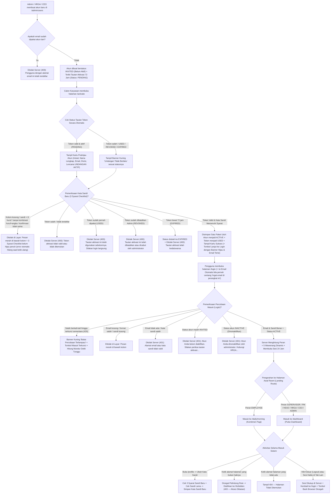
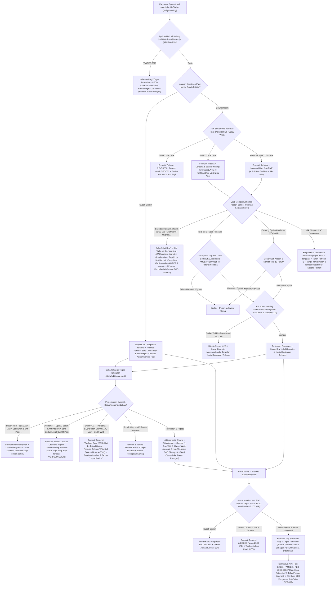
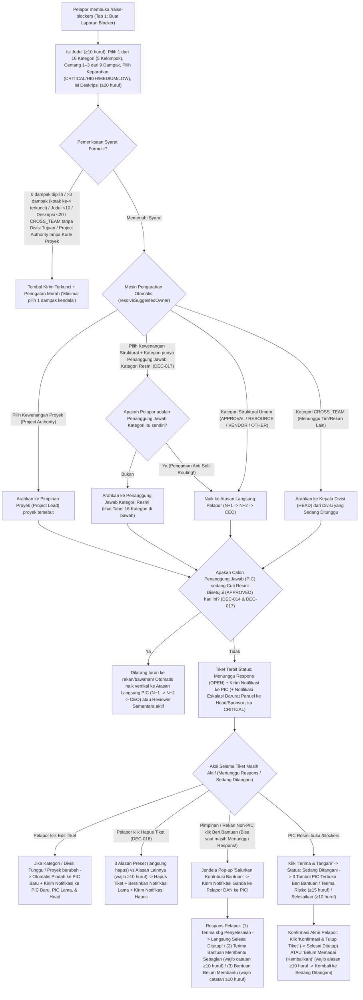
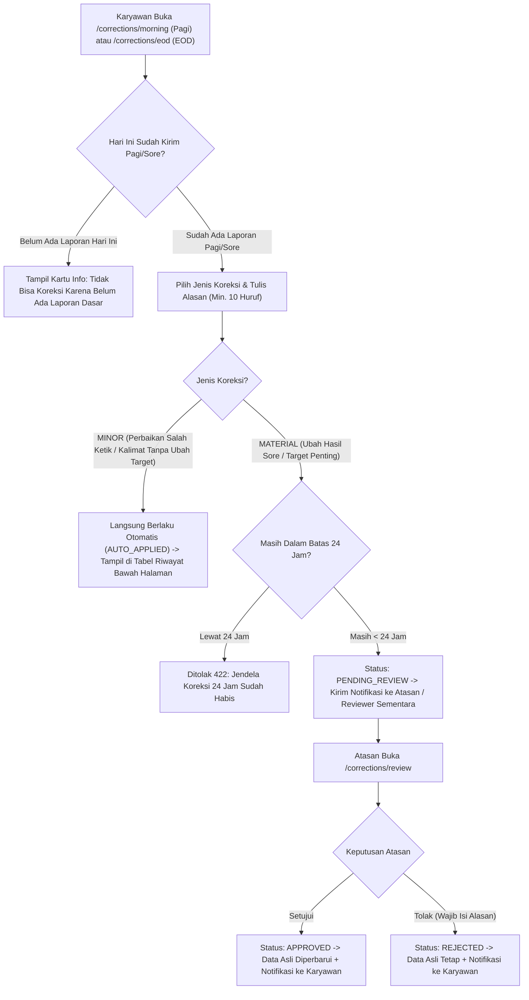
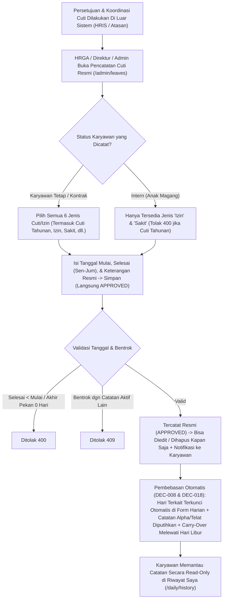
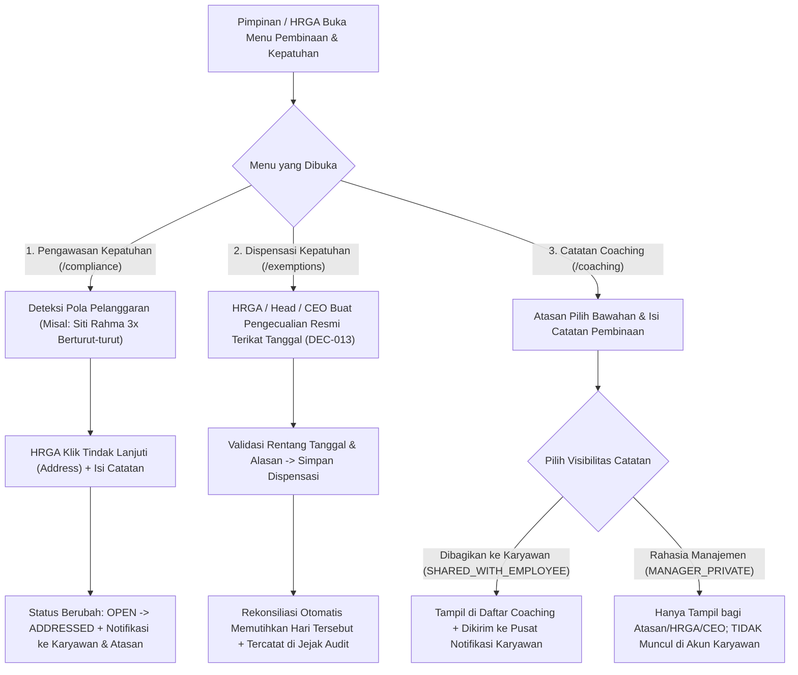
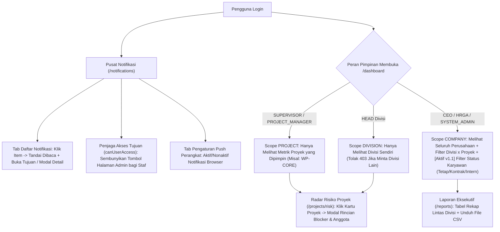
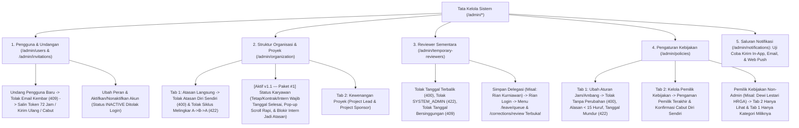

# Dokumen Induk 3-Lapisan: Peta Perjalanan Bercabang (E2E Journeys), Panduan Skenario Prosedural Lengkap (Aksi, Input & Hasil yang Diharapkan), serta Master Katalog Kondisi Sistem WorkPulse

> **Sistem:** WorkPulse — Sistem Pencatatan Komitmen Harian & Penanganan Kendala Kerja  
> **Organisasi:** PT Dutamedia Mandiri Pratama (Malang — WIB / UTC+7)  
> **Versi Dokumen:** `v1.3 — Edisi Sistem Live Pasca-UAT, Penyelarasan Penuh 26 Prototype HTML & 34 Bab Dokumen Baseline` (Seluruh **4 Paket Pasca-UAT + 25 Audit Prototype vs Live (26/26 halaman HTML) + Audit 34 Bab Dokumen Baseline (`PRD v1.0`)** sudah selesai diverifikasi 100% di `https://dutamedia-workpulse.vercel.app`)  
> **Pemilik Proyek:** Harry  
> **Dokumen Pendamping Wajib untuk Auditor & Penyusun User Manual:**
> - [Daftar-Perubahan-Pasca-UAT-4-Paket.md](file:///d:/PKL%20Duta%20Media/Dutamedia-WorkPulse/UAT/Daftar-Perubahan-Pasca-UAT-4-Paket.md) — Rincian perbedaan resmi **4 Paket Pasca-UAT** (*Dulu vs Sekarang di Live*) agar tidak dianggap kesalahan.
> - [Daftar-Perubahan-Audit-Prototype-vs-Live.md](file:///d:/PKL%20Duta%20Media/Dutamedia-WorkPulse/UAT/Daftar-Perubahan-Audit-Prototype-vs-Live.md) — Peta status audit **26 File Prototype HTML (`Audit #1` s/d `Audit #25` selesai 100%)** serta **Rangkuman Pemeriksaan 34 Bab Dokumen Baseline (`PRD_Dutamedia_Work_Pulse_v1.0.docx`) vs Sistem Live (`Bagian 3`)**.  
> *(Catatan Lokasi File Prototype HTML: Seluruh 26 file HTML yang diacu singkat `UI-UX-Design/...html` di bawah ini berada lengkap di folder `Dokumen-Perancangan-untuk-Pengerjaan-Baru/UI-UX-Design/`).*
> **4 Fungsi Utama Dokumen Ini:**
> 1. **Panduan Skenario Prosedural Mandiri dari A sampai Z:** Memandu siapa saja (penguji, teman auditor, maupun pengguna baru) untuk mencoba **seluruh kemampuan, halaman, jendela pop-up, dan aturan sistem** secara berurutan tanpa merusak/mengunci data lebih dulu, lengkap dengan **Aksi Klik/Ketik Siap Salin (*Copy-Paste*)** dan ***Hasil yang Diharapkan*** di setiap langkah.
> 2. **Dasar Langsung Pembuatan 2 Versi Buku Panduan (*User Manual*):**
>    - **Versi Stakeholder / Pimpinan (Lead, HRGA, Direktur, Penilai Proyek):** Menjelaskan tujuan bisnis, aturan wewenang, pagar pengaman anti-kecurangan, dan bukti pengawasan.
>    - **Versi Pengguna Umum (Seluruh Karyawan & Anak Magang):** Menjelaskan langkah pakai sehari-hari dan cara mengatasi setiap pesan kesalahan atau kondisi khusus.
> 3. **Acuan Utama Slide Presentasi & Skrip Demo Live:** Menunjukkan urutan demo terbaik beserta akun dan kalimat penjelasnya.
> 4. **Daftar Periksa (*Checklist*) Audit Tampilan 4 Ukuran Layar (`HP 375px`, `Tablet 768/1024px`, `Desktop 1440px`, `Layar Lebar 1920px`) & Perbandingan 26 File Prototype HTML / Dokumen Baseline.**

---

## 0. Daftar Lengkap 25 Akun Resmi Sistem (`Password123!`) & Peta Wewenang

Seluruh langkah di dokumen ini menggunakan **25 akun resmi** yang sudah disiapkan di database awal (`seed.ts`). Kata sandi awal untuk semua akun aktif adalah **`Password123!`**.
- **Komposisi Populasi Live di Dashboard & Laporan (`/dashboard` & `/reports`):** Dari 25 akun, terdapat **25 personil operasional terhitung** (*23 Karyawan Tetap + 0 Kontrak + 2 Anak Magang / Intern*). *(Akun `Fajar Ramadhan / calon.karyawan@dutamedia.com` tetap berada pada status akun belum diaktifkan `INVITED`, sementara seluruh akun yang memiliki penugasan organisasi aktif tercatat sebagai populasi laporan).*

| No | Nama Lengkap | Email Login | Peran Sistem & Status Akun | Divisi & Jabatan | Atasan Langsung | Wewenang Khusus yang Dimiliki |
|---|---|---|---|---|---|---|
| 1 | **Sistem Administrator** | `admin@dutamedia.com` | `SYSTEM_ADMIN` (`ACTIVE`) | Management — Infrastructure & System Administrator | — | Mengelola seluruh menu `Administration`. **Pemisahan Tugas (`IMP-026`):** Tidak punya menu kerja harian (`Workspace` diblokir `403`) dan tidak boleh ditunjuk menjadi peninjau cuti/koreksi. |
| 2 | **Hendra Wijaya** | `direktur@dutamedia.com` | `CEO_MANAGEMENT` (`ACTIVE`) | Management — Chief Executive Officer (CEO) | — | Memantau `Seluruh Perusahaan`, Pemilik Kebijakan di semua 5 kategori, pengelola daftar Pemilik Kebijakan, pencatat cuti/dispensasi resmi (`/admin/leaves`, `/exemptions`), tujuan akhir eskalasi. **Pemisahan Tugas Eksekutif (`DEC-019`):** Menu `Workspace` disembunyikan (`403` pada `/daily/*`, `/raise-blockers`, `/corrections/morning`, `/corrections/eod`) & mengakses notifikasi lewat lonceng TopBar (`/notifications`). |
| 3 | **Dewi Lestari** | `hrga@dutamedia.com` | `HRGA` (`ACTIVE`) | HRGA — HRGA & Corporate Legal Administration | Hendra Wijaya | Mengelola `Antrean Kepatuhan`, `Manajemen Dispensasi`, `Pencatatan Cuti Resmi` (`/admin/leaves`), `Kelola Pengguna`, `Struktur Organisasi`, `Reviewer Sementara`, penerima kategori **`LEGAL`** (via pengarahan divisi HRGA & Legal), dan Pemilik Kebijakan. |
| 4 | **Eko Prasetyo** | `ga@dutamedia.com` | `EMPLOYEE` (`ACTIVE`) | HRGA — General Affairs (GA) Officer | Dewi Lestari | Staf HRGA yang ditunjuk resmi sebagai **Penanggung Jawab Kategori `OFFICE_FACILITY` (Fasilitas & Sarana Kantor)** → otomatis bisa membuka menu `Antrean Blocker` (`/blockers`) & `Penuaan & Eskalasi` (`/blockers/aging`). |
| 5 | **Arif Budiman** | `head.eng@dutamedia.com` | `HEAD` (`ACTIVE`) | Engineering — Head of Engineering | Hendra Wijaya | Kepala Divisi Engineering (memantau tab `Divisi Saya`), Sponsor Proyek `WP-CORE`, menyetujui cuti & koreksi tim Engineering, membuat `Catatan Coaching` untuk bawahan langsungnya. |
| 6 | **Bambang Pratama** | `lead.tech@dutamedia.com` | `SUPERVISOR` (`ACTIVE`) | Engineering — Technical Lead 1 | Arif Budiman | Pimpinan Proyek **`WP-CORE`** & **`PRJ-CORE`**, serta **Penanggung Jawab Kategori `TECHNICAL` (Teknis & Kode Program)**. Memantau tab `Tim (Proyek)` di dasbor. |
| 7 | **Aditya Nugroho** | `dev.frontend@dutamedia.com` | `EMPLOYEE` (`ACTIVE`) | Engineering — Frontend Developer | Arif Budiman | Staf operasional murni (`Karyawan Tetap`) — tidak punya bawahan dan bukan penanggung jawab kategori → menu `Management` dan `Administration` tertutup & diblokir `403`. Di `seed.ts` sudah ditanam **data H-1 selesai + `Prioritas Kemarin Sore`** agar kotak referensi prioritas kemarin tetap tampil saat komitmen hari ini sudah terkunci (`SUBMITTED`). |
| 8 | **Siti Rahma** | `dev.backend@dutamedia.com` | `EMPLOYEE` (`ACTIVE`) | Engineering — Backend Developer | Arif Budiman | Staf operasional Engineering (memiliki data contoh pola tidak melapor 3x berturut-turut di `/compliance`). |
| 9 | **Fajar Ramadhan** | `calon.karyawan@dutamedia.com` | `EMPLOYEE` (`INVITED`) | Engineering — Junior Developer | Arif Budiman | Akun karyawan baru yang **belum aktif** (untuk menguji penolakan login `INVITED` dan aktivasi akun dengan token 72 jam `wp_seed_invite_token_72h_demo_secret`). |
| 10 | **Dharma Putra** | `head.delivery@dutamedia.com` | `HEAD` (`ACTIVE`) | Delivery — Head of Delivery | Hendra Wijaya | Kepala Divisi Delivery, menyetujui cuti/koreksi & coaching Divisi Delivery. |
| 11 | **Dimas Prakoso** | `pm@dutamedia.com` | `PROJECT_MANAGER` (`ACTIVE`) | Delivery — Project Manager | Dharma Putra | Manajer Proyek (`PRJ-PORTAL`, `PRJ-MOBILE`), memantau `/dashboard` & `/projects/risk` proyeknya; pada jalur Proyek menangani kendala proyek kategori `REQUIREMENT` / `CLIENT`. |
| 12 | **Bagas Saputra** | `product@dutamedia.com` | `EMPLOYEE` (`ACTIVE`) | Delivery — Product Manager | Dharma Putra | Staf Product Manager di bawah Head Delivery (formulir komitmen pagi hari ini **terbuka / belum disubmit**). Di `seed.ts` sudah ditanam rantai **`H-2 → H-1` lengkap** sehingga langsung menampilkan kotak **`Prioritas Kemarin Sore`** dan panel **`Draf Tugas Berlanjut dari Kemarin (2 Tersedia: Carry-Over #2 AMBER & Carry-Over #1 GREEN)`**. |
| 13 | **Nadia Kusuma** | `qa@dutamedia.com` | `EMPLOYEE` (`ACTIVE`) | Quality — Software QA Specialist | Dharma Putra | Staf QA (cocok dipakai untuk menguji pengiriman `0 Komitmen` dan simulasi penonaktifan akun `INACTIVE`). |
| 14 | **Gunawan Setiawan** | `head.ops@dutamedia.com` | `HEAD` (`ACTIVE`) | Operations & Infrastructure — Head of Ops & Infra | Hendra Wijaya | Kepala Divisi Operations & Infrastructure, tujuan pengarahan kendala lintas divisi (`CROSS_TEAM`) ke Ops & Infra, serta atasan langsung Reza/Gilang/Taufik. |
| 15 | **Rian Kurniawan** | `lead.creative@dutamedia.com` | `SUPERVISOR` (`ACTIVE`) | Operations & Infrastructure — Ops Supervisor | Gunawan Setiawan | Supervisor Ops & Infra (dipakai untuk menguji pendelegasian **Reviewer Sementara** lintas divisi). |
| 16 | **Reza Mahendra** | `network.infra@dutamedia.com` | `EMPLOYEE` (`ACTIVE`) | Operations & Infrastructure — Network & Infrastructure | Gunawan Setiawan | Staf spesialis yang ditunjuk resmi sebagai **Penanggung Jawab Kategori `INFRA` (Server & Rilis Sistem)** dan **`NETWORK` (Jaringan & Koneksi)** → punya akses `/blockers` & `/blockers/aging`. |
| 17 | **Gilang Ramadhan** | `specialist.it@dutamedia.com` | `EMPLOYEE` (`ACTIVE`) | Operations & Infrastructure — Specialist IT | Gunawan Setiawan | Staf spesialis yang ditunjuk resmi sebagai **Penanggung Jawab Kategori `HOSTING_DOMAIN` (Hosting, Cloud & Domain)** → punya akses `/blockers` & `/blockers/aging`. |
| 18 | **Taufik Hidayat** | `it.support@dutamedia.com` | `EMPLOYEE` (`ACTIVE`) | Operations & Infrastructure — IT Support | Gunawan Setiawan | Staf spesialis yang ditunjuk resmi sebagai **Penanggung Jawab Kategori `ACCESS_SECURITY` (Akses & Keamanan Digital)** dan **`WORK_DEVICE` (Perangkat Kerja)** → punya akses `/blockers` & `/blockers/aging`. |
| 19 | **Maya Putri** | `designer@dutamedia.com` | `EMPLOYEE` (`ACTIVE`) | R&D — Principal Engineer (R&D & Technical Advisory) | Hendra Wijaya | Staf R&D Advisory (melapor langsung ke Direktur; dipakai untuk menguji batas isolasi lintas divisi). |
| 20 | **Lukman Hakim** | `head.sales@dutamedia.com` | `HEAD` (`ACTIVE`) | Commercial — Head of Sales Enablement & Presales | Hendra Wijaya | Kepala Divisi Sales Enablement & Presales (atasan langsung Bayu Santoso). |
| 21 | **Bayu Santoso** | `sales.bd@dutamedia.com` | `EMPLOYEE` (`ACTIVE`) | Commercial — Business Development Executive | Lukman Hakim | Staf Sales & Business Development sekaligus **Penanggung Jawab Kategori `CLIENT`** (untuk kendala calon klien/penawaran jalur Struktural) → punya akses `/blockers` & `/blockers/aging`. |
| 22 | **Ratna Sari** | `finance@dutamedia.com` | `EMPLOYEE` (`ACTIVE`) | Finance — Senior Finance Staff | Hendra Wijaya | Penanggung jawab senior Divisi Finance (atasan langsung Intan Permata & Nisa Amelia; memiliki menu `Coaching` bagi bawahannya). |
| 23 | **Intan Permata** | `staff.finance@dutamedia.com` | `EMPLOYEE` (`ACTIVE`) | Finance — Finance & Invoicing Staff | Ratna Sari | Staf Finance berstatus **`Karyawan Tetap` (`PERMANENT`)** dan **Penanggung Jawab Kategori `FINANCE` (Keuangan & Pembayaran)** → punya akses `/blockers` & `/blockers/aging`. |
| 24 | **Raka Pratama** | `intern.frontend@dutamedia.com` | `EMPLOYEE` (`ACTIVE`) · **Status: `Intern`** | Engineering — Frontend Developer | Arif Budiman | **`[Aktif v1.1 — Paket #1]`** Akun **Karyawan Magang (`Intern`)** Divisi Engineering (masa magang 90 hari: `20 Nov 2026 s/d 18 Feb 2027`). Tidak punya kuota cuti tahunan (hanya Izin & Sakit) dan dikecualikan dari seluruh daftar atasan/PIC. Formulir pagi hari ini terbuka lengkap dengan data **H-1 (`Prioritas Kemarin Sore` + `1 Tersedia Carry-Over #1`)**. |
| 25 | **Nisa Amelia** | `intern.finance@dutamedia.com` | `EMPLOYEE` (`ACTIVE`) · **Status: `Intern`** | Finance — Finance Staff | Ratna Sari | **`[Aktif v1.1 — Paket #1]`** Akun **Karyawan Magang (`Intern`)** Divisi Finance (masa magang 90 hari: `20 Nov 2026 s/d 18 Feb 2027`). Dipakai menguji isolasi `Intern` dan pelaporan kerja magang lintas divisi. |

---

### 0.B. Peta Wewenang Dinamis & Peran Ganda (*Mengapa Dua Akun dengan Peran Dasar yang Sama Bisa Melihat Menu Berbeda*)

Di WorkPulse, menu yang tampil di bilah samping kiri (*sidebar*) dan hak akses halaman tidak hanya ditentukan oleh **1 peran dasar** (`EMPLOYEE`, `SUPERVISOR`, `PROJECT_MANAGER`, `HEAD`, `HRGA`, `CEO_MANAGEMENT`, `SYSTEM_ADMIN`), melainkan juga oleh **5 penanda wewenang dinamis** yang dihitung otomatis oleh server saat pengguna masuk (`/v1/auth/me`) serta **status karyawan** (`Karyawan Tetap`, `Kontrak`, `Intern`). Bagian ini wajib dijelaskan di kedua versi Buku Panduan Pengguna (*User Manual*) agar pengguna tidak bingung:

| No | Penanda Wewenang / Status | Siapa yang Memilikinya (Contoh Nyata di Sistem) | Menu / Hak Tambahan yang Otomatis Terbuka | Apa yang Terjadi Saat Masa Tugas Berakhir / Dicabut? |
|---|---|---|---|---|
| 1 | **Memiliki Bawahan Langsung Aktif (`hasSubordinates = true`)** | Semua `HEAD`, `CEO`, `SUPERVISOR` yang punya bawahan, **serta staf senior berstatus `EMPLOYEE` yang membawahi staf lain** (contoh nyata: **Ratna Sari — `finance@dutamedia.com`**, peran dasar `EMPLOYEE` tetapi atasan langsung Intan & Nisa). | Membuka menu **`Catatan Coaching` (`/coaching`)** untuk membina bawahan langsung/berjenjangnya. | Jika tidak lagi memiliki bawahan aktif di `/admin/organization`, menu `/coaching` otomatis disembunyikan. |
| 2 | **Pimpinan Proyek Aktif (`isProjectLead = true`)** | Siapa pun yang tercatat aktif sebagai *Project Manager / Project Lead* di `/admin/organization` Tab 2 (contoh: **Bambang Pratama — `lead.tech@dutamedia.com`** pada `WP-CORE` & `PRJ-CORE`; **Dimas Prakoso — `pm@dutamedia.com`** pada `PRJ-PORTAL` & `PRJ-MOBILE`). | Membuka menu **`Pulse Dashboard` (`/dashboard` — ruang lingkup Proyek)**, **`Radar Risiko Proyek` (`/projects/risk`)**, **`Antrean Blocker` (`/blockers`)**, dan **`Penuaan & Eskalasi` (`/blockers/aging`)**. | Begitu Admin mengeklik **`Tutup Wewenang`** pada proyek tersebut di `/admin/organization` Tab 2, proyek berhenti menjadi proyek aktif dan wewenang proyeknya otomatis berakhir. |
| 3 | **Penanggung Jawab Kategori Kendala Resmi (`isCategoryOwner = true` — `DEC-017`)** | Staf spesialis berstatus `EMPLOYEE` yang ditunjuk resmi menangani kategori kendala tertentu (contoh: **Reza** untuk `INFRA` & `NETWORK`, **Gilang Ramadhan** untuk `HOSTING_DOMAIN`, **Taufik** untuk `ACCESS_SECURITY` & `WORK_DEVICE`, **Eko** untuk `OFFICE_FACILITY`, **Intan** untuk `FINANCE`, **Bayu Santoso** untuk `CLIENT`, serta **Bambang** untuk `TECHNICAL`). | Meskipun peran dasarnya **`EMPLOYEE`** (sehingga tidak melihat menu Dasbor/Coaching/Laporan), sistem **otomatis membuka menu `Antrean Blocker` (`/blockers`) dan `Penuaan & Eskalasi` (`/blockers/aging`)** agar mereka bisa menerima (`Terima & Tangani`) dan menyelesaikan tiket bidangnya. | Jika sedang **Cuti Resmi (`APPROVED`)**, tiket baru otomatis naik vertikal ke atasan langsungnya (`DEC-014` & `DEC-017`). |
| 4 | **Reviewer Sementara Aktif (`isTemporaryReviewer = true` — `DEC-009`)** | Pejabat/rekan non-Admin dan non-Intern yang sedang didelegasikan aktif hari ini di `/admin/temporary-reviewers` (contoh: **Rian Kurniawan — `lead.creative@dutamedia.com`** saat menggantikan Gunawan Setiawan). | Selama tanggal delegasi sedang berlaku (`Aktif`), sistem **otomatis membuka menu `Review Koreksi` (`/corrections/review`), `Antrean Blocker` (`/blockers`), dan `Penuaan & Eskalasi` (`/blockers/aging`)** untuk divisi pejabat yang digantikan. | Begitu melewati tanggal berakhir atau diklik **`Cabut`** oleh Admin, menu peninjauan tersebut otomatis tertutup kembali di akun penerima delegasi. |
| 5 | **Pemilik Kebijakan Resmi (`isPolicyOwner = true` — `BR-15` / `FR-34`)** | `CEO_MANAGEMENT`, `SYSTEM_ADMIN`, serta pejabat non-Admin yang ditetapkan aktif di Seksi 7 `/admin/policies` (contoh: **Dewi Lestari — `hrga@dutamedia.com`** dan **Dharma Putra — `head.delivery@dutamedia.com`** pada kategori kebijakan tertentu). | Membuka menu **`Kebijakan & Cut-off` (`/admin/policies`)**. Khusus Pemilik Kebijakan non-Admin/non-CEO, mereka hanya dapat mengubah nilai pada **kategori kebijakan yang menjadi wewenangnya**, sedangkan kategori lain bertanda `[Terkunci: Bukan Pemilik]` dan tabel Seksi 7 hanya-lihat (`Hanya Lihat (Direktur/Admin)`). | Jika dicabut dari seluruh kategori di Seksi 7 `/admin/policies` (dengan syarat bukan pemilik terakhir), akses ke `/admin/policies` otomatis tertutup (`403`). |
| 6 | **Status Karyawan Magang (`employmentStatus = INTERN` — `Paket #1` & `DEC-018`)** | **Raka Pratama (`intern.frontend@dutamedia.com`)** dan **Nisa Amelia (`intern.finance@dutamedia.com`)**. | Wajib mengisi komitmen pagi, tugas tambahan, evaluasi sore, dan bisa melapor kendala seperti karyawan biasa. Catatan izin/sakit resminya dicatatkan oleh HRGA/Admin/Direktur di `/admin/leaves` (hanya jenis **`Izin (Keperluan Mendesak / Alasan Logis)`** & **`Sakit`**, tanpa hak **`Cuti Tahunan`**, dan dapat dilihat read-only di **`Riwayat Saya`** `/daily/history`), serta namanya **otomatis dikecualikan dari 7 daftar pilihan atasan/penanggung jawab** di seluruh sistem. | Jika lulus magang dan diangkat menjadi **`Karyawan Tetap` (`PERMANENT`)** lewat `+ Atur Penugasan Baru` di `/admin/organization`, hak pencatatan cuti tahunan dan pilihan jabatan otomatis terbuka sejak tanggal efektif baru tanpa merusak riwayat masa magangnya. |
| 7 | **Pemisahan Tugas Non-Operasional & Notifikasi Hybrid (`SYSTEM_ADMIN` & `CEO_MANAGEMENT` — `IMP-026` & `DEC-019`)** | **Sistem Administrator (`admin@dutamedia.com`)** dan **Direktur / CEO (`direktur@dutamedia.com`)**. | Mengelola fungsi tata kelola/strategis (`Management` / `Administration`), namun **seluruh menu kerja harian `Workspace` (`/daily/*`, `/raise-blockers`, `/corrections/morning`, `/corrections/eod`) disembunyikan dari sidebar dan diblokir (`403`)**, serta tidak ditagih mengisi laporan harian agar metrik kepatuhan murni berisi personel operasional. Keduanya tetap mengakses `/notifications` & `/profile` lewat ikon lonceng & avatar TopBar (**Pola Hybrid `DEC-019`**), sementara peran operasional tetap memiliki keduanya (sidebar `Workspace` + lonceng TopBar). | Berlaku permanen sebagai pagar pengaman pemisahan tugas (*Separation of Duties*). |

---

### 0.C. Katalog Terpadu 50 Cerita Pengguna (*User Stories* `US-01` s/d `US-50`: 31 Cerita Asli Perancangan + 19 Cerita Baru Pasca-UAT & Audit)

Tabel di bawah ini merangkum **seluruh 50 cerita pengguna (*User Stories*)** dari sudut pandang pemakai nyata di PT Dutamedia Mandiri Pratama, lengkap dengan pemetaannya ke skenario di dokumen ini agar **Buku Panduan Pengguna Versi Karyawan** dan **Buku Panduan Pengguna Versi Pimpinan** tidak memiliki satu pun celah:

#### Kelompok A — Cerita Pengguna Karyawan Operasional & Anak Magang (`Workspace`)
| Kode | Peran Pemakai | Cerita Pengguna (*Sebagai ..., saya ingin ..., agar ...*) | Lokasi Halaman | Acuan Skenario di Dokumen Induk |
|---|---|---|---|---|
| **US-01** | Karyawan & Intern | Mengisi 1–3 Komitmen Pagi beserta tingkat risikonya (`GREEN`/`AMBER`/`RED`), atau memilih `0 Komitmen` dengan alasan resmi minimal 10 huruf jika seharian penuh pelatihan/audit, agar rencana harian tercatat jujur tanpa mengarang tugas palsu. | `/daily/morning` | `SP-02.1` (Langkah 2.1.1–2.1.5) |
| **US-02** | Karyawan & Intern | Mencatat Pekerjaan Tambahan (*Additional Work*, maksimal 5 tugas/hari) yang muncul mendadak di siang hari beserta alasan dan pemberi tugasnya tanpa mengubah 1–3 komitmen pagi yang sudah terkunci. | `/daily/additional-work` | `SP-02.2` (Langkah 2.2.2) |
| **US-03** | Karyawan & Intern | Mengisi Evaluasi Sore (*EOD Outcome*: `Selesai`, `Selesai Sebagian`, `Belum Selesai`, `Dibatalkan`) dan status kelanjutan (`Lanjutkan Besok` / `Tidak Dilanjutkan`) untuk setiap komitmen pagi maupun pekerjaan tambahan, serta memilih status akhir hari (`GREEN`/`AMBER`/`RED`) dengan hak pilih `GREEN` yang tidak pernah dikunci (`DEC-003`). | `/daily/eod` | `SP-02.3` (Langkah 2.3.1–2.3.2) |
| **US-04** | Seluruh Peran Operasional | Melaporkan tiket kendala (*Blocker*) kapan saja 24 jam (memilih 1 dari 16 kategori dalam 5 kelompok dan mencentang 1–3 dari 9 dampak) tanpa harus menunggu jam evaluasi sore. | `/raise-blockers` | `SP-03.1` (Langkah 3.1.1–3.1.4) |
| **US-05** | Karyawan & Intern | Menerima pengingat otomatis tepat 60 menit sebelum batas waktu tepat waktu pagi dan sore melalui Pusat Notifikasi, Email, dan Browser Push perangkat yang sudah diizinkan. | `/notifications`, `/profile` | `SP-01.3` (Panel 3), `SP-07.1` |
| **US-06** | Karyawan & Intern | Melihat tabel riwayat harian pribadi (`Riwayat Saya`), membuka rincian evaluasi per tanggal, menyaring rentang tanggal, dan mengunduh arsip `.csv` milik sendiri. | `/daily/history` | `SP-02.3` (Langkah 2.3.3) |
| **US-07** | Karyawan & Intern | Melihat daftar `Draf Tugas Berlanjut dari Kemarin` (semua komitmen kemarin yang ditandai `Lanjutkan Besok`) lengkap dengan penanda `Carry-Over #2+ Disarankan AMBER`, lalu menyalinnya per item atau mencentang beberapa sekaligus ke slot hari ini (disertai pengisian otomatis potensi kendala dari catatan evaluasi kemarin). | `/daily/morning` | `SP-02.1` (Langkah 2.1.3) |
| **US-25** | Karyawan & Intern | Mengajukan Koreksi Komitmen Pagi (`/corrections/morning`) setelah formulir pagi terkunci — baik `Perubahan Minor` (salah ketik/tautan, langsung berlaku otomatis `AUTO_APPLIED`) maupun `Perubahan Material` (ubah target/risiko, masuk antrean peninjauan atasan dengan jendela sanggahan 24 jam). | `/corrections/morning` | `SP-04.1` (Langkah 1–3) |
| **US-26** | Karyawan Tetap/Kontrak | Mengajukan Cuti Tahunan (jatah 12 hari kerja/tahun, hanya menghitung hari kerja Senin–Jumat), Sakit, atau Cuti Khusus di `/leave/my`, melihat peringatan dini jika melebihi sisa kuota, membatalkan mandiri (`Batalkan`) selama masih `Menunggu Review`, dan otomatis bebas dari catatan mangkir begitu disetujui (`DEC-008`). | `/leave/my` | `SP-05.1` (Langkah 1–6) |
| **US-28** | Karyawan & Intern | Menuliskan catatan opsional `Prioritas Utama Besok` saat mengisi Evaluasi Sore, dan tetap melihatnya sebagai spanduk rujukan `Prioritas Kemarin Sore` di halaman Komitmen Pagi keesokan harinya (baik sebelum maupun sesudah komitmen pagi dikirim). | `/daily/eod`, `/daily/morning` | `SP-02.1` (Langkah 2.1.3), `SP-02.3` |
| **US-29** | Karyawan & Intern | Mengajukan Koreksi Evaluasi Sore (`/corrections/eod`) secara terpisah untuk laporan sore yang sudah terkunci (mengubah hasil capaian, kelanjutan tugas, atau keterangan hasil) dengan alasan resmi minimal 10 huruf. | `/corrections/eod` | `SP-04.1` (Langkah 4) |
| **US-30** | Pelapor Kendala | Memeriksa solusi atau rencana mitigasi risiko yang dikirim PIC pada tiket kendala saya, lalu memilih **`Konfirmasi & Tutup Tiket`** (atau **`Setujui Mitigasi & Tutup Tiket`**) jika sudah beres, atau memilih **`Belum Memadai (Kembalikan)`** dengan alasan minimal 10 huruf jika kendala masih terjadi. | `/raise-blockers?tab=mine`, `/blockers` | `SP-03.1` (Langkah 3.1.6), `SP-03.4` |
| **US-31** | Calon Karyawan (`INVITED`) | Mengaktifkan akun baru melalui tautan undangan sekali pakai 72 jam (`/activate`), memeriksa Kartu Pratinjau Akun milik saya, dan menetapkan kata sandi pribadi yang memenuhi 3 syarat keamanan tanpa perlu berbagi kata sandi lewat pesan singkat. | `/activate`, `/login` | `SP-01.2` (Langkah 1.2.1–1.2.3) |
| **US-32** *(Baru)* | Karyawan & Intern | Menyimpan ketikan sementara komitmen pagi lewat tombol **`Simpan Draf`** (`localStorage` per akun & tanggal kerja) agar aman saat halaman dimuat ulang (`F5`), serta melihat contoh kalimat panduan otomatis (*placeholder*) yang sesuai dengan divisi kerja saya (10 divisi resmi). | `/daily/morning` | `SP-02.1` (Langkah 2.1.3 & Tabel 10 Divisi) |
| **US-33** *(Baru)* | Karyawan & Intern | Membedakan dengan tepat kapan menggunakan tombol **`Pilih Blocker Aktif`** (saat tugas saya hari ini adalah *membereskan* tiket kendala tersebut) vs dropdown **`Tiket Blocker Penyebab`** (saat tugas saya hari ini *terhambat* oleh tiket kendala tersebut), serta kapan cukup memilih `AMBER`/`RED` tanpa membuat tiket blocker baru. | `/daily/morning`, `/raise-blockers` | `Bagian 3.A.2` (Panduan 7 Situasi Nyata) |
| **US-34** *(Baru)* | Karyawan & Intern | Tetap dapat mencatat Pekerjaan Tambahan siang hari dan Evaluasi Sore meskipun pagi harinya lupa mengisi Komitmen Pagi hingga melewati jam batas kunci pagi (**Opsi A — alasan otomatis `Komitmen Pagi Terlewat`**), serta memahami bahwa setelah Evaluasi Sore dikirim maka formulir Pekerjaan Tambahan ikut terkunci otomatis (`Terkunci Pasca-EOD`). | `/daily/additional-work`, `/daily/eod` | `SP-02.2` (Langkah 2.2.1), `SP-02.3` |
| **US-35** *(Baru)* | Karyawan & Intern | Mengubah (`Edit`) atau menghapus (`Hapus` dengan alasan wajib minimal 5 huruf) kartu Pekerjaan Tambahan yang salah ketik selama Evaluasi Sore belum ditutup, dengan transparansi penuh di mana atasan pemberi tugas otomatis menerima notifikasi jika tugas pemberiannya diubah atau dihapus. | `/daily/additional-work`, `/notifications` | `SP-02.2` (Langkah 2.2.3) |
| **US-36** *(Baru)* | Pelapor Kendala | Mengubah isi tiket kendala yang masih aktif (`Edit Tiket` — termasuk otomatis memindahkan penanggung jawab / *Dynamic Re-Routing* bila kategori, proyek, atau divisi yang ditunggu berubah), menghapus tiket yang salah lapor/sudah teratasi mandiri (`Hapus Tiket` dengan 3 alasan cepat atau `Alasan Lainnya` minimal 10 huruf), serta menanggapi setiap bantuan bertahap dengan 3 pilihan (`Terima sbg Penyelesaian`, `Membantu Sebagian`, atau `Belum Membantu`). | `/raise-blockers?tab=mine` | `SP-03.1` (Langkah 3.1.6), `SP-03.2`, `SP-03.3` |
| **US-37** *(Baru)* | Karyawan & Intern | Menggunakan tombol **`Gunakan Draf Sebelumnya & Sesuaikan`** setelah permohonan koreksi material saya ditolak atasan (`REJECTED`), sehingga saya bisa langsung memperbaiki usulan koreksi berdasarkan `Catatan Peninjau` tanpa mengetik ulang dari nol. | `/corrections/morning`, `/corrections/eod` | `SP-04.1` (Langkah 6–7) |
| **US-38** *(Baru)* | Anak Magang (`Intern`) | Mengajukan **`Izin (Keperluan Mendesak / Alasan Logis)`** atau **`Sakit`** pada tampilan khusus Karyawan Magang di `/leave/my` (tanpa kartu kuota cuti tahunan 12 hari) dan melihat masa berakhir magang saya secara jelas di `/profile`. | `/leave/my`, `/profile` | `SP-01.3`, `SP-05.1` (Langkah 7) |
| **US-39** *(Baru)* | Seluruh Pengguna | Mengelola keamanan akun mandiri: mencentang `Ingat email di perangkat ini` saat masuk, memahami hitung mundur kunci sementara (`429`) jika 5 kali salah sandi, memperbarui kata sandi mandiri di `/profile` sambil mencabut seluruh sesi perangkat lain, atau menghubungi Admin/HRGA jika lupa kata sandi. | `/login`, `/profile` | `SP-01.1`, `SP-01.3` |

#### Kelompok B — Cerita Pengguna Staf Spesialis, Pimpinan Proyek, Kepala Divisi, HRGA, Direktur, & Admin (`Management & Administration`)
| Kode | Peran Pemakai | Cerita Pengguna (*Sebagai ..., saya ingin ..., agar ...*) | Lokasi Halaman | Acuan Skenario di Dokumen Induk |
|---|---|---|---|---|
| **US-08** | Supervisor / Tech Lead | Memantau kepatuhan dan hambatan tim proyek saya dalam satu layar `Pulse Dashboard` (`Scope: PROJECT`) tanpa harus menagih laporan manual satu per satu. | `/dashboard` | `SP-07.2` (Langkah 1) |
| **US-09** | PIC Kendala (Atasan / Lead / Spesialis) | Menerima tiket kendala yang ditugaskan kepada saya melalui tombol **`Terima & Tangani`** (`Sedang Ditangani`), lalu mencatat bantuan bertahap (`Beri Bantuan`), mengajukan **`Terima Risiko`** (minimal 15 huruf), atau mengirim solusi (`Selesaikan`, minimal 10 huruf). | `/blockers` | `SP-03.1` (Langkah 3.1.5–3.1.6), `SP-03.4` |
| **US-10** | Pimpinan / Rekan Non-PIC | Menyalurkan kontribusi bantuan (`Salurkan Kontribusi Bantuan`) pada tiket kendala rekan atau anggota tim — bahkan saat tiket masih berstatus `Menunggu Respons` — sehingga pelapor dan PIC sama-sama terbantu dan kontribusi saya tercatat di `Feed Dukungan Lintas Fungsi` dasbor. | `/blockers`, `/dashboard` | `SP-03.2` (Langkah 3.2.2–3.2.3), `SP-07.2` |
| **US-11** | Kepala Divisi (`HEAD`) | Memantau seluruh kondisi anggota divisi saya (`Belum Mengisi Komitmen`, `Komitmen Waspada AMBER`, `Komitmen Kritis RED`, `Blocker Belum Direspon`) pada `Pulse Dashboard` yang terkunci aman khusus divisi saya (`Scope: DIVISION`). | `/dashboard` | `SP-07.2` (Langkah 2) |
| **US-12** | Kepala Divisi / Pimpinan | Menerima pengalihan tiket kendala lintas divisi (`CROSS_TEAM`) atau eskalasi paralel darurat (`CRITICAL`), serta menekan tombol **`Bantu Unblock`** langsung dari kartu `Personil Butuh Bantuan Hari Ini` di `/dashboard` untuk mempercepat penyelesaian hambatan. | `/dashboard`, `/blockers` | `SP-03.2`, `SP-03.3`, `SP-07.2` |
| **US-13** | Atasan (`HEAD` / `SUPERVISOR` / Atasan Langsung) | Membuat catatan pembinaan, apresiasi, atau evaluasi (`Catatan Coaching`) untuk bawahan saya — baik menggunakan tombol template cepat maupun ketikan khusus — dengan memilih mode **`Dibagikan ke Karyawan`** (dikirim ke notifikasi karyawan) atau **`Rahasia Manajemen`** (terisolasi hanya untuk pimpinan/HRGA). | `/coaching`, `/notifications` | `SP-06.1` (Langkah 4–5) |
| **US-14** | Admin / HRGA / Direktur & Penerima Delegasi | Mendelegasikan wewenang atasan yang sedang cuti/dinas luar kepada **Reviewer Sementara** (`/admin/temporary-reviewers`) pada rentang tanggal efektif tertentu, mengubah atau mencabut delegasi, serta bagi penerima delegasi langsung mendapatkan akses menu `/leave/queue`, `/corrections/review`, dan `/blockers` selama masa tugasnya. | `/admin/temporary-reviewers`, `/leave/queue`, `/corrections/review`, `/blockers` | `SP-08.2` (Langkah 1–4) |
| **US-15** | Project Manager (`PM`) | Memantau skor kesehatan dan tingkat risiko seluruh proyek yang saya pimpin di `Radar Risiko Proyek` (`/projects/risk`), serta membuka jendela `Rincian Risiko Proyek` untuk melihat kendala utama dan komitmen aktif proyek. | `/projects/risk` | `SP-07.2` (Langkah 1 & 3) |
| **US-16** | Project Manager (`PM`) | Menerima tiket kendala yang menggunakan jalur `Project Authority (Kewenangan Proyek)` pada proyek yang saya pimpin meskipun pelapor berasal dari divisi lain. | `/raise-blockers`, `/blockers` | `SP-03.2` (Langkah 3.2.1–3.2.3) |
| **US-17** | HRGA / Kepala Divisi / Direktur | Memantau daftar ketidakpatuhan harian (`Tidak Check-in` & `Pola Terlambat 3x`) di `/compliance`, mencatat tindakan pembinaan (`Tindak Lanjut` minimal 5 huruf), serta memperbarui catatan yang sudah ditangani melalui tombol **`Ubah Catatan`**. | `/compliance` | `SP-06.1` (Langkah 2) |
| **US-18** | HRGA / Kepala Divisi / Direktur | Mendaftarkan dispensasi resmi terikat rentang tanggal (`Dinas Luar`, `Sakit Mendadak`, `Gangguan Infrastruktur`, dll.) di `/exemptions` agar hari kerja karyawan terkait otomatis diputihkan menjadi `EXEMPT` dan penerima dispensasi mendapat notifikasi resmi. | `/exemptions`, `/compliance` | `SP-06.1` (Langkah 3) |
| **US-19** | HRGA / Kepala Divisi / Direktur | Menjaga kerahasiaan catatan pembinaan berstatus `Rahasia Manajemen` (`MANAGER_PRIVATE`) di `/coaching` agar hanya dapat dilihat oleh manajemen berwenang dan tidak pernah bocor ke pusat notifikasi karyawan. | `/coaching`, `/notifications` | `SP-06.1` (Langkah 4–5) |
| **US-20** | Direktur (`CEO`) / HRGA / Kepala Divisi | Melihat tren kepatuhan lintas unit kerja (`Hari Ini`, `Pekan Ini`, `Bulan Ini`, `Kuartal Ini`), menyaring berdasarkan **Divisi** dan **Status Karyawan** (`Karyawan Tetap`, `Kontrak`, `Intern`), serta mengunduh **`Laporan Eksekutif (CSV)`** atau **`Cetak / PDF`** tanpa pemeringkatan individu (*non-punitive*). | `/reports`, `/dashboard` | `SP-07.2` (Langkah 3) |
| **US-21** | Direktur / Pimpinan / Staf Kategori | Memantau seluruh tiket kendala yang menua atau melewati batas waktu penanganan di halaman `Penuaan & Eskalasi` (`/blockers/aging`), menyaring khusus tiket `Hanya Lewat Batas Waktu` atau tingkat `Kritis`, dan menekan **`Buka`** untuk langsung melompat ke tiket terkait di `/blockers`. | `/blockers/aging`, `/blockers` | `SP-03.5` (Langkah 3.5.1) |
| **US-22** | Direktur / Admin Sistem | Mengatur parameter kebijakan operasional (jam batas pagi & sore, target waktu respon kendala, ambang carry-over, batas hari pengajuan koreksi, dan menit pengingat) di `/admin/policies` melalui penerbitan versi baru без mengubah kode program. | `/admin/policies` | `SP-08.3` (Langkah 1) |
| **US-23** | Pemilik Kebijakan (`isPolicyOwner`) | Menerbitkan versi kebijakan baru pada kategori yang menjadi wewenang saya dengan alasan minimal 15 huruf dan tanggal mulai berlaku hari ini/masa depan (*anti-backdating*), sambil melihat seluruh riwayat perubahan dan mengunduh CSV di `Jejak Audit Perubahan Kebijakan`. | `/admin/policies` | `SP-08.3` (Langkah 1 & 3) |
| **US-24** | Admin Sistem / HRGA / Direktur | Mengelola struktur penugasan organisasi (mutasi divisi, ganti atasan langsung, pengangkatan `Intern` menjadi `Karyawan Tetap`) dan kewenangan proyek (`+ Tetapkan Kewenangan Proyek` & `Tutup Wewenang`) di `/admin/organization` dengan tanggal efektif baru tanpa merusak catatan sejarah masa lalu serta dicegah dari siklus atasan melingkar (`A → B → A`). | `/admin/organization` | `SP-08.1` (Langkah 2–4) |
| **US-27** | Peninjau Koreksi (`HEAD` / `CEO` / `Reviewer Sementara`) | Meninjau permohonan koreksi material pagi dan sore di `/corrections/review` melalui kotak perbandingan terstruktur (`Sebelum:` vs `Diajukan:`), lalu menyetujui (`Setujui`) atau menolak (`Tolak`) dengan catatan peninjau wajib minimal 5 karakter. | `/corrections/review` | `SP-04.1` (Langkah 6) |
| **US-40** *(Baru)* | Staf Spesialis Penanggung Jawab Kategori (`isCategoryOwner`) | Sebagai staf berstatus `EMPLOYEE` yang ditunjuk resmi menjadi Penanggung Jawab Kategori (seperti `Reza`, `Gilang`, `Taufik`, `Eko`, `Intan`, `Bayu Santoso`), saya otomatis memperoleh akses menu `/blockers` dan `/blockers/aging` untuk menangani tiket bidang keahlian saya; jika saya sendiri yang melapor atau sedang cuti resmi, sistem otomatis mengalihkan tiket ke atasan langsung saya (*Anti-Self-Routing* & *Fallback Cuti Vertikal*). | `/raise-blockers`, `/blockers`, `/blockers/aging` | `SP-03.4` (Langkah 3.4.1), `SP-03.5` (Langkah 3.5.1–3.5.2) |
| **US-41** *(Baru)* | Penyetuju Cuti (`HEAD` / `CEO` / `Reviewer Sementara`) | Meninjau permohonan cuti karyawan tetap/kontrak maupun permohonan `Izin / Sakit` anak magang (`Intern` berpil ungu) di `/leave/queue` dengan hitungan akurat hari kerja Senin–Jumat, menyetujui atau menolak (wajib alasan minimal 5 huruf), serta melihat siapa yang memutuskan dan waktu keputusannya dalam WIB. | `/leave/queue` | `SP-05.1` (Langkah 5 & 7) |
| **US-42** *(Baru)* | Admin Sistem / HRGA / Direktur | Mengundang pengguna baru (`/admin/users`), mengatur status `Intern` (otomatis mengunci peran `Karyawan` dan mewajibkan `Tanggal Selesai Magang`), menyalin tautan aktivasi 72 jam, menerbitkan tautan baru lewat **`Kirim Ulang`** atau membatalkan lewat **`Cabut`** di `/admin/invitations`, serta menonaktifkan akun karyawan yang keluar (`Nonaktifkan` mencabut seluruh sesi aktif seketika) dengan perlindungan anti-nonaktif akun sendiri (`Akun Anda`). | `/admin/users`, `/admin/invitations` | `SP-08.1` (Langkah 1) |
| **US-43** *(Baru)* | Direktur / Admin Sistem | Mengelola daftar pejabat **Pemilik Kebijakan (Multi-Owner PIC)** di Seksi 7 `/admin/policies` (`Tetapkan Pemilik`, `Ubah` dengan menjaga tanggal mulai lama, dan `Cabut`), dilengkapi pengaman yang melarang pencabutan pemilik terakhir pada suatu kategori serta kotak konfirmasi ekstra saat mencabut wewenang diri sendiri. | `/admin/policies` | `SP-08.3` (Langkah 2) |
| **US-44** *(Baru)* | Admin Sistem / HRGA / Direktur | Memantau kesiapan nyata 3 saluran pengiriman notifikasi (`In-App`, `Email Transaksional Brevo`, `Browser Push VAPID` — menampilkan status jujur `Aktif` vs `Mode Simulasi Aktif`), memeriksa tabel matriks **9 Pemicu Resmi** beserta 4 tab penyaringnya, dan menjalankan uji coba pengiriman langsung ke tabel `Log Pengiriman Uji Coba Terbaru` di `/admin/notifications`. | `/admin/notifications` | `SP-08.3` (Langkah 4) |
| **US-45** *(Baru)* | Seluruh Pengguna | Membaca Pusat Notifikasi (`/notifications`) yang dilengkapi pengaman akses tujuan (`canUserAccess`) — di mana notifikasi informasi dari halaman khusus Admin/Pimpinan (seperti pengumuman perubahan kebijakan atau catatan pembinaan) tetap menampilkan isi lengkapnya kepada staf, namun menyembunyikan tombol menuju halaman Admin agar staf tidak pernah tersesat ke layar `403`. | `/notifications` | `SP-07.1` (Langkah 1) |

*(Catatan Penomoran: `US-01` s/d `US-31` mengikuti penomoran asli `02-PRD.md`, sedangkan `US-32` s/d `US-45` beserta 5 sub-skenario siklus hidup organisasi di `SP-08.1` menggenapkan seluruh 50 skenario kebutuhan pengguna dari awal perancangan hingga kondisi sistem live v1.3 saat ini).*

---

# BAGIAN I — SIKLUS AKUN, KEAMANAN AKSES, & AKUNTABILITAS HARIAN

---

## JOURNEY 1: Siklus Akun, Undangan 72 Jam, Login, Profil, Sesi, & Proteksi Rute (403/404)

### 1.A. Lapisan 1 — Peta Alur Bercabang & Intisari User Manual / Demo (Journey 1)

#### Intisari untuk *User Manual* & *Skrip Demo Presentasi* (Journey 1)
- **Untuk Panduan Pengguna Umum (*User Manual Karyawan*):**
  - **Cara Mengaktifkan Akun Baru:** Buka tautan aktivasi dari Admin/HRGA sebelum 72 jam habis, buat kata sandi minimal 8 karakter (wajib gabungan huruf dan angka). Setelah aktif, tautan tersebut otomatis hangus dan tidak bisa dipakai lagi.
  - **Jika Gagal Masuk (*Login*):** Periksa pesan di kotak merah atas formulir — sistem memberi tahu dengan jelas apakah karena salah email/kata sandi, akun belum diaktifkan, akun sudah dinonaktifkan HRGA, atau sedang diminta menunggu beberapa detik karena terlalu sering salah memasukkan kata sandi.
  - **Prosedur Resmi Jika Lupa Kata Sandi (`IMP-010` / `IMP-011`):** Demi keamanan sistem internal perusahaan, halaman `/login` tidak menyediakan tombol reset kata sandi publik mandiri. Jika Anda masih masuk di salah satu perangkat, ubah kata sandi melalui menu **Profil Akun (`/profile` — Panel 2)**. Jika Anda lupa kata sandi saat sudah keluar dari semua perangkat, hubungi **Admin Sistem (`admin@dutamedia.com`) atau Tim HRGA (`hrga@dutamedia.com`)** sesuai petunjuk bantuan di bagian bawah formulir masuk.
- **Untuk Panduan Stakeholder / Pimpinan & Skrip Demo:**
  - **Keamanan Undangan Sekali Pakai (`DEC-005`):** Mencegah kebocoran akses; tautan aktivasi hanya berlaku 1 kali dalam 72 jam dan dapat dicabut sewaktu-waktu oleh Admin/HRGA.
  - **Pemisahan Tugas Administrator (`IMP-026`):** Akun `SYSTEM_ADMIN` fokus mengurus pengaturan teknis dan **diblokir (`403`)** dari pengisian kerja harian maupun persetujuan cuti agar data kinerja karyawan murni berisi staf operasional.

---

### 1.B. Lapisan 2 — Panduan Skenario Prosedural Langkah demi Langkah (Journey 1)

#### Skenario Prosedural `SP-01.1` — Menyisir Seluruh Kondisi Halaman Login (`/login`): Kolom Kosong, Sandi Salah, Akun Belum Aktif (`INVITED`), Akun Dinonaktifkan (`INACTIVE`), Kunci Tunggu Percobaan Beruntun (`429`), & Login Sukses
- **Acuan Prototype & Baseline:** `UI-UX-Design/01-Login-Activation.html` · `02-PRD.md` (`FR-01..04`) · `TC-AUTH-001`, `TC-AUTH-002`, `TC-AUTH-009`, `TC-AUTH-010`

1. **Langkah 1.1.1 — Inspeksi Tampilan Awal, Logo Layar HP, & Pengalihan Otomatis Alamat Dasar `/` (`ST-AUTH-01`):**
   - **Aksi:** Pastikan belum login (jika sedang login, klik tombol **Keluar** di pojok kiri bawah). Buka alamat dasar `/` di browser.
   - **Hasil yang Diharapkan:**
     - Alamat otomatis berpindah ke **`/login`**.
     - Bagian kiri layar menampilkan informasi pengenalan WorkPulse (`Komitmen jelas, hambatan tuntas`) dengan 3 poin keunggulan beserta ikon gambarnya.
     - Bagian kanan layar menampilkan tab **`Masuk Sistem`** | **`Aktivasi Akun`**, formulir masuk berisi kolom **Email Perusahaan**, kolom **Kata Sandi** (dilengkapi tombol ikon mata untuk melihat/menyembunyikan ketikan sandi), kotak centang **`Ingat email di perangkat ini`**, tautan **`Belum aktivasi akun?`**, dan tombol hijau **`Masuk ke Sistem`**.
   - **Pemeriksaan Tampilan 4 Ukuran Layar (`375px` · `768px` · `1440px` · `1920px`):**
     - Ubah lebar layar di Chrome DevTools (F12): pastikan di layar lebar (`1440px` & `1920px`) panel kiri dan kanan tampil berdampingan rapi, sedangkan di layar HP (`375px`) dan Tablet (`768px`) panel hijau kiri disembunyikan dan **digantikan oleh header logo `WP · WorkPulse — DUTAMEDIA ACCOUNTABILITY` tepat di atas kartu formulir** tanpa ada kotak input atau tombol yang terpotong ke samping.

2. **Langkah 1.1.2 — Uji Validasi Kolom Kosong, Format Email Salah, Tombol Ikon Mata, & Fungsi `"Ingat email di perangkat ini"` (`ST-AUTH-03`, `ST-AUTH-08`):**
   - **Aksi:**
     1. Biarkan kolom Email dan Kata Sandi kosong, lalu langsung klik **`Masuk ke Sistem`**.
     2. Ketik `bukan-format-email` pada kolom Email dan ketik `Rahasia123` pada kolom Kata Sandi, lalu klik tombol **ikon mata** di ujung kanan kolom Kata Sandi.
     3. *(Uji Fungsi Ingat Email):* Centang **`Ingat email di perangkat ini`**, masukkan `product@dutamedia.com` + `Password123!`, masuk ke sistem, lalu klik **Keluar (Logout)** agar kembali ke `/login`. Kemudian coba lepas centangnya dan muat ulang halaman.
   - **Hasil yang Diharapkan:**
     1. Saat kosong: formulir tidak terkirim ke server dan muncul tulisan peringatan merah tepat di bawah kolom yang kosong.
     2. Saat ikon mata diklik: tampilan titik-titik pada kolom Kata Sandi berubah menjadi tulisan terbaca `Rahasia123` (dan kembali tersembunyi saat diklik sekali lagi).
     3. Setelah logout dalam keadaan tadi dicentang: alamat email `product@dutamedia.com` **otomatis terisi kembali** dan centang tetap aktif; saat centang dilepas, email tersimpan otomatis dihapus lagi.

3. **Langkah 1.1.3 — Uji Penolakan Kata Sandi Salah / Email Tidak Terdaftar (`ST-AUTH-04`):**
   - **Aksi:**
     - **Email Perusahaan:** `dev.frontend@dutamedia.com`
     - **Kata Sandi:** `SandiSalah123!`
     - Klik **`Masuk ke Sistem`**.
   - **Hasil yang Diharapkan:**
     - Muncul kotak peringatan merah di atas formulir dengan kalimat persis: **`"Alamat email atau kata sandi tidak valid."`**
     - Pengguna tetap tertahan di halaman `/login`.

4. **Langkah 1.1.4 — Uji Penolakan Akun Belum Diaktifkan (`INVITED` — `ST-AUTH-05`):**
   - **Aksi:**
     - **Email Perusahaan:** `calon.karyawan@dutamedia.com` (akun Fajar Ramadhan yang berstatus `INVITED`)
     - **Kata Sandi:** `Password123!`
     - Klik **`Masuk ke Sistem`**.
   - **Hasil yang Diharapkan:**
     - Muncul kotak peringatan merah di atas formulir dengan kalimat persis: **`"Akun Anda belum diaktifkan. Silakan periksa tautan aktivasi pada email Anda atau hubungi administrator."`**

5. **Langkah 1.1.5 — Uji Penolakan Akun yang Dinonaktifkan (`INACTIVE` — `ST-AUTH-06`):**
   - **Aksi:**
     1. Login terlebih dahulu sebagai **Sistem Administrator** (`admin@dutamedia.com` / `Password123!`), buka menu **Kelola Pengguna (`/admin/users`)**.
     2. Cari baris **`Nadia Kusuma`** (`qa@dutamedia.com`), klik tombol **`Nonaktifkan`** hingga statusnya berubah menjadi **`INACTIVE`**, lalu klik **Keluar (Logout)**.
     3. Di halaman `/login`, masukkan Email **`qa@dutamedia.com`** dan Kata Sandi **`Password123!`**, lalu klik **`Masuk ke Sistem`**.
     4. **Pemulihan Wajib:** Login kembali sebagai **Sistem Administrator** (`admin@dutamedia.com`), buka `/admin/users`, klik **`Aktifkan`** pada baris **`Nadia Kusuma`** hingga statusnya kembali **`ACTIVE`**, lalu klik **Keluar**.
   - **Hasil yang Diharapkan:**
     - Saat `qa@dutamedia.com` mencoba login dalam keadaan `INACTIVE`, server menolak (`401`) dan muncul kotak peringatan merah di atas formulir dengan kalimat persis: **`"Akun Anda dinonaktifkan oleh administrator. Hubungi HRGA untuk informasi lebih lanjut."`**

6. **Langkah 1.1.6 — Uji Penguncian Sementara Saat Terlalu Banyak Percobaan Masuk (`429` — `ST-AUTH-07`):**
   - **Aksi:** Di halaman `/login`, masukkan email `uji.salah@dutamedia.com` dan kata sandi salah `SalahTerus1!`, lalu klik **`Masuk ke Sistem`** 5 kali berturut-turut hingga batas pengaman percobaan masuk terpicu. *(Tunggu hingga hitung mundur selesai atau pindah halaman sebelum lanjut ke langkah berikutnya).*
   - **Hasil yang Diharapkan:**
     - Tombol **`Masuk ke Sistem`** otomatis terkunci (`Terkunci (Xs)`) dan muncul **kotak peringatan kuning** berjudul **`Batas Percobaan Terlampaui`** dengan hitung mundur detik: `"Terlalu banyak percobaan masuk. Demi keamanan sistem, silakan tunggu X detik sebelum mencoba kembali."`

7. **Langkah 1.1.7 — Uji Login Sukses & Pendaratan Halaman Awal Sesuai Peran (`ST-AUTH-02`, `ST-AUTH-09`):**
   - **Aksi:**
     1. Masukkan Email **`dev.frontend@dutamedia.com`** dan Kata Sandi **`Password123!`**, lalu klik **`Masuk ke Sistem`**.
     2. Setelah berhasil masuk, coba ketik manual `/login` di bilah alamat browser lalu tekan Enter.
   - **Hasil yang Diharapkan:**
     1. Sebagai staf operasional (`EMPLOYEE`), Aditya langsung diarahkan ke halaman **`/daily/morning`** (`My Today / Morning Commitment`). Di pojok kiri bawah menu samping (sidebar) tertulis **`Aditya Nugroho`** (`Frontend Developer`).
     2. Saat mengetik `/login` ketika statusnya sudah masuk sistem, aplikasi otomatis mengembalikannya ke **`/daily/morning`** (tidak menampilkan form login lagi).

---

#### Skenario Prosedural `SP-01.2` — Menyisir Seluruh Kondisi Halaman Aktivasi Akun (`/activate`): Validasi Kata Sandi, Token Salah, Token Dicabut (`REVOKED`), Token Bekas Pakai (`USED`), & Aktivasi Sukses
- **Acuan Prototype & Baseline:** `UI-UX-Design/01-Login-Activation.html` · `DEC-005` · `TC-AUTH-003`, `TC-AUTH-004`

1. **Langkah 1.2.1 — Uji Logo Layar HP, Kotak 3 Syarat Kata Sandi, Kombinasi Huruf & Angka, & Tombol Mata Konfirmasi (`ST-ACTV-01`, `ST-ACTV-03`):**
   - **Aksi:** Pastikan dalam keadaan **Keluar (Logout)**. Buka halaman `/activate` (cek juga di layar HP `375px`):
     1. Klik **`Aktifkan Akun Saya`** saat semua kolom masih kosong.
     2. Isi **Token Aktivasi:** `token_percobaan`, **Kata Sandi Baru:** `hanyahuruf` (≥ 8 karakter tetapi tanpa angka), dan **Konfirmasi Kata Sandi:** `hanyahuruf`, lalu klik **`Aktifkan Akun Saya`**.
     3. Setelah error muncul, ubah keduanya menjadi `FajarBaru123!`, lalu klik **tombol ikon mata** pada kolom **Konfirmasi Kata Sandi**.
   - **Hasil yang Diharapkan:**
     1. Di layar HP/tablet (`<= 900px`), tampil header logo **`WP · WorkPulse`** di atas kartu tanpa layar melebar ke samping.
     2. Di bawah kolom **Kata Sandi Baru**, tampil 4 batang kekuatan sandi beserta **kotak daftar periksa 3 syarat** (`Minimal 8 karakter`, `Kombinasi huruf & angka`, `Konfirmasi kata sandi cocok`).
     3. Ketikan `hanyahuruf` ditolak dengan pesan merah persis **`"Kata sandi wajib minimal 8 karakter dengan kombinasi huruf dan angka."`** (centang hijau hanya menyala pada syarat 1 & 3, bukan syarat 2).
     4. Begitu sandi diubah menjadi `FajarBaru123!`, **pesan error merah langsung hilang otomatis**, ketiga syarat menyala hijau tercentang, dan klik tombol mata konfirmasi membuat teks `FajarBaru123!` terlihat/tersembunyi dengan benar.

2. **Langkah 1.2.2 — Uji Peringatan Token Tidak Berlaku (`NOT_FOUND` / `REVOKED` — `ST-ACTV-04`, `ST-ACTV-06`):**
   - **Aksi:**
     1. Buka `/activate?token=token_tidak_terdaftar_999000111222`.
     2. Untuk menguji **Token Dicabut (`REVOKED`)**: Login sebagai **Admin** (`admin@dutamedia.com`), buka `/admin/users`, klik **`+ Undang Pengguna Baru`**, isi Nama `Tes Cabut Token` dan Email `tes.cabut@dutamedia.com`, klik simpan → salin kode tokennya → tutup pop-up → pada baris `Tes Cabut Token` klik tombol **`Cabut`** → Logout Admin → buka `/activate` dan tempelkan token yang sudah dicabut tadi.
   - **Hasil yang Diharapkan:**
     1. Begitu token tidak dikenal atau dicabut terdeteksi (atau dikirim), tampil **kotak peringatan kuning `Undangan Tidak Berlaku`** bertuliskan **`"Token aktivasi tidak valid atau tidak ditemukan."`** (atau `"Tautan aktivasi ini telah dibatalkan atau dicabut oleh administrator."`).

3. **Langkah 1.2.3 — Uji Kartu Pratinjau Akun Token 72 Jam, Aktivasi Sukses + Banner Sambutan Login, & Penolakan Token Bekas Pakai (`USED` — `ST-ACTV-02`, `ST-ACTV-05`):**
   - **Aksi:**
     1. Buka alamat `/activate?token=wp_seed_invite_token_72h_demo_secret` *(memerlukan akun contoh berstatus `INVITED`, misal `calon.karyawan@dutamedia.com` — Fajar Ramadhan, jika belum terpakai)*. Periksa **Kartu Pratinjau Akun** di atas formulir.
     2. Isi **Kata Sandi Baru:** `Password123!` dan **Konfirmasi Kata Sandi:** `Password123!`, klik **`Aktifkan Akun Saya`**, lalu klik **`Lanjut ke Halaman Masuk`**.
     3. Buka kembali `/activate?token=wp_seed_invite_token_72h_demo_secret`.
   - **Hasil yang Diharapkan:**
     1. Saat token berstatus `PENDING` aktif: tampil **Kartu Pratinjau Akun** berisi inisial **`FR`**, nama **`Fajar Ramadhan`**, detail **`calon.karyawan@dutamedia.com · Engineering`**, dan lencana **`UNDANGAN AKTIF`**.
     2. Setelah aktivasi berhasil: muncul **Kartu Sukses Aktivasi** (`"Akun Anda berhasil diaktifkan dengan aman. Silakan masuk menggunakan kata sandi yang baru dibuat."`), dan saat klik **`Lanjut ke Halaman Masuk`**, halaman `/login` terbuka dengan **banner info hijau** **`"Aktivasi berhasil! Silakan masuk dengan kata sandi baru Anda."`** beserta email otomatis terisi.
     3. Pada kunjungan ulang token yang sudah dipakai (`USED`): langsung tampil **kotak peringatan kuning `Undangan Tidak Berlaku`** bertuliskan **`"Tautan aktivasi ini telah digunakan sebelumnya. Silakan login langsung."`**.

---

#### Skenario Prosedural `SP-01.3` — Menyisir Halaman Profil (`/profile`), Ubah Kata Sandi Mandiri, Layar 403 & 404, Pemisahan Tugas Admin (`IMP-026`), & Sesi Habis Lintas 2 Tab
- **Acuan Prototype & Baseline:** `UI-UX-Design/24-Profile-Settings.html` · `TC-AUTH-005..008`, `TC-ADMN-003`, `CH-EXP-04`

1. **Langkah 1.3.1 — Inspeksi 3 Bagian Halaman Profil (`/profile`), Tampilan Khusus Akun `Intern`, & Uji Lengkap Ubah Kata Sandi Mandiri (`ST-PROF-01..04`):**
   - **Aksi:**
     1. Login terlebih dahulu sebagai akun magang **Raka Pratama** (`intern.frontend@dutamedia.com` / `Password123!`), klik lingkaran inisial **`RP`** di pojok kanan atas untuk membuka `/profile`, lalu periksa lencana di samping nama serta seluruh kartu pada Panel 1. Setelah itu klik tombol **`Keluar Sesi`** pada Panel 2 dan pastikan transisi bersih tanpa kilasan data contoh sebelum ke `/login`.
     2. Login sebagai karyawan tetap **Aditya Nugroho** (`dev.frontend@dutamedia.com` / `Password123!`), klik lingkaran inisial **`AN`** di pojok kanan atas untuk membuka `/profile`:
        - Periksa 3 panel utama di halaman Profil (Panel 1 Identitas & Penugasan Aktif, Panel 2 Keamanan & Kata Sandi beserta kotak centang **`Akhiri seluruh sesi aktif di perangkat/peramban lain setelah kata sandi diperbarui`**, dan Panel 3 Ringkasan Kanal Notifikasi beserta tombol **`Kelola Saluran & Uji Perangkat di Pusat Notifikasi →`**).
     3. Pada formulir **Panel 2: Keamanan & Kata Sandi — Pembaruan Mandiri**, uji 6 kondisi salah secara berurutan (lalu periksa error langsung bersih saat mengetik perbaikan):
        - Kosongkan **Kata Sandi Saat Ini**, isi sandi baru `Baru1234!` → klik **`Simpan Kata Sandi Baru`**.
        - Isi **Kata Sandi Saat Ini:** `Password123!`, **Kata Sandi Baru:** `abc12` (kurang dari 8 karakter) → klik **`Simpan Kata Sandi Baru`**.
        - Ubah **Kata Sandi Baru:** `semuahurufsaja` (tanpa angka) → klik **`Simpan Kata Sandi Baru`**.
        - Isi **Kata Sandi Saat Ini:** `Password123!`, **Kata Sandi Baru:** `Password123!`, **Konfirmasi:** `Password123!` (sama dengan sandi saat ini) → klik **`Simpan Kata Sandi Baru`**.
        - Ubah **Kata Sandi Baru:** `Baru1234!`, **Konfirmasi Kata Sandi Baru:** `Beda9999!` → klik **`Simpan Kata Sandi Baru`**.
        - Isi **Kata Sandi Saat Ini:** `SandiLamaSalah1!`, **Kata Sandi Baru:** `Baru1234!`, **Konfirmasi:** `Baru1234!` → klik **`Simpan Kata Sandi Baru`**.
     4. Sekarang isi data yang benar (**Kata Sandi Saat Ini:** `Password123!`, **Kata Sandi Baru:** `PasswordBaru123!`, **Konfirmasi:** `PasswordBaru123!`) dengan kotak centang **Akhiri seluruh sesi aktif di perangkat/peramban lain** tercentang → klik **`Simpan Kata Sandi Baru`**.
     5. **Pemulihan Wajib:** Segera ubah kembali kata sandi Aditya dari `PasswordBaru123!` kembali ke **`Password123!`**.
   - **Hasil yang Diharapkan:**
     1. Pada akun magang **Raka Pratama**: tampil pil ungu **`Intern`** di sebelah nama, **`Kode Akun / ID`** ringkas `#USR-...`, baris **Status Karyawan** menampilkan **`Intern`**, **`Tanggal Efektif Penugasan`** sesuai penugasan aktif di server (`20 Nov 2026`), **`Status Dispensasi Kerja: Tidak Ada Dispensasi Aktif`**, dan muncul baris **`Masa Magang Berakhir: 18 Feb 2027`**.
     2. Pada akun tetap **Aditya Nugroho**:
        - **Panel 1:** Menampilkan `Aditya Nugroho`, `#USR-...`, `dev.frontend@dutamedia.com`, `Frontend Developer`, `Engineering`, `Peran Akses Sistem: Karyawan`, `Status Karyawan: Karyawan Tetap` (tanpa baris Masa Magang Berakhir), Atasan `Arif Budiman`, `Tanggal Efektif Penugasan` asli (`29 Okt 2026`), `Status Dispensasi Kerja` asli (mis. `Dispensasi Aktif: ...` bila aktif / `Tidak Ada Dispensasi Aktif`), dan lencana **`Aktif · Terdaftar`**.
        - **Panel 2:** Menampilkan 4 balok pengukur kekuatan kata sandi (`Belum diisi` → `Sangat Lemah` → `Cukup` → `Kuat` → `Sangat Kuat`), 3 baris syarat yang berubah menjadi ikon centang hijau saat terpenuhi, kotak `Sesi Peramban Ini` berkalimat sederhana tanpa istilah cookie teknis, dan placeholder `#new-pwd` utuh di HP `375px` (`scrollWidth = 375`).
        - **Panel 3:** Menampilkan kartu `Notifikasi Peramban Ini` berbahasa Indonesia (`Belum Diatur` / `Aktif` / `Diblokir` / `Tidak Didukung`), kartu `Aturan Tetap Pengingat` dengan jam dinamis 60 menit sebelum batas tepat waktu kebijakan `CHECKIN_TIMING` aktif (mis. `22:58 WIB` & `16:00 WIB`), dan kartu `Pusat Notifikasi & Email Resmi` bebas `Unregister`/`trigger`.
     3. Keenam percobaan salah menampilkan kotak peringatan merah di atas form dengan pesan persis (5 validasi pertama langsung ditahan di sisi klien, error otomatis hilang saat mengetik ulang, dan di server juga menolak `400 VALIDATION_FAILED`):
        - **`"Kata sandi saat ini wajib diisi."`**
        - **`"Kata sandi baru minimal 8 karakter."`**
        - **`"Kata sandi baru harus kombinasi huruf dan angka."`**
        - **`"Kata sandi baru harus berbeda dari kata sandi saat ini."`**
        - **`"Konfirmasi kata sandi baru tidak cocok dengan kata sandi baru."`**
        - **`"Kata sandi lama yang Anda masukkan tidak sesuai."`**
     4. Saat semua benar: muncul kotak hijau **`"Kata sandi berhasil diperbarui dan seluruh sesi aktif di perangkat/peramban lain telah diakhiri."`**, dan sesi masuk pada peramban lain benar-benar dicabut saat dicek ulang.

2. **Langkah 1.3.2 — Uji Pencegatan Alamat Terlarang (`403`), Alamat Tidak Dikenal (`404`), Pemisahan Admin (`IMP-026`), & Sesi Berakhir Lintas 2 Tab (`ST-ERR-01`, `ST-ERR-02`):**
   - **Aksi:**
     1. Masih login sebagai **Aditya Nugroho (`EMPLOYEE`)**, ketik `/admin/organization` di bilah alamat browser. Klik tombol **`Kembali ke Beranda`** yang muncul.
     2. Ketik `/alamat-tidak-ada-123` di bilah alamat browser.
     3. Buka **2 tab browser** yang sama-sama login sebagai Aditya (`/daily/morning` di Tab 1 dan `/profile` di Tab 2). Di **Tab 2**, klik tombol **Keluar (Logout)**. Lalu kembali ke **Tab 1** dan klik menu lain atau coba kirim form.
     4. Login sebagai **Sistem Administrator** (`admin@dutamedia.com` / `Password123!`), periksa daftar menu di sidebar kiri, lalu coba ketik manual `/daily/morning` dan `/raise-blockers`.
   - **Hasil yang Diharapkan:**
     1. Saat Aditya mengetik `/admin/organization`: langsung dialihkan ke **`/forbidden?from=/admin/organization`** yang menampilkan judul **`403 — Akses Dibatasi`**, keterangan `"Peran Anda (EMPLOYEE) tidak memiliki hak akses ke halaman /admin/organization."`, dan tombol **`Kembali ke Beranda`** (yang mengembalikan Aditya ke `/daily/morning`).
     2. Saat mengetik `/alamat-tidak-ada-123`: tampil layar **`404 — Halaman Tidak Ditemukan`** (`"Alamat yang Anda tuju tidak tersedia."`).
     3. Saat Logout di Tab 2 lalu beraktivitas di Tab 1: Tab 1 otomatis mendeteksi sesi telah dicabut (`401`) dan langsung melempar pengguna kembali ke halaman **`/login`**.
     4. Saat login sebagai `SYSTEM_ADMIN`: grup menu `Workspace` tidak ditampilkan di sidebar, dan percobaan mengetik `/daily/morning` atau `/raise-blockers` langsung dihadang ke layar **`403 — Akses Dibatasi`**.

---

## JOURNEY 2: Siklus Akuntabilitas Harian (`Morning Commitment` → `Additional Work` → `EOD Outcome` → `Riwayat Saya`)

### 2.A. Lapisan 1 — Peta Alur Bercabang & Intisari User Manual / Demo (Journey 2)

---

### 2.B. Lapisan 2 — Panduan Skenario Prosedural Langkah demi Langkah (Journey 2)

#### Skenario Prosedural `SP-02.1` — Menyisir Halaman Komitmen Pagi (`/daily/morning`): Batas 3 Slot, Validasi Gagal, Risiko `AMBER/RED`, Picker Blocker, Salin Kemarin (`DEC-011`), Kirim `0 Komitmen` Tuntas (`DEC-004`), Kirim `1–3 Komitmen` Tuntas, Konflik 2 Tab (`DEF-001`), & Simulasi Lewat Batas Waktu (`LOCKED`)
- **Akun Uji:**
  - Akun 1 (Untuk uji lengkap 1–3 komitmen & konflik 2 tab): **Aditya Nugroho** (`dev.frontend@dutamedia.com` / `Password123!`)
  - Akun 2 (Untuk uji kirim `0 Komitmen` sampai tersimpan tuntas): **Nadia Kusuma** (`qa@dutamedia.com` / `Password123!`)
  - Akun 3 (Untuk simulasi lewat jam batas cut-off): **Hendra Wijaya / Direktur** (`direktur@dutamedia.com` / `Password123!`) + **Bagas Saputra** (`product@dutamedia.com` / `Password123!`)
- **Acuan Prototype & Baseline:** `UI-UX-Design/02-Morning-Commitment.html` · `TC-DLYM-001..007`

1. **Langkah 2.1.1 — Uji Tambah/Hapus Slot, Batas Maksimum 3 Komitmen, & Contoh Kalimat Panduan Otomatis Spesifik 10 Divisi (`FR-12` / `CR-008` / `Audit #3: 02-K1` — `ST-DLYM-01`, `ST-DLYM-09`):**
   - **Aksi:** Login sebagai **Aditya Nugroho** (`dev.frontend@dutamedia.com`), pastikan berada di `/daily/morning` (**jangan klik Kirim dulu!**):
     1. Perhatikan tulisan bayangan contoh (*placeholder*) di dalam kotak ketik **Deskripsi Komitmen & Kriteria Selesai (*)** pada Slot #1. Bandingkan juga bila login menggunakan akun dari divisi lain seperti **Bagas Saputra** (`product@dutamedia.com` — Divisi `Delivery`) atau **Intan Permata** (`staff.finance@dutamedia.com` — Divisi `Finance`).
     2. Klik tombol **`+ Tambah Slot Komitmen`** dua kali sehingga terbuka 3 kotak tugas (Slot #1, Slot #2, Slot #3).
     3. Periksa area tombol tambah slot di bagian bawah.
     4. Klik tombol hapus/kosongkan pada Slot #3.
   - **Hasil yang Diharapkan:**
     1. **Contoh Kalimat Panduan Otomatis per 10 Divisi (`FR-12` / `CR-008`):** Kotak ketik menampilkan contoh kalimat kerja nyata yang sesuai dengan divisi karyawan yang sedang masuk (bukan hanya contoh programmer), sesuai daftar resmi berikut yang wajib dicantumkan di *User Manual*:
        - **1. Engineering:** *"Contoh: Menyelesaikan implementasi fitur dan memastikan perubahan siap diuji"*
        - **2. Quality (QA/QC):** *"Contoh: Menyelesaikan pengujian fitur, verifikasi kualitas, atau penelusuran temuan defect hari ini"*
        - **3. Operations & Infrastructure:** *"Contoh: Menyelesaikan konfigurasi atau pekerjaan infrastruktur yang direncanakan hari ini"*
        - **4. R&D:** *"Contoh: Menyelesaikan eksplorasi teknis, evaluasi arsitektur, atau penyusunan rekomendasi riset hari ini"*
        - **5. Delivery:** *"Contoh: Menyelesaikan koordinasi atau pekerjaan yang mendukung delivery proyek hari ini"*
        - **6. Business Development:** *"Contoh: Menyelesaikan penjajakan kemitraan, tindak lanjut prospek, atau penyusunan proposal bisnis hari ini"*
        - **7. Sales Enablement & Presales:** *"Contoh: Menyelesaikan materi atau kebutuhan pendukung aktivitas penjualan hari ini"*
        - **8. Finance:** *"Contoh: Menyelesaikan rekonsiliasi atau proses administrasi keuangan yang menjadi prioritas hari ini"*
        - **9. HRGA:** *"Contoh: Menyelesaikan proses administrasi atau kebutuhan operasional karyawan hari ini"*
        - **10. Management:** *"Contoh: Menyelesaikan prioritas koordinasi atau keputusan yang perlu ditindaklanjuti hari ini"*
     2. Saat 3 slot sudah terbuka: tombol `+ Tambah Slot Komitmen` hilang dan berganti menjadi teks petunjuk bahwa batas maksimal adalah 3 komitmen utama per hari.
     3. Saat Slot #3 dikosongkan: muncul pesan melayang hijau: **`"Slot komitmen dikosongkan."`**

2. **Langkah 2.1.2 — Uji Validasi Teks Pendek (< 3 Huruf), Perbedaan Aturan Risiko `AMBER` (Blocker Opsional — `DEC-021`) vs `RED` (Blocker Aktif Wajib + Jalan Pintas Cara A — `DEC-020`), & Menu `Pilih Blocker Aktif` (`ST-DLYM-07`, `ST-DLYM-09`):**
   - **Aksi:**
     1. Pada Slot #1, ketik 2 huruf `Te`, lalu klik **`Kirim Morning Commitment`**.
     2. Ubah teks Slot #1 menjadi `Optimasi komponen tabel riwayat komitmen harian`, lalu klik pilihan risiko **`AMBER`**. Biarkan kotak **Potensi Kendala / Hambatan (*)** kosong, lalu klik **`Kirim Morning Commitment`**.
     3. Isi **Potensi Kendala / Hambatan (*)** lalu coba pilih opsi `Pilih Blocker Aktif`: amati bahwa pada risiko **`AMBER`**, pilihan **`-- Tidak Terkait Tiket Blocker Aktif (Risiko / Dependensi Ringan) --`** tetap tersedia disertai catatan panduan bahwa penautan tiket bersifat opsional.
     4. Sekarang ubah risiko Slot #1 menjadi **`RED`**, biarkan dropdown `Blocker Aktif` kosong/belum dipilih, lalu klik **`Kirim Morning Commitment`**.
     5. Uji jalan pintas **Cara A (`DEC-020`)**: di bawah dropdown `Blocker Aktif` pada Slot #1 berisiko `RED`, klik tombol **`+ Buat Tiket Blocker Sekarang`**, isi formulir di `/raise-blockers` lalu kirim tiket.
   - **Hasil yang Diharapkan:**
     1. Teks 2 huruf `Te` ditolak dengan pesan melayang merah persis: **`"Slot #1: Deskripsi komitmen wajib diisi minimal 3 karakter."`**
     2. Saat risiko `AMBER` dipilih tanpa Potensi Kendala: lencana status berubah kuning **`AMBER — Berisiko`**, dan ditolak dengan pesan merah: **`"Slot #1: Komitmen dengan risiko AMBER wajib menyertakan potensi kendala."`** Jika Potensi Kendala sudah diisi, `AMBER` boleh dikirim tanpa menautkan tiket blocker aktif (`DEC-021`).
     3. Saat risiko **`RED`** dipilih tanpa menautkan tiket blocker aktif: dropdown tidak menyediakan pilihan lepas tanpa tiket, tombol wajib mengaitkan blocker aktif ditampilkan, dan pengiriman ditolak baik di frontend maupun backend (`400`: `"Slot #1: Komitmen dengan risiko RED wajib mengaitkan tiket blocker aktif agar segera ditangani dan dieskalasi."` — `DEC-020`).
     4. Saat **`+ Buat Tiket Blocker Sekarang`** diklik: sistem otomatis menyimpan draf komitmen lokal, mengarahkan ke `/raise-blockers?returnTo=/daily/morning&slot=...` dengan spanduk konteks kembali ke Morning Commitment, dan setelah tiket berhasil dibuat langsung mengembalikan pengguna ke `/daily/morning` dengan **draf utuh & tiket baru otomatis terpilih** di Slot #1.

3. **Langkah 2.1.3 — Uji Spanduk `Prioritas Kemarin Sore` (`1a`), Draf Pekerjaan Berlanjut dari Kemarin (`1b`: *Copy-Forward* H-1 → H & `Carry-Over #2+ AMBER`), serta Fitur `Simpan Draf` Lokal & Footer 1 Baris (`1c`) — Akun Nyata Bagas Saputra (`product@dutamedia.com`):**
   - **Aksi:** *(Sangat disarankan menggunakan akun **Bagas Saputra — `product@dutamedia.com`**, sandi `Password123!`, karena `seed.ts` sudah menanam data evaluasi sore H-2 & H-1 nyata pada akun ini tanpa menyentuh form komitmen hari ini).* Buka `/daily/morning` (pada layar desktop `1280px+` & pastikan belum mengirim komitmen hari ini):
     1. **Cek `Prioritas Kemarin Sore`:** Amati kotak referensi di bagian atas panel daftar slot komitmen. *(Catatan: setelah nanti dikirim pun, pada akun seperti **Aditya Nugroho** `dev.frontend@dutamedia.com`, kotak `Prioritas Kemarin Sore` tetap tampil di atas Kartu Ringkasan Terkunci).*
     2. **Buka Panel `Draf Tugas Berlanjut dari Kemarin`:** Klik **`Lihat Draf`** pada panel berjudul **`Draf Tugas Berlanjut dari Kemarin`** (`2 Tersedia`). Periksa isi kedua kartu draf (`Carry-Over #2` dan `Carry-Over #1`), lalu centang kedua kotak centang (*checkbox*) dan klik tombol **`Gunakan Item Terpilih ke Slot Hari Ini`** (atau uji tombol **`Salin ke Slot`** per item).
     3. **Uji Tombol `Simpan Draf`, Tata Letak Footer 1 Baris, Refresh `F5`, & `Reset Draf`:**
        - Periksa baris bagian paling bawah formulir (`.action-footer`). Pastikan tulisan **`Pastikan seluruh komitmen telah diisi dengan akurat sebelum batas cut-off.`** di sebelah kiri berada **dalam satu baris horizontal yang sama** dengan tombol **`Simpan Draf`** dan **`Kirim Morning Commitment`** di sebelah kanan.
        - Tambahkan catatan uji di Slot #2 (misal tambahkan kata ` — Revisi draf pagi`), lalu klik tombol **`Simpan Draf`**.
        - Setelah muncul pemberitahuan simpan & lencana waktu simpan draf, tekan **`F5` (Refresh Halaman)**.
        - Terakhir, klik tombol **`Reset Draf`** agar formulir akun Bagas kembali bersih (jangan tekan `Kirim Morning Commitment` jika masih ingin memakai akun Bagas untuk uji ulang terbuka).
   - **Hasil yang Diharapkan:**
     1. **`Prioritas Kemarin Sore`:** Tampil spanduk kuning bertuliskan **`"Prioritas Kemarin Sore: Selesaikan spesifikasi penagihan PRJ-PORTAL dan validasi kriteria UAT bersama QA sebelum pukul 14:00 WIB"`** dengan lencana **`Hanya Referensi`**.
     2. **`Draf Tugas Berlanjut dari Kemarin`:**
        - Menampilkan **2 item**: item #1 berlabel **`Carry-Over #2`** dan peringatan **`Carry-over 2+ hari berturut-turut — Disarankan AMBER`** (lengkap dengan `Sumber: Komitmen Pagi Kemarin`, `Keputusan EOD: Dilanjutkan`, `Proyek: PRJ-PORTAL`, & `Catatan EOD Kemarin`), serta item #2 berlabel **`Carry-Over #1`** (`PRJ-CORE`).
        - Setelah klik **`Gunakan Item Terpilih ke Slot Hari Ini`**: muncul toast **`"2 draf tugas berlanjut diterapkan ke slot komitmen hari ini."`**, Slot #1 & Slot #2 terisi otomatis tanpa menimpa slot yang sudah diisi manual, **Slot #1 (`Carry-Over #2`) otomatis terpilih berisiko `AMBER` dan kotak `Uraian Resiko atau Potensi Kendala *` otomatis terisi dari `Catatan EOD Kemarin`**, dan tombol pada kedua item draf berubah menjadi **`Sudah Tersalin`** (kotak centang ikut nonaktif agar tidak tersalin ganda). Jika Slot #2 kemudian dihapus, tombol draf item tersebut kembali aktif.
     3. **`Simpan Draf` & Footer 1 Baris:**
        - Di layar komputer/laptop (`> 768px`), tulisan footer dan kedua tombol (`Simpan Draf` dan `Kirim Morning Commitment`) tampil sejajar pada **1 baris yang sama**.
        - Klik **`Simpan Draf`** memunculkan pesan hijau **`"Draf Morning Commitment berhasil disimpan secara lokal."`**, lencana biru **`Draf tersimpan pukul HH:mm WIB`**, dan tautan tombol **`Reset Draf`**.
        - Setelah menekan **`F5`**, seluruh slot hasil salinan, pilihan proyek/risiko `AMBER`, serta ketikan tambahan di Slot #2 tetap **utuh tidak hilang**, dan lencana jam simpan draf masih tampil.
        - Setelah klik **`Reset Draf`**, muncul pesan **`"Draf lokal berhasil dihapus."`** dan formulir kembali kosong ke 1 slot bersih *(dan jika nantinya komitmen resmi dikirim lewat `Kirim Morning Commitment`, draf lokal otomatis terhapus dari browser).*

4. **Langkah 2.1.4 — Uji Pengiriman `1–3 Komitmen` Valid & Pengaman Anti-Dobel 2 Tab (`DEF-001` — `ST-DLYM-04`, `ST-DLYM-10`):**
   - **Aksi:**
     1. Buka **Tab Kedua** di browser yang sama dan buka `/daily/morning` (sehingga Tab 1 dan Tab 2 sama-sama menampilkan formulir pagi Aditya yang belum dikirim).
     2. Di **Tab 1**, pastikan Slot #1 berisi `Optimasi komponen tabel riwayat komitmen harian` (risiko `AMBER`, potensi kendala `Menunggu kepastian format kolom waktu WIB dari tim desain`, bantuan `Keputusan final format jam 24 jam`) dan Slot #2 berisi `Penyusunan unit test komponen formulir komitmen pagi` (risiko `GREEN`). Klik **`Kirim Morning Commitment`** di **Tab 1**.
     3. Segera pindah ke **Tab 2** (tanpa menekan Refresh/F5), isi Slot #1 dengan `Percobaan kirim ganda dari tab kedua`, lalu klik **`Kirim Morning Commitment`** di **Tab 2**.
   - **Hasil yang Diharapkan:**
     - **Di Tab 1:** Muncul pesan hijau **`"Morning Commitment berhasil dikirim dan dicatat."`**, lencana atas berubah menjadi **`SUBMITTED (Terkunci)`**, muncul banner hijau waktu kirim (`Disubmit pada HH:mm WIB` + tombol `Ajukan Koreksi Pagi`), dan formulir berubah permanen menjadi **Kartu Ringkasan Resmi (*Summary Cards*)** yang hanya bisa dibaca (*read-only*).
     - **Di Tab 2:** Server menolak pengiriman kedua (`HTTP 422`: `"Morning Commitment hari ini telah diserahkan dan terkunci. Perubahan data wajib melalui alur permohonan koreksi resmi."`), lalu tampilan Tab 2 otomatis memuat data yang sudah terkunci dari Tab 1 tanpa menghasilkan data ganda.

5. **Langkah 2.1.5 — Uji Pengiriman Opsi `0 Komitmen` Sampai Tersimpan Tuntas (`DEC-004` — `ST-DLYM-08`):**
   - **Aksi:**
     1. Logout Aditya → Login sebagai **Nadia Kusuma** (`qa@dutamedia.com` / `Password123!`), buka `/daily/morning`.
     2. Centang kotak **`Saya tidak menetapkan komitmen terencana hari ini (0 Komitmen)`**.
     3. Ketik alasan pendek 5 huruf `Riset` → klik **`Kirim Morning Commitment`**.
     4. Ketik alasan lengkap (≥ 10 karakter): `Mengikuti pelatihan penuh standar pengujian keamanan aplikasi bersama tim QA eksternal seharian` → klik **`Kirim Morning Commitment`**.
   - **Hasil yang Diharapkan:**
     1. Saat dicentang: kotak slot 1–3 disembunyikan dan lencana status harian berubah menjadi **`0 KOMITMEN`**.
     2. Saat alasan hanya 5 huruf (`Riset`): ditolak dengan pesan merah **`"Alasan tidak menetapkan komitmen wajib diisi minimal 10 karakter."`**
     3. Saat alasan ≥ 10 karakter dikirim: berhasil tersimpan, formulir terkunci rapi menampilkan alasan 0 komitmen tersebut dengan status **`0 KOMITMEN`** (bukan dianggap mangkir/`No Submission`).

6. **Langkah 2.1.6 — Uji Kondisi Formulir Terkunci Karena Lewat Jam Batas Cut-Off (`DEC-002` — `ST-DLYM-03`):**
   - **Aksi:** *(Jika saat pengujian jam sudah lewat `09:30 WIB`, cukup login sebagai **`product@dutamedia.com` — Bagas Saputra** yang belum mengisi komitmen pagi dan buka `/daily/morning`. Jika pengujian dilakukan sebelum `09:30 WIB`, login dulu sebagai **Direktur `direktur@dutamedia.com`** → buka `/admin/policies` → klik `Buat Versi Kebijakan Baru` kategori `Jam Kerja & Waktu Komitmen` → ubah `Cut-Off Pagi` ke `00:01` dengan alasan audit → lalu login sebagai **`product@dutamedia.com`** dan buka `/daily/morning` → setelah selesai melihat tampilannya, kembalikan `Cut-Off Pagi` di `/admin/policies` ke `09:30`/`23:59` semula).*
   - **Hasil yang Diharapkan:**
     - Pada akun yang belum mengisi saat jam sudah melewati batas `Cut-Off Pagi`: lencana atas berwarna merah **`LOCKED (Pasca Cut-Off)`**, muncul banner merah **`"Batas Cut-Off (HH:mm WIB) Telah Berakhir — Formulir Terkunci"`** lengkap dengan tombol **`Ajukan Koreksi Pagi`**, seluruh kotak input terkunci (*disabled*), dan tombol kirim disembunyikan.

---

#### Skenario Prosedural `SP-02.2` — Menyisir Halaman Tugas Tambahan (`/daily/additional-work`): Prasyarat Pagi vs Mode Pagi Terlewat (`Opsi A`), 5+1 Alasan Kondisional, Fitur `Edit` & `Hapus` Terkontrol Sebelum EOD (`Audit #3`), Batas Maksimum 5 Tugas, & Penguncian Pasca-EOD
- **Acuan Prototype & Baseline:** `UI-UX-Design/03-Additional-Work.html` · `FR-06..07` · `TC-DLYA-001..003` · `Audit #3 (03-K1 & 03-K2)`

1. **Langkah 2.2.1 — Uji Peringatan Saat Belum Mengisi Komitmen Pagi Sebelum Batas Pagi vs Mode `Komitmen Pagi Terlewat` Setelah Batas Pagi (`Opsi A` — `ST-DLYA-01`):**
   - **Aksi:**
     1. **Sebelum Batas Jam Kunci Pagi (`Pra Cut-Off Pagi`):** Login sebagai **Bagas Saputra** (`product@dutamedia.com` / `Password123!` — yang belum mengirim komitmen pagi hari ini), lalu buka menu `/daily/additional-work`.
     2. **Setelah Batas Jam Kunci Pagi (`Pasca Cut-Off Pagi` — `Opsi A`):** Jika jam server sudah melewati batas kunci pagi (atau disimulasikan lewat `/admin/policies`), buka `/daily/additional-work` pada akun yang belum mengirim komitmen pagi.
   - **Hasil yang Diharapkan:**
     1. **Sebelum batas kunci pagi:** Formulir input tugas tambahan disembunyikan; muncul kotak peringatan berikon tanda seru: **`"Belum Mengisi Morning Commitment: Silakan kirimkan komitmen pagi terlebih dahulu sebelum menambahkan pekerjaan tambahan siang hari."`** beserta tautan **`Buka Morning Commitment →`**.
     2. **Setelah batas kunci pagi terlewat (`Opsi A`):** Karyawan tidak terblokir seharian; formulir Tugas Tambahan **terbuka** dengan pilihan alasan otomatis terisi **`Komitmen Pagi Terlewat`** (`MORNING_CUTOFF_MISSED`), sementara catatan paginya tetap jujur tercatat **`Belum Mengisi` (`NO_SUBMISSION`)** untuk kemudian dievaluasi bersama pada sore hari (`/daily/eod`).

2. **Langkah 2.2.2 — Uji Validasi Input, Pilihan Alasan Kondisional, & Batas Maksimum 5 Tugas (`ST-DLYA-02..05`):**
   - **Aksi:** Logout Bagas → Login kembali sebagai **Aditya Nugroho** (`dev.frontend@dutamedia.com` — yang sudah mengirim komitmen pagi di `SP-02.1`), buka `/daily/additional-work`:
     1. Periksa tampilan daftar bawah saat belum ada tugas tambahan hari ini (*empty state*).
     2. Ketik deskripsi 3 huruf `Cek` → klik **`Tambahkan Pekerjaan`**.
     3. Ketik deskripsi `Perbaikan bug validasi token kadaluarsa di halaman aktivasi`, pilih alasan **`Penugasan Baru dari Atasan`**, biarkan pilihan **`Ditugaskan Oleh (Atasan Langsung/Lead) *`** kosong → coba klik **`Tambahkan Pekerjaan`**.
     4. Ubah alasan menjadi **`Lainnya`**, isi kotak **`Keterangan Alasan Lainnya *`** dengan 2 huruf `Ya` → klik **`Tambahkan Pekerjaan`**.
     5. Pilih kembali alasan **`Penugasan Baru dari Atasan`**, buka dropdown **`Ditugaskan Oleh (Atasan Langsung/Lead) *`** dan pastikan **tidak ada nama karyawan `Intern`** (*Raka Pratama* / *Nisa Amelia*) di dalamnya (`[Aktif v1.1 — Paket #1]`), lalu pilih atasan **`Bambang Pratama`**, pilih proyek **`[PRJ-CORE] Enterprise Core Engine & Identity Sync`**, dan klik **`Tambahkan Pekerjaan`**.
     6. Tambahkan lagi 4 tugas tambahan singkat lainnya (misalnya alasan `Perbaikan Error / Bug Kritis` atau `Pengalihan Prioritas Kerja`) hingga total tugas tambahan hari ini mencapai **5 tugas**.
   - **Hasil yang Diharapkan:**
     1. Saat belum ada tugas: panel bawah menampilkan tampilan kosong berikon tas kerja (`Briefcase`).
     2. Deskripsi 3 huruf ditolak dengan pesan merah: **`"Deskripsi pekerjaan tambahan minimal 5 karakter."`**
     3. `Penugasan Baru` tanpa memilih atasan ditolak (`"Pekerjaan dengan alasan Penugasan Baru wajib memilih atasan yang menugaskan."`).
     4. `Lainnya` dengan keterangan < 3 huruf ditolak dengan pesan merah: **`"Keterangan alasan lainnya wajib diisi minimal 3 karakter untuk menjelaskan konteks pekerjaan."`**
     5. Saat dikirim valid: muncul pesan hijau **`"Pekerjaan tambahan berhasil dicatat."`** dan kartu tugas muncul di daftar bawah lengkap dengan lencana proyek serta nama atasan penugas.
     6. Begitu mencapai **5 tugas**: muncul banner kuning **`"Batas maksimum 5 tugas tambahan per hari telah tercapai. Anda tidak dapat menambahkan tugas baru lagi hari ini."`**, seluruh kotak input terkunci, dan tombol berubah menjadi **`Batas 5 Tugas Tercapai`**.

3. **Langkah 2.2.3 — Uji Tombol `Edit` & `Hapus` Terkontrol pada Kartu Pekerjaan Tambahan Sebelum EOD Ditutup & Notifikasi Otomatis ke Atasan Penugas (`Audit #3: 03-K2`):**
   - **Aksi:** Masih sebagai **Aditya Nugroho** di `/daily/additional-work` (sebelum mengirim Evaluasi Sore EOD dan sebelum pukul `21:00 WIB`):
     1. Pada kartu tugas tambahan yang memiliki atasan penugas **`Bambang Pratama`**, perhatikan tombol **`Edit`** dan **`Hapus`** di sudut kartu.
     2. Klik **`Edit`**, perbarui deskripsi tugas dengan menambahkan kata ` (revisi cakupan siang)` atau sesuaikan proyeknya, lalu klik **`Simpan Perubahan`**.
     3. Klik **`Hapus`** pada salah satu kartu tugas tambahan: coba klik konfirmasi hapus saat kotak **`Alasan Penghapusan *`** masih kosong atau baru diisi 3 huruf (`Tes`); kemudian isi alasan penghapusan minimal 5 karakter: `Tugas digabungkan ke pengerjaan tiket utama atas arahan Tech Lead` → klik **`Konfirmasi Hapus`**.
     4. Logout Aditya → Login sebagai **Bambang Pratama** (`lead.tech@dutamedia.com`), lalu buka menu **Notifikasi (`/notifications`)**.
   - **Hasil yang Diharapkan:**
     1. Sebelum Evaluasi Sore dikirim, setiap kartu Pekerjaan Tambahan menampilkan tombol **`Edit`** dan **`Hapus`** yang sejajar rapi (dan kedua tombol ini otomatis hilang setelah Evaluasi Sore dikirim atau lewat pukul `21:00 WIB`).
     2. Saat `Edit` disimpan: teks pada kartu langsung terbarui dan perubahan tercatat di `audit_logs`.
     3. Saat `Hapus` diklik: muncul kotak konfirmasi hapus di dalam kartu yang mewajibkan alasan minimal **5 karakter** (serta menampilkan peringatan bahwa atasan penugas akan diberi tahu). Setelah dihapus dengan alasan valid, kartu terhapus dan jika jumlah tugas turun menjadi `< 5`, formulir tambah pekerjaan di atas otomatis terbuka kembali.
     4. Di `/notifications` **Bambang Pratama** (selaku atasan pemberi tugas): masuk notifikasi otomatis **`Pekerjaan Tambahan dari Anda Diubah`** dan **`Pekerjaan Tambahan dari Anda Dihapus`** lengkap dengan rincian perubahan serta alasan penghapusannya (mencegah bawahan mengubah atau menghapus penugasan atasan secara diam-diam).

---

#### Skenario Prosedural `SP-02.3` — Menyisir Halaman Evaluasi Sore (`/daily/eod`) & Riwayat Saya (`/daily/history`): Penahanan Pra-Cut-Off Pagi (`Opsi A`), Wajib Alasan Batal/Lanjut & Risiko `AMBER`/`RED` (`FR-10`), Saran Status & Hak Pilih Hijau (`FR-13`/`FR-14`/`DEC-003`), Kunci Atomik (`DEF-002`), Kunci Additional Work Pasca-EOD (`[Aktif v1.1 — Paket #2]`), & Buka Rincian Riwayat
- **Acuan Prototype & Baseline:** `UI-UX-Design/04-EOD-Outcome.html` · `06-My-History-Weekly-Summary.html` · `FR-08..14` · `DEC-003` · `TC-DLYE-001..005`

1. **Langkah 2.3.0 — Uji Kondisi Belum Mengisi Komitmen Pagi Sebelum Batas Pagi (`Opsi A` Pra-Cut-Off):**
   - **Aksi:** Login sebagai **Bagas Saputra** (`product@dutamedia.com` / `Password123!`, yang belum mengisi komitmen pagi hari ini) sebelum batas pagi lewat, lalu buka `/daily/eod` (**jangan submit komitmen pagi di akun Bagas**).
   - **Hasil yang Diharapkan:** Layar menampilkan kotak kuning **`Belum Mengisi Morning Commitment`** lengkap dengan tautan **`Buka Morning Commitment →`**, sedangkan formulir evaluasi dan tombol **`Kirim Evaluasi EOD`** disembunyikan agar tidak terjadi error pengisian. *(Bila jam sudah melewati batas pagi, layar otomatis membuka formulir EOD dengan kotak info **`Komitmen Pagi Hari Ini Terlewat`**).*

2. **Langkah 2.3.1 — Uji Validasi Wajib Alasan `Dibatalkan`, `Lanjutkan Besok`, Perubahan Status Kembali ke `Selesai`, & Wajib Penjelasan Risiko `AMBER`/`RED` (`ST-DLYE-01..03`):**
   - **Aksi:** Login sebagai **Aditya Nugroho** (`dev.frontend@dutamedia.com`), buka `/daily/eod`:
     1. Pastikan seluruh Komitmen Pagi **dan** seluruh Tugas Tambahan yang baru dicatat di `SP-02.2` muncul di daftar evaluasi.
     2. Pada Komitmen #1, pilih **`Dibatalkan`** (`CANCELLED`), kosongkan kotak alasan pembatalan, lalu klik **`Kirim Evaluasi EOD`**.
     3. Ubah Komitmen #1 menjadi **`Selesai Sebagian`** (`PARTIALLY_COMPLETED`), pilih kelanjutan **`Lanjutkan Besok (Carry-Over)`** (`CONTINUE`), kosongkan kotak alasan kelanjutan, lalu klik **`Kirim Evaluasi EOD`**.
     4. Setelah melihat penolakan error kelanjutan, ubah kembali Komitmen #1 menjadi **`Selesai`** (`COMPLETED`) lalu kembali ke **`Selesai Sebagian`** (`Lanjutkan Besok`). Pastikan mengganti ke **`Selesai`** tidak memicu error catatan kelanjutan usang.
     5. Pada bagian **Status Akhir Hari (`Final Daily Status`)**, klik kartu **`AMBER`** atau **`RED`** dan amati munculnya kolom **`Penjelasan Risiko / Kendala Hari Ini *`**. Coba ketik kurang dari 10 huruf (misal `"Pendek"`) dan klik **`Kirim Evaluasi EOD`**.
   - **Hasil yang Diharapkan:**
     1. Saat `Dibatalkan` tanpa alasan: ditolak dengan pesan merah persis: **`"Komitmen #1: Alasan pembatalan wajib diisi bila status Dibatalkan."`**
     2. Saat `Lanjutkan Besok` tanpa alasan: ditolak dengan pesan merah persis: **`"Komitmen #1: Alasan kelanjutan (Continuation) wajib diisi bila tugas dilanjutkan."`**
     3. Saat memilih **`AMBER`** / **`RED`** dengan penjelasan risiko < 10 huruf: ditolak dengan pesan **`"Penjelasan risiko atau kendala hari ini wajib diisi minimal 10 karakter ketika status akhir hari AMBER atau RED."`**

3. **Langkah 2.3.2 — Uji Saran Status Sistem (`FR-13`/`FR-14`), Hak Pilih Status Hijau (`DEC-003`), Penguncian Permanen Pasca-Kirim (`DEF-002`), & Penguncian `Additional Work` Pasca-EOD (`[Aktif v1.1 — Paket #2]` — `ST-DLYE-02`, `ST-DLYE-04`, `ST-DLYA-06`):**
   - **Aksi:**
     1. Isi alasan kelanjutan pada Komitmen #1 (`CONTINUE`): `Menunggu penggabungan cabang kode utama besok pagi`, dan pilih **`Selesai Penuh`** (`COMPLETED`) untuk tugas lainnya (amati panel **`Saran Status Sistem`** tampil menyesuaikan kondisi tugas/blocker aktif tanpa mengunci pilihan radio).
     2. Pada bagian **Status Akhir Hari (`Final Daily Status`)**, klik pilihan **`GREEN` (Hijau — Terkendali)** dan klik **`Kirim Evaluasi EOD`**: jika kotak **`Konfirmasi Pilihan Status Akhir Hari`** muncul karena pilihan lebih ringan dari saran, klik **`Tetap Kirim sebagai GREEN`** (atau pilih **`AMBER`** dengan mengisi kolom wajib **`Penjelasan Risiko / Kendala Hari Ini *`** >= 10 huruf bila menguji penyimpanan catatan risiko).
     3. Isi kolom opsional **Prioritas Utama Besok (`Tomorrow Priority`)**: `Menjalankan verifikasi integrasi tabel waktu WIB pada pukul 09:00 WIB`.
     4. Klik **`Kirim Evaluasi EOD`**, lalu tekan `F5` (Refresh) dan uji juga pada lebar layar HP `375px`.
     5. **`[Aktif v1.1 — Paket #2]`:** Buka kembali halaman `/daily/additional-work` setelah EOD terkunci, dan periksa juga lencana status waktu di `/daily/eod` jika mengirim antara pukul `17:01–21:00 WIB`.
   - **Hasil yang Diharapkan:**
     - Pilihan **`GREEN` tetap aktif dan dapat dikirim** meskipun Komitmen #1 belum selesai penuh atau ada blocker aktif (`DEC-003`).
     - Setelah dikirim: muncul pesan hijau **`"Evaluasi EOD Outcome berhasil dikirim dan dicatat."`**, lencana atas menjadi **`SUBMITTED (Terkunci)`**, muncul banner hijau waktu kirim (`HH:mm WIB` tanpa detik) + tombol **`Ajukan Koreksi EOD`**, seluruh item berubah menjadi **Kartu Ringkasan Evaluasi** (termasuk kartu **`Penjelasan Risiko / Kendala Hari Ini`** bila mengirim `AMBER`/`RED`) yang tetap terkunci setelah `F5`, dan tampil rapi tanpa terpotong ke samping pada layar HP `375px`.
     - Jika mengisi EOD pada jam `17:01–21:00 WIB`, lencana waktu bertuliskan **`Di Luar Jam Normal (Lembur Fleksibel)`** (bukan `LATE`).
     - **`[Aktif v1.1 — Paket #2]`:** Saat membuka `/daily/additional-work` setelah EOD terkunci, seluruh kotak input tidak aktif (`disabled`), tombol berubah menjadi **`Terkunci Pasca-EOD`**, dan tampil banner **`"Evaluasi Sore (EOD) Hari Ini Telah Ditutup — Formulir Terkunci"`** dengan panduan mencatat lembur mendadak di hari kerja berikutnya serta tautan **`Lapor Blocker`** yang tetap bisa diklik 24 jam.

4. **Langkah 2.3.3 — Menyisir Halaman Riwayat Saya (`/daily/history` — `ST-HIST-01..05`):**
   - **Aksi:**
     1. Buka menu **Riwayat Saya (`/daily/history`)** pada layar desktop maupun HP (`375px`). Perhatikan rentang bawaan 7 hari terakhir (termasuk tetap akurat pada pukul `00:00–06:59 WIB`), label status di kolom tabel, dan tombol **`Unduh CSV`**.
     2. Klik baris catatan hari ini (atau hari dengan `AMBER`/`RED` dan tugas `Batal`/`Lanjut`) pada tabel untuk membuka rinciannya (`Tutup ^`), lalu klik sekali lagi untuk menutupnya.
     3. Coba isi **Dari Tanggal** lebih akhir daripada **Sampai Tanggal** (misal `25/11/2026` s/d `20/11/2026`), lalu klik **`Terapkan Rentang`**.
     4. Setelah itu, atur filter **Dari Tanggal** & **Sampai Tanggal** ke tanggal masa depan yang belum punya catatan (misal `01/01/2027` s/d `05/01/2027`), klik **`Terapkan Rentang`**, lalu klik kembali tombol **`Unduh CSV`**.
   - **Hasil yang Diharapkan:**
     1. Seluruh kolom tabel menampilkan label Bahasa Indonesia bersih (tanpa `(Prototipe 06)` dan tanpa kode bahasa Inggris bergaris bawah: `Tepat Waktu`, `Terlambat` / `Di Luar Jam Normal`, `Belum Mengisi`, `Hijau (Terkendali)`, `Kuning (Waspada)`, `Merah (Kritis)`, `Tidak Ada Komitmen`), serta tersusun rapi 2 kolom kartu pada layar HP `375px` tanpa meluap ke samping.
     2. Saat baris diklik: baris melebar menampilkan **`Penjelasan Risiko Hari Ini`** (jika status `AMBER`/`RED`), **`Prioritas Esok Hari`** (jika diisi), seluruh **Komitmen Pagi** dan **Pekerjaan Tambahan Siang** lengkap dengan label Bahasa Indonesia, warna lencana sesuai hasil (`Selesai` hijau, `Selesai Sebagian` kuning, `Belum Selesai` merah, `Dibatalkan` abu-abu), **Kelanjutan Besok**, **Alasan Pembatalan**, dan alasan **`0 Komitmen`** jika ada.
     3. Saat rentang tanggal terbalik (`Dari Tanggal > Sampai Tanggal`): sistem memunculkan pesan peringatan merah **`"Dari Tanggal tidak boleh lebih akhir daripada Sampai Tanggal."`**, tidak mengirim query ke server, dan tetap mempertahankan isi tabel sebelumnya; saat filter valid mengarah ke tanggal kosong, tabel menampilkan keterangan kosong (`empty-cell`) dan klik **`Unduh CSV`** memunculkan pesan merah **`"Tidak ada data riwayat untuk diunduh."`**. Saat data tersedia, **`Unduh CSV`** mengunduh file `.csv` dengan label Bahasa Indonesia yang terbaca rapi.

---

### 2.C. Lapisan 3 — Tabel Ceklis Katalog Kondisi per Halaman (Bagian I: Halaman 1 s/d 8)

| ID Kondisi | Halaman & Rute | Acuan Prototype | Ringkasan Kondisi yang Diaudit | HP (375) | Tablet (768/1024) | Desktop (1440) | Lebar (1920) |
|---|---|---|---|:---:|:---:|:---:|:---:|
| `ST-AUTH-01..09` | **1. Login** (`/login`) | `01-Login-Activation.html` | Tampilan awal 2 panel + **header logo HP/tablet (`<= 900px`)**, validasi kosong/format email, tombol ikon mata sandi, **fungsi centang `Ingat email di perangkat ini` (`localStorage`)**, error `401` sandi salah, error akun `INVITED`, error akun `INACTIVE`, **banner kuning kunci hitung mundur `Batas Percobaan Terlampaui` (`429`)**, **banner info hijau + email otomatis pasca-aktivasi (`?activated=1&email=...`)**, login sukses, & pengalihan balik bila sudah login. | `[x]` | `[x]` | `[x]` | `[x]` |
| `ST-ACTV-01..07` | **2. Aktivasi Akun** (`/activate`) | `01-Login-Activation.html` | Auto-isi `?token=` + **header logo HP/tablet (`<= 900px`)**, **Kartu Pratinjau Akun undangan (`FR · Fajar Ramadhan · UNDANGAN AKTIF`)**, **kotak daftar periksa 3 syarat sandi (minimal 8 karakter, kombinasi huruf & angka, konfirmasi cocok) + auto-clear error saat mengetik ulang + tombol ikon mata kolom konfirmasi**, garis indikator kekuatan sandi, **banner kuning `Undangan Tidak Berlaku` (`NOT_FOUND`/`USED`/`REVOKED`/`EXPIRED`)**, & kartu sukses aktivasi menuju `/login`. | `[x]` | `[x]` | `[x]` | `[x]` |
| `ST-PROF-01..04` | **3. Profil Pribadi** (`/profile`) | `24-Profile-Settings.html` | Kode `#USR-...`, `Status Karyawan` & lencana `Intern` + tanggal efektif & dispensasi kerja nyata `/v1/auth/me`, transisi `Keluar Sesi` tanpa data contoh, Panel 3 Bahasa Indonesia & jam pengingat dinamis kebijakan aktif, penahanan 6 kondisi validasi sandi (termasuk berbeda dari sandi saat ini) + pencabutan sesi perangkat lain nyata, & responsif 5 ukuran layar (`375px`, `768px`, `1024px`, `1440px`, `1920px`). | `[x]` | `[x]` | `[x]` | `[x]` |
| `ST-ERR-01..02` | **4. Error 403 & 404** (`/forbidden`, `/*`) | Standar Design System | Layar `403 — Akses Dibatasi` (menampilkan nama peran & alamat yang diblokir + tombol kembali ke beranda peran `IMP-023`) & layar `404 — Halaman Tidak Ditemukan` (memulihkan sesi aktif agar tombol bertuliskan `Kembali ke Beranda` saat sudah masuk akun). | `[x]` | `[x]` | `[x]` | `[x]` |
| `ST-DLYM-01..11` | **5. Komitmen Pagi** (`/daily/morning`) | `02-Morning-Commitment.html` | `ON-TIME` vs `Terlambat (LATE)` vs `LOCKED` (>09:30) vs `SUBMITTED (Kartu Ringkasan)` vs `CUTI RESMI`, format `HH:mm WIB`, panel **`Draf Tugas Berlanjut dari Kemarin`** (`Carry-Over #2+ Disarankan AMBER`, centang multi-item `Gunakan Item Terpilih ke Slot Hari Ini`, `Salin ke Slot`, auto-isi kendala dari `Catatan EOD Kemarin`), banner **`Prioritas Kemarin Sore`** (tampil baik saat terbuka maupun sesudah terkunci), fitur **`Simpan Draf` lokal tahan `F5` + `Reset Draf`**, tata letak footer **1 baris** (`Pastikan seluruh komitmen...` sejajar `Simpan Draf` & `Kirim`), risiko `AMBER/RED`, `Pilih Blocker Aktif`, opsi `0 Komitmen` (`DEC-004`), batas 3 slot, & pengaman 2 tab (`DEF-001`). | `[x]` | `[x]` | `[x]` | `[x]` |
| `ST-DLYA-01..06` | **6. Tugas Tambahan** (`/daily/additional-work`) | `03-Additional-Work.html` | Peringatan belum isi pagi, tampilan daftar kosong, 5 alasan kondisional (pilih atasan bebas `Intern` pada `Penugasan Baru` & teks wajib pada `Lainnya`), pemilih proyek & blocker, kunci batas maksimum 5 tugas, & `[Aktif v1.1 — Paket #2]` kunci pasca-EOD (`Terkunci Pasca-EOD` + tautan `Lapor Blocker`). | `[x]` | `[x]` | `[x]` | `[x]` |
| `ST-DLYE-01..09` | **7. Evaluasi Sore EOD** (`/daily/eod`) | `04-EOD-Outcome.html` | Penahanan pra-Cut-Off pagi (`Belum Mengisi Morning Commitment`) vs info pasca-Cut-Off (`Komitmen Pagi Hari Ini Terlewat` — `Opsi A`), `ON-TIME` vs **`Di Luar Jam Normal (Lembur Fleksibel)`** (`17:01–21:00 WIB`) vs `LOCKED` (>21:00 WIB) vs `SUBMITTED (Kartu Ringkasan)` vs `CUTI RESMI`, alasan wajib `Dibatalkan` & `Lanjutkan Besok` (termasuk saat ubah balik ke `Selesai`), kolom wajib **`Penjelasan Risiko / Kendala Hari Ini *`** (`AMBER`/`RED`), panel **`Saran Status Sistem`** + konfirmasi ketidaksesuaian inline + hak pilih bebas `GREEN` (`DEC-003`), pengaman anti-dobel (`DEF-002`), & responsif HP `375px` tanpa terpotong. | `[x]` | `[x]` | `[x]` | `[x]` |
| `ST-HIST-01..05` | **8. Riwayat Saya** (`/daily/history`) | `06-My-History-Weekly-Summary.html` | Bebas `(Prototipe 06)`, rentang bawaan 7 hari WIB akurat pukul `00:00–06:59 WIB`, label tabel/rincian/CSV Bahasa Indonesia + `Di Luar Jam Normal`, warna lencana hasil sesuai status, rincian **`Penjelasan Risiko Hari Ini`**, **`Prioritas Esok Hari`**, **`Alasan Pembatalan`**, & `0 Komitmen`, tolak tanggal terbalik, responsif HP `375px`, serta tolak unduh saat kosong. | `[x]` | `[x]` | `[x]` | `[x]` |

---

# BAGIAN II — SIKLUS PENANGANAN KENDALA (BLOCKER) LINTAS DIVISI, 16 KATEGORI, 9 DAMPAK, & ESKALASI

---

## JOURNEY 3: Siklus Penanganan Kendala / Blocker Lintas Divisi (`DEC-014` s/d `DEC-017` / `CR-018`)

### 3.A. Lapisan 1 — Peta Alur Bercabang & Intisari User Manual / Demo (Journey 3)

#### Tabel Acuan Pengarahan Otomatis 16 Kategori Kendala (Untuk *User Manual* & Pengujian Pratinjau Kotak Hijau)

| Kelompok | Kode & Nama Kategori di Layar | Tujuan Pengarahan Otomatis (`Organizational Authority`) | Nama Penanggung Jawab Otomatis (Jika Dilaporkan oleh Aditya Nugroho) |
|---|---|---|---|
| **1. Teknis & Sistem** | `TECHNICAL` — **Teknis & Kode Program** | Penanggung Jawab Kategori `TECHNICAL` | **Bambang Pratama** *(Jika Bambang yang melapor → naik ke **Arif Budiman**)* |
| | `INFRA` — **Server & Rilis Sistem** | Penanggung Jawab Kategori `INFRA` | **Reza Mahendra** *(Jika Reza cuti/melapor → naik ke **Gunawan Setiawan**)* |
| | `HOSTING_DOMAIN` — **Hosting, Cloud & Domain** | Penanggung Jawab Kategori `HOSTING_DOMAIN` | **Gilang Ramadhan** *(Jika cuti/melapor → naik ke **Gunawan Setiawan**)* |
| | `ACCESS_SECURITY` — **Akses & Keamanan Digital** | Penanggung Jawab Kategori `ACCESS_SECURITY` | **Taufik Hidayat** *(Jika cuti/melapor → naik ke **Gunawan Setiawan**)* |
| **2. Kantor & Perangkat** | `NETWORK` — **Jaringan & Koneksi** | Penanggung Jawab Kategori `NETWORK` | **Reza Mahendra** *(Jika cuti/melapor → naik ke **Gunawan Setiawan**)* |
| | `WORK_DEVICE` — **Perangkat Kerja** | Penanggung Jawab Kategori `WORK_DEVICE` | **Taufik Hidayat** *(Jika cuti/melapor → naik ke **Gunawan Setiawan**)* |
| | `OFFICE_FACILITY` — **Fasilitas & Sarana Kantor** | Penanggung Jawab Kategori `OFFICE_FACILITY` | **Eko Prasetyo** *(Jika cuti/melapor → naik ke **Dewi Lestari**)* |
| **3. Orang & Keputusan** | `REQUIREMENT` — **Kebutuhan & Arahan Kerja** | Struktural: Atasan Langsung Pelapor (`directManagerId`); Jalur Proyek: Pimpinan Proyek | **Arif Budiman** *(Jika pilih jalur Proyek: Pimpinan Proyek)* |
| | `APPROVAL` — **Persetujuan & Tanda Tangan** | Atasan Langsung Pelapor (`directManagerId`) | **Arif Budiman** (Atasan Langsung Aditya) |
| | `CROSS_TEAM` — **Menunggu Tim / Rekan Lain** | Kepala Divisi (`HEAD`) dari **Divisi yang Sedang Ditunggu** | Sesuai divisi yang dipilih (contoh: pilih Ops & Infra → **Gunawan Setiawan**; pilih Delivery → **Dharma Putra**; pilih Sales → **Lukman Hakim**) |
| | `RESOURCE` — **Tenaga & Kapasitas Tim** | Atasan Langsung Pelapor (`directManagerId`) | **Arif Budiman** (Atasan Langsung Aditya) |
| **4. Pihak Luar, Uang & Hukum** | `CLIENT` — **Klien & Calon Klien** | Penanggung Jawab Kategori `CLIENT` (atau Pimpinan Proyek jika jalur Proyek) | **Bayu Santoso** *(Jika cuti/melapor → naik ke **Lukman Hakim**)* |
| | `VENDOR` — **Vendor & Pihak Ketiga** | Atasan Langsung Pelapor (`directManagerId`) | **Arif Budiman** (Atasan Langsung Aditya) |
| | `FINANCE` — **Keuangan & Pembayaran** | Penanggung Jawab Kategori `FINANCE` | **Intan Permata** *(Jika cuti/melapor → naik ke **Ratna Sari**)* |
| | `LEGAL` — **Hukum, Kontrak & Perizinan** | Tujuan Divisi `HRGA & Legal` (`BLOCKER_TYPE_DIVISION_ROUTING`) | **Dewi Lestari** *(Jika cuti/melapor → naik ke **Hendra Wijaya / Direktur**)* |
| **5. Lainnya** | `OTHER` — **Kendala Lainnya** | Atasan Langsung Pelapor (`directManagerId`) | **Arif Budiman** (Atasan Langsung Aditya) |

---

#### 3.A.2. Panduan Keputusan 7 Situasi Nyata Sehari-hari: Kapan Cukup Isi Risiko `AMBER/RED` di Komitmen Pagi vs Kapan Wajib Buat Tiket Blocker + Beda 2 Tombol Penautan Blocker (Wajib Masuk *User Manual*)

Bagian ini menjawab pertanyaan paling penting bagi karyawan baru: ***"Kalau kerjaan saya terhambat atau menunggu orang lain, apakah cukup pilih AMBER/RED di Komitmen Pagi (`/daily/morning`), atau harus buat tiket di Lapor Blocker (`/raise-blockers`)?"***

1. **Perbedaan Tujuan Utama:**
   - **Komitmen Pagi (`/daily/morning`):** Menilai **kelancaran tugas pribadi Anda hari ini** (*"Apakah target saya hari ini lancar mandiri `GREEN`, berisiko tertunda karena menunggu sesuatu `AMBER`, atau terhenti total `RED`?"*). Hanya diisi pagi hari sebelum jam kunci pagi.
   - **Lapor Blocker (`/raise-blockers`):** Melaporkan **masalah atau gangguan nyatanya** agar **Penanggung Jawab (PIC) terkait langsung mendapat tugas resmi beserta hitung mundur batas waktu penanganan** (2 jam untuk `CRITICAL`, 4 jam untuk `HIGH`, 8 jam untuk `MEDIUM`, 24 jam untuk `LOW`). Bisa dilaporkan kapan saja 24 jam.
2. **Perbedaan 2 Tombol Penautan Blocker di Halaman Komitmen Pagi (`/daily/morning`) — Jangan Tertukar!**
   - **Tombol `Pilih Blocker Aktif` (di bagian atas slot, sebelah kolom Tautan Referensi):** Dipakai ketika **tugas kerja Anda hari ini adalah MEMBERESKAN / MEMPERBAIKI tiket kendala milik rekan atau tim lain** (contoh: QA melaporkan bug `#BLK-...`, dan komitmen kerja Anda hari ini adalah memperbaiki bug tersebut).
   - **Daftar Pilihan `Tiket Blocker Penyebab (Opsional)` (muncul di bagian bawah slot saat memilih risiko `AMBER` atau `RED`):** Dipakai ketika **tugas kerja Anda hari ini TERHAMBAT / TIDAK BISA JALAN GARA-GARA tiket kendala tersebut** (contoh: Anda mau menguji aplikasi, tetapi terhambat oleh tiket server staging mati).
3. **Tabel Keputusan Cepat 7 Situasi Kerja Sehari-hari:**

| No | Situasi Nyata yang Dialami Karyawan | Apa yang Dilakukan di Komitmen Pagi (`/daily/morning`)? | Apa yang Dilakukan di Lapor Blocker (`/raise-blockers`)? | Status Awal Hari |
|---|---|---|---|---|
| **1** | **Pekerjaan lancar & bisa diselesaikan sendiri** (misal: membuat kode halaman, menyusun rekap keuangan rutin, memeriksa berkas internal). | Pilih **`GREEN` (Terkendali)**. | **Tidak perlu** buat tiket blocker. | **`GREEN`** |
| **2** | **Koordinasi harian ringan antar rekan yang sudah biasa jalan** (misal: menunggu rekan memeriksa PR kode jam 11 siang, atau menunggu staf lain mengirim file rutin yang sudah disepakati lewat obrolan). | Pilih **`AMBER`**, biarkan pilihan **`-- Tidak Terkait Tiket Blocker Aktif --`**, lalu isi *Potensi Kendala* & *Bantuan yang Dibutuhkan*. | **Tidak perlu** buat tiket blocker (agar tidak membebani rekan dengan alarm eskalasi darurat untuk urusan koordinasi biasa). | **`AMBER`** |
| **3** | **Arahan tugas / spesifikasi belum jelas atau berubah** (misal: aturan hitung diskon produk belum diputuskan PM/atasan, atau anak magang belum mendapat kejelasan instruksi tugas). | Pilih **`RED`** (jika tertahan total) atau **`AMBER`** (jika sebagian masih bisa dicicil), lalu **tautkan tiket blocker penyebabnya**. | **Wajib Buat Tiket Blocker** — pilih Kategori **`Kebutuhan & Arahan Kerja` (`REQUIREMENT`)**, centang 1–3 dampak, agar PM / Atasan segera memberi keputusan resmi. | **`AMBER / RED`** |
| **4** | **Menunggu data/persetujuan Klien, Vendor bermasalah, atau Menunggu Divisi Lain lama belum merespons** (misal: klien belum kirim akses API, atau menunggu data dari divisi lain). | Pilih **`AMBER`** atau **`RED`**, lalu **tautkan tiket blocker penyebabnya**. | **Wajib Buat Tiket Blocker** — pilih Kategori **`Klien & Calon Klien` (`CLIENT`)**, **`Vendor & Pihak Ketiga` (`VENDOR`)**, atau **`Menunggu Tim / Rekan Lain` (`CROSS_TEAM` + pilih Divisi yang Sedang Ditunggu)**. | **`AMBER / RED`** |
| **5** | **Gangguan berat diketahui sejak pukul 08:00 pagi sebelum isi komitmen** (misal: server staging mati total, internet kantor mati, atau laptop kerja rusak sehingga tugas hari ini tidak bisa jalan). | Pilih **`RED`** pada tugas yang terdampak dan **tautkan tiket blocker penyebabnya**. *(Pantangan logis: tugas yang terdampak blocker aktif tidak boleh dipilih `GREEN`).* | **Wajib Buat Tiket Blocker** (atau gunakan tiket yang sudah dibuat rekan) — pilih Kategori **`Server & Rilis Sistem` (`INFRA`)**, **`Jaringan & Koneksi` (`NETWORK`)**, atau **`Perangkat Kerja` (`WORK_DEVICE`)**. | **`RED`** |
| **6** | **Tugas hari ini lancar (`GREEN`), tetapi menemukan masalah untuk minggu depan atau fasilitas kantor** (misal: sertifikat domain habis 5 hari lagi, atau AC ruang rapat rusak). | Pilih **`GREEN`** pada semua komitmen hari ini (karena target kerja hari ini tidak terganggu). | **Buat Tiket Blocker** — pada pilihan tautan komitmen pilih **`— Tidak Terkait Komitmen Hari Ini —`**, pilih Kategori **`Hosting, Cloud & Domain`** atau **`Fasilitas & Sarana Kantor` (`OFFICE_FACILITY`)**. | **`GREEN`** |
| **7** | **Pagi hari semua lancar (`GREEN`), tapi jam 14:00 siang tiba-tiba muncul gangguan mendadak** (misal: layanan pembayaran pihak ketiga tiba-tiba mati saat jam kerja siang). | Formulir pagi sudah terkunci (tidak perlu diubah). Nanti sore saat mengisi `/daily/eod`, laporkan kondisi sebenarnya. | **Langsung buka `/raise-blockers` detik itu juga**, pilih **`Tautkan ke Komitmen: [Komitmen #1]`** tadi pagi, dan kirim tiket agar PIC langsung bergerak siang itu juga tanpa menunggu sore. | Pagi `GREEN` → Blocker Siang Aktif |
| **8** *(Bonus)* | **Tugas saya hari ini adalah MEMBERESKAN tiket kendala yang dilaporkan orang lain** (misal: staf IT Support memperbaiki laptop rekan, atau programmer memperbaiki bug tiket `#BLK-...`). | Tulis rencana perbaikan di slot komitmen, klik tombol **`Pilih Blocker Aktif`** di sebelah kolom Tautan Referensi atas, dan pilih tiket yang akan dibereskan. Pilih risiko `GREEN` jika yakin selesai hari ini. | Tidak perlu buat tiket baru; buka **`/blockers`** untuk klik **`Terima & Tangani`** lalu **`Selesaikan`** setelah beres. | Sesuai risiko (`GREEN`) |

---

### 3.B. Lapisan 2 — Panduan Skenario Prosedural Mandiri Langkah demi Langkah (Journey 3)

#### Skenario Prosedural `SP-03.1` — Menyisir Formulir Lapor Blocker (16 Kategori, 9 Dampak Batas 1–3, Pratinjau Otomatis) & Siklus Lengkap 6-Riwayat oleh PIC Resmi
- **Akun Uji:** Aditya Nugroho (`dev.frontend@dutamedia.com` — Pelapor) ↔ Arif Budiman (`head.eng@dutamedia.com` — PIC Atasan Langsung)
- **Acuan Prototype & Baseline:** `UI-UX-Design/05-Raise-Instant-Blocker.html` · `09-Blocker-Escalation-Queue.html` · `TC-BLKR-001..006`, `TC-E2E-002` (Skenario 1)

1. **Langkah 3.1.1 — Uji Validasi Judul Pendek (< 10 Huruf), Nomor Urut Komitmen (`#1`–`#3`), Konfirmasi `+ Gunakan Format Terstruktur`, Tombol Bantu Format, & Bersihkan Formulir (`ST-BLKR-01`, `ST-BLKR-04`, `ST-BLKR-05`):**
   - **Aksi:** Login sebagai **Aditya Nugroho** (`dev.frontend@dutamedia.com`), buka menu **Lapor Blocker (`/raise-blockers`)** (Tab 1: `Buat Laporan Blocker`):
     1. Buka dropdown **Tautkan ke Komitmen / Tugas Hari Ini (opsional)** dan amati pilihan komitmen pagi.
     2. Pada **Judul Kendala (*)**, ketik 8 huruf: `Error DB`.
     3. Pastikan kolom Deskripsi kosong → klik **`+ Gunakan Format Terstruktur`**. Kemudian ganti isi Deskripsi dengan kalimat bebas `"Saya sedang menulis kendala jaringan sejak pagi."`, lalu klik lagi **`+ Gunakan Format Terstruktur`** → klik **`Batal`** → klik **`+ Gunakan Format Terstruktur`** lagi dan klik **`Ganti dengan Format Terstruktur`**.
     4. Pada kolom **Bantuan Konkret yang Diharapkan**, klik tombol cepat **`+ Code Review`** dan **`+ Approval`**.
     5. Klik tombol **`Bersihkan Formulir`** di kiri bawah.
   - **Hasil yang Diharapkan:**
     1. Dropdown **Tautkan ke Komitmen / Tugas Hari Ini** menampilkan nomor urut lengkap (`[Komitmen #1]`, `[Komitmen #2]`, dst., bukan `[Komitmen #]` kosong).
     2. Saat judul baru 8 huruf: penghitung menunjukkan `8 / 140` (`min 10`) dan tombol **`Kirim Laporan Blocker`** tetap terkunci (*disabled*).
     3. Saat Deskripsi kosong, klik `+ Gunakan Format Terstruktur` langsung mengisi kerangka 4 poin tanpa dialog konfirmasi. Saat Deskripsi sudah berisi teks, klik tombol tersebut menampilkan kotak konfirmasi kuning (`Batal` menjaga ketikan tetap utuh; `Ganti dengan Format Terstruktur` menggantinya ke kerangka 4 poin). Klik `+ Code Review` dan `+ Approval` mengisi teks `Review Solusi / Arsitektur | Approval PR/Tiket`.
     4. Klik `Bersihkan Formulir` mengosongkan seluruh isian dan memunculkan pesan melayang hijau: **`"Formulir berhasil dibersihkan."`**

2. **Langkah 3.1.2 — Uji Seluruh 16 Kategori (5 Kelompok) & Perubahan Kotak Hijau `Jalur Penanganan Otomatis` (`ST-BLKR-01`, `ST-BLKR-03`):**
   - **Aksi:** Buka dropdown **Kategori Kendala *** dan pilih kategori berikut satu per satu sambil mengamati perubahan kalimat di kotak hijau **`Jalur Penanganan Otomatis`** (Bagian 2):
     1. Pilih **`Teknis & Kode Program`** (`TECHNICAL`).
     2. Pilih **`Server & Rilis Sistem`** (`INFRA`) lalu **`Jaringan & Koneksi`** (`NETWORK`).
     3. Pilih **`Hosting, Cloud & Domain`** (`HOSTING_DOMAIN`).
     4. Pilih **`Akses & Keamanan Digital`** (`ACCESS_SECURITY`) lalu **`Perangkat Kerja`** (`WORK_DEVICE`).
     5. Pilih **`Fasilitas & Sarana Kantor`** (`OFFICE_FACILITY`).
     6. Pilih **`Kebutuhan & Arahan Kerja`** (`REQUIREMENT`) lalu **`Klien & Calon Klien`** (`CLIENT`).
     7. Pilih **`Keuangan & Pembayaran`** (`FINANCE`) lalu **`Hukum, Kontrak & Perizinan`** (`LEGAL`).
     8. Pilih **`Menunggu Tim / Rekan Lain`** (`CROSS_TEAM`) → amati dropdown baru yang muncul → pilih **`Divisi Operations & Infrastructure (IT, Server & Jaringan)`**.
     9. Pilih **`Persetujuan & Tanda Tangan`** (`APPROVAL`) (atau `RESOURCE` / `VENDOR` / `OTHER`).
   - **Hasil yang Diharapkan:**
     - Dropdown menampilkan 16 kategori yang terbagi rapi dalam 5 kelompok judul (`1. Teknis & Sistem`, `2. Kantor & Perangkat`, `3. Orang & Keputusan`, `4. Pihak Luar, Uang & Hukum`, `5. Lainnya`).
     - Kotak hijau `Jalur Penanganan Otomatis` langsung berganti menunjuk penanggung jawab yang sesuai dengan **Tabel 16 Kategori** di atas (`Bambang Pratama`, `Reza Mahendra`, `Gilang Ramadhan`, `Taufik Hidayat`, `Eko Prasetyo`, `Bayu Santoso`, `Intan Permata`, `Dewi Lestari`).
     - Selain itu, pada dropdown **Penanggung Jawab Khusus (opsional)** (`#assignedOwner`), akun berstatus **`Intern`** (*Raka Pratama* & *Nisa Amelia*) **otomatis disaring keluar dari seluruh opsi termasuk kelompok `── Lainnya ──`** (`[Aktif v1.1 — Perbaikan Chrome B3]`).
     - Khusus saat memilih **`Menunggu Tim / Rekan Lain` (`CROSS_TEAM`)**: muncul dropdown wajib **`Divisi yang Sedang Ditunggu *`** (selama belum dipilih, tombol kirim terkunci); begitu dipilih `Divisi Operations & Infrastructure`, kotak hijau menunjuk **`Gunawan Setiawan`**.
     - Saat dikembalikan ke **`Persetujuan & Tanda Tangan` (`APPROVAL`)**: dropdown divisi tunggu otomatis hilang dan kotak hijau menampilkan: **`"Tiket akan langsung diteruskan otomatis ke Atasan Langsung Anda: Arif Budiman."`**

3. **Langkah 3.1.3 — Uji Batas Kotak Centang 9 Dampak (Minimal 1, Maksimal 3 Pilihan) (`ST-BLKR-02`):**
   - **Aksi:**
     1. Pada bagian **Dampak Kendala (Pilih 1–3 Dampak) ***, centang 3 kotak sekaligus: **`Target & Tenggat Waktu`**, **`Satu Tim / Divisi`**, dan **`Jadwal Proyek Lintas Tim`**.
     2. Lepaskan centang ketiga kotak tersebut satu per satu hingga tidak ada satu pun yang tercentang (`0 / 3 dipilih`).
     3. Centang kembali 2 kotak: **`Target & Tenggat Waktu`** dan **`Satu Tim / Divisi`**.
   - **Hasil yang Diharapkan:**
     1. Saat 3 kotak tercentang: penghitung menjadi **`3 / 3 dipilih`** dan **6 kotak dampak lainnya otomatis terkunci (*disabled*)** sehingga mustahil mencentang dampak ke-4.
     2. Saat 0 kotak tercentang: penghitung berubah menjadi merah **`0 / 3 dipilih`**, muncul tulisan peringatan merah tepat di atas daftar kotak centang: **`"Minimal pilih 1 dampak kendala."`**, dan tombol **`Kirim Laporan Blocker`** terkunci (*disabled*).
     3. Saat 2 kotak dicentang kembali: tulisan peringatan merah hilang dan penghitung menunjukkan **`2 / 3 dipilih`**.

4. **Langkah 3.1.4 — Kirim Tiket `HIGH` & Verifikasi Tampilan Baru di Tab `Blocker Saya` (`ST-BLKR-05`, `ST-BLKM-01`):**
   - **Aksi:** Isi formulir dengan data berikut:
     - **Judul Kendala (*):** `Endpoint API Komitmen Harian Mengembalikan Error 500 Saat Submit Form`
     - **Kategori Kendala *:** `Persetujuan & Tanda Tangan — Menunggu ACC atau tanda tangan atasan untuk dokumen, penawaran, pengajuan, atau rilis`
     - **Dampak Kendala *:** Centang 2 kotak: **`Target & Tenggat Waktu`** dan **`Satu Tim / Divisi`**
     - **Tingkat Keparahan (*):** Klik kartu **`HIGH`** (`Target: 4 jam`)
     - **Deskripsi Kendala & Upaya Mandiri (*):** `Integrasi halaman komitmen pagi ke endpoint POST /api/v1/daily/morning gagal dengan HTTP 500 Internal Server Error ketika payload berisi lebih dari satu item komitmen. Sudah dicek format payload JSON di browser DevTools sudah sesuai kontrak API, namun transaksi database di sisi backend gagal dieksekusi.`
     - **Bantuan Konkret yang Diharapkan:** `Perbaikan query transaksi di endpoint backend dan persetujuan deploy hotfix ke server staging Engineering`
     - **Bagian 2:** Pastikan terpilih **`Organizational Authority (Struktural)`** (otomatis mengarah ke **`Arif Budiman`**).
     - Klik **`Kirim Laporan Blocker`** → setelah muncul panel konfirmasi sukses, klik **`Lihat di Blocker Saya`**.
   - **Hasil yang Diharapkan:**
     - Muncul pesan hijau **`"Tiket kendala berhasil diterbitkan dan dinotifikasi ke penanggung jawab."`**
     - Di tab **`Blocker Saya`**: kartu tiket menampilkan status `Menunggu Respons`, `Tingkat HIGH`, `Penanggung Jawab: Arif Budiman`, sisa waktu hitung mundur, **tanpa lencana singkatan kode kategori kaku** di bagian atas kartu, serta menampilkan kotak rincian utuh **Kategori Kendala** dan **2 poin Dampak Kendala** lengkap dengan kalimat penjelasnya.

5. **Langkah 3.1.5 — Cek Notifikasi Bersih & Penguncian Tombol Tahap 1 di `/blockers` oleh PIC (`ST-NOTF-02`, `ST-BLKQ-01`, `ST-BLKQ-02`):**
   - **Aksi:** Logout Aditya → Login sebagai **Arif Budiman** (`head.eng@dutamedia.com` / `Password123!`):
     1. Buka menu **Notifikasi (`/notifications`)** → klik notifikasi teratas `Kendala Baru Dialokasikan: Endpoint API Komitmen Harian Mengembalikan Error 500 Saat Submit Form`.
     2. Klik tombol hijau **`Buka Antrean Eskalasi Blocker`** di bawah jendela pop-up notifikasi untuk menuju `/blockers`.
     3. Pilih tiket tersebut di daftar kiri, amati tombol aksi yang tersedia di kanan atas panel rincian, lalu klik **`Terima & Tangani`**.
   - **Hasil yang Diharapkan:**
     1. Di dalam jendela pop-up notifikasi: tertulis **`Kategori Kendala: Persetujuan & Tanda Tangan`** dan **`Dampak Kendala: Target & Tenggat Waktu (...); Satu Tim / Divisi (...)`** — **100% Bahasa Indonesia bersih tanpa kode Inggris `(APPROVAL)` atau `[MILESTONE]`**.
     2. Di `/blockers` sebelum diklik `Terima & Tangani`: kartu kiri dan panel kanan menampilkan lencana hijau **`Tugas Anda`**, dan di kanan atas **hanya ada 1 tombol yaitu `Terima & Tangani`** (tombol `Beri Bantuan`, `Terima Risiko`, dan `Selesaikan` belum muncul).
     3. Setelah klik **`Terima & Tangani`**: muncul pesan hijau **`"Tiket kendala berhasil diterima dan berstatus Sedang Ditangani."`**, status berubah menjadi **`Sedang Ditangani`**, dan sekarang ke-3 tombol kerja PIC (**`Beri Bantuan`**, **`Terima Risiko`**, **`Selesaikan`**) terbuka!

6. **Langkah 3.1.6 — Jalankan Siklus 6 Riwayat Penuh (`Beri Bantuan #1 [Belum Membantu]` → `Beri Bantuan #2 [Membantu Sebagian]` → `Selesaikan #1` → `Belum Memadai [Kembalikan]` → `Selesaikan #2` → `Konfirmasi & Tutup Tiket`) (`ST-BLKQ-03`, `ST-BLKM-04`, `ST-BLKM-05`):**
   - **Aksi & Hasil yang Diharapkan secara Berurutan:**
     1. **Arif klik `Beri Bantuan` di `/blockers`:** Jendela pop-up berjudul **`Catat Bantuan / Progres Penanganan Bertahap`**. Ketik 3 huruf `Cek` lalu klik **`Simpan Kontribusi`** → muncul kotak peringatan merah persisten **di dalam jendela pop-up**: **`"Tindakan bantuan minimal 5 karakter."`** Isi Aksi: `Menambahkan pengecekan null-check pada array commitments di controller backend staging` dan Hasil: `Endpoint sudah di-restart di server staging, silakan dicoba submit ulang dari form komitmen pagi` → klik **`Simpan Kontribusi`** → masuk ke `Riwayat Penanganan & Kontribusi (1)` (status tiket tetap `Sedang Ditangani`).
     2. **Logout Arif → Login Aditya (`/raise-blockers?tab=mine`):** Pada entri bantuan ke-1 tampil 3 tombol (`Terima sbg Penyelesaian (Tutup Tiket)`, `Terima Bantuan (Membantu Sebagian)`, `Bantuan Belum Membantu`). Klik tombol ke-3 **`Bantuan Belum Membantu`** → ketik 5 huruf `Gagal` lalu klik kirim → ditolak dengan pesan merah **`"Penjelasan kendala yang masih terjadi wajib diisi minimal 10 karakter."`** Isi catatan valid: `Sudah dicoba submit 2 komitmen di staging, tetapi masih muncul error 500 karena kegagalan transaksi Prisma di service.` → klik **`Kirim Catatan Kendala`** → lencana entri ke-1 berubah menjadi **`Bantuan Belum Membantu`**.
     3. **Logout Aditya → Login Arif (`/notifications` & `/blockers`):** Arif menerima notifikasi **`Bantuan Belum Membantu: ...`**. Di `/blockers`, Arif klik lagi **`Beri Bantuan`** dan mengisi Bantuan #2 (Aksi: `Memperbaiki query nested create commitments di dalam transaksi Prisma pada DailyService`, Hasil: `Query insert multi-komitmen sudah berhasil masuk ke database staging, tinggal uji regresi penguncian form`) → klik **`Simpan Kontribusi`**.
     4. **Logout Arif → Login Aditya (`/raise-blockers?tab=mine`):** Pada entri bantuan ke-2, klik tombol biru ke-2 **`Terima Bantuan (Membantu Sebagian)`** → ketik 8 huruf `Baru 50%` lalu klik kirim → ditolak dengan pesan merah **`"Catatan progres dan sisa kendala yang masih terjadi wajib diisi minimal 10 karakter."`** Isi catatan valid: `Penyimpanan 2 komitmen sudah berhasil masuk ke DB staging, namun status penguncian form pasca-submit masih perlu disesuaikan.` → klik **`Kirim Catatan Membantu Sebagian`** → muncul pesan hijau **`"Bantuan diterima (membantu sebagian). Tiket tetap dilanjutkan penanggung jawab."`** dan lencana entri ke-2 menjadi **`Bantuan Diterima (Membantu Sebagian)`** (Arif menerima notifikasi `Bantuan Diterima (Membantu Sebagian)`).
     5. **Logout Aditya → Login Arif (`/blockers`):** Klik tombol hijau **`Selesaikan`** → ketik 8 huruf `Sudah ok` lalu klik **`Kirim Solusi`** → muncul kotak peringatan merah persisten di dalam jendela pop-up: **`"Catatan resolusi wajib diisi minimal 10 karakter."`** Isi solusi #1: `Hotfix transaksi komitmen harian dan respons serializer telah di-deploy ke staging, namun cache Redis gateway belum di-flush.` → klik **`Kirim Solusi`** → status tiket berubah menjadi **`Solusi Diberikan`**, tombol kerja PIC disembunyikan, dan muncul banner kuning `"Menunggu verifikasi dan konfirmasi penutupan dari pelapor (Aditya Nugroho)."`
     6. **Logout Arif → Login Aditya (`/raise-blockers?tab=mine`):** Klik tombol **`Belum Memadai (Kembalikan)`** → ketik 7 huruf `Masih 5` lalu klik kirim → ditolak dengan pesan merah **`"Alasan pengembalian minimal 10 karakter."`** Isi alasan valid: `Saat submit pertama kali berhasil, namun halaman langsung error saat memuat ulang status komitmen karena cache API lama.` → klik **`Kirim & Kembalikan ke PIC`** → status tiket kembali ke **`Sedang Ditangani`** dan tercatat entri ke-4 `Dikembalikan Pelapor (Belum Memadai)`.
     7. **Logout Aditya → Login Arif (`/notifications` & `/blockers`):** Arif menerima notifikasi **`Solusi Belum Memadai: ...`**. Di `/blockers`, Arif klik **`Selesaikan`** dan mengisi solusi akhir: `Cache Redis API gateway staging sudah di-flush dan invalidasi otomatis ditambahkan pasca-submit komitmen harian.` → klik **`Kirim Solusi`** (status kembali `Solusi Diberikan`, entri riwayat ke-5).
     8. **Logout Arif → Login Aditya (`/raise-blockers?tab=mine`):** Klik tombol hijau **`Konfirmasi & Tutup Tiket`** → muncul pesan hijau **`"Tiket kendala telah dikonfirmasi dan ditutup permanen."`**, status tiket menjadi **`Selesai Ditutup`**, tombol Edit/Hapus hilang, dan di bawah **`Riwayat Penanganan & Kontribusi (6)`** tampil utuh 6 entri riwayat dari awal sampai akhir!

---

#### Skenario Prosedural `SP-03.2` — Kolaborasi Lintas Peran pada Tiket `CRITICAL` Proyek `WP-CORE`: Eskalasi Paralel ke Atasan, Bantuan Non-PIC Saat Masih `Menunggu Respons` (Notifikasi Ganda ke Pelapor & PIC), & Penutupan Instan via `Terima sbg Penyelesaian`
- **Akun Uji:** Aditya Nugroho (`dev.frontend@dutamedia.com` — Pelapor) ↔ Arif Budiman (`head.eng@dutamedia.com` — Non-PIC / Atasan) ↔ Bambang Pratama (`lead.tech@dutamedia.com` — PIC Pimpinan Proyek `WP-CORE`)
- **Acuan Prototype & Baseline:** `TC-E2E-002` (Skenario 2) · `DEC-015`

1. **Langkah 3.2.1 — Buat Tiket `CRITICAL` Kategori `TECHNICAL` pada Proyek `WP-CORE`:**
   - **Aksi:** Login sebagai **Aditya Nugroho**, buka `/raise-blockers` (Tab 1: `Buat Laporan Blocker`):
     - **Judul Kendala (*):** `Deadlock Query Transaksi Saat Agregasi Data Dashboard Proyek WP-CORE`
     - **Kategori Kendala *:** `Teknis & Kode Program — Bug aplikasi, error kode, query database lambat, skenario tes gagal`
     - **Dampak Kendala *:** Centang 2 kotak: **`Jadwal Proyek Lintas Tim`** dan **`Layanan Langsung Pengguna`**
     - **Tingkat Keparahan (*):** Klik kartu **`CRITICAL`** (`Target: 2 jam`)
     - **Deskripsi Kendala & Upaya Mandiri (*):** `Query agregasi komitmen mingguan pada modul backend WP-CORE mengalami deadlock transaksi PostgreSQL ketika dijalankan bersamaan oleh lebih dari 5 pengguna aktif.`
     - **Bantuan Konkret yang Diharapkan:** `Optimasi urutan lock transaksi Prisma dan penambahan composite index pada tabel daily_records`
     - **Bagian 2:** Klik kartu kanan **`Project Authority (Kewenangan Proyek)`**, lalu pada dropdown **Pilih Proyek Terdaftar (*)** pilih **`WP-CORE — WorkPulse Platform Core 2026`**.
     - Klik **`Kirim Laporan Blocker`**.
   - **Hasil yang Diharapkan:**
     - Saat `CRITICAL` diklik: muncul kotak peringatan merah **`"Perhatian Skala Critical: Opsi ini mengaktifkan timer darurat (target respons 2 jam) dan memicu eskalasi prioritas ke pimpinan divisi."`**
     - Saat proyek `WP-CORE` dipilih: kotak hijau `Jalur Penanganan Otomatis` menampilkan: **`"Tiket akan langsung diteruskan otomatis ke Pimpinan Proyek WP-CORE: Bambang Pratama untuk ditindaklanjuti."`**

2. **Langkah 3.2.2 — Cek Eskalasi Paralel `CRITICAL` & Salurkan Bantuan oleh Non-PIC Saat Tiket Masih `Menunggu Respons`:**
   - **Aksi:** Logout Aditya → Login sebagai **Arif Budiman** (`head.eng@dutamedia.com` — Non-PIC):
     1. Buka `/notifications` → klik notifikasi **`Eskalasi Darurat (CRITICAL): Deadlock Query Transaksi Saat Agregasi Data Dashboard Proyek WP-CORE`** → klik **`Buka Antrean Eskalasi Blocker`** (`/blockers`).
     2. Pilih tiket tersebut di `/blockers` (statusnya masih `Menunggu Respons`). Periksa tampilan nama PIC dan tombol yang tersedia di kanan atas.
     3. Klik tombol **`Beri Bantuan`**, periksa judul jendela pop-up yang terbuka, lalu isi:
        - **Aksi Bantuan yang Diberikan (*):** `Menambahkan composite index pada kolom userId dan workDate serta mengurutkan operasi upsert transaksi Prisma`
        - **Hasil / Progres yang Dicapai (*):** `Migration index sudah dijalankan di database staging dan uji beban 20 request paralel selesai dalam 45ms tanpa deadlock`
     4. Klik **`Simpan Kontribusi`**.
   - **Hasil yang Diharapkan:**
     1. Di `/notifications` Arif: masuk notifikasi eskalasi paralel darurat dengan pengantar `"Aditya Nugroho melaporkan kendala darurat yang ditugaskan kepada Bambang Pratama. Pemberitahuan ini diteruskan kepada Anda selaku pimpinan untuk pemantauan dan bantuan percepatan penanganan."`
     2. Di `/blockers` Arif (Non-PIC): bagian Penanggung Jawab Awal tertulis bersih **`Bambang Pratama`** (tanpa lencana tambahan `PIC Rekan / Lainnya`), dan di kanan atas **hanya muncul 1 tombol yaitu `Beri Bantuan`** (tombol `Terima & Tangani`, `Terima Risiko`, dan `Selesaikan` tidak muncul).
     3. Saat Non-PIC klik `Beri Bantuan`: judul jendela pop-up tertulis bersih **`Salurkan Kontribusi Bantuan`** (tanpa istilah Inggris *Peer Support*). Setelah disimpan, bantuan masuk ke `Riwayat Penanganan & Kontribusi (1)` dan status tiket tetap `Menunggu Respons`.

3. **Langkah 3.2.3 — Verifikasi Notifikasi Ganda pada PIC Proyek (`Bambang Pratama`) & Tutup Tiket Instan oleh Pelapor:**
   - **Aksi:**
     1. Logout Arif → Login sebagai **Bambang Pratama** (`lead.tech@dutamedia.com`), buka `/notifications`.
     2. Buka `/blockers`, pilih tiket `Deadlock Query Transaksi...` (berlabel hijau `Tugas Anda`), lalu klik **`Terima & Tangani`**.
     3. Logout Bambang → Login sebagai **Aditya Nugroho** (`dev.frontend@dutamedia.com`), buka tab **Blocker Saya (`/raise-blockers?tab=mine`)**.
     4. Pada entri bantuan dari Arif Budiman di bawah tiket `Deadlock Query Transaksi...`, klik tombol hijau ke-1: **`Terima sbg Penyelesaian (Tutup Tiket)`**.
   - **Hasil yang Diharapkan:**
     1. Di `/notifications` Bambang (PIC): terdapat **2 notifikasi** untuk tiket tersebut — (a) `Kendala Baru Dialokasikan` dan (b) **`Bantuan Kendala Diberikan: ...`** dengan kalimat pengantar khusus PIC: **`"Arif Budiman telah menyalurkan kontribusi bantuan pada tiket kendala yang ditugaskan kepada Anda. Silakan pantau perkembangan ini sembari menunggu konfirmasi Pelapor."`**
     2. Saat Aditya menekan **`Terima sbg Penyelesaian (Tutup Tiket)`**: muncul pesan hijau **`"Bantuan diterima sebagai penyelesaian. Tiket ditutup permanen."`**, status tiket **langsung berubah menjadi `Selesai Ditutup`** (tanpa perlu Bambang klik `Selesaikan` lagi) dengan 2 entri riwayat (`Bantuan Diterima sbg Penyelesaian` dan `Dikonfirmasi & Ditutup Pelapor`), dan baik Bambang maupun Arif menerima notifikasi `Tiket Ditutup Pelapor`!

---

#### Skenario Prosedural `SP-03.3` — Edit Tiket Aktif (Termasuk Pemindahan Penanggung Jawab Otomatis / *Dynamic Re-Routing* Lintas Divisi) & 2 Varian Hapus Tiket oleh Pelapor (`DEC-016`)
- **Akun Uji:** Aditya Nugroho (`dev.frontend@dutamedia.com`) ↔ Arif Budiman (`head.eng@dutamedia.com`) ↔ Gunawan Setiawan (`head.ops@dutamedia.com`)
- **Acuan Prototype & Baseline:** `TC-E2E-002` (Skenario 3) · `DEC-016`

1. **Langkah 3.3.1 — Buat Tiket Uji, Edit Kategori ke `CROSS_TEAM`, & Verifikasi Pindah Penanggung Jawab Otomatis (*Dynamic Re-Routing*) (`ST-BLKM-03`):**
   - **Aksi:**
     1. Login sebagai **Aditya Nugroho**, buka `/raise-blockers`, buat tiket baru:
        - **Judul:** `Salah Konfigurasi Variabel Environment Modul Pembayaran di Lokal`
        - **Kategori:** `Persetujuan & Tanda Tangan` (`APPROVAL` — mengarah ke **Arif Budiman**)
        - **Dampak:** Centang `Tugas Pribadi`
        - **Keparahan:** `LOW` (`Target: 24 jam`)
        - **Deskripsi:** `Variabel environment sandbox payment gateway belum sesuai dengan kunci pengujian terbaru di komputer lokal.`
        - Klik **`Kirim Laporan Blocker`** → klik **`Lihat di Blocker Saya`**.
     2. Pada kartu tiket baru tersebut di `Blocker Saya`, klik tombol **`Edit Tiket`**.
     3. Di dalam jendela pop-up `Edit Tiket Kendala`:
        - Ubah **Judul** menjadi `Akses Firewall Sandbox Payment Gateway Diblokir oleh Router Jaringan Kantor`
        - Ubah **Kategori Kendala** menjadi **`Menunggu Tim / Rekan Lain`** (`CROSS_TEAM`)
        - Pada dropdown **Divisi yang Sedang Ditunggu (*)** yang muncul, pilih **`Divisi Operations & Infrastructure (IT, Server & Jaringan)`**
        - Centang tambahan dampak **`Satu Tim / Divisi`** (`2 / 3 dipilih`) dan ubah **Keparahan** menjadi **`MEDIUM`**.
        - Amati kotak hijau pratinjau jalur otomatis di dalam pop-up edit, lalu klik **`Simpan Perubahan`**.
   - **Hasil yang Diharapkan:**
     - Di dalam pop-up edit: begitu kategori diubah ke `Menunggu Tim / Rekan Lain` (`Divisi Operations & Infrastructure`), kotak pratinjau langsung berubah menunjuk Kepala Divisi Ops & Infra: **`Gunawan Setiawan`**.
     - Setelah klik `Simpan Perubahan`: muncul pesan hijau **`"Perubahan tiket kendala disimpan dan dinotifikasikan ke PIC, Lead, serta Head terkait."`**
     - Pada kartu tiket di `Blocker Saya`: judul, kategori, 2 dampak, dan tingkat keparahan (`MEDIUM`) terbarui, serta **`Penanggung Jawab:` otomatis berpindah dari `Arif Budiman` menjadi `Gunawan Setiawan`**!

2. **Langkah 3.3.2 — Uji 2 Varian Hapus Tiket oleh Pelapor (`Alasan Lainnya` Wajib ≥ 10 Karakter vs Alasan Preset Tanpa Ketik Teks) (`ST-BLKM-03`):**
   - **Aksi:**
     1. Pada tiket `Akses Firewall Sandbox...` di `Blocker Saya`, klik tombol merah **`Hapus Tiket`**.
     2. Di dalam jendela pop-up `Hapus Tiket Kendala`: pilih radio ke-4 **`Alasan Lainnya`**, ketik alasan pendek 5 huruf `Salah`, lalu klik **`Konfirmasi Hapus Tiket`**.
     3. Perbaiki detail alasan menjadi: `Setelah dicek bersama tim Ops, kendala berasal dari pengaturan proxy lokal yang sudah disetel ulang.` (≥ 10 karakter), lalu klik **`Konfirmasi Hapus Tiket`**.
     4. Buat 1 tiket singkat lagi (judul `Duplikat Laporan Uji Penghapusan Cepat Preset`, kategori `Kendala Lainnya`, dampak `Tugas Pribadi`, keparahan `LOW`, deskripsi `Tiket uji coba untuk menguji penghapusan menggunakan pilihan alasan preset tanpa teks tambahan.`), lalu di `Blocker Saya` klik **`Hapus Tiket`**, pilih radio ke-1 **`Salah Input / Tiket Duplikat`**, dan langsung klik **`Konfirmasi Hapus Tiket`**.
   - **Hasil yang Diharapkan:**
     1. Saat memilih `Alasan Lainnya` dengan teks < 10 karakter: penghapusan ditolak dan muncul kotak error merah persisten **di dalam jendela pop-up**: **`"Detail alasan penghapusan wajib diisi minimal 10 karakter untuk kategori Alasan Lainnya."`**
     2. Saat dihapus dengan alasan ≥ 10 karakter: muncul pesan hijau **`"Tiket kendala telah dihapus dan pemberitahuan dikirim ke PIC, Lead, serta Head terkait."`**, tiket hilang dari daftar, dan di akun Gunawan Setiawan notifikasi alokasi lama otomatis dibersihkan lalu diganti notifikasi `Tiket Kendala Dihapus Pelapor`.
     3. Saat memilih alasan preset (`Salah Input / Tiket Duplikat`, `Sudah Teratasi Mandiri`, atau `Kendala Tidak Jadi / Batal Relevan`): tiket langsung terhapus tanpa mewajibkan pengetikan teks panjang.

---

#### Skenario Prosedural `SP-03.4` — Pengaman *Anti-Self-Routing* Saat Penanggung Jawab Kategori Melapor Sendiri, Siklus `Terima Risiko` (`ACCEPTED_RISK`), & Pengembalian / Penutupan Tiket Langsung dari `/blockers`
- **Akun Uji:** Bambang Pratama (`lead.tech@dutamedia.com` — Penanggung Jawab Kategori `TECHNICAL`) ↔ Arif Budiman (`head.eng@dutamedia.com` — Atasan Langsung Bambang)
- **Acuan Prototype & Baseline:** `TC-E2E-002` (Skenario 4) · `DEC-017`

1. **Langkah 3.4.1 — Uji Pengaman *Anti-Self-Routing* & Perlindungan Laporan Sendiri di `/blockers`:**
   - **Aksi:** Login sebagai **Bambang Pratama** (`lead.tech@dutamedia.com`), buka `/raise-blockers`:
     1. Pilih Kategori **`Teknis & Kode Program`** (`TECHNICAL` — kategori yang penanggung jawab resminya adalah Bambang sendiri!) dan pastikan terpilih **`Organizational Authority (Struktural)`**. Amati kotak hijau `Jalur Penanganan Otomatis`.
     2. Isi Judul `Ketidakcocokan Versi Library PDF Generator pada Service Pelaporan`, centang dampak `Satu Tim / Divisi`, keparahan `MEDIUM`, deskripsi `Library PDF generator versi terbaru membutuhkan pembaruan runtime Node di container produksi.`, lalu klik **`Kirim Laporan Blocker`**.
     3. Masih sebagai **Bambang Pratama**, buka menu **Antrean Blocker (`/blockers`)** dan klik tiket `Ketidakcocokan Versi Library...` yang baru dibuatnya.
   - **Hasil yang Diharapkan:**
     1. **Bukti *Anti-Self-Routing*:** Kotak hijau `Jalur Penanganan Otomatis` **tidak menunjuk Bambang Pratama sendiri**, melainkan otomatis naik menunjuk Atasan Langsung Bambang yaitu **`Arif Budiman`**!
     2. **Bukti Perlindungan Laporan Sendiri di `/blockers`:** Pada kartu tiket milik sendiri tampil lencana `Laporan Anda`; di kanan atas panel rincian **tidak ada tombol `Terima & Tangani`** (diganti keterangan `"Laporan Anda Sendiri"`), sedangkan di bagian bawah panel rincian tersedia tombol **`Edit Tiket`** dan **`Hapus Tiket`** bagi Bambang selaku pelapor.

2. **Langkah 3.4.2 — Uji Siklus Keputusan `Terima Risiko` (`ACCEPTED_RISK`), `Mitigasi Belum Memadai`, & `Setujui Mitigasi & Tutup Tiket`:**
   - **Aksi:**
     1. Logout Bambang → Login sebagai **Arif Budiman** (`head.eng@dutamedia.com`), buka `/blockers`, pilih tiket `Ketidakcocokan Versi Library...`, klik **`Terima & Tangani`**.
     2. Klik tombol oranye **`Terima Risiko`** → di dalam jendela pop-up `Tetapkan Terima Risiko`, ketik 8 huruf `Ditunda` lalu klik **`Tetapkan Terima Risiko`**.
     3. Isi alasan & rencana mitigasi valid (≥ 15 karakter): `Pembaruan library PDF ditunda ke sprint depan; selama periode ini ekspor laporan menggunakan format CSV resmi.` → klik **`Tetapkan Terima Risiko`**.
     4. Logout Arif → Login kembali sebagai **Bambang Pratama**, buka `/blockers`, pilih tiket tersebut → klik tombol **`Mitigasi Belum Memadai`**, isi alasan pengembalian `Tim keuangan masih membutuhkan petunjuk konversi CSV ke PDF di panduan internal` (≥ 10 karakter), klik kirim.
     5. Logout Bambang → Login sebagai **Arif Budiman** di `/blockers` → klik kembali **`Terima Risiko`**, isi mitigasi lengkap `Panduan konversi CSV ke PDF sudah ditambahkan di halaman laporan dan pembaruan library dijadwalkan pada rilis v1.1.`, klik **`Tetapkan Terima Risiko`**.
     6. Logout Arif → Login sebagai **Bambang Pratama** di `/blockers` → klik tombol hijau **`Setujui Mitigasi & Tutup Tiket`**.
   - **Hasil yang Diharapkan:**
     - Input `Terima Risiko` < 15 karakter ditolak dengan kotak error merah persisten di dalam jendela pop-up: **`"Alasan penerimaan risiko dan rencana mitigasi wajib diisi minimal 15 karakter."`**
     - Saat `Terima Risiko` disimpan: status tiket berubah menjadi **`Risiko Diterima`** (`ACCEPTED_RISK`) dan menampilkan kotak rincian keputusan risiko.
     - Saat Bambang menekan `Mitigasi Belum Memadai`: status kembali ke **`Sedang Ditangani`** dan Arif menerima notifikasi pengembalian tiket.
     - Saat Bambang menekan **`Setujui Mitigasi & Tutup Tiket`** langsung dari `/blockers`: status berubah permanen menjadi **`Selesai Ditutup`** (`CLOSED`).

---

#### Skenario Prosedural `SP-03.5` — Akses Staf Penanggung Jawab Kategori (`isCategoryOwner`), Penyisiran Halaman Radar Penuaan & Eskalasi (`/blockers/aging`), serta Aturan Cuti Vertikal Penanggung Jawab Kategori (`DEC-014` & `DEC-017`)
- **Akun Uji:** Aditya Nugroho (`dev.frontend@dutamedia.com`), Reza Mahendra (`network.infra@dutamedia.com` — `EMPLOYEE` dengan `isCategoryOwner = true`), Gunawan Setiawan (`head.ops@dutamedia.com` — Head Ops & Infra)
- **Acuan Prototype & Baseline:** `UI-UX-Design/14-Escalation-Aging.html` · `TC-BLKR-004`, `TC-E2E-002` (Skenario 5 & 6) · `DEC-014`, `DEC-017`

1. **Langkah 3.5.1 — Uji Akses `/blockers` & `/blockers/aging` oleh Staf Spesialis Penanggung Jawab Kategori (`Reza Mahendra` — `EMPLOYEE`):**
   - **Aksi:**
     1. Login sebagai **Aditya Nugroho**, buka `/raise-blockers`, buat tiket baru:
        - **Judul:** `Koneksi VPN Tunnel ke Server Staging Terputus Setiap 15 Menit`
        - **Kategori:** `Server & Rilis Sistem` (`INFRA` — mengarah otomatis ke **Reza Mahendra**)
        - **Dampak:** Centang `Satu Tim / Divisi` dan `Operasional Kantor`
        - **Keparahan:** `CRITICAL` (`Target: 2 jam`)
        - **Deskripsi:** `Koneksi VPN dari jaringan kantor lantai 2 ke server staging terputus berulang kali sehingga proses deploy terhenti.`
        - Klik **`Kirim Laporan Blocker`**.
     2. Logout Aditya → Login sebagai **Reza Mahendra** (`network.infra@dutamedia.com` / `Password123!`).
     3. Periksa daftar menu di sidebar kiri Reza (meskipun perannya `EMPLOYEE`), lalu buka menu **Antrean Blocker (`/blockers`)** dan terima/selesaikan tiket `Koneksi VPN Tunnel...` tersebut.
     4. Masih sebagai **Reza Mahendra**, buka menu **Penuaan & Eskalasi (`/blockers/aging`)**:
        - Periksa 4 kartu metrik di bagian atas (`Total Kendala Tertahan`, `Lewat Batas Waktu`, `Prioritas Kritis`, `Tingkat Ketepatan Waktu`).
        - Coba ketik di kotak pencarian **`Cari kendala, proyek, pelapor, atau PIC...`**, centang **`Hanya Lewat Batas Waktu`**, ubah filter tingkat keparahan (`Kritis` / `Tinggi` / `Sedang` / `Rendah`), klik **`Segarkan Data`**, lalu klik **`Buka`** pada salah satu baris tiket tertahan.
   - **Hasil yang Diharapkan:**
     1. Berkat penanda `isCategoryOwner = true`, Reza (`EMPLOYEE`) melihat dan dapat mengakses penuh menu **`Antrean Blocker` (`/blockers`)** serta **`Penuaan & Eskalasi` (`/blockers/aging`)** di sidebar kiri!
     2. Di `/blockers/aging`: saat awal dibuka **tidak ada toast otomatis**, seluruh tingkat keparahan memakai Bahasa Indonesia (`Kritis`, `Tinggi`, `Sedang`, `Rendah`; `Belum Ditugaskan`; `Tanpa Batas Waktu`), tabel menampilkan pil merah **`Terlewat (...)`** vs hijau **`Sisa ...`**, jika filter menghasilkan 0 baris muncul tombol **`Tampilkan Semua Kendala`**, klik **`Segarkan Data`** memperbarui jam evaluasi dan menampilkan toast **`"Data penuaan kendala berhasil diperbarui."`**, klik **`Buka`** mengarahkan ke `/blockers?ticketId=...` dengan tiket tersebut langsung terpilih, dan tampilan HP `375px` tersusun rapi tanpa geser samping (`scrollWidth = 375`).

2. **Langkah 3.5.2 — Uji Kondisi Langka: Penanggung Jawab Kategori (`Reza`) Sedang Cuti Resmi Hari Ini → Tiket Otomatis Naik Vertikal ke Atasannya (`Gunawan Setiawan`) (`DEC-014` & `DEC-017`):**
   - **Aksi:**
     1. Masih login sebagai **Reza Mahendra** (`network.infra@dutamedia.com`), buka menu **Cuti Saya (`/leave/my`)**, ajukan izin/cuti untuk **Tanggal Hari Ini** (Tanggal Mulai = Hari Ini, Tanggal Selesai = Hari Ini, Jenis `Izin Khusus` / `Sakit`, Alasan `Izin pemeriksaan kesehatan untuk pengujian pengalihan otomatis kategori INFRA saat cuti`).
     2. Logout Reza → Login sebagai **Gunawan Setiawan** (`head.ops@dutamedia.com` / `Password123!`), buka menu **Persetujuan Cuti (`/leave/queue`)**, klik **`Setujui`** pada permohonan Reza hari ini, lalu konfirmasi setuju.
     3. Logout Gunawan → Login sebagai **Aditya Nugroho** (`dev.frontend@dutamedia.com`), buka `/raise-blockers` (Tab 1: `Buat Laporan Blocker`).
     4. Pilih Kategori **`Server & Rilis Sistem` (`INFRA`)** lalu coba juga **`Jaringan & Koneksi` (`NETWORK`)**, dan periksa kalimat di kotak hijau **`Jalur Penanganan Otomatis`** (Bagian 2).
   - **Hasil yang Diharapkan:**
     - Karena Penanggung Jawab Kategori `INFRA` dan `NETWORK` (`Reza Mahendra`) sedang dalam masa cuti resmi `APPROVED` hari ini, sistem **tidak menugaskan tiket ke Reza** dan **tidak pernah menurunkannya ke rekan sejajar**, melainkan kotak hijau `Jalur Penanganan Otomatis` otomatis naik vertikal menunjuk Atasan Langsung Reza yaitu **`Gunawan Setiawan`**!

---

### 3.C. Lapisan 3 — Tabel Ceklis Katalog Kondisi per Halaman (Bagian II: Halaman 9A s/d 11)

| ID Kondisi | Halaman & Rute | Acuan Prototype | Ringkasan Kondisi yang Diaudit | HP (375) | Tablet (768/1024) | Desktop (1440) | Lebar (1920) |
|---|---|---|---|:---:|:---:|:---:|:---:|
| `ST-BLKR-01..05` | **9A. Lapor Blocker — Tab 1: Buat Laporan** (`/raise-blockers`) | `05-Raise-Instant-Blocker.html` | Form 2 bagian, judul < 10 huruf (tombol terkunci), dropdown `[Komitmen #1]` bernomor urut, tombol `+ Gunakan Format Terstruktur` (langsung isi saat kosong vs kotak konfirmasi sebelum menimpa teks yang sudah diketik) & chip cepat, 16 kategori (5 kelompok), dropdown wajib `Divisi yang Sedang Ditunggu *` (`CROSS_TEAM`), 9 dampak (`0/3` peringatan merah `"Minimal pilih 1 dampak kendala."` vs `3/3` kunci 6 kotak lain), peringatan merah `CRITICAL`, `Project Authority` vs `Organizational Authority`, dropdown `#assignedOwner` bebas `Intern` (termasuk `── Lainnya ──`), pratinjau kotak hijau 16 kategori + pengalihan cuti vertikal, panel sukses pasca-kirim, & responsif HP `375px`. | `[x]` | `[x]` | `[x]` | `[x]` |
| `ST-BLKM-01..05` | **9B. Lapor Blocker — Tab 2: Blocker Saya** (`/raise-blockers?tab=mine`) | `05-Raise-Instant-Blocker.html` | 5 pil filter status, tampilan kosong, kartu tiket tanpa lencana singkatan kaku, `0` kata `SLA` & cap waktu `HH:mm WIB` (`[Aktif v1.1 Paket #3/#4]`), kotak Kategori + 1–3 Dampak lengkap kalimat penjelas, pop-up Edit (dengan pratinjau *Dynamic Re-Routing* & error merah di dalam pop-up), pop-up Hapus (3 alasan preset vs `Alasan Lainnya` wajib ≥ 10 huruf), 3 tombol respons bantuan (`Terima sbg Penyelesaian`, `Terima Bantuan Membantu Sebagian` wajib ≥ 10 huruf, `Bantuan Belum Membantu` wajib ≥ 10 huruf), serta kotak konfirmasi `Solusi Diberikan` / `Risiko Diterima` & *Kembalikan*. | `[x]` | `[x]` | `[x]` | `[x]` |
| `ST-BLKQ-01..05` | **10. Antrean Eskalasi Blocker** (`/blockers`) | `09-Blocker-Escalation-Queue.html` | 3 kartu metrik atas, filter Status (`Sedang Ditangani` mencakup `ACKNOWLEDGED` & `IN_PROGRESS`)/Kepemilikan/16 Kategori (panel kanan otomatis sinkron/kosong saat filter kategori), layout 2 kolom (responsif penuh `375px`: toolbar bertumpuk & `.info-grid-2` 1 kolom), `0` kata `SLA` & cap waktu `HH:mm WIB` (`[Aktif v1.1 Paket #3/#4]`), perbedaan tombol PIC saat `Menunggu Respons` (`Terima & Tangani`) vs PIC saat `Sedang Ditangani` (`Beri Bantuan` bervalidasi min. 5 karakter di UI & server `400`, `Terima Risiko`, `Selesaikan`) vs Non-PIC (hanya `Beri Bantuan` dengan pop-up `Salurkan Kontribusi Bantuan` tanpa lencana `PIC Rekan`) vs Pelapor sendiri (`Laporan Anda Sendiri` + Edit/Hapus/Konfirmasi), ke-6 jendela pop-up dengan kotak error merah persisten, akses staf `isCategoryOwner` (Reza/Eko/Taufik/Gilang/Intan/Hari), & blokir `403` staf biasa. | `[x]` | `[x]` | `[x]` | `[x]` |
| `ST-AGNG-01..02` | **11. Radar Penuaan & Eskalasi** (`/blockers/aging`) | `14-Escalation-Aging.html` | Waktu evaluasi (`HH:mm WIB`, bebas `SLA`), `Segarkan Data` (toast sukses hanya saat klik refresh + error toast bila gagal), 4 kartu KPI (`Total Kendala Tertahan`, `Lewat Batas Waktu`, `Prioritas Kritis`, `Tingkat Ketepatan Waktu`), kotak cari + filter `Kritis`/`Tinggi`/`Sedang`/`Rendah` + `Hanya Lewat Batas Waktu`, tombol reset filter `Tampilkan Semua Kendala`, tautan `Buka` langsung pilih tiket di `/blockers?ticketId=...`, & responsif HP `375px` (`scrollWidth = 375`). | `[x]` | `[x]` | `[x]` | `[x]` |
---

# BAGIAN III: KOREKSI LAPORAN, CUTI & IZIN, SERTA PENGAWASAN KEPATUHAN & COACHING

---

## JOURNEY 4: Koreksi Laporan Pagi & Sore (Minor Otomatis vs Material 24 Jam)

### 4.A. Lapisan 1 — Peta Alur & Percabangan (`Journey 4`)

- **Intisari untuk User Manual Versi Pengguna Umum:**
  - *Beda Perubahan Minor vs Perubahan Material:* Jika hanya memperbaiki salah ketik (*typo*) atau menambahkan tautan referensi tanpa mengubah target utama/hasil capaian, pilih **Perubahan Minor (`MINOR`)** — perubahan langsung berlaku otomatis (`AUTO_APPLIED`) saat itu juga. Jika ingin mengubah target komitmen, tingkat risiko, atau mengubah status hasil evaluasi sore (misalnya dari `BLOCKED` menjadi `DONE`), pilih **Perubahan Material (`MATERIAL`)** — perubahan ini masuk ke antrean peninjauan atasan dengan **Jendela Sanggahan 24 Jam**.
  - *Batas Waktu Hari Kerja & Cara Revisi Jika Koreksi Ditolak Atasan:* Permohonan koreksi hanya dapat diajukan dalam batas hari kerja yang ditetapkan di kebijakan aktif (**Seksi 6 `/admin/policies`**, bawaan **`7 hari kerja`** sejak laporan terkunci). Selama pengajuan material masih berstatus **`Menunggu Review` (`PENDING`)**, Anda tidak bisa mengirim pengajuan ganda pada komitmen/tugas yang sama. Jika atasan menolak pengajuan Anda (`REJECTED`), baca alasan atasan pada kotak merah **`Catatan Peninjau`**, lalu klik tombol **`Gunakan Draf Sebelumnya & Sesuaikan`** di atas formulir agar isian usulan Anda sebelumnya langsung terisi kembali untuk diperbaiki dan dikirim ulang.
- **Intisari untuk User Manual Stakeholder & Skrip Demo:**
  - *Kejujuran Data yang Tetap Manusiawi:* Karyawan bisa saja mengalami salah ketik atau salah pilih tombol setelah jam kunci lewat, namun sistem menjaga keaslian data: perubahan penting tidak langsung mengubah catatan resmi, melainkan wajib melalui persetujuan atasan di `/corrections/review` dengan menampilkan perbandingan nilai **Sebelum** dan **Diajukan** secara berdampingan, serta mewajibkan catatan peninjau minimal 5 huruf baik saat menyetujui maupun menolak.

---

### 4.B. Lapisan 2 — Panduan Skenario Prosedural Langkah demi Langkah (`Journey 4`)

#### Skenario Prosedural `SP-04.1`: Uji Belum Ada Laporan Dasar (`Tidak Ada Komitmen Hari Ini`), Validasi Form, Kirim Koreksi Pagi (`/corrections/morning`) & Koreksi Sore (`/corrections/eod`), serta Uji Tolak (`REJECTED`) & Setujui (`APPROVED`) oleh Atasan di `/corrections/review`
- **Akun Uji:**
  1. `product@dutamedia.com` (Bagas Saputra — Staf yang belum kirim komitmen pagi hari ini)
  2. `dev.frontend@dutamedia.com` (Aditya Nugroho — Staf yang sudah kirim laporan pagi & sore di `Journey 2`)
  3. `head.eng@dutamedia.com` (Arif Budiman — Head of Engineering, atasan langsung Aditya)
- **Langkah Pelaksanaan & Hasil yang Diharapkan:**
  1. **Uji Kondisi Belum Ada Laporan Hari Ini (`Tidak Ada Komitmen Hari Ini`):**
     - **Aksi:** Masuk (*Login*) sebagai **`product@dutamedia.com`** (sandi `Password123!`), lalu klik menu kiri **Koreksi Komitmen Pagi** (`/corrections/morning`) dan **Koreksi Evaluasi Sore** (`/corrections/eod`).
     - ***Hasil yang Diharapkan:***
       - Karena Bagas belum mengirim Komitmen Pagi hari ini, kedua halaman menyembunyikan formulir koreksi dan menampilkan kartu informasi **`"Tidak Ada Komitmen Hari Ini"`** beserta tombol **`Buka Morning Commitment`** (mencegah pengajuan koreksi saat belum ada laporan dasar; di server juga dijaga dengan kode `422`).
  2. **Uji Tab Pindah, Batas Minimal Karakter, Penolakan Pengajuan Tanpa Perubahan, `Reset Isian`, & Penahan Duplikat `PENDING` di `/corrections/morning` (`[Diperbarui Audit #16a]`):**
     - **Aksi:** Keluar (*Logout*) dari akun Bagas, lalu masuk sebagai **`dev.frontend@dutamedia.com`** (Aditya Nugroho) dan buka menu **Koreksi Komitmen Pagi** (`/corrections/morning`).
     - **Aksi:** Periksa tab perpindahan **`Koreksi Komitmen Pagi`** / **`Koreksi Evaluasi Sore (EOD)`** di bawah judul, lalu pada panel kiri **Formulir Pengajuan Koreksi Komparatif**:
       - Pilih komitmen pada dropdown **`Pilih Komitmen yang Ingin Dikoreksi *`** (`#comSelect`), lalu periksa kotak **`Baseline Tersimpan (Locked)`** di bawahnya.
       - Pilih kartu **`Perubahan Minor`** (`MINOR`).
       - Isi **`Deskripsi Komitmen Baru yang Diajukan *`** (`#newTaskInput`) hanya 2 huruf (`OK`) dan **`Alasan Resmi Permohonan Koreksi *`** (`#reasonInput`) hanya 5 huruf (`Salah`) sambil mengamati penghitung huruf alasan (`5 / 10 karakter minimum`).
       - Klik **`Reset Isian`** untuk mengembalikan nilai baseline komitmen, isi alasan minimal 10 huruf tanpa mengubah komitmen, lalu coba tekan **`Kirim Permohonan Koreksi`**.
     - ***Hasil yang Diharapkan:***
       - Selama deskripsi komitmen `< 3` karakter atau alasan `< 10` karakter, tombol **`Kirim Permohonan Koreksi`** otomatis terkunci (`disabled`). Penghitung huruf menampilkan `X / 10 karakter minimum` hingga berubah hijau **`Alasan memenuhi syarat (X karakter)`**.
       - Menekan **`Reset Isian`** mengembalikan deskripsi, tautan referensi, dan tingkat risiko ke baseline tersimpan serta mengosongkan alasan. Mengirim tanpa mengubah satu pun isian komitmen ditolak baik di layar maupun server (`400 VALIDATION_FAILED`: `"Perubahan yang diajukan masih sama dengan data komitmen saat ini. Silakan ubah minimal satu isian komitmen."`).
       - Jika komitmen yang dipilih masih memiliki pengajuan `PENDING`, banner biru muncul di atas formulir (disertai batas waktu tinjauan 24 jam) dan tombol kirim terkunci (server juga menolak ganda dengan `409 RESOURCE_CONFLICT`). Jika pengajuan terakhir berstatus `REJECTED`, banner merah menampilkan catatan penolakan beserta tombol **`Gunakan Draf Sebelumnya & Sesuaikan`**.
  3. **Kirim Koreksi Pagi `Perubahan Minor` (`MINOR` — Langsung Berlaku Otomatis) & `Perubahan Material` (`MATERIAL` — Menunggu Atasan):**
     - **Aksi (Kirim Minor):** Masih di `/corrections/morning` sebagai Aditya, isi:
       - **Klasifikasi Perubahan \*:** Klik kartu **`Perubahan Minor`**
       - **Deskripsi Komitmen Baru yang Diajukan \*:** `Optimasi komponen tabel riwayat komitmen harian dan penyesuaian format jam WIB`
       - **Tautan Referensi Baru (opsional):** `https://github.com/dutamedia/workpulse/pull/104`
       - **Tingkat Risiko Baru:** `AMBER (Waspada)`
       - **Alasan Resmi Permohonan Koreksi \*:** `Memperbaiki salah ketik penamaan komponen tabel dan menambahkan tautan PR referensi.`
       - Klik **`Kirim Permohonan Koreksi`**, lalu periksa panel kanan **Riwayat Permohonan Koreksi**.
     - **Aksi (Kirim Material Pagi untuk Diuji Penolakan):** Masih di `/corrections/morning`, pilih **`[Komitmen #2]`** pada `#comSelect`, klik kartu **`Perubahan Material`**, ubah deskripsi komitmen baru menjadi `Mengganti seluruh cakupan tugas #2 menjadi eksplorasi desain halaman baru`, isi alasan `Ingin mengganti target komitmen kedua setelah diskusi singkat tadi pagi`, lalu klik **`Kirim Permohonan Koreksi`**.
     - ***Hasil yang Diharapkan:***
       - Saat kirim Minor: muncul pesan hijau **`"Koreksi minor berhasil diterapkan seketika (AUTO_APPLIED)."`** dan di panel kanan muncul kartu riwayat berstatus **`AUTO_APPLIED`** dengan cap waktu `HH:mm WIB`.
       - Saat kirim Material: muncul pesan hijau **`"Permohonan koreksi material telah diajukan. Jendela keberatan aktif 24 jam."`** dan di panel kanan muncul kartu riwayat berstatus **`PENDING`**.
  4. **Kirim Koreksi Evaluasi Sore (`MATERIAL` EOD) & Uji Pengaman di `/corrections/eod` (`[Diperbarui Audit #16b]`):**
     - **Aksi:** Klik menu kiri **Koreksi Evaluasi Sore** (`/corrections/eod`) atau tab **`Koreksi Evaluasi Sore (EOD)`**. Pastikan subjudul menampilkan jam batas kunci kebijakan aktif (bawaan `21:00 WIB`).
     - **Aksi (Cek Kondisi Belum Submit EOD & Penolakan Tanpa Perubahan):**
       - Jika akun baru mengirim Komitmen Pagi tetapi **belum pernah mengirim Evaluasi Sore hari ini**, amati kartu **`Belum Ada Evaluasi Sore Hari Ini`** beserta tombol **`Buka Evaluasi Sore (EOD)`** (formulir disembunyikan; server juga menolak `422`).
       - Pada akun yang sudah mengirim EOD: isi alasan >= 10 huruf tanpa mengubah nilai outcome/keterangan/kelanjutan, lalu klik **`Kirim Permohonan Koreksi EOD`** -> amati toast penolakan di UI (server juga menolak `400 VALIDATION_FAILED`). Klik **`Reset Isian`** bila ingin memulihkan isian form.
     - **Aksi:** Pada panel kiri **Formulir Pengajuan Koreksi Evaluasi Sore**, isi:
       - **Pilih Komitmen / Tugas Target \*:** Pilih `[Tugas #1] ...` pada dropdown `#eodSelect` (periksa kotak `Baseline EOD Tersimpan` berlabel Bahasa Indonesia lengkap dengan `Kelanjutan: ...`).
       - **Klasifikasi Perubahan \*:** Klik kartu **`Perubahan Material`** (`MATERIAL`).
       - **Hasil Baru yang Diajukan (Outcome) \*:** Klik kartu **`DONE (Tuntas)`** (tersedia bersama **`IN_PROGRESS (Sebagian)`**, **`BLOCKED (Terhambat)`**, dan **`DROPPED (Dibatalkan)`**).
       - **Keterangan Hasil yang Diajukan:** `Cabang kode utama sudah digabungkan pada pukul 17:25 WIB sehingga tugas selesai tuntas hari ini.`
       - **Status Kelanjutan Tugas:** Pilih **`Arsipkan / Tuntas`** (`ARCHIVE`) pada dropdown `#continuationSelect`.
       - **Alasan Resmi Permohonan Koreksi \*:** `Salah memilih tombol status Selesai Sebagian saat mengisi evaluasi sore tadi padahal PR sudah selesai digabungkan.` (amati penghitung huruf berubah hijau **`Alasan memenuhi syarat`**).
     - **Aksi:** Klik **`Kirim Permohonan Koreksi EOD`**, lalu periksa panel kanan **Riwayat Permohonan Koreksi EOD**.
     - ***Hasil yang Diharapkan:***
       - Muncul pesan hijau **`"Permohonan koreksi material EOD diajukan. Jendela sanggahan 24 jam dibuka."`** dan kartu riwayat di panel kanan tampil berstatus **`PENDING`** lengkap dengan pil **`Tugas #1`**, label Bahasa Indonesia (`IN_PROGRESS (Sebagian)` -> `DONE (Tuntas)`), diff **Kelanjutan Tugas** & **Keterangan Hasil**, serta batas waktu tinjauan 24 jam.
       - *Kondisi Khusus Bentrok & Batas Waktu:* Jika karyawan mengirim koreksi material kedua pada tugas yang sama saat pengajuan pertama masih `PENDING`, banner biru muncul di atas formulir dan tombol kirim terkunci (server menolak `409 Conflict`). Jika pengajuan terakhir berstatus `REJECTED`, banner merah menampilkan catatan penolakan beserta tombol **`Gunakan Draf Sebelumnya & Sesuaikan`**. Jika sudah melewati batas jendela koreksi, sistem menolak (`422`).
  5. **Uji Blokir Akses Halaman Review Koreksi bagi Staf Biasa (`403`):**
     - **Aksi:** Masih menggunakan akun Aditya (`dev.frontend@dutamedia.com`), ketik alamat `/corrections/review` secara manual di browser.
     - ***Hasil yang Diharapkan:***
       - Server menolak permintaan `GET /api/correction-requests?mode=review` dengan **HTTP `403 AUTH_FORBIDDEN_ROLE`** dan sistem mengalihkan Aditya ke layar **`403 — Akses Dibatasi`** karena staf biasa tanpa delegasi Reviewer Sementara aktif tidak berwenang meninjau koreksi.
  6. **Review di `/corrections/review`: Uji Tolak/Setujui Catatan Wajib Min. 5 Karakter, Tolak Resmi (`REJECTED`), Setujui Resmi (`APPROVED`), Diff Terstruktur, & Filter Riwayat:**
     - **Aksi:** Keluar dari akun Aditya, lalu masuk sebagai **`head.eng@dutamedia.com`** (Arif Budiman — Head of Engineering) dan buka menu kiri **Review Koreksi & Cuti** (`/corrections/review`).
     - ***Hasil yang Diharapkan:***
       - Header menampilkan judul Bahasa Indonesia **`Review Koreksi & Cuti`** bebas kode internal `SAD 2.4` serta tombol pintas **`Buka Persetujuan Cuti`** ke `/leave/queue`.
       - Tabel **Permohonan Koreksi Material** menampilkan pemohon berinisial 2 huruf lengkap dengan **Peran · Divisi** (mis. `Karyawan · Engineering`), pil lingkup (**`Koreksi Komitmen Pagi`** / **`Koreksi Evaluasi Sore`**), kotak **PERBANDINGAN NILAI** terstruktur per field (`Deskripsi Tugas`, `Tingkat Risiko`, `Tautan Referensi`, `Hasil Capaian`, `Status Kelanjutan`, `Alasan / Keterangan` dengan label Bahasa Indonesia `Sebelum:` vs `Diajukan:` tanpa JSON mentah), alasan permohonan, sisa waktu jendela sanggahan, serta kolom paling kanan **`AKSI`** utuh tanpa terpotong di layar Desktop `1440px` maupun responsif tanpa overflow di layar HP `375px`.
     - **Aksi (Cabang 1 — Uji Validasi Penolakan & Tolak Resmi `REJECTED` pada Koreksi Pagi):**
       1. Pada baris koreksi pagi (`MORNING_COMMITMENT`) milik Aditya, klik tombol **`Tolak`**.
       2. Kosongkan atau isi catatan kurang dari 5 karakter (penghitung menampilkan `X / 5 karakter minimum`), lalu coba klik konfirmasi tolak.
       3. Isi catatan penolakan minimal 5 karakter: `Target komitmen pagi yang sudah dikunci tidak boleh diganti ke topik lain; silakan catat sebagai Pekerjaan Tambahan.` lalu klik konfirmasi tolak.
     - **Aksi (Cabang 2 — Setujui Resmi `APPROVED` pada Koreksi EOD & Cek Filter Lingkup/Status/Reset):**
       1. Pada baris koreksi sore (`EOD_OUTCOME`) milik Aditya, klik tombol **`Setujui`**, isi catatan minimal 5 karakter: `Disetujui sesuai bukti penggabungan kode sebelum pukul 17:30 WIB`, lalu konfirmasi setuju.
       2. Uji dropdown filter lingkup (**`Semua Lingkup`** / `Koreksi Komitmen Pagi` / `Koreksi Evaluasi Sore`), divisi (bila ada >= 2 divisi), klik kartu metrik, serta ubah dropdown filter status di kanan atas tabel dari **`Menunggu Review`** menjadi **`Semua Status`** (serta tombol **`Tampilkan Semua`** saat pencarian 0 hasil).
     - **Aksi (Verifikasi Catatan Penolakan & Persetujuan di Akun Aditya):** Keluar dari Arif, masuk kembali sebagai **Aditya Nugroho** (`dev.frontend@dutamedia.com`), lalu buka `/corrections/morning` dan `/corrections/eod`.
     - ***Hasil yang Diharapkan:***
       - Saat menyetujui/menolak dengan catatan kosong atau `< 5` karakter: modal menahan pengiriman lewat pesan kesalahan inline merah di dalam modal, dan server menolak **HTTP `400 VALIDATION_FAILED`** bila dikirim langsung.
       - Setelah koreksi pagi ditolak dan koreksi EOD disetujui: pada filter `Semua Status` di `/corrections/review`, kedua baris tampil berstatus **`Ditolak`** dan **`Disetujui`** lengkap dengan nama peninjau + waktu keputusan WIB + kotak **`Catatan Peninjau`**, serta kolom aksi menampilkan **`Selesai`**.
       - Di akun Aditya: panel kanan `/corrections/morning` menampilkan kartu berstatus **`REJECTED`** lengkap dengan penanda **`Komitmen #...`**, perubahan **Tingkat Risiko** / **Tautan Referensi** bila ikut diubah, serta kotak merah catatan penolakan lengkap dengan nama peninjau (`Catatan Peninjau (Arif Budiman): ...`), sedangkan panel kanan `/corrections/eod` menampilkan kartu berstatus **`APPROVED`** lengkap dengan penanda **`Tugas #...`**, label hasil Bahasa Indonesia (`DONE (Tuntas)`, dll.), diff kelanjutan/keterangan, dan catatan persetujuan peninjau (`Catatan Peninjau (<Nama>): ...`). Notifikasi di `/notifications` membawa tombol langsung **`Buka Koreksi Komitmen Pagi`** (`/corrections/morning`) dan **`Buka Koreksi Evaluasi Sore`** (`/corrections/eod`).
       - Di layar HP `375px`: pada kedua halaman koreksi maupun `/corrections/review`, tab/filter, pilihan klasifikasi, pilihan risiko/hasil capaian, tombol aksi formulir, kartu metrik, modal, dan perbandingan riwayat tersusun rapi tanpa melebihi lebar layar (`scrollWidth === 375`).

---

### 4.C. Lapisan 3 — Tabel Ceklis Katalog Kondisi per Halaman Bagian III-A (Halaman 12–14)

| ID Kondisi | Halaman & Rute | Kondisi / State yang Diuji | Peran Uji | HP (375) | Tablet (768/1024) | Desktop (1440) | Lebar (1920) | Cek Prototype & Baseline |
|---|---|---|---|---|---|---|---|---|
| **K-12.1** | **Koreksi Komitmen Pagi** (`/corrections/morning`) · *(Acuan `16a-Morning-Correction-Request.html`)* | Belum ada laporan pagi hari ini (`No Baseline`), tab Pagi/Sore, form `MINOR` vs `MATERIAL` + penghitung min. 10 huruf & `Reset Isian`, tolak tanpa perubahan (`400`) & tolak ganda saat `PENDING` (`409` + banner tunggu), bantuan `Gunakan Draf Sebelumnya & Sesuaikan` pasca-`REJECTED`, riwayat lengkap (`Komitmen #`, risiko/tautan, nama peninjau, `HH:mm WIB`), & responsif HP `375px` | `EMPLOYEE` (`product` & `dev.frontend`) | `[x]` | `[x]` | `[x]` | `[x]` | `[x]` |
| **K-13.1** | **Koreksi Evaluasi Sore** (`/corrections/eod`) · *(Acuan `16b-EOD-Correction-Request.html`)* | Guard `Belum Ada Evaluasi Sore Hari Ini` (`422` bila EOD belum disubmit), jam cut-off dinamis kebijakan, tab Pagi/Sore, label hasil seragam (`DONE (Tuntas)`/`IN_PROGRESS (Sebagian)`/`BLOCKED (Terhambat)`/`DROPPED (Dibatalkan)`), penghitung min. 10 huruf & `Reset Isian`, tolak tanpa perubahan/invalid (`400`) & tolak ganda saat `PENDING` (`409` + banner tunggu), bantuan `Gunakan Draf Sebelumnya & Sesuaikan`, riwayat lengkap (`Tugas #`, kelanjutan/keterangan, nama peninjau, `HH:mm WIB`), & responsif HP `375px` | `EMPLOYEE` (`product` & `dev.frontend`) | `[x]` | `[x]` | `[x]` | `[x]` | `[x]` |
| **K-14.1** | **Review Koreksi & Cuti** (`/corrections/review`) · *(Acuan `22-Correction-and-Leave-Review.html`)* | Guard `403` staf biasa, header **`Review Koreksi & Cuti`** bebas `SAD 2.4` + pintasan `/leave/queue`, diff terstruktur per field (`Sebelum:` vs `Diajukan:`) tanpa JSON mentah, peran/divisi & **`Catatan Peninjau`**, filter lingkup/divisi/status + reset, modal Setujui/Tolak wajib alasan min. 5 karakter, Desktop `1440px` tanpa potong kolom `AKSI` & HP `375px` | `HEAD` / `HRGA` / `CEO` / `Reviewer Sementara` | `[x]` | `[x]` | `[x]` | `[x]` | `[x]` |

---

## JOURNEY 5: Pengajuan Cuti, Izin `Intern`, Persetujuan Berjenjang, & Pemutihan Kepatuhan Otomatis (`DEC-008`)

### 5.A. Lapisan 1 — Peta Alur & Percabangan (`Journey 5` — `DEC-018`)

- **Intisari untuk User Manual Versi Pengguna Umum:**
  - *Pengajuan & Persetujuan Cuti di Luar Sistem (`DEC-018`):* Tidak ada lagi formulir pengajuan mandiri (`/leave/my`) maupun antrean persetujuan cuti (`/leave/queue`) di dalam aplikasi. Karyawan cukup meminta persetujuan cuti/izin/sakit melalui jalur HR/atasan resmi di luar sistem; setelah disetujui, HRGA/Direktur/Admin mencatatnya ke menu **`Pencatatan Cuti Resmi`** (`/admin/leaves`).
  - *Otomatis Bebas Isi Laporan & Read-Only di `Riwayat Saya`:* Begitu cuti atau dispensasi tercatat resmi untuk tanggal kerja Anda, Anda **otomatis dibebaskan** dari Morning Commitment, Additional Work, maupun EOD Outcome **tanpa perlu membuka aplikasi atau memilih `0 komitmen`**, semua pelanggaran di tanggal tersebut diputihkan, dan Anda dapat melihat rekapnya secara **hanya-baca (`read-only`)** di **`Riwayat Saya`** (`/daily/history`).
  - *Aturan Khusus Anak Magang (`Intern`):* Karyawan magang tetap dibedakan pada pencatatan resmi — hanya jenis **`Izin (Keperluan Mendesak / Alasan Logis)`** dan **`Sakit`** yang dapat dicatatkan (tanpa **`Cuti Tahunan`**).
- **Intisari untuk User Manual Stakeholder & Skrip Demo:**
  - *Fokus pada Core Accountability & Otomasi Cerdas (`DEC-018`):* Menjelaskan bahwa WorkPulse sengaja tidak menduplikasi sistem HRIS/approval cuti (`zero double-entry`). HRGA/Direktur/Admin cukup mencatat, mengubah, atau menghapus data cuti yang **sudah disetujui final (`APPROVED`)** di `/admin/leaves` (dan dispensasi di `/exemptions`), lalu mesin WorkPulse otomatis membebaskan kewajiban laporan harian dan menjaga integritas metrik kepatuhan & `Carry-Over`.

---

### 5.B. Lapisan 2 — Panduan Skenario Prosedural Langkah demi Langkah (`Journey 5`)

#### Skenario Prosedural `SP-05.1`: Pencatatan Cuti Resmi oleh HRGA/Direktur/Admin (`/admin/leaves`), Validasi Tanggal/Intern, Edit & Hapus Langsung, Pembebasan Otomatis Tanpa `0 Komitmen`, & Tampilan Read-Only di `/daily/history` (`DEC-018`)
- **Akun Uji:**
  1. `hrga@dutamedia.com` (Dewi Lestari — HRGA, pencatat cuti resmi; atau `direktur@dutamedia.com` / `admin@dutamedia.com`)
  2. `product@dutamedia.com` (Bagas Saputra — Staf Tetap untuk uji pembebasan otomatis & Edit/Hapus)
  3. `intern.frontend@dutamedia.com` (Raka Pratama — Akun **`Intern`** untuk pembuktian pembatasan jenis izin/sakit)
- **Langkah Pelaksanaan & Hasil yang Diharapkan:**
  1. **Verifikasi Penghapusan Rute Lama (`/leave/my`, `/leave/queue`) & Pembatasan Akses `/admin/leaves` bagi Staf Biasa:**
     - **Aksi:** Masuk sebagai **`product@dutamedia.com`** (Bagas), periksa sidebar kiri, lalu akses manual `/admin/leaves`, `/leave/my`, dan `/leave/queue`.
     - ***Hasil yang Diharapkan:*** Menu `Cuti Saya` & `Persetujuan Cuti` sudah **tidak ada** di sidebar; `/admin/leaves` menolak akses staf biasa dengan **`403 — Akses Dibatasi`** (hanya `HRGA`, `CEO_MANAGEMENT`, dan `SYSTEM_ADMIN`), serta endpoint lama `/leave/queue` sudah tidak digunakan.
  2. **Catat Cuti Resmi oleh HRGA di `/admin/leaves` + Validasi Tanggal & Aturan `Intern`:**
     - **Aksi:** Masuk sebagai **`hrga@dutamedia.com`** (Dewi Lestari) dan buka menu **`Pencatatan Cuti Resmi`** (`/admin/leaves`).
     - **Aksi (Uji Validasi `Intern` & Tanggal):** Pilih karyawan **Raka Pratama (`INTERN`)** — amati bahwa opsi **`Cuti Tahunan` (`ANNUAL`)** tidak tersedia (dan jika dikirim langsung via API ditolak **`400`**); uji rentang akhir pekan saja (`28/11/2026`–`29/11/2026`) atau tanggal terbalik (`400`) serta keterangan `< 5` huruf (`400`).
     - **Aksi (Catat Cuti Resmi Hari Ini untuk Bagas):** Pilih **Bagas Saputra** (`product@dutamedia.com`), Jenis: **`Sakit`** (`SICK`), Tanggal Mulai & Selesai: **Hari Ini**, Keterangan: `Surat keterangan sakit dari klinik (ACC HRGA)`, lalu klik **`Simpan Catatan Cuti Resmi`**.
     - **Aksi (Uji Bentrok Tanggal `409`):** Coba daftarkan lagi cuti untuk Bagas pada tanggal **Hari Ini** yang sama.
     - ***Hasil yang Diharapkan:***
       - Catatan sakit Bagas langsung tersimpan berstatus **`Disetujui (APPROVED)`** tanpa tahap pending/review tambahan; Bagas mendapat notifikasi **Catatan Cuti Resmi Ditambahkan** yang mengarah ke `/daily/history`.
       - Percobaan catat ulang di tanggal yang bertumpuk ditolak server dengan **`409 Conflict`**.
  3. **Verifikasi Pembebasan Otomatis di Workspace Bagas & Tampilan Read-Only di `/daily/history`:**
     - **Aksi:** Masuk sebagai **`product@dutamedia.com`** (Bagas) dan buka `/daily/morning`, `/daily/additional-work`, `/daily/eod`, serta **`Riwayat Saya`** (`/daily/history`). Cek juga **`Antrean Kepatuhan`** (`/compliance`) dari akun HRGA.
     - ***Hasil yang Diharapkan:***
       - Ketiga form harian Bagas otomatis **terkunci** menampilkan spanduk **`Masa Cuti Resmi Tercatat`** (bebas dari kewajiban mengisi komitmen/EOD tanpa harus memilih `0 komitmen`, dan pengiriman paksa via API ditolak aman).
       - Di **`Riwayat Saya`** (`/daily/history`), panel **`Riwayat Cuti & Dispensasi Resmi Tercatat`** menampilkan catatan sakit Bagas secara **read-only** (tidak ada tombol ajukan, ubah, atau batalkan bagi karyawan).
       - Di `/compliance` HRGA, Bagas tidak tercatat mangkir (`LEAVE_APPROVED` / `EXEMPT`).
  4. **Uji Edit & Hapus Catatan Cuti Resmi di `/admin/leaves`:**
     - **Aksi:** Kembali ke akun **`hrga@dutamedia.com`** di `/admin/leaves`. Klik **`Edit`** pada baris catatan milik Bagas, ubah keterangan atau rentang tanggal lalu simpan; setelah terverifikasi, klik **`Hapus`** dan konfirmasi lewat modal in-app.
     - ***Hasil yang Diharapkan:***
       - Perubahan langsung tersimpan (`PATCH /api/leave/registry/:id`) dan penghapusan (`DELETE /api/leave/registry/:id`) langsung mencabut pembebasan tanggal terkait serta mengirim notifikasi **`Catatan Cuti Resmi Diperbarui`** / **`Dihapus`** ke akun karyawan.

---

### 5.C. Lapisan 3 — Tabel Ceklis Katalog Kondisi per Halaman Bagian III-B (Halaman 18–19)

| ID Kondisi | Halaman & Rute | Kondisi / State yang Diuji | Peran Uji | HP (375) | Tablet (768/1024) | Desktop (1440) | Lebar (1920) | Cek Prototype & Baseline |
|---|---|---|---|---|---|---|---|---|
| **K-15.1** | **Pencatatan Cuti Resmi** (`/admin/leaves`) · *(`DEC-018`)* | Tambah/Edit/Hapus catatan cuti `APPROVED` langsung, hitung hari kerja Sen–Jum, pencarian & filter jenis/divisi, validasi tanggal terbalik/akhir pekan (`400`), tolak bentrok tanggal (`409`), blokir akses staf biasa (`403`), serta notifikasi ke karyawan ke `/daily/history` | `HRGA` / `CEO_MANAGEMENT` / `SYSTEM_ADMIN` | `[x]` | `[x]` | `[x]` | `[x]` | `[x]` |
| **K-15.2** | **Pencatatan Cuti Resmi** (`/admin/leaves`) · *(`DEC-018` + `Paket #1`)* | Pembatasan khusus karyawan `Intern`: hanya pilihan `Izin (Keperluan Mendesak / Alasan Logis)` & `Sakit` di formulir pencatatan (tolak `ANNUAL` `400`) | `HRGA` / `CEO` / `Admin` (`intern.frontend@dutamedia.com`) | `[x]` | `[x]` | `[x]` | `[x]` | `[x]` |
| **K-16.1** | **Riwayat Saya** (`/daily/history`) & Form Harian · *(`DEC-018`)* | Tampilan **read-only** panel **`Riwayat Cuti & Dispensasi Resmi Tercatat`** di `/daily/history` + penguncian otomatis `/daily/morning`, `/daily/additional-work`, `/daily/eod` saat ada cuti atau dispensasi aktif tanpa memilih `0 komitmen` | `EMPLOYEE` / `SUPERVISOR` / `HEAD` | `[x]` | `[x]` | `[x]` | `[x]` | `[x]` |

---

## JOURNEY 6: Pengawasan Kepatuhan HRGA (Pola 3x), Dispensasi Resmi (`DEC-013`), & Catatan Coaching Atasan

### 6.A. Lapisan 1 — Peta Alur & Percabangan (`Journey 6`)

- **Intisari untuk User Manual Versi Pengguna Umum:**
  - *Menerima Catatan Pembinaan (Coaching) dari Atasan:* Jika atasan membagikan catatan evaluasi atau arahan kerja kepada Anda (*Dibagikan ke Karyawan*), Anda akan menerima notifikasi di ikon lonceng (`/notifications`). Klik notifikasi tersebut untuk membaca isi lengkap pesan pembinaan dari atasan Anda.
- **Intisari untuk User Manual Stakeholder & Skrip Demo:**
  - *Pembinaan Berdasarkan Catatan Kehadiran Nyata:* Tunjukkan kombinasi 3 fitur pengawasan pimpinan: (1) `/compliance` otomatis menandai karyawan yang tidak melapor **3 kali berturut-turut** (seperti data contoh Siti Rahma), (2) `/exemptions` memberi jalur pencatatan resmi yang terikat rentang tanggal (`DEC-013`) bila karyawan sedang dinas luar tanpa sinyal sehingga tidak bisa dihapus tanpa catatan, dan (3) `/coaching` menyediakan buku catatan pembinaan dengan 2 mode kerahasiaan (*Dibagikan ke Karyawan* vs *Rahasia Manajemen*).

---

### 6.B. Lapisan 2 — Panduan Skenario Prosedural Langkah demi Langkah (`Journey 6`)

#### Skenario Prosedural `SP-06.1`: Tindak Lanjut Pola 3x di `/compliance`, Daftarkan Dispensasi Resmi di `/exemptions`, serta Uji 2 Mode Kerahasiaan Catatan Coaching & Pembinaan Karyawan `Intern` di `/coaching`
- **Akun Uji:**
  1. `dev.frontend@dutamedia.com` (Aditya Nugroho) & `intern.frontend@dutamedia.com` (Raka Pratama — `Intern`) — untuk uji blokir `403` dan menerima coaching *Dibagikan ke Karyawan*
  2. `head.eng@dutamedia.com` (Arif Budiman — Head of Engineering, membuat catatan coaching)
  3. `dev.backend@dutamedia.com` (Siti Rahma — memiliki data contoh 3x pelanggaran kepatuhan & target coaching *Rahasia Manajemen*)
  4. `hrga@dutamedia.com` (Dewi Lestari — HRGA, menindaklanjuti pola 3x di `/compliance` & mendaftarkan dispensasi di `/exemptions`)
- **Langkah Pelaksanaan & Hasil yang Diharapkan:**
  1. **Uji Blokir Akses `/compliance`, `/exemptions`, dan `/coaching` bagi Staf Biasa & Akun `Intern` (`403`):**
     - **Aksi:** Masuk (*Login*) sebagai **`dev.frontend@dutamedia.com`** (Aditya Nugroho) atau **`intern.frontend@dutamedia.com`** (Raka Pratama), lalu coba buka alamat `/compliance`, `/exemptions`, dan `/coaching` satu per satu di browser.
     - ***Hasil yang Diharapkan:***
       - Ketiga halaman tersebut menolak akses dan mengalihkan pengguna ke layar **`403 — Akses Dibatasi`** karena staf tanpa bawahan maupun karyawan magang tidak berwenang membuka halaman kepatuhan atau membuat catatan coaching.
  2. **Tindak Lanjuti Pola Pelanggaran 3x Berturut-turut di `/compliance` (HRGA):**
     - **Aksi:** Keluar dari akun staf, lalu masuk sebagai **`hrga@dutamedia.com`** (Dewi Lestari — HRGA) dan buka menu kiri **Antrean Kepatuhan** (`/compliance`).
     - ***Hasil yang Diharapkan:***
       - Tampil kartu ringkasan kepatuhan, filter **Semua Jenjang** (`Pola Terlambat 3x`, `Peringatan Tertulis`, `Eskalasi Direksi`, `Tidak Check-in`) dan **Semua Status** (`Belum Ditangani`, `Sudah Ditangani`), serta tabel daftar ketidakpatuhan harian dalam Bahasa Indonesia penuh.
       - Terlihat data contoh **Siti Rahma** (`dev.backend@dutamedia.com`) dengan penanda **`Pola Terlambat 3x`** dan **Nadia Kusuma** (`qa@dutamedia.com`) dengan penanda **`Tidak Check-in`** berstatus **`Belum Ditangani`** (tombol **`Tindak Lanjut`**) atau **`Sudah Ditangani`** (tombol **`Ubah Catatan`**).
     - **Aksi:** Klik tombol **Tindak Lanjut** pada baris berstatus `Belum Ditangani`, coba ketik `"ok"` lalu hapus dan isi catatan tindak lanjut min. 5 karakter: `Sudah dilakukan panggilan pengingat disiplin pelaporan harian bersama Head of Engineering`, lalu klik **`Simpan Tindak Lanjut`**.
     - ***Hasil yang Diharapkan:***
       - Tombol **`Simpan Tindak Lanjut`** tetap nonaktif saat catatan kurang dari 5 karakter (dan server juga menolak `400` jika kurang dari 5 karakter). Setelah catatan valid disimpan, status baris kepatuhan berubah dari `Belum Ditangani` menjadi **`Sudah Ditangani`** lengkap dengan nama penindak lanjut sesuai akun yang masuk (Dewi Lestari, Direktur, atau Admin Sistem) dan karyawan menerima pemberitahuan di halaman `/notifications`.
     - **Aksi (`Ubah Catatan` pada Baris yang `Sudah Ditangani` & Sambungan ke `/coaching`):** Pada baris yang sudah berstatus **`Sudah Ditangani`**, klik tombol **`Ubah Catatan`**, perbarui isi catatan tindak lanjut (minimal 5 karakter), lalu klik **`Simpan Tindak Lanjut`**.
     - ***Hasil yang Diharapkan:***
       - Catatan tindak lanjut HRGA pada halaman `/compliance` diperbarui dengan teks terbaru beserta waktu pembaruan terakhir.
       - **Kapan menggunakan `Tindak Lanjut` di `/compliance` vs `Catat Pembinaan` di `/coaching`?**
         * **`Tindak Lanjut` di `/compliance`** digunakan oleh **HRGA / Direktur / Admin** untuk mencatat bahwa pelanggaran ritme pelaporan harian pada tanggal tersebut sudah dihubungi atau dikonfirmasi oleh HRGA.
         * **`Catat Pembinaan` di `/coaching`** digunakan oleh **Atasan Langsung, Head Divisi, HRGA, atau Direktur** untuk mencatat sesi pembinaan tatap muka / 1-on-1 serta kesepakatan perbaikan kerja bersama karyawan yang sering terlambat atau sering melewatkan laporan.
  3. **Daftarkan Dispensasi Resmi Terikat Tanggal di `/exemptions` (`DEC-013`):**
     - **Aksi:** Masih sebagai Dewi Lestari (`hrga@dutamedia.com`), klik menu kiri **Manajemen Dispensasi** (`/exemptions`).
     - **Aksi (Uji Validasi Tanggal Terbalik & Alasan Singkat pada Panel Kiri `Daftarkan Dispensasi Baru`):**
       - Pilih **`Karyawan Penerima Dispensasi *`** (`#empSelect`): **Siti Rahma (`dev.backend@dutamedia.com`)**.
       - Isi **`Tanggal Mulai *`** (`#startDateInput`): besok — perhatikan kotak **`Tanggal Selesai *`** (`#endDateInput`) otomatis membatasi pilihan kalender paling awal sama dengan tanggal mulai; coba atur manual ke hari ini (terbalik) atau isi alasan kurang dari 5 karakter (`"ok"`), lalu klik **`Daftarkan Dispensasi`**.
     - ***Hasil yang Diharapkan:***
       - Sistem menolak penyimpanan (`400`) karena tanggal selesai tidak boleh mendahului tanggal mulai dan alasan wajib minimal **5 karakter** (dijaga di tampilan maupun server). Bila karyawan yang sama didaftarkan pada tanggal yang bertumpuk dengan dispensasi lain yang sudah ada, server menolak dengan status **`409`** (*`"Karyawan tersebut sudah memiliki dispensasi pada rentang tanggal yang bertumpuk."`*).
     - **Aksi (Simpan Dispensasi Resmi):** Perbaiki **`Tanggal Mulai *`** dan **`Tanggal Selesai *`** menjadi **Kemarin** (atau salah satu tanggal kerja minggu ini), pilih **`Kategori Pengecualian *`** (`#catSelect`): **`Dinas Luar (Penugasan Luar Kantor / Klien)`**, isi **`Nomor Surat Tugas / Referensi (opsional)`** (`#refNoInput`): `ST/HRGA/2026/XI/042`, isi **`Alasan Resmi Dispensasi *`** (`#reasonInput`): `Pendampingan instalasi server on-premise di lokasi klien dari pukul 07:30 sampai 20:00 WIB`, lalu klik **`Daftarkan Dispensasi`**.
     - ***Hasil yang Diharapkan:***
       - Dispensasi baru langsung muncul di panel kanan **Daftar Pengecualian Resmi Aktif** (halaman **`Manajemen Dispensasi & Pengecualian Akuntabilitas`**) lengkap dengan nama karyawan, periode tanggal WIB (menampilkan satu tanggal untuk dispensasi 1 hari, atau rentang `s/d` untuk multi-hari), pil kategori `Dinas Luar`, nomor referensi `ST/HRGA/2026/XI/042`, alasan, dan nama pencatat (`Dewi Lestari`). Panel kanan juga dapat dicari (`#exemptionSearchInput`) maupun disaring berdasarkan kategori (`#exemptionCategoryFilter`), kotak tanggal formulir ikut ter-reset setelah simpan, dan karyawan penerima menerima pemberitahuan di `/notifications` (mengarah ke `/daily/history`).
       - HRGA/Direktur/Admin dapat mengubah (`Edit` -> `PATCH /api/compliance/exemptions/:id`) maupun menghapus (`Hapus` lewat modal in-app -> `DELETE /api/compliance/exemptions/:id`) dispensasi aktif secara langsung, dan pada tanggal dispensasi aktif karyawan otomatis dibebaskan dari kewajiban mengisi laporan harian (`DEC-018`) serta catatan ketidakhadiran diputihkan menjadi `EXEMPT`.
  4. **Buat 2 Jenis Catatan Pembinaan (`SHARED_WITH_EMPLOYEE` vs `MANAGER_PRIVATE`) & Uji Tombol Template Cepat di `/coaching`:**
     - **Aksi:** Keluar dari akun HRGA, lalu masuk sebagai **`head.eng@dutamedia.com`** (Arif Budiman — Head of Engineering) dan buka menu kiri **Catatan Coaching** (`/coaching`).
     - ***Hasil yang Diharapkan:***
       - Kartu dan daftar karyawan menampilkan seluruh anggota berstatus aktif sesuai cakupan peran pengguna (`HRGA` / `CEO` / `System Admin` melihat semua karyawan aktif perusahaan selain dirinya sendiri; `HEAD` melihat seluruh karyawan aktif divisinya beserta bawahan berjenjangnya; `SUPERVISOR` melihat bawahan langsung dan berjenjang yang aktif; sistem menolak `400` jika atasan mencoba membuat catatan coaching untuk dirinya sendiri).
       - Jika mengganti pilihan **`Karyawan yang Dituju`** di formulir kiri, panel riwayat sebelah kanan otomatis ikut berpindah menampilkan catatan milik karyawan tersebut, dan inisial pada kartu anggota memakai huruf awal nama depan dan belakang (`getUserInitials`).
       - Tombol template cepat di atas kolom catatan menggunakan bahasa sehari-hari yang jelas (`[Aktif v1.1 — Paket #3]`: bertuliskan **`[Apresiasi Prestasi]: Penanganan cepat kendala kritis layanan aktif (waktu respon < 45 menit)`**, tanpa istilah teknis `SLA`), dan jika kolom isi sudah bertulisan maka tombol template memunculkan kotak konfirmasi (`Ya, Ganti Isi` / `Batal`) terlebih dahulu sebelum menimpa teks.
       - Pilihan **`Dibagikan ke Karyawan`** menjelaskan secara akurat bahwa karyawan menerima notifikasi dan dapat membaca catatan tersebut di halaman **Notifikasi**.
     - **Aksi (Coaching #1 — Dibagikan ke Karyawan):**
       - Pilih Karyawan: **Aditya Nugroho** (`dev.frontend@dutamedia.com`)
       - Pilih Visibilitas: **Dibagikan ke Karyawan (`SHARED_WITH_EMPLOYEE`)**
       - Klik salah satu tombol template cepat atau isi Catatan: `Apresiasi untuk ketepatan waktu pengisian komitmen pagi minggu ini. Pertahankan rincian kriteria selesai yang sudah sangat jelas.`
       - Klik **Simpan Catatan Coaching**.
     - **Aksi (Coaching #2 — Rahasia Manajemen):**
       - Pilih Karyawan: **Siti Rahma** (`dev.backend@dutamedia.com`)
       - Pilih Visibilitas: **Rahasia Manajemen (`MANAGER_PRIVATE`)**
       - Isi Catatan: `Catatan evaluasi internal: perlu pemantauan khusus kedisiplinan pengisian laporan pagi selama 2 minggu ke depan pasca teguran HRGA.`
       - Klik **Simpan Catatan Coaching**.
     - ***Hasil yang Diharapkan:***
       - Kedua catatan tampil di daftar riwayat coaching Arif Budiman dengan lencana pembeda yang jelas: **`Dibagikan ke Karyawan`** (untuk Aditya) dan **`Rahasia Manajemen`** (untuk Siti Rahma), serta dapat difilter per anggota tim.
  5. **Verifikasi Isolasi Kerahasiaan Catatan Coaching pada Akun Karyawan:**
     - **Aksi (Cek Akun Aditya):** Masuk sebagai **`dev.frontend@dutamedia.com`** (Aditya Nugroho) dan buka **Pusat Notifikasi** (`/notifications`). Klik notifikasi **Catatan Pembinaan (Coaching) Baru**.
     - ***Hasil yang Diharapkan:***
       - Muncul jendela modal yang menampilkan isi lengkap pesan apresiasi dari Arif Budiman.
     - **Aksi (Cek Akun Siti Rahma):** Keluar dari akun Aditya, lalu masuk sebagai **`dev.backend@dutamedia.com`** (Siti Rahma) dan buka **Pusat Notifikasi** (`/notifications`).
     - ***Hasil yang Diharapkan:***
       - **TIDAK ADA** notifikasi maupun bocoran teks mengenai catatan coaching `Rahasia Manajemen` yang dibuat Arif Budiman tadi (100% terisolasi hanya untuk manajemen).

---

### 6.C. Lapisan 3 — Tabel Ceklis Katalog Kondisi per Halaman Bagian III-C (Halaman 12–14)

| ID Kondisi | Halaman & Rute | Kondisi / State yang Diuji | Peran Uji | HP (375) | Tablet (768/1024) | Desktop (1440) | Lebar (1920) | Cek Prototype & Baseline |
|---|---|---|---|---|---|---|---|---|
| **K-17.1** | **Pengawasan Kepatuhan** (`/compliance`) · *(Acuan `11-Compliance-Queue-HRGA.html`)* | Kartu ringkasan + filter & tabel Bahasa Indonesia penuh (`Pola Terlambat 3x` / `Tidak Check-in`, `Belum Ditangani` → `Sudah Ditangani`, tombol `Tindak Lanjut` / `Ubah Catatan`) + modal textarea 4 baris min. 5 karakter (`Simpan Tindak Lanjut`, atribusi nama pencatat sesuai akun masuk + kirim notifikasi ke karyawan) & responsif HP `375px` (`scrollWidth = 375`) | `HRGA` / `HEAD` / `CEO` | `[x]` | `[x]` | `[x]` | `[x]` | `[x]` |
| **K-18.1** | **Manajemen Dispensasi** (`/exemptions`) · *(Acuan `12-Exemption-Management.html`)* | Judul **`Manajemen Dispensasi & Pengecualian Akuntabilitas`**, Tambah/Edit/Hapus langsung (`PATCH`/`DELETE`), pembebasan otomatis pengisian form harian tanpa `0 komitmen`, tolak tanggal terbalik (`400` + batas `min` kalender), alasan min. 5 karakter di server (`400`), tolak bentrok tanggal karyawan (`409`), reset tanggal pasca simpan, notifikasi otomatis ke karyawan (`/daily/history`), pencarian & saringan kategori tabel, format tanggal 1 hari vs `s/d`, & responsif HP `375px` (`scrollWidth = 375`) | `HRGA` / `HEAD` / `CEO` | `[x]` | `[x]` | `[x]` | `[x]` | `[x]` |
| **K-19.1** | **Catatan Coaching** (`/coaching`) · *(Acuan `10-Manager-Note-Coaching-Record.html`)* | Cakupan daftar karyawan aktif sesuai peran (`HRGA`/`CEO`/`Admin`/`HEAD`/atasan berjenjang), sinkronisasi pilihan formulir ke panel riwayat + inisial avatar standar, chip template cepat bebas `SLA` dengan konfirmasi sebelum timpa ketikan, panduan visibilitas ke `/notifications`, lencana `Dibagikan` vs `Rahasia Manajemen`, & responsif HP `375px` (`scrollWidth = 375`) | `HEAD` / `SUPERVISOR` / `HRGA` / `CEO` | `[x]` | `[x]` | `[x]` | `[x]` | `[x]` |

---

# BAGIAN IV: PUSAT NOTIFIKASI, DASHBOARD & LAPORAN EKSEKUTIF, SERTA TATA KELOLA ADMIN

---

## JOURNEY 7: Pusat Notifikasi, Pulse Dashboard (3 Ruang Lingkup), Radar Risiko Proyek, & Laporan Eksekutif CSV

### 7.A. Lapisan 1 — Peta Alur & Percabangan (`Journey 7`)

- **Intisari untuk User Manual Versi Pengguna Umum:**
  - *Cara Menggunakan Pusat Notifikasi (`/notifications`):* Angka merah pada lonceng di pojok kanan atas menunjukkan jumlah pemberitahuan yang belum dibaca. Saat Anda mengeklik salah satu pemberitahuan, angka otomatis berkurang 1. Jika pemberitahuan berasal dari perubahan aturan oleh Admin (halaman yang tidak boleh dibuka staf), sistem tetap menampilkan isi perubahannya namun menyembunyikan tombol menuju halaman Admin agar Anda tidak diarahkan ke halaman yang dibatasi.
- **Intisari untuk User Manual Stakeholder & Skrip Demo:**
  - *Satu Layar Pantau sesuai Jabatan (3 Scope Dashboard):* Bagian penting presentasi untuk manajemen — tunjukkan perbandingan nyata: saat `PROJECT_MANAGER` (Dimas Prakoso) membuka `/dashboard`, ia fokus pada proyeknya; saat `HEAD` (Arif Budiman) membuka `/dashboard`, ia fokus pada divisinya; dan saat `CEO` (Hendra Wijaya) membuka `/dashboard`, `/projects/risk`, serta `/reports`, beliau bisa memfilter seluruh divisi, proyek, hingga memisahkan kinerja karyawan tetap vs anak magang (`Intern`) lalu mengunduh laporan CSV dalam satu klik.

---

### 7.B. Lapisan 2 — Panduan Skenario Prosedural Langkah demi Langkah (`Journey 7`)

#### Skenario Prosedural `SP-07.1`: Uji Lengkap Pusat Notifikasi (`/notifications`), 4 Tab Kategori & Pencarian, Pengaman Tombol Tujuan (`canUserAccess`), Navigasi Kartu Ringkasan, Status Browser Push Bahasa Indonesia, & Layar HP `375px`
- **Akun Uji:** `dev.frontend@dutamedia.com` (Aditya Nugroho) atau `lead.tech@dutamedia.com` (Bambang Pratama)
- **Langkah Pelaksanaan & Hasil yang Diharapkan:**
  1. **Uji 4 Tab Filter Kategori, Pencarian, Klik 1 Notifikasi, & Pengurangan Angka Lencana Lonceng:**
     - **Aksi:** Masuk (*Login*) sebagai **`lead.tech@dutamedia.com`** atau **`dev.frontend@dutamedia.com`**. Perhatikan angka pada lencana lonceng di baris atas (*TopBar*) dan di menu kiri **Notifikasi**, lalu buka `/notifications`.
     - **Aksi:** Klik secara berurutan 4 tombol tab filter kategori (**`Semua`**, **`Belum Dibaca`**, **`Blocker & Eskalasi`**, **`Komitmen & Pengingat`**), ketik kata kunci di kotak **`Cari notifikasi...`**, lalu klik salah satu kartu notifikasi yang masih memiliki titik hijau (belum dibaca).
     - ***Hasil yang Diharapkan:***
       - Daftar notifikasi tersaring sesuai tab dan kata kunci pencarian; tab **`Komitmen & Pengingat`** ikut menampilkan notifikasi **Pekerjaan Tambahan**, **Koreksi Komitmen**, **Pengajuan Cuti**, **Catatan Pembinaan**, **Pembaruan Kebijakan**, dan **Pengingat Harian**. Item perubahan/penghapusan Pekerjaan Tambahan memakai lencana chip **`Pekerjaan Tambahan`**, dan seluruh cap waktu tampil dalam format `HH:mm WIB` tanpa detik serta bebas kata `SLA`.
       - Saat satu notifikasi belum dibaca diklik: status kartu berubah menjadi sudah dibaca dan angka belum dibaca berkurang **1** secara langsung tanpa memuat ulang halaman.
       - Jika notifikasi adalah *Catatan Coaching*, *Blocker*, *Delegasi Reviewer*, atau *Perubahan Kebijakan*, muncul jendela pop-up berisi rincian pesannya. Tombol menuju halaman asal menampilkan label spesifik (misal **`Buka Pekerjaan Tambahan`**, **`Buka Antrean Eskalasi Blocker`**, **`Buka Cuti Saya`**, **`Buka Koreksi Komitmen Pagi`**), kecuali jika asal halamannya dibatasi untuk peran pengguna.
       - *Pengaman Akses Tujuan (`canUserAccess`):* Pada notifikasi yang asalnya dari halaman khusus Admin/Pimpinan (misal `/admin/policies` bagi staf atau `/coaching` bagi non-atasan), sistem **menyembunyikan tombol menuju halaman terkait** agar staf tidak diarahkan ke halaman yang diblokir `403`.
  2. **Uji Tombol `Tandai semua dibaca`, Kartu Ringkasan Tab-Switch, Tab `Pengaturan Kanal & Perangkat`, & Layar HP `375px`:**
     - **Aksi:** Klik kartu ke-3 (**`Browser Push Perangkat`**) untuk berpindah ke tab **`Pengaturan Kanal & Perangkat`**, lalu klik kartu ke-1 (**`Total Notifikasi`**) atau kartu ke-2 (**`Belum Dibaca`**). Jika ingin menguji penguncian saat `0` belum dibaca, perhatikan status tombol **`Tandai semua dibaca`** saat angka belum dibaca bernilai `0`. Uji juga halaman pada lebar layar HP `375px`.
     - ***Hasil yang Diharapkan:***
       - Status izin peramban di kartu ke-3 maupun di tab **`Pengaturan Kanal & Perangkat`** tampil dalam Bahasa Indonesia (**`Belum Diatur`**, **`Aktif`**, **`Ditolak Peramban`**, atau **`Tidak Didukung`**), tombol dinonaktifkan apabila izin sudah aktif / ditolak / tidak didukung, dan catatan informasi menyebut menu **`Saluran Notifikasi (khusus Admin / Pimpinan)`**.
       - Mengklik kartu **`Total Notifikasi`** atau **`Belum Dibaca`** dari tab pengaturan langsung mengembalikan tampilan ke tab **`Daftar Notifikasi`** dengan penyaring yang sesuai.
       - Saat jumlah belum dibaca bernilai `0`, tombol **`Tandai semua dibaca`** nonaktif dan tidak dapat ditekan; saat `> 0` lalu diklik, seluruh notifikasi berubah menjadi sudah dibaca.
       - Pada layar HP `375px`, 3 kartu ringkasan menumpuk 1 kolom, 2 tab utama bertumpuk lebar penuh, tombol filter & kotak pencarian tertata rapi tanpa meluap ke samping (`scrollWidth = 375`).

---

#### Skenario Prosedural `SP-07.2`: Pembuktian 3 Ruang Lingkup `/dashboard` (`SUPERVISOR`, `PROJECT_MANAGER`, `HEAD`, `CEO`), Radar Risiko Proyek (`/projects/risk`), & Unduh CSV Laporan Eksekutif (`/reports`)
- **Akun Uji:**
  1. `lead.tech@dutamedia.com` (Bambang Pratama — `SUPERVISOR` & Project Lead `WP-CORE`)
  2. `pm@dutamedia.com` (Dimas Prakoso — `PROJECT_MANAGER` & Penanggung Jawab Kategori `REQUIREMENT` dan `CLIENT`)
  3. `head.eng@dutamedia.com` (Arif Budiman — `HEAD` Divisi Engineering)
  4. `direktur@dutamedia.com` (Hendra Wijaya — `CEO_MANAGEMENT`)
- **Langkah Pelaksanaan & Hasil yang Diharapkan:**
  1. **Uji Ruang Lingkup Proyek (`Scope: PROJECT`) menggunakan Akun `SUPERVISOR` & `PROJECT_MANAGER`:**
     - **Aksi (Akun Supervisor):** Masuk sebagai **`lead.tech@dutamedia.com`** (Bambang Pratama) dan buka **Pulse Dashboard** (`/dashboard`).
     - ***Hasil yang Diharapkan:***
       - Dashboard menampilkan lencana ruang lingkup **Proyek (`PROJECT`)** yang berfokus pada proyek yang dipimpin Bambang (`WP-CORE`).
     - **Aksi (Akun Project Manager — Pembuktian Peran `PROJECT_MANAGER`):** Keluar dari akun Bambang, lalu masuk sebagai **`pm@dutamedia.com`** (Dimas Prakoso — `PROJECT_MANAGER`, sandi `Password123!`).
     - **Aksi:** Periksa menu navigasi kiri Dimas Prakoso, lalu buka halaman **Pulse Dashboard** (`/dashboard`), **Radar Risiko Proyek** (`/projects/risk`), dan **Antrean Blocker** (`/blockers`).
     - ***Hasil yang Diharapkan:***
       - Di `/dashboard`, Dimas melihat ruang lingkup proyek yang dikelolanya.
       - Di `/projects/risk`, Dimas dapat melihat kartu kesehatan proyek, mengeklik salah satu kartu proyek, dan membuka **Modal Rincian Proyek** yang menampilkan daftar kendala aktif beserta anggota tim proyeknya.
       - Di `/blockers`, Dimas dapat membuka antrean kendala proyek sekaligus kendala kategori `REQUIREMENT` dan `CLIENT` karena ia adalah Penanggung Jawab Kategori tersebut.
       - **Uji Batas Wewenang `PROJECT_MANAGER`:** Saat Dimas mencoba mengetik alamat `/reports` (Laporan Eksekutif), `/compliance`, atau `/admin/users` di browser, sistem **menolak akses (`403`)** dan mengalihkannya kembali karena laporan tingkat perusahaan dan pengawasan HRGA hanya untuk `HEAD` / `HRGA` / `CEO` / `ADMIN`.
  2. **Uji Ruang Lingkup Divisi (`Scope: DIVISION`) & Blokir Lintas Divisi (`metrics` & `feed`) menggunakan Akun `HEAD`:**
     - **Aksi:** Keluar dari akun Dimas, lalu masuk sebagai **`head.eng@dutamedia.com`** (Arif Budiman — Head of Engineering) dan buka **Pulse Dashboard** (`/dashboard`).
     - ***Hasil yang Diharapkan:***
       - Dashboard terkunci pada **Divisi Engineering (`Scope: DIVISION`)**; dropdown pemilihan divisi lain tidak muncul dan tab **`Seluruh Perusahaan`** disembunyikan.
       - Jika dipaksa meminta data cakupan **`management`** atau divisi lain lewat parameter URL baik pada **`/dashboard/metrics`** maupun **`/dashboard/feed`**, mesin belakang menolak kedua permintaan dengan kode **`403 AUTH_FORBIDDEN_SCOPE`**.
  3. **Uji Ruang Lingkup Perusahaan (`Scope: COMPANY`), Filter Silang, Filter Periode Waktu, Pengecualian Cuti/Dispensasi (`FR-27`), Responsif HP `375px`, Radar Risiko Proyek, & Unduh CSV di `/reports` menggunakan Akun `CEO`:**
     - **Aksi:** Keluar dari akun Arif, lalu masuk sebagai **`direktur@dutamedia.com`** (Hendra Wijaya — CEO) dan buka **Pulse Dashboard** (`/dashboard`). Coba ubah filter **Periode Waktu** (`Hari Ini` → `Pekan Ini` → `Kemarin`), coba juga buka di lebar layar HP `375px`.
     - ***Hasil yang Diharapkan:***
       - Dashboard menampilkan lencana **Seluruh Perusahaan (`COMPANY`)**.
       - Mengubah filter periode **`Hari Ini` / `Kemarin` / `Pekan Ini`** langsung memperbarui 4 kartu metrik, judul daftar (**`Personil Butuh Bantuan Hari Ini` / `Kemarin` / `Pekan Ini`**), serta **Feed Dukungan Lintas Fungsi** (pada `Pekan Ini`, karyawan yang check-in lebih dari 1 hari dihitung unik 1 orang per partisipasi).
       - Karyawan yang sedang **Cuti Resmi disetujui** atau memiliki **Dispensasi aktif** (`FR-27`) dikecualikan dari hitungan `Belum Mengisi Komitmen` dan penyebut persentase partisipasi (bila ada, kartu 1 menampilkan catatan **`· X Cuti/Dispensasi`**).
       - Hendra Wijaya dapat mengubah filter **Divisi** (misal: *Semua Divisi* → *Engineering* → *Ops & Infra*) dan filter **Proyek** secara bebas, serta angka kepatuhan pagi, sore, dan jumlah blocker kritis ikut berubah secara akurat.
       - `[Aktif v1.1 — Paket #1]:` Tersedia filter **Status Karyawan** (*Semua Status*, *Karyawan Tetap*, *Kontrak*, *Intern*) sehingga Direktur dapat memisahkan tingkat kepatuhan karyawan tetap (`23 orang`) dari anak magang (`2 orang`) dengan total perusahaan **25 orang** (pil ungu `Intern` tampil pada baris anggota magang).
       - Pada layar HP `375px`, keempat pilihan penyaring menumpuk rapi dalam lebar layar, 4 kartu metrik tersusun 1 kolom vertikal, dan tombol **`Bantu Unblock`** terlipat penuh di bawah deskripsi kartu tanpa melebar keluar layar (`scrollWidth = 375`).
     - **Aksi (Alur Tombol `Bantu Unblock` & `Feed Dukungan Lintas Fungsi` — `US-16` & `FR-20`):** Pada bagian daftar blocker aktif atau kritis di `/dashboard`, klik tombol **`Bantu Unblock`** pada salah satu kartu blocker.
     - ***Hasil yang Diharapkan:***
       - Pengguna langsung diarahkan ke halaman **Antrean Blocker** (`/blockers`) dengan tiket kendala tersebut langsung terpilih di panel detail kanan.
       - Saat pimpinan atau rekan lintas divisi mengetik catatan bantuan pada kotak **`Beri Bantuan`** lalu menekan tombol **`Kirim Bantuan`** (atau mengambil tindakan **`Alihkan PIC`** / **`Eskalasi`** / **`Selesaikan`**), tindakan tersebut langsung tercatat pada riwayat tiket **dan otomatis muncul di bagian `Feed Dukungan Lintas Fungsi` pada `/dashboard`** lengkap dengan nama pemberi bantuan, waktu tindakan, dan ringkasan bantuan yang diberikan.
     - **Aksi (Radar Risiko Proyek):** Klik menu kiri **Radar Risiko Proyek** (`/projects/risk`), coba cari kata kunci divisi (mis. `"Engineering"`), lalu klik tombol **Rincian** pada proyek **WorkPulse Platform Core 2026 (`WP-CORE`)**.
     - ***Hasil yang Diharapkan:***
       - Tabel portofolio dan 5 kartu ringkasan atas menampilkan lencana tingkat risiko Bahasa Indonesia (*Rendah / Waspada / Tinggi / Kritis*), skor kesehatan, jumlah komitmen aktif hari ini (tanggal WIB), dan blocker terbuka. Pencarian mencakup kode, nama proyek, divisi terkait, serta Project Lead (dengan tombol **`Tampilkan Semua Proyek`** saat hasil saringan kosong).
       - Tombol **Rincian** membuka **Modal Rincian Risiko Proyek** secara utuh (termasuk **Kendala Utama** berawalan `[Kritis]`/`[Tinggi]` dan tautan ke `/blockers`) yang dapat ditutup baik lewat tombol `X` maupun klik area luar; endpoint server menolak `403` jika dibuka langsung oleh staf biasa non-Project Lead, dan tampilan HP `375px` bebas geser samping (`scrollWidth = 375`).
     - **Aksi (Laporan Eksekutif & Unduh CSV sesuai Scope):** Pertama buka `/reports` sebagai **`head.eng@dutamedia.com` (Arif Budiman)** untuk membuktikan kunci wilayah **`Khusus Divisi Engineering`**, lalu uji sebagai **`direktur@dutamedia.com` (Hendra Wijaya)** — pilih periode **`Hari Ini`** → **`Pekan Ini`** → **`Bulan Ini`**, uji filter **Divisi**, uji filter **Status Karyawan** (`Semua Status` → `Intern` → `Kontrak`), periksa tombol **`Tampilkan Semua`**, lalu klik **`Unduh Laporan (CSV)`** dan cek **`Cetak / PDF`**.
     - ***Hasil yang Diharapkan:***
       - **Penguncian `HEAD` (`FR-41` / `AC-20`):** Akun `head.eng` hanya melihat **`Khusus Divisi Engineering`** (`1 Unit Kerja` tanpa dropdown divisi lain); permintaan langsung ke `/reports/executive` atau `/reports/export` dengan divisi lain ditolak server **`403 AUTH_FORBIDDEN_SCOPE`**.
       - **Periode & Hitungan Nyata (`direktur`):** `Hari Ini`, `Pekan Ini`, dan `Bulan Ini` menghitung hari kerja nyata pada rentang terkait (mengecualikan akhir pekan, hari libur perusahaan, cuti resmi `APPROVED`, & dispensasi aktif `FR-27`), serta **Rata-rata Selesai Kendala (MTTR)** dihitung dari durasi kendala selesai (`—` bila 0 kendala selesai).
       - **Tampilan & Token Warna Kanonikal:** Judul **`Laporan Eksekutif`**, jam batas pada 3 pil tengah mengikuti kebijakan `CHECKIN_TIMING` aktif dengan warna biru info (`Tepat Waktu`), oranye (`Terlambat Sah`), dan slate netral (`Belum Mengisi`).
       - Saat memilih filter **`Kontrak`** (`0 Unit Kerja`), isi tabel menampilkan pesan penjelas: **`"Belum ada data karyawan untuk penyaring yang dipilih."`** + tombol **`Tampilkan Semua`**, sementara **`Unduh Laporan (CSV)`** dan **`Cetak / PDF`** otomatis dinonaktifkan.
       - Berkas `.csv` berhasil diunduh dengan UTF-8 BOM (`\uFEFF`), nama berkas bertanggal WIB, pelindung anti-rumus Excel, serta kolom lengkap termasuk **`Status Karyawan`** dan **`Periode`**. Di layar HP `375px`, TopBar breadcrumb utuh 1 baris, pil jumlah unit kerja 1 baris, dan layar bebas overflow horizontal (`scrollWidth = 375`).

---

### 7.C. Lapisan 3 — Tabel Ceklis Katalog Kondisi per Halaman Bagian IV-A (Halaman 15–18)

| ID Kondisi | Halaman & Rute | Kondisi / State yang Diuji | Peran Uji | HP (375) | Tablet (768/1024) | Desktop (1440) | Lebar (1920) | Cek Prototype & Baseline |
|---|---|---|---|---|---|---|---|---|
| **K-20.1** | **Pusat Notifikasi** (`/notifications`) · *(Acuan `07-Notification-Center-Browser-Push.html`)* | 4 filter termasuk `Komitmen & Pengingat` (mencakup `Pekerjaan Tambahan`, Koreksi, Cuti, Coaching), klik item kurangi counter, tombol tujuan spesifik + kunci `Tandai semua dibaca` saat `0` belum dibaca, & responsif HP `375px` (`scrollWidth = 375`) | Semua Peran (`dev.frontend` / `lead.tech`) | `[x]` | `[x]` | `[x]` | `[x]` | `[x]` |
| **K-20.2** | **Pusat Notifikasi** (`/notifications`) | Pengaman `canUserAccess` (sembunyikan tombol halaman terlarang bagi staf), navigasi balik dari Tab 2 lewat klik kartu atas, & status izin peramban Bahasa Indonesia (`Belum Diatur`/`Aktif`/`Ditolak Peramban`/`Tidak Didukung`) + wording `Saluran Notifikasi` | `EMPLOYEE` / `SUPERVISOR` | `[x]` | `[x]` | `[x]` | `[x]` | `[x]` |
| **K-21.1** | **Pulse Dashboard** (`/dashboard`) · *(Acuan `08-Pulse-Dashboard.html`)* | `Scope: PROJECT` (`SUPERVISOR` & `PROJECT_MANAGER`) vs `Scope: DIVISION` (`HEAD`) vs `Scope: COMPANY` (`CEO`/`HRGA`/`ADMIN`), blokir `403` lintas cakupan di metrics & feed, + pengecualian `Cuti/Dispensasi` (`FR-27`) | `lead.tech`, `pm`, `head.eng`, `direktur` | `[x]` | `[x]` | `[x]` | `[x]` | `[x]` |
| **K-21.2** | **Pulse Dashboard** (`/dashboard`) | Filter silang Divisi × Proyek × Periode (`Hari Ini`/`Kemarin`/`Pekan Ini`) + `[Aktif v1.1 — Paket #1]` Filter Status Karyawan (`Tetap/Kontrak/Intern`, pil ungu `Intern`) + responsif HP `375px` (`scrollWidth = 375`) | `CEO_MANAGEMENT` (`direktur@dutamedia.com`) | `[x]` | `[x]` | `[x]` | `[x]` | `[x]` |
| **K-22.1** | **Radar Risiko Proyek** (`/projects/risk`) · *(Acuan `13-Project-Risk-View.html`)* | 5 kartu metrik filter + tabel portofolio aktif (tanggal WIB & jendela berlaku proyek, penguncian `403` staf non-lead) + lencana Bahasa Indonesia (*Rendah/Waspada/Tinggi/Kritis*) + cari divisi & tombol reset filter + **Modal Rincian Proyek** (tutup klik luar + keparahan kendala Bahasa Indonesia) & responsif HP `375px` (`scrollWidth = 375`) | `PROJECT_MANAGER` / `HEAD` / `CEO` | `[x]` | `[x]` | `[x]` | `[x]` | `[x]` |
| **K-23.1** | **Laporan Eksekutif** (`/reports`) · *(Acuan `23-Reports.html`)* | Penguncian wilayah `HEAD` (`403 AUTH_FORBIDDEN_SCOPE`) vs `Seluruh Perusahaan` (`CEO`/`HRGA`/`ADMIN`), hitungan multi-hari nyata & eksklusi `FR-27`, MTTR kendala selesai nyata (`—` bila 0 selesai), jam & warna token kebijakan aktif, filter Divisi + Status Karyawan + **`Tampilkan Semua`**, penguncian **`Unduh Laporan (CSV)`** saat `0 Unit Kerja`, CSV ber-BOM aman formula + WIB, serta responsif HP `375px` (`scrollWidth = 375`) | `HEAD` / `HRGA` / `CEO` / `SYSTEM_ADMIN` | `[x]` | `[x]` | `[x]` | `[x]` | `[x]` |

---

## JOURNEY 8: Tata Kelola Admin, Struktur Organisasi & Proyek, Reviewer Sementara, Kebijakan Sistem & Pemilik Kebijakan, serta Saluran Notifikasi

### 8.A. Lapisan 1 — Peta Alur & Percabangan (`Journey 8`)

- **Intisari untuk User Manual Versi Pengguna Umum:**
  - *Ketika Anda Ditunjuk Sebagai Reviewer Sementara atau Pemilik Kebijakan:* Jika atasan Anda sedang cuti dan Admin menunjuk Anda sebagai **Reviewer Sementara**, menu **Persetujuan Cuti** (`/leave/queue`), **Review Koreksi** (`/corrections/review`), dan **Antrean Blocker** (`/blockers`) akan otomatis muncul di menu kiri Anda selama masa tugas tersebut. Begitu pula jika Direktur/Admin menunjuk Anda sebagai **Pemilik Kebijakan**, menu **Pengaturan Kebijakan** (`/admin/policies`) akan muncul di menu kiri Anda khusus untuk kategori aturan yang dipercayakan kepada Anda.
- **Intisari untuk User Manual Stakeholder & Skrip Demo:**
  - *Tata Kelola Perusahaan yang Aman dari Kesalahan Manusia:* Tunjukkan kepada penguji bagaimana sistem mencegah kesalahan fatal: tidak bisa membuat struktur atasan melingkar (`A bawahannya B, B bawahannya A`), tidak bisa mencabut pemilik kebijakan terakhir sampai suatu kategori kosong tanpa penanggung jawab, tidak bisa mengubah jam batas laporan tanpa alasan minimal 15 huruf atau berlaku surut ke masa lalu (*anti-backdating*), tidak bisa menunjuk karyawan magang (`Intern`) menjadi atasan/penanggung jawab, dan setiap perubahan aturan otomatis mengirim pengumuman ke seluruh pihak terkait!

---

### 8.B. Lapisan 2 — Panduan Skenario Prosedural Langkah demi Langkah (`Journey 8`)

#### Skenario Prosedural `SP-08.1`: Kelola Pengguna (`/admin/users`), Siklus Undangan (`/admin/invitations`), Pengaman Peran `Intern`, & Struktur Organisasi Anti-Siklus Melingkar (`/admin/organization`)
- **Akun Uji:** `admin@dutamedia.com` (System Administrator, sandi `Password123!`)
- **Langkah Pelaksanaan & Hasil yang Diharapkan:**
  1. **Uji Undang Pengguna Baru, Pengaman Otomatis Status `Intern`, Tolak Email Kembar (`409`), Perlindungan Akun Sendiri, & Kelola Undangan (`/admin/users` & `/admin/invitations`) (`[Aktif v1.2 + Audit #25]`):**
     - **Aksi:** Masuk (*Login*) sebagai **`admin@dutamedia.com`**, lalu buka menu kiri **Kelola Pengguna** (`/admin/users`). Periksa pintasan **`Buka Struktur Organisasi`**, keempat kartu metrik klik (**Total Akun**, **Aktif**, **Menunggu Aktivasi**, **Nonaktif / Kedaluwarsa**), inisial 2 huruf, label peran & divisi Bahasa Indonesia, pil **`Akun Anda`** pada baris `admin@dutamedia.com`, serta status **`Kedaluwarsa`** pada undangan yang melewati batas waktu (`karyawan.baru@dutamedia.com`). Klik kartu **`Nonaktif / Kedaluwarsa`** untuk memastikan tabel menyaring baris terkait sementara angka keempat kartu metrik tetap utuh (`26 / 24 / 1 / 1` via `meta.summary`).
     - **Aksi (Inspeksi Tabel & Baris `Intern`):** Periksa baris **`Raka Pratama`** (`intern.frontend@dutamedia.com`) dan **`Nisa Amelia`** (`intern.finance@dutamedia.com`) pada tabel pengguna, termasuk uji bar pencarian + filter Divisi/Peran/Status/Status Karyawan + tombol **`Reset`** dan **`Tampilkan Semua`** saat kosong.
     - **Aksi (Uji Pengaman Status `Intern` & Pilihan Divisi di Pop-up `Undang Pengguna Baru`):** Klik tombol **`Undang Pengguna Baru`**, periksa ketersediaan 10 divisi kanonikal valid (`Operations & Infrastructure`, `R&D`, `Business Development`, `Sales Enablement & Presales`, dll.), ubah pilihan **`Status Karyawan`** (`#new-emp-status`) menjadi **`Intern (Magang)`**, lalu amati perubahan pada pilihan **`Peran`** (`#new-role`) dan kemunculan kolom **`Tanggal Selesai Magang *`** (`#new-end-date`).
     - **Aksi (Uji Email Kembar `409`):** Kembalikan `Status Karyawan` ke `Karyawan Tetap`, masukkan email yang sudah terdaftar: `dev.frontend@dutamedia.com`, isi Nama Lengkap, lalu klik **`Terbitkan Undangan (72 Jam)`**.
     - **Aksi (Undang Email Baru & Kelola di `/admin/invitations`):** Ubah email menjadi `staf.baru.uji@dutamedia.com`, Nama Lengkap: `Raka Prasetya`, Status Karyawan: `Karyawan Tetap`, Peran: `Karyawan`, Divisi: `Engineering` (atau uji `Operations & Infrastructure`), Jabatan: `Junior Frontend Developer`, lalu klik **`Terbitkan Undangan (72 Jam)`** → klik **`Salin Tautan Aktivasi`** → klik **`Selesai`**. Setelah itu buka menu kiri **Undangan Karyawan** (`/admin/invitations`), verifikasi judul **`Undangan Karyawan & Aktivasi Akun`** & saringan bawaan `Semua Undangan`, cari baris `staf.baru.uji@dutamedia.com`, klik **`Kirim Ulang`** → konfirmasi pada jendela dialog in-app (berkolom alasan opsional) dan salin tautan baru 72 jam dari modal hasil, lalu uji **`Cabut`** via jendela konfirmasi in-app.
     - **Aksi (Uji Nonaktifkan Akun Lain via Modal In-App & Cegah Nonaktif Diri Sendiri):** Klik **`Nonaktifkan`** pada akun aktif lain untuk memeriksa jendela konfirmasi **`Nonaktifkan Akun Pengguna`** (penjelasan penghentian sesi instan & jaminan riwayat tetap aman, bukan `window.confirm`), dan verifikasi baris akun sendiri menampilkan **`Akun Anda`** (serta server menolak penonaktifan diri sendiri atau aktivasi paksa akun `INVITED` dengan `400 VALIDATION_FAILED`).
     - ***Hasil yang Diharapkan (`[Aktif v1.2 + Audit #25]`):***
       - Pada tabel `/admin/users`: seluruh baris tampil dengan inisial 2 huruf, label peran & divisi Bahasa Indonesia bersih, alamat email tampil 1 baris utuh di desktop, baris Raka Pratama & Nisa Amelia menampilkan pil ungu **`Intern`**, keterangan `Engineering · Intern` / `Finance · Intern`, dan tanggal `Selesai magang: 18 Feb 2027` (atau lencana merah **`Masa Magang Berakhir`** bila tanggal selesai magang sudah terlewati). Di HP `375px`, tidak ada overflow horizontal halaman dan tabel dapat digeser ke samping penuh.
       - Di pop-up `Undang Pengguna Baru` saat memilih `Intern`: pilihan **`Peran`** otomatis terkunci pada **`Karyawan` (`EMPLOYEE`)** disertai keterangan `"Karyawan Intern otomatis menggunakan peran Karyawan."`, dan kolom **`Tanggal Selesai Magang *`** muncul serta wajib diisi; memilih divisi mana pun (termasuk `Operations & Infrastructure`, `R&D`, `Sales Enablement & Presales`) diproses sukses tanpa error validasi.
       - Saat email kembar dikirim: sistem menolak dengan kode **`409 Conflict`**.
       - Saat email baru atau **`Kirim Ulang`** dijalankan: muncul jendela tautan aktivasi 72 jam untuk disalin (`AuditLog` tercatat), status undangan lewat waktu otomatis **`Kedaluwarsa`** (`EXPIRED`) tanpa tombol **`Cabut`**, sedangkan **`Cabut`** pada undangan aktif mengubah status menjadi **`Dicabut`** (`REVOKED`).
       - Menonaktifkan akun lain melalui modal in-app seketika mencabut sesi aktifnya (`INACTIVE` + `AuditLog`), akun sendiri tidak bisa dinonaktifkan, dan akun non-admin (`EMPLOYEE`) ditolak **`403`** pada `/admin/users`, `/admin/invitations`, dan `GET /api/v1/admin/users`.
  2. **Uji Pencegahan Atasan Diri Sendiri (`400`) & Siklus Melingkar (`422 BUSINESS_RULE_REPORTING_CYCLE`) di `/admin/organization`:**
     - **Aksi:** Klik menu kiri **Struktur Organisasi** (`/admin/organization`). Pastikan berada di **Tab 1: Struktur & Penugasan Organisasi**.
     - **Aksi (Uji Atasan Diri Sendiri):** Klik **`+ Atur Penugasan Baru`**, pilih karyawan **Arif Budiman** (`head.eng@dutamedia.com`), coba atur kolom *Atasan Langsung (Direct Manager)* menjadi **Arif Budiman** sendiri, lalu simpan.
     - ***Hasil yang Diharapkan:***
       - Sistem menolak penyimpanan (`400`) karena seseorang tidak boleh menjadi atasan langsung bagi dirinya sendiri (atau opsi dirinya sendiri sudah otomatis dikecualikan dari dropdown).
     - **Aksi (Uji Siklus Melingkar `A -> B -> A`):**
       - Diketahui di data awal: **Bambang Pratama** (`lead.tech@dutamedia.com`) memiliki atasan langsung **Arif Budiman** (`head.eng@dutamedia.com`).
       - Pilih karyawan **Arif Budiman** (`head.eng@dutamedia.com`), ubah *Atasan Langsung*-nya dari Hendra Wijaya menjadi **Bambang Pratama** (bawahan Arif sendiri), isi alasan penugasan, lalu klik **`Simpan Penugasan`**.
     - ***Hasil yang Diharapkan:***
       - Mesin pendeteksi pohon organisasi menolak penyimpanan dengan kode **`422 BUSINESS_RULE_REPORTING_CYCLE`** dan menampilkan pesan jelas bahwa perubahan tersebut menciptakan **siklus pelaporan melingkar** (atasan tidak boleh melapor kepada bawahannya sendiri).
  3. **Uji Tab 1 Pencarian/Filter, Label Peran, Pengaman `Intern` & Tab 2 Kewenangan Proyek (Tolak `PM === Reviewer` & Modal Konfirmasi In-App `Tutup Wewenang`) (`[Aktif v1.1 + Audit #15]`):**
     - **Aksi:**
       1. Di Tab 1 `/admin/organization`, periksa bahwa seluruh daftar penugasan termuat penuh (>20 baris, hingga 100 baris via `limit=100`), subjudul tidak menampilkan rute `(/admin/organization)`, seluruh lencana peran memakai label Bahasa Indonesia (`Karyawan`, `Supervisor`, `Kepala Divisi`, `Manajer Proyek`, `HRGA`, `Direktur / CEO`, `Admin Sistem`), lalu uji kotak cari (`#orgSearchInput`), dropdown divisi (`#orgFunctionFilter`), dropdown status (`#orgStatusFilter`), dan tombol reset **`Tampilkan Semua Penugasan`** saat kosong.
       2. Klik **`+ Atur Penugasan Baru`**, pilih **`Intern`** pada kolom **Status Karyawan**, periksa kewajiban kolom **`Tanggal Selesai Magang *`**, coba pilih peran selain `EMPLOYEE` (misal `HEAD`), dan periksa seluruh daftar nama pada dropdown **`Atasan Langsung (Direct Manager)`**. Tutup pop-up.
       3. Klik **Tab 2: Kewenangan Proyek (Project Authority)**, periksa tabel proyek aktif (`WP-CORE`, `PRJ-CORE`, dll.) lengkap dengan kotak pencarian (`#paSearchInput`) serta tombol **`Tutup Wewenang`** di kolom aksi -> klik **`Tutup Wewenang`** untuk memeriksa modal konfirmasi in-app **`Konfirmasi Tutup Wewenang Proyek`** (tutup dengan **`Batal`** bila hanya menguji). Lalu klik **`+ Tetapkan Kewenangan Proyek`**, cek nilai default tanggal efektif hari ini WIB, periksa dropdown **`Project Manager`** (`#pa-pm`) dan **`Escalation Reviewer`** (`#pa-rev`), dan coba pilih orang yang SAMA di kedua dropdown tersebut.
     - ***Hasil yang Diharapkan (`[Aktif v1.1 + Audit #15]`):***
       - Tab 1 menampilkan seluruh 26 penugasan tanpa terpotong 20 baris, dengan subjudul bersih, label peran Bahasa Indonesia, serta saringan & tombol **`Tampilkan Semua Penugasan`** berfungsi normal (termasuk rapi tanpa overflow di layar HP `375px`).
       - Jendela pop-up Tab 1 memiliki jarak aman dari tepi layar dan dapat digulir (*scroll*) sampai tombol **`Simpan Penugasan`** tanpa terpotong di layar standar.
       - Saat memilih status **`Intern`**: kolom **`Tanggal Selesai Magang *`** wajib diisi, pemilihan peran selain `EMPLOYEE` ditolak (`422`), dan pil ungu `Intern` tampil otomatis di tabel tanpa perlu menulis kata `"Intern"` di nama jabatan.
       - Akun berstatus `Intern` (*Raka Pratama* & *Nisa Amelia*) **0 kali muncul** di dropdown `Atasan Langsung` (Tab 1) maupun dropdown `Project Manager` dan `Escalation Reviewer` (Tab 2).
       - Pada Tab 2: Tanggal efektif bawaan terisi hari ini WIB, Admin/HRGA dapat menutup kewenangan lewat modal konfirmasi in-app **`Konfirmasi Tutup Wewenang Proyek`** (bukan `confirm()` browser), dan memilih orang yang sama untuk `Project Manager` dan `Escalation Reviewer` ditolak oleh UI dan server (`400 VALIDATION_FAILED`: `"Project Manager dan Escalation Reviewer tidak boleh dijabat oleh orang yang sama."`).
  4. **Panduan Siklus Hidup Mutasi Divisi, Ganti Atasan, Pengangkatan `Intern` Menjadi `Karyawan Tetap`, & Penutupan Proyek (`US-24`, `FR-23`, `FR-24`):**
     - **Kasus A — Karyawan Pindah Divisi atau Berganti Atasan Langsung:**
       1. Jika karyawan pindah divisi, Admin/HRGA membuka **`/admin/users`**, klik **`Ubah`** pada karyawan tersebut, pilih **Divisi** baru, lalu klik **`Simpan Perubahan`**.
       2. Selanjutnya Admin/HRGA membuka **`/admin/org-mapping`** (**Tab 1: Pemetaan Pelaporan**), memilih karyawan tersebut, memilih **Atasan Langsung (Reviewer)** yang baru beserta **Tanggal Mulai Efektif**, lalu klik **`Simpan Pemetaan`**. Sistem otomatis menutup masa berlaku atasan lama dan mengaktifkan atasan baru tanpa menghapus riwayat pemeriksaan check-in di masa lalu.
     - **Kasus B — Anak Magang (`Intern`) Diangkat Menjadi `Karyawan Tetap` atau `Kontrak`:**
       1. Admin/HRGA membuka **`/admin/users`**, klik **`Ubah`** pada akun anak magang tersebut, lalu mengubah **Status Karyawan** dari `Intern` menjadi **`Karyawan Tetap`** (atau `Kontrak`) dan menyesuaikan **Peran Sistem** jika diperlukan, lalu klik **`Simpan Perubahan`**.
       2. Sejak perubahan disimpan, pil ungu `Intern` tidak lagi ditampilkan pada kartu/baris akun tersebut, dan akun tersebut kini diizinkan dipilih sebagai **Atasan Langsung**, **Project Manager**, **Escalation Reviewer**, atau **Reviewer Sementara** apabila diberi tanggung jawab kepemimpinan.
     - **Kasus C — Proyek Selesai atau Pergantian `Project Manager` / `Escalation Reviewer`:**
       1. Buka **`/admin/org-mapping`** lalu pindah ke **Tab 2: Kepemimpinan Proyek**.
       2. Jika proyek telah berakhir, klik tombol **`Tutup Wewenang`** pada baris proyek tersebut, lalu tekan **`Ya, Tutup Wewenang`** pada jendela **`Konfirmasi Tutup Wewenang Proyek`**.
       3. Jika hanya terjadi pergantian `Project Manager` atau `Escalation Reviewer` di tengah jalan, isi formulir penetapan baru untuk proyek yang sama dengan pejabat baru (pastikan PM dan Escalation Reviewer adalah dua orang yang berbeda) lalu klik **`Simpan Kepemimpinan Proyek`**.

---

#### Skenario Prosedural `SP-08.2`: Delegasi Reviewer Sementara (`/admin/temporary-reviewers`) & Pembuktian Login Akun Penerima Delegasi (`Rian Kurniawan`)
- **Akun Uji:**
  1. `admin@dutamedia.com` (System Administrator — pembuat delegasi)
  2. `lead.creative@dutamedia.com` (Rian Kurniawan — `SUPERVISOR` Ops & Infra yang ditunjuk sebagai Reviewer Sementara menggantikan Head yang cuti)
- **Langkah Pelaksanaan & Hasil yang Diharapkan:**
  1. **Uji Kartu Ringkasan, Pencarian/Filter, Tanggal Terbalik/Mundur (`400`), Larangan `SYSTEM_ADMIN`/`Intern`/Diri Sendiri (`400`), Alasan Minimal, & Bentrok Tanggal (`409`):**
     - **Aksi:** Masuk sebagai **`admin@dutamedia.com`** dan buka menu kiri **Reviewer Sementara** (`/admin/temporary-reviewers`). Periksa 4 kartu ringkasan klik (`Aktif`, `Terjadwal`, `Segera Berakhir`, `Kedaluwarsa`) serta (bila data tersedia) bar pencarian, filter divisi/status, dan tombol **`Tampilkan Semua Delegasi`**.
     - **Aksi (Uji Validasi Tanggal Terbalik / Mundur & Alasan Singkat):** Klik **`+ Delegasikan Reviewer Baru`**, pilih Pejabat yang Berhalangan: **Gunawan Setiawan** (`head.ops@dutamedia.com`), pastikan **Divisi Wewenang Peninjauan (Otomatis)** terisi `OperationsInfrastructure`, pilih Pengganti: **Rian Kurniawan** (`lead.creative@dutamedia.com`), isi alasan `< 10` karakter (misal `abc`) lalu coba simpan; kemudian isi alasan `>= 10` karakter tetapi masukkan tanggal masa lalu (`kemarin`) atau tanggal selesai mendahului tanggal mulai, lalu coba simpan.
     - ***Hasil yang Diharapkan:***
       - Dropdown `#del-replaced` dan `#del-user` otomatis mengecualikan akun `SYSTEM_ADMIN` (`admin@dutamedia.com`) maupun `INTERN` (*Raka Pratama* / *Nisa Amelia*) serta mencegah memilih orang yang sama; permintaan backend ke jenis terlarang / diri sendiri juga ditolak **`400 VALIDATION_FAILED`**.
       - Sistem menolak penyimpanan (`400 VALIDATION_FAILED` & validasi UI/input `:min` WIB) apabila alasan `< 10` karakter, tanggal mulai berada di masa lalu (*anti-backdating*), atau tanggal selesai mendahului tanggal mulai.
  2. **Terbitkan Delegasi Aktif Hari Ini untuk Rian Kurniawan (`Persetujuan Cuti, Koreksi & Blocker`):**
     - **Aksi:** Isi formulir delegasi dengan data valid berikut:
       - **Pejabat yang Digantikan (Principal):** `Gunawan Setiawan (Head of Operations & Infrastructure)`
       - **Reviewer Sementara (Delegate):** `Rian Kurniawan (lead.creative@dutamedia.com)`
       - **Divisi Wewenang (Otomatis):** `OperationsInfrastructure`
       - **Tanggal Efektif Mulai:** **Hari Ini** (atau uji 1 hari penuh dengan Tanggal Kedaluwarsa sama)
       - **Batas Tanggal Kedaluwarsa:** **3 Hari dari Sekarang**
       - **Alasan Delegasi (`>= 10` karakter):** `Menggantikan Head of Ops & Infra selama dinas luar kota dan audit pusat data.`
     - **Aksi:** Klik **`Terbitkan Delegasi`**.
     - ***Hasil yang Diharapkan:***
       - Tabel `/admin/temporary-reviewers` memuat hingga `limit=100` dan menampilkan delegasi baru dengan lencana **`Aktif`** (atau **`Terjadwal`** bila mulai besok / **`Kedaluwarsa`** bila lewat) + hitung mundur sisa hari (penanda **`Segera Berakhir`** bila `<= 7` hari), rentang 1 hari ringkas bila mulai=selesai, serta cakupan **`Persetujuan Cuti, Koreksi & Blocker`**.
     - **Aksi (Uji Bentrok Tanggal `409 Conflict`):** Coba buat satu lagi delegasi baru dengan pasangan pejabat dan pengganti yang sama pada rentang tanggal yang bersinggungan (Hari Ini s/d Besok).
     - ***Hasil yang Diharapkan:***
       - Sistem menolak dengan kode **`409 Conflict`** karena sudah ada delegasi aktif pada tanggal yang bersinggungan.
  3. **Buktikan Wewenang Aktif dengan Login sebagai Penerima Delegasi (`Rian Kurniawan`):**
     - **Aksi:** Keluar (*Logout*) dari akun Admin, lalu masuk sebagai **`lead.creative@dutamedia.com`** (Rian Kurniawan, sandi `Password123!`).
     - **Aksi:** Perhatikan menu navigasi di sisi kiri layar Rian Kurniawan, lalu klik menu **Persetujuan Cuti** (`/leave/queue`), **Review Koreksi** (`/corrections/review`), dan **Antrean Blocker** (`/blockers`).
     - ***Hasil yang Diharapkan:***
       - Karena penanda `isTemporaryReviewer: true` aktif pada sesi Rian Kurniawan hari ini, ketiga menu pimpinan tersebut (**Persetujuan Cuti**, **Review Koreksi**, dan **Antrean Blocker**) **terbuka penuh tanpa blokir `403`** untuk mewakili divisi Ops & Infra!
  4. **Edit & Cabut Delegasi oleh Admin:**
     - **Aksi:** Keluar dari akun Rian Kurniawan, masuk kembali sebagai **`admin@dutamedia.com`**, dan buka `/admin/temporary-reviewers`.
     - **Aksi:** Klik tombol **Ubah (Edit)** pada baris delegasi Rian Kurniawan untuk memperbarui catatan alasan (minimal `5` karakter) atau perpanjang tanggal, simpan, lalu klik tombol **Cabut / Nonaktifkan (Revoke)** (alasan minimal `5` karakter) bila masa tugas selesai lebih cepat.
     - ***Hasil yang Diharapkan:***
       - Perubahan tersimpan dengan rapi dan saat dicabut, status delegasi berubah menjadi nonaktif serta wewenang tambahan Rian otomatis berakhir.

---

#### Skenario Prosedural `SP-08.3`: Pengaturan Kebijakan Sistem (`/admin/policies`), Uji Pengaman Pemilik Kebijakan (`CEO` vs `HRGA Non-Admin`), & Simulasi Saluran Notifikasi (`/admin/notifications`)
- **Akun Uji:**
  1. `direktur@dutamedia.com` (Hendra Wijaya — `CEO_MANAGEMENT`, pemegang hak penuh Tab 1 & Tab 2 `/admin/policies`)
  2. `hrga@dutamedia.com` (Dewi Lestari — `HRGA`, contoh **Pemilik Kebijakan Non-Admin / Non-CEO** untuk membuktikan tampilan terkunci sebagian)
  3. `admin@dutamedia.com` (System Administrator — untuk uji `/admin/notifications`)
- **Langkah Pelaksanaan & Hasil yang Diharapkan:**
  1. **Uji Pembuatan Versi Kebijakan Baru (`+ Buat Versi Kebijakan Baru`) sebagai Direktur (`direktur@dutamedia.com`) — Inspeksi 6 Seksi (5 Kategori), Pengaman Jam Terbalik/Kunci GREEN (`400`), Tolak Simpan Tanpa Perubahan Nilai, Alasan `< 15` Huruf, Anti-Backdating (`422`), & Filter/Unduh Audit CSV:**
     - **Aksi:** Masuk sebagai **`direktur@dutamedia.com`** (Hendra Wijaya) dan buka menu kiri **Kebijakan & Cut-off** (`/admin/policies`).
     - **Aksi (Inspeksi 6 Seksi Kebijakan & Modal `+ Buat Versi Kebijakan Baru`):** Periksa kartu ringkasan atas dan Seksi 1 s/d **Seksi 6 (`6. Jendela Pengajuan Koreksi & Ambang Pengingat Otomatis`)** di halaman utama, lalu klik tombol **`+ Buat Versi Kebijakan Baru`** di kanan atas. Di dalam pop-up, ganti pilihan dropdown **`Kategori Kebijakan *`** (`#select-cat`) satu per satu dari kategori ke-1 sampai kategori ke-5 untuk memeriksa seluruh kolom pengaturannya (tertata 2 kolom di komputer, 1 kolom di HP) beserta penghitung huruf di bawah `#input-reason`.
     - ***Hasil yang Diharapkan:***
       - `[Aktif — Audit #18]:` Seksi 1–6 tampil di halaman utama dalam Bahasa Indonesia yang bersih tanpa istilah teknis `SLA` atau akhiran kurung bahasa Inggris — termasuk **Seksi 6** yang menampilkan nilai aktif `Batas Jendela Pengajuan Koreksi` (`Hari Kerja`), `Pengingat Komitmen Pagi`, `Pengingat Evaluasi Sore (EOD)`, dan `Ambang Peringatan Batas Waktu Kendala` (`%`), serta Seksi 1/3 yang dinamis mengikuti kebijakan aktif. Di dalam dropdown modal `#select-cat` tampil 5 opsi:
         1. **`Jam Kerja & Batas Pengiriman (Cut-Off) — [Wewenang Anda Aktif]`** (kolom: `Batas Tepat Waktu Pagi *`, `Batas Kunci Pengisian Pagi (Cut-Off) *`, `Batas Tepat Waktu Sore (EOD) *`, `Batas Kunci Pengisian Sore (Cut-Off) *`)
         2. **`Target Waktu Penanganan Kendala — [Wewenang Anda Aktif]`** (kolom: `Batas Respon Jenjang Pertama (Jam Kerja) *`, `Batas Penanganan Jenjang Lanjutan (Jam Kerja) *`, `Batas Waktu Naik ke Atasan Berikutnya (Jam Kerja) *`)
         3. **`Ambang Batas Carry-Over Berulang — [Wewenang Anda Aktif]`** (kolom: `Ambang Saran Amber Carry-Over (Hari) *` & lencana `Proteksi Hak Hijau: Bebas Dipilih (Tidak Terkunci)`)
         4. **`Jendela Pengajuan Koreksi — [Wewenang Anda Aktif]`** (kolom: `Batas Jendela Pengajuan Koreksi (Hari Kerja) *`)
         5. **`Ambang Notifikasi & Pengingat — [Wewenang Anda Aktif]`** (kolom: `Pengingat Pagi (Menit Sebelum Deadline) *`, `Pengingat Sore EOD (Menit Sebelum Deadline) *`, `Ambang Peringatan Batas Waktu Kendala (%) *`)
       - Kolom tanggal dan alasan di bagian bawah modal berbahasa Indonesia jelas: **`Tanggal Mulai Berlaku *`**, **`Tanggal Berakhir (Opsional)`**, dan **`Alasan Perubahan Kebijakan *`** disertai penghitung langsung (`0 / 15 karakter minimum` → `Alasan memenuhi syarat`).
     - **Aksi (Uji Jam Terbalik & Tanggal Berakhir Lebih Awal `400` serta Pencegahan Simpan Tanpa Perubahan Nilai):** Pada kategori `Jam Kerja & Batas Pengiriman (Cut-Off)`, coba isi alasan `>= 15` huruf tetapi atur `Batas Tepat Waktu Pagi = 09:30` dan `Batas Kunci Pengisian Pagi = 09:00` → klik **`Simpan & Terapkan Versi Baru`**; lalu pulihkan jam seperti semula (tanpa mengubah satu parameter pun dari nilai aktif) → klik **`Simpan & Terapkan Versi Baru`**.
     - ***Hasil yang Diharapkan:***
       - Sistem menahan jam terbalik baik di modal maupun server (`400 VALIDATION_FAILED`: **`"Batas Kunci Pengisian Pagi (Cut-Off) harus lebih lambat daripada Batas Tepat Waktu Pagi."`**), menahan tanggal berakhir sebelum tanggal mulai, menolak percobaan mengunci hak status `GREEN` (`400`), serta menahan penyimpanan bila nilai sama persis: **`"Tidak ada perubahan nilai parameter dibandingkan kebijakan yang sedang berlaku saat ini. Silakan ubah minimal satu parameter sebelum menyimpan."`**.
     - **Aksi (Uji Alasan Kurang dari 15 Huruf & Tanggal Berlaku Mundur ke Kemarin `422`):** Ubah salah satu jam, isi alasan hanya 8 huruf (`Diundur`) → klik **`Simpan & Terapkan Versi Baru`**. Lalu isi alasan ≥ 15 huruf tetapi pilih **`Tanggal Mulai Berlaku *`**: **Kemarin** → klik **`Simpan & Terapkan Versi Baru`**.
     - ***Hasil yang Diharapkan:***
       - Sistem menahan pengiriman: alasan wajib minimal **15 karakter** (`"Alasan perubahan kebijakan minimal 15 karakter untuk kebutuhan jejak audit kepatuhan."`) dan tanggal mulai berlaku dilarang mundur ke masa lalu (`"Tanggal mulai berlaku tidak boleh di masa lampau (Dilarang Backdating / Ubah Surut)."` / server `422`).
     - **Aksi (Simpan Perubahan Kebijakan Resmi, Kembalikan ke Nilai Semula, Saring Jejak Audit, & Unduh Audit CSV):** Isi alasan lengkap, pilih **`Tanggal Mulai Berlaku *`**: **Hari Ini**, klik **`Simpan & Terapkan Versi Baru`** (setelah berhasil, kembalikan ke nilai semula dengan cara yang sama). Gulir ke **Jejak Audit Perubahan Kebijakan (Policy Audit Trail)**, uji penyaring `#auditCategoryFilter` dan kotak cari `#auditSearchInput` (serta tombol **`Tampilkan Semua Catatan`** bila hasil kosong), lalu klik **`Unduh Audit CSV`**.
     - ***Hasil yang Diharapkan:***
       - Versi kebijakan baru tersimpan dan tercatat di **Jejak Audit Perubahan Kebijakan** lengkap dengan diff sebelum → sesudah untuk semua 5 kategori (termasuk `Batas Koreksi` dan `Pengingat Pagi`/`Sore`/`Peringatan Batas Kendala`), serta mengirim notifikasi penjelas tanpa jargon `SLA`. Toolbar cari/filter + reset menyaring baris secara akurat (termasuk endpoint `GET /api/policies/audit?category=...`), dan **`Unduh Audit CSV`** mengunduh berkas CSV ber-BOM yang rapi dibuka di Excel. *(Catatan untuk auditor: pada 2 baris log audit sejarah tanggal 11 Nov 2026 masih tersimpan kalimat lama yang memuat kata `"SLA"` karena catatan sejarah tidak boleh diubah surut).*
  2. **Uji Seksi 7 `Penugasan Pemilik Kebijakan (Policy Owners)` — Bebas `Intern`, Tambah/Ubah (Jaga Tanggal Lampau Lama) Pemilik, Pengaman Pemilik Terakhir, & Konfirmasi Cabut Diri Sendiri:**
     - **Aksi:** Masih sebagai Hendra Wijaya (`direktur@dutamedia.com`) di `/admin/policies`, gulir ke **Penugasan Pemilik Kebijakan (Policy Owners)**.
     - **Aksi (Cek Bebas `Intern` & Tambah/Ubah Pemilik):** Klik tombol **`Tetapkan Pemilik`** (atau `+ Tambah Pemilik`), pastikan **tidak ada nama karyawan `Intern`** (*Raka Pratama* / *Nisa Amelia*) di `#owner-user`, dan opsi aktif bertanda `— [Sudah Aktif Ditugaskan]`. Tutup modal, lalu klik **`Ubah`** pada salah satu kartu pemilik lama (misal mulai `12 Nov 2026`) untuk melihat mode `Ubah Penugasan Pemilik Kebijakan` — pastikan `#owner-effective` mempertahankan tanggal lama (`min = tanggal mulai awal`) sehingga pengalihan pejabat/kategori tetap dapat disimpan, sementara pengisian tanggal mundur lain tetap ditolak.
     - **Aksi (Uji Pengaman Pemilik Terakhir):** Pada kategori kebijakan yang hanya memiliki **1 orang pemilik aktif**, klik **`Cabut`** pada pemilik tersebut.
     - ***Hasil yang Diharapkan:***
       - Muncul kotak peringatan **`Tidak Dapat Mencabut Pemilik Terakhir`** dan tombol konfirmasi cabut terkunci (`disabled`).
     - **Aksi (Uji Konfirmasi Ekstra Cabut Diri Sendiri):** Pada kategori dengan `> 1` pemilik aktif, klik **`Cabut`** pada kartu milik **Hendra Wijaya** sendiri.
     - ***Hasil yang Diharapkan:***
       - Muncul kotak peringatan ekstra **`"Peringatan: Anda Mencabut Wewenang Akun Anda Sendiri"`** dengan `#confirm-self-revoke-checkbox`; tombol konfirmasi tetap terkunci sebelum dicentang. (Klik **Batal** agar wewenang Direktur tetap utuh).
  3. **Buktikan Tampilan Khusus Pemilik Kebijakan Non-Admin / Non-CEO (`Dewi Lestari — HRGA`) & Tolak Karyawan Non-Pemilik (`403`):**
     - **Aksi:** Masuk sebagai **`hrga@dutamedia.com`** (Dewi Lestari) dan buka **Kebijakan & Cut-off** (`/admin/policies`); lalu uji juga masuk sebagai karyawan non-pemilik (misal **`dev.frontend@dutamedia.com`**) dan pastikan menu admin tersembunyi serta panggilan `GET /api/policies` / `/api/policies/audit` ditolak **`403`**.
     - ***Hasil yang Diharapkan:***
       - Dewi melihat menu `/admin/policies` (`isPolicyOwner: true`), namun tombol **`Tetapkan Pemilik`**, **`Ubah`**, dan **`Cabut`** diganti lencana **`Dikelola Direktur & Admin`** / **`Hanya Lihat (Direktur/Admin)`**.
       - Saat Dewi membuka **`+ Buat Versi Kebijakan Baru`**: opsi kategori yang bukan wewenangnya bertanda **`— [Terkunci: Bukan Pemilik]`**, muncul kotak peringatan kuning, dan tombol **`Simpan & Terapkan Versi Baru`** otomatis terkunci (`disabled`).
       - Karyawan yang tidak tercatat di tabel **Pemilik Kebijakan** tidak dapat mengakses rute maupun membaca `/api/policies*` (`403 AUTH_FORBIDDEN_ROLE`).
  4. **Uji Halaman Pengaturan Saluran Notifikasi (`/admin/notifications`), Status Jujur Server, 9 Pemicu Resmi, & Pengaman Akses (`403`):**
     - **Aksi:** Keluar dari akun Dewi Lestari, masuk sebagai **`admin@dutamedia.com`** (atau `direktur@dutamedia.com` / `hrga@dutamedia.com`), lalu klik menu kiri **Saluran Notifikasi** (`/admin/notifications`).
     - **Aksi:** Periksa ketiga kartu metrik & ketiga kartu saluran (**In-App Notification Center**, **Email Transaksional (Brevo)**, **Browser Push (VAPID RFC 8292)**), uji keempat tab penyaring matriks **9 pemicu resmi** (`Semua Pemicu (9)`, `Email`, `Browser Push`, `Pusat Notifikasi In-App`), uji validasi input kosong / email salah format (`bukan-email`), klik **`Uji Saluran Ini`** lalu klik **`Kirim Notifikasi Uji Coba`**, dan uji **`Bersihkan Log Sesi`**. Selain itu, verifikasi bahwa karyawan biasa (`dev.frontend@dutamedia.com`) ditolak **`403`** jika mengakses `/api/notifications/channels` atau `/api/notifications/test-delivery`.
     - ***Hasil yang Diharapkan:***
       - Halaman membaca kesiapan nyata dari server (`GET /api/notifications/channels`): **In-App** tampil **`Aktif`**, sedangkan **Email** dan **Browser Push** menampilkan status jujur **`Mode Simulasi Aktif`** bila kunci Brevo/VAPID server belum diatur (atau `Siap (Terkonfigurasi)` bila terpasang).
       - Matriks menampilkan seluruh **9 pemicu resmi** (termasuk `Pengingat Komitmen Pagi` aktif di Email, dan `Pengajuan Koreksi Material` aktif di In-App + Email tanpa Browser Push), serta tab **`Browser Push`** menyaring ke `6 pemicu resmi`, **`Email`** ke `8 pemicu resmi`, dan **`In-App`** / **`Semua Pemicu`** ke `9 pemicu resmi`.
       - Pengujian mengirim hasil jujur (`Terkirim` atau **`Mode Simulasi Aktif`**), mencatatnya lengkap dengan waktu **WIB** di tabel **`Log Pengiriman Uji Coba Terbaru`** di bawah halaman (dan dapat dihapus lewat **`Bersihkan Log Sesi`**), menolak saluran/email tidak valid (`400 VALIDATION_FAILED`), serta menolak karyawan biasa (`403 AUTH_FORBIDDEN_ROLE`).

---

### 8.C. Lapisan 3 — Tabel Ceklis Katalog Kondisi per Halaman Bagian IV-B (Halaman 19–29)

| ID Kondisi | Halaman & Rute | Kondisi / State yang Diuji | Peran Uji | HP (375) | Tablet (768/1024) | Desktop (1440) | Lebar (1920) | Cek Prototype & Baseline |
|---|---|---|---|---|---|---|---|---|
| **K-24.1** | **Kelola Pengguna** (`/admin/users`) · *(Acuan `25-Admin-User-Invitation-Management.html`)* | 4 kartu KPI klik utuh via `meta.summary` (`26 / 24 / 1 / 1`), pintasan `/admin/organization`, 5 filter aksesibel + Reset + `Tampilkan Semua`, inisial 2 huruf + label peran/divisi Indonesia + email desktop 1 baris, badge `Intern` & `Selesai magang` `WIB`, 10 enum divisi valid di modal undangan, jendela konfirmasi in-app beralasan (`AuditLog`), pil `Akun Anda` cegah nonaktif diri sendiri (`400`), blokir `403` non-admin, & responsif HP `375px` (`0px` overflow + tabel gulir) | `SYSTEM_ADMIN` (`admin@dutamedia.com`) & `dev.frontend@dutamedia.com` | `[x]` | `[x]` | `[x]` | `[x]` | `[x]` |
| **K-25.1** | **Undangan Karyawan** (`/admin/invitations`) · *(Acuan `25-Admin-User-Invitation-Management.html`)* | Judul khusus `Undangan Karyawan & Aktivasi Akun`, bawaan saringan `INVITED`, deteksi otomatis `Kedaluwarsa` (`EXPIRED`) tanpa tombol Cabut, jendela konfirmasi in-app **`Kirim Ulang`** memunculkan modal tautan baru 72 jam + **`Cabut`** (`REVOKED`), angka 4 kartu ringkasan tetap utuh (`26`), blokir `403` non-admin, & responsif HP `375px` | `SYSTEM_ADMIN` & `dev.frontend@dutamedia.com` | `[x]` | `[x]` | `[x]` | `[x]` | `[x]` |
| **K-26.1** | **Struktur Organisasi** (`/admin/organization`) · *(Acuan `15-Admin-Organizational-Mapping.html`)* | Tab 1 Atasan Langsung: muat penuh `limit=100` (>20 baris), label peran Bahasa Indonesia, subjudul bersih tanpa rute, pencarian/filter divisi/status + reset, tolak diri sendiri (`400`) & siklus melingkar (`422`), pengaman `Intern` wajib tanggal selesai + blokir `Intern` jadi atasan, modal scroll aman, & responsif HP `375px` | `SYSTEM_ADMIN` / `HRGA` | `[x]` | `[x]` | `[x]` | `[x]` | `[x]` |
| **K-26.2** | **Struktur Organisasi** (`/admin/organization`) | Tab 2 Kewenangan Proyek (*Project Lead* & *Project Sponsor*, bebas `Intern`): muat penuh `limit=100`, pencarian + cek aktif WIB, default tanggal efektif hari ini WIB, tolak `PM === Reviewer` di UI & server (`400 VALIDATION_FAILED`), serta modal konfirmasi in-app `Konfirmasi Tutup Wewenang Proyek` | `SYSTEM_ADMIN` / `HRGA` | `[x]` | `[x]` | `[x]` | `[x]` | `[x]` |
| **K-27.1** | **Reviewer Sementara** (`/admin/temporary-reviewers`) · *(Acuan `17-Admin-Temporary-Reviewer.html`)* | Muat penuh `limit=100`, 4 kartu ringkasan klik (`Aktif`/`Terjadwal`/`Segera Berakhir`/`Kedaluwarsa`), bar cari/filter divisi & status + reset, status WIB + hitung mundur & cakupan `Review Koreksi & Antrean Blocker`, anti-backdating & tanggal terbalik (`400`), alasan min (`10` buat / `5` ubah/cabut), tolak `SYSTEM_ADMIN`/`Intern`/diri sendiri (`400`), tolak bentrok (`409`), modal scrollable, responsif HP `375px`, Edit & Cabut + bukti login `Rian Kurniawan` | `SYSTEM_ADMIN` & `lead.creative@dutamedia.com` | `[x]` | `[x]` | `[x]` | `[x]` | `[x]` |
| **K-28.1** | **Pengaturan Kebijakan** (`/admin/policies`) · *(Acuan `18-Policy-Settings.html`)* | 6 seksi (5 kategori penuh + nilai dinamis) bebas `SLA` & kode internal, evaluasi WIB, penghitung huruf modal, tolak jam terbalik/`GREEN` dikunci/tanpa ubah nilai (`400`), alasan `< 15` huruf, tanggal mundur (`422`), bar cari/filter audit + reset + CSV ber-BOM, & responsif HP `375px` | `CEO_MANAGEMENT` (`direktur@dutamedia.com`) | `[x]` | `[x]` | `[x]` | `[x]` | `[x]` |
| **K-28.2** | **Pengaturan Kebijakan** (`/admin/policies`) | Pemilik Kebijakan: ubah pemilik jaga tanggal mulai lama, pengaman pemilik terakhir (`422`), blokir `Intern`, konfirmasi cabut diri sendiri, tampilan khusus Non-Admin (`Dewi Lestari` + tombol terkunci), & tolak baca non-pemilik (`403`) | `CEO_MANAGEMENT`, `hrga@dutamedia.com`, & `dev.frontend@dutamedia.com` | `[x]` | `[x]` | `[x]` | `[x]` | `[x]` |
| **K-29.1** | **Saluran Notifikasi** (`/admin/notifications`) · *(Acuan `19-Admin-Notification-Channel-Setup.html`)* | Status jujur 3 saluran dari server (`Aktif` vs `Mode Simulasi Aktif`), matriks 9 pemicu resmi + 4 tab filter saluran, tombol **`Uji Saluran Ini`** & **`Segarkan Status`**, validasi penerima/email (`400`), tabel **`Log Pengiriman Uji Coba Terbaru`** + **`Bersihkan Log Sesi`**, tolak non-admin (`403`), & responsif HP `375px` | `SYSTEM_ADMIN` & `dev.frontend@dutamedia.com` | `[x]` | `[x]` | `[x]` | `[x]` | `[x]` |

---

# LAMPIRAN: VERIFIKASI KELENGKAPAN 100% & PAGAR PENGAMAN KERJA PARALEL

## A. Rekapitulasi Cakupan Dokumen Induk (Tidak Ada Satu pun yang Terlewat)
1. **Seluruh 25 Akun Pengguna Resmi (`seed.ts`):** Tercantum lengkap dengan email, sandi, peran utama, divisi, status karyawan (`23 Tetap + 2 Intern`), dan wewenang khususnya di **Bagian 0**.
2. **Seluruh 7 Peran Utama + 2 Status Akun + 5 Penanda Wewenang Dinamis + 3 Status Karyawan (`[Aktif v1.1]`):**
   - `EMPLOYEE`, `SUPERVISOR`, `PROJECT_MANAGER`, `HEAD`, `HRGA`, `CEO_MANAGEMENT`, `SYSTEM_ADMIN`.
   - Status akun `INVITED` (`/activate` token 72 jam & `REVOKED`) dan `INACTIVE` (ditolak login setelah dinonaktifkan Admin).
   - Penanda dinamis `hasSubordinates`, `isProjectLead`, `isTemporaryReviewer` (dibuktikan dengan login `Rian Kurniawan`), `isCategoryOwner` (dibuktikan dengan login staf spesialis `Reza Mahendra`), dan `isPolicyOwner` (dibuktikan dengan login non-Admin `Dewi Lestari`).
   - Status Karyawan: `Karyawan Tetap (PERMANENT)`, `Kontrak (CONTRACT)`, dan `Intern` (dibuktikan dengan akun `intern.frontend@dutamedia.com` & `intern.finance@dutamedia.com`).
3. **Seluruh 29 Rute & Halaman Aplikasi (`K-01` s/d `K-29`):** Setiap halaman memiliki skenario prosedural langkah demi langkah beserta *Hasil yang Diharapkan* dan baris ceklis **4 ukuran layar (`375px`, `768/1024px`, `1440px`, `1920px`)** serta ceklis perbandingan *Prototype & Baseline*.
4. **Seluruh 16 Kategori Kendala (5 Kelompok) & 9 Dampak Kendala (Kotak Centang 1–3 Pilihan):** Terkunci lengkap dengan tabel pemetaan siapa staf/pejabat penerima otomatisnya di **Journey 3 (`Bagian II`)**.
5. **Seluruh 4 Paket Penyesuaian Pasca-UAT + 25 Audit Prototype (26/26 Halaman HTML) + Audit 34 Bab Dokumen Baseline (`[Aktif v1.3]`):**
   - **Paket #1:** Status Karyawan (`Tetap/Kontrak/Intern`), kuota cuti `12 hari kerja/tahun` (hitungan Senin–Jumat), `Intern` tanpa cuti tahunan (hanya `Izin (Keperluan Mendesak / Alasan Logis)` & `Sakit`), blokir otomatis `Intern` dari 7 daftar atasan/PIC termasuk grup `── Lainnya ──`, filter Status Karyawan di `/dashboard` & `/reports` (beserta CSV dan pesan tabel kosong `0 Unit Kerja`), serta lokasi kantor **Malang**. *(Catatan jujur: **Alur Persetujuan Cuti 3 Tahap HRGA → Head Divisi → Direktur** masuk **`[Backlog v1.2]`**; di situs live saat ini persetujuan berjalan 1 tahap).*
   - **Paket #2:** Halaman `/daily/additional-work` langsung terkunci begitu Evaluasi Sore (EOD) dikirim atau lewat pukul `21:00 WIB` (`Evaluasi Sore (EOD) Hari Ini Telah Ditutup — Formulir Terkunci` & tombol `Terkunci Pasca-EOD`), disertai panduan lembur mendadak & tautan `Lapor Blocker` serta lencana **`Di Luar Jam Normal (Lembur Fleksibel)`** di `/daily/eod`.
   - **Paket #3:** Penghapusan seluruh istilah teknis `"SLA"` dan akhiran bahasa Inggris kategori di layar operasional (`/raise-blockers`, `/blockers`, `/blockers/aging`, `/coaching`, `/notifications`, dan `/admin/policies` + 6 label input modal kebijakan dalam Bahasa Indonesia).
   - **Paket #4:** Penyeragaman format waktu **`Asia/Jakarta` (`HH:mm WIB`, misal `10:45 WIB`)** dengan titik dua (`:`), tanpa detik, wajib diakhiri `WIB`, angka sejajar rapi, serta penghapusan rumus kurung siku di Panel 3 `/profile`.
   - **Audit Prototype vs Live — Seluruh 26 File Prototype HTML (`Audit #1` s/d `Audit #25`) & 34 Bab Dokumen Baseline (`PRD_Dutamedia_Work_Pulse_v1.0.docx`):** Seluruh 26 file desain HTML dan 34 bab dokumen Baseline telah selesai diaudit, diselaraskan, dan diverifikasi langsung di Chrome Live (`https://dutamedia-workpulse.vercel.app`) pada ukuran layar **Desktop (`1440px`)** dan **HP (`375px`)** dengan **`0` celah fungsional yang terlewat**. Rincian lengkap per halaman dan tabel rekapitulasi 34 bab Baseline tersedia di [Daftar-Perubahan-Audit-Prototype-vs-Live.md](file:///d:/PKL%20Duta%20Media/Dutamedia-WorkPulse/UAT/Daftar-Perubahan-Audit-Prototype-vs-Live.md).

## B. Aturan Pagar Pengaman untuk Teman Auditor (Saat Bekerja Paralel)
1. **Baca Dokumen Pembanding Dulu Sebelum Menilai Perbedaan Prototype:**
   - Buka [Daftar-Perubahan-Pasca-UAT-4-Paket.md](file:///d:/PKL%20Duta%20Media/Dutamedia-WorkPulse/UAT/Daftar-Perubahan-Pasca-UAT-4-Paket.md) beserta [Daftar-Perubahan-Audit-Prototype-vs-Live.md](file:///d:/PKL%20Duta%20Media/Dutamedia-WorkPulse/UAT/Daftar-Perubahan-Audit-Prototype-vs-Live.md), dan pahami folder prototype asli di `Dokumen-Perancangan-untuk-Pengerjaan-Baru/UI-UX-Design/`.
2. **Hanya Menguji & Mencatat (Dilarang Mengubah Kode Sendiri Tanpa Koordinasi):**
   - Teman auditor menjalankan skenario `SP-01.1` sampai `SP-08.3` secara berurutan di browser menggunakan Chrome DevTools (*Device Toolbar*) pada **4 ukuran layar**: **HP (`375px`)**, **Tablet (`768px` & `1024px`)**, **Desktop (`1440px`)**, dan **Layar Lebar (`1920px`)**.
3. **Cara Mencatat Temuan Tampilan atau Perbedaan Prototype:**
   - Centang kotak `[x]` pada tabel **Lapisan 3 (`K-01` s/d `K-29`)** jika tampilan dan perilaku sudah 100% sesuai dengan *Hasil yang Diharapkan*.
   - Jika menemukan teks terpotong, tombol bertumpuk di layar HP, atau bagian yang berbeda di luar daftar perubahan resmi pada 26 file HTML Prototype, catat dengan format: **`[ID Kondisi, misal K-10.3] — [Ukuran Layar, misal 375px] — [Penjelasan singkat apa yang kurang pas & tangkapan layar]`**.
4. **File yang Dilarang Keras Diubah:**
   - Jangan pernah mengubah atau menimpa file `UAT/UAT-Execution-Checklist.md` dan `UAT/UAT-Execution-Log.csv` karena kedua file tersebut adalah bukti rekam jejak UAT resmi yang sudah lulus.

---

## C. Kamus Tanya-Jawab & Pemecahan Masalah Sehari-hari (*Troubleshooting & FAQ Lengkap untuk 2 Versi User Manual*)

Tabel ini berisi daftar masalah atau pertanyaan yang paling sering dialami pengguna sehari-hari beserta penyebab dan langkah solusinya, untuk dicantumkan langsung pada **Buku Panduan Pengguna Versi Karyawan** dan **Buku Panduan Pengguna Versi Pimpinan**:

### C.1. Tanya-Jawab untuk Karyawan Operasional & Anak Magang (`User Manual Versi Pengguna Umum`)

| No | Pertanyaan / Kondisi yang Dialami Pengguna | Penyebab di Sistem | Solusi / Langkah yang Harus Dilakukan |
|---|---|---|---|
| **1** | **"Saya lupa kata sandi saat mau masuk, tapi tidak ada tombol Lupa Kata Sandi di halaman `/login`."** | Demi keamanan lingkungan internal perusahaan (`IMP-010`/`IMP-011`), pembuatan dan pemulihan akses akun dikelola terpusat tanpa reset email publik bebas. | Jika masih masuk di perangkat lain, buka **Profil Akun (`/profile` — Panel 2)** untuk mengganti sandi. Jika sudah keluar di semua perangkat, hubungi **Admin Sistem (`admin@dutamedia.com`) atau HRGA (`hrga@dutamedia.com`)**. |
| **2** | **"Tombol `Masuk ke Sistem` terkunci dan muncul kotak kuning hitung mundur detik."** | Anda salah memasukkan email atau kata sandi sebanyak **5 kali berturut-turut**, sehingga pengaman anti-tebak sandi (`429`) mengunci tombol sementara selama 60 detik. | Tunggu hingga hitung mundur detik selesai (jangan tutup atau tekan berulang), periksa kembali ketikan kata sandi dengan menekan **ikon mata**, lalu masuk kembali. |
| **3** | **"Tautan aktivasi akun saya menampilkan kotak kuning `Undangan Tidak Berlaku`."** | Tautan aktivasi 72 jam hanya berlaku **1 kali pakai** (`DEC-005`). Pesan tersebut muncul jika tautan sudah pernah dipakai (`USED`), lewat 72 jam (`EXPIRED`), atau dicabut Admin (`REVOKED`). | Jika akun sudah pernah diaktifkan sebelumnya, langsung klik **`Masuk Sistem` (`/login`)**. Jika tautan sudah kedaluwarsa (>72 jam), minta Admin/HRGA menekan tombol **`Kirim Ulang`** di menu `/admin/invitations` untuk menerbitkan tautan 72 jam yang baru. |
| **4** | **"Saya lupa mengisi Komitmen Pagi dan sekarang sudah lewat batas jam kunci pagi (`LOCKED`). Apakah saya tidak bisa mengisi kerjaan siang dan evaluasi sore?"** | Formulir Komitmen Pagi dikunci otomatis setelah batas pagi (`DEC-002`) agar rencana pagi tidak diubah surut. | **Tetap bisa lanjut kerja!** Buka menu **Tugas Tambahan (`/daily/additional-work`)** — setelah jam kunci pagi lewat, formulir otomatis terbuka dengan pilihan alasan **`Komitmen Pagi Terlewat`** (`Opsi A`), dan sore harinya Anda tetap dapat mengisi **Evaluasi Sore (`/daily/eod`)**. Jika ada alasan sah keterlambatan pagi, Anda juga dapat mengajukan **Koreksi Komitmen Pagi (`/corrections/morning`)**. |
| **5** | **"Mengapa formulir Tugas Tambahan (`/daily/additional-work`) terkunci dan tombolnya tertulis `Terkunci Pasca-EOD`?"** | Anda sudah mengirim **Evaluasi Sore (`/daily/eod`)** hari ini atau waktu sudah melewati batas malam (`21:00 WIB` — `Paket #2`). | Pekerjaan atau lembur mendadak yang muncul setelah Evaluasi Sore ditutup dicatat pada komitmen/tugas hari kerja berikutnya. Namun jika ada **kendala darurat**, klik tautan **`Lapor Blocker`** pada spanduk tersebut (terbuka 24 jam). |
| **6** | **"Di Komitmen Pagi ada 2 tempat memilih Blocker: tombol `Pilih Blocker Aktif` di atas dan pilihan `Tiket Blocker Penyebab` di bawah. Mana yang harus saya pakai?"** | Keduanya memiliki fungsi berbeda (`Bagian 3.A.2`). | Gunakan tombol **`Pilih Blocker Aktif` (di atas)** jika tugas kerja Anda hari ini adalah **membereskan/memperbaiki** tiket kendala tersebut. Gunakan **`Tiket Blocker Penyebab` (di bawah, saat memilih `AMBER`/`RED`)** jika tugas Anda hari ini **terhambat** gara-gara tiket kendala tersebut. |
| **7** | **"Saat mengisi Evaluasi Sore (`/daily/eod`), sistem menyarankan status `RED` atau `AMBER`, padahal menurut saya kondisi hari ini masih terkendali (`GREEN`)."** | Saran warna sistem dihitung otomatis dari persentase tugas belum selesai atau kendala aktif (`FR-13`), namun **sistem dilarang mengunci hak pilih karyawan (`DEC-003`)**. | Anda tetap bebas memilih kartu **`GREEN` (Hijau — Terkendali)**. Saat muncul kotak **`Konfirmasi Pilihan Status Akhir Hari`**, klik **`Tetap Kirim sebagai GREEN`**. |
| **8** | **"Mengapa tombol `Kirim Laporan Blocker` di `/raise-blockers` tetap mati (tidak bisa diklik)?"** | Ada salah satu syarat wajib formulir yang belum terpenuhi. | Periksa 4 hal ini: (1) **Judul Kendala** wajib minimal **10 huruf**, (2) **Dampak Kendala** wajib dicentang **minimal 1 dan maksimal 3 kotak** (`1 / 3` s/d `3 / 3`), (3) **Deskripsi Kendala** wajib minimal **20 huruf**, dan (4) jika memilih kategori **`Menunggu Tim / Rekan Lain`**, wajib memilih **`Divisi yang Sedang Ditunggu *`** (atau jika memilih **`Project Authority`**, wajib memilih **`Proyek Terdaftar *`**). |
| **9** | **"Permohonan Koreksi Material saya ditolak atasan (`REJECTED`). Apakah saya harus mengetik ulang semuanya dari awal?"** | Tidak perlu (`Audit #16a/16b`). | Buka `/corrections/morning` atau `/corrections/eod`, baca alasan penolakan atasan pada kotak merah **`Catatan Peninjau`**, lalu klik tombol **`Gunakan Draf Sebelumnya & Sesuaikan`** di spanduk atas formulir untuk memulihkan ketikan lama Anda dan memperbaikinya. |
| **10** | **"Mengapa pada catatan cuti saya tidak bisa dicatatkan `Cuti Tahunan`?"** | Akun Anda terdaftar berstatus **Karyawan Magang (`Intern` — `Paket #1` & `DEC-018`)**. | Sesuai aturan perusahaan, karyawan magang tidak memiliki hak Cuti Tahunan 12 hari, melainkan hanya dapat dicatatkan **`Izin (Keperluan Mendesak / Alasan Logis)`** atau **`Sakit`** oleh HRGA/Direktur/Admin di `/admin/leaves`. |

### C.2. Tanya-Jawab untuk Staf Spesialis, Pimpinan, HRGA, Direktur, & Admin (`User Manual Versi Stakeholder / Pimpinan`)

| No | Pertanyaan / Kondisi yang Dialami Pimpinan / Pengelola | Penyebab di Sistem | Solusi / Langkah yang Harus Dilakukan |
|---|---|---|---|
| **1** | **"Saya adalah PIC tiket kendala di `/blockers`, tapi mengapa tombol `Beri Bantuan`, `Terima Risiko`, dan `Selesaikan` tidak muncul?"** | Tiket masih berada pada Tahap 1 berstatus **`Menunggu Respons` (`OPEN` — `DEC-015`)**. | Klik terlebih dahulu tombol hijau **`Terima & Tangani`** di kanan atas panel rincian. Begitu status tiket berubah menjadi **`Sedang Ditangani`**, ketiga tombol kerja PIC (`Beri Bantuan`, `Terima Risiko`, `Selesaikan`) langsung terbuka. |
| **2** | **"Mengapa pada tiket kendala di `/blockers` saya hanya melihat 1 tombol `Beri Bantuan` (atau keterangan `Laporan Anda Sendiri`) tanpa tombol `Terima & Tangani`?"** | Sistem membedakan tombol berdasarkan posisi Anda terhadap tiket tersebut. | (a) Jika Anda **bukan PIC resmi** tiket tersebut (misal atasan/rekan yang ikut memantau), Anda hanya melihat tombol **`Beri Bantuan`** (`Salurkan Kontribusi Bantuan`). (b) Jika tiket tersebut adalah **tiket yang Anda laporkan sendiri**, muncul keterangan **`Laporan Anda Sendiri`** (dilarang menerima tiket sendiri) beserta tombol **`Edit Tiket`** dan **`Hapus Tiket`** di bagian bawah. |
| **3** | **"Saya sudah menekan tombol `Selesaikan` (atau `Terima Risiko`) pada tiket kendala, tetapi mengapa status tiket belum `Selesai Ditutup`?"** | Penutupan akhir tiket wajib dikonfirmasi oleh **Pelapor (`US-30` / `FR-18`)** agar solusi benar-benar terbukti memadai di lapangan. | Tiket akan berstatus **`Solusi Diberikan`** (atau **`Risiko Diterima`**) sembari menunggu pelapor menekan **`Konfirmasi & Tutup Tiket`** (atau mengembalikannya lewat **`Belum Memadai`** jika masalah masih terjadi). |
| **4** | **"Apa yang terjadi jika Staf Spesialis Penanggung Jawab Kategori (misal Reza untuk Server/Jaringan) sedang cuti resmi saat ada karyawan melapor kendala?"** | Mesin pengarahan otomatis memeriksa status cuti resmi `APPROVED` hari ini (`DEC-014` & `DEC-017`). | Sistem **tidak pernah menurunkan tiket ke rekan sejajar atau bawahan**, melainkan otomatis menaikkan penugasan tiket secara vertikal ke **Atasan Langsung pejabat yang cuti tersebut** (contoh: naik dari Reza ke Kepala Divisi Ops & Infra **Gunawan Setiawan**) atau ke **Reviewer Sementara** yang sedang aktif. |
| **5** | **"Karyawan baru saja dicatatkan cuti/sakit atau dispensasinya siang hari setelah batas jam kunci pagi lewat. Apakah HRGA harus menghapus catatan mangkirnya secara manual di `/compliance`?"** | Tidak perlu. Mesin Rekonsiliasi Otomatis (`DEC-008` / `DEC-018` / `FR-48`) bekerja seketika saat cuti resmi disimpan di `/admin/leaves` atau dispensasi disimpan di `/exemptions`. | Begitu catatan cuti resmi (`APPROVED`) atau dispensasi disimpan, catatan ketidakpatuhan pada rentang tanggal tersebut otomatis diputihkan (`Superseded by Approved Leave` / `EXEMPT`), dikeluarkan dari hitungan pelanggaran 3x berturut-turut, dan karyawan bebas dari tagihan form harian tanpa harus klik `0 komitmen`. |
| **6** | **"Bagaimana jika karyawan tidak sempat mengisi laporan karena ditugaskan dinas luar kantor seharian tanpa akses internet?"** | Karyawan tidak perlu mengajukan cuti pribadi untuk tugas dinas perusahaan. | HRGA, Kepala Divisi, atau Direktur membuka menu **`Manajemen Dispensasi` (`/exemptions`)**, memilih nama karyawan, rentang tanggal, kategori **`Dinas Luar`**, nomor surat tugas, dan alasan minimal 5 huruf. Tanggal tersebut otomatis diputihkan secara resmi dan tercatat di jejak audit. |
| **7** | **"Mengapa di halaman `/admin/policies` ada kategori kebijakan yang bertanda `— [Terkunci: Bukan Pemilik]` dan tombol `Cabut` pemilik kebijakan tidak bisa diklik?"** | Berlaku aturan **Kepemilikan Kebijakan per Kategori (`BR-15` / `FR-34`)** dan **Pengaman Pemilik Terakhir (`IMP-069`)**. | (a) Pejabat non-Admin/non-CEO (seperti HRGA atau Kepala Divisi) hanya dapat mengubah kategori kebijakan yang ditugaskan kepadanya. (b) Sistem mengunci tombol **`Cabut`** apabila pejabat tersebut adalah **satu-satunya pemilik aktif terakhir** pada kategori itu; tambahkan pemilik pengganti terlebih dahulu lewat **`+ Tambah Pemilik`** sebelum mencabut pemilik lama. |
| **8** | **"Mengapa di `/admin/notifications` kartu Email Brevo dan Browser Push menampilkan lencana kuning `Mode Simulasi Aktif`?"** | Halaman `/admin/notifications` melaporkan kesiapan kunci server secara jujur (`Audit #19`). | Selama kunci pengiriman produksi (`BREVO_API_KEY` / `VAPID_PRIVATE_KEY`) belum dipasang di environment server, pengiriman berjalan dalam **`Mode Simulasi Aktif`** agar pengujian tetap aman tanpa memalsukan status pengiriman luar; sedangkan **Pusat Notifikasi Dalam Aplikasi (`In-App`)** selalu **`Aktif`** penuh. |

---

# LAMPIRAN D: PERTANGGUNGJAWABAN KEPUTUSAN DESAIN & ATURAN BISNIS (`DEC-018` s/d `DEC-021`)

Bagian ini mendokumentasikan secara resmi **alasan logis, kritis, dan empatis** di balik empat keputusan penyederhanaan serta penguatan aturan akuntabilitas (*Decision Rationale*, disetujui Harry pada 24 November 2026) sebagai landasan resmi implementasi dan pertanggungjawaban saat demo maupun audit.

## 1. `DEC-018` — Penyederhanaan Manajemen Cuti & Dispensasi (Tanpa Workflow Pengajuan/Persetujuan di Dalam Sistem + Pembebasan Otomatis)

- **Masalah Awal yang Ditemukan:**
  - Dokumen baseline awal (*PRD/PDD*) memang **tidak mensyaratkan WorkPulse menjadi sistem HRIS pengajuan dan persetujuan cuti berjenjang**.
  - Kehadiran halaman pengajuan mandiri (`/leave/my`), antrean persetujuan (`/leave/queue`), pembatalan mandiri, dan pengajuan dispensasi menciptakan duplikasi administrasi (*double-entry*) terhadap proses persetujuan cuti/izin yang di DutaMedia sebenarnya sudah berjalan di jalur HR/atasan di luar sistem.
  - Selain itu, sebelumnya karyawan yang cuti/dispensasi masih berpotensi bingung apakah harus tetap membuka aplikasi dan mengirim `0 komitmen`.
- **Keputusan Resmi (`DEC-018`):**
  1. Menghapus seluruh alur pengajuan & persetujuan cuti dari aplikasi (`/leave/my`, `/leave/queue`).
  2. Menghadirkan **`Pencatatan Cuti Resmi`** (`/admin/leaves`) khusus **`HRGA`**, **`CEO_MANAGEMENT`**, dan **`SYSTEM_ADMIN`** untuk langsung **mencatat, mengedit, dan menghapus** cuti/izin/sakit yang **sudah disetujui final (`APPROVED`)** di luar sistem.
  3. Melengkapi **`Manajemen Dispensasi`** (`/exemptions`) dengan fitur **Edit & Hapus** langsung atas pengecualian resmi yang dicatat HRGA/Direktur/Admin.
  4. Cuti resmi dan dispensasi yang tercatat **secara otomatis membebaskan karyawan yang bersangkutan** dari kewajiban mengisi Morning Commitment, Additional Work, dan EOD Outcome (**tanpa harus membuka web dan memilih `0 komitmen`**), otomatis memutihkan catatan kepatuhan (`ComplianceEvent`), serta dilewati oleh logika `Carry-Over` hari kerja sebelumnya (`WorkdayService`).
  5. Karyawan tetap dapat memantau catatan cuti dan dispensasinya secara **hanya-baca (*read-only*)** di panel baru pada halaman **`Riwayat Saya`** (`/daily/history`), dan menerima notifikasi otomatis tiap kali data ditambah/diubah/dihapus.
- **Pertanggungjawaban Logis & Empatis:**
  - **Menghilangkan *double-entry* & *scope creep* HRIS:** WorkPulse tetap ramping sebagai sistem *Daily Accountability & Blocker Resolution*, bukan aplikasi manajemen cuti HRIS.
  - **Integritas & kepastian data:** Hanya cuti yang benar-benar sah (`APPROVED`) yang masuk ke basis data operasional; bila ada revisi jadwal/koreksi, diskusi dilakukan cepat secara manusiawi di luar sistem lalu Admin/HRGA/Direktur cukup memperbarui atau menghapus satu baris data.
  - **Empatis bagi karyawan yang sakit/cuti/dinas:** Karyawan yang sedang sakit, berhalangan mendesak, atau dinas luar tidak perlu membuka laptop/aplikasi hanya untuk klik `0 komitmen` — sistem otomatis mengunci form hariannya dan menandai statusnya sah.
- **Alternatif yang Ditolak:**
  - *Menambah workflow persetujuan 3 tahap HRGA → Head → Direktur di dalam sistem:* Ditolak karena menambah kompleksitas birokrasi aplikasi, memperpanjang proses pencatatan, dan keluar dari fokus utama proyek.

---

## 2. `DEC-019` — Penghapusan Menu `Workspace` untuk `CEO_MANAGEMENT` & Pola Notifikasi *Hybrid*

- **Masalah Awal yang Ditemukan:**
  - Direktur (`CEO_MANAGEMENT`) sebelumnya masih melihat grup menu **`Workspace`** (*My Today*, *Lapor Blocker*, *Riwayat Saya*, *Koreksi Komitmen/EOD*, *Notifikasi*) di sidebar dan dapat membuka halaman-halaman harian tersebut, padahal Direktur tidak mengisi Morning Commitment maupun EOD Outcome pribadi.
  - Menghilangkan seluruh grup `Workspace` berarti menu **`Notifikasi`** di dalam sidebar juga ikut hilang bagi `CEO_MANAGEMENT` (sama seperti `SYSTEM_ADMIN`).
- **Keputusan Resmi (`DEC-019`):**
  1. Menghapus `CEO_MANAGEMENT` dari peran operasional (`OPERATIONAL_ROLES`) sehingga grup menu **`Workspace`** disembunyikan di sidebar dan seluruh rute kerja harian (`/daily/*`, `/raise-blockers`, `/corrections/morning`, `/corrections/eod`) **diblokir `403`** untuk `CEO_MANAGEMENT` — sejajar dengan **`SYSTEM_ADMIN`**.
  2. Menyembunyikan tombol **`+ Laporkan Blocker Baru`** di `/blockers` bagi `CEO_MANAGEMENT` dan `SYSTEM_ADMIN`.
  3. Menerapkan **Pola Notifikasi *Hybrid***:
     - Akun **operasional** (Employee, Supervisor/PM, Head, HRGA) tetap memiliki akses ganda: link **`Notifikasi` + lencana merah** di sidebar `Workspace` **dan** ikon **lonceng + lencana merah** di TopBar kanan atas.
     - **`CEO_MANAGEMENT`** dan **`SYSTEM_ADMIN`** mengakses Pusat Notifikasi (`/notifications`) cukup lewat **ikon lonceng + lencana merah di TopBar** (rute `/notifications` dan `/profile` tetap terbuka).
- **Pertanggungjawaban Logis & Empatis:**
  - **Pemisahan Tugas Eksekutif & Kebersihan Metrik:** Menyeleraskan tanggung jawab Direktur (pengawasan strategis, pembuat kebijakan, pemberi bantuan eskalasi, peninjau laporan) dengan `SYSTEM_ADMIN` agar statistik kepatuhan kerja tidak tercampur akun non-operasional.
  - **Konsistensi Antarmuka Tanpa Mengorbankan Kebiasaan Staf (*Hybrid*):** Ikon lonceng di TopBar sudah menjadi pola universal pada aplikasi enterprise dan selalu terlihat dari halaman mana pun tanpa membebani sidebar khusus non-operasional; sementara staf operasional tidak kehilangan shortcut sidebar yang sudah mereka kenal.
- **Alternatif yang Ditolak:**
  - *Memindahkan menu `Notifikasi` ke grup `Management` atau grup `Lainnya`:* Akan membingungkan karena kelompok `Management` semestinya berisi fungsi pengawasan tim/perusahaan, bukan kotak masuk pribadi, dan tetap membutuhkan penyesuaian khusus bagi `SYSTEM_ADMIN` yang hanya memakai `Administration`.

---

## 3. `DEC-020` — Komitmen Pagi Berisiko `RED` Wajib Mengaitkan Tiket Blocker Aktif (Alur **Cara A**)

- **Masalah Awal yang Ditemukan:**
  - Karyawan kadang melaporkan status **`RED`** langsung di Morning Commitment dengan mengisi catatan singkat, tanpa membuat tiket di `/raise-blockers`. Akibatnya muncul **"RED siluman" (*ghost RED*)**: secara status pagi hari terlihat kritis, namun tidak tercatat di `Antrean Blocker`, tidak memiliki penanggung jawab awal (PIC), tidak masuk hitungan batas waktu penanganan (*SLA*), dan tidak pernah tereskalasi ke atasan.
- **Keputusan Resmi (`DEC-020`):**
  1. Slot komitmen pagi dengan risiko awal **`RED`** **WAJIB mengaitkan satu tiket blocker aktif** (`OPEN`, `ACKNOWLEDGED`, atau `IN_PROGRESS`) — dijaga di frontend maupun validasi server (`DailyService`).
  2. Menerapkan **Jalan Pintas *Cara A* (Buat Tiket dengan Simpan Draf Otomatis)**: tepat di bawah dropdown pemilihan blocker pada slot `RED`, tersedia tombol **`+ Buat Tiket Blocker Sekarang`** yang otomatis menyimpan draf komitmen lokal, mengarahkan ke `/raise-blockers?returnTo=/daily/morning&slot=...` dengan spanduk konteks, dan setelah tiket selesai dibuat langsung memulangkan pengguna ke `/daily/morning` dalam kondisi **draf utuh dan tiket baru otomatis terpilih**.
- **Pertanggungjawaban Logis & Empatis:**
  - **Definisi Terukur & Konsisten:** Kondisi `RED` berarti *"sudah terbukti mandek / sangat terancam gagal hari ini"* sehingga secara prinsip akuntabilitas pasti sudah layak memiliki tiket eskalasi resmi agar pimpinan segera turun tangan.
  - **Menjaga Kelancaran UX (*Cara A* vs *Cara B*):** Dibandingkan menyematkan form pembuatan tiket lengkap secara *inline* di tengah halaman Morning Commitment (**Cara B** — membuat formulir terlalu berat, penuh dropdown 16 kategori & 1–3 dampak, dan memicu duplikasi validasi UI), **Cara A** menjaga Morning Commitment tetap ringkas dan tetap menuntun karyawan melewati form terstruktur 16 kategori & 9 dampak dengan aman tanpa kehilangan ketikan paginya.
- **Alternatif yang Ditolak:**
  - *Menyisipkan formulir penuh Blocker di dalam Morning Commitment (`Cara B`):* Ditolak karena merusak fokus form harian, menggemukkan komponen, dan menyulitkan penautan multi-slot.

---

## 4. `DEC-021` — Komitmen Pagi Berisiko `AMBER` Tetap Mengizinkan Pilihan Opsional Tanpa Tiket Blocker Aktif

- **Masalah Awal yang Ditemukan:**
  - Muncul pertanyaan kritis: apakah **`AMBER`** juga wajib dikaitkan ke tiket blocker seperti `RED`, atau tetap boleh memilih *"Tidak Terkait Tiket Blocker Aktif"* (sambil tetap wajib mengisi catatan potensi kendala)?
- **Keputusan Resmi (`DEC-021`):**
  - Risiko **`AMBER`** tetap menyediakan pilihan **`-- Tidak Terkait Tiket Blocker Aktif (Risiko / Dependensi Ringan) --`**, dengan syarat **wajib mengisi catatan `Potensi Kendala / Hambatan`** minimal jelas, dan tetap membolehkan menautkan tiket jika memang sudah ada tiket aktif terkait.
- **Pertanggungjawaban Logis & Empatis (4 Landasan Utama):**
  1. **Mencegah *Alert Fatigue* (Kebanjiran Tiket Prematur):** Tidak semua kekhawatiran pagi adalah masalah yang butuh tiket eskalasi formal — contohnya *rencana diskusi klarifikasi desain jam 10 pagi* atau *pekerjaan yang masih perlu perhatian ekstra karena kompleksitas tinggi*. Jika sekecil apa pun wajib membuat tiket, Antrean Blocker atasan akan penuh oleh "noise" sehingga kasus `RED` yang sungguh-sungguh kritis justru tenggelam.
  2. **Mencegah Efek Balik "Terpaksa Berbohong `GREEN`":** Jika `AMBER` dibuat wajib membuat tiket 16 kategori + dampak terlebih dahulu, karyawan yang sedang dikejar batas waktu *cut-off* pagi cenderung memilih aman dengan klik **`GREEN`** saja meski sebenarnya ada potensi ganjalan, agar cepat terkirim. Akibatnya pimpinan justru kehilangan *early warning signal*.
  3. **Kompatibilitas dengan Otomasi `Carry-Over #2+` (`FR-12` / `CR-008`):** Tugas yang berlanjut dua kali dari hari kemarin otomatis diset ke **`AMBER`** sebagai penanda perhatian manajemen (*carry-over warning*), bukan berarti tugas itu pasti terhalang oleh blocker baru yang butuh tiket. Memaksa `AMBER` selalu punya tiket akan memblokir skenario carry-over yang sah.
  4. **Membentuk Tangga Eskalasi 3 Tingkat yang Sehat & Realistis:**
     - **`GREEN`:** Pekerjaan berjalan mulus tanpa kendala berarti.
     - **`AMBER`:** *Early warning* — ada potensi hambatan, ketergantungan ringan, atau carry-over yang masih bisa dimitigasi mandiri/koordinasi cepat (wajib menulis catatan kendala; boleh kaitkan tiket bila perlu).
     - **`RED`:** Terhambat nyata / kritis — mustahil diselesaikan tanpa bantuan/keputusan, sehingga **wajib** berpasangan dengan tiket blocker resmi agar segera diproses sesuai batas waktu penanganan & jalur eskalasi.
- **Alternatif yang Ditolak:**
  - *Mewajibkan `AMBER` juga membuat tiket blocker:* Ditolak karena menghilangkan pembeda fungsional antara `AMBER` dan `RED`, menimbulkan *alert fatigue*, berisiko merusak mekanisme `Carry-Over #2+ AMBER`, serta mendorong perilaku menghindari pelaporan risiko (`false GREEN`).
