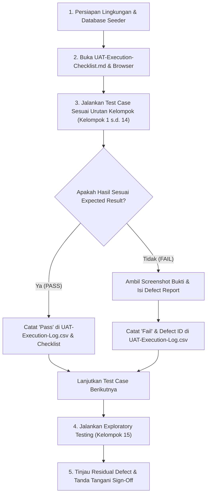

# WorkPulse — Master Manual UAT Testing Package

> **Sistem:** WorkPulse (Daily Accountability & Blocker Log System)  
> **Organisasi:** PT Dutamedia Mandiri Pratama  
> **Versi Dokumen:** 1.0.0  
> **Penanggung Jawab Eksekusi:** Harry (Acceptance Owner & Manual Tester)  
> **Penyusun:** Senior Quality Assurance Engineer & Manual Test Architect  
> **Tanggal Rilis Paket:** 29 Oktober 2026  

---

## 1. SELAMAT DATANG DI PAKET PENGUJIAN MANUAL UAT WORKPULSE

Paket pengujian User Acceptance Testing (UAT) ini dirancang khusus untuk Anda (**Harry**) agar dapat melakukan pengujian penerimaan sistem WorkPulse secara manual melalui browser web tanpa perlu merancang skenario tambahan di tengah proses pengujian.

Paket ini disusun berdasarkan analisis statis mendalam terhadap **Product Definition Document (PDD v1.5)**, **Product Requirements Document (PRD v1.6)**, **UI/UX Specification & Flow**, **Visual Design System v1.5.0**, **System Architecture Design (SAD)**, 26 Prototipe Layar HTML, 25 Dokumen Penjelasan Halaman, dan implementasi kode sumber frontend/backend aktual.

> [!IMPORTANT]
> **Prinsip Utama: Manual UAT Only**
> - Seluruh pengujian dijalankan oleh manusia (Harry) melalui antarmuka web.
> - Tidak ada pengujian otomatis yang dijalankan atas nama Anda.
> - Seluruh kolom hasil eksekusi (`Actual Result`, `Execution Status`, `Tester`, `Execution Date`, `Defect ID`, `Evidence Reference`) sengaja dibiarkan **KOSONG** untuk Anda isi sendiri saat pengujian berlangsung.

---

## 2. PANDUAN STRUKTUR & PETA NAVIGASI 16 ARTEFAK UAT

Seluruh berkas pengujian disimpan secara terstruktur di dalam direktori `UAT/`:

```
d:\PKL Duta Media\Dutamedia-WorkPulse\UAT\
├── UAT-README.md                          <- [Anda Berada di Sini] Panduan pengantar & navigasi master
├── UAT-Progress-Tracker.md                <- Pelacakan progres fase, kendala, & kepatuhan quality gates
├── UAT-Strategy-and-Test-Plan.md          <- Strategi, 13 pendekatan uji, prioritas risiko, entry/exit criteria
├── UAT-Requirement-Inventory.md           <- Inventarisasi lengkap FR-01 s.d. FR-55, DEC-001 s.d. DEC-013, & Gap Analysis
├── UAT-Test-Scenario-Catalog.md           <- Katalog seluruh skenario terstruktur per modul dan peran
├── UAT-Manual-Test-Cases.md               <- Spesifikasi langkah demi langkah manual (Aksi, Lokasi, Data, Expected Result)
├── UAT-Test-Data-Matrix.csv               <- Dataset uji konkret (Akun seeder, token aktivasi 72 jam, batasan data)
├── UAT-Requirement-Traceability-Matrix.csv<- Matriks keterlacakan (RTM) kebutuhan ke test case (Field eksekusi kosong)
├── UAT-Role-Action-Matrix.csv             <- Matriks otorisasi hak akses (RBAC) 8 peran kanonikal sistem
├── UAT-Workflow-Transition-Matrix.csv      <- Matriks aturan transisi status (Commitment, Blocker, Koreksi, Cuti)
├── UAT-Execution-Checklist.md             <- Lembar kerja urutan eksekusi 15 kelompok sekuensial
├── UAT-Exploratory-Testing-Charters.md    <- 7 Piagam uji eksplorasi heuristik, multi-tab, & usability
├── UAT-Defect-Report-Template.md          <- Template formulir pelaporan cacat/bug standar industri
├── UAT-Execution-Log.csv                  <- Lembar pencatatan hasil eksekusi (Status awal 'Not Run')
├── UAT-Coverage-Audit.md                  <- Laporan audit matematis designed coverage & analisis celah residual
└── UAT-Final-Acceptance-Checklist.md      <- Formulir evaluasi akhir & penandatanganan penerimaan (Sign-Off)
```

---

## 3. LANGKAH-LANGKAH MENJALANKAN UAT SECARA MANDIRI

Untuk meminimalkan waktu dan perpindahan sesi, ikuti alur kerja berikut:



### Langkah 1: Persiapan Lingkungan & Database
1. Pastikan backend Node.js (`http://localhost:3000`) dan frontend Vue 3 (`http://localhost:5173`) telah berjalan.
2. Pastikan database PostgreSQL telah diisi data awal resmi menggunakan perintah:
   ```bash
   cd backend
   npm run prisma:seed
   ```
3. Buka browser (Chrome / Edge) pada mode **Incognito Window**.

### Langkah 2: Kredensial Akun Pengujian Baku
Seluruh akun uji lokal menggunakan kata sandi standar: **`Password123!`**
- **Employee (Frontend):** `dev.frontend@dutamedia.com` (Mendarat di `/daily/morning`)
- **Employee (Backend):** `dev.backend@dutamedia.com`
- **Employee (Designer):** `designer@dutamedia.com`
- **Supervisor (Engineering Lead):** `lead.tech@dutamedia.com` (Mendarat di `/dashboard`)
- **Supervisor (Creative Lead):** `lead.creative@dutamedia.com`
- **Lead HRGA:** `hrga@dutamedia.com` (Mendarat di `/compliance`)
- **System Administrator:** `admin@dutamedia.com` (Mendarat di `/admin/organization`)
- **Direktur Utama / CEO:** `direktur@dutamedia.com` (Mendarat di `/dashboard`)
- **Calon Karyawan (Aktivasi Baru):** Buka URL `/activate?token=wp_seed_invite_token_72h_demo_secret`

### Langkah 3: Eksekusi Test Case & Pencatatan Hasil
1. Buka berkas [UAT-Execution-Checklist.md](file:///d:/PKL%20Duta%20Media/Dutamedia-WorkPulse/UAT/UAT-Execution-Checklist.md) dan [UAT-Manual-Test-Cases.md](file:///d:/PKL%20Duta%20Media/Dutamedia-WorkPulse/UAT/UAT-Manual-Test-Cases.md).
2. Ikuti setiap langkah: **Aksi**, **Lokasi**, **Data**, **Hasil yang Diharapkan**, dan **Verifikasi**.
3. Buka berkas [UAT-Execution-Log.csv](file:///d:/PKL%20Duta%20Media/Dutamedia-WorkPulse/UAT/UAT-Execution-Log.csv) (dapat dibuka menggunakan Microsoft Excel, Google Sheets, atau text editor).
4. Ubah kolom `ExecutionStatus` dari `Not Run` menjadi `Pass`, `Fail`, atau `Blocked`.
5. Tuliskan deskripsi ringkas hasil pengamatan Anda pada kolom `ActualResult`.

### Langkah 4: Pelaporan Defect (Jika Ada Temuan)
1. Jika antarmuka berperilaku tidak sesuai harapan (misal tombol tidak merespons, opsi Hijau terkunci, atau pesan validasi salah), ambil screenshot.
2. Buka [UAT-Defect-Report-Template.md](file:///d:/PKL%20Duta%20Media/Dutamedia-WorkPulse/UAT/UAT-Defect-Report-Template.md).
3. Salin formulir template dan isi detail temuan (DEF-001, DEF-002, dst.).
4. Laporkan defect kepada tim pengembang untuk diperbaiki.

### Langkah 5: Penandatanganan Penerimaan Sistem (Sign-Off)
1. Setelah seluruh pengujian selesai dan defect kritis bernilai 0, buka [UAT-Final-Acceptance-Checklist.md](file:///d:/PKL%20Duta%20Media/Dutamedia-WorkPulse/UAT/UAT-Final-Acceptance-Checklist.md).
2. Periksa kelima kriteria penerimaan akhir (Acceptance Gates).
3. Tentukan keputusan akhir (Fully Accepted / Conditionally Accepted / Rejected).
4. Bubuhkan tanda tangan penerimaan formal.

---

## 4. KEPATUHAN TERHADAP ATURAN BISNIS UTAMA DUTAMEDIA

Paket pengujian ini secara khusus memverifikasi 5 aturan bisnis arsitektural terpenting:
1. **DEC-001 (Timing Classification):** Klasifikasi On-Time vs Late vs No Submission berjalan akurat.
2. **DEC-002 (Anti-Direct Edit):** Form komitmen pagi dan EOD terkunci dari penyuntingan langsung pasca cut-off; perubahan data wajib melalui permohonan koreksi resmi.
3. **DEC-003 (Anti-Lock Green):** Pada formulir EOD sore, opsi status **Hijau (GREEN) DILARANG DIKUNCI/DINONAKTIFKAN** meskipun sistem secara heuristik menyarankan Kuning/Merah. Karyawan tetap berhak memilih Hijau dengan mengisi justifikasi.
4. **DEC-004 (0 Komitmen Rule):** Opsi 0 komitmen mewajibkan alasan minimal 10 karakter (`NOT_APPLICABLE — NO_COMMITMENT`).
5. **DEC-008 (Leave Reconciliation):** Karyawan yang cutinya telah disetujui resmi otomatis direkonsiliasi menjadi `Superseded by Approved Leave` pasca cut-off tanpa dikenakan catatan penalti ketidakpatuhan.
6. **DEC-012 (Enterprise Sidebar):** Tombol darurat melayang `☰ Menu` telah dimusnahkan secara tuntas; seluruh navigasi menggunakan sidebar permanen 232px yang responsif.

